

<p class="tfs-links"><strong>Transformer architectures: from BERT to diffusion</strong> · lesson 4 of 15 · <a href="/teaching/">all lessons</a> · <a href="https://www.kaggle.com/code/qmarva/transformer-architectures-04-gpt-chess">run on Kaggle</a> · <a href="https://colab.research.google.com/github/xmarva/transformers-from-scratch/blob/main/notebooks/colab/a04_gpt.ipynb">open in Colab</a> · <a href="https://github.com/xmarva/transformers-from-scratch">code on GitHub</a></p>

In September 2023 OpenAI released gpt-3.5-turbo-instruct, an unremarkable model for completing text, and within days people noticed that it played chess.

Nicholas Carlini gave it the moves of a game so far, in PGN, the notation of chess books and databases, and asked it for the next one: "GPT-4, for example, can't even play a full game against me without making a few illegal moves. GPT-3.5-turbo-instruct can beat me" <sup class="cite">[<a href="#ref-1" id="cite-1" data-ref="1" aria-label="Reference 1: Carlini, N. (2023). Playing chess with large language models.">1</a>]</sup>.

Against the bots of Lichess it later rated 1755, the level of a good amateur<sup class="cite">[<a href="#ref-2" id="cite-2" data-ref="2" aria-label="Reference 2: Ruoss, A., Delétang, G., Medapati, S., Grau-Moya, J., Wenliang, L. K., Catt, E., Reid, J., Lewis, C. A., Veness, J., &amp; Genewein, T. (2024). Amortized planning with large-scale transformers: a case study on chess. NeurIPS 2024.">2</a>]</sup>. A year on, Dynomight tested a dozen other language models, open ones and OpenAI's newer chat models among them, and rated every one of them "Terrible"<sup class="cite">[<a href="#ref-3" id="cite-3" data-ref="3" aria-label="Reference 3: Dynomight (2024). Something weird is happening with LLMs and chess.">3</a>]</sup>.

Part of the explanation sits in an appendix of an OpenAI paper: GPT-4's pre-training data "included chess games in the format of move sequence known as Portable Game Notation (PGN)", and only games of players rated 1800 or higher <sup class="cite">[<a href="#ref-4" id="cite-4" data-ref="4" aria-label="Reference 4: Burns, C., Izmailov, P., Kirchner, J. H., Baker, B., Gao, L., Aschenbrenner, L., Chen, Y., Ecoffet, A., Joglekar, M., Leike, J., Sutskever, I., &amp; Wu, J. (2023). Weak-to-strong generalization: eliciting strong capabilities with weak supervision. arXiv:2312.09390.">4</a>]</sup>.

Nobody taught these models the rules. They read game records, and a game record is a strange text: it lists moves and never shows a position.

To write a legal move you have to know where the pieces stand, and nothing in the text says. So does a model that only ever predicted the next character of game records keep a board somewhere inside it? That question fits on a free GPU.

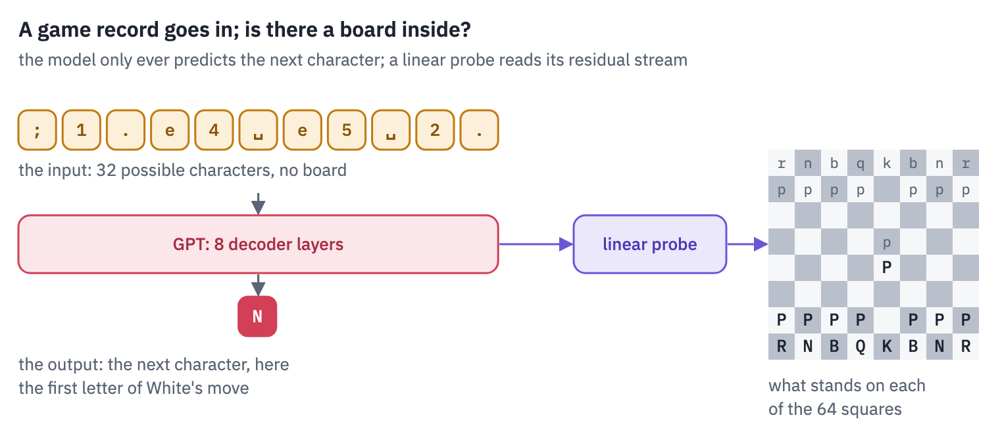
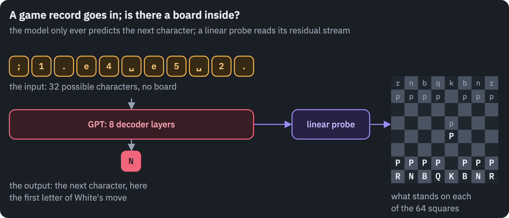

All of these models are GPTs, descendants of a 2018 OpenAI model trained to do one thing: predict the next token. In this lesson you will write GPT-2 yourself, load OpenAI's weights into your code, and watch it generate and change its mind layer by layer.

Then you will train a small GPT of your own on Lichess games for 25 minutes, see how well it plays, and look inside it for the board.

**What you'll do**

1. See what a decoder-only model is trained to do, and why one rule turned out to be enough.
2. Read the blueprints of GPT-1 and the four GPT-2s from their configs, and count where the parameters live.
3. Write GPT-2 in PyTorch, load OpenAI's weights into it and match Hugging Face's outputs.
4. Generate text with a KV cache and measure what the cache saves.
5. Watch GPT-2 change its mind layer by layer with the logit lens.
6. Ask GPT-2 to play chess, then train a GPT of your own on Lichess games and see how often its moves are legal.
7. Open the chess model up and find the board inside it with a linear probe.

**What you need**: a GPU. On Kaggle, *Settings → Accelerator → GPU*; on Colab, *Runtime → Change runtime type →
T4 GPU*. The notebook downloads GPT-2 (550 MB) and a gigabyte of Lichess games, and trains a chess model for
25 minutes; on a T4 it runs in about 40 minutes.

## Setup

One small helper package, `tfs`, draws the course's plots and token chips and knows where the notebook runs
(Kaggle, Colab or your own machine). Everything the lesson teaches is written out in the notebook itself.

```python
import importlib.util
import subprocess
import sys

TFS = "git+https://github.com/xmarva/transformers-from-scratch@main"
if importlib.util.find_spec("tfs") is None:
    subprocess.check_call([sys.executable, "-m", "pip", "install", "-q", TFS])

from tfs import env
from tfs.viz import table, token_chips, use_course_style

env.quiet()  # no progress bars or environment warnings in the outputs
SEED = 42
env.seed_everything(SEED)
COLORS = use_course_style()
WORK_DIR = env.work_dir()
```

```python
import importlib.util
import json
import math
import random
import re
import subprocess
import sys
import time
from collections import Counter

# python-chess knows the rules of chess; our models will never be told them
if importlib.util.find_spec("chess") is None:
    subprocess.check_call([sys.executable, "-m", "pip", "install", "-q", "chess==1.11.2"])
import chess
import matplotlib.pyplot as plt
import numpy as np
import pandas as pd
import torch
import torch.nn as nn
import torch.nn.functional as F
from huggingface_hub import get_safetensors_metadata, hf_hub_download
from IPython.display import display
from safetensors.torch import load_file
from tfs.viz import heatmap
from transformers import AutoTokenizer
# the reference implementation, for the check
from transformers import GPT2LMHeadModel

SMOKE = env.smoke()  # CI runs the lesson on a small slice; you run it in full
device = "cuda" if torch.cuda.is_available() else "cpu"
assert device == "cuda" or SMOKE, "This lesson trains a model for 25 minutes: use a GPU."
if device == "cuda":
    print("GPU:", torch.cuda.get_device_name(0))
```

<pre class="tfs-printed" markdown="0"><code>GPU: Tesla T4</code></pre>

## 1. One rule: predict the next token

BERT, in the first lesson, read a sentence with holes and filled them, looking both ways.

A GPT reads a text from left to right and, at every position, guesses the next token. That is the whole training task. The probability of a text $$x_1, \dots, x_T$$ is written as a chain of such guesses,

$$p(x_1, \dots, x_T) = \prod_{t=1}^{T} p(x_t \mid x_1, \dots, x_{t-1}),$$

which is not an approximation but the chain rule of probability: any distribution over sequences can be written
this way. The model's job is to supply each factor. Training minimises the average negative log of the
probability it gave to the token that actually came next:

$$\mathcal{L} = -\frac{1}{T} \sum_{t=1}^{T} \log p_\theta(x_t \mid x_{<t}).$$

Here $$\theta$$ are the weights, and $$x_{<t}$$ is everything before position $$t$$. A loss of $$\mathcal{L}$$ means the
model gave the right token a probability of $$e^{-\mathcal{L}}$$, on average in the geometric sense.

Two things make this rule cheap to train. The targets are the text itself shifted by one position, so any text is training data and nobody has to label anything.

And one pass over a sequence of $$T$$ tokens trains all $$T$$ predictions at once: the causal mask lets position $$t$$ see positions $$1$$ to $$t$$ and nothing after, so the model can't peek at the answer it is asked for.

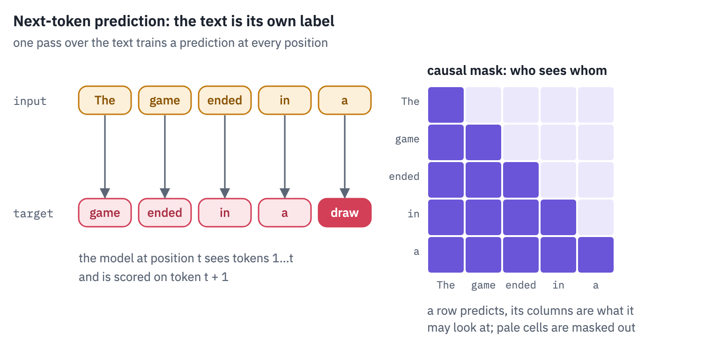
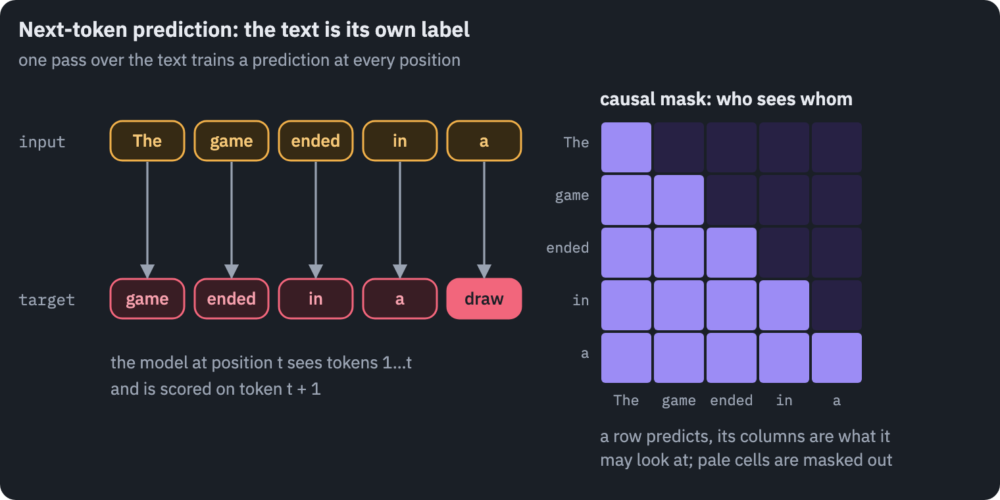

The rule has a second life after training. To generate, the model predicts a distribution over the next token,
one token is picked from it and appended, and the longer text goes back in. Everything a chatbot writes is made
this way, one token at a time.

## 2. Three GPTs

OpenAI's first GPT, in June 2018, was a 12-layer Transformer decoder trained on BooksCorpus, "over 7,000 unique unpublished books", chosen because "it contains long stretches of contiguous text" <sup class="cite">[<a href="#ref-5" id="cite-5" data-ref="5" aria-label="Reference 5: Radford, A., Narasimhan, K., Salimans, T., &amp; Sutskever, I. (2018). Improving language understanding by generative pre-training. OpenAI.">5</a>]</sup>.

Pre-training took "1 month on 8 GPUs"; then a copy of the model was fine-tuned for each task, and it improved the state of the art "in 9 out of the 12 tasks studied".

Four months later BERT beat it on GLUE by reading in both directions, and for two years the encoder looked like the winner.

GPT-2, in February 2019, was "a direct scale-up of GPT, with more than 10X the parameters and trained on more than 10X the amount of data"<sup class="cite">[<a href="#ref-6" id="cite-6" data-ref="6" aria-label="Reference 6: OpenAI, 2019. openai.com.">6</a>]</sup>.

The data, WebText, was the text of pages linked from Reddit posts with at least 3 karma, which the paper calls "a heuristic indicator for whether other users found the link interesting, educational, or just funny": 8 million documents, 40 GB.

The largest model, 1.5 billion parameters, was not fine-tuned for anything, and still set the state of the art on 7 of 8 language-modelling benchmarks; it even summarised articles when the prompt ended with "TL;DR:" <sup class="cite">[<a href="#ref-7" id="cite-7" data-ref="7" aria-label="Reference 7: Radford, A., Wu, J., Child, R., Luan, D., Amodei, D., &amp; Sutskever, I. (2019). Language models are unsupervised multitask learners. OpenAI.">7</a>]</sup>.

OpenAI held it back: "Due to our concerns about malicious applications of the technology, we are not releasing the trained model."

Newspapers turned that into a model "too dangerous to release", a phrase OpenAI never used, and the weights came out in four stages, from the smallest in February to the full model in November 2019.

GPT-3, in May 2020, kept GPT-2's design, with attention layers that alternate between full and locally banded patterns, and grew it to 175 billion parameters in 96 layers, trained on 300 billion tokens <sup class="cite">[<a href="#ref-8" id="cite-8" data-ref="8" aria-label="Reference 8: Brown, T. B., Mann, B., Ryder, N., Subbiah, M., et al. (2020). Language models are few-shot learners. NeurIPS 2020.">8</a>]</sup>.

Its paper named *in-context learning*: show the model a few examples of a task in the prompt, with no change to its weights, and it does the task.

People asked to tell its news articles from real ones were right "∼ 52%" of the time, barely above chance. Its weights were never published. The chat models that followed, from ChatGPT to Llama, Qwen and DeepSeek, are all of this line: a stack of decoder layers predicting the next token.

The configs of GPT-1 and of the four GPT-2s are on the Hugging Face Hub, and the safetensors files say how many
numbers they hold without downloading them:

```python
GPT_FAMILY = ["openai-gpt", "gpt2", "gpt2-medium", "gpt2-large", "gpt2-xl"]
rows = []
for name in GPT_FAMILY:
    repo = "openai-community/" + name
    with open(hf_hub_download(repo, "config.json")) as f:
        c = json.load(f)
    stored = sum(get_safetensors_metadata(repo).parameter_count.values())
    rows.append({"model": name, "layers": c["n_layer"], "width": c["n_embd"],
                 "heads": c["n_head"], "context": c["n_positions"],
                 "vocabulary": c["vocab_size"], "numbers stored": stored})
family = pd.DataFrame(rows)
table(family)
```

<div class="tfs-table-wrap"><table class="tfs-table" style="border-collapse:collapse;font-family:'IBM Plex Sans', -apple-system, 'Segoe UI', Roboto, Helvetica, Arial, sans-serif;font-size:13.5px;line-height:1.45;margin:4px 0 8px;"><thead><tr><th style="padding:7px 14px;border-bottom:2px solid #B9C0CB;font-weight:600;color:#5B6575;font-size:12px;letter-spacing:0.02em;text-align:left;">model</th><th style="padding:7px 14px;border-bottom:2px solid #B9C0CB;font-weight:600;color:#5B6575;font-size:12px;letter-spacing:0.02em;text-align:right;">layers</th><th style="padding:7px 14px;border-bottom:2px solid #B9C0CB;font-weight:600;color:#5B6575;font-size:12px;letter-spacing:0.02em;text-align:right;">width</th><th style="padding:7px 14px;border-bottom:2px solid #B9C0CB;font-weight:600;color:#5B6575;font-size:12px;letter-spacing:0.02em;text-align:right;">heads</th><th style="padding:7px 14px;border-bottom:2px solid #B9C0CB;font-weight:600;color:#5B6575;font-size:12px;letter-spacing:0.02em;text-align:right;">context</th><th style="padding:7px 14px;border-bottom:2px solid #B9C0CB;font-weight:600;color:#5B6575;font-size:12px;letter-spacing:0.02em;text-align:right;">vocabulary</th><th style="padding:7px 14px;border-bottom:2px solid #B9C0CB;font-weight:600;color:#5B6575;font-size:12px;letter-spacing:0.02em;text-align:right;">numbers stored</th></tr></thead><tbody><tr><td style="padding:7px 14px;border-bottom:1px solid #E6E9EE;vertical-align:top;text-align:left;max-width:460px;white-space:normal;">openai-gpt</td><td style="padding:7px 14px;border-bottom:1px solid #E6E9EE;vertical-align:top;text-align:right;font-variant-numeric:tabular-nums;max-width:460px;white-space:normal;">12</td><td style="padding:7px 14px;border-bottom:1px solid #E6E9EE;vertical-align:top;text-align:right;font-variant-numeric:tabular-nums;max-width:460px;white-space:normal;">768</td><td style="padding:7px 14px;border-bottom:1px solid #E6E9EE;vertical-align:top;text-align:right;font-variant-numeric:tabular-nums;max-width:460px;white-space:normal;">12</td><td style="padding:7px 14px;border-bottom:1px solid #E6E9EE;vertical-align:top;text-align:right;font-variant-numeric:tabular-nums;max-width:460px;white-space:normal;">512</td><td style="padding:7px 14px;border-bottom:1px solid #E6E9EE;vertical-align:top;text-align:right;font-variant-numeric:tabular-nums;max-width:460px;white-space:normal;">40,478</td><td style="padding:7px 14px;border-bottom:1px solid #E6E9EE;vertical-align:top;text-align:right;font-variant-numeric:tabular-nums;max-width:460px;white-space:normal;">119,680,512</td></tr><tr><td style="padding:7px 14px;border-bottom:1px solid #E6E9EE;vertical-align:top;text-align:left;max-width:460px;white-space:normal;">gpt2</td><td style="padding:7px 14px;border-bottom:1px solid #E6E9EE;vertical-align:top;text-align:right;font-variant-numeric:tabular-nums;max-width:460px;white-space:normal;">12</td><td style="padding:7px 14px;border-bottom:1px solid #E6E9EE;vertical-align:top;text-align:right;font-variant-numeric:tabular-nums;max-width:460px;white-space:normal;">768</td><td style="padding:7px 14px;border-bottom:1px solid #E6E9EE;vertical-align:top;text-align:right;font-variant-numeric:tabular-nums;max-width:460px;white-space:normal;">12</td><td style="padding:7px 14px;border-bottom:1px solid #E6E9EE;vertical-align:top;text-align:right;font-variant-numeric:tabular-nums;max-width:460px;white-space:normal;">1,024</td><td style="padding:7px 14px;border-bottom:1px solid #E6E9EE;vertical-align:top;text-align:right;font-variant-numeric:tabular-nums;max-width:460px;white-space:normal;">50,257</td><td style="padding:7px 14px;border-bottom:1px solid #E6E9EE;vertical-align:top;text-align:right;font-variant-numeric:tabular-nums;max-width:460px;white-space:normal;">137,022,720</td></tr><tr><td style="padding:7px 14px;border-bottom:1px solid #E6E9EE;vertical-align:top;text-align:left;max-width:460px;white-space:normal;">gpt2-medium</td><td style="padding:7px 14px;border-bottom:1px solid #E6E9EE;vertical-align:top;text-align:right;font-variant-numeric:tabular-nums;max-width:460px;white-space:normal;">24</td><td style="padding:7px 14px;border-bottom:1px solid #E6E9EE;vertical-align:top;text-align:right;font-variant-numeric:tabular-nums;max-width:460px;white-space:normal;">1,024</td><td style="padding:7px 14px;border-bottom:1px solid #E6E9EE;vertical-align:top;text-align:right;font-variant-numeric:tabular-nums;max-width:460px;white-space:normal;">16</td><td style="padding:7px 14px;border-bottom:1px solid #E6E9EE;vertical-align:top;text-align:right;font-variant-numeric:tabular-nums;max-width:460px;white-space:normal;">1,024</td><td style="padding:7px 14px;border-bottom:1px solid #E6E9EE;vertical-align:top;text-align:right;font-variant-numeric:tabular-nums;max-width:460px;white-space:normal;">50,257</td><td style="padding:7px 14px;border-bottom:1px solid #E6E9EE;vertical-align:top;text-align:right;font-variant-numeric:tabular-nums;max-width:460px;white-space:normal;">379,988,992</td></tr><tr><td style="padding:7px 14px;border-bottom:1px solid #E6E9EE;vertical-align:top;text-align:left;max-width:460px;white-space:normal;">gpt2-large</td><td style="padding:7px 14px;border-bottom:1px solid #E6E9EE;vertical-align:top;text-align:right;font-variant-numeric:tabular-nums;max-width:460px;white-space:normal;">36</td><td style="padding:7px 14px;border-bottom:1px solid #E6E9EE;vertical-align:top;text-align:right;font-variant-numeric:tabular-nums;max-width:460px;white-space:normal;">1,280</td><td style="padding:7px 14px;border-bottom:1px solid #E6E9EE;vertical-align:top;text-align:right;font-variant-numeric:tabular-nums;max-width:460px;white-space:normal;">20</td><td style="padding:7px 14px;border-bottom:1px solid #E6E9EE;vertical-align:top;text-align:right;font-variant-numeric:tabular-nums;max-width:460px;white-space:normal;">1,024</td><td style="padding:7px 14px;border-bottom:1px solid #E6E9EE;vertical-align:top;text-align:right;font-variant-numeric:tabular-nums;max-width:460px;white-space:normal;">50,257</td><td style="padding:7px 14px;border-bottom:1px solid #E6E9EE;vertical-align:top;text-align:right;font-variant-numeric:tabular-nums;max-width:460px;white-space:normal;">811,778,816</td></tr><tr><td style="padding:7px 14px;border-bottom:1px solid #E6E9EE;vertical-align:top;text-align:left;max-width:460px;white-space:normal;">gpt2-xl</td><td style="padding:7px 14px;border-bottom:1px solid #E6E9EE;vertical-align:top;text-align:right;font-variant-numeric:tabular-nums;max-width:460px;white-space:normal;">48</td><td style="padding:7px 14px;border-bottom:1px solid #E6E9EE;vertical-align:top;text-align:right;font-variant-numeric:tabular-nums;max-width:460px;white-space:normal;">1,600</td><td style="padding:7px 14px;border-bottom:1px solid #E6E9EE;vertical-align:top;text-align:right;font-variant-numeric:tabular-nums;max-width:460px;white-space:normal;">25</td><td style="padding:7px 14px;border-bottom:1px solid #E6E9EE;vertical-align:top;text-align:right;font-variant-numeric:tabular-nums;max-width:460px;white-space:normal;">1,024</td><td style="padding:7px 14px;border-bottom:1px solid #E6E9EE;vertical-align:top;text-align:right;font-variant-numeric:tabular-nums;max-width:460px;white-space:normal;">50,257</td><td style="padding:7px 14px;border-bottom:1px solid #E6E9EE;vertical-align:top;text-align:right;font-variant-numeric:tabular-nums;max-width:460px;white-space:normal;">1,607,942,848</td></tr></tbody></table></div>

The width $$d$$, the number of layers $$L$$ and the vocabulary $$V$$ fix the size of the model. Each layer holds four
matrices of attention ($$Q$$, $$K$$, $$V$$ and the output projection, $$4d^2$$ weights) and two of the feed-forward network,
$$d \times 4d$$ and $$4d \times d$$ ($$8d^2$$). With biases and two LayerNorms that is $$12d^2 + 13d$$ per layer. The
embeddings add $$Vd$$ for tokens and $$Cd$$ for positions, where $$C$$ is the context, and the output layer adds nothing,
for a reason we'll see in a moment. Let's check the formula against the files:

```python
def gpt_parameters(layers, d, vocab, context):
    per_layer = 12 * d * d + 13 * d
    embeddings = vocab * d + context * d
    final_norm = 2 * d  # GPT-2 has one more LayerNorm at the end
    return layers * per_layer + embeddings + final_norm


family["by the formula"] = [gpt_parameters(r.layers, r.width, r.vocabulary, r.context)
                            for r in family.itertuples()]
family["gap"] = family["numbers stored"] - family["by the formula"]
family["one mask per layer"] = family["layers"] * family["context"] ** 2
table(family[["model", "numbers stored", "by the formula", "gap", "one mask per layer"]])
```

<div class="tfs-table-wrap"><table class="tfs-table" style="border-collapse:collapse;font-family:'IBM Plex Sans', -apple-system, 'Segoe UI', Roboto, Helvetica, Arial, sans-serif;font-size:13.5px;line-height:1.45;margin:4px 0 8px;"><thead><tr><th style="padding:7px 14px;border-bottom:2px solid #B9C0CB;font-weight:600;color:#5B6575;font-size:12px;letter-spacing:0.02em;text-align:left;">model</th><th style="padding:7px 14px;border-bottom:2px solid #B9C0CB;font-weight:600;color:#5B6575;font-size:12px;letter-spacing:0.02em;text-align:right;">numbers stored</th><th style="padding:7px 14px;border-bottom:2px solid #B9C0CB;font-weight:600;color:#5B6575;font-size:12px;letter-spacing:0.02em;text-align:right;">by the formula</th><th style="padding:7px 14px;border-bottom:2px solid #B9C0CB;font-weight:600;color:#5B6575;font-size:12px;letter-spacing:0.02em;text-align:right;">gap</th><th style="padding:7px 14px;border-bottom:2px solid #B9C0CB;font-weight:600;color:#5B6575;font-size:12px;letter-spacing:0.02em;text-align:right;">one mask per layer</th></tr></thead><tbody><tr><td style="padding:7px 14px;border-bottom:1px solid #E6E9EE;vertical-align:top;text-align:left;max-width:460px;white-space:normal;">openai-gpt</td><td style="padding:7px 14px;border-bottom:1px solid #E6E9EE;vertical-align:top;text-align:right;font-variant-numeric:tabular-nums;max-width:460px;white-space:normal;">119,680,512</td><td style="padding:7px 14px;border-bottom:1px solid #E6E9EE;vertical-align:top;text-align:right;font-variant-numeric:tabular-nums;max-width:460px;white-space:normal;">116,536,320</td><td style="padding:7px 14px;border-bottom:1px solid #E6E9EE;vertical-align:top;text-align:right;font-variant-numeric:tabular-nums;max-width:460px;white-space:normal;">3,144,192</td><td style="padding:7px 14px;border-bottom:1px solid #E6E9EE;vertical-align:top;text-align:right;font-variant-numeric:tabular-nums;max-width:460px;white-space:normal;">3,145,728</td></tr><tr><td style="padding:7px 14px;border-bottom:1px solid #E6E9EE;vertical-align:top;text-align:left;max-width:460px;white-space:normal;">gpt2</td><td style="padding:7px 14px;border-bottom:1px solid #E6E9EE;vertical-align:top;text-align:right;font-variant-numeric:tabular-nums;max-width:460px;white-space:normal;">137,022,720</td><td style="padding:7px 14px;border-bottom:1px solid #E6E9EE;vertical-align:top;text-align:right;font-variant-numeric:tabular-nums;max-width:460px;white-space:normal;">124,439,808</td><td style="padding:7px 14px;border-bottom:1px solid #E6E9EE;vertical-align:top;text-align:right;font-variant-numeric:tabular-nums;max-width:460px;white-space:normal;">12,582,912</td><td style="padding:7px 14px;border-bottom:1px solid #E6E9EE;vertical-align:top;text-align:right;font-variant-numeric:tabular-nums;max-width:460px;white-space:normal;">12,582,912</td></tr><tr><td style="padding:7px 14px;border-bottom:1px solid #E6E9EE;vertical-align:top;text-align:left;max-width:460px;white-space:normal;">gpt2-medium</td><td style="padding:7px 14px;border-bottom:1px solid #E6E9EE;vertical-align:top;text-align:right;font-variant-numeric:tabular-nums;max-width:460px;white-space:normal;">379,988,992</td><td style="padding:7px 14px;border-bottom:1px solid #E6E9EE;vertical-align:top;text-align:right;font-variant-numeric:tabular-nums;max-width:460px;white-space:normal;">354,823,168</td><td style="padding:7px 14px;border-bottom:1px solid #E6E9EE;vertical-align:top;text-align:right;font-variant-numeric:tabular-nums;max-width:460px;white-space:normal;">25,165,824</td><td style="padding:7px 14px;border-bottom:1px solid #E6E9EE;vertical-align:top;text-align:right;font-variant-numeric:tabular-nums;max-width:460px;white-space:normal;">25,165,824</td></tr><tr><td style="padding:7px 14px;border-bottom:1px solid #E6E9EE;vertical-align:top;text-align:left;max-width:460px;white-space:normal;">gpt2-large</td><td style="padding:7px 14px;border-bottom:1px solid #E6E9EE;vertical-align:top;text-align:right;font-variant-numeric:tabular-nums;max-width:460px;white-space:normal;">811,778,816</td><td style="padding:7px 14px;border-bottom:1px solid #E6E9EE;vertical-align:top;text-align:right;font-variant-numeric:tabular-nums;max-width:460px;white-space:normal;">774,030,080</td><td style="padding:7px 14px;border-bottom:1px solid #E6E9EE;vertical-align:top;text-align:right;font-variant-numeric:tabular-nums;max-width:460px;white-space:normal;">37,748,736</td><td style="padding:7px 14px;border-bottom:1px solid #E6E9EE;vertical-align:top;text-align:right;font-variant-numeric:tabular-nums;max-width:460px;white-space:normal;">37,748,736</td></tr><tr><td style="padding:7px 14px;border-bottom:1px solid #E6E9EE;vertical-align:top;text-align:left;max-width:460px;white-space:normal;">gpt2-xl</td><td style="padding:7px 14px;border-bottom:1px solid #E6E9EE;vertical-align:top;text-align:right;font-variant-numeric:tabular-nums;max-width:460px;white-space:normal;">1,607,942,848</td><td style="padding:7px 14px;border-bottom:1px solid #E6E9EE;vertical-align:top;text-align:right;font-variant-numeric:tabular-nums;max-width:460px;white-space:normal;">1,557,611,200</td><td style="padding:7px 14px;border-bottom:1px solid #E6E9EE;vertical-align:top;text-align:right;font-variant-numeric:tabular-nums;max-width:460px;white-space:normal;">50,331,648</td><td style="padding:7px 14px;border-bottom:1px solid #E6E9EE;vertical-align:top;text-align:right;font-variant-numeric:tabular-nums;max-width:460px;white-space:normal;">50,331,648</td></tr></tbody></table></div>

The formula is right, up to a gap that has a funny explanation. OpenAI's checkpoints store the causal mask, a
$$C \times C$$ triangle of ones and zeros, as a tensor in every layer, so the files hold a million numbers per layer
that aren't weights. GPT-1's gap is $$2d$$ short of its masks: it has no final LayerNorm, which the formula counted.

The smallest GPT-2 has 124 million parameters. Its paper says 117M, and the larger ones 345M and 762M; OpenAI
later admitted in its repository that "our original parameter counts were wrong"
([openai/gpt-2](https://github.com/openai/gpt-2)). 117M is the size of GPT-1, which the smallest GPT-2 was meant to
match: the extra seven million are the bigger vocabulary and the longer context.

Where those parameters live depends on the size. In the smallest GPT-2 the token embeddings are almost a third of
the model; in GPT-2 XL they are a few percent, and the layers are everything:

```python
fig, ax = plt.subplots(figsize=(6.4, 2.6))
names = family["model"][1:]
for k, r in enumerate(family[1:].itertuples()):
    embed = (r.vocabulary + r.context) * r.width / 1e6
    layers_part = r.layers * (12 * r.width ** 2 + 13 * r.width) / 1e6
    ax.barh(k, embed, color=COLORS["data"], label="embeddings" if k == 0 else None)
    ax.barh(k, layers_part, left=embed, color=COLORS["dec"],
            label="layers" if k == 0 else None)
    share = embed / (embed + layers_part)
    ax.text(embed + layers_part + 20, k, f"embeddings {share:.0%}", va="center",
            color=COLORS["muted"])
ax.set_yticks(range(len(names)), names)
ax.invert_yaxis()
ax.set_xlabel("millions of parameters")
ax.set_xlim(0, 2100)
ax.legend(loc="upper right", frameon=False)
plt.show()
```

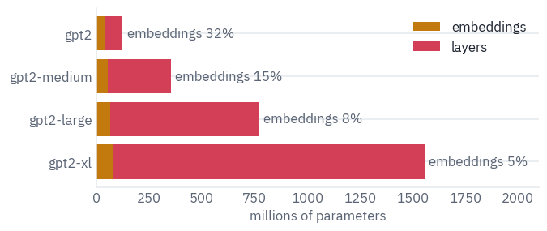

## 3. GPT-2 in PyTorch

A GPT-2 layer has the same two parts as every Transformer layer: self-attention, then a feed-forward network, each wrapped in a residual connection. Two things changed since BERT.

The mask is causal. And the LayerNorm moved: BERT normalised after adding the residual, GPT-2 normalises the input of each part and leaves the residual path alone. The GPT-2 paper describes it in one sentence, and adds a final LayerNorm after the last layer.

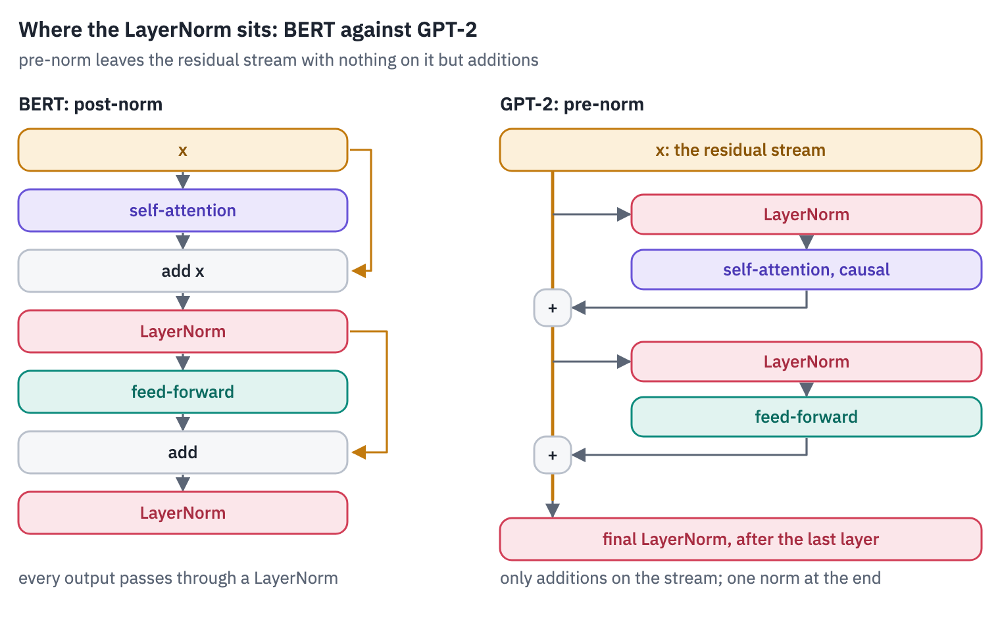
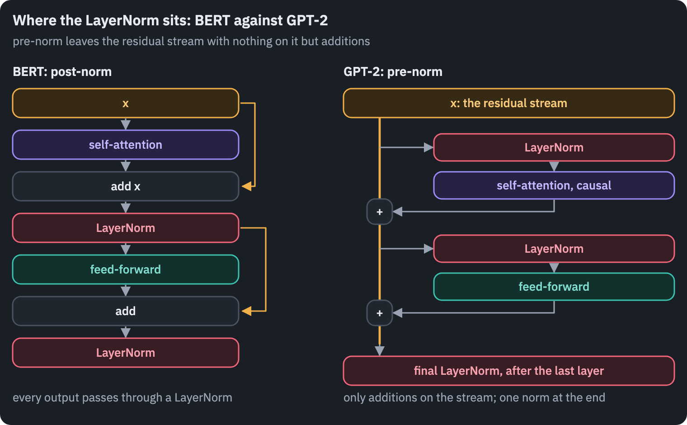

The difference matters for training deep models. In a post-norm stack, the gradient that reaches the first layer has passed through a LayerNorm in every layer above it.

In a pre-norm stack there is a clean path of additions from the loss to the embeddings, the *residual stream*, and each layer only adds to it. Deep pre-norm models train without the careful learning-rate warm-up that post-norm ones need <sup class="cite">[<a href="#ref-9" id="cite-9" data-ref="9" aria-label="Reference 9: Xiong, R., Yang, Y., He, D., Zheng, K., Zheng, S., Xing, C., Zhang, H., Lan, Y., Wang, L., &amp; Liu, T.-Y. (2020). On layer normalization in the Transformer architecture. ICML 2020.">9</a>]</sup>, and every large decoder since GPT-2 is pre-norm.

<div class="callout callout-key" markdown="1">
<p class="callout-label">Key point</p>

In a pre-norm model every layer reads the residual stream and adds its result back to it. The
stream is a running draft of everything the model has worked out so far, which is why section 6 and the probes
of section 11 can read it after any layer.
</div>

Attention is the one from the first course, with the causal mask. We write it out once by hand, and then use
PyTorch's `scaled_dot_product_attention`, which computes the same thing in one fused kernel, without ever storing
the $$T \times T$$ matrix of weights. The check:

```python
def attention_by_hand(q, k, v):
    length = q.shape[-2]
    scores = q @ k.transpose(-2, -1) / math.sqrt(q.shape[-1])
    causal = torch.ones(length, length, dtype=torch.bool, device=q.device).tril()
    scores = scores.masked_fill(~causal, float("-inf"))
    return scores.softmax(dim=-1) @ v


# batch 1, 2 heads, 5 positions, 4 dimensions
q, k, v = torch.randn(3, 1, 2, 5, 4).unbind(0)
fused = F.scaled_dot_product_attention(q, k, v, is_causal=True)
print("largest difference:", (attention_by_hand(q, k, v) - fused).abs().max().item())
```

<pre class="tfs-printed" markdown="0"><code>largest difference: 5.960464477539063e-08</code></pre>

The attention layer keeps an optional `cache`, a dictionary where it stores the keys and values it has computed.
It does nothing until section 5, where it makes generation fast.

```python
class Attention(nn.Module):
    def __init__(self, config):
        super().__init__()
        d = config["n_embd"]
        self.heads = config["n_head"]
        self.qkv = nn.Linear(d, 3 * d)  # queries, keys and values in one matrix
        self.out = nn.Linear(d, d)

    def split(self, x):
        batch, length, d = x.shape
        return x.view(batch, length, self.heads, d // self.heads).transpose(1, 2)

    def forward(self, x, cache=None):
        q, k, v = self.qkv(x).split(x.shape[-1], dim=-1)
        q, k, v = self.split(q), self.split(k), self.split(v)
        if cache is not None and "k" in cache:  # the keys and values of earlier tokens
            k = torch.cat([cache["k"], k], dim=2)
            v = torch.cat([cache["v"], v], dim=2)
        if cache is not None:
            cache["k"], cache["v"] = k, v
        # one new token may look at everything; several new tokens need the causal mask
        y = F.scaled_dot_product_attention(q, k, v, is_causal=q.shape[2] > 1)
        y = y.transpose(1, 2).reshape(x.shape)
        return self.out(y)
```

The feed-forward network uses GELU, as BERT did, but in the approximation OpenAI's code used, with a tanh:

$$\text{GELU}(x) \approx \tfrac{1}{2}\,x\left(1 + \tanh\!\left(\sqrt{2/\pi}\,\left(x + 0.044715\,x^3\right)\right)\right).$$

The exact GELU, $$x\,\Phi(x)$$, needs the error function, which was slow on the hardware of 2018; the tanh version
differs from it by less than 0.001 everywhere. A transplant has to use the same one the weights were trained
with, or the outputs drift. PyTorch has both, and the config says which one a model wants:

```python
x = torch.linspace(-6, 6, 10001)
print("largest gap, tanh GELU against exact:",
      f"{(F.gelu(x, approximate='tanh') - F.gelu(x)).abs().max().item():.1e}")


class Block(nn.Module):
    def __init__(self, config):
        super().__init__()
        d, eps = config["n_embd"], config["layer_norm_epsilon"]
        self.norm1 = nn.LayerNorm(d, eps=eps)
        self.attention = Attention(config)
        self.norm2 = nn.LayerNorm(d, eps=eps)
        self.up = nn.Linear(d, 4 * d)
        self.down = nn.Linear(4 * d, d)
        # OpenAI's "gelu_new" is the tanh approximation
        self.approximate = "tanh" if config["activation_function"] == "gelu_new" else "none"

    def forward(self, x, cache=None):
        x = x + self.attention(self.norm1(x), cache)
        hidden = F.gelu(self.up(self.norm2(x)), approximate=self.approximate)
        return x + self.down(hidden)
```

<pre class="tfs-printed" markdown="0"><code>largest gap, tanh GELU against exact: 4.7e-04</code></pre>

The model around the layers: token embeddings plus learned position embeddings, one vector per position up to the context length, as in BERT; the layers; the final LayerNorm. Then the output layer, which is not a layer at all.

GPT-2 scores every token of the vocabulary by a dot product of the last hidden state with that token's *input* embedding: the same matrix reads tokens in and writes them out.

This *weight tying* saves $$V \times d$$ parameters, 38.6 million in the smallest GPT-2, and works because a good representation of "the next token is *Paris*" should look like the embedding of *Paris* <sup class="cite">[<a href="#ref-10" id="cite-10" data-ref="10" aria-label="Reference 10: Press, O., &amp; Wolf, L. (2017). Using the output embedding to improve language models. EACL 2017.">10</a>]</sup>.

`forward` can also hand back the residual stream after every layer, `keep_states=True`; sections 6 and 11 read it.

```python
class GPT(nn.Module):
    def __init__(self, config):
        super().__init__()
        d = config["n_embd"]
        self.tokens = nn.Embedding(config["vocab_size"], d)
        self.positions = nn.Embedding(config["n_positions"], d)
        self.blocks = nn.ModuleList(Block(config) for _ in range(config["n_layer"]))
        self.norm = nn.LayerNorm(d, eps=config["layer_norm_epsilon"])

    def forward(self, ids, caches=None, keep_states=False):
        past = 0
        if caches is not None and "k" in caches[0]:
            past = caches[0]["k"].shape[2]  # tokens already in the cache
        positions = torch.arange(past, past + ids.shape[1], device=ids.device)
        x = self.tokens(ids) + self.positions(positions)
        states = [x]
        for i, block in enumerate(self.blocks):
            x = block(x, caches[i] if caches is not None else None)
            states.append(x)
        logits = self.unembed(x)
        return (logits, states) if keep_states else logits

    def unembed(self, x):
        return self.norm(x) @ self.tokens.weight.T  # tied: the input table, read backwards
```

## 4. OpenAI's weights in our code

OpenAI's checkpoint names its tensors differently, so we write down which goes where. One more difference hides in the shapes.

OpenAI's code stored its linear layers as `Conv1D`, a name left over from the GPT-1 code, which keeps the weight as (inputs, outputs), the transpose of `nn.Linear`'s (outputs, inputs). So four of the matrices of every layer go in transposed, and `load_state_dict` refuses anything missing or left over:

```python
GPT2 = "openai-community/gpt2"
tokenizer = AutoTokenizer.from_pretrained(GPT2)
with open(hf_hub_download(GPT2, "config.json")) as f:
    config = json.load(f)


def openai_names(config):
    names = {"tokens.weight": "wte.weight", "positions.weight": "wpe.weight",
             "norm.weight": "ln_f.weight", "norm.bias": "ln_f.bias"}
    parts = {"norm1": "ln_1", "attention.qkv": "attn.c_attn",
             "attention.out": "attn.c_proj", "norm2": "ln_2",
             "up": "mlp.c_fc", "down": "mlp.c_proj"}
    for i in range(config["n_layer"]):
        for ours, theirs in parts.items():
            for kind in ("weight", "bias"):
                names[f"blocks.{i}.{ours}.{kind}"] = f"h.{i}.{theirs}.{kind}"
    return names


CONV1D = ("qkv.weight", "out.weight", "up.weight", "down.weight")
weights = load_file(hf_hub_download(GPT2, "model.safetensors"))
state = {}
for ours, theirs in openai_names(config).items():
    tensor = weights[theirs]
    if ours.endswith(CONV1D):
        tensor = tensor.T
    state[ours] = tensor
gpt2 = GPT(config)
gpt2.load_state_dict(state, strict=True)
gpt2 = gpt2.to(device).eval()
left_over = sorted(set(weights) - set(openai_names(config).values()))
print(f"loaded {sum(p.numel() for p in gpt2.parameters()):,} parameters")
example = left_over[0]
print(f"not loaded: {len(left_over)} tensors, e.g. {example}, "
      f"of shape {tuple(weights[example].shape)}")
```

<pre class="tfs-printed" markdown="0"><code>loaded 124,439,808 parameters
not loaded: 12 tensors, e.g. h.0.attn.bias, of shape (1, 1, 1024, 1024)</code></pre>

The tensors left over are the stored causal masks from section 2. Now the check against Hugging Face's
`GPT2LMHeadModel`, the reference implementation: the same text through both, and the scores of all 50,257 tokens
at every position compared.

```python
reference = GPT2LMHeadModel.from_pretrained(GPT2).to(device).eval()
CHECK = ("In 1997 Deep Blue beat Garry Kasparov, the world chess champion, "
         "in a six-game match.")
check = tokenizer(CHECK, return_tensors="pt").to(device)
with torch.no_grad():
    theirs = reference(**check).logits
    ours = gpt2(check["input_ids"])
gap = (ours - theirs).abs().max().item()
print(f"largest difference in the scores: {gap:.1e}")
print(f"the scores themselves reach {theirs.abs().max():.0f}")
assert gap < 1e-2
del reference
```

<pre class="tfs-printed" markdown="0"><code>largest difference in the scores: 6.1e-05
the scores themselves reach 181</code></pre>

Rounding, again: the two implementations add the same numbers in a different order. Our hundred lines are GPT-2.

Teacher forcing makes it easy to see what the model thinks of a text: one pass gives the probability it assigned
to every token that actually came next. A sentence from a 2016 news story, which GPT-2 may well have read:

```python
def next_token_probabilities(text):
    ids = tokenizer(text, return_tensors="pt")["input_ids"].to(device)
    with torch.no_grad():
        logits = gpt2(ids)
    probs = logits[0, :-1].float().softmax(dim=-1)
    targets = ids[0, 1:]
    chosen = probs[torch.arange(len(targets)), targets]
    return tokenizer.convert_ids_to_tokens(ids[0]), chosen.cpu()


TEXT = ("AlphaGo, a program developed by Google DeepMind, beat Lee Sedol "
        "four games to one in Seoul.")
tokens, chosen = next_token_probabilities(TEXT)
print(f"loss {-chosen.log().mean():.2f}")
print("the probability of each token, given the ones before it:")
labels = [token.replace("Ġ", "␣") for token in tokens[1:]]
heatmap(chosen[None].numpy(), cols=labels, role="dec", vmin=0, vmax=1, annotate=True,
        cell=0.42)
plt.show()
```

<pre class="tfs-printed" markdown="0"><code>loss 3.88
the probability of each token, given the ones before it:</code></pre>

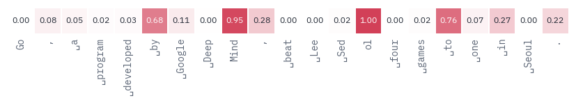

A loss of 3.88 is an average of very different guesses. Where the left context gives the next token away, GPT-2 is close to certain: *Mind* after *Deep*, the *ol* of *Sedol* once *Sed* is there, *to* after *four games*.

Where the sentence carries news, it is lost: *Lee*, *Sed* and *Seoul* get next to nothing, although its training text runs to the end of 2017, well after the match. Those tokens are the information in the sentence, and the loss is highest exactly there. A language model is, among other things, a meter of surprise.

## 5. Generating text, and the KV cache

Generation is a loop:

<p class="flow"><span>scores at the last position</span><span>pick a token</span><span>append it</span><span>run again</span></p>

The simplest pick is the most probable token, *greedy decoding*. Here is GPT-2 continuing the most famous opening
move order in chess, the Ruy Lopez, written the way chess books and websites write it:

```python
@torch.no_grad()
def generate(model, ids, steps, use_cache=True, temperature=0.0, generator=None):
    caches = [{} for _ in model.blocks] if use_cache else None
    new = ids
    for _ in range(steps):
        logits = model(new if use_cache else ids, caches)[:, -1].float()
        if temperature == 0:
            token = logits.argmax(dim=-1, keepdim=True)
        else:
            probs = (logits / temperature).softmax(dim=-1)
            token = torch.multinomial(probs, 1, generator=generator)
        ids = torch.cat([ids, token], dim=1)
        new = token  # with a cache, only the new token goes in
    return ids


RUY_LOPEZ = "1. e4 e5 2. Nf3 Nc6 3. Bb5"
prompt = tokenizer(RUY_LOPEZ, return_tensors="pt")["input_ids"].to(device)
print(tokenizer.decode(generate(gpt2, prompt, 40)[0]))
```

<pre class="tfs-printed" markdown="0"><code>1. e4 e5 2. Nf3 Nc6 3. Bb5 Nc6 4. Nf3 Nc6 5. Bd3 Nc6 6. Bd2 Nc6 7. Bd3 Nc6 8. Bd2</code></pre>

GPT-2 knows what a game record looks like, a number, a dot, a letter and a square, and nothing about the game.

Its first move, 3...Nc6, sends a knight to the square where Black's knight already stands; White answers 4.Nf3, the same mistake, and from then on the two sides shuffle pieces that aren't there. Greedy decoding makes the loop worse: once a pattern has repeated, repeating it again is the likeliest continuation.

Look at what the loop recomputes. At step $$t$$ the model runs over all $$t$$ tokens, although the keys and values of the first $$t-1$$ were computed at the previous step and haven't changed: causal attention never lets an earlier position see a later one, so nothing about them can change.

The *KV cache* keeps every layer's keys and values, and each step feeds only the new token, whose query attends to the cached keys.

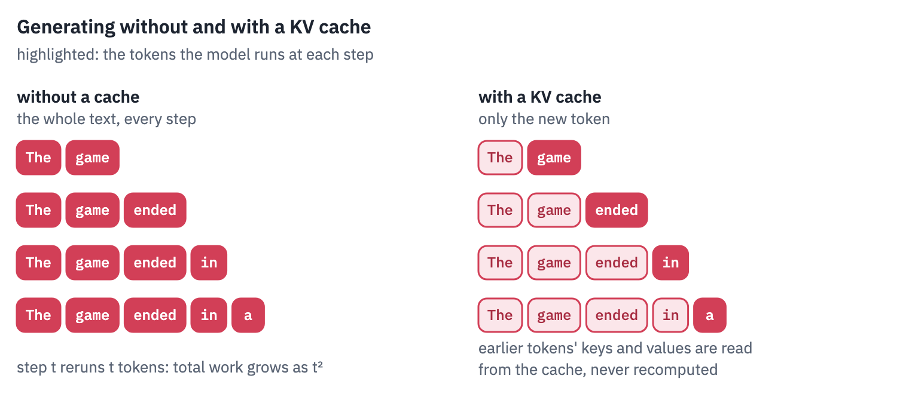
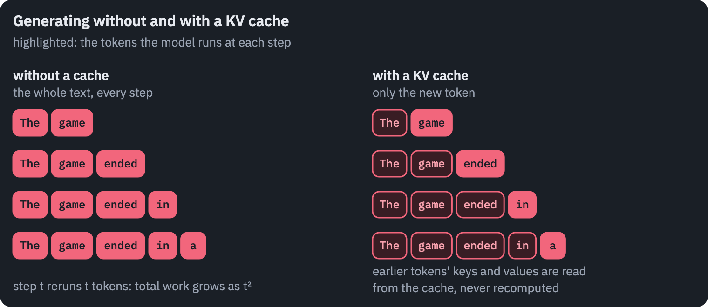

The cache must not change the result. Greedy decoding with and without it, the same prompt:

```python
with_cache = generate(gpt2, prompt, 40, use_cache=True)
without_cache = generate(gpt2, prompt, 40, use_cache=False)
print("same tokens with and without the cache:", torch.equal(with_cache, without_cache))
assert torch.equal(with_cache, without_cache)
```

<pre class="tfs-printed" markdown="0"><code>same tokens with and without the cache: True</code></pre>

Now the time each new token takes, with and without the cache, as the text grows:

```python
@torch.no_grad()
def time_per_token(use_cache, steps):
    caches = [{} for _ in gpt2.blocks] if use_cache else None
    ids = prompt
    new = prompt
    times = []
    for _ in range(steps):
        if device == "cuda":
            torch.cuda.synchronize()
        start = time.perf_counter()
        logits = gpt2(new if use_cache else ids, caches)[:, -1]
        token = logits.argmax(dim=-1, keepdim=True)
        if device == "cuda":
            torch.cuda.synchronize()
        times.append(time.perf_counter() - start)
        ids = torch.cat([ids, token], dim=1)
        new = token
    return np.array(times) * 1000


STEPS = 60 if SMOKE else 900
time_per_token(True, 5)  # warm up the GPU
slow = time_per_token(False, STEPS)
fast = time_per_token(True, STEPS)
print(f"{STEPS} tokens: {slow.sum() / 1000:.1f} s without the cache, "
      f"{fast.sum() / 1000:.1f} s with it")

fig, ax = plt.subplots(figsize=(6.4, 3.0))
length = prompt.shape[1] + np.arange(STEPS)
ax.plot(length, slow, color=COLORS["line"], label="no cache: the whole text every step")
ax.plot(length, fast, color=COLORS["dec"], label="KV cache: one token every step")
ax.set_xlabel("tokens in the text")
ax.set_ylabel("ms for the next token")
ax.set_ylim(bottom=0)
ax.legend(frameon=False)
plt.show()
```

<pre class="tfs-printed" markdown="0"><code>900 tokens: 36.1 s without the cache, 4.9 s with it</code></pre>

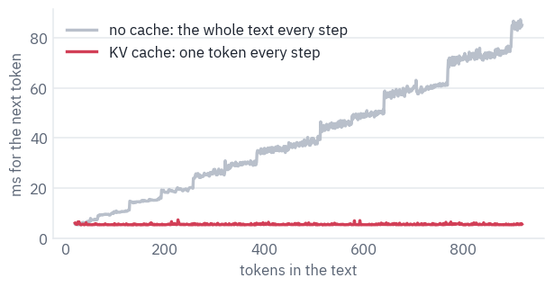

Without the cache, each step reruns the whole text, so the time per token grows with the length and the total grows with its square; the staircase is the GPU working in blocks of fixed size, so the cost jumps every so many tokens.

With the cache, token 900 costs what token 20 did. For 900 tokens that is 36.1 seconds against 4.9 on a T4, and the gap widens with every token.

The cache costs memory instead: two vectors of width $$d$$ per token in every layer. For GPT-2 that is small; for the
models of today it is the main thing that limits how many conversations fit on one GPU, which is what lesson 8 of
this course is about. In 16-bit numbers:

```python
def kv_bytes_per_token(layers, d):
    return 2 * layers * d * 2  # keys and values, every layer, 2 bytes per number


for name, layers, d in [("GPT-2", 12, 768), ("GPT-2 XL", 48, 1600), ("GPT-3", 96, 12288)]:
    per_token = kv_bytes_per_token(layers, d)
    print(f"{name:9s} {per_token / 1024:7,.0f} KB per token, "
          f"{per_token * 2048 / 2**30:5.2f} GB for 2,048 tokens")
```

<pre class="tfs-printed" markdown="0"><code>GPT-2          36 KB per token,  0.07 GB for 2,048 tokens
GPT-2 XL      300 KB per token,  0.59 GB for 2,048 tokens
GPT-3       4,608 KB per token,  9.00 GB for 2,048 tokens</code></pre>

GPT-3's numbers are from its paper; it has no public weights. A single 2,048-token conversation with it holds
several gigabytes of cache, before anyone else is served.

Greedy decoding is a poor way to write prose: it picks the safest token every time, and safe texts repeat, as GPT-2's chess shows.

Sampling picks the next token at random from the model's distribution, usually sharpened by a *temperature* $$\tau$$: the scores are divided by $$\tau$$ before the softmax, so $$\tau < 1$$ makes likely tokens likelier and $$\tau \to 0$$ is greedy. The same prompt, three samples at $$\tau = 0.8$$:

```python
generator = torch.Generator(device=device).manual_seed(SEED)
START = "The strangest chess game ever played"
start = tokenizer(START, return_tensors="pt")["input_ids"].to(device)
for _ in range(3):
    sample = generate(gpt2, start, 30, temperature=0.8, generator=generator)
    print("·", tokenizer.decode(sample[0]).replace("\n", " "))
```

<pre class="tfs-printed" markdown="0"><code>· The strangest chess game ever played, the only way to receive the prize?  I have been making chess updates since last November, and when it comes to chess, the most
· The strangest chess game ever played for a mere four years in a single day.  I&#x27;m not speaking of the grand tournament, here, about the Russian chess grandmaster —
· The strangest chess game ever played is Chess Guides. It&#x27;s a game of chess, at least, but it could be more apt to be released on consoles right now. </code></pre>

## 6. The logit lens: GPT-2 changing its mind

The residual stream after every layer is a vector of the same width as the last one, and nothing stops us from applying the final LayerNorm and the unembedding to it early.

What comes out is the model's guess for the next token *as it stands* after that layer. The idea is called the *logit lens* <sup class="cite">[<a href="#ref-11" id="cite-11" data-ref="11" aria-label="Reference 11: nostalgebraist (2020). interpreting GPT: the logit lens. LessWrong.">11</a>]</sup>, and it works on GPT-2 because a pre-norm stack only ever adds to the stream, so each layer refines the same running guess.

The last word of each prompt below is where we look: after every layer, what does GPT-2 expect next?

```python
@torch.no_grad()
def logit_lens(text):
    ids = tokenizer(text, return_tensors="pt")["input_ids"].to(device)
    _, states = gpt2(ids, keep_states=True)
    rows = []
    for layer, state in enumerate(states):
        probs = gpt2.unembed(state[0, -1]).float().softmax(dim=-1)
        best = probs.argmax().item()
        rows.append((layer, tokenizer.decode(best), probs[best].item()))
    return rows


PROMPTS = ["In 1997, IBM's Deep Blue defeated the world chess champion Garry",
           "Bobby Fischer won the 1972 World Chess Championship against Boris"]
lens = {text: logit_lens(text) for text in PROMPTS}
fig, axes = plt.subplots(1, 2, figsize=(9.6, 4.4), sharey=True)
for ax, text in zip(axes, PROMPTS):
    rows = lens[text]
    layers = [layer for layer, _, _ in rows]
    top = [p for _, _, p in rows]
    ax.barh(layers, top, color=COLORS["dec"], height=0.7)
    for layer, word, p in rows:
        ax.text(p + 0.02, layer, repr(word), va="center", fontsize=9, color=COLORS["ink"])
    ax.set_xlim(0, 1.45)
    ax.set_title("… " + " ".join(text.split()[-5:]), fontsize=10)
    ax.set_xlabel("probability of the top token")
axes[0].set_ylabel("after layer (0 = embeddings)")
axes[0].set_yticks(range(len(lens[PROMPTS[0]])))
axes[0].invert_yaxis()
plt.tight_layout()
plt.show()
```

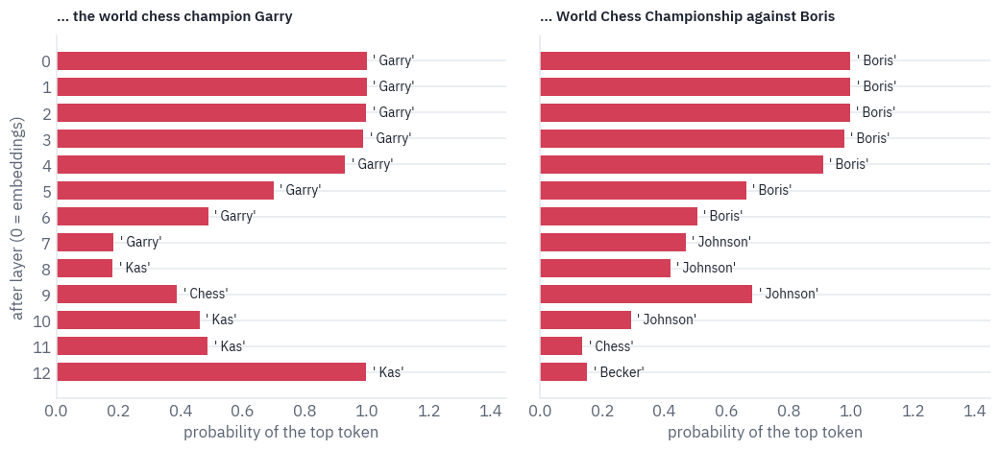

For Deep Blue's opponent, the first seven layers just repeat the last word of the prompt, *Garry*: early layers still carry mostly their input, and the lens reads it back. From layer 8 *Kas* takes over, wavers once, and ends at full confidence.

The second prompt asks for Bobby Fischer's opponent of 1972, Boris Spassky. The middle layers bet on *Johnson*, the Boris of British politics; the last one settles, with little confidence, on *Becker*, a tennis player.

Spassky never appears. The smallest GPT-2 doesn't know him, and the lens shows how it fails: by sliding from one famous Boris to another.

The lens is biased: the final LayerNorm and unembedding were trained to read the last layer, not the middle ones, so early guesses look worse than what the layer knows. The *tuned lens* fixes this by training a small affine map for every layer<sup class="cite">[<a href="#ref-12" id="cite-12" data-ref="12" aria-label="Reference 12: Belrose, N., Ostrovsky, I., McKinney, L., Furman, Z., Smith, L., Halawi, D., Biderman, S., &amp; Steinhardt, J. (2023). Eliciting latent predictions from transformers with the tuned lens. arXiv:2303.08112.">12</a>]</sup>.

For GPT-2 the plain lens reads well enough to show the main thing: the answer is assembled gradually, and the residual stream is a place where you can watch it happen. Section 11 will read the same stream with a probe of our own.

## 7. A gigabyte of chess

Lichess, the free and open-source chess server, publishes every rated game played on it, month by month, under CC0: no rights reserved. By November 2026 the database held more than 8.3 billion standard games, with every player's clock recorded since April 2017<sup class="cite">[<a href="#ref-13" id="cite-13" data-ref="13" aria-label="Reference 13: Lichess (2026). Lichess open database. CC0.">13</a>]</sup>.

Hugging Face mirrors it as Parquet files by year and month. The month we take, January 2025, is split into 72 Parquet files of about a gigabyte each; one is plenty.

```python
LICHESS = "Lichess/standard-chess-games"
SHARD = "data/year=2025/month=01/train-00000-of-00072.parquet"
path = hf_hub_download(LICHESS, SHARD, repo_type="dataset")
lichess = pd.read_parquet(path, columns=["Event", "WhiteElo", "BlackElo", "movetext"])
if SMOKE:
    lichess = lichess.head(100_000)
print(f"{len(lichess):,} games")
print(lichess["movetext"][0][:240], "…")
```

<pre class="tfs-printed" markdown="0"><code>1,394,617 games
1. Nc3 { [%clk 0:03:00] } 1... e5 { [%clk 0:03:00] } 2. e4 { [%clk 0:02:59] } 2... Bc5 { [%clk 0:02:59] } 3. Qh5 { [%clk 0:02:57] } 3... Nf6 { [%clk 0:02:58] } 4. Qxe5+ { [%clk 0:02:56] } 4... Be7 { [%clk 0:02:55] } 5. d3 { [%clk 0:02:55] } …</code></pre>

Every move comes with the time left on the player's clock, `{ [%clk 0:02:59] }`, and Black's moves repeat the move
number as `1...`. The games are of every kind, from one-minute bullet to classical:

```python
# "Rated Blitz game", "Blitz swiss https://lichess.org/swiss/…" -> "Blitz"
SPEEDS = r"(UltraBullet|Bullet|Blitz|Rapid|Classical|Correspondence)"
kind = lichess["Event"].str.extract(SPEEDS)[0]
table(kind.value_counts().rename_axis("time control").reset_index(name="games"))
```

<div class="tfs-table-wrap"><table class="tfs-table" style="border-collapse:collapse;font-family:'IBM Plex Sans', -apple-system, 'Segoe UI', Roboto, Helvetica, Arial, sans-serif;font-size:13.5px;line-height:1.45;margin:4px 0 8px;"><thead><tr><th style="padding:7px 14px;border-bottom:2px solid #B9C0CB;font-weight:600;color:#5B6575;font-size:12px;letter-spacing:0.02em;text-align:left;">time control</th><th style="padding:7px 14px;border-bottom:2px solid #B9C0CB;font-weight:600;color:#5B6575;font-size:12px;letter-spacing:0.02em;text-align:right;">games</th></tr></thead><tbody><tr><td style="padding:7px 14px;border-bottom:1px solid #E6E9EE;vertical-align:top;text-align:left;max-width:460px;white-space:normal;">Blitz</td><td style="padding:7px 14px;border-bottom:1px solid #E6E9EE;vertical-align:top;text-align:right;font-variant-numeric:tabular-nums;max-width:460px;white-space:normal;">652,645</td></tr><tr><td style="padding:7px 14px;border-bottom:1px solid #E6E9EE;vertical-align:top;text-align:left;max-width:460px;white-space:normal;">Bullet</td><td style="padding:7px 14px;border-bottom:1px solid #E6E9EE;vertical-align:top;text-align:right;font-variant-numeric:tabular-nums;max-width:460px;white-space:normal;">505,274</td></tr><tr><td style="padding:7px 14px;border-bottom:1px solid #E6E9EE;vertical-align:top;text-align:left;max-width:460px;white-space:normal;">Rapid</td><td style="padding:7px 14px;border-bottom:1px solid #E6E9EE;vertical-align:top;text-align:right;font-variant-numeric:tabular-nums;max-width:460px;white-space:normal;">212,558</td></tr><tr><td style="padding:7px 14px;border-bottom:1px solid #E6E9EE;vertical-align:top;text-align:left;max-width:460px;white-space:normal;">UltraBullet</td><td style="padding:7px 14px;border-bottom:1px solid #E6E9EE;vertical-align:top;text-align:right;font-variant-numeric:tabular-nums;max-width:460px;white-space:normal;">13,939</td></tr><tr><td style="padding:7px 14px;border-bottom:1px solid #E6E9EE;vertical-align:top;text-align:left;max-width:460px;white-space:normal;">Classical</td><td style="padding:7px 14px;border-bottom:1px solid #E6E9EE;vertical-align:top;text-align:right;font-variant-numeric:tabular-nums;max-width:460px;white-space:normal;">8,846</td></tr><tr><td style="padding:7px 14px;border-bottom:1px solid #E6E9EE;vertical-align:top;text-align:left;max-width:460px;white-space:normal;">Correspondence</td><td style="padding:7px 14px;border-bottom:1px solid #E6E9EE;vertical-align:top;text-align:right;font-variant-numeric:tabular-nums;max-width:460px;white-space:normal;">1,355</td></tr></tbody></table></div>

Bullet games are decided by the clock as much as by the moves, and a model trained on them learns to blunder in time trouble. We keep blitz, rapid and classical games where both players are rated 1800 or more.

Then we strip the clocks and write each game the way Adam Karvonen did for his chess-playing GPT<sup class="cite">[<a href="#ref-14" id="cite-14" data-ref="14" aria-label="Reference 14: Karvonen, A. (2024). Emergent world models and latent variable estimation in chess-playing language models. COLM 2024.">14</a>]</sup>: a `;` to mark the start, move numbers glued to White's moves, nothing else.

```python
CLOCK = re.compile(r"\{[^}]*\}")  # { [%clk 0:02:59] } and the like
BLACK_NUMBER = re.compile(r"\d+\.\.\. ")  # "1... " before Black's moves
GLYPHS = re.compile(r"[?!]")  # annotations such as ?? and !?
NUMBER = re.compile(r"(\d+)\. ")  # "1. e4" -> "1.e4"
RESULT = re.compile(r" ?(1-0|0-1|1/2-1/2|\*)$")


def clean(movetext):
    text = CLOCK.sub("", movetext)
    text = BLACK_NUMBER.sub("", text)
    text = GLYPHS.sub("", text)
    text = NUMBER.sub(r"\1.", text)
    text = " ".join(text.split())  # one space between moves
    text = RESULT.sub("", text)
    return ";" + text


slow = kind.isin(["Blitz", "Rapid", "Classical"])
strong = (lichess["WhiteElo"] >= 1800) & (lichess["BlackElo"] >= 1800)
games = [clean(movetext) for movetext in lichess["movetext"][slow & strong]]
games = [game for game in games if game.count(" ") >= 10]  # at least five moves each
print(f"{len(games):,} games kept, e.g.\n{games[0][:200]} …")
```

<pre class="tfs-printed" markdown="0"><code>250,635 games kept, e.g.
;1.e4 c6 2.d4 d5 3.exd5 cxd5 4.Bd3 Nf6 5.h3 Nc6 6.c3 e5 7.dxe5 Nxe5 8.Be2 Bd6 9.Nf3 Nxf3+ 10.Bxf3 Be6 11.O-O Qc7 12.Nd2 Rd8 13.Nb3 h6 14.Nd4 O-O 15.Re1 a6 16.Rxe6 fxe6 17.Nxe6 Qa5 18.Nxf8 Rxf8 19.Be3  …</code></pre>

The whole language of these games fits in a few dozen characters:

```python
VOCAB = sorted(set("".join(games)))
print(len(VOCAB), "characters:", "".join(VOCAB))
stoi = {char: i for i, char in enumerate(VOCAB)}
lengths = np.array([len(game) for game in games])
print(f"a game is {np.median(lengths):.0f} characters long in the median, "
      f"{np.percentile(lengths, 90):.0f} at the 90th percentile")
```

<pre class="tfs-printed" markdown="0"><code>32 characters:  #+-.0123456789;=BKNOQRabcdefghx
a game is 387 characters long in the median, 663 at the 90th percentile</code></pre>

Thirty-two characters: the files `a` to `h`, the ranks `1` to `8`, the pieces `K Q R B N`, `x` for a capture, `+` and `#` for check and mate, `O-O` for castling, `=` for promotion, the digits of move numbers, the dot, the space and the `;`.

A model that reads this alphabet is never told what a knight is. It sees `N` followed by a square, again and again, in the places where knights went.

We hold out 4,000 games for testing and pack the rest into one long stream of character ids. A training example
is a window of the stream that starts at the beginning of a game.

```python
CONTEXT = 512  # characters the model reads at once: most games fit
rng = np.random.default_rng(SEED)
order = rng.permutation(len(games))
test_games = [games[i] for i in order[:4000]]
train_games = [games[i] for i in order[4000:]]

lookup = np.zeros(128, dtype=np.uint8)
for char, i in stoi.items():
    lookup[ord(char)] = i
stream = lookup[np.frombuffer("".join(train_games).encode("ascii"), dtype=np.uint8)]
stream = torch.from_numpy(stream.astype(np.int64))
starts = np.flatnonzero(stream.numpy() == stoi[";"])
starts = starts[starts + CONTEXT + 1 <= len(stream)]  # every window must fit in the stream
print(f"{len(train_games):,} training games, {len(stream) / 1e6:.0f} million characters; "
      f"{len(test_games):,} held out")
```

<pre class="tfs-printed" markdown="0"><code>246,635 training games, 102 million characters; 4,000 held out</code></pre>

## 8. GPT-2 at the chessboard

Chess notation is all over the web, in game reports, forums and PGN files, so GPT-2 has read some. In a typical
position there are "of the order of 30 legal moves", as Claude Shannon estimated in 1950, among the thousands of
strings that look like a move. How often does GPT-2 hit one?

Part of the trouble is visible before the model runs. GPT-2's tokenizer was built for English prose, and it cuts
chess notation into pieces that don't follow the moves:

```python
LINE = "1. e4 e5 2. Nf3 Nc6 3. Bb5 a6 4. Ba4 Nf6 5. O-O Be7"
pieces = [tokenizer.decode([i]) for i in tokenizer(LINE)["input_ids"]]
token_chips([pieces], labels=["GPT-2 tokens"], max_width=640)
plt.show()
print(f"10 moves, {len(pieces)} tokens")
```

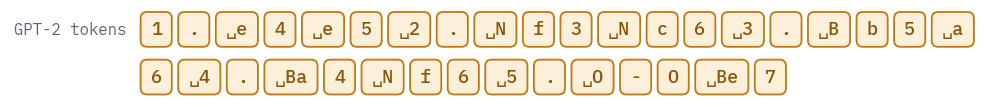

<pre class="tfs-printed" markdown="0"><code>10 moves, 35 tokens</code></pre>

To test a player, chess or language model, we take positions from the held-out games: a game cut at a random
move, the moves so far as the prompt, and the question of what comes next. `python-chess` replays the moves and
judges the answer. The same positions will test our own model later, written in its own format.

```python
def moves_of(game):
    return [word.split(".")[-1] for word in game[1:].split(" ")]  # "12.Nf3" -> "Nf3"


def prompt_for(moves, upto, spaced):
    # the game before move number `upto` (counted from 0), ready for that move
    text = ""
    for i in range(upto):
        if i % 2 == 0:
            text += f"{i // 2 + 1}." + (" " if spaced else "")
        text += moves[i] + " "
    if upto % 2 == 0:  # White to move: the move number comes first
        text += f"{upto // 2 + 1}."
    return text


def test_positions(games, n, seed):
    rng = random.Random(seed)
    positions = []
    for game in games:
        moves = moves_of(game)
        upto = rng.randrange(1, min(len(moves), 70))
        if len(prompt_for(moves, upto, spaced=False)) > CONTEXT - 10:
            continue  # longer than our model's context
        board = chess.Board()
        for move in moves[:upto]:
            board.push_san(move)
        positions.append({"moves": moves, "upto": upto, "board": board,
                          "played": moves[upto]})
        if len(positions) == n:
            break
    return positions


positions = test_positions(test_games, 100 if SMOKE else 1000, SEED)
example = positions[0]
moves, upto = example["moves"], example["upto"]
print("GPT-2 gets:    ", repr(prompt_for(moves, upto, spaced=True).rstrip()))
print("our model gets:", repr(";" + prompt_for(moves, upto, spaced=False)))
print("the player played:", example["played"])
```

<pre class="tfs-printed" markdown="0"><code>GPT-2 gets:     &#x27;1. d4 Nf6 2. c4 e6 3. Nf3 d5 4. Bg5 Bb4+ 5. Nbd2 dxc4 6. Qa4+ Nc6 7. a3 Bxd2+ 8. Nxd2 Qxd4 9. Nxc4 O-O 10. Rd1 Qc5 11. Bxf6&#x27;
our model gets: &#x27;;1.d4 Nf6 2.c4 e6 3.Nf3 d5 4.Bg5 Bb4+ 5.Nbd2 dxc4 6.Qa4+ Nc6 7.a3 Bxd2+ 8.Nxd2 Qxd4 9.Nxc4 O-O 10.Rd1 Qc5 11.Bxf6 &#x27;
the player played: gxf6</code></pre>

A move can go wrong in several ways, and `python-chess` tells them apart. It may not be a move at all; it may name
a move no piece can make, a knight to a square no knight reaches, or a pawn through a piece; it may be a move the
piece could make if the king were not in check, or not pinned: *pseudo-legal*, as chess programmers say; or it may
fit two pieces at once.

```python
def judge(board, move):
    try:
        board.parse_san(move)
        return "legal"
    except chess.InvalidMoveError:
        return "not a move"
    except chess.AmbiguousMoveError:
        return "ambiguous"
    except chess.IllegalMoveError:
        pass
    pseudo_legal = {board.san(m).rstrip("+#") for m in board.pseudo_legal_moves}
    if move.rstrip("+#") in pseudo_legal:
        return "leaves the king in check"
    return "no piece can do that"


def score(make_move, positions):
    verdicts, same_as_player = [], 0
    for position in positions:
        move = make_move(position)
        verdicts.append(judge(position["board"], move))
        same_as_player += move.rstrip("+#") == position["played"].rstrip("+#")
    shares = {}
    for verdict, count in Counter(verdicts).items():
        shares[verdict] = count / len(positions)
    return shares, same_as_player / len(positions)


@torch.no_grad()
def gpt2_move(position):
    prompt = prompt_for(position["moves"], position["upto"], spaced=True).rstrip()
    ids = tokenizer(prompt, return_tensors="pt")["input_ids"].to(device)
    continuation = tokenizer.decode(generate(gpt2, ids, 5)[0, ids.shape[1]:])
    words = continuation.split()
    return words[0] if words else ""


gpt2_shares, gpt2_same = score(gpt2_move, positions)
print(f"GPT-2: {gpt2_shares.get('legal', 0.0):.1%} legal moves, "
      f"{gpt2_same:.1%} the same move as the player")
table(pd.DataFrame({"verdict": list(gpt2_shares), "share": list(gpt2_shares.values())}))
```

<pre class="tfs-printed" markdown="0"><code>GPT-2: 27.8% legal moves, 3.2% the same move as the player</code></pre>

<div class="tfs-table-wrap"><table class="tfs-table" style="border-collapse:collapse;font-family:'IBM Plex Sans', -apple-system, 'Segoe UI', Roboto, Helvetica, Arial, sans-serif;font-size:13.5px;line-height:1.45;margin:4px 0 8px;"><thead><tr><th style="padding:7px 14px;border-bottom:2px solid #B9C0CB;font-weight:600;color:#5B6575;font-size:12px;letter-spacing:0.02em;text-align:left;">verdict</th><th style="padding:7px 14px;border-bottom:2px solid #B9C0CB;font-weight:600;color:#5B6575;font-size:12px;letter-spacing:0.02em;text-align:right;">share</th></tr></thead><tbody><tr><td style="padding:7px 14px;border-bottom:1px solid #E6E9EE;vertical-align:top;text-align:left;max-width:460px;white-space:normal;">no piece can do that</td><td style="padding:7px 14px;border-bottom:1px solid #E6E9EE;vertical-align:top;text-align:right;font-variant-numeric:tabular-nums;max-width:460px;white-space:normal;">0.68</td></tr><tr><td style="padding:7px 14px;border-bottom:1px solid #E6E9EE;vertical-align:top;text-align:left;max-width:460px;white-space:normal;">legal</td><td style="padding:7px 14px;border-bottom:1px solid #E6E9EE;vertical-align:top;text-align:right;font-variant-numeric:tabular-nums;max-width:460px;white-space:normal;">0.28</td></tr><tr><td style="padding:7px 14px;border-bottom:1px solid #E6E9EE;vertical-align:top;text-align:left;max-width:460px;white-space:normal;">leaves the king in check</td><td style="padding:7px 14px;border-bottom:1px solid #E6E9EE;vertical-align:top;text-align:right;font-variant-numeric:tabular-nums;max-width:460px;white-space:normal;">0.01</td></tr><tr><td style="padding:7px 14px;border-bottom:1px solid #E6E9EE;vertical-align:top;text-align:left;max-width:460px;white-space:normal;">not a move</td><td style="padding:7px 14px;border-bottom:1px solid #E6E9EE;vertical-align:top;text-align:right;font-variant-numeric:tabular-nums;max-width:460px;white-space:normal;">0.02</td></tr><tr><td style="padding:7px 14px;border-bottom:1px solid #E6E9EE;vertical-align:top;text-align:left;max-width:460px;white-space:normal;">ambiguous</td><td style="padding:7px 14px;border-bottom:1px solid #E6E9EE;vertical-align:top;text-align:right;font-variant-numeric:tabular-nums;max-width:460px;white-space:normal;">0.01</td></tr></tbody></table></div>

GPT-2 almost always writes something shaped like a move: only 2% of its answers aren't moves at all. But 68%
are moves that no piece on the board can make, and only 28% are legal. It has learned the notation, not the
game.

## 9. A GPT that has read nothing but chess

Now the same `GPT` class, with a 32-character vocabulary and a smaller body: 8 layers, 512 wide, 8 heads, a context of 512 characters. That is the size of Karvonen's smaller chess model, which will come in handy.

We initialise it the way GPT-2 was: weights drawn from a normal distribution with a standard deviation of 0.02, and the two matrices of every layer that write into the residual stream scaled down by $$1/\sqrt{2L}$$, so that the stream doesn't grow with depth at the start.

```python
chess_config = {"vocab_size": len(VOCAB), "n_positions": CONTEXT, "n_embd": 512,
                "n_head": 8, "n_layer": 8, "layer_norm_epsilon": 1e-5,
                "activation_function": "gelu_new"}


def init_like_gpt2(model, layers):
    for module in model.modules():
        if isinstance(module, (nn.Linear, nn.Embedding)):
            nn.init.normal_(module.weight, std=0.02)
        if isinstance(module, nn.Linear):
            nn.init.zeros_(module.bias)
    for block in model.blocks:  # the two matrices that add to the residual stream
        nn.init.normal_(block.attention.out.weight, std=0.02 / math.sqrt(2 * layers))
        nn.init.normal_(block.down.weight, std=0.02 / math.sqrt(2 * layers))


torch.manual_seed(SEED)
chess_gpt = GPT(chess_config)
init_like_gpt2(chess_gpt, chess_config["n_layer"])
chess_gpt = chess_gpt.to(device)
print(f"{sum(p.numel() for p in chess_gpt.parameters()) / 1e6:.1f} million parameters")
```

<pre class="tfs-printed" markdown="0"><code>25.5 million parameters</code></pre>

The training loop is the first course's, with the settings GPT-2-style models are trained with: AdamW with
$$\beta_2 = 0.95$$ and weight decay 0.1 on the matrices only, a short warm-up and a cosine decay of the learning rate,
gradients clipped at norm 1. The T4 computes fast in 16-bit floats, so the forward pass runs under `autocast`, and
a `GradScaler` keeps small gradients from rounding to zero in that format. `torch.compile` turns the model into
fused GPU kernels for training; generation and the tests use the plain model. Every few minutes we stop to test the
model on 200 held-out positions, using the move function written for it below.

```python
@torch.no_grad()
def chess_move(model, position, generator=None):
    prompt = ";" + prompt_for(position["moves"], position["upto"], spaced=False)
    ids = torch.tensor([[stoi[char] for char in prompt]], device=device)
    caches = [{} for _ in model.blocks]
    move = ""
    for _ in range(8):  # the longest move, "exd8=Q+", has 7 characters
        logits = model(ids, caches)[0, -1].float()
        if generator is None:
            char = logits.argmax().item()
        else:
            char = torch.multinomial(logits.softmax(dim=-1), 1, generator=generator).item()
        if VOCAB[char] == " ":
            break
        move += VOCAB[char]
        ids = torch.tensor([[char]], device=device)
    return move


def windows(rng, size):
    picked = starts[rng.integers(0, len(starts), size)]
    rows = torch.stack([stream[s:s + CONTEXT + 1] for s in picked]).to(device)
    return rows[:, :-1], rows[:, 1:]  # inputs, and the same characters shifted by one


BATCH, PEAK_LR, WARMUP = 64, 1e-3, 300
STEPS = 30 if SMOKE else 3400
EVAL_EVERY = 10 if SMOKE else 500


def learning_rate(step):
    if step < WARMUP:
        return PEAK_LR * (step + 1) / WARMUP
    progress = (step - WARMUP) / max(1, STEPS - WARMUP)
    cosine = 0.5 * (1 + math.cos(math.pi * progress))
    return PEAK_LR * (0.1 + 0.9 * cosine)  # down to a tenth of the peak


matrices = [p for p in chess_gpt.parameters() if p.dim() == 2]
others = [p for p in chess_gpt.parameters() if p.dim() < 2]
groups = [{"params": matrices, "weight_decay": 0.1},
          {"params": others, "weight_decay": 0.0}]
optimizer = torch.optim.AdamW(groups, lr=PEAK_LR, betas=(0.9, 0.95))
scaler = torch.amp.GradScaler(enabled=device == "cuda")
# the compiler fuses the training passes into fewer GPU kernels; the first steps wait for it
compiled = torch.compile(chess_gpt) if device == "cuda" else chess_gpt
quick_test = positions[:200]

rng = np.random.default_rng(SEED)
curve = []
start = time.time()
for step in range(STEPS):
    for group in optimizer.param_groups:
        group["lr"] = learning_rate(step)
    inputs, targets = windows(rng, BATCH)
    with torch.autocast(device, dtype=torch.float16, enabled=device == "cuda"):
        logits = compiled(inputs)
    loss = F.cross_entropy(logits.float().view(-1, len(VOCAB)), targets.reshape(-1))
    optimizer.zero_grad(set_to_none=True)
    scaler.scale(loss).backward()
    scaler.unscale_(optimizer)
    torch.nn.utils.clip_grad_norm_(chess_gpt.parameters(), 1.0)
    scaler.step(optimizer)
    scaler.update()
    if (step + 1) % EVAL_EVERY == 0 or step + 1 == STEPS:
        chess_gpt.eval()
        shares, _ = score(lambda position: chess_move(chess_gpt, position), quick_test)
        chess_gpt.train()
        minutes = (time.time() - start) / 60
        curve.append({"step": step + 1, "minutes": minutes, "loss": loss.item(),
                      "legal": shares.get("legal", 0.0)})
        print(f"step {step + 1:5d}  {minutes:5.1f} min  loss {loss.item():.3f}  "
              f"legal moves {shares.get('legal', 0.0):.1%}")
chess_gpt = chess_gpt.eval()
```

<pre class="tfs-printed" markdown="0"><code>step   500    4.3 min  loss 0.789  legal moves 52.5%
step  1000    8.2 min  loss 0.611  legal moves 75.0%
step  1500   12.1 min  loss 0.559  legal moves 84.5%
step  2000   16.0 min  loss 0.530  legal moves 87.5%
step  2500   19.8 min  loss 0.482  legal moves 91.0%
step  3000   23.7 min  loss 0.460  legal moves 91.5%
step  3400   26.9 min  loss 0.447  legal moves 92.0%</code></pre>

Twenty-five minutes, 111 million characters, about one pass over the training games. After four minutes the
model already finds a legal move in half the test positions, far more often than GPT-2 ever does; after twenty it
levels off around nine in ten. Nobody told it what a knight is.

```python
curve = pd.DataFrame(curve)
fig, (left, right) = plt.subplots(1, 2, figsize=(9.6, 3.0))
left.plot(curve["minutes"], curve["loss"], color=COLORS["dec"], marker="o", markersize=3)
left.set_xlabel("minutes of training")
left.set_ylabel("loss per character")
right.plot(curve["minutes"], curve["legal"], color=COLORS["dec"], marker="o", markersize=3,
           label="our chess GPT")
right.axhline(gpt2_shares.get("legal", 0.0), color=COLORS["line"], linestyle="--",
              label="GPT-2")
right.set_xlabel("minutes of training")
right.set_ylabel("legal moves, 200 positions")
right.set_ylim(0, 1)
right.legend(frameon=False, loc="lower right")
plt.tight_layout()
plt.show()
```

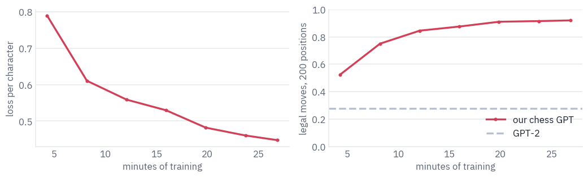

## 10. Does it play chess?

The full test, on the same 1,000 positions GPT-2 got, written in our model's format:

```python
chess_shares, chess_same = score(lambda p: chess_move(chess_gpt, p), positions)
print(f"our chess GPT: {chess_shares.get('legal', 0.0):.1%} legal moves, "
      f"{chess_same:.1%} the same move as the player")
```

<pre class="tfs-printed" markdown="0"><code>our chess GPT: 89.5% legal moves, 32.5% the same move as the player</code></pre>

Nine moves in ten are legal. And one move in three is the move the human actually played, in positions with
some thirty legal options: the model has learned not only the rules, but how players rated 1800 like to play.

What would more training buy? Karvonen published the models of his paper on the Hugging Face Hub under the MIT license, and his 8-layer model is ours to the letter: 8 layers, 512 wide, 8 heads, the same 32 characters.

It was trained with [nanoGPT](https://github.com/karpathy/nanoGPT) on 16 million Lichess games, and "took 72 hours to train on one RTX 3090 GPU". Our class can run it, after one more transplant.

Three things differ from GPT-2's checkpoint: nanoGPT's linear layers are `nn.Linear`, so nothing is transposed; they have no biases, so ours are set to zero, which computes the same function; and nanoGPT uses the exact GELU, which goes into the config.

<div class="callout callout-warn" markdown="1">
<p class="callout-label">Trap</p>

The file is a PyTorch checkpoint, which is a pickle, and unpickling can run any code the file
contains. `weights_only=True` makes `torch.load` refuse everything but tensors and plain values; never load a
checkpoint from the internet without it.
</div>

```python
path = hf_hub_download("adamkarvonen/chess_llms", "lichess_8layers_ckpt_no_optimizer.pt")
checkpoint = torch.load(path, map_location="cpu", weights_only=True)
args = checkpoint["model_args"]
print(args)
seen = checkpoint["iter_num"] * checkpoint["config"]["batch_size"] * args["block_size"]
print(f"characters seen in training: {seen / 1e9:.0f} billion; "
      f"ours: {STEPS * BATCH * CONTEXT / 1e6:.0f} million")

assert "".join(VOCAB) == " #+-.0123456789;=BKNOQRabcdefghx"  # his alphabet, in his order
karvonen_config = {"vocab_size": args["vocab_size"], "n_positions": args["block_size"],
                   "n_embd": args["n_embd"], "n_head": args["n_head"],
                   "n_layer": args["n_layer"], "layer_norm_epsilon": 1e-5,
                   "activation_function": "gelu"}  # the exact GELU
weights = checkpoint["model"]
karvonen = GPT(karvonen_config)
state = karvonen.state_dict()
zeroed = 0
for ours, theirs in openai_names(karvonen_config).items():
    key = "_orig_mod.transformer." + theirs  # torch.compile added "_orig_mod."
    if key in weights:
        state[ours] = weights[key]
    else:  # trained without biases: a zero bias is the same thing
        state[ours] = torch.zeros_like(state[ours])
        zeroed += 1
karvonen.load_state_dict(state, strict=True)
karvonen = karvonen.to(device).eval()
output_layer = weights["_orig_mod.lm_head.weight"]
tied = torch.equal(output_layer, weights["_orig_mod.transformer.wte.weight"])
print(f"{len(weights)} tensors in the file; {zeroed} biases of ours set to zero; "
      f"output layer tied to the embeddings: {tied}")
```

<pre class="tfs-printed" markdown="0"><code>{&#x27;n_layer&#x27;: 8, &#x27;n_head&#x27;: 8, &#x27;n_embd&#x27;: 512, &#x27;block_size&#x27;: 1023, &#x27;bias&#x27;: False, &#x27;vocab_size&#x27;: 32, &#x27;dropout&#x27;: 0.0}
characters seen in training: 61 billion; ours: 111 million
52 tensors in the file; 49 biases of ours set to zero; output layer tied to the embeddings: True</code></pre>

The same test for all three:

```python
karvonen_shares, karvonen_same = score(lambda p: chess_move(karvonen, p), positions)
verdicts = ["legal", "leaves the king in check", "no piece can do that", "ambiguous",
            "not a move"]
by_model = {"GPT-2, 124M": gpt2_shares, "ours, 25 minutes": chess_shares,
            "Karvonen's, 72 hours": karvonen_shares}
comparison = pd.DataFrame({"verdict": verdicts})
for name, shares in by_model.items():
    comparison[name] = [shares.get(verdict, 0.0) for verdict in verdicts]
display(table(comparison, digits=3))
print(f"the move the player actually made: GPT-2 {gpt2_same:.1%}, ours {chess_same:.1%}, "
      f"Karvonen's {karvonen_same:.1%}")
```

<div class="tfs-table-wrap"><table class="tfs-table" style="border-collapse:collapse;font-family:'IBM Plex Sans', -apple-system, 'Segoe UI', Roboto, Helvetica, Arial, sans-serif;font-size:13.5px;line-height:1.45;margin:4px 0 8px;"><thead><tr><th style="padding:7px 14px;border-bottom:2px solid #B9C0CB;font-weight:600;color:#5B6575;font-size:12px;letter-spacing:0.02em;text-align:left;">verdict</th><th style="padding:7px 14px;border-bottom:2px solid #B9C0CB;font-weight:600;color:#5B6575;font-size:12px;letter-spacing:0.02em;text-align:right;">GPT-2, 124M</th><th style="padding:7px 14px;border-bottom:2px solid #B9C0CB;font-weight:600;color:#5B6575;font-size:12px;letter-spacing:0.02em;text-align:right;">ours, 25 minutes</th><th style="padding:7px 14px;border-bottom:2px solid #B9C0CB;font-weight:600;color:#5B6575;font-size:12px;letter-spacing:0.02em;text-align:right;">Karvonen&#x27;s, 72 hours</th></tr></thead><tbody><tr><td style="padding:7px 14px;border-bottom:1px solid #E6E9EE;vertical-align:top;text-align:left;max-width:460px;white-space:normal;">legal</td><td style="padding:7px 14px;border-bottom:1px solid #E6E9EE;vertical-align:top;text-align:right;font-variant-numeric:tabular-nums;max-width:460px;white-space:normal;">0.278</td><td style="padding:7px 14px;border-bottom:1px solid #E6E9EE;vertical-align:top;text-align:right;font-variant-numeric:tabular-nums;max-width:460px;white-space:normal;">0.895</td><td style="padding:7px 14px;border-bottom:1px solid #E6E9EE;vertical-align:top;text-align:right;font-variant-numeric:tabular-nums;max-width:460px;white-space:normal;">0.996</td></tr><tr><td style="padding:7px 14px;border-bottom:1px solid #E6E9EE;vertical-align:top;text-align:left;max-width:460px;white-space:normal;">leaves the king in check</td><td style="padding:7px 14px;border-bottom:1px solid #E6E9EE;vertical-align:top;text-align:right;font-variant-numeric:tabular-nums;max-width:460px;white-space:normal;">0.014</td><td style="padding:7px 14px;border-bottom:1px solid #E6E9EE;vertical-align:top;text-align:right;font-variant-numeric:tabular-nums;max-width:460px;white-space:normal;">0.009</td><td style="padding:7px 14px;border-bottom:1px solid #E6E9EE;vertical-align:top;text-align:right;font-variant-numeric:tabular-nums;max-width:460px;white-space:normal;">0.001</td></tr><tr><td style="padding:7px 14px;border-bottom:1px solid #E6E9EE;vertical-align:top;text-align:left;max-width:460px;white-space:normal;">no piece can do that</td><td style="padding:7px 14px;border-bottom:1px solid #E6E9EE;vertical-align:top;text-align:right;font-variant-numeric:tabular-nums;max-width:460px;white-space:normal;">0.682</td><td style="padding:7px 14px;border-bottom:1px solid #E6E9EE;vertical-align:top;text-align:right;font-variant-numeric:tabular-nums;max-width:460px;white-space:normal;">0.088</td><td style="padding:7px 14px;border-bottom:1px solid #E6E9EE;vertical-align:top;text-align:right;font-variant-numeric:tabular-nums;max-width:460px;white-space:normal;">0.002</td></tr><tr><td style="padding:7px 14px;border-bottom:1px solid #E6E9EE;vertical-align:top;text-align:left;max-width:460px;white-space:normal;">ambiguous</td><td style="padding:7px 14px;border-bottom:1px solid #E6E9EE;vertical-align:top;text-align:right;font-variant-numeric:tabular-nums;max-width:460px;white-space:normal;">0.005</td><td style="padding:7px 14px;border-bottom:1px solid #E6E9EE;vertical-align:top;text-align:right;font-variant-numeric:tabular-nums;max-width:460px;white-space:normal;">0.008</td><td style="padding:7px 14px;border-bottom:1px solid #E6E9EE;vertical-align:top;text-align:right;font-variant-numeric:tabular-nums;max-width:460px;white-space:normal;">0.000</td></tr><tr><td style="padding:7px 14px;border-bottom:1px solid #E6E9EE;vertical-align:top;text-align:left;max-width:460px;white-space:normal;">not a move</td><td style="padding:7px 14px;border-bottom:1px solid #E6E9EE;vertical-align:top;text-align:right;font-variant-numeric:tabular-nums;max-width:460px;white-space:normal;">0.021</td><td style="padding:7px 14px;border-bottom:1px solid #E6E9EE;vertical-align:top;text-align:right;font-variant-numeric:tabular-nums;max-width:460px;white-space:normal;">0.000</td><td style="padding:7px 14px;border-bottom:1px solid #E6E9EE;vertical-align:top;text-align:right;font-variant-numeric:tabular-nums;max-width:460px;white-space:normal;">0.001</td></tr></tbody></table></div>

<pre class="tfs-printed" markdown="0"><code>the move the player actually made: GPT-2 3.2%, ours 32.5%, Karvonen&#x27;s 52.1%</code></pre>

Karvonen's model makes a legal move in 99.6% of the positions and the player's own move in more than half of
them. Ours, with the same architecture and 550 times less training, is legal 89.5% of the time, and almost all
of its mistakes are moves that no piece can make. What it lacks is the board, not the notation.

<p class="takeaway" markdown="1">The same 25 million parameters, 550 times more training: from nine legal moves in ten to all but a few in a
thousand.</p>

A legal move in a position from a human game is one thing; a whole game is harder, because the model's own moves build the position it has to understand. Each model plays White against an opponent that picks a random legal move.

When a model proposes an illegal move, it gets four more tries, sampled instead of greedy; after five failures it forfeits. A game that outgrows the model's context is stopped as unfinished, and so is one that reaches 150 half-moves.

```python
def play_against_random(model, seed, max_moves=150):
    rng = random.Random(seed)
    generator = torch.Generator(device=device).manual_seed(seed)
    limit = model.positions.num_embeddings  # the model's context
    board = chess.Board()
    moves, illegal = [], 0
    while not board.is_game_over() and len(moves) < max_moves:
        if board.turn == chess.WHITE:
            if len(prompt_for(moves, len(moves), spaced=False)) > limit - 10:
                return "unfinished", moves, illegal
            position = {"moves": moves, "upto": len(moves)}
            move = None
            for attempt in range(5):
                candidate = chess_move(model, position, generator if attempt > 0 else None)
                if judge(board, candidate) == "legal":
                    move = candidate
                    break
                illegal += 1
            if move is None:
                return "forfeit", moves, illegal
        else:
            move = board.san(rng.choice(list(board.legal_moves)))
        move = board.san(board.parse_san(move))  # the standard spelling, + where it checks
        board.push_san(move)
        moves.append(move)
    if not board.is_game_over():
        return "unfinished", moves, illegal
    return board.result(), moves, illegal


played = []
for name, model in [("ours, 25 minutes", chess_gpt), ("Karvonen's, 72 hours", karvonen)]:
    for seed in range(10 if SMOKE else 100):
        result, moves, illegal = play_against_random(model, seed)
        played.append({"model": name, "result": result, "half-moves": len(moves),
                       "illegal tries": illegal, "game": moves})
played = pd.DataFrame(played)
outcomes = pd.crosstab(played["model"], played["result"])
outcomes["illegal tries per game"] = played.groupby("model")["illegal tries"].mean()
table(outcomes.reset_index())
```

<div class="tfs-table-wrap"><table class="tfs-table" style="border-collapse:collapse;font-family:'IBM Plex Sans', -apple-system, 'Segoe UI', Roboto, Helvetica, Arial, sans-serif;font-size:13.5px;line-height:1.45;margin:4px 0 8px;"><thead><tr><th style="padding:7px 14px;border-bottom:2px solid #B9C0CB;font-weight:600;color:#5B6575;font-size:12px;letter-spacing:0.02em;text-align:left;">model</th><th style="padding:7px 14px;border-bottom:2px solid #B9C0CB;font-weight:600;color:#5B6575;font-size:12px;letter-spacing:0.02em;text-align:right;">1-0</th><th style="padding:7px 14px;border-bottom:2px solid #B9C0CB;font-weight:600;color:#5B6575;font-size:12px;letter-spacing:0.02em;text-align:right;">1/2-1/2</th><th style="padding:7px 14px;border-bottom:2px solid #B9C0CB;font-weight:600;color:#5B6575;font-size:12px;letter-spacing:0.02em;text-align:right;">forfeit</th><th style="padding:7px 14px;border-bottom:2px solid #B9C0CB;font-weight:600;color:#5B6575;font-size:12px;letter-spacing:0.02em;text-align:right;">unfinished</th><th style="padding:7px 14px;border-bottom:2px solid #B9C0CB;font-weight:600;color:#5B6575;font-size:12px;letter-spacing:0.02em;text-align:right;">illegal tries per game</th></tr></thead><tbody><tr><td style="padding:7px 14px;border-bottom:1px solid #E6E9EE;vertical-align:top;text-align:left;max-width:460px;white-space:normal;">Karvonen&#x27;s, 72 hours</td><td style="padding:7px 14px;border-bottom:1px solid #E6E9EE;vertical-align:top;text-align:right;font-variant-numeric:tabular-nums;max-width:460px;white-space:normal;">74</td><td style="padding:7px 14px;border-bottom:1px solid #E6E9EE;vertical-align:top;text-align:right;font-variant-numeric:tabular-nums;max-width:460px;white-space:normal;">18</td><td style="padding:7px 14px;border-bottom:1px solid #E6E9EE;vertical-align:top;text-align:right;font-variant-numeric:tabular-nums;max-width:460px;white-space:normal;">5</td><td style="padding:7px 14px;border-bottom:1px solid #E6E9EE;vertical-align:top;text-align:right;font-variant-numeric:tabular-nums;max-width:460px;white-space:normal;">3</td><td style="padding:7px 14px;border-bottom:1px solid #E6E9EE;vertical-align:top;text-align:right;font-variant-numeric:tabular-nums;max-width:460px;white-space:normal;">1.00</td></tr><tr><td style="padding:7px 14px;border-bottom:1px solid #E6E9EE;vertical-align:top;text-align:left;max-width:460px;white-space:normal;">ours, 25 minutes</td><td style="padding:7px 14px;border-bottom:1px solid #E6E9EE;vertical-align:top;text-align:right;font-variant-numeric:tabular-nums;max-width:460px;white-space:normal;">8</td><td style="padding:7px 14px;border-bottom:1px solid #E6E9EE;vertical-align:top;text-align:right;font-variant-numeric:tabular-nums;max-width:460px;white-space:normal;">1</td><td style="padding:7px 14px;border-bottom:1px solid #E6E9EE;vertical-align:top;text-align:right;font-variant-numeric:tabular-nums;max-width:460px;white-space:normal;">49</td><td style="padding:7px 14px;border-bottom:1px solid #E6E9EE;vertical-align:top;text-align:right;font-variant-numeric:tabular-nums;max-width:460px;white-space:normal;">42</td><td style="padding:7px 14px;border-bottom:1px solid #E6E9EE;vertical-align:top;text-align:right;font-variant-numeric:tabular-nums;max-width:460px;white-space:normal;">13.95</td></tr></tbody></table></div>

Here the gap becomes a canyon. Karvonen's model mates the random opponent in 74 games of 100 and draws 18. Ours forfeits about half of its games, five illegal moves in a row, and most of the rest run out of its context before anyone wins.

The likely reason is the opponent. A random player builds positions that no 1800-rated human would allow, with pieces hanging and kings wandering, and our model has never seen anything like them: its 89.5% on human positions owed a good deal to the habits of human games.

Karvonen's model has read 61 billion characters, enough to keep its bearings when the game leaves the map. Carlini noticed the same in gpt-3.5-turbo-instruct: given an implausible history that reaches the same position, "it's only half as good!"

The shortest win of the lot, and where it ended:

```python
# White in capitals, Black in small letters; class 0 is an empty square
PIECES = "PNBRQKpnbrqk"


def board_classes(board):
    classes = np.zeros(64, dtype=np.int64)  # square 0 is a1, 7 is h1, 63 is h8
    for square, piece in board.piece_map().items():
        classes[square] = 1 + PIECES.index(piece.symbol())
    return classes


def draw_board(ax, classes, title, truth=None):
    for square in range(64):
        file, rank = square % 8, square // 8
        light = (file + rank) % 2 == 1
        color = COLORS["card"] if light else COLORS["grid"]
        ax.add_patch(plt.Rectangle((file, rank), 1, 1, color=color))
        if truth is not None and classes[square] != truth[square]:
            ax.add_patch(plt.Rectangle((file + 0.04, rank + 0.04), 0.92, 0.92, fill=False,
                                       edgecolor=COLORS["dec"], linewidth=2))
        if classes[square] > 0:
            piece = PIECES[classes[square] - 1]
            ax.text(file + 0.5, rank + 0.47, piece, ha="center", va="center", fontsize=13,
                    weight="bold", family="monospace",
                    color=COLORS["ink"] if piece.isupper() else COLORS["muted"])
    ax.set_xlim(0, 8)
    ax.set_ylim(0, 8)
    ax.set_xticks(np.arange(8) + 0.5, list("abcdefgh"))
    ax.set_yticks(np.arange(8) + 0.5, range(1, 9))
    ax.tick_params(length=0)
    ax.set_aspect("equal")
    ax.grid(False)
    ax.set_title(title, fontsize=10)


wins = played[played["result"] == "1-0"]
if len(wins):
    shortest = wins.loc[wins["half-moves"].idxmin()]
    game = shortest["game"]
    print(shortest["model"] + ":", prompt_for(game, len(game), spaced=True).strip())
    board = chess.Board()
    for move in game:
        board.push_san(move)
    fig, ax = plt.subplots(figsize=(3.2, 3.4))
    draw_board(ax, board_classes(board), f"after {len(game)} half-moves: checkmate")
    plt.show()
```

<pre class="tfs-printed" markdown="0"><code>Karvonen&#x27;s, 72 hours: 1. e4 f5 2. exf5 a6 3. Qh5+ g6 4. fxg6 Nc6 5. g7#</code></pre>

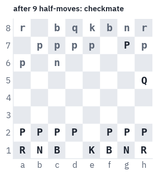

## 11. Where is the board?

The model writes legal moves most of the time, and a legal move depends on where every piece stands. Nothing in its input says where they stand: the text lists moves, and a square is mentioned only when a piece goes there.

To get `Nc6` right after twenty moves, the model has to have kept track of which knight is where and which squares are free. Does it keep a board somewhere, or has it found some other trick?

The question has a history. In 2022 Kenneth Li and colleagues trained an 8-layer GPT on the moves of Othello, a game with "a vocabulary of 60 words", and asked whether it kept the board <sup class="cite">[<a href="#ref-15" id="cite-15" data-ref="15" aria-label="Reference 15: Li, K., Hopkins, A. K., Bau, D., Viégas, F., Pfister, H., &amp; Wattenberg, M. (2023). Emergent world representations: exploring a sequence model trained on a synthetic task. ICLR 2023.">15</a>]</sup>.

Linear probes failed: their error rates "never dip below 20%", and the paper concluded the board was there in a nonlinear form.

A year later Neel Nanda and colleagues found that the board was linear after all, once you ask the right question: the model doesn't store squares as black and white, but "relative to the current player of each timestep (MINE, YOURS, EMPTY)", and a linear probe for that reads it at 99.6%<sup class="cite">[<a href="#ref-16" id="cite-16" data-ref="16" aria-label="Reference 16: Nanda, N., Lee, A., &amp; Wattenberg, M. (2023). Emergent linear representations in world models of self-supervised sequence models. BlackboxNLP 2023.">16</a>]</sup>.

Adam Karvonen then did the same for chess, with a model like ours trained for 72 hours on 16 million Lichess games, and read the board at 99.1% in its 8-layer model<sup class="cite">[<a href="#ref-14" id="cite-17" data-ref="14" aria-label="Reference 14: Karvonen, A. (2024). Emergent world models and latent variable estimation in chess-playing language models. COLM 2024.">14</a>]</sup>. Ours trained for 25 minutes.

A *linear probe* is the simplest way to ask. Take the residual stream after some layer at a position in the game, a vector $$h \in \mathbb{R}^{512}$$, and train a linear map $$W h + b$$ to predict, for every one of the 64 squares, which of 13 things stands on it: nothing, or one of the six White or six Black pieces.

If a linear map can read the board off the stream, the board is *there*, in the plainest form a network can hold anything: as directions in its space<sup class="cite">[<a href="#ref-17" id="cite-18" data-ref="17" aria-label="Reference 17: Alain, G., &amp; Bengio, Y. (2016). Understanding intermediate layers using linear classifier probes. arXiv:1610.01644.">17</a>]</sup>. The probe is trained on states of the frozen model; the model's weights don't move.

We read the stream at the dot after each move number, where White is about to move, from games the model never trained on.

At that moment "mine" is always White, so the two ways of labelling the board coincide. The same probe trained on an untrained model with the same architecture is the control: whatever it reads comes from the input itself, not from anything the model learned.

```python
@torch.no_grad()
def residual_states(model, games):
    features = [[] for _ in range(len(model.blocks) + 1)]
    labels = []
    for game in games:
        board = chess.Board()
        text, dots, boards = ";", [], []
        for i, move in enumerate(moves_of(game)):
            if i % 2 == 0:
                text += f"{i // 2 + 1}."
                if len(text) > CONTEXT:
                    break
                dots.append(len(text) - 1)  # the dot: White is about to move
                boards.append(board_classes(board))
            text += move + " "
            board.push_san(move)
        ids = torch.tensor([[stoi[char] for char in text[:CONTEXT]]], device=device)
        _, states = model(ids, keep_states=True)
        for layer, state in enumerate(states):
            features[layer].append(state[0, dots].float().cpu())
        labels.append(torch.from_numpy(np.stack(boards)))
    return [torch.cat(layer) for layer in features], torch.cat(labels)


def train_probe(features, labels, epochs=12):
    mean, std = features.mean(dim=0), features.std(dim=0) + 1e-5  # standardised features
    x, y = ((features - mean) / std).to(device), labels.to(device)
    probe = nn.Linear(features.shape[1], 64 * 13).to(device)
    optimizer = torch.optim.AdamW(probe.parameters(), lr=3e-3, weight_decay=0.01)
    for _ in range(epochs):
        for batch in torch.randperm(len(x), device=device).split(1024):
            logits = probe(x[batch]).view(-1, 13)
            loss = F.cross_entropy(logits, y[batch].view(-1))
            optimizer.zero_grad()
            loss.backward()
            optimizer.step()
    def read(h):
        logits = probe(((h - mean) / std).to(device)).view(-1, 64, 13)
        return logits.argmax(dim=-1).cpu()
    return read


def probe_scores(read, features, labels):
    with torch.no_grad():
        predicted = read(features)
    correct = predicted == labels
    return {"all squares": correct.float().mean().item(),
            "occupied squares": correct[labels > 0].float().mean().item(),
            "whole board right": correct.all(dim=1).float().mean().item()}


probe_train, probe_test = test_games[:400 if SMOKE else 3000], test_games[3000:3600]
if SMOKE:
    probe_test = test_games[400:480]
torch.manual_seed(SEED)
untrained = GPT(chess_config)
init_like_gpt2(untrained, chess_config["n_layer"])
untrained = untrained.to(device).eval()

MODELS = {"untrained": untrained, "ours, 25 minutes": chess_gpt,
          "Karvonen's, 72 hours": karvonen}
rows, readers, test_features = [], {}, {}
for name, model in MODELS.items():
    train_x, train_y = residual_states(model, probe_train)
    test_x, test_y = residual_states(model, probe_test)
    for layer in range(len(train_x)):
        read = train_probe(train_x[layer], train_y)
        readers[name, layer] = read
        scores = probe_scores(read, test_x[layer], test_y)
        rows.append({"model": name, "layer": layer, **scores})
    test_features[name] = test_x
probes = pd.DataFrame(rows)
print(f"{len(train_y):,} positions to train each probe, {len(test_y):,} to test it")
```

<pre class="tfs-printed" markdown="0"><code>103,308 positions to train each probe, 20,693 to test it</code></pre>

How much of the board each layer gives away, on the squares that hold a piece; the empty ones are easy, since
most of the board is empty most of the time:

```python
fig, ax = plt.subplots(figsize=(6.4, 3.4))
styles = {"untrained": COLORS["line"], "ours, 25 minutes": COLORS["data"],
          "Karvonen's, 72 hours": COLORS["dec"]}
for name, color in styles.items():
    part = probes[probes["model"] == name]
    ax.plot(part["layer"], part["occupied squares"], marker="o", color=color, label=name)
ax.set_xlabel("residual stream after layer (0 = embeddings)")
ax.set_ylabel("probe accuracy, occupied squares")
ax.set_ylim(0, 1)
ax.legend(frameon=False, loc="lower right")
plt.show()
best_rows = probes.loc[probes.groupby("model")["occupied squares"].idxmax()]
table(best_rows.set_index("model").loc[list(MODELS)].reset_index(), digits=3)
```

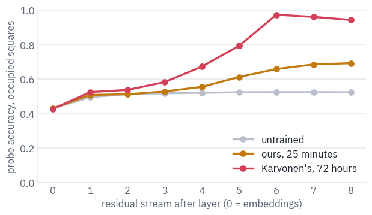

<div class="tfs-table-wrap"><table class="tfs-table" style="border-collapse:collapse;font-family:'IBM Plex Sans', -apple-system, 'Segoe UI', Roboto, Helvetica, Arial, sans-serif;font-size:13.5px;line-height:1.45;margin:4px 0 8px;"><thead><tr><th style="padding:7px 14px;border-bottom:2px solid #B9C0CB;font-weight:600;color:#5B6575;font-size:12px;letter-spacing:0.02em;text-align:left;">model</th><th style="padding:7px 14px;border-bottom:2px solid #B9C0CB;font-weight:600;color:#5B6575;font-size:12px;letter-spacing:0.02em;text-align:right;">layer</th><th style="padding:7px 14px;border-bottom:2px solid #B9C0CB;font-weight:600;color:#5B6575;font-size:12px;letter-spacing:0.02em;text-align:right;">all squares</th><th style="padding:7px 14px;border-bottom:2px solid #B9C0CB;font-weight:600;color:#5B6575;font-size:12px;letter-spacing:0.02em;text-align:right;">occupied squares</th><th style="padding:7px 14px;border-bottom:2px solid #B9C0CB;font-weight:600;color:#5B6575;font-size:12px;letter-spacing:0.02em;text-align:right;">whole board right</th></tr></thead><tbody><tr><td style="padding:7px 14px;border-bottom:1px solid #E6E9EE;vertical-align:top;text-align:left;max-width:460px;white-space:normal;">untrained</td><td style="padding:7px 14px;border-bottom:1px solid #E6E9EE;vertical-align:top;text-align:right;font-variant-numeric:tabular-nums;max-width:460px;white-space:normal;">7</td><td style="padding:7px 14px;border-bottom:1px solid #E6E9EE;vertical-align:top;text-align:right;font-variant-numeric:tabular-nums;max-width:460px;white-space:normal;">0.769</td><td style="padding:7px 14px;border-bottom:1px solid #E6E9EE;vertical-align:top;text-align:right;font-variant-numeric:tabular-nums;max-width:460px;white-space:normal;">0.523</td><td style="padding:7px 14px;border-bottom:1px solid #E6E9EE;vertical-align:top;text-align:right;font-variant-numeric:tabular-nums;max-width:460px;white-space:normal;">0.055</td></tr><tr><td style="padding:7px 14px;border-bottom:1px solid #E6E9EE;vertical-align:top;text-align:left;max-width:460px;white-space:normal;">ours, 25 minutes</td><td style="padding:7px 14px;border-bottom:1px solid #E6E9EE;vertical-align:top;text-align:right;font-variant-numeric:tabular-nums;max-width:460px;white-space:normal;">8</td><td style="padding:7px 14px;border-bottom:1px solid #E6E9EE;vertical-align:top;text-align:right;font-variant-numeric:tabular-nums;max-width:460px;white-space:normal;">0.842</td><td style="padding:7px 14px;border-bottom:1px solid #E6E9EE;vertical-align:top;text-align:right;font-variant-numeric:tabular-nums;max-width:460px;white-space:normal;">0.691</td><td style="padding:7px 14px;border-bottom:1px solid #E6E9EE;vertical-align:top;text-align:right;font-variant-numeric:tabular-nums;max-width:460px;white-space:normal;">0.113</td></tr><tr><td style="padding:7px 14px;border-bottom:1px solid #E6E9EE;vertical-align:top;text-align:left;max-width:460px;white-space:normal;">Karvonen&#x27;s, 72 hours</td><td style="padding:7px 14px;border-bottom:1px solid #E6E9EE;vertical-align:top;text-align:right;font-variant-numeric:tabular-nums;max-width:460px;white-space:normal;">6</td><td style="padding:7px 14px;border-bottom:1px solid #E6E9EE;vertical-align:top;text-align:right;font-variant-numeric:tabular-nums;max-width:460px;white-space:normal;">0.984</td><td style="padding:7px 14px;border-bottom:1px solid #E6E9EE;vertical-align:top;text-align:right;font-variant-numeric:tabular-nums;max-width:460px;white-space:normal;">0.972</td><td style="padding:7px 14px;border-bottom:1px solid #E6E9EE;vertical-align:top;text-align:right;font-variant-numeric:tabular-nums;max-width:460px;white-space:normal;">0.523</td></tr></tbody></table></div>

The untrained model sets the floor. About half of the occupied squares can be read from any network's stream, because the input gives a lot away: a piece that has never moved is where it started, and the last move says where one piece went.

Karvonen's model climbs far above that floor in the middle of its stack. After layer 6 the probe reads 97.2% of the occupied squares, 98.4% of all squares, and the whole board without a single mistake in 52% of the positions; the last two layers give a little back as they turn the board into the next move.

His paper found the peak at the same place, "the 8 layer model obtains peak accuracy at layer 6".

Ours, after 25 minutes, reads 69% of the occupied squares, and its curve is still rising at the last layer: the
board is under construction. Nobody asked either model for a board. Predicting the next character of a game
record was enough to make one, and a single matrix can read it off.

What the probes see, on one position from a held-out game: the real board, and the board read off the residual
stream of each trained model, at the layer where Karvonen's model holds it best. Squares a probe gets wrong are
outlined.

```python
layer = int(best_rows.set_index("model").loc["Karvonen's, 72 hours", "layer"])
index = len(test_y) // 2
truth = test_y[index].numpy()
fig, axes = plt.subplots(1, 3, figsize=(9.6, 3.6))
draw_board(axes[0], truth, "the real board")
for ax, name in zip(axes[1:], ["ours, 25 minutes", "Karvonen's, 72 hours"]):
    features = test_features[name][layer][index:index + 1]
    board_read = readers[name, layer](features)[0].numpy()
    draw_board(ax, board_read, f"{name}, layer {layer}", truth)
plt.tight_layout()
plt.show()
```

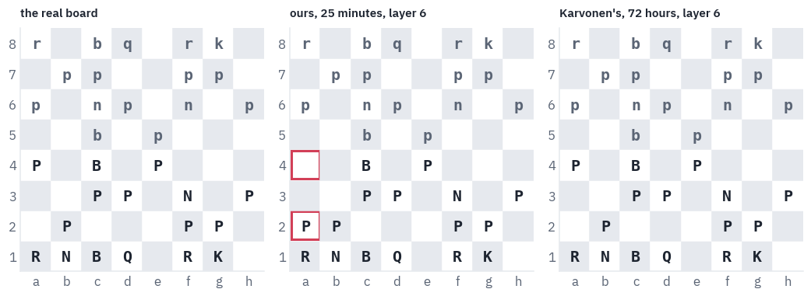

Karvonen's model reads this position without a mistake. Ours gets all of it but one pawn, and the mistake is telling: the pawn went from a2 to a4 long ago, and our probe still finds it on a2, its square at the start of the game.

A model that has half learned to track the board falls back on what boards usually look like.

## 12. Where GPT is the right tool today

GPT-2 itself has retired from every job but two. It is the laboratory animal of interpretability: open, small enough to run anywhere, and studied so thoroughly that new methods are usually shown on it first, the way the logit lens was.

And it is the reference decoder that people rebuild to learn how one works, as you just did. For writing, answering and following instructions, use a modern open model; lesson 6 is about what changed in them.

The decoder-only design, on the other hand, is everywhere. Every chat model is one, and so are the models that write code or treat proteins, music or clicks as sequences of tokens.

The chess model shows why the design spread: give a GPT a sequence of symbols with structure, and next-token prediction alone makes it learn the structure, here the rules and the board, without anyone writing them down. It also shows the limit.

Predicting the next move of players rated 1800 is not the same as playing well; Carlini's gpt-3.5-turbo-instruct answered one of the worst openings in chess with the same opening.

<blockquote class="pull" markdown="1">
It's important to remember, though, that this model is not playing to win. It's playing to maximize the
likelihood of the PGN text that's been provided.

<cite>Nicholas Carlini, 2023</cite>
</blockquote>

DeepMind trained a 270-million-parameter Transformer on Stockfish's evaluations of positions instead of human moves, and it reached a Lichess blitz rating of 2895 against humans without any search<sup class="cite">[<a href="#ref-2" id="cite-19" data-ref="2" aria-label="Reference 2: Ruoss, A., Delétang, G., Medapati, S., Grau-Moya, J., Wenliang, L. K., Catt, E., Reid, J., Lewis, C. A., Veness, J., &amp; Genewein, T. (2024). Amortized planning with large-scale transformers: a case study on chess. NeurIPS 2024.">2</a>]</sup>.

When Kaggle and Google DeepMind ran a chess tournament for frontier language models in August 2025, o3 beat Grok 4 4–0 in the final, and the organisers wrote that engines like Stockfish "would beat every frontier model without a doubt" <sup class="cite">[<a href="#ref-18" id="cite-20" data-ref="18" aria-label="Reference 18: Google, 2025. blog.google.">18</a>]</sup>. A language model plays the game its data plays.

GPT-2's passport, and the family tree with this lesson's branch:


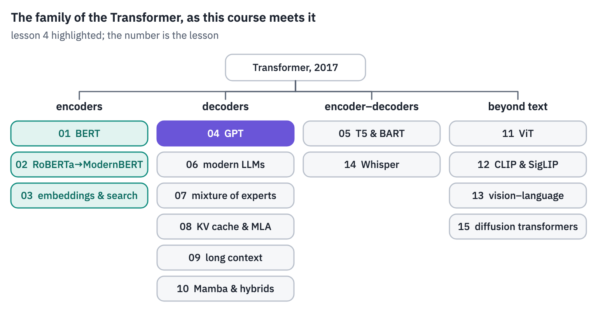
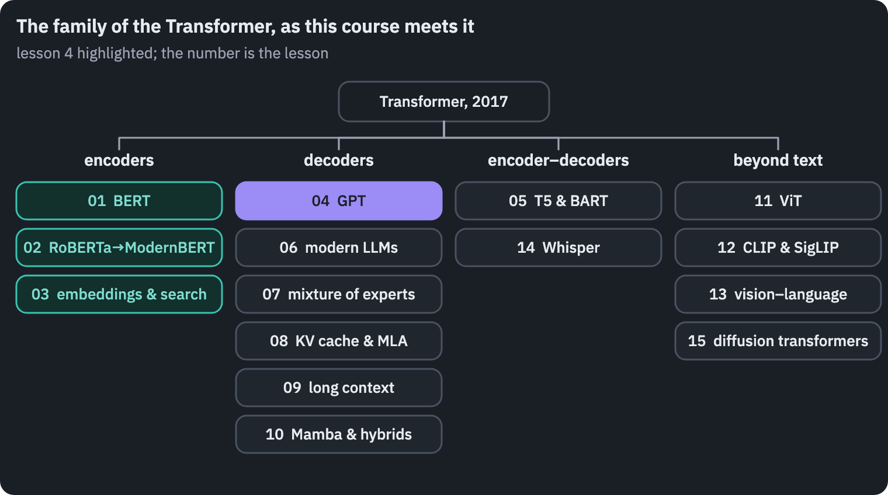

## References

1. {:#ref-1} Carlini, N. (2023). [Playing chess with large language models](https://nicholas.carlini.com/writing/2023/chess-llm.html). <a class="ref-back" href="#cite-1" aria-label="Back to the text">&#8617;</a>
2. {:#ref-2} Ruoss, A., Delétang, G., Medapati, S., Grau-Moya, J., Wenliang, L. K., Catt, E., Reid, J., Lewis, C. A., Veness, J., & Genewein, T. (2024). [Amortized planning with large-scale transformers: a case study on chess](https://arxiv.org/abs/2402.04494). *NeurIPS 2024*. <a class="ref-back" href="#cite-2" aria-label="Back to the text">&#8617;</a>
3. {:#ref-3} Dynomight (2024). [Something weird is happening with LLMs and chess](https://dynomight.net/chess/). <a class="ref-back" href="#cite-3" aria-label="Back to the text">&#8617;</a>
4. {:#ref-4} Burns, C., Izmailov, P., Kirchner, J. H., Baker, B., Gao, L., Aschenbrenner, L., Chen, Y., Ecoffet, A., Joglekar, M., Leike, J., Sutskever, I., & Wu, J. (2023). [Weak-to-strong generalization: eliciting strong capabilities with weak supervision](https://arxiv.org/abs/2312.09390). arXiv:2312.09390. <a class="ref-back" href="#cite-4" aria-label="Back to the text">&#8617;</a>
5. {:#ref-5} Radford, A., Narasimhan, K., Salimans, T., & Sutskever, I. (2018). [Improving language understanding by generative pre-training](https://cdn.openai.com/research-covers/language-unsupervised/language_understanding_paper.pdf). OpenAI. <a class="ref-back" href="#cite-5" aria-label="Back to the text">&#8617;</a>
6. {:#ref-6} OpenAI, 2019. [openai.com](https://openai.com/index/better-language-models/). <a class="ref-back" href="#cite-6" aria-label="Back to the text">&#8617;</a>
7. {:#ref-7} Radford, A., Wu, J., Child, R., Luan, D., Amodei, D., & Sutskever, I. (2019). [Language models are unsupervised multitask learners](https://cdn.openai.com/better-language-models/language_models_are_unsupervised_multitask_learners.pdf). OpenAI. <a class="ref-back" href="#cite-7" aria-label="Back to the text">&#8617;</a>
8. {:#ref-8} Brown, T. B., Mann, B., Ryder, N., Subbiah, M., et al. (2020). [Language models are few-shot learners](https://arxiv.org/abs/2005.14165). *NeurIPS 2020*. <a class="ref-back" href="#cite-8" aria-label="Back to the text">&#8617;</a>
9. {:#ref-9} Xiong, R., Yang, Y., He, D., Zheng, K., Zheng, S., Xing, C., Zhang, H., Lan, Y., Wang, L., & Liu, T.-Y. (2020). [On layer normalization in the Transformer architecture](https://arxiv.org/abs/2002.04745). *ICML 2020*. <a class="ref-back" href="#cite-9" aria-label="Back to the text">&#8617;</a>
10. {:#ref-10} Press, O., & Wolf, L. (2017). [Using the output embedding to improve language models](https://arxiv.org/abs/1608.05859). *EACL 2017*. <a class="ref-back" href="#cite-10" aria-label="Back to the text">&#8617;</a>
11. {:#ref-11} nostalgebraist (2020). [interpreting GPT: the logit lens](https://www.lesswrong.com/posts/AcKRB8wDpdaN6v6ru/interpreting-gpt-the-logit-lens). LessWrong. <a class="ref-back" href="#cite-11" aria-label="Back to the text">&#8617;</a>
12. {:#ref-12} Belrose, N., Ostrovsky, I., McKinney, L., Furman, Z., Smith, L., Halawi, D., Biderman, S., & Steinhardt, J. (2023). [Eliciting latent predictions from transformers with the tuned lens](https://arxiv.org/abs/2303.08112). arXiv:2303.08112. <a class="ref-back" href="#cite-12" aria-label="Back to the text">&#8617;</a>
13. {:#ref-13} Lichess (2026). [Lichess open database](https://database.lichess.org/). CC0. <a class="ref-back" href="#cite-13" aria-label="Back to the text">&#8617;</a>
14. {:#ref-14} Karvonen, A. (2024). [Emergent world models and latent variable estimation in chess-playing language models](https://arxiv.org/abs/2403.15498). *COLM 2024*. <a class="ref-back" href="#cite-14" aria-label="Back to the text">&#8617;</a>
15. {:#ref-15} Li, K., Hopkins, A. K., Bau, D., Viégas, F., Pfister, H., & Wattenberg, M. (2023). [Emergent world representations: exploring a sequence model trained on a synthetic task](https://arxiv.org/abs/2210.13382). *ICLR 2023*. <a class="ref-back" href="#cite-15" aria-label="Back to the text">&#8617;</a>
16. {:#ref-16} Nanda, N., Lee, A., & Wattenberg, M. (2023). [Emergent linear representations in world models of self-supervised sequence models](https://arxiv.org/abs/2309.00941). *BlackboxNLP 2023*. <a class="ref-back" href="#cite-16" aria-label="Back to the text">&#8617;</a>
17. {:#ref-17} Alain, G., & Bengio, Y. (2016). [Understanding intermediate layers using linear classifier probes](https://arxiv.org/abs/1610.01644). arXiv:1610.01644. <a class="ref-back" href="#cite-18" aria-label="Back to the text">&#8617;</a>
18. {:#ref-18} Google, 2025. [blog.google](https://blog.google/technology/ai/kaggle-game-arena/). <a class="ref-back" href="#cite-20" aria-label="Back to the text">&#8617;</a>
19. {:#ref-19} Toshniwal, S., Wiseman, S., Livescu, K., & Gimpel, K. (2022). [Chess as a testbed for language model state tracking](https://arxiv.org/abs/2102.13249). *AAAI 2022*.
20. {:#ref-20} Shannon, C. E. (1950). Programming a computer for playing chess. *Philosophical Magazine*, 41(314).
{: .tfs-refs}


<p class="tfs-neighbours"><a href="/blog/2026/transformer-architectures-03-search/">← Lesson 3: Embeddings & search</a></p>


