

<p class="tfs-links"><strong>Transformer architectures: from BERT to diffusion</strong> · lesson 5 of 15 · <a href="/teaching/">all lessons</a> · <a href="https://www.kaggle.com/code/qmarva/transformer-architectures-05-t5-bart">run on Kaggle</a> · <a href="https://colab.research.google.com/github/xmarva/transformers-from-scratch/blob/main/notebooks/colab/a05_t5.ipynb">open in Colab</a> · <a href="https://github.com/xmarva/transformers-from-scratch">code on GitHub</a></p>

In 1961 four researchers at MIT's Lincoln Laboratory fed a computer questions on punched cards, such as "Where did the Red Sox play on July 7?" Their program, BASEBALL, turned each one into a list, `Place = ? Team = Red Sox Month = July Day = 7`, looked the answer up in the results of one American League season and printed it<sup class="cite">[<a href="#ref-1" id="cite-1" data-ref="1" aria-label="Reference 1: Green, B. F., Wolf, A. K., Chomsky, C., &amp; Laughery, K. (1961). Baseball: an automatic question-answerer. Western Joint IRE-AIEE-ACM Computer Conference, 219–224.">1</a>]</sup>.

The authors had bigger plans: "the business executive, the military commander, and the scientist need to ask questions of the computer in ordinary English".

Sixty-five years later, asking a database in English is a common feature, and the benchmark everyone measured it on, Spider, went from 12.4% of queries exactly right for the best model of 2018 to 86.6% of queries returning the right result for GPT-4 with careful prompting in 2023.

Then came Spider 2.0, built from real company databases "often containing over 1,000 columns", and o1-preview solved 21.3% of its tasks <sup class="cite">[<a href="#ref-2" id="cite-2" data-ref="2" aria-label="Reference 2: Lei, F., Chen, J., Ye, Y., et al. (2025). Spider 2.0: evaluating language models on real-world enterprise text-to-SQL workflows. ICLR 2025.">2</a>]</sup>.

A question in English and a query in SQL are two languages, and the architecture built for translating between languages is the encoder–decoder. Its most influential member is T5, Google's model of 2019 that turned every task into text in, text out.

For a while encoder–decoders led Spider: in 2021 T5-3B with a constrained decoder reached 75.1% on the test set. Then decoder-only models took over. But T5 never left: its encoder turns your prompt into the conditioning of Stable Diffusion 3 and FLUX, and in 2025 Google turned Gemma into an encoder–decoder.

In this lesson you will write T5 yourself, load Google's weights into it, look at what makes it different from BERT
and GPT, and fine-tune it on Spider for 20 minutes on a free GPU. Then you will run every query it writes and see
which ones are right.

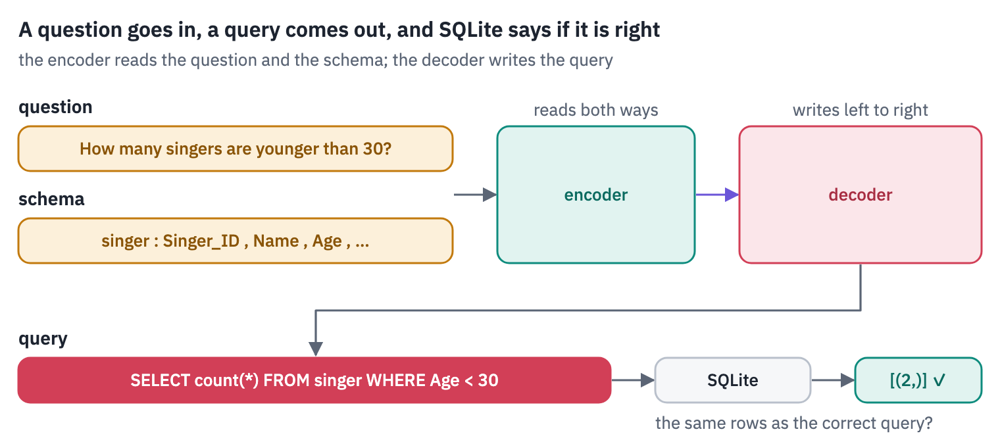
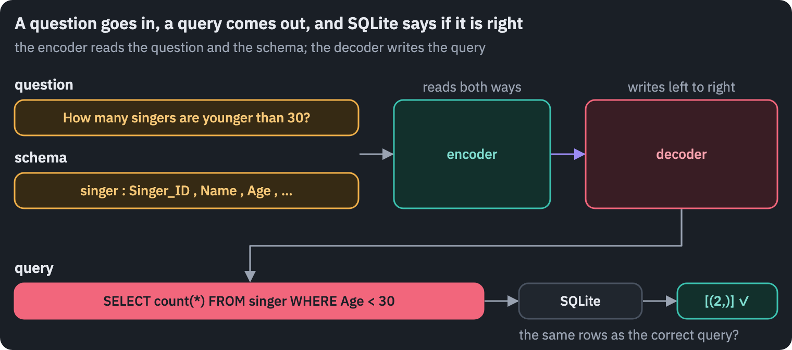

**What you'll do**

1. See how T5 turns every task into text in, text out, and make the smallest T5 translate, judge grammar
   and score similarity from a prefix.
2. Take the encoder–decoder apart: an encoder that reads the whole input, a decoder that writes, and the
   cross-attention that connects them.
3. Write T5 in PyTorch, with its unusual parts: a norm without a mean, attention without scaling and positions
   as 32 learned biases. Load Google's weights into it and match Hugging Face's outputs.
4. Look at what the position buckets learned, and watch the decoder find the source words while it translates.
5. Corrupt text the way T5 and BART were pre-trained, and let both models repair it.
6. Teach T5 to write SQL for databases it has never seen, check every query by running it, and let SQLite pick
   the best of several attempts.

**What you need**: a GPU. On Kaggle, *Settings → Accelerator → GPU*; on Colab, *Runtime → Change runtime type → T4
GPU*. The notebook downloads t5-small and t5-base (1.1 GB), BART (560 MB) and the Spider databases (200 MB), and
fine-tunes T5 for 20 minutes; on a T4 it runs in about 45 minutes.

## Setup

One small helper package, `tfs`, draws the course's plots and token chips and knows where the notebook runs
(Kaggle, Colab or your own machine). Everything the lesson teaches is written out in the notebook itself.

```python
import importlib.util
import subprocess
import sys

TFS = "git+https://github.com/xmarva/transformers-from-scratch@main"
if importlib.util.find_spec("tfs") is None:
    subprocess.check_call([sys.executable, "-m", "pip", "install", "-q", TFS])

from tfs import env
from tfs.viz import table, token_chips, use_course_style

env.quiet()  # no progress bars or environment warnings in the outputs
SEED = 42
env.seed_everything(SEED)
COLORS = use_course_style()
WORK_DIR = env.work_dir()
```

```python
import json
import math
import random
import re
import sqlite3
import time
import zipfile
from collections import Counter

import matplotlib.pyplot as plt
import numpy as np
import pandas as pd
import torch
import torch.nn as nn
import torch.nn.functional as F
from huggingface_hub import hf_hub_download
from matplotlib.colors import LinearSegmentedColormap
from safetensors.torch import load_file
from tfs.viz import heatmap
from transformers import AutoTokenizer
# the reference implementations, for the checks
from transformers import BartForConditionalGeneration, T5ForConditionalGeneration

SMOKE = env.smoke()  # CI runs the lesson on a small slice; you run it in full
device = "cuda" if torch.cuda.is_available() else "cpu"
assert device == "cuda" or SMOKE, "This lesson fine-tunes a model for 20 minutes: use a GPU"
if device == "cuda":
    print("GPU:", torch.cuda.get_device_name(0))
```

<pre class="tfs-printed" markdown="0"><code>GPU: Tesla T4</code></pre>

## 1. Every task as text

In October 2019 a Google team published a 67-page study built on one idea: "Every task we consider—including translation, question answering, and classification—is cast as feeding our model text as input and training it to generate some target text"<sup class="cite">[<a href="#ref-3" id="cite-3" data-ref="3" aria-label="Reference 3: Raffel, C., Shazeer, N., Roberts, A., Lee, K., Narang, S., Matena, M., Zhou, Y., Li, W., &amp; Liu, P. J. (2020). Exploring the limits of transfer learning with a unified text-to-text transformer. Journal of Machine Learning Research, 21(140), 1–67.">3</a>]</sup>. They named the model the Text-to-Text Transfer Transformer, T5.

A task is chosen by a prefix written in plain words, `translate English to German:` or `cola sentence:` for grammaticality, and a class is a word, *acceptable* or *not acceptable*. Even regression became text.

STS-B asks how similar two sentences are, on a scale up to 5; T5 rounded the scores to steps of 0.2 and wrote them out as strings like "3.8", which recasts the regression as "a 21-class classification problem".

The paper is remembered as much for its method as for the idea: on one setup it compared nearly every choice people argued about in 2019, from architectures and objectives to datasets, multi-task training and scale. Its dataset became a standard of its own.

C4, the Colossal Clean Crawled Corpus, is about 750 GB of English cut from one month of Common Crawl, April 2019, by blunt rules: keep only lines that end in a full stop or similar mark, drop pages with fewer than three sentences, pages with any word from a list of "Dirty, Naughty, Obscene or Otherwise Bad Words", pages with "lorem ipsum", and any page with a curly bracket, since "the curly bracket “{” appears in many programming languages […] but not in natural text".

Code was not what C4 was for, and section 8 shows one thing that cost.

The original T5 checkpoints were pre-trained on a mixture of C4 and the paper's supervised tasks, translation and
summarisation among them. That is why the smallest of them still knows its prefixes. Here are four of them in five
prompts, one model with no task-specific layer:

```python
T5_SMALL = "google-t5/t5-small"
tokenizer = AutoTokenizer.from_pretrained(T5_SMALL)
reference = T5ForConditionalGeneration.from_pretrained(T5_SMALL).to(device).eval()

prompts = [
    "translate English to German: The guards arrive at the museum at seven in the morning.",
    "translate English to French: The night train to Vienna leaves at eleven.",
    "cola sentence: The guards arrives at the museum at seven.",
    "stsb sentence1: The night train leaves at eleven. "
    "sentence2: At eleven the night train departs.",
    "stsb sentence1: The night train leaves at eleven. "
    "sentence2: The museum opens at nine.",
]
batch = tokenizer(prompts, return_tensors="pt", padding=True).to(device)
with torch.no_grad():
    answers = reference.generate(**batch, max_new_tokens=40, num_beams=1, do_sample=False)
answers = tokenizer.batch_decode(answers, skip_special_tokens=True)
table(pd.DataFrame({"prompt": prompts, "answer": answers}))
```

<div class="tfs-table-wrap"><table class="tfs-table" style="border-collapse:collapse;font-family:'IBM Plex Sans', -apple-system, 'Segoe UI', Roboto, Helvetica, Arial, sans-serif;font-size:13.5px;line-height:1.45;margin:4px 0 8px;"><thead><tr><th style="padding:7px 14px;border-bottom:2px solid #B9C0CB;font-weight:600;color:#5B6575;font-size:12px;letter-spacing:0.02em;text-align:left;">prompt</th><th style="padding:7px 14px;border-bottom:2px solid #B9C0CB;font-weight:600;color:#5B6575;font-size:12px;letter-spacing:0.02em;text-align:left;">answer</th></tr></thead><tbody><tr><td style="padding:7px 14px;border-bottom:1px solid #E6E9EE;vertical-align:top;text-align:left;max-width:460px;white-space:normal;">translate English to German: The guards arrive at the museum at seven in the morning.</td><td style="padding:7px 14px;border-bottom:1px solid #E6E9EE;vertical-align:top;text-align:left;max-width:460px;white-space:normal;">Die Wachen kommen morgens um sieben Uhr im Museum an.</td></tr><tr><td style="padding:7px 14px;border-bottom:1px solid #E6E9EE;vertical-align:top;text-align:left;max-width:460px;white-space:normal;">translate English to French: The night train to Vienna leaves at eleven.</td><td style="padding:7px 14px;border-bottom:1px solid #E6E9EE;vertical-align:top;text-align:left;max-width:460px;white-space:normal;">Le train de nuit à Vienne quitte à 11 heures.</td></tr><tr><td style="padding:7px 14px;border-bottom:1px solid #E6E9EE;vertical-align:top;text-align:left;max-width:460px;white-space:normal;">cola sentence: The guards arrives at the museum at seven.</td><td style="padding:7px 14px;border-bottom:1px solid #E6E9EE;vertical-align:top;text-align:left;max-width:460px;white-space:normal;">acceptable</td></tr><tr><td style="padding:7px 14px;border-bottom:1px solid #E6E9EE;vertical-align:top;text-align:left;max-width:460px;white-space:normal;">stsb sentence1: The night train leaves at eleven. sentence2: At eleven the night train departs.</td><td style="padding:7px 14px;border-bottom:1px solid #E6E9EE;vertical-align:top;text-align:left;max-width:460px;white-space:normal;">5.0</td></tr><tr><td style="padding:7px 14px;border-bottom:1px solid #E6E9EE;vertical-align:top;text-align:left;max-width:460px;white-space:normal;">stsb sentence1: The night train leaves at eleven. sentence2: The museum opens at nine.</td><td style="padding:7px 14px;border-bottom:1px solid #E6E9EE;vertical-align:top;text-align:left;max-width:460px;white-space:normal;">0.0</td></tr></tbody></table></div>

The translations are right, and the similarity scores come back as text: 5.0 for a paraphrase and 0.0 for two sentences that have nothing in common. The grammar judgement is wrong.

"The guards arrives at the museum at seven" is called acceptable, a reminder that a prefix asks for a task and doesn't promise the model can do it. This is the smallest T5, with 60 million parameters.

## 2. Two stacks and a bridge

BERT, in lesson 1, was an encoder: it read a whole text at once, every token looking at every other, and turned it into vectors. GPT, in lesson 4, was a decoder: it wrote text one token at a time, each token looking only at the ones before it.

The original Transformer of 2017 was both, because it was built for translation, where the input and the output are different texts. T5 and BART went back to that design.


The encoder turns the $$S$$ input tokens into a matrix $$H \in \mathbb{R}^{S \times d}$$, once. The decoder has, in
every layer, one part that neither BERT nor GPT had: *cross-attention*. It is ordinary attention with the
queries taken from the decoder's own stream $$Y \in \mathbb{R}^{T \times d}$$ and the keys and values taken from
the encoder's output:

$$\begin{aligned} &\text{CrossAttention}(Y, H) \\ &\quad = \text{softmax}\!\left(\frac{(Y W_Q)(H W_K)^\top}{\sqrt{d_k}}
\right) H W_V. \end{aligned}$$

The matrix of scores is $$T \times S$$: each of the $$T$$ positions being written looks at all $$S$$ positions of the
input, and no mask is needed, since the input is complete before the first word is written. Self-attention in the
decoder stays causal, as in GPT.

Two consequences follow, and both matter for the rest of this lesson. The input is read with full context in
both directions, as BERT reads, and it is read once: generating $$T$$ tokens runs the encoder once and the decoder
$$T$$ times. And the parameters are split between two stacks: t5-small has 6 encoder layers and 6 decoder
layers, so a token of output passes through only half of the model.

## 3. T5 in PyTorch

T5's layer has the familiar shape, pre-norm with a residual around each part, as in GPT-2. Four details differ,
and each is a decision the T5 paper made on purpose.

**A norm without a mean.** LayerNorm subtracts the mean of a vector, divides by the standard deviation, scales and
shifts. T5's norm only rescales:

$$\text{RMSNorm}(x) = g \odot \frac{x}{\sqrt{\frac{1}{d}\sum_{i=1}^{d} x_i^2 + \varepsilon}}.$$

Here $$g$$ is a learned vector of scales and $$\varepsilon = 10^{-6}$$ guards against division by zero. No mean is subtracted and no bias is added.

The idea has its own name and paper, RMSNorm <sup class="cite">[<a href="#ref-4" id="cite-4" data-ref="4" aria-label="Reference 4: Zhang, B., &amp; Sennrich, R. (2019). Root mean square layer normalization. NeurIPS 2019.">4</a>]</sup>, which argues that the rescaling, not the centring, is what makes LayerNorm work, and it is the norm of Llama, Qwen and nearly every model since. PyTorch has it built in, which makes for an easy check:

```python
class Norm(nn.Module):
    def __init__(self, d, eps):
        super().__init__()
        self.weight = nn.Parameter(torch.ones(d))
        self.eps = eps

    def forward(self, x):
        variance = x.float().pow(2).mean(dim=-1, keepdim=True)
        x = x.float() * torch.rsqrt(variance + self.eps)
        return self.weight * x.to(self.weight.dtype)


x = torch.randn(2, 5, 8)
mine, builtin = Norm(8, 1e-6), nn.RMSNorm(8, eps=1e-6)
print("largest difference from nn.RMSNorm:", (mine(x) - builtin(x)).abs().max().item())
```

<pre class="tfs-printed" markdown="0"><code>largest difference from nn.RMSNorm: 0.0</code></pre>

**Attention without $$\sqrt{d_k}$$.** T5 drops the division by $$\sqrt{d_k}$$ in the scores. Nothing is lost: Google's initialisation draws the query matrix with a standard deviation $$\sqrt{d_k}$$ times smaller than the key matrix's, which has the same effect when training starts, and training adjusts it from there.

A transplant has to leave the division out too, or every score comes out eight times too small.

**Positions as a bias.** T5 has no position embeddings at all. Instead, each attention head adds a learned number
to each score, which depends only on how far the key is from the query:

$$s_{ij} = q_i \cdot k_j + b_h\big(\text{bucket}(j - i)\big).$$

The distances are sorted into 32 buckets. In the encoder, which looks both ways, half of the buckets are for keys to the left and half for keys to the right.

Within each half, the first 8 distances get a bucket each, and the rest share the remaining 8 buckets on a logarithmic scale up to a distance of 128; anything farther falls into the last bucket.

Near words get precise positions, far ones only a rough sense of "far". The decoder looks only back, so it uses all 32 buckets for distances to the left.

Written out for the encoder, with $$n = \lvert j - i \rvert$$ the distance between key and query, the bucket within
one half is

$$b(n) = \begin{cases} n, & n < 8, \\ \min\big(15,\; f(n)\big), & n \ge 8, \end{cases}$$

where

$$f(n) = 8 + \left\lfloor 8 \cdot \dfrac{\ln(n/8)}{\ln(128/8)} \right\rfloor,$$

and keys to the right of the query get $$b(n) + 16$$. The logarithm spreads the eight far buckets so that each covers a range about 1.4 times wider than the one before: distances 8 to 11 share a bucket, then 12 to 15, 16 to 22, and the last one starts at 91 and takes everything farther.

The decoder uses the same rule with 16 exact distances and 16 far buckets, $$16 + \lfloor 16 \cdot \ln(n/16) / \ln(128/16) \rfloor$$, capped at 31.

```python
def position_bucket(relative, bidirectional, buckets=32, max_distance=128):
    bucket = torch.zeros_like(relative)
    if bidirectional:
        buckets = buckets // 2
        # keys to the right of the query get the upper half of the buckets
        bucket = bucket + (relative > 0).long() * buckets
        distance = relative.abs()
    else:
        distance = (-relative).clamp(min=0)  # the decoder only looks back
    exact = buckets // 2
    log_distance = torch.log(distance.clamp(min=1).float() / exact)
    scaled = log_distance / math.log(max_distance / exact)
    far = exact + (scaled * (buckets - exact)).long()
    far = far.clamp(max=buckets - 1)
    return bucket + torch.where(distance < exact, distance, far)


relative = torch.tensor([-300, -128, -64, -20, -9, -8, -7, -1,
                         0, 1, 7, 8, 20, 64, 128, 300])
table(pd.DataFrame({"key minus query": relative.tolist(),
                    "encoder bucket": position_bucket(relative, True).tolist(),
                    "decoder bucket": position_bucket(relative, False).tolist()}))
```

<div class="tfs-table-wrap"><table class="tfs-table" style="border-collapse:collapse;font-family:'IBM Plex Sans', -apple-system, 'Segoe UI', Roboto, Helvetica, Arial, sans-serif;font-size:13.5px;line-height:1.45;margin:4px 0 8px;"><thead><tr><th style="padding:7px 14px;border-bottom:2px solid #B9C0CB;font-weight:600;color:#5B6575;font-size:12px;letter-spacing:0.02em;text-align:right;">key minus query</th><th style="padding:7px 14px;border-bottom:2px solid #B9C0CB;font-weight:600;color:#5B6575;font-size:12px;letter-spacing:0.02em;text-align:right;">encoder bucket</th><th style="padding:7px 14px;border-bottom:2px solid #B9C0CB;font-weight:600;color:#5B6575;font-size:12px;letter-spacing:0.02em;text-align:right;">decoder bucket</th></tr></thead><tbody><tr><td style="padding:7px 14px;border-bottom:1px solid #E6E9EE;vertical-align:top;text-align:right;font-variant-numeric:tabular-nums;max-width:460px;white-space:normal;">-300</td><td style="padding:7px 14px;border-bottom:1px solid #E6E9EE;vertical-align:top;text-align:right;font-variant-numeric:tabular-nums;max-width:460px;white-space:normal;">15</td><td style="padding:7px 14px;border-bottom:1px solid #E6E9EE;vertical-align:top;text-align:right;font-variant-numeric:tabular-nums;max-width:460px;white-space:normal;">31</td></tr><tr><td style="padding:7px 14px;border-bottom:1px solid #E6E9EE;vertical-align:top;text-align:right;font-variant-numeric:tabular-nums;max-width:460px;white-space:normal;">-128</td><td style="padding:7px 14px;border-bottom:1px solid #E6E9EE;vertical-align:top;text-align:right;font-variant-numeric:tabular-nums;max-width:460px;white-space:normal;">15</td><td style="padding:7px 14px;border-bottom:1px solid #E6E9EE;vertical-align:top;text-align:right;font-variant-numeric:tabular-nums;max-width:460px;white-space:normal;">31</td></tr><tr><td style="padding:7px 14px;border-bottom:1px solid #E6E9EE;vertical-align:top;text-align:right;font-variant-numeric:tabular-nums;max-width:460px;white-space:normal;">-64</td><td style="padding:7px 14px;border-bottom:1px solid #E6E9EE;vertical-align:top;text-align:right;font-variant-numeric:tabular-nums;max-width:460px;white-space:normal;">14</td><td style="padding:7px 14px;border-bottom:1px solid #E6E9EE;vertical-align:top;text-align:right;font-variant-numeric:tabular-nums;max-width:460px;white-space:normal;">26</td></tr><tr><td style="padding:7px 14px;border-bottom:1px solid #E6E9EE;vertical-align:top;text-align:right;font-variant-numeric:tabular-nums;max-width:460px;white-space:normal;">-20</td><td style="padding:7px 14px;border-bottom:1px solid #E6E9EE;vertical-align:top;text-align:right;font-variant-numeric:tabular-nums;max-width:460px;white-space:normal;">10</td><td style="padding:7px 14px;border-bottom:1px solid #E6E9EE;vertical-align:top;text-align:right;font-variant-numeric:tabular-nums;max-width:460px;white-space:normal;">17</td></tr><tr><td style="padding:7px 14px;border-bottom:1px solid #E6E9EE;vertical-align:top;text-align:right;font-variant-numeric:tabular-nums;max-width:460px;white-space:normal;">-9</td><td style="padding:7px 14px;border-bottom:1px solid #E6E9EE;vertical-align:top;text-align:right;font-variant-numeric:tabular-nums;max-width:460px;white-space:normal;">8</td><td style="padding:7px 14px;border-bottom:1px solid #E6E9EE;vertical-align:top;text-align:right;font-variant-numeric:tabular-nums;max-width:460px;white-space:normal;">9</td></tr><tr><td style="padding:7px 14px;border-bottom:1px solid #E6E9EE;vertical-align:top;text-align:right;font-variant-numeric:tabular-nums;max-width:460px;white-space:normal;">-8</td><td style="padding:7px 14px;border-bottom:1px solid #E6E9EE;vertical-align:top;text-align:right;font-variant-numeric:tabular-nums;max-width:460px;white-space:normal;">8</td><td style="padding:7px 14px;border-bottom:1px solid #E6E9EE;vertical-align:top;text-align:right;font-variant-numeric:tabular-nums;max-width:460px;white-space:normal;">8</td></tr><tr><td style="padding:7px 14px;border-bottom:1px solid #E6E9EE;vertical-align:top;text-align:right;font-variant-numeric:tabular-nums;max-width:460px;white-space:normal;">-7</td><td style="padding:7px 14px;border-bottom:1px solid #E6E9EE;vertical-align:top;text-align:right;font-variant-numeric:tabular-nums;max-width:460px;white-space:normal;">7</td><td style="padding:7px 14px;border-bottom:1px solid #E6E9EE;vertical-align:top;text-align:right;font-variant-numeric:tabular-nums;max-width:460px;white-space:normal;">7</td></tr><tr><td style="padding:7px 14px;border-bottom:1px solid #E6E9EE;vertical-align:top;text-align:right;font-variant-numeric:tabular-nums;max-width:460px;white-space:normal;">-1</td><td style="padding:7px 14px;border-bottom:1px solid #E6E9EE;vertical-align:top;text-align:right;font-variant-numeric:tabular-nums;max-width:460px;white-space:normal;">1</td><td style="padding:7px 14px;border-bottom:1px solid #E6E9EE;vertical-align:top;text-align:right;font-variant-numeric:tabular-nums;max-width:460px;white-space:normal;">1</td></tr><tr><td style="padding:7px 14px;border-bottom:1px solid #E6E9EE;vertical-align:top;text-align:right;font-variant-numeric:tabular-nums;max-width:460px;white-space:normal;">0</td><td style="padding:7px 14px;border-bottom:1px solid #E6E9EE;vertical-align:top;text-align:right;font-variant-numeric:tabular-nums;max-width:460px;white-space:normal;">0</td><td style="padding:7px 14px;border-bottom:1px solid #E6E9EE;vertical-align:top;text-align:right;font-variant-numeric:tabular-nums;max-width:460px;white-space:normal;">0</td></tr><tr><td style="padding:7px 14px;border-bottom:1px solid #E6E9EE;vertical-align:top;text-align:right;font-variant-numeric:tabular-nums;max-width:460px;white-space:normal;">1</td><td style="padding:7px 14px;border-bottom:1px solid #E6E9EE;vertical-align:top;text-align:right;font-variant-numeric:tabular-nums;max-width:460px;white-space:normal;">17</td><td style="padding:7px 14px;border-bottom:1px solid #E6E9EE;vertical-align:top;text-align:right;font-variant-numeric:tabular-nums;max-width:460px;white-space:normal;">0</td></tr><tr><td style="padding:7px 14px;border-bottom:1px solid #E6E9EE;vertical-align:top;text-align:right;font-variant-numeric:tabular-nums;max-width:460px;white-space:normal;">7</td><td style="padding:7px 14px;border-bottom:1px solid #E6E9EE;vertical-align:top;text-align:right;font-variant-numeric:tabular-nums;max-width:460px;white-space:normal;">23</td><td style="padding:7px 14px;border-bottom:1px solid #E6E9EE;vertical-align:top;text-align:right;font-variant-numeric:tabular-nums;max-width:460px;white-space:normal;">0</td></tr><tr><td style="padding:7px 14px;border-bottom:1px solid #E6E9EE;vertical-align:top;text-align:right;font-variant-numeric:tabular-nums;max-width:460px;white-space:normal;">8</td><td style="padding:7px 14px;border-bottom:1px solid #E6E9EE;vertical-align:top;text-align:right;font-variant-numeric:tabular-nums;max-width:460px;white-space:normal;">24</td><td style="padding:7px 14px;border-bottom:1px solid #E6E9EE;vertical-align:top;text-align:right;font-variant-numeric:tabular-nums;max-width:460px;white-space:normal;">0</td></tr><tr><td style="padding:7px 14px;border-bottom:1px solid #E6E9EE;vertical-align:top;text-align:right;font-variant-numeric:tabular-nums;max-width:460px;white-space:normal;">20</td><td style="padding:7px 14px;border-bottom:1px solid #E6E9EE;vertical-align:top;text-align:right;font-variant-numeric:tabular-nums;max-width:460px;white-space:normal;">26</td><td style="padding:7px 14px;border-bottom:1px solid #E6E9EE;vertical-align:top;text-align:right;font-variant-numeric:tabular-nums;max-width:460px;white-space:normal;">0</td></tr><tr><td style="padding:7px 14px;border-bottom:1px solid #E6E9EE;vertical-align:top;text-align:right;font-variant-numeric:tabular-nums;max-width:460px;white-space:normal;">64</td><td style="padding:7px 14px;border-bottom:1px solid #E6E9EE;vertical-align:top;text-align:right;font-variant-numeric:tabular-nums;max-width:460px;white-space:normal;">30</td><td style="padding:7px 14px;border-bottom:1px solid #E6E9EE;vertical-align:top;text-align:right;font-variant-numeric:tabular-nums;max-width:460px;white-space:normal;">0</td></tr><tr><td style="padding:7px 14px;border-bottom:1px solid #E6E9EE;vertical-align:top;text-align:right;font-variant-numeric:tabular-nums;max-width:460px;white-space:normal;">128</td><td style="padding:7px 14px;border-bottom:1px solid #E6E9EE;vertical-align:top;text-align:right;font-variant-numeric:tabular-nums;max-width:460px;white-space:normal;">31</td><td style="padding:7px 14px;border-bottom:1px solid #E6E9EE;vertical-align:top;text-align:right;font-variant-numeric:tabular-nums;max-width:460px;white-space:normal;">0</td></tr><tr><td style="padding:7px 14px;border-bottom:1px solid #E6E9EE;vertical-align:top;text-align:right;font-variant-numeric:tabular-nums;max-width:460px;white-space:normal;">300</td><td style="padding:7px 14px;border-bottom:1px solid #E6E9EE;vertical-align:top;text-align:right;font-variant-numeric:tabular-nums;max-width:460px;white-space:normal;">31</td><td style="padding:7px 14px;border-bottom:1px solid #E6E9EE;vertical-align:top;text-align:right;font-variant-numeric:tabular-nums;max-width:460px;white-space:normal;">0</td></tr></tbody></table></div>

A distance of 1 and a distance of 7 get different buckets; 64 and 100 share one. Every key to the right of a
decoder query lands in bucket 0 with the query itself, but the causal mask hides those keys anyway. The whole map,
for distances up to 150 either way:

```python
distances = torch.arange(-150, 151)
fig, ax = plt.subplots(figsize=(6.4, 2.8))
ax.step(distances, position_bucket(distances, True), where="mid", color=COLORS["enc"],
        label="encoder: both directions")
ax.step(distances, position_bucket(distances, False), where="mid", color=COLORS["dec"],
        label="decoder: only back")
ax.axvspan(-7.5, 7.5, color=COLORS["grid"], zorder=0)
ax.text(0, 33.5, "one bucket per distance", ha="center", color=COLORS["muted"], fontsize=9)
ax.set_xlabel("key position minus query position")
ax.set_ylabel("bucket")
ax.set_ylim(-1, 36)
ax.legend(loc="lower right", frameon=False)
plt.show()
```

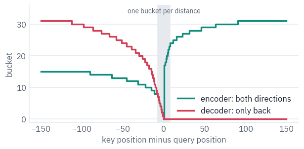

The table of biases, 32 buckets by the number of heads, lives in the first layer of the encoder and the first layer
of the decoder. Every other layer reuses the same biases, so a model of six layers learns positions with
$$2 \times 32 \times 8 = 512$$ numbers. GPT-2 spent 786,432 on its position embeddings.

**The output layer.** T5's decoder scores the vocabulary with the input embedding matrix, tied as in GPT-2, after multiplying the hidden state by $$d^{-1/2}$$.

Google's Mesh TensorFlow code does this whenever the input and output embeddings are shared, and Hugging Face's code copies it. Leave it out and every logit is $$\sqrt{512} \approx 23$$ times too large for t5-small.

The attention layer below takes an optional `source`: without it, it is self-attention; with it, the keys and values come from the encoder and it is cross-attention.

The optional `cache` is the KV cache of lesson 4, with one addition: in cross-attention the keys and values come from the encoder, which doesn't change while the decoder writes, so they are computed once for the whole answer. For the pictures of section 5 it can also return the attention weights.

```python
class Attention(nn.Module):
    def __init__(self, config, relative=False, bidirectional=True):
        super().__init__()
        d = config["d_model"]
        self.heads, self.head_dim = config["num_heads"], config["d_kv"]
        inner = self.heads * self.head_dim
        self.q = nn.Linear(d, inner, bias=False)
        self.k = nn.Linear(d, inner, bias=False)
        self.v = nn.Linear(d, inner, bias=False)
        self.o = nn.Linear(inner, d, bias=False)
        self.buckets = config["relative_attention_num_buckets"]
        self.bidirectional = bidirectional
        if relative:  # only the first layer has the table; the others reuse its biases
            self.relative_bias = nn.Embedding(self.buckets, self.heads)

    def position_bias(self, queries, keys):
        relative = keys[None, :] - queries[:, None]
        buckets = position_bucket(relative, self.bidirectional, self.buckets)
        return self.relative_bias(buckets).permute(2, 0, 1).unsqueeze(0)  # 1, heads, q, k

    def split(self, x):
        batch, length, _ = x.shape
        return x.view(batch, length, self.heads, self.head_dim).transpose(1, 2)

    def forward(self, x, source=None, bias=None, cache=None, keep_weights=False):
        q = self.split(self.q(x))
        if source is not None and cache is not None and "k" in cache:
            # cross-attention: the encoder's keys and values never change
            k, v = cache["k"], cache["v"]
        else:
            k = self.split(self.k(x if source is None else source))
            v = self.split(self.v(x if source is None else source))
            if source is None and cache is not None and "k" in cache:
                k = torch.cat([cache["k"], k], dim=2)
                v = torch.cat([cache["v"], v], dim=2)
        if cache is not None:
            cache["k"], cache["v"] = k, v
        weights = None
        if keep_weights:
            scores = q @ k.transpose(-2, -1) + bias  # no division by the square root of d_k
            weights = scores.float().softmax(dim=-1).to(q.dtype)
            y = weights @ v
        else:
            y = F.scaled_dot_product_attention(q, k, v, attn_mask=bias, scale=1.0)
        y = y.transpose(1, 2).reshape(x.shape[0], x.shape[1], -1)
        return self.o(y), weights
```

The feed-forward network of the original T5 is two matrices with a ReLU between them and no biases; there are no
biases anywhere in T5. Dropout only matters for training, in section 8.

```python
class FeedForward(nn.Module):
    def __init__(self, config):
        super().__init__()
        self.wi = nn.Linear(config["d_model"], config["d_ff"], bias=False)
        self.wo = nn.Linear(config["d_ff"], config["d_model"], bias=False)
        self.drop = nn.Dropout(config["dropout_rate"])

    def forward(self, x):
        return self.wo(self.drop(F.relu(self.wi(x))))


class EncoderLayer(nn.Module):
    def __init__(self, config, first):
        super().__init__()
        d, eps = config["d_model"], config["layer_norm_epsilon"]
        self.norm1, self.attention = Norm(d, eps), Attention(config, relative=first)
        self.norm2, self.ff = Norm(d, eps), FeedForward(config)
        self.drop = nn.Dropout(config["dropout_rate"])

    def forward(self, x, bias):
        x = x + self.drop(self.attention(self.norm1(x), bias=bias)[0])
        return x + self.drop(self.ff(self.norm2(x)))


class DecoderLayer(nn.Module):
    def __init__(self, config, first):
        super().__init__()
        d, eps = config["d_model"], config["layer_norm_epsilon"]
        self.norm1 = Norm(d, eps)
        self.attention = Attention(config, relative=first, bidirectional=False)
        self.norm2, self.cross = Norm(d, eps), Attention(config)
        self.norm3, self.ff = Norm(d, eps), FeedForward(config)
        self.drop = nn.Dropout(config["dropout_rate"])

    def forward(self, y, memory, self_bias, cross_bias, cache=None, keep_weights=False):
        own = cache["self"] if cache is not None else None
        other = cache["cross"] if cache is not None else None
        y = y + self.drop(self.attention(self.norm1(y), bias=self_bias, cache=own)[0])
        out, weights = self.cross(self.norm2(y), source=memory, bias=cross_bias,
                                  cache=other, keep_weights=keep_weights)
        y = y + self.drop(out)
        return y + self.drop(self.ff(self.norm3(y))), weights
```

The model puts the stacks together. The encoder's padding is hidden by a bias of $$-\infty$$, in practice the smallest float, on the padded keys, both in the encoder and in cross-attention; the decoder adds the causal mask to its position biases.

`decode` takes `past`, the number of tokens already written, so that a single new token gets the right position biases when the earlier ones are in the cache.

```python
def padding_bias(mask):
    blocked = torch.finfo(torch.float32).min
    return (1.0 - mask[:, None, None, :].float()) * blocked  # batch, 1, 1, keys


class T5(nn.Module):
    def __init__(self, config):
        super().__init__()
        d, eps = config["d_model"], config["layer_norm_epsilon"]
        self.d = d
        self.embed = nn.Embedding(config["vocab_size"], d)
        layers = config["num_layers"]
        self.encoder = nn.ModuleList(EncoderLayer(config, i == 0) for i in range(layers))
        self.encoder_norm = Norm(d, eps)
        layers = config.get("num_decoder_layers", config["num_layers"])
        self.decoder = nn.ModuleList(DecoderLayer(config, i == 0) for i in range(layers))
        self.decoder_norm = Norm(d, eps)
        self.drop = nn.Dropout(config["dropout_rate"])

    def encode(self, ids, mask):
        positions = torch.arange(ids.shape[1], device=ids.device)
        bias = self.encoder[0].attention.position_bias(positions, positions)
        bias = bias + padding_bias(mask)
        x = self.drop(self.embed(ids))
        for layer in self.encoder:
            x = layer(x, bias)
        return self.drop(self.encoder_norm(x))

    def decode(self, targets, memory, mask, caches=None, past=0, keep_weights=False):
        length = targets.shape[1]
        queries = torch.arange(past, past + length, device=targets.device)
        keys = torch.arange(past + length, device=targets.device)
        self_bias = self.decoder[0].attention.position_bias(queries, keys)
        future = keys[None, :] > queries[:, None]
        self_bias = self_bias.masked_fill(future, torch.finfo(torch.float32).min)
        cross_bias = padding_bias(mask)
        y = self.drop(self.embed(targets))
        cross = []
        for i, layer in enumerate(self.decoder):
            cache = caches[i] if caches is not None else None
            y, weights = layer(y, memory, self_bias, cross_bias, cache, keep_weights)
            cross.append(weights)
        y = self.drop(self.decoder_norm(y))
        logits = (y * self.d ** -0.5) @ self.embed.weight.T  # tied, and rescaled first
        return (logits, cross) if keep_weights else logits
```

## 4. Google's weights in our code

The checkpoint's names follow the structure of Google's code, `block.{i}.layer.{j}`, where the parts of a layer
are numbered: in the decoder, 0 is self-attention, 1 cross-attention and 2 the feed-forward network. We write down
which goes where; `load_state_dict` refuses anything missing or left over.

```python
def transplant(model, state):
    mine = {"embed.weight": state["shared.weight"],
            "encoder_norm.weight": state["encoder.final_layer_norm.weight"],
            "decoder_norm.weight": state["decoder.final_layer_norm.weight"]}
    for i in range(len(model.encoder)):
        old, new = f"encoder.block.{i}.layer.", f"encoder.{i}."
        for name in "qkvo":
            weight = state[old + f"0.SelfAttention.{name}.weight"]
            mine[new + f"attention.{name}.weight"] = weight
        mine[new + "norm1.weight"] = state[old + "0.layer_norm.weight"]
        mine[new + "ff.wi.weight"] = state[old + "1.DenseReluDense.wi.weight"]
        mine[new + "ff.wo.weight"] = state[old + "1.DenseReluDense.wo.weight"]
        mine[new + "norm2.weight"] = state[old + "1.layer_norm.weight"]
    for i in range(len(model.decoder)):
        old, new = f"decoder.block.{i}.layer.", f"decoder.{i}."
        for name in "qkvo":
            weight = state[old + f"0.SelfAttention.{name}.weight"]
            mine[new + f"attention.{name}.weight"] = weight
            weight = state[old + f"1.EncDecAttention.{name}.weight"]
            mine[new + f"cross.{name}.weight"] = weight
        for part in range(3):
            mine[new + f"norm{part + 1}.weight"] = state[old + f"{part}.layer_norm.weight"]
        mine[new + "ff.wi.weight"] = state[old + "2.DenseReluDense.wi.weight"]
        mine[new + "ff.wo.weight"] = state[old + "2.DenseReluDense.wo.weight"]
    for side in ["encoder", "decoder"]:
        key = f"{side}.block.0.layer.0.SelfAttention.relative_attention_bias.weight"
        mine[f"{side}.0.attention.relative_bias.weight"] = state[key]
    model.load_state_dict(mine)
    return model


def load_t5(repo):
    with open(hf_hub_download(repo, "config.json")) as f:
        config = json.load(f)
    state = load_file(hf_hub_download(repo, "model.safetensors"))
    return transplant(T5(config), state), config


t5, t5_config = load_t5(T5_SMALL)
t5 = t5.to(device).eval()
print(f"t5-small: {sum(p.numel() for p in t5.parameters()) / 1e6:.1f} million parameters")
```

<pre class="tfs-printed" markdown="0"><code>t5-small: 60.5 million parameters</code></pre>

The check: the same input and the same decoder input through both models, teacher-forced, so every position is
compared at once. The decoder's first input is the padding token, T5's start-of-output.

```python
batch = tokenizer(prompts, return_tensors="pt", padding=True).to(device)
written = tokenizer(answers, return_tensors="pt", padding=True).input_ids.to(device)
# the padding token is also T5's start token
start = torch.zeros(len(prompts), 1, dtype=torch.long, device=device)
decoder_input = torch.cat([start, written[:, :-1]], dim=1)
with torch.no_grad():
    ours = t5.decode(decoder_input, t5.encode(batch.input_ids, batch.attention_mask),
                     batch.attention_mask)
    theirs = reference(**batch, decoder_input_ids=decoder_input).logits
print("largest difference in logits:", (ours - theirs).abs().max().item())
```

<pre class="tfs-printed" markdown="0"><code>largest difference in logits: 3.814697265625e-05</code></pre>

Generation is lesson 4's loop with an encoder in front: encode the input once, start the decoder from the padding
token, and keep feeding back the most probable token until every row has written the end-of-text token `</s>`.

```python
@torch.no_grad()
def generate(model, ids, mask, max_new_tokens=64, eos=1, pad=0, temperature=0.0,
             generator=None):
    memory = model.encode(ids, mask)
    caches = [{"self": {}, "cross": {}} for _ in model.decoder]
    token = torch.full((ids.shape[0], 1), pad, device=ids.device)
    written = []
    done = torch.zeros(ids.shape[0], dtype=torch.bool, device=ids.device)
    for step in range(max_new_tokens):
        logits = model.decode(token, memory, mask, caches, past=step)[:, -1].float()
        if temperature == 0:
            token = logits.argmax(dim=-1, keepdim=True)  # greedy
        else:
            probs = (logits / temperature).softmax(dim=-1)
            token = torch.multinomial(probs, 1, generator=generator)
        token = token.masked_fill(done[:, None], pad)  # finished rows write padding
        written.append(token)
        done = done | (token[:, 0] == eos)
        if done.all():
            break
    return torch.cat(written, dim=1)


ours = tokenizer.batch_decode(generate(t5, batch.input_ids, batch.attention_mask),
                              skip_special_tokens=True)
print("our generation matches Hugging Face's:", ours == answers)
for text in ours[:2]:
    print(" ", text)
```

<pre class="tfs-printed" markdown="0"><code>our generation matches Hugging Face&#x27;s: True
  Die Wachen kommen morgens um sieben Uhr im Museum an.
  Le train de nuit à Vienne quitte à 11 heures.</code></pre>

## 5. What the positions learned, and where the decoder looks

The 32 biases of each head are all T5 knows about word order, so they are worth a look.

Each row below is one of the eight heads of t5-small's encoder; each column a distance from the query, from 20 tokens to the left to 20 to the right; the color is the bias the head adds to the score of a key at that distance.

```python
def bias_by_distance(attention, distances):
    zero = torch.zeros(1, dtype=torch.long, device=device)
    with torch.no_grad():
        bias = attention.position_bias(zero, distances.to(device))
    return bias[0, :, 0].cpu()  # heads, distances


distances = torch.arange(-20, 21)
encoder_bias = bias_by_distance(t5.encoder[0].attention, distances)
limit = encoder_bias.abs().max().item()
# negative biases in teal, positive in rose, zero white
ends = [COLORS["enc"], COLORS["card"], COLORS["dec"]]
diverging = LinearSegmentedColormap.from_list("bias", ends)
fig, ax = plt.subplots(figsize=(6.4, 2.6))
image = ax.imshow(encoder_bias, cmap=diverging, vmin=-limit, vmax=limit, aspect="auto")
ax.set_xticks(range(0, 41, 5), [str(d) for d in range(-20, 21, 5)])
ax.set_yticks(range(8), [f"head {h}" for h in range(8)])
ax.set_xlabel("key position minus query position")
ax.grid(False)
fig.colorbar(image, ax=ax, label="bias added to the score")
plt.show()
```

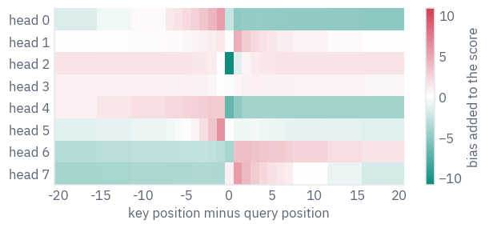

The heads have split the work. Some favour the left side and some the right; one rises sharply on the token just before the query, one on the token just after; one strongly avoids the query's own position, so that it always reads a neighbour; and one barely cares about distance at all and attends by content.

A model that is told nothing about order beyond these 32 numbers per head still builds a sense of left, right and next door. Beyond about ten tokens the biases flatten out: the buckets there are wide, and far is simply far.

Cross-attention is where the encoder–decoder earns its name, and it can be watched. We translate the sentence of
section 1 again with our model, keep the cross-attention weights of every decoder layer, and average the eight
heads of one layer: each row is a German token being written, each column an English token of the input.

```python
source = tokenizer([prompts[0]], return_tensors="pt").to(device)
german = generate(t5, source.input_ids, source.attention_mask)
start = torch.zeros(1, 1, dtype=torch.long, device=device)
decoder_input = torch.cat([start, german[:, :-1]], dim=1)
with torch.no_grad():
    memory = t5.encode(source.input_ids, source.attention_mask)
    _, cross = t5.decode(decoder_input, memory, source.attention_mask, keep_weights=True)
# SentencePiece marks a word's start with "▁"; we show it as a space
def readable(ids):
    return [t.replace("▁", " ") for t in tokenizer.convert_ids_to_tokens(ids)]


source_tokens, german_tokens = readable(source.input_ids[0]), readable(german[0])
LAYER = 4
weights = cross[LAYER][0].mean(dim=0).cpu()  # rows: German tokens, columns: English tokens
heatmap(weights, rows=german_tokens, cols=source_tokens, cell=0.3)
plt.show()
```

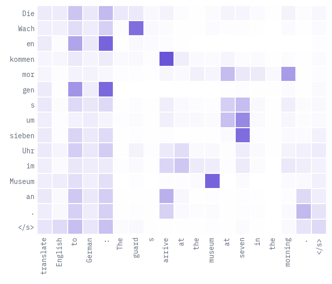

Most German tokens find their English source: *Wach* looks at *guard*, *kommen* at *arrive*, *sieben* at *seven*, *Museum* at *museum*. German puts the particle of *ankommen* at the very end of the sentence, and the last word, *an*, looks back at *arrive*. Nobody gave the model an alignment; it learned one because translating needs it.

Much of the attention, though, goes to the task prefix, *to* and the colon, on nearly every row: a head that has nothing useful to read parks its weight on a token that carries no content, the same habit as the attention sinks of lesson 9.

## 6. Pre-training by repair: T5 and BART

An encoder–decoder needs a task with an input and an output, and raw text has neither. Both T5 and BART make one
up the same way: damage the text, give the damaged version to the encoder, and train the decoder to undo the
damage. They damage it differently.

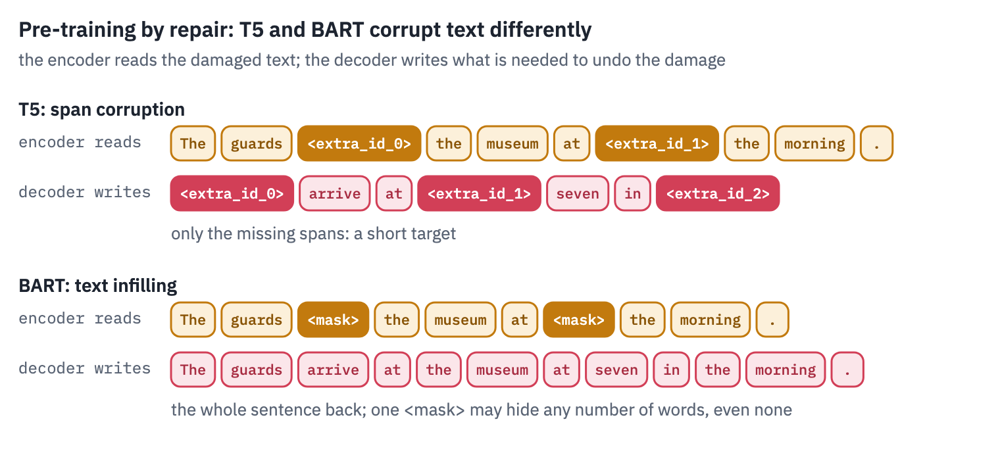
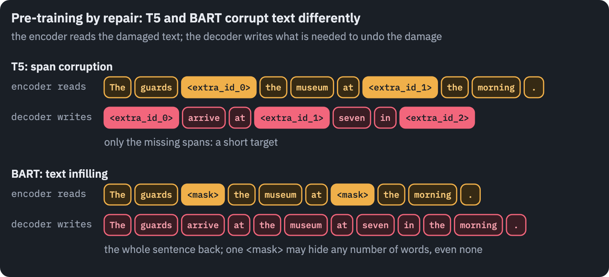

T5's version is *span corruption*. It drops 15% of the tokens in spans of 3 on average, replaces each span with a sentinel token, `<extra_id_0>`, `<extra_id_1>` and so on, and asks the decoder for the dropped spans only, each after its sentinel, with one more sentinel at the end.

The targets are short, and that was the point: the choice was "made to reduce the computational cost of pre-training". Across the many variants the paper tried, the details of the corruption mattered little. What mattered was that "denoising objectives outperformed language modeling".

BART, which Facebook AI published the same month, is the same design seen from the other side: "a denoising autoencoder for pretraining sequence-to-sequence models", whose bidirectional encoder and left-to-right decoder "can be seen as generalizing BERT […], GPT […], and other recent pretraining schemes" <sup class="cite">[<a href="#ref-5" id="cite-5" data-ref="5" aria-label="Reference 5: Lewis, M., Liu, Y., Goyal, N., Ghazvininejad, M., Mohamed, A., Levy, O., Stoyanov, V., &amp; Zettlemoyer, L. (2020). BART: denoising sequence-to-sequence pre-training for natural language generation, translation, and comprehension. ACL 2020.">5</a>]</sup>.

Its best corruption was *text infilling*: span lengths are drawn from a Poisson distribution with a mean of 3, and each span becomes a single mask token, even a span of length zero, so the model has to "predict how many tokens are missing from a span".

The large model also shuffled the order of the sentences. BART's decoder writes the whole document back, which made it a strong generator: on XSum, a summarisation dataset the BART paper calls highly abstractive, it beat the best earlier model by "roughly 3.5 points on all ROUGE metrics".

Inside, BART is the Transformer of 2017 with GPT's GELU in place of ReLU, which makes its layers closer to BERT's than to T5's: learned position embeddings for up to 1,024 positions, a LayerNorm with its mean and bias after each part of the layer, biases in every linear layer, and GPT-2's byte-level vocabulary, in which `<` and every other character have a token.

The model we load below, bart-base, has 6 layers on each side and a width of 768.

T5's recipe comes down to two numbers: 15% of the tokens are dropped, in spans of 3 tokens on average, at random places.

Google's code first decides how many tokens to drop and how many spans to cut them into, then splits both the dropped and the kept tokens into that many pieces of random length, and interleaves them. Here it is on the example sentence from the T5 paper:

```python
def random_split(total, parts, rng):
    # a random way to write `total` as a sum of `parts` positive whole numbers
    cuts = sorted(rng.sample(range(1, total), parts - 1))
    edges = [0] + cuts + [total]
    return [edges[i + 1] - edges[i] for i in range(parts)]


def span_corruption(tokens, rng, density=0.15, mean_span=3):
    n = len(tokens)
    dropped = min(max(round(n * density), 1), n - 1)
    spans = max(round(dropped / mean_span), 1)
    dropped_lengths = random_split(dropped, spans, rng)
    kept_lengths = random_split(n - dropped, spans, rng)
    source, target, i = [], [], 0
    for k in range(spans):
        source += tokens[i:i + kept_lengths[k]]
        i += kept_lengths[k]
        sentinel = f"<extra_id_{k}>"
        source.append(sentinel)
        target.append(sentinel)
        target += tokens[i:i + dropped_lengths[k]]
        i += dropped_lengths[k]
    target.append(f"<extra_id_{spans}>")  # the last sentinel says: nothing more
    return source, target


paper_sentence = tokenizer.tokenize("Thank you for inviting me to your party last week.")
paper_sentence = [t.replace("▁", " ") for t in paper_sentence]
source, target = span_corruption(paper_sentence, random.Random(3), density=0.3, mean_span=2)
token_chips([source, target], labels=["encoder reads", "decoder writes"],
            strong=lambda row, col, token: token.startswith("<extra"))
plt.show()
```

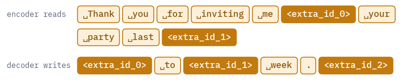

The encoder sees the sentence with holes, each hole one sentinel however many tokens it hides. The decoder's target lists what is missing, in order, and closes with one more sentinel.

A sentence of 11 tokens would lose only two at T5's rate, so the cell doubles it; on a 512-token passage of C4 the real recipe cuts about two dozen holes, in every kind of place.

So does a pre-trained T5 repair text? Ask it to fill the spans the T5 paper drops. We use t5-base here, which we
also need in section 8; the smallest model fills them less reliably.

```python
T5_BASE = "google-t5/t5-base"
base_reference = T5ForConditionalGeneration.from_pretrained(T5_BASE).to(device).eval()
damaged = ["Thank you <extra_id_0> me to your party <extra_id_1> week.",
           "The guards <extra_id_0> at the museum at <extra_id_1> in the morning.",
           "The night train to <extra_id_0> leaves at eleven and arrives in <extra_id_1> "
           "the next morning."]
batch = tokenizer(damaged, return_tensors="pt", padding=True).to(device)
with torch.no_grad():
    repaired = base_reference.generate(**batch, max_new_tokens=16, num_beams=1,
                                       do_sample=False)
def fill_spans(damaged_text, written):
    # the output is "<extra_id_0> span <extra_id_1> span …"; each span goes back in place
    pieces = re.split(r"<extra_id_\d+>", written.replace("<pad>", "").replace("</s>", ""))
    filled = damaged_text
    for k in range(damaged_text.count("<extra_id_")):
        span = pieces[k + 1].strip() if k + 1 < len(pieces) else "?"
        filled = filled.replace(f"<extra_id_{k}>", f"[{span}]")
    return filled


rows = []
for text, ids in zip(damaged, repaired):
    written = tokenizer.decode(ids, skip_special_tokens=False)
    shown = written.replace("<pad>", "")[:48] + "…"
    rows.append({"damaged": text, "t5-base writes": shown,
                 "the spans put back": fill_spans(text, written)})
table(pd.DataFrame(rows))
```

<div class="tfs-table-wrap"><table class="tfs-table" style="border-collapse:collapse;font-family:'IBM Plex Sans', -apple-system, 'Segoe UI', Roboto, Helvetica, Arial, sans-serif;font-size:13.5px;line-height:1.45;margin:4px 0 8px;"><thead><tr><th style="padding:7px 14px;border-bottom:2px solid #B9C0CB;font-weight:600;color:#5B6575;font-size:12px;letter-spacing:0.02em;text-align:left;">damaged</th><th style="padding:7px 14px;border-bottom:2px solid #B9C0CB;font-weight:600;color:#5B6575;font-size:12px;letter-spacing:0.02em;text-align:left;">t5-base writes</th><th style="padding:7px 14px;border-bottom:2px solid #B9C0CB;font-weight:600;color:#5B6575;font-size:12px;letter-spacing:0.02em;text-align:left;">the spans put back</th></tr></thead><tbody><tr><td style="padding:7px 14px;border-bottom:1px solid #E6E9EE;vertical-align:top;text-align:left;max-width:460px;white-space:normal;">Thank you &lt;extra_id_0&gt; me to your party &lt;extra_id_1&gt; week.</td><td style="padding:7px 14px;border-bottom:1px solid #E6E9EE;vertical-align:top;text-align:left;max-width:460px;white-space:normal;">&lt;extra_id_0&gt; for inviting&lt;extra_id_1&gt; this&lt;extra…</td><td style="padding:7px 14px;border-bottom:1px solid #E6E9EE;vertical-align:top;text-align:left;max-width:460px;white-space:normal;">Thank you [for inviting] me to your party [this] week.</td></tr><tr><td style="padding:7px 14px;border-bottom:1px solid #E6E9EE;vertical-align:top;text-align:left;max-width:460px;white-space:normal;">The guards &lt;extra_id_0&gt; at the museum at &lt;extra_id_1&gt; in the morning.</td><td style="padding:7px 14px;border-bottom:1px solid #E6E9EE;vertical-align:top;text-align:left;max-width:460px;white-space:normal;">&lt;extra_id_0&gt; arrive&lt;extra_id_1&gt; 8&lt;extra_id_2&gt; ar…</td><td style="padding:7px 14px;border-bottom:1px solid #E6E9EE;vertical-align:top;text-align:left;max-width:460px;white-space:normal;">The guards [arrive] at the museum at [8] in the morning.</td></tr><tr><td style="padding:7px 14px;border-bottom:1px solid #E6E9EE;vertical-align:top;text-align:left;max-width:460px;white-space:normal;">The night train to &lt;extra_id_0&gt; leaves at eleven and arrives in &lt;extra_id_1&gt; the next morning.</td><td style="padding:7px 14px;border-bottom:1px solid #E6E9EE;vertical-align:top;text-align:left;max-width:460px;white-space:normal;">&lt;extra_id_0&gt; London&lt;extra_id_1&gt; London&lt;extra_id_…</td><td style="padding:7px 14px;border-bottom:1px solid #E6E9EE;vertical-align:top;text-align:left;max-width:460px;white-space:normal;">The night train to [London] leaves at eleven and arrives in [London] the next morning.</td></tr></tbody></table></div>

t5-base fills the gaps sensibly: *for inviting* and *this* in the paper's sentence, a verb and a time for the guards, a city for the train.

The middle column shows what it actually writes. It doesn't stop after the last gap: the target of span corruption ends with one more sentinel, and this model keeps going past it, inventing more gaps and repeating itself, so we read only as many spans as there are holes.

Most likely the released t5-base, trained on long passages of C4 mixed with supervised tasks, never saw a single short sentence with two holes.

BART's version is closer to BERT's masked language model, and to what the decoder of lesson 4 does. Each span
becomes one `<mask>`, whatever its length, and the decoder writes the whole text back, so it also has to decide how
many words each mask hid:

```python
BART = "facebook/bart-base"
bart_tokenizer = AutoTokenizer.from_pretrained(BART)
bart = BartForConditionalGeneration.from_pretrained(BART).to(device).eval()
masked = ["Thank you <mask> me to your party <mask> week.",
          "The guards <mask> at the museum at <mask> in the morning.",
          "The night train to <mask> leaves at eleven and arrives in <mask> "
          "the next morning."]
batch = bart_tokenizer(masked, return_tensors="pt", padding=True).to(device)
with torch.no_grad():
    repaired = bart.generate(**batch, max_new_tokens=32, num_beams=1, do_sample=False)
written = bart_tokenizer.batch_decode(repaired, skip_special_tokens=True)
table(pd.DataFrame({"masked": masked, "BART writes": written}))
```

<div class="tfs-table-wrap"><table class="tfs-table" style="border-collapse:collapse;font-family:'IBM Plex Sans', -apple-system, 'Segoe UI', Roboto, Helvetica, Arial, sans-serif;font-size:13.5px;line-height:1.45;margin:4px 0 8px;"><thead><tr><th style="padding:7px 14px;border-bottom:2px solid #B9C0CB;font-weight:600;color:#5B6575;font-size:12px;letter-spacing:0.02em;text-align:left;">masked</th><th style="padding:7px 14px;border-bottom:2px solid #B9C0CB;font-weight:600;color:#5B6575;font-size:12px;letter-spacing:0.02em;text-align:left;">BART writes</th></tr></thead><tbody><tr><td style="padding:7px 14px;border-bottom:1px solid #E6E9EE;vertical-align:top;text-align:left;max-width:460px;white-space:normal;">Thank you &lt;mask&gt; me to your party &lt;mask&gt; week.</td><td style="padding:7px 14px;border-bottom:1px solid #E6E9EE;vertical-align:top;text-align:left;max-width:460px;white-space:normal;">Thank you for inviting me to your party this week.</td></tr><tr><td style="padding:7px 14px;border-bottom:1px solid #E6E9EE;vertical-align:top;text-align:left;max-width:460px;white-space:normal;">The guards &lt;mask&gt; at the museum at &lt;mask&gt; in the morning.</td><td style="padding:7px 14px;border-bottom:1px solid #E6E9EE;vertical-align:top;text-align:left;max-width:460px;white-space:normal;">The guards were at the museum at about 2:30 in the morning.</td></tr><tr><td style="padding:7px 14px;border-bottom:1px solid #E6E9EE;vertical-align:top;text-align:left;max-width:460px;white-space:normal;">The night train to &lt;mask&gt; leaves at eleven and arrives in &lt;mask&gt; the next morning.</td><td style="padding:7px 14px;border-bottom:1px solid #E6E9EE;vertical-align:top;text-align:left;max-width:460px;white-space:normal;">The night train to the airport leaves at eleven and arrives in New York the next morning.</td></tr></tbody></table></div>

BART writes each sentence back whole and decides the length of each gap itself: one mask becomes one word, another becomes two. For the night train it invents a whole route.

The repairs are fluent and plausible rather than right, and that is all a pre-training objective can ask for, since nothing in the damaged text says which words were removed. What the model learns from millions of such guesses is how text hangs together, which is what fine-tuning then puts to work.

## 7. Spider: questions about databases the model has never seen

Spider was built at Yale in 2018. Eleven students spent "a total of 1,000 man-hours" writing "10,181 questions and 5,693 unique complex SQL queries on 200 databases with multiple tables, covering 138 different domains" <sup class="cite">[<a href="#ref-6" id="cite-6" data-ref="6" aria-label="Reference 6: Yu, T., Zhang, R., Yang, K., et al. (2018). Spider: a large-scale human-labeled dataset for complex and cross-domain semantic parsing and text-to-SQL task. EMNLP 2018. Data: yale-lily.github.io/spider, CC BY-SA 4.0.">6</a>]</sup>.

What made it hard was the split: the databases of the test set never appear in training, so a model has to read a schema it has never seen.

The best model in the paper got 12.4% of the test queries exactly right. In 2021 T5-3B with PICARD, a decoder that rejects any token that would make the query invalid, reached 75.1% execution accuracy on the test set.

PICARD's authors noted that without it, "12% of the SQL queries generated by the T5-3B model on Spider's development set result in an execution error" <sup class="cite">[<a href="#ref-7" id="cite-7" data-ref="7" aria-label="Reference 7: Scholak, T., Schucher, N., &amp; Bahdanau, D. (2021). PICARD: parsing incrementally for constrained auto-regressive decoding from language models. EMNLP 2021.">7</a>]</sup>. GPT-4 with careful prompting took the leaderboard to 85.3% and then 86.6% in 2023, and in February 2024 the authors closed it.

The Spider authors distribute the databases as SQLite files; the Hugging Face copy we use is a re-host of the
official archive, pinned to one revision, under the same CC BY-SA 4.0 licence.

```python
SPIDER = "HAL-9001/spider-databases"
SPIDER_REVISION = "4a01bbac6520cd35b216db9e1724e5e1ada60aa4"
archive = hf_hub_download(SPIDER, "spider_data.zip", repo_type="dataset",
                          revision=SPIDER_REVISION)
with zipfile.ZipFile(archive) as z:
    z.extractall(WORK_DIR)
SPIDER_DIR = WORK_DIR / "spider_data"

with open(SPIDER_DIR / "train_spider.json") as f:
    train_set = json.load(f)
with open(SPIDER_DIR / "dev.json") as f:
    dev_set = json.load(f)
with open(SPIDER_DIR / "tables.json") as f:
    schemas = {db["db_id"]: db for db in json.load(f)}
train_dbs = {e["db_id"] for e in train_set}
dev_dbs = {e["db_id"] for e in dev_set}
print(f"training: {len(train_set):,} questions on {len(train_dbs)} databases")
print(f"development: {len(dev_set):,} questions on {len(dev_dbs)} databases")
print("databases in both:", len(train_dbs & dev_dbs))
```

<pre class="tfs-printed" markdown="0"><code>training: 7,000 questions on 140 databases
development: 1,034 questions on 20 databases
databases in both: 0</code></pre>

Not one database is shared between the two sets, as the last line shows. Here is the first development question,
about `concert_singer`, and the table it asks about:

```python
example = dev_set[0]
print("question:", example["question"])
print("query:   ", example["query"])
database = SPIDER_DIR / "database" / example["db_id"] / (example["db_id"] + ".sqlite")
with sqlite3.connect(database) as connection:
    singers = pd.read_sql_query("SELECT * FROM singer", connection)
table(singers)
```

<pre class="tfs-printed" markdown="0"><code>question: How many singers do we have?
query:    SELECT count(*) FROM singer</code></pre>

<div class="tfs-table-wrap"><table class="tfs-table" style="border-collapse:collapse;font-family:'IBM Plex Sans', -apple-system, 'Segoe UI', Roboto, Helvetica, Arial, sans-serif;font-size:13.5px;line-height:1.45;margin:4px 0 8px;"><thead><tr><th style="padding:7px 14px;border-bottom:2px solid #B9C0CB;font-weight:600;color:#5B6575;font-size:12px;letter-spacing:0.02em;text-align:right;">Singer_ID</th><th style="padding:7px 14px;border-bottom:2px solid #B9C0CB;font-weight:600;color:#5B6575;font-size:12px;letter-spacing:0.02em;text-align:left;">Name</th><th style="padding:7px 14px;border-bottom:2px solid #B9C0CB;font-weight:600;color:#5B6575;font-size:12px;letter-spacing:0.02em;text-align:left;">Country</th><th style="padding:7px 14px;border-bottom:2px solid #B9C0CB;font-weight:600;color:#5B6575;font-size:12px;letter-spacing:0.02em;text-align:left;">Song_Name</th><th style="padding:7px 14px;border-bottom:2px solid #B9C0CB;font-weight:600;color:#5B6575;font-size:12px;letter-spacing:0.02em;text-align:left;">Song_release_year</th><th style="padding:7px 14px;border-bottom:2px solid #B9C0CB;font-weight:600;color:#5B6575;font-size:12px;letter-spacing:0.02em;text-align:right;">Age</th><th style="padding:7px 14px;border-bottom:2px solid #B9C0CB;font-weight:600;color:#5B6575;font-size:12px;letter-spacing:0.02em;text-align:left;">Is_male</th></tr></thead><tbody><tr><td style="padding:7px 14px;border-bottom:1px solid #E6E9EE;vertical-align:top;text-align:right;font-variant-numeric:tabular-nums;max-width:460px;white-space:normal;">1</td><td style="padding:7px 14px;border-bottom:1px solid #E6E9EE;vertical-align:top;text-align:left;max-width:460px;white-space:normal;">Joe Sharp</td><td style="padding:7px 14px;border-bottom:1px solid #E6E9EE;vertical-align:top;text-align:left;max-width:460px;white-space:normal;">Netherlands</td><td style="padding:7px 14px;border-bottom:1px solid #E6E9EE;vertical-align:top;text-align:left;max-width:460px;white-space:normal;">You</td><td style="padding:7px 14px;border-bottom:1px solid #E6E9EE;vertical-align:top;text-align:left;max-width:460px;white-space:normal;">1992</td><td style="padding:7px 14px;border-bottom:1px solid #E6E9EE;vertical-align:top;text-align:right;font-variant-numeric:tabular-nums;max-width:460px;white-space:normal;">52</td><td style="padding:7px 14px;border-bottom:1px solid #E6E9EE;vertical-align:top;text-align:left;max-width:460px;white-space:normal;">F</td></tr><tr><td style="padding:7px 14px;border-bottom:1px solid #E6E9EE;vertical-align:top;text-align:right;font-variant-numeric:tabular-nums;max-width:460px;white-space:normal;">2</td><td style="padding:7px 14px;border-bottom:1px solid #E6E9EE;vertical-align:top;text-align:left;max-width:460px;white-space:normal;">Timbaland</td><td style="padding:7px 14px;border-bottom:1px solid #E6E9EE;vertical-align:top;text-align:left;max-width:460px;white-space:normal;">United States</td><td style="padding:7px 14px;border-bottom:1px solid #E6E9EE;vertical-align:top;text-align:left;max-width:460px;white-space:normal;">Dangerous</td><td style="padding:7px 14px;border-bottom:1px solid #E6E9EE;vertical-align:top;text-align:left;max-width:460px;white-space:normal;">2008</td><td style="padding:7px 14px;border-bottom:1px solid #E6E9EE;vertical-align:top;text-align:right;font-variant-numeric:tabular-nums;max-width:460px;white-space:normal;">32</td><td style="padding:7px 14px;border-bottom:1px solid #E6E9EE;vertical-align:top;text-align:left;max-width:460px;white-space:normal;">T</td></tr><tr><td style="padding:7px 14px;border-bottom:1px solid #E6E9EE;vertical-align:top;text-align:right;font-variant-numeric:tabular-nums;max-width:460px;white-space:normal;">3</td><td style="padding:7px 14px;border-bottom:1px solid #E6E9EE;vertical-align:top;text-align:left;max-width:460px;white-space:normal;">Justin Brown</td><td style="padding:7px 14px;border-bottom:1px solid #E6E9EE;vertical-align:top;text-align:left;max-width:460px;white-space:normal;">France</td><td style="padding:7px 14px;border-bottom:1px solid #E6E9EE;vertical-align:top;text-align:left;max-width:460px;white-space:normal;">Hey Oh</td><td style="padding:7px 14px;border-bottom:1px solid #E6E9EE;vertical-align:top;text-align:left;max-width:460px;white-space:normal;">2013</td><td style="padding:7px 14px;border-bottom:1px solid #E6E9EE;vertical-align:top;text-align:right;font-variant-numeric:tabular-nums;max-width:460px;white-space:normal;">29</td><td style="padding:7px 14px;border-bottom:1px solid #E6E9EE;vertical-align:top;text-align:left;max-width:460px;white-space:normal;">T</td></tr><tr><td style="padding:7px 14px;border-bottom:1px solid #E6E9EE;vertical-align:top;text-align:right;font-variant-numeric:tabular-nums;max-width:460px;white-space:normal;">4</td><td style="padding:7px 14px;border-bottom:1px solid #E6E9EE;vertical-align:top;text-align:left;max-width:460px;white-space:normal;">Rose White</td><td style="padding:7px 14px;border-bottom:1px solid #E6E9EE;vertical-align:top;text-align:left;max-width:460px;white-space:normal;">France</td><td style="padding:7px 14px;border-bottom:1px solid #E6E9EE;vertical-align:top;text-align:left;max-width:460px;white-space:normal;">Sun</td><td style="padding:7px 14px;border-bottom:1px solid #E6E9EE;vertical-align:top;text-align:left;max-width:460px;white-space:normal;">2003</td><td style="padding:7px 14px;border-bottom:1px solid #E6E9EE;vertical-align:top;text-align:right;font-variant-numeric:tabular-nums;max-width:460px;white-space:normal;">41</td><td style="padding:7px 14px;border-bottom:1px solid #E6E9EE;vertical-align:top;text-align:left;max-width:460px;white-space:normal;">F</td></tr><tr><td style="padding:7px 14px;border-bottom:1px solid #E6E9EE;vertical-align:top;text-align:right;font-variant-numeric:tabular-nums;max-width:460px;white-space:normal;">5</td><td style="padding:7px 14px;border-bottom:1px solid #E6E9EE;vertical-align:top;text-align:left;max-width:460px;white-space:normal;">John Nizinik</td><td style="padding:7px 14px;border-bottom:1px solid #E6E9EE;vertical-align:top;text-align:left;max-width:460px;white-space:normal;">France</td><td style="padding:7px 14px;border-bottom:1px solid #E6E9EE;vertical-align:top;text-align:left;max-width:460px;white-space:normal;">Gentleman</td><td style="padding:7px 14px;border-bottom:1px solid #E6E9EE;vertical-align:top;text-align:left;max-width:460px;white-space:normal;">2014</td><td style="padding:7px 14px;border-bottom:1px solid #E6E9EE;vertical-align:top;text-align:right;font-variant-numeric:tabular-nums;max-width:460px;white-space:normal;">43</td><td style="padding:7px 14px;border-bottom:1px solid #E6E9EE;vertical-align:top;text-align:left;max-width:460px;white-space:normal;">T</td></tr><tr><td style="padding:7px 14px;border-bottom:1px solid #E6E9EE;vertical-align:top;text-align:right;font-variant-numeric:tabular-nums;max-width:460px;white-space:normal;">6</td><td style="padding:7px 14px;border-bottom:1px solid #E6E9EE;vertical-align:top;text-align:left;max-width:460px;white-space:normal;">Tribal King</td><td style="padding:7px 14px;border-bottom:1px solid #E6E9EE;vertical-align:top;text-align:left;max-width:460px;white-space:normal;">France</td><td style="padding:7px 14px;border-bottom:1px solid #E6E9EE;vertical-align:top;text-align:left;max-width:460px;white-space:normal;">Love</td><td style="padding:7px 14px;border-bottom:1px solid #E6E9EE;vertical-align:top;text-align:left;max-width:460px;white-space:normal;">2016</td><td style="padding:7px 14px;border-bottom:1px solid #E6E9EE;vertical-align:top;text-align:right;font-variant-numeric:tabular-nums;max-width:460px;white-space:normal;">25</td><td style="padding:7px 14px;border-bottom:1px solid #E6E9EE;vertical-align:top;text-align:left;max-width:460px;white-space:normal;">T</td></tr></tbody></table></div>

The model gets the question and the schema as one line of text: the database's name, then every table with its columns, the names exactly as SQL has to write them.

Nothing else: no rows, no types, no keys. That keeps the input short, and it means the model has to guess, from names alone, that `Singer_ID` in `singer_in_concert` points to `singer`.

```python
def schema_text(db_id, only=None):
    db = schemas[db_id]
    columns = {}
    for table_index, column in db["column_names_original"][1:]:  # the first is "*"
        columns.setdefault(table_index, []).append(column)
    parts = []
    for i, name in enumerate(db["table_names_original"]):
        if only is None or name.lower() in only:
            parts.append(name + " : " + " , ".join(columns.get(i, [])))
    return db_id + " | " + " | ".join(parts)


def model_input(example, only=None):
    return example["question"] + " | " + schema_text(example["db_id"], only)


def model_target(example):
    # Spider's queries have stray spaces and line breaks
    return " ".join(example["query"].split())


print(model_input(example))
print(model_target(example))
lengths = [len(tokenizer(model_input(e)).input_ids) for e in train_set]
print("input tokens: median", int(np.median(lengths)), "longest", max(lengths))
print("training inputs longer than 512 tokens:", sum(n > 512 for n in lengths))
dev_lengths = [len(tokenizer(model_input(e)).input_ids) for e in dev_set]
print("development inputs longer than 512 tokens:", sum(n > 512 for n in dev_lengths))

# a schema cut at 512 tokens would teach the model about tables it was never shown,
# so a long one keeps only the tables its query uses
shortened = 0
for e, n in zip(train_set, lengths):
    e["input"] = model_input(e)
    if n > 512:
        words = set(re.findall(r"[a-z_][a-z0-9_]*", e["query"].lower()))
        e["input"] = model_input(e, only=words)
        shortened += 1
for e in dev_set:
    e["input"] = model_input(e)
lengths = [len(tokenizer(e["input"]).input_ids) for e in train_set]
print("training schemas shortened to the tables of their query:", shortened)
print("training inputs still longer than 512 tokens:", sum(n > 512 for n in lengths))
```

<pre class="tfs-printed" markdown="0"><code>How many singers do we have? | concert_singer | stadium : Stadium_ID , Location , Name , Capacity , Highest , Lowest , Average | singer : Singer_ID , Name , Country , Song_Name , Song_release_year , Age , Is_male | concert : concert_ID , concert_Name , Theme , Stadium_ID , Year | singer_in_concert : concert_ID , Singer_ID
SELECT count(*) FROM singer
input tokens: median 140 longest 1892
training inputs longer than 512 tokens: 323
development inputs longer than 512 tokens: 0
training schemas shortened to the tables of their query: 323
training inputs still longer than 512 tokens: 0</code></pre>

A few training databases have schemas too long for 512 tokens. Cutting them at 512 would teach the model to write about tables it was never shown, which is exactly the mistake we least want it to learn, and dropping their questions would lose some of the hardest joins in the set.

So for those questions alone the schema keeps only the tables that the reference query uses. Every development schema fits whole, so the evaluation never relies on this.

The keys are the costly omission. Spider's `tables.json` lists which column points to which, and a join needs
exactly that; but writing the keys in would push hundreds of training inputs and dozens of development inputs past
512 tokens, so we leave them out. Section 9 shows what that costs.

## 8. A T5 that writes SQL

Before training anything, one problem. Ask the tokenizer to read a query with a comparison:

```python
query = "SELECT count(*) FROM singer WHERE Age < 30"
ids = tokenizer(query).input_ids
print(tokenizer.convert_ids_to_tokens(ids))
print("back to text:", tokenizer.decode(ids, skip_special_tokens=True))
with_less = sum("<" in model_target(e) for e in train_set)
print(f"training queries with '<': {with_less} of {len(train_set):,}")
```

<pre class="tfs-printed" markdown="0"><code>[&#x27;▁&#x27;, &#x27;SEL&#x27;, &#x27;ECT&#x27;, &#x27;▁count&#x27;, &#x27;(&#x27;, &#x27;*&#x27;, &#x27;)&#x27;, &#x27;▁FROM&#x27;, &#x27;▁singer&#x27;, &#x27;▁W&#x27;, &#x27;HER&#x27;, &#x27;E&#x27;, &#x27;▁Age&#x27;, &#x27;▁&#x27;, &#x27;&lt;unk&gt;&#x27;, &#x27;▁30&#x27;, &#x27;&lt;/s&gt;&#x27;]
back to text: SELECT count(*) FROM singer WHERE Age  30
training queries with &#x27;&lt;&#x27;: 320 of 7,000</code></pre>

T5 can't write "less than". Its vocabulary was learned for prose, and `<` isn't in it, so the tokenizer turns it into `<unk>`, the unknown token, and decoding drops it.

The query loses its comparison without an error: `Age < 30` becomes `Age 30`. A model fine-tuned on such targets would learn to write queries that can't run, for every question that needs a "less than".

The fix costs nothing. The embedding matrix has more rows than the tokenizer has tokens, because the vocabulary
was rounded up to a multiple of 128, and the last rows have never been used. We add `<` to the tokenizer, it takes
the first free id, and the model already has a row for it:

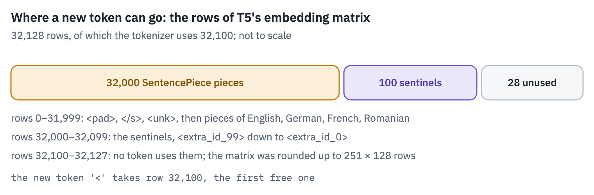
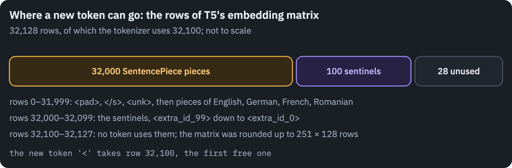

```python
print("vocabulary rows in the model:", t5.embed.weight.shape[0])
print("tokens the tokenizer knows:  ", len(tokenizer))
sql_tokenizer = AutoTokenizer.from_pretrained(T5_SMALL)
sql_tokenizer.add_tokens(["<"])
print("id of the new token '<':     ", sql_tokenizer.convert_tokens_to_ids("<"))
ids = sql_tokenizer(query).input_ids
print(sql_tokenizer.convert_ids_to_tokens(ids))
```

<pre class="tfs-printed" markdown="0"><code>vocabulary rows in the model: 32128
tokens the tokenizer knows:   32100
id of the new token &#x27;&lt;&#x27;:      32100
[&#x27;▁&#x27;, &#x27;SEL&#x27;, &#x27;ECT&#x27;, &#x27;▁count&#x27;, &#x27;(&#x27;, &#x27;*&#x27;, &#x27;)&#x27;, &#x27;▁FROM&#x27;, &#x27;▁singer&#x27;, &#x27;▁W&#x27;, &#x27;HER&#x27;, &#x27;E&#x27;, &#x27;▁Age&#x27;, &#x27;&lt;&#x27;, &#x27;▁30&#x27;, &#x27;&lt;/s&gt;&#x27;]</code></pre>

The new token sits in a row the model never trained, so at first it is noise; fine-tuning will give it a meaning,
because a few hundred training queries use it. The tokenizer is the same for every size of T5, so `sql_tokenizer`
serves t5-base too.

Now the training. We fine-tune t5-base, the same architecture as t5-small with 12 layers on each side and a width of 768, loaded into our own `T5` class; the transplant needs no change.

Each step takes a random batch of questions, runs the encoder on the inputs and the decoder on the queries shifted right by the start token, and minimises the cross-entropy of every query token, ignoring padding, exactly as in lesson 4.

```python
del base_reference, bart  # the reference models have done their job
if device == "cuda":
    torch.cuda.empty_cache()
model, model_config = load_t5(T5_BASE)
model = model.to(device)
print(f"t5-base: {sum(p.numel() for p in model.parameters()) / 1e6:.0f} million parameters")


def make_batch(examples):
    inputs = sql_tokenizer([e["input"] for e in examples], max_length=512,
                           truncation=True, padding=True, return_tensors="pt")
    targets = sql_tokenizer([model_target(e) for e in examples], max_length=256,
                            truncation=True, padding=True, return_tensors="pt").input_ids
    start = torch.zeros(len(examples), 1, dtype=torch.long)  # the start token
    decoder_input = torch.cat([start, targets[:, :-1]], dim=1)
    labels = targets.masked_fill(targets == sql_tokenizer.pad_token_id, -100)
    return inputs.input_ids, inputs.attention_mask, decoder_input, labels


def loss_on(model, batch):
    ids, mask, decoder_input, labels = [t.to(device) for t in batch]
    logits = model.decode(decoder_input, model.encode(ids, mask), mask)
    return F.cross_entropy(logits.flatten(0, 1), labels.flatten(), ignore_index=-100)


held_out = random.Random(SEED).sample(dev_set, 256 if not SMOKE else 16)
with torch.no_grad():
    model.eval()
    before = loss_on(model, make_batch(held_out[:32])).item()
print(f"loss on development queries before training: {before:.2f}")
```

<pre class="tfs-printed" markdown="0"><code>t5-base: 223 million parameters
loss on development queries before training: 4.94</code></pre>

The plan: 1,100 steps, about 20 minutes on a T4. Batches hold up to 16 questions of similar length and at most 4,096 input tokens, so that the longest schemas still fit in a T4's memory.

The optimizer is AdamW at a constant learning rate after a short warm-up, with gradients clipped at 1. Every 200 steps we measure the loss on 256 held-out development questions.

We train in float32. T5 was trained on TPUs with bfloat16 activations, which have the range of float32, and in
float16 its feed-forward outputs overflow: in 2021, "t5-small was the only T5 model that was working in fp16"
<sup class="cite">[<a href="#ref-8" id="cite-8" data-ref="8" aria-label="Reference 8: Hugging Face forum (2021). T5 fp16 issue is fixed.">8</a>]</sup>. A T4 has no fast
bfloat16, so float32 it is.

```python
STEPS = 3 if SMOKE else 1100  # about 20 minutes on a T4
BATCH = 16
LR = 3e-4
WARMUP = 100
optimizer = torch.optim.AdamW(model.parameters(), lr=LR, weight_decay=0.0)


TOKEN_BUDGET = 4096  # input tokens per batch: 16 questions of 256 tokens, or 8 of 512
input_tokens = {}
for e, n in zip(train_set, lengths):
    input_tokens[e["question"] + e["query"]] = min(n, 512)


def batches_by_length(examples, size, rng):
    shuffled = examples[:]
    rng.shuffle(shuffled)
    batches = []
    for i in range(0, len(shuffled), size * 50):
        pool = sorted(shuffled[i:i + size * 50],
                      key=lambda e: input_tokens[e["question"] + e["query"]])
        batch = []
        for e in pool:
            longest = input_tokens[e["question"] + e["query"]]  # the pool is sorted
            if len(batch) == size or (len(batch) + 1) * longest > TOKEN_BUDGET:
                batches.append(batch)
                batch = []
            batch.append(e)
        batches.append(batch)
    rng.shuffle(batches)  # similar lengths within a batch, random order of batches
    return batches


def dev_loss(model):
    model.eval()
    total = 0.0
    with torch.no_grad():
        for i in range(0, len(held_out), 32):
            chunk = held_out[i:i + 32]
            total += loss_on(model, make_batch(chunk)).item() * len(chunk)
    model.train()
    return total / len(held_out)


rng = random.Random(SEED)
history = []
model.train()
started, step = time.time(), 0
while step < STEPS:
    for examples in batches_by_length(train_set, BATCH, rng):
        if step == STEPS:
            break
        for group in optimizer.param_groups:
            group["lr"] = LR * min(1.0, (step + 1) / WARMUP)
        loss = loss_on(model, make_batch(examples))
        loss.backward()
        torch.nn.utils.clip_grad_norm_(model.parameters(), 1.0)
        optimizer.step()
        optimizer.zero_grad()
        if step % 200 == 0:
            history.append({"step": step, "minutes": (time.time() - started) / 60,
                            "train loss": loss.item(), "dev loss": dev_loss(model)})
        step += 1
history.append({"step": step, "minutes": (time.time() - started) / 60,
                "train loss": loss.item(), "dev loss": dev_loss(model)})
model.eval()
history = pd.DataFrame(history)
minutes = (time.time() - started) / 60
passes = step * BATCH / len(train_set)
print(f"{step:,} steps in {minutes:.0f} minutes, about {passes:.1f} passes over the data")
```

<pre class="tfs-printed" markdown="0"><code>1,100 steps in 21 minutes, about 2.5 passes over the data</code></pre>

```python
fig, ax = plt.subplots(figsize=(6.4, 2.8))
ax.plot(history["step"], history["train loss"], color=COLORS["enc"], label="training batch")
ax.plot(history["step"], history["dev loss"], color=COLORS["dec"],
        label="development questions")
ax.set_xlabel("step")
ax.set_ylabel("cross-entropy per token")
ax.set_ylim(0, None)
ax.legend(frameon=False)
plt.show()
```

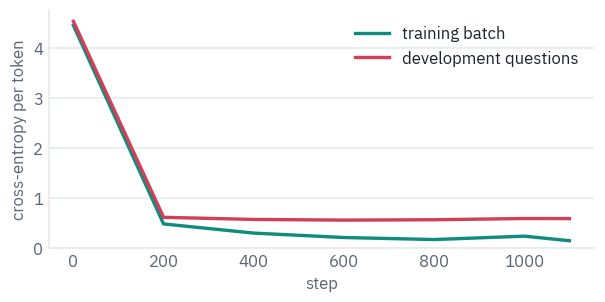

The loss falls fast: within the first 200 steps the development loss drops to a small fraction of where it started,
and after that it barely moves while the training loss keeps going down. From there on the model gets better at the
training questions than at SQL in general, the start of overfitting.

## 9. Checking by running

A loss says how probable the model finds the reference query, token by token. It doesn't say whether the query the model writes is right: a query worded differently from the reference can be improbable and still return the right rows.

For SQL there is a better judge than comparing text: run it. Spider's databases are real SQLite files, so we run the model's query and the correct one on the same database and compare what comes back.

This is *execution accuracy*. It errs in both directions. Two correct queries can differ as strings, `AGE > 34` and `AGE >= 35`, which is why exact matching underrates models.

And a wrong query can happen to return the right rows on one particular database, which is why Spider's official metric since 2020 runs every query on a suite of databases built to tell such queries apart<sup class="cite">[<a href="#ref-9" id="cite-9" data-ref="9" aria-label="Reference 9: Zhong, R., Yu, T., &amp; Klein, D. (2020). Semantic evaluation for text-to-SQL with distilled test suites. EMNLP 2020.">9</a>]</sup>. We use the one database Spider ships.


Two results are the same if they hold the same rows. Order matters only if the correct query asks for one with
`ORDER BY`; otherwise we compare the rows as sorted lists. A query that runs longer than five seconds is stopped
and counts as wrong, and so does one that fails.

```python
def run_query(db_id, query, seconds=5.0):
    path = SPIDER_DIR / "database" / db_id / (db_id + ".sqlite")
    connection = sqlite3.connect(path)
    # a few databases hold text that isn't valid UTF-8
    connection.text_factory = lambda raw: raw.decode(errors="replace")
    deadline = time.time() + seconds
    # SQLite calls the handler every 10,000 steps; returning True stops the query
    connection.set_progress_handler(lambda: time.time() > deadline, 10_000)
    try:
        return connection.execute(query).fetchall()
    finally:
        connection.close()


def same_result(db_id, predicted, gold):
    expected = run_query(db_id, gold)
    try:
        got = run_query(db_id, predicted)
    except Exception as error:
        return False, str(error)  # SQLite's message
    if "order by" in gold.lower():
        return got == expected, "ran"
    return sorted(map(repr, got)) == sorted(map(repr, expected)), "ran"


print(same_result("concert_singer", "SELECT count(*) FROM singer WHERE Age < 30",
                  "SELECT count(*) FROM singer WHERE age < 30"))
print(same_result("concert_singer", "SELECT count(*) FROM singer WHERE Age <= 30",
                  "SELECT count(*) FROM singer WHERE age < 30"))
print(same_result("concert_singer", "SELECT count(*) FROM singers",
                  "SELECT count(*) FROM singer WHERE age < 30"))
```

<pre class="tfs-printed" markdown="0"><code>(True, &#x27;ran&#x27;)
(True, &#x27;ran&#x27;)
(False, &#x27;no such table: singers&#x27;)</code></pre>

Now every development question, 1,034 of them about 20 databases the model has never seen. Generation uses our
own `generate` with the KV cache, in batches.

```python
evaluated = dev_set if not SMOKE else dev_set[:24]
predictions = []
started = time.time()
for i in range(0, len(evaluated), 64):
    chunk = evaluated[i:i + 64]
    batch = sql_tokenizer([e["input"] for e in chunk], max_length=512, truncation=True,
                          padding=True, return_tensors="pt").to(device)
    written = generate(model, batch.input_ids, batch.attention_mask, max_new_tokens=192)
    predictions += sql_tokenizer.batch_decode(written, skip_special_tokens=True)
print(f"{len(predictions):,} queries written in {time.time() - started:.0f} s")

def normalized(query):
    query = " ".join(query.lower().replace('"', "'").split())
    return re.sub(r"\s*([,()<>=!])\s*", r"\1", query)  # spaces around , ( ) and < > = !


results = []
for e, predicted in zip(evaluated, predictions):
    correct, status = same_result(e["db_id"], predicted, model_target(e))
    results.append({"db_id": e["db_id"], "question": e["question"], "gold": model_target(e),
                    "predicted": predicted, "correct": correct, "status": status,
                    "as written": predicted == model_target(e),
                    "exact": normalized(predicted) == normalized(model_target(e)),
                    "no rows": len(run_query(e["db_id"], model_target(e))) == 0})
results = pd.DataFrame(results)
print(f"execution accuracy:                     {results['correct'].mean():.1%}")
print(f"the same string as the reference:       {results['as written'].mean():.1%}")
print(f"the same up to spaces, quotes and case: {results['exact'].mean():.1%}")
print("queries that failed to run:", (results["status"] != "ran").sum())
lucky = results["correct"] & results["no rows"] & ~results["exact"]
print("right only in that both return no rows:", lucky.sum())
```

<pre class="tfs-printed" markdown="0"><code>1,034 queries written in 87 s
execution accuracy:                     42.6%
the same string as the reference:       11.2%
the same up to spaces, quotes and case: 32.0%
queries that failed to run: 406
right only in that both return no rows: 7</code></pre>

Just over two queries in five return the right rows, on twenty databases the model has never seen, after 20 minutes
of fine-tuning a model of 220 million parameters.

The three ways of counting tell three different stories. Compared character for character, only about one query in nine matches the reference, and most of that gap is formatting: T5's tokenizer drops the space before a comma, and Spider's annotators mixed quotes and capital letters.

After normalising those, about a third match. Execution accepts roughly another tenth on top: queries written differently that mean the same thing.

A handful of those are right only by luck, because both queries return no rows at all on this database, the false positive of the figure above. And almost two queries in five don't run.

Where does it go wrong? Spider's own scripts sort queries into four levels of hardness by counting their parts; a
rougher but transparent way is to look at what a correct query contains: a join, a nested `SELECT`, a `GROUP BY`,
an `ORDER BY`, or none of these.

```python
def query_parts(query):
    q = " " + query.lower() + " "
    return {"join": " join " in q, "nested select": q.count("select ") > 1,
            "group by": " group by " in q, "order by": " order by " in q}


rows = []
for name in ["join", "nested select", "group by", "order by", "none of these"]:
    if name == "none of these":
        chosen = [not any(query_parts(g).values()) for g in results["gold"]]
    else:
        chosen = [query_parts(g)[name] for g in results["gold"]]
    part = results[chosen]
    rows.append({"correct query has": name, "questions": len(part),
                 "execution accuracy": part["correct"].mean()})
parts = pd.DataFrame(rows)
table(parts)
```

<div class="tfs-table-wrap"><table class="tfs-table" style="border-collapse:collapse;font-family:'IBM Plex Sans', -apple-system, 'Segoe UI', Roboto, Helvetica, Arial, sans-serif;font-size:13.5px;line-height:1.45;margin:4px 0 8px;"><thead><tr><th style="padding:7px 14px;border-bottom:2px solid #B9C0CB;font-weight:600;color:#5B6575;font-size:12px;letter-spacing:0.02em;text-align:left;">correct query has</th><th style="padding:7px 14px;border-bottom:2px solid #B9C0CB;font-weight:600;color:#5B6575;font-size:12px;letter-spacing:0.02em;text-align:right;">questions</th><th style="padding:7px 14px;border-bottom:2px solid #B9C0CB;font-weight:600;color:#5B6575;font-size:12px;letter-spacing:0.02em;text-align:right;">execution accuracy</th></tr></thead><tbody><tr><td style="padding:7px 14px;border-bottom:1px solid #E6E9EE;vertical-align:top;text-align:left;max-width:460px;white-space:normal;">join</td><td style="padding:7px 14px;border-bottom:1px solid #E6E9EE;vertical-align:top;text-align:right;font-variant-numeric:tabular-nums;max-width:460px;white-space:normal;">408</td><td style="padding:7px 14px;border-bottom:1px solid #E6E9EE;vertical-align:top;text-align:right;font-variant-numeric:tabular-nums;max-width:460px;white-space:normal;">0.19</td></tr><tr><td style="padding:7px 14px;border-bottom:1px solid #E6E9EE;vertical-align:top;text-align:left;max-width:460px;white-space:normal;">nested select</td><td style="padding:7px 14px;border-bottom:1px solid #E6E9EE;vertical-align:top;text-align:right;font-variant-numeric:tabular-nums;max-width:460px;white-space:normal;">159</td><td style="padding:7px 14px;border-bottom:1px solid #E6E9EE;vertical-align:top;text-align:right;font-variant-numeric:tabular-nums;max-width:460px;white-space:normal;">0.28</td></tr><tr><td style="padding:7px 14px;border-bottom:1px solid #E6E9EE;vertical-align:top;text-align:left;max-width:460px;white-space:normal;">group by</td><td style="padding:7px 14px;border-bottom:1px solid #E6E9EE;vertical-align:top;text-align:right;font-variant-numeric:tabular-nums;max-width:460px;white-space:normal;">277</td><td style="padding:7px 14px;border-bottom:1px solid #E6E9EE;vertical-align:top;text-align:right;font-variant-numeric:tabular-nums;max-width:460px;white-space:normal;">0.39</td></tr><tr><td style="padding:7px 14px;border-bottom:1px solid #E6E9EE;vertical-align:top;text-align:left;max-width:460px;white-space:normal;">order by</td><td style="padding:7px 14px;border-bottom:1px solid #E6E9EE;vertical-align:top;text-align:right;font-variant-numeric:tabular-nums;max-width:460px;white-space:normal;">237</td><td style="padding:7px 14px;border-bottom:1px solid #E6E9EE;vertical-align:top;text-align:right;font-variant-numeric:tabular-nums;max-width:460px;white-space:normal;">0.40</td></tr><tr><td style="padding:7px 14px;border-bottom:1px solid #E6E9EE;vertical-align:top;text-align:left;max-width:460px;white-space:normal;">none of these</td><td style="padding:7px 14px;border-bottom:1px solid #E6E9EE;vertical-align:top;text-align:right;font-variant-numeric:tabular-nums;max-width:460px;white-space:normal;">333</td><td style="padding:7px 14px;border-bottom:1px solid #E6E9EE;vertical-align:top;text-align:right;font-variant-numeric:tabular-nums;max-width:460px;white-space:normal;">0.63</td></tr></tbody></table></div>

```python
fig, ax = plt.subplots(figsize=(6.4, 2.6))
ax.barh(parts["correct query has"], parts["execution accuracy"], color=COLORS["enc"])
for k in range(len(parts)):
    accuracy, count = parts["execution accuracy"][k], parts["questions"][k]
    ax.text(accuracy + 0.01, k, f"{accuracy:.0%} of {count}", va="center",
            color=COLORS["muted"])
ax.invert_yaxis()
ax.set_xlim(0, 1)
ax.set_xlabel("execution accuracy")
plt.show()
```

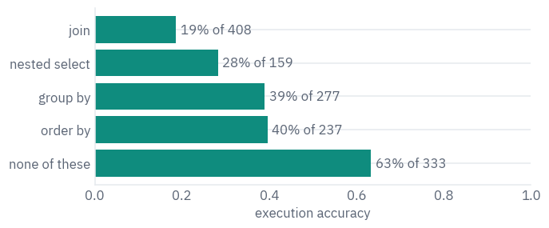

The pattern is the one Spider was built to expose. Queries with none of these parts, one table with a filter or a count, are right almost two times in three.

Every added clause costs, and joins cost the most: fewer than one in five is right. To join two tables, the model has to know which column of one points to which column of the other. Our input doesn't say, so it guesses from the names.

Three kinds of answers are worth looking at one by one: queries that are right although they differ from the
reference, queries that don't run, and queries that run and return the wrong thing.

```python
right_but_different = results[results["correct"] & ~results["exact"]]  # really different
failed = results[results["status"] != "ran"]
wrong = results[(results["status"] == "ran") & ~results["correct"]]
for title, frame in [("right, but not the reference string", right_but_different),
                     ("does not run", failed), ("runs, wrong result", wrong)]:
    print(f"== {title}: {len(frame)}")
    for row in frame.head(3).itertuples():
        print("  question: ", row.question)
        print("  reference:", row.gold)
        note = "" if row.status == "ran" else f"({row.status})"
        print("  model:    ", row.predicted, note)
        print()
```

<pre class="tfs-printed" markdown="0"><code>== right, but not the reference string: 117
  question:  Show the stadium name and capacity with most number of concerts in year 2014 or after.
  reference: SELECT T2.name , T2.capacity FROM concert AS T1 JOIN stadium AS T2 ON T1.stadium_id = T2.stadium_id WHERE T1.year &gt;= 2014 GROUP BY T2.stadium_id ORDER BY count(*) DESC LIMIT 1
  model:     SELECT T1.name, max(T1.capacity) FROM stadium AS T1 JOIN concert AS T2 ON T1.stadium_id = T2.stadium_id WHERE T2.year &gt;= 2014 GROUP BY T2.stadium_id ORDER BY count(*) DESC LIMIT 1 

  question:  What is the name and capacity of the stadium with the most concerts after 2013 ?
  reference: select t2.name , t2.capacity from concert as t1 join stadium as t2 on t1.stadium_id = t2.stadium_id where t1.year &gt; 2013 group by t2.stadium_id order by count(*) desc limit 1
  model:     SELECT T1.name, T1.capacity FROM stadium AS T1 JOIN concert AS T2 ON T1.stadium_id = T2.stadium_id WHERE T2.year &gt; 2013 GROUP BY T1.name ORDER BY count(*) DESC LIMIT 1 

  question:  Show names for all stadiums except for stadiums having a concert in year 2014.
  reference: SELECT name FROM stadium EXCEPT SELECT T2.name FROM concert AS T1 JOIN stadium AS T2 ON T1.stadium_id = T2.stadium_id WHERE T1.year = 2014
  model:     SELECT name FROM stadium EXCEPT SELECT T1.name FROM stadium AS T1 JOIN concert AS T2 ON T1.stadium_id = T2.stadium_id WHERE T2.year = 2014 

== does not run: 406
  question:  Show the name and the release year of the song by the youngest singer.
  reference: SELECT song_name , song_release_year FROM singer ORDER BY age LIMIT 1
  model:     SELECT T1.name, T1.song_release_year FROM singer AS T1 JOIN concert AS T2 ON T1.singer_id = T2.singer_id ORDER BY T2.age LIMIT 1 (no such column: T2.singer_id)

  question:  What are the names and release years for all the songs of the youngest singer?
  reference: SELECT song_name , song_release_year FROM singer ORDER BY age LIMIT 1
  model:     SELECT T1.name, T1.song_release_year FROM singer AS T1 JOIN concert AS T2 ON T1.singer_id = T2.singer_id ORDER BY T2.age LIMIT 1 (no such column: T2.singer_id)

  question:  Show location and name for all stadiums with a capacity between 5000 and 10000.
  reference: SELECT LOCATION , name FROM stadium WHERE capacity BETWEEN 5000 AND 10000
  model:     SELECT T1.location, T1.name FROM stadium AS T1 JOIN concert AS T2 ON T1.stadium_id = T2.stadium_id WHERE T2.capacity BETWEEN 5000 AND 10000 (no such column: T2.capacity)

== runs, wrong result: 187
  question:  Show name, country, age for all singers ordered by age from the oldest to the youngest.
  reference: SELECT name , country , age FROM singer ORDER BY age DESC
  model:     SELECT name, country FROM singer ORDER BY age 

  question:  How many singers are from each country?
  reference: SELECT country , count(*) FROM singer GROUP BY country
  model:     SELECT count(*), Country FROM singer GROUP BY Country 

  question:  What is the maximum capacity and the average of all stadiums ?
  reference: select max(capacity), average from stadium
  model:     SELECT max(capacity), avg(capacity) FROM stadium </code></pre>

The first group is why execution accuracy exists: the model groups by the name instead of the id, joins the tables
from the other side, or writes an aggregate where the reference doesn't need one, and the rows come out the same.
Some of these are right on this database only; a suite of test databases would catch a few.

The second group is the model's main failure, and it isn't about SQL. The queries are well formed, but they reach
for a column or a table that doesn't exist, often through a join the question didn't need.

The third group is where our own check shows its limits. "How many singers are from each country?" answered with `SELECT count(*), Country` is right: it holds the same numbers in the other column order, and our comparison, which is strict about the order of columns, counts it as wrong.

The last example is a matter of annotation: the reference reads "the average" as a column called `Average`, the model as `avg(capacity)`, and a person could read the question either way. No metric of text-to-SQL is free of such cases; what matters is knowing which way each one errs.

The queries that don't run, sorted by what SQLite said about them:

```python
def error_kind(message):
    for kind in ["no such column", "syntax error", "no such table", "ambiguous column",
                 "interrupted"]:
        if kind in message:
            return kind
    return "other"


kinds = Counter(error_kind(message) for message in failed["status"])
table(pd.DataFrame(kinds.most_common(), columns=["SQLite says", "queries"]))
```

<div class="tfs-table-wrap"><table class="tfs-table" style="border-collapse:collapse;font-family:'IBM Plex Sans', -apple-system, 'Segoe UI', Roboto, Helvetica, Arial, sans-serif;font-size:13.5px;line-height:1.45;margin:4px 0 8px;"><thead><tr><th style="padding:7px 14px;border-bottom:2px solid #B9C0CB;font-weight:600;color:#5B6575;font-size:12px;letter-spacing:0.02em;text-align:left;">SQLite says</th><th style="padding:7px 14px;border-bottom:2px solid #B9C0CB;font-weight:600;color:#5B6575;font-size:12px;letter-spacing:0.02em;text-align:right;">queries</th></tr></thead><tbody><tr><td style="padding:7px 14px;border-bottom:1px solid #E6E9EE;vertical-align:top;text-align:left;max-width:460px;white-space:normal;">no such column</td><td style="padding:7px 14px;border-bottom:1px solid #E6E9EE;vertical-align:top;text-align:right;font-variant-numeric:tabular-nums;max-width:460px;white-space:normal;">343</td></tr><tr><td style="padding:7px 14px;border-bottom:1px solid #E6E9EE;vertical-align:top;text-align:left;max-width:460px;white-space:normal;">no such table</td><td style="padding:7px 14px;border-bottom:1px solid #E6E9EE;vertical-align:top;text-align:right;font-variant-numeric:tabular-nums;max-width:460px;white-space:normal;">32</td></tr><tr><td style="padding:7px 14px;border-bottom:1px solid #E6E9EE;vertical-align:top;text-align:left;max-width:460px;white-space:normal;">syntax error</td><td style="padding:7px 14px;border-bottom:1px solid #E6E9EE;vertical-align:top;text-align:right;font-variant-numeric:tabular-nums;max-width:460px;white-space:normal;">19</td></tr><tr><td style="padding:7px 14px;border-bottom:1px solid #E6E9EE;vertical-align:top;text-align:left;max-width:460px;white-space:normal;">ambiguous column</td><td style="padding:7px 14px;border-bottom:1px solid #E6E9EE;vertical-align:top;text-align:right;font-variant-numeric:tabular-nums;max-width:460px;white-space:normal;">7</td></tr><tr><td style="padding:7px 14px;border-bottom:1px solid #E6E9EE;vertical-align:top;text-align:left;max-width:460px;white-space:normal;">other</td><td style="padding:7px 14px;border-bottom:1px solid #E6E9EE;vertical-align:top;text-align:right;font-variant-numeric:tabular-nums;max-width:460px;white-space:normal;">5</td></tr></tbody></table></div>

Five failures in six are of one kind: the query names a column that the table doesn't have. Syntax errors are rare. After 20 minutes the model writes grammatical SQL; what it can't do reliably is read the schema.

The text-to-SQL literature calls this *schema linking*, and it is why the best T5 systems on Spider gave the model some of each database's contents as well as its names. Here is one failure drawn against the real schema:

```python
invented = failed[failed["status"].str.startswith("no such column")]
if len(invented) > 0:
    case = invented.iloc[0]
    db = schemas[case["db_id"]]
    print("question:", case["question"])
    print("model:   ", case["predicted"])
    print("SQLite:  ", case["status"])
    rows, labels = [], []
    for i, name in enumerate(db["table_names_original"]):
        rows.append([c for t, c in db["column_names_original"][1:] if t == i])
        labels.append(name)
    rows.append([case["status"].split(": ", 1)[1]])
    labels.append("the model wrote")
    token_chips(rows, labels=labels, mark_spaces=False,
                strong=lambda row, col, token: row == len(rows) - 1)
    plt.show()
```

<pre class="tfs-printed" markdown="0"><code>question: Show the name and the release year of the song by the youngest singer.
model:    SELECT T1.name, T1.song_release_year FROM singer AS T1 JOIN concert AS T2 ON T1.singer_id = T2.singer_id ORDER BY T2.age LIMIT 1
SQLite:   no such column: T2.singer_id</code></pre>

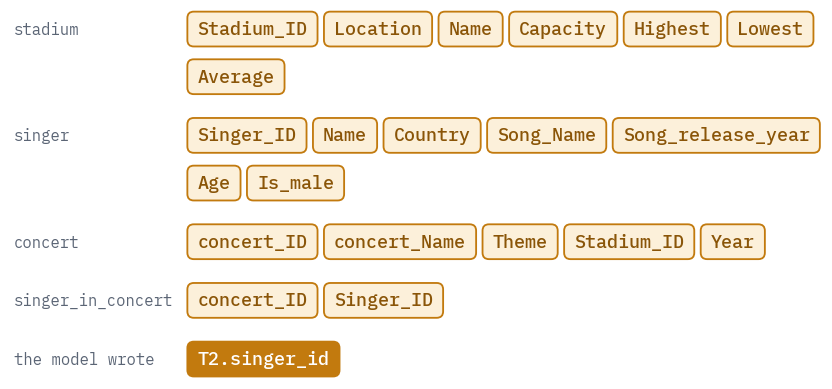

The model knows that a singer has an id and that concerts involve singers, so it joins `singer` to `concert` on `singer_id`. But `concert` has no such column: singers and concerts meet in a third table, `singer_in_concert`, and nothing in our input says so.

The foreign keys we left out would have. The question didn't even need a join: the youngest singer's song is in `singer` itself.

## 10. Letting SQLite choose

A query that doesn't run is the cheapest mistake to catch: SQLite says so in a millisecond, without knowing the right answer. PICARD used this inside the decoder, rejecting any token that would make the query unparseable.

Earlier, Wang et al. ran partly written queries during beam search and dropped the beams whose execution failed, which they called *execution-guided decoding*<sup class="cite">[<a href="#ref-10" id="cite-10" data-ref="10" aria-label="Reference 10: Wang, C., Tatwawadi, K., Brockschmidt, M., Huang, P.-S., Mao, Y., Polozov, O., &amp; Singh, R. (2018). Robust text-to-SQL generation with execution-guided decoding. arXiv:1807.03100.">10</a>]</sup>.

We do the simplest version of the idea: sample four more queries per question at a temperature of 0.7, put the greedy query first, and keep the first one that SQLite runs without an error. The choice looks only at the database, never at the reference answer, so it is a fair test.

The last line, *at least one of five is right*, is not a method: it peeks at the reference. It shows how much a
perfect judge could get out of the same five candidates.

```python
SAMPLES = 4
generator = torch.Generator(device=device).manual_seed(SEED)
candidates = [[query] for query in predictions]  # the greedy query comes first
started = time.time()
for i in range(0, len(evaluated), 64):
    chunk = evaluated[i:i + 64]
    batch = sql_tokenizer([e["input"] for e in chunk], max_length=512, truncation=True,
                          padding=True, return_tensors="pt").to(device)
    for _ in range(SAMPLES):
        written = generate(model, batch.input_ids, batch.attention_mask, max_new_tokens=192,
                           temperature=0.7, generator=generator)
        queries = sql_tokenizer.batch_decode(written, skip_special_tokens=True)
        for j, query in enumerate(queries):
            candidates[i + j].append(query)
print(f"{SAMPLES} more queries per question in {time.time() - started:.0f} s")


def first_that_runs(db_id, queries):
    for query in queries:
        try:
            run_query(db_id, query)
            return query
        except Exception:
            continue
    return queries[0]  # none runs: keep the greedy one


chosen, any_right = [], []
for e, queries in zip(evaluated, candidates):
    chosen.append(first_that_runs(e["db_id"], queries))
    any_right.append(any(same_result(e["db_id"], q, model_target(e))[0] for q in queries))
results["chosen"] = chosen
results["chosen correct"] = [same_result(e["db_id"], q, model_target(e))[0]
                             for e, q in zip(evaluated, chosen)]
results["any of 5 correct"] = any_right
still_failing = 0
for e, q in zip(evaluated, chosen):
    try:
        run_query(e["db_id"], q)
    except Exception:
        still_failing += 1
print(f"greedy:                      {results['correct'].mean():.1%}")
print(f"first of 5 that runs:        {results['chosen correct'].mean():.1%}")
print(f"at least one of 5 is right:  {results['any of 5 correct'].mean():.1%}")
print("queries that still fail to run:", still_failing)
```

<pre class="tfs-printed" markdown="0"><code>4 more queries per question in 348 s
greedy:                      42.6%
first of 5 that runs:        48.8%
at least one of 5 is right:  52.8%
queries that still fail to run: 260</code></pre>

```python
labels = ["greedy", "first of 5\nthat runs", "any of 5\nis right"]
values = [results["correct"].mean(), results["chosen correct"].mean(),
          results["any of 5 correct"].mean()]
fig, ax = plt.subplots(figsize=(6.4, 2.4))
ax.barh(labels, values, color=[COLORS["enc"], COLORS["enc"], COLORS["line"]])
for k, value in enumerate(values):
    ax.text(value + 0.01, k, f"{value:.1%}", va="center", color=COLORS["muted"])
ax.invert_yaxis()
ax.set_xlim(0, 1)
ax.set_xlabel("execution accuracy on 1,034 development questions")
plt.show()
```

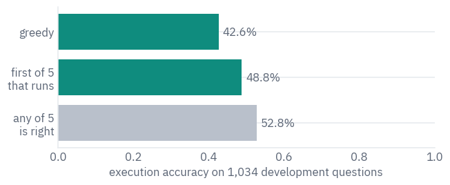

Letting SQLite reject the queries that fail adds about six points of execution accuracy, with no new training and nothing but the database's word that a query runs.

More than a third of the failing questions get a working replacement from the four samples. The last bar shows what is left for a better judge: a perfect choice among the same five candidates would add only about four points more.

For nearly half of the questions, none of the five candidates is right. Choosing better won't fix those; a bigger model, longer training, or the schema's keys and some of its values in the input would.

## 11. Why decoder-only models won anyway

T5's own comparison put the encoder–decoder first: "For all tasks, the encoder-decoder architecture with the
denoising objective performed best." Three years later the largest models were all decoders. The reasons are worth
knowing, because none of them is that the encoder–decoder is worse.

The first is what got measured. T5 measured transfer learning: pre-train, then fine-tune for each task. The models that changed the field were used another way, prompted with no fine-tuning at all.

BigScience tested exactly this before choosing the architecture of BLOOM, training models of 5 billion parameters on 170 billion tokens, and found that "the best objective and architecture is the opposite in these two settings": a causal decoder trained on plain language modelling did best right after pre-training, an encoder–decoder trained on masked language modelling did best once multi-task fine-tuning was added<sup class="cite">[<a href="#ref-11" id="cite-11" data-ref="11" aria-label="Reference 11: Wang, T., Roberts, A., Hesslow, D., Le Scao, T., et al. (2022). What language model architecture and pretraining objective work best for zero-shot generalization? ICML 2022.">11</a>]</sup>.

BLOOM's report <sup class="cite">[<a href="#ref-12" id="cite-12" data-ref="12" aria-label="Reference 12: BigScience Workshop (2022). BLOOM: a 176B-parameter open-access multilingual language model. arXiv:2211.05100.">12</a>]</sup> stated the market's verdict: "all state-of-the-art language models over 100 billion parameters are causal decoder-only models".

The second is memory. Each token passes through only one stack, so an encoder–decoder costs about as much compute as a decoder-only model with half its parameters. But it has "twice the parameters of the decoder-only model, and hence twice the memory footprint", and when the limit is what fits on the GPUs, that counts.

The third is how much the objective teaches per token: denoising learns from the 15% of tokens it hides, language modelling from nearly all of them, which Yi Tay, the first author of [UL2](https://arxiv.org/abs/2205.05131), calls less "loss exposure" <sup class="cite">[<a href="#ref-13" id="cite-13" data-ref="13" aria-label="Reference 13: Tay, Y. (2024). What happened to BERT &amp; T5? On Transformer encoders, PrefixLM and denoising objectives.">13</a>]</sup>.

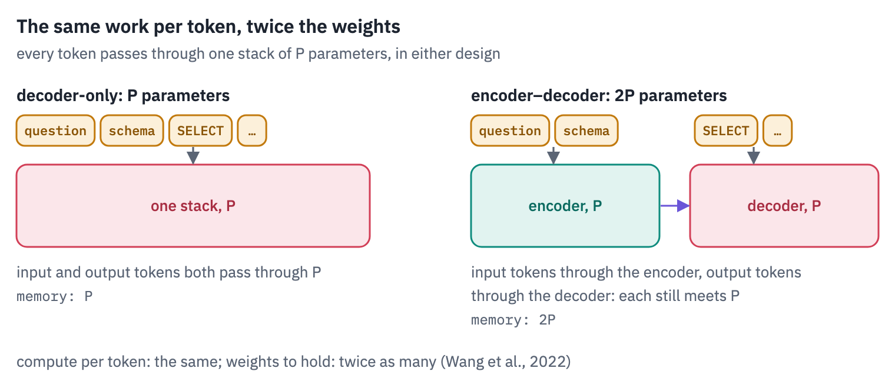
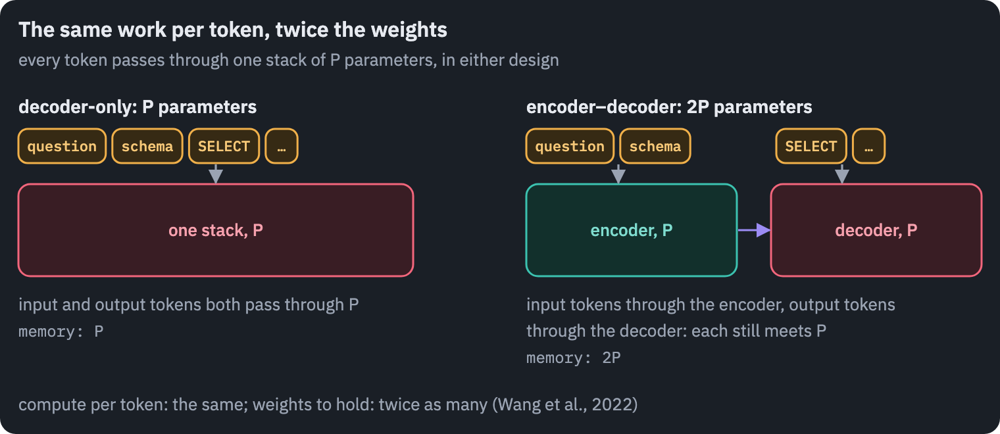

There is also an engineering argument, which is ours rather than a paper's: one stack is simpler. A chat is one growing sequence in which every answer becomes part of the next input.

A decoder reads it with one KV cache; an encoder–decoder has to decide what counts as input and re-encode it as the conversation grows. Kernels, serving systems and fine-tuning tools were then built for the one shape that won, which made it cheaper still.

The verdict is not final. In 2025 Google turned pre-trained Gemma 2 decoders into encoder–decoders and reported that "under similar inference budget, encoder-decoder LLMs achieve comparable (often better) pretraining performance but substantially better finetuning performance than their decoder-only counterpart" <sup class="cite">[<a href="#ref-14" id="cite-14" data-ref="14" aria-label="Reference 14: Zhang, B., Moiseev, F., Ainslie, J., et al. (2025). Encoder-decoder Gemma: improving the quality-efficiency trade-off via adaptation. arXiv:2504.06225.">14</a>]</sup>.

Google's announcement adds that a model with a 9B encoder and a 2B decoder runs at nearly the latency of the 2B model <sup class="cite">[<a href="#ref-15" id="cite-15" data-ref="15" aria-label="Reference 15: Google (2025). T5Gemma: a new collection of encoder-decoder Gemma models. Google Developers Blog.">15</a>]</sup>. [T5Gemma 2](https://arxiv.org/abs/2512.14856) followed in December 2025, multimodal, in sizes from 270M-270M to 4B-4B.

## 12. Where the encoder–decoder is the right tool today

Wherever the input is long or of a different kind from the output, and the output is short. Speech recognition: Whisper is an encoder–decoder, chosen because "this architecture has been well validated to scale reliably" <sup class="cite">[<a href="#ref-16" id="cite-16" data-ref="16" aria-label="Reference 16: Radford, A., Kim, J. W., Xu, T., Brockman, G., McLeavey, C., &amp; Sutskever, I. (2022). Robust speech recognition via large-scale weak supervision. arXiv:2212.04356.">16</a>]</sup>.

Translation: Meta's [NLLB-200](https://arxiv.org/abs/2207.04672) and the Helsinki-NLP MarianMT models. Image generation: the frozen encoder half of a T5-XXL turns the prompt into vectors in Imagen, Stable Diffusion 3 and [FLUX.1](https://github.com/black-forest-labs/flux).

Imagen's authors found "scaling the text encoder size to be significantly more impactful than the U-Net size"<sup class="cite">[<a href="#ref-17" id="cite-17" data-ref="17" aria-label="Reference 17: Saharia, C., Chan, W., Saxena, S., et al. (2022). Photorealistic text-to-image diffusion models with deep language understanding. NeurIPS 2022.">17</a>]</sup>, and Stable Diffusion 3's that dropping T5 costs little, except when the prompt asks for written text in the picture <sup class="cite">[<a href="#ref-18" id="cite-18" data-ref="18" aria-label="Reference 18: Esser, P., Kulal, S., Blattmann, A., et al. (2024). Scaling rectified flow transformers for high-resolution image synthesis. ICML 2024.">18</a>]</sup>.

And structured jobs like ours: a question to SQL, a document to fields, a ticket to a category with an explanation. For such a job, a small encoder–decoder fine-tuned on a few thousand examples is cheap to run and, in our experience, hard to beat at its size.

What it is not for is open conversation and learning from examples in the prompt. The models people chat with are
decoders, and lesson 6 is about what changed inside them since GPT-2.

T5's passport, and the family tree with this lesson's branch:


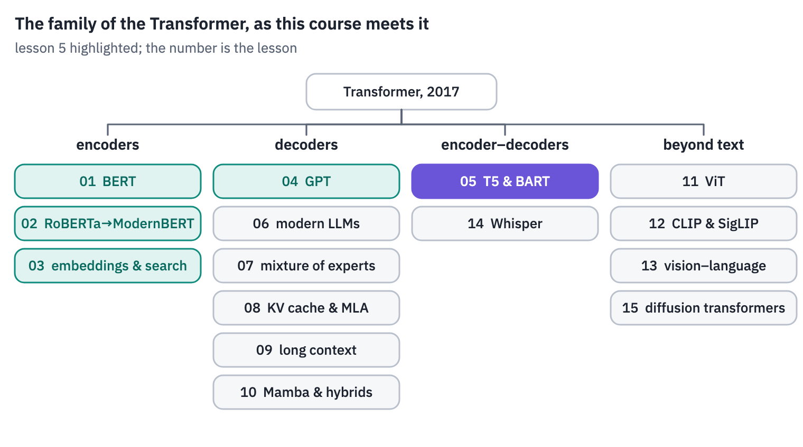
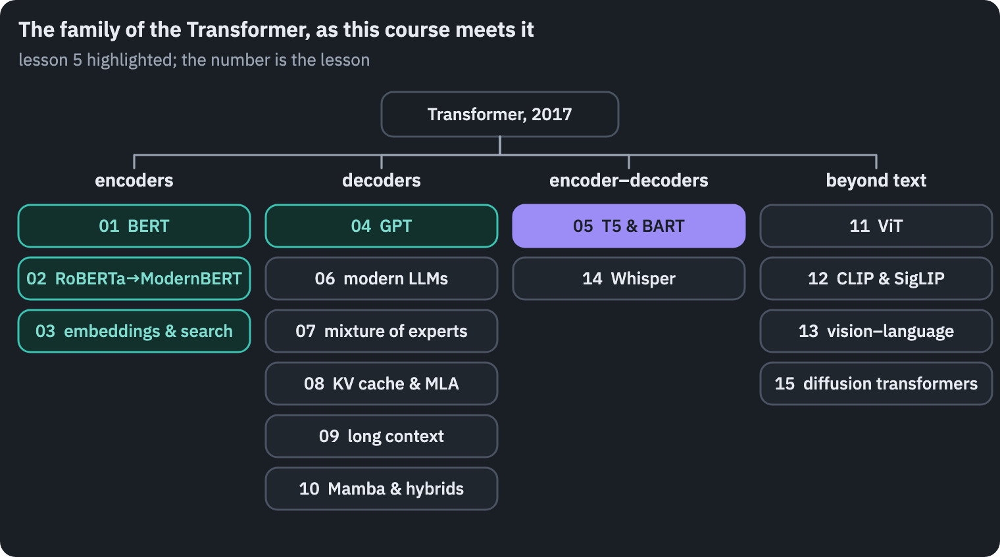

## References

1. {:#ref-1} Green, B. F., Wolf, A. K., Chomsky, C., & Laughery, K. (1961). [Baseball: an automatic question-answerer](https://doi.org/10.1145/1460690.1460714). *Western Joint IRE-AIEE-ACM Computer Conference*, 219–224. <a class="ref-back" href="#cite-1" aria-label="Back to the text">&#8617;</a>
2. {:#ref-2} Lei, F., Chen, J., Ye, Y., et al. (2025). [Spider 2.0: evaluating language models on real-world enterprise text-to-SQL workflows](https://arxiv.org/abs/2411.07763). *ICLR 2025*. <a class="ref-back" href="#cite-2" aria-label="Back to the text">&#8617;</a>
3. {:#ref-3} Raffel, C., Shazeer, N., Roberts, A., Lee, K., Narang, S., Matena, M., Zhou, Y., Li, W., & Liu, P. J. (2020). [Exploring the limits of transfer learning with a unified text-to-text transformer](https://arxiv.org/abs/1910.10683). *Journal of Machine Learning Research*, 21(140), 1–67. <a class="ref-back" href="#cite-3" aria-label="Back to the text">&#8617;</a>
4. {:#ref-4} Zhang, B., & Sennrich, R. (2019). [Root mean square layer normalization](https://arxiv.org/abs/1910.07467). *NeurIPS 2019*. <a class="ref-back" href="#cite-4" aria-label="Back to the text">&#8617;</a>
5. {:#ref-5} Lewis, M., Liu, Y., Goyal, N., Ghazvininejad, M., Mohamed, A., Levy, O., Stoyanov, V., & Zettlemoyer, L. (2020). [BART: denoising sequence-to-sequence pre-training for natural language generation, translation, and comprehension](https://aclanthology.org/2020.acl-main.703/). *ACL 2020*. <a class="ref-back" href="#cite-5" aria-label="Back to the text">&#8617;</a>
6. {:#ref-6} Yu, T., Zhang, R., Yang, K., et al. (2018). [Spider: a large-scale human-labeled dataset for complex and cross-domain semantic parsing and text-to-SQL task](https://aclanthology.org/D18-1425/). *EMNLP 2018*. Data: [yale-lily.github.io/spider](https://yale-lily.github.io/spider), CC BY-SA 4.0. <a class="ref-back" href="#cite-6" aria-label="Back to the text">&#8617;</a>
7. {:#ref-7} Scholak, T., Schucher, N., & Bahdanau, D. (2021). [PICARD: parsing incrementally for constrained auto-regressive decoding from language models](https://arxiv.org/abs/2109.05093). *EMNLP 2021*. <a class="ref-back" href="#cite-7" aria-label="Back to the text">&#8617;</a>
8. {:#ref-8} Hugging Face forum (2021). [T5 fp16 issue is fixed](https://discuss.huggingface.co/t/t5-fp16-issue-is-fixed/3139). <a class="ref-back" href="#cite-8" aria-label="Back to the text">&#8617;</a>
9. {:#ref-9} Zhong, R., Yu, T., & Klein, D. (2020). [Semantic evaluation for text-to-SQL with distilled test suites](https://arxiv.org/abs/2010.02840). *EMNLP 2020*. <a class="ref-back" href="#cite-9" aria-label="Back to the text">&#8617;</a>
10. {:#ref-10} Wang, C., Tatwawadi, K., Brockschmidt, M., Huang, P.-S., Mao, Y., Polozov, O., & Singh, R. (2018). [Robust text-to-SQL generation with execution-guided decoding](https://arxiv.org/abs/1807.03100). arXiv:1807.03100. <a class="ref-back" href="#cite-10" aria-label="Back to the text">&#8617;</a>
11. {:#ref-11} Wang, T., Roberts, A., Hesslow, D., Le Scao, T., et al. (2022). [What language model architecture and pretraining objective work best for zero-shot generalization?](https://arxiv.org/abs/2204.05832) *ICML 2022*. <a class="ref-back" href="#cite-11" aria-label="Back to the text">&#8617;</a>
12. {:#ref-12} BigScience Workshop (2022). [BLOOM: a 176B-parameter open-access multilingual language model](https://arxiv.org/abs/2211.05100). arXiv:2211.05100. <a class="ref-back" href="#cite-12" aria-label="Back to the text">&#8617;</a>
13. {:#ref-13} Tay, Y. (2024). [What happened to BERT & T5? On Transformer encoders, PrefixLM and denoising objectives](https://www.yitay.net/blog/model-architecture-blogpost-encoders-prefixlm-denoising). <a class="ref-back" href="#cite-13" aria-label="Back to the text">&#8617;</a>
14. {:#ref-14} Zhang, B., Moiseev, F., Ainslie, J., et al. (2025). [Encoder-decoder Gemma: improving the quality-efficiency trade-off via adaptation](https://arxiv.org/abs/2504.06225). arXiv:2504.06225. <a class="ref-back" href="#cite-14" aria-label="Back to the text">&#8617;</a>
15. {:#ref-15} Google (2025). [T5Gemma: a new collection of encoder-decoder Gemma models](https://developers.googleblog.com/en/t5gemma/). Google Developers Blog. <a class="ref-back" href="#cite-15" aria-label="Back to the text">&#8617;</a>
16. {:#ref-16} Radford, A., Kim, J. W., Xu, T., Brockman, G., McLeavey, C., & Sutskever, I. (2022). [Robust speech recognition via large-scale weak supervision](https://arxiv.org/abs/2212.04356). arXiv:2212.04356. <a class="ref-back" href="#cite-16" aria-label="Back to the text">&#8617;</a>
17. {:#ref-17} Saharia, C., Chan, W., Saxena, S., et al. (2022). [Photorealistic text-to-image diffusion models with deep language understanding](https://arxiv.org/abs/2205.11487). *NeurIPS 2022*. <a class="ref-back" href="#cite-17" aria-label="Back to the text">&#8617;</a>
18. {:#ref-18} Esser, P., Kulal, S., Blattmann, A., et al. (2024). [Scaling rectified flow transformers for high-resolution image synthesis](https://arxiv.org/abs/2403.03206). *ICML 2024*. <a class="ref-back" href="#cite-18" aria-label="Back to the text">&#8617;</a>
19. {:#ref-19} Tay, Y., Dehghani, M., Tran, V. Q., et al. (2023). [UL2: unifying language learning paradigms](https://arxiv.org/abs/2205.05131). *ICLR 2023*.
20. {:#ref-20} Zhang, B., Suganthan, P., Liu, G., et al. (2025). [T5Gemma 2: seeing, reading, and understanding longer](https://arxiv.org/abs/2512.14856). arXiv:2512.14856.
21. {:#ref-21} NLLB Team (2022). [No language left behind: scaling human-centered machine translation](https://arxiv.org/abs/2207.04672). arXiv:2207.04672.
{: .tfs-refs}


<p class="tfs-neighbours"><a href="/blog/2026/transformer-architectures-06-modern/">Lesson 6: Modern LLMs →</a></p>


