

<aside class="tldr" markdown="1">

In short

Neural networks trained only to do a task, never fitted to brains, turn out to predict the brain's responses better than any model neuroscientists built by hand: language models for the language network, vision models for the visual cortex, a reinforcement-learning rule for dopamine.

The match is real and also narrower than the headlines. Better models stopped becoming more brain-like years ago, much of the measured similarity comes from word meaning and from loose statistics, and a language model is a model of one network in the brain, not of a mind.

The brain wins on energy and data by orders of magnitude, the models win on speed and breadth, and the largest gaps are lifelong learning, a body and knowing what one doesn't know.

−97.5%drop in the language network's response to sentences a GPT-based model chose to silence it

10⁵–10⁶×more text in Llama 3.1's training than the words a child hears by adolescence

57.5%for the best video model on an intuitive-physics test where people score 96.4%

</aside>

In 2023 a team at MIT trained a model on one thing: how strongly the language areas of five people's brains responded, in a scanner, to a thousand ordinary sentences.

The model read each sentence through GPT-2 and predicted the response from GPT-2's internal activity. Then the researchers turned it around. They let the model search 1.8 million sentences for the ones it expected to drive the language network as hard as possible, and the ones it expected to silence it.

The winners to drive were odd: "People on Insta Be Like, "Gross!"" and "Turin loves me not, nor will." The winners to silence were the dullest sentences imaginable: "We were sitting on the couch."

Played to new people the model had never seen, the drive sentences raised the response of the language network by 85.7% over ordinary sentences and the suppress sentences lowered it by 97.5%, on a standardised scale[<a href="#ref-1" id="cite-1" data-ref="1" aria-label="Reference 1: Tuckute et al., 2024. doi.org.">1</a>].

A language model had learned enough about one part of the human brain to steer it with the choice of words alone.

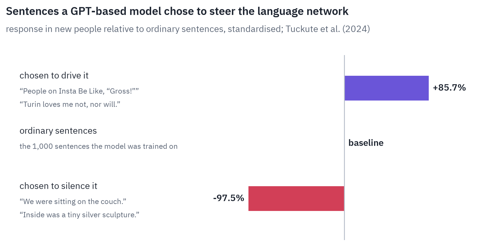
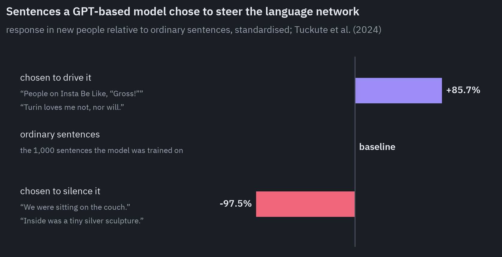

That experiment is the best short answer to the question everyone asks about AI and the brain: are they alike? In some places they are alike enough to be useful to each other.

In others the resemblance is an artefact of how we measure it, and in others there is nothing to compare, because one side has no counterpart at all. This post goes through the evidence system by system, language, vision, space and memory, reward, bodies, then asks which is more efficient and what is missing.

## How do you compare a brain with a model?

A brain and a neural network don't share units. A voxel in an fMRI scan averages the blood flow around hundreds of thousands of neurons over a couple of seconds; a unit in a network is one number. So nobody compares them directly.

The standard method is an *encoding model*: show the same stimuli, a story, a set of photographs, to a person in a scanner and to a network, record the network's internal activity, and fit a linear map from that activity to each voxel's response.

Then test the map on stimuli it hasn't seen. If the network's activity predicts the brain's response to new sentences, the two must share some of the information they carry.

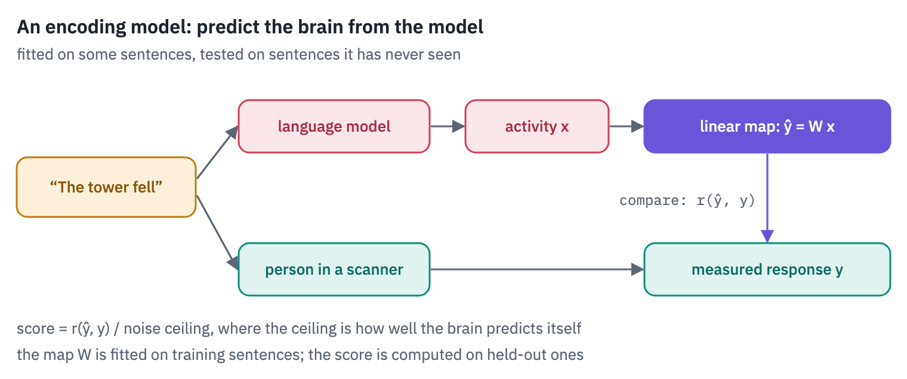
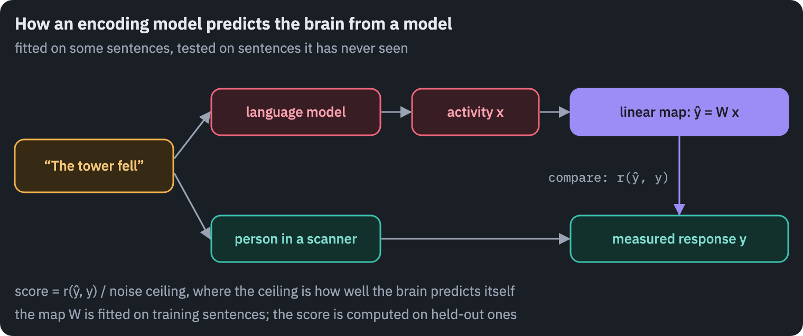

The prediction is scored as a correlation, and since the brain itself is noisy, the correlation is compared with a *noise ceiling*: how well one recording of the same person, or other people, predicts another.

"The model explains 80% of the explainable variance" means its correlation is 80% of that ceiling. The other common method, *representational similarity analysis*, skips the map: it compares which stimuli the brain treats as similar with which ones the network treats as similar[<a href="#ref-2" id="cite-2" data-ref="2" aria-label="Reference 2: Khaligh-Razavi &amp; Kriegeskorte, 2014. doi.org.">2</a>].

Both methods answer a narrower question than it seems. They show that two systems carry overlapping information about the stimuli, not that they compute it the same way.

A linear map is flexible enough to find shared information in very different machinery. And the details of the test matter enormously, as we will see.

Three numbers to keep in mind when reading these studies

Raw correlations are small. In one of the best-known language studies the best models reached a correlation of about 0.05 with single fMRI voxels, against a ceiling of 0.06[<a href="#ref-3" id="cite-3" data-ref="3" aria-label="Reference 3: Caucheteux &amp; King, 2022. doi.org.">3</a>]. "Close to the ceiling" can mean that both numbers are close to zero.

The ceiling is sometimes extrapolated. "Nearly 100% of explainable variance" in Schrimpf et al.'s much-cited paper is a ratio of correlations, with ceilings of r = 0.17 to 0.32, estimated for an infinite number of participants[<a href="#ref-4" id="cite-4" data-ref="4" aria-label="Reference 4: Schrimpf et al., 2021. doi.org.">4</a>].

How the data are split decides a lot. If sentences from the same passage land in both the training and the test set, a model can score well by recognising the passage rather than the sentence.

A 2026 re-analysis found that several of the field's best-known results depend on such splits, and that a model knowing only a sentence's position in the experiment matches GPT-2 on them[<a href="#ref-5" id="cite-5" data-ref="5" aria-label="Reference 5: Hadidi et al., 2026. doi.org.">5</a>].

## Language models predict the language network, and mostly its sense of meaning

The human brain has a set of regions that respond when we read or hear language and barely respond to anything else: not to arithmetic, logic, music or code.

Evelina Fedorenko's group calls it the *language network*; it sits mostly in the left hemisphere, along the temporal lobe and in the inferior frontal gyrus. Here it is as an atlas of 804 people: the colour shows how often each spot of cortex was among a person's most language-selective.

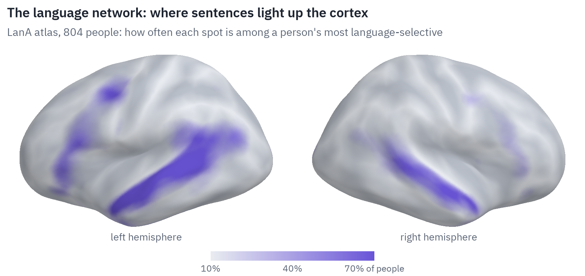
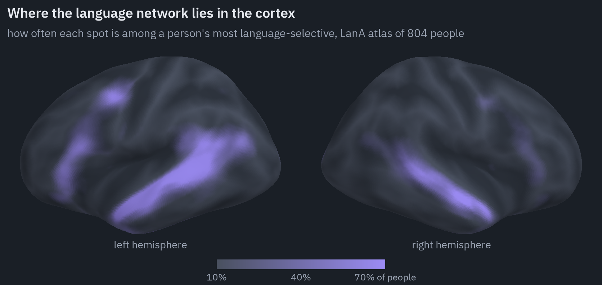

Since 2021 one result has been replicated with fMRI, magnetoencephalography and electrodes placed on the brains of epilepsy patients: the internal activity of language models predicts this network's response to language better than any other model we have.

Schrimpf and colleagues compared 43 models and found transformers best; across models, the ones better at predicting the next word predicted the brain better, while performance on language-understanding benchmarks didn't[<a href="#ref-4" id="cite-6" data-ref="4" aria-label="Reference 4: Schrimpf et al., 2021. doi.org.">4</a>].

Caucheteux and King trained thousands of transformers from scratch and found brain similarity rising with the ability to predict words from context, with a twist: it peaked before the models were at their best, and "the highest brain scores are not achieved by the very best language transformers"[<a href="#ref-3" id="cite-7" data-ref="3" aria-label="Reference 3: Caucheteux &amp; King, 2022. doi.org.">3</a>].

The fit also scales. Training encoding models on about twenty hours of fMRI per person, Antonello, Vaidya and Huth found that predictions improved roughly logarithmically with model size, by about 15% from 125 million to 30 billion parameters, and then levelled off[<a href="#ref-6" id="cite-8" data-ref="6" aria-label="Reference 6: Antonello et al., 2023. arxiv.org.">6</a>].

In some regions the best models came close to the ceiling. And it doesn't take an internet of text: GPT-2 trained on 100 million words, about what a child hears in ten years, predicted the brain as well as GPT-2 trained on billions[<a href="#ref-7" id="cite-9" data-ref="7" aria-label="Reference 7: Hosseini et al., 2024. doi.org.">7</a>].

Here the honest part starts. What is the network actually matching? Kauf and colleagues scrambled the word order of sentences and lost only 8 to 24% of the predictivity; removing the content words lost up to 83%[<a href="#ref-8" id="cite-10" data-ref="8" aria-label="Reference 8: Kauf et al., 2024. doi.org.">8</a>].

What the models share with the language network is mostly the meaning of words, plus some of how words combine, and much less syntax than the word "language model" suggests.

The 2026 re-analysis went further: on the classic datasets, a sentence's position, the rate of words and static word embeddings together accounted for over 80% of GPT-2-XL's predictivity[<a href="#ref-5" id="cite-11" data-ref="5" aria-label="Reference 5: Hadidi et al., 2026. doi.org.">5</a>].

The most attractive story in the field, that the brain is a next-word predictor because next-word predictors fit it best, has been pulled from both sides.

Goldstein and colleagues recorded from 1,339 electrodes while nine patients listened to a podcast and found information about the upcoming word up to 800 milliseconds before it was heard, and surprise after it, much as a language model would show[<a href="#ref-9" id="cite-12" data-ref="9" aria-label="Reference 9: Goldstein et al., 2022. doi.org.">9</a>].

In 2026 Schönmann and colleagues showed that the same signature appears when the analysis is run on the speech sound itself, or on word embeddings that cannot predict anything, because words in natural speech are statistically dependent on their neighbours[<a href="#ref-10" id="cite-13" data-ref="10" aria-label="Reference 10: Schönmann et al., 2026. doi.org.">10</a>].

Goldstein's team had warned about this themselves: "These shared computational principles, however, do not imply that the human brain and DLMs implement these computations in a similar way."

Language models are the best encoding models of the language network we have, and what they mostly capture is word meaning. Whether the brain computes language by predicting the next word is still open.

### Fluency is not thought

The language network has a second property that matters more than any correlation. People who lose it, after a stroke that leaves them with global aphasia, unable to understand or produce sentences, can still do arithmetic, solve logic problems and reason about what other people believe[<a href="#ref-11" id="cite-14" data-ref="11" aria-label="Reference 11: Fedorenko &amp; Varley, 2016. doi.org.">11</a>].

In healthy people the network stays quiet during arithmetic, logic and music. In the brain, language and thought are different systems that talk to each other[<a href="#ref-12" id="cite-15" data-ref="12" aria-label="Reference 12: Fedorenko et al., 2024. doi.org.">12</a>].

Mahowald, Ivanova and colleagues turned this into a distinction for language models: *formal competence*, knowing the rules and patterns of a language, and *functional competence*, using language to reason, plan and know about the world.

A fluent text tempts us to infer the second from the first, the "good at language, therefore good at thought" fallacy[<a href="#ref-13" id="cite-16" data-ref="13" aria-label="Reference 13: Mahowald et al., 2024. doi.org.">13</a>]. The brain data agree.

In a family of models trained from scratch, similarity to the language network peaked after only 2 to 8 billion tokens of training, while reasoning and knowledge kept improving through 300 billion[<a href="#ref-14" id="cite-17" data-ref="14" aria-label="Reference 14: AlKhamissi et al., 2025. arxiv.org.">14</a>].

So a large language model is two things at once. Part of it is a good model of the human language network. The rest, the arithmetic, the facts, the code, has to live somewhere else in the brain, and the language network doesn't predict which.

### Reading language from the brain works, with the person's help

The same models made it possible to decode language from brain activity. Tang, LeBel, Jain and Huth decoded the gist of stories that people heard or imagined, and of silent films they watched, from fMRI alone, using a GPT model to propose candidate word sequences and an encoding model to pick the one that best explained the scan[<a href="#ref-15" id="cite-18" data-ref="15" aria-label="Reference 15: Tang et al., 2023. doi.org.">15</a>].

The output is paraphrase, not transcript: most words come out wrong, and the meaning comes through. The decoder had to be trained on about 16 hours of each person's own scans, didn't work across people, and failed when the person resisted by thinking of something else.

The most practical use is in medicine. Electrodes implanted in the speech-motor cortex of a man with ALS let him speak through a computer at about 32 words a minute with 97.5% accuracy, over 248 hours of everyday use[<a href="#ref-16" id="cite-19" data-ref="16" aria-label="Reference 16: Card et al., 2024. doi.org.">16</a>].

A language model corrects the raw output into likely sentences. The signal is the attempt to move the mouth, not the language network and not thought.

## Vision models matched the visual cortex, then stopped getting closer

The visual system was where this whole line of work began, and where it is most mature.

Visual information flows from the primary visual cortex at the back of the head forward along the underside of the brain, through areas that respond to edges, then to shapes and textures, then to whole objects and faces in the inferior temporal cortex. This *ventral stream* is a hierarchy, like the stack of layers in a convolutional network.

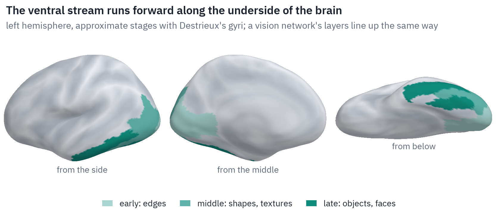
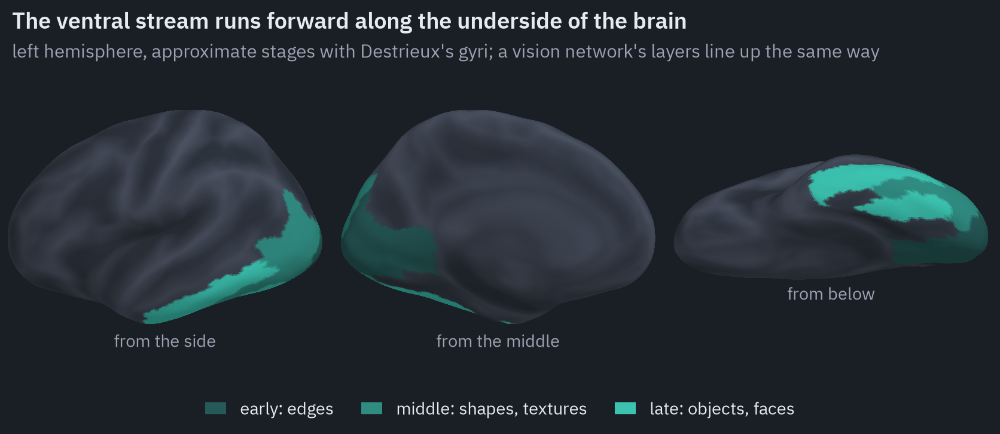

In 2014 Yamins, DiCarlo and colleagues showed that the resemblance is more than a picture. They trained networks only to recognise objects, never fitting them to neural data, and found that the better a network categorised, the better its top layer predicted single sites in the inferior temporal cortex of monkeys, and an intermediate layer predicted area V4.

The best model predicted 48.5% of the explainable variance of IT, nearly twice as much as any model built before it[<a href="#ref-17" id="cite-20" data-ref="17" aria-label="Reference 17: Yamins et al., 2014. doi.org.">17</a>]. A system optimised for a task had converged, in part, on the representation that evolution and development produced for the same task.

What followed is the most instructive turn in the field. If accuracy made networks brain-like, more accurate networks should be more brain-like still.

For a while they were. Then four groups with different data found the payoff gone.

Brain-Score, a benchmark that scores networks against monkey recordings, found the link between ImageNet accuracy and brain similarity weakening above about 70% accuracy[<a href="#ref-18" id="cite-21" data-ref="18" aria-label="Reference 18: Schrimpf et al., 2018. doi.org.">18</a>]. Across 135 networks, Linsley and colleagues found that the more accurate ones had become *worse* models of IT[<a href="#ref-19" id="cite-22" data-ref="19" aria-label="Reference 19: Linsley et al., 2023. arxiv.org.">19</a>].

Over 600 models trained under controlled conditions, alignment with behaviour kept improving with scale while alignment with neurons saturated[<a href="#ref-20" id="cite-23" data-ref="20" aria-label="Reference 20: Gokce &amp; Schrimpf, 2025. arxiv.org.">20</a>]. And in human fMRI from the Natural Scenes Dataset, ImageNet accuracy didn't predict how brain-like a model was at all: the rank correlation was −0.006 by one measure and 0.17 by another[<a href="#ref-21" id="cite-24" data-ref="21" aria-label="Reference 21: Conwell et al., 2024. doi.org.">21</a>].

Conwell's study, 224 models and 1.8 billion regressions, found something even more uncomfortable.

Convolutional networks and transformers trained the same way scored r = 0.67 and 0.66; 126 of the 224 models scored within 0.1 of each other; models whose representations barely correlated with each other got the same brain score; and the same models explained about 31% or about 79.5% of the explainable variance, depending on which of two reasonable versions of the analysis was used.

What mattered most was what images a model was trained on. The authors' conclusion is about our instruments as much as about brains: "standard methods used to link models to brains may be too flexible."

Task-trained networks predicted the visual cortex better than any hand-built model. Since then, accuracy has stopped buying similarity, architecture barely matters, and the measuring stick is looser than the scores suggest.

### Where vision differs

The differences show up in behaviour. On images with the shape of one object and the texture of another, a cat's outline filled with elephant skin, people name the shape 95.9% of the time; ImageNet-trained networks mostly name the texture[<a href="#ref-22" id="cite-25" data-ref="22" aria-label="Reference 22: Geirhos et al., 2019. arxiv.org.">22</a>].

In an odd-one-out task that needs the 3D shape of an object seen from different angles, people score 78% and the best vision model 44%[<a href="#ref-23" id="cite-26" data-ref="23" aria-label="Reference 23: Bonnen et al., 2024. arxiv.org.">23</a>]. Frontier multimodal models of 2024 solved a classic mental rotation test 33% of the time, against 78.5% for people and 25% by chance[<a href="#ref-24" id="cite-27" data-ref="24" aria-label="Reference 24: Ramakrishnan et al., 2025. arxiv.org.">24</a>].

One difference turned out smaller than it looked. Tiny, invisible changes to an image can make a network see a different object, which seemed to prove that networks are fragile and brains are not.

But when the responses of monkey IT neurons were attacked the same way, they turned out about as fragile as networks trained to resist such attacks[<a href="#ref-25" id="cite-28" data-ref="25" aria-label="Reference 25: Guo et al., 2022. arxiv.org.">25</a>].

People resist because they get to look again; a 63-millisecond glimpse followed by a mask can be nudged by the same perturbations that fool networks[<a href="#ref-26" id="cite-29" data-ref="26" aria-label="Reference 26: Elsayed et al., 2018. arxiv.org.">26</a>].

### Pictures from the brain are mostly the generator's

If you have seen images "reconstructed from brain scans", they came from the Natural Scenes Dataset: eight people, each lying in a 7-tesla scanner for 30 to 40 sessions over a year and looking at 9,000 to 10,000 photographs[<a href="#ref-27" id="cite-30" data-ref="27" aria-label="Reference 27: Allen et al., 2022. doi.org.">27</a>].

Pipelines like MindEye2 map the scans into the input space of an image generator. Asked to pick which of 300 photographs a person saw, MindEye2 is right 98.3% of the time; with only one hour of a new person's data, on top of 40 hours each from seven others, 57.4%[<a href="#ref-28" id="cite-31" data-ref="28" aria-label="Reference 28: Scotti et al., 2024. arxiv.org.">28</a>].

Retrieval is real. Reconstruction is mostly the generator's. On a dataset built so that test images come from categories absent from training, the same methods produced realistic pictures of the training categories instead of what people saw; geometric shapes came out as photographs.

The authors call what these methods do "a combination of 'classification' and 'hallucination'"[<a href="#ref-29" id="cite-32" data-ref="29" aria-label="Reference 29: Shirakawa et al., 2025. arxiv.org.">29</a>]. The brain supplies a rough steer, and a model trained on billions of images supplies the picture.

## Space and memory: grid cells, the hippocampus and the context window

The hippocampus and the entorhinal cortex next to it hold the brain's best-understood map. *Place cells* fire when an animal is in one particular spot; *grid cells* fire at every vertex of a triangular lattice that tiles the whole environment. John O'Keefe and May-Britt and Edvard Moser shared the 2014 Nobel Prize for finding them[<a href="#ref-30" id="cite-33" data-ref="30" aria-label="Reference 30: Hafting et al., 2005. doi.org.">30</a>].

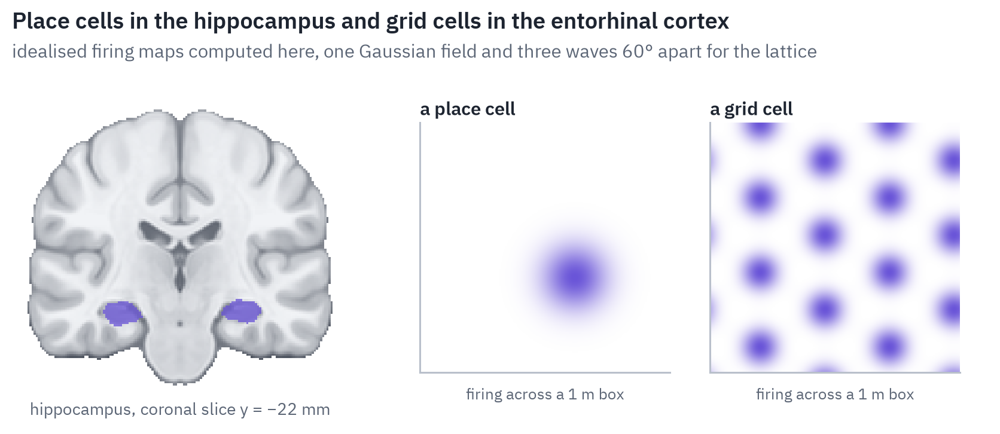
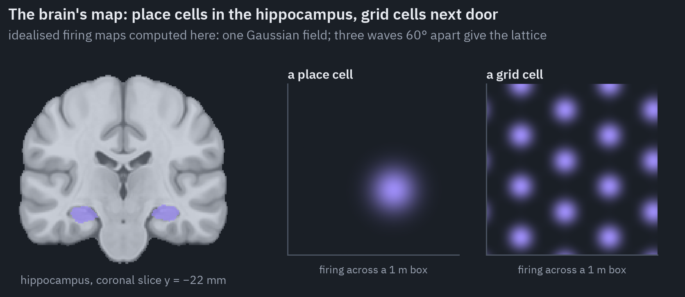

In 2018 a DeepMind team trained a recurrent network to keep track of its position from its own movements, and grid-like units appeared in it, about a quarter of the units in one layer, with scales like a rat's; an agent using them navigated mazes and took shortcuts[<a href="#ref-31" id="cite-34" data-ref="31" aria-label="Reference 31: Banino et al., 2018. doi.org.">31</a>].

It looked like a task explaining a cell type. Then Schaeffer, Khona and Fiete trained more than 11,000 such networks.

Most learned to keep track of position; fewer than 10% showed grid-like units, only with one particular, hand-chosen way of reading out the position, and never with the several grid modules of different scales that real brains have[<a href="#ref-32" id="cite-35" data-ref="32" aria-label="Reference 32: Schaeffer et al., 2022. doi.org.">32</a>].

Banino's networks had needed dropout too. The grid came partly from the task and partly from the modeller's choices.

A model can also look as if it has a map without having one. Transformers trained on turn-by-turn taxi rides in Manhattan chose a valid next turn almost every time and often found shortest paths, yet the street map implied by their behaviour was impossible, with streets running in orientations the city doesn't have.

Replace 1% of their turns with random detours, and only 69% of their routes stayed valid; replace 10%, and 8% did[<a href="#ref-33" id="cite-36" data-ref="33" aria-label="Reference 33: Vafa et al., 2024. arxiv.org.">33</a>].

### Three memories and no sleep

The brain has several memory systems, and a language model has several stores, and it is tempting to pair them. The pairing is a useful map if you remember that it is a map.

The weights of a model hold what it absorbed slowly in training, distributed and not individually addressable, which is loosely like *semantic memory*: knowing that Paris is in France without remembering when you learned it.

The context window holds the current conversation, available all at once and lost when it ends, which is loosely like *working memory*. Retrieval systems that search a database and paste documents into the context are loosely like recalling an *episode*.

Each analogy breaks somewhere instructive. Human working memory holds about four chunks of meaning at a time[<a href="#ref-34" id="cite-37" data-ref="34" aria-label="Reference 34: Cowan, 2001. doi.org.">34</a>]; a context window holds a hundred thousand tokens and more.

But models use long contexts unevenly: information in the middle is used worse than at the beginning or the end, a U-shaped curve that resembles the human serial-position effect[<a href="#ref-35" id="cite-38" data-ref="35" aria-label="Reference 35: Liu et al., 2024. doi.org.">35</a>].

Retrieval brings back documents, not the system's own experiences. And attention itself is, mathematically, one update of an associative memory, the kind of network neuroscientists have long used as a model of memory recall[<a href="#ref-36" id="cite-39" data-ref="36" aria-label="Reference 36: Ramsauer et al., 2021. arxiv.org.">36</a>]; that is a statement about equations, not about the hippocampus.

The deepest difference is consolidation. In the brain, what happens during the day is replayed during sleep: cells that fired together during a task fire together again, in sequences compressed about twentyfold ([Lee & Wilson, 2002](https://doi.org/10.1016/S0896-6273(02)01096-6)).

Suppressing the ripples that carry this replay impairs memory, and prolonging them improves it[<a href="#ref-37" id="cite-40" data-ref="37" aria-label="Reference 37: Girardeau et al., 2009. doi.org.">37</a>, <a href="#ref-38" id="cite-41" data-ref="38" aria-label="Reference 38: Fernández-Ruiz et al., 2019. doi.org.">38</a>]. A deployed language model has no such step: nothing it learns in a conversation is written back into its weights.

Training it further on new facts erases old ones, and standard deep networks trained continually slowly lose the ability to learn at all[<a href="#ref-39" id="cite-42" data-ref="39" aria-label="Reference 39: Dohare et al., 2024. doi.org.">39</a>]. Brains keep learning for a lifetime.

## Reward: the place where AI theory predicted biology

The cleanest case of a match runs in an unexpected direction. In the 1980s, reinforcement-learning researchers developed *temporal-difference learning*, in which an agent learns to predict future reward from the error between what it predicted and what it got.

In 1997 Schultz, Dayan and Montague showed that dopamine neurons in the monkey midbrain fire exactly like that error[<a href="#ref-40" id="cite-43" data-ref="40" aria-label="Reference 40: Schultz et al., 1997. doi.org.">40</a>]. An unexpected drop of juice makes them burst.

Once a light reliably predicts the juice, the burst moves to the light and the juice itself gets no response. If the juice then fails to arrive, the neurons fall silent at the moment it was due.

The chart above is not a recording. It is a temporal-difference model computed for this post, and it reproduces all three patterns that the monkeys' neurons showed.

The story went further. In AI, *distributional* reinforcement learning predicts the whole range of possible rewards rather than their average, with some predictors optimistic and some pessimistic.

Dabney and colleagues predicted that dopamine neurons would show the same diversity, and found it in recordings from mice: different neurons flipped from silence to firing at different reward sizes[<a href="#ref-41" id="cite-44" data-ref="41" aria-label="Reference 41: Dabney et al., 2020. doi.org.">41</a>].

In 2025 two more papers found dopamine neurons working at many timescales at once and encoding a map of both when and how much reward to expect[<a href="#ref-42" id="cite-45" data-ref="42" aria-label="Reference 42: Masset et al., 2025. doi.org.">42</a>, <a href="#ref-43" id="cite-46" data-ref="43" aria-label="Reference 43: Sousa et al., 2025. doi.org.">43</a>].

Two caveats keep this honest. The distributional result rests on tens of cells in five mice. And the prediction-error account itself has a serious challenger: a careful 2022 study concluded that dopamine release in the nucleus accumbens tracks causal associations rather than prediction errors[<a href="#ref-44" id="cite-47" data-ref="44" aria-label="Reference 44: Jeong et al., 2022. doi.org.">44</a>].

The analogy that people draw most often, between dopamine and the reinforcement learning that turns a language model into a chat assistant, is the weakest. Both use a single number to say "more of this".

But in RLHF that number comes from a second model trained to guess human preferences, and optimising against it too hard makes answers worse[<a href="#ref-45" id="cite-48" data-ref="45" aria-label="Reference 45: Gao et al., 2023. arxiv.org.">45</a>] and more sycophantic[<a href="#ref-46" id="cite-49" data-ref="46" aria-label="Reference 46: Sharma et al., 2023. arxiv.org.">46</a>]. It also damaged GPT-4's sense of its own reliability: before this training its confidence matched its accuracy almost perfectly, after it, ten times worse[<a href="#ref-47" id="cite-50" data-ref="47" aria-label="Reference 47: OpenAI, 2023. arxiv.org.">47</a>].

## Bodies and worlds: Moravec's paradox in numbers

In 1988 the roboticist Hans Moravec noticed that what is hard for people, chess, logic, exams, was easy for computers, and what a one-year-old does without thinking, seeing and moving, was the hardest of all. Nearly forty years of progress have kept the paradox and given it numbers.

Video models trained to predict the hidden parts of natural videos learn some intuitive physics: a model called V-JEPA tells a possible video from an impossible one, a ball that vanishes behind a screen or jumps from one place to another, 98% of the time on a classic test borrowed from infant research[<a href="#ref-48" id="cite-51" data-ref="48" aria-label="Reference 48: Garrido et al., 2025. arxiv.org.">48</a>].

On a harder version of the same test with more complex scenes, people are right 96.4% of the time and the best models are close to a coin flip.

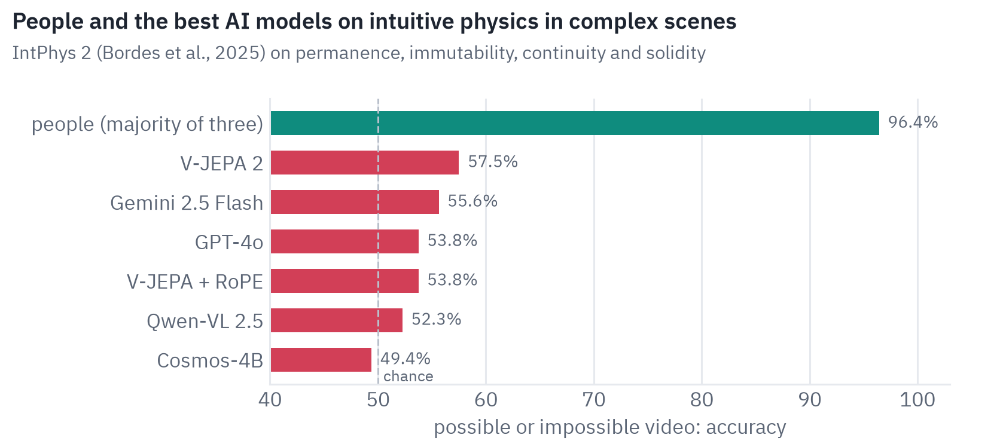
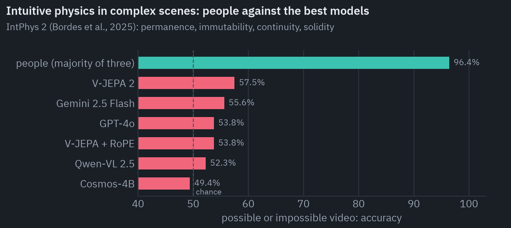

Robots now borrow knowledge from the web. RT-2, a vision-language model fine-tuned to output robot actions, doubled the success of its predecessor on objects and settings it hadn't seen, from 32% to 62%, and could follow instructions like "pick up the object that could be used as an improvised hammer".

Its authors were clear about the limit: "the robot does not acquire any ability to perform new motions"[<a href="#ref-49" id="cite-52" data-ref="49" aria-label="Reference 49: Brohan et al., 2023. arxiv.org.">49</a>].

V-JEPA 2, used as a world model to plan a robot arm's movements, grasped a cup 65% of the time and a box 25%, spending 16 seconds planning each move[<a href="#ref-50" id="cite-53" data-ref="50" aria-label="Reference 50: Assran et al., 2025. arxiv.org.">50</a>]. No benchmark measures human and robot dexterity on the same tasks, which says something by itself.

The brain-model link holds in motor control too, for a body simulated in detail. A network trained to drive a realistic virtual rat, imitating the movements of real rats, produced activity that predicted the neurons of real rats' motor cortex and striatum better than any measured feature of their movements did[<a href="#ref-51" id="cite-54" data-ref="51" aria-label="Reference 51: Aldarondo et al., 2024. doi.org.">51</a>].

## The map: which parts of the brain have a counterpart

Put the evidence together and a map appears. Colour each brain system by how close the best AI counterpart is, judged by the studies above: strong where models predict the system's activity or reproduce its signature, partial where they do some of its job without its properties, and absent where there is nothing to compare.

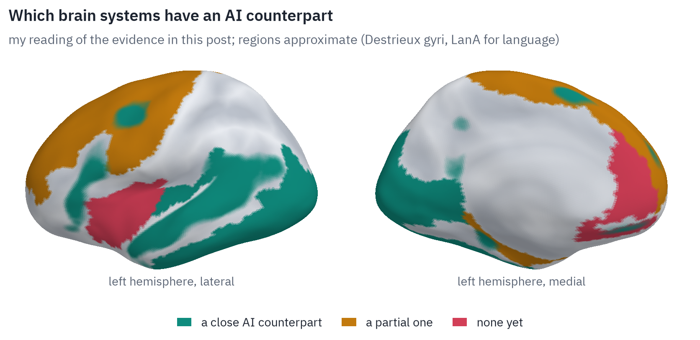
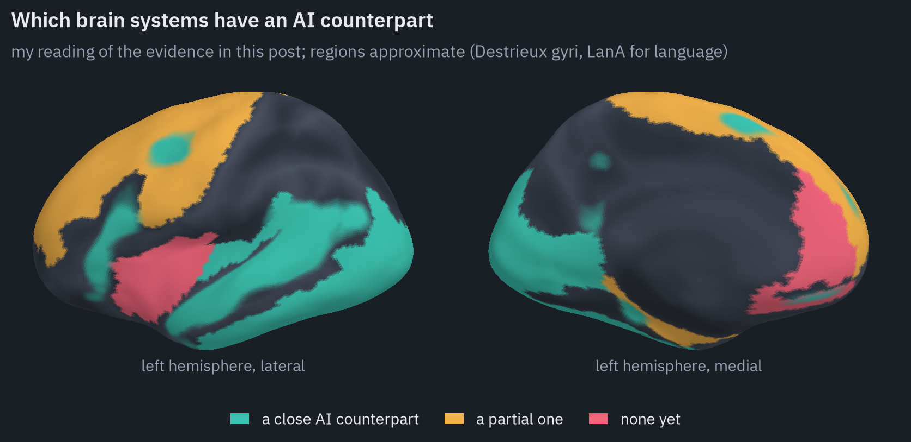

The strongest matches are the sensory and language systems, and the dopamine teaching signal. They have something in common: each was matched by a model trained on a large amount of the same kind of input the brain gets, to do a similar job, and the similarity grew out of the training rather than being built in.

The weakest are the systems that run the body, keep track of the self and keep learning over a lifetime.

## Who is more efficient?

This is the question where the most nonsense is written, so the numbers here come with their units and their uncertainty.

### Energy

The usual figure is that a brain runs on 20 watts. That is the energy of the glucose it burns; positron emission tomography puts it nearer 17 W, and only about 6 W of that becomes ATP that can do work.

Most of the brain's energy goes into moving signals rather than computing with them: in an audit of the human cortex, long-distance communication cost about 3.5 W and computation in the narrow sense, at the synapses, about 0.1 W[<a href="#ref-52" id="cite-55" data-ref="52" aria-label="Reference 52: Levy &amp; Calvert, 2021. doi.org.">52</a>]. Computers have the same problem, where moving data costs more energy than the arithmetic on it.

Training is where AI looks extravagant. Twenty years of a 20-watt brain come to about 3.5 megawatt-hours. Training GPT-3 took 1,287 MWh[<a href="#ref-53" id="cite-56" data-ref="53" aria-label="Reference 53: Patterson et al., 2021. arxiv.org.">53</a>], Llama 3.1 405B 30.84 million GPU-hours, which comes to about 22 GWh for the GPUs alone[<a href="#ref-54" id="cite-57" data-ref="54" aria-label="Reference 54: Meta, 2024. arxiv.org.">54</a>], and Epoch AI estimates Grok 4 at about 310 GWh[<a href="#ref-55" id="cite-58" data-ref="55" aria-label="Reference 55: Epoch AI, 2025. epoch.ai.">55</a>].

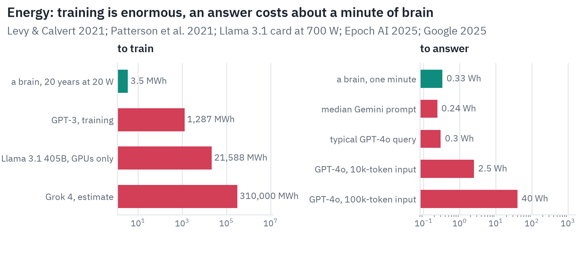
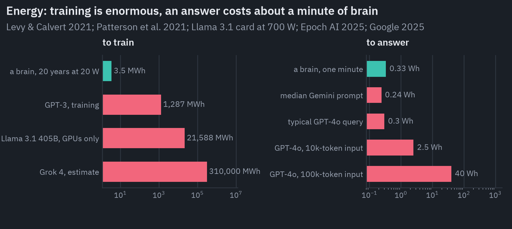

But training is paid once and shared by everyone who uses the model afterwards. An answer from a chatbot is cheap: Google measured 0.24 watt-hours for a median Gemini text prompt in 2025, after a 33-fold drop in a year[<a href="#ref-56" id="cite-59" data-ref="56" aria-label="Reference 56: Elsworth et al., 2025. arxiv.org.">56</a>], and Epoch AI estimates about 0.3 Wh for a typical GPT-4o query[<a href="#ref-57" id="cite-60" data-ref="57" aria-label="Reference 57: You, 2025. epoch.ai.">57</a>].

That is the energy a brain uses in about 45 seconds. Long prompts and reasoning cost much more.

Per operation the comparison is speculative, because a brain doesn't do floating-point operations. The most careful estimate puts the computation needed to match a brain at about 10¹⁵ operations per second, with a plausible range from 10¹³ to 10¹⁷[<a href="#ref-58" id="cite-61" data-ref="58" aria-label="Reference 58: Carlsmith, 2020. openphilanthropy.org.">58</a>].

On the central estimate, a brain does about 5 × 10¹³ operations per joule and an H100 GPU at its peak about 1.4 × 10¹², so the brain is some tens of times more efficient; across the range, anywhere from three times worse to a few thousand times better.

### Data

Here the gap is larger and much less uncertain. A child hears somewhere between ten and a hundred million words before adolescence[<a href="#ref-59" id="cite-62" data-ref="59" aria-label="Reference 59: Frank, 2023. doi.org.">59</a>]; Llama 3.1 was trained on 15.6 trillion tokens, each a little less than a word[<a href="#ref-54" id="cite-63" data-ref="54" aria-label="Reference 54: Meta, 2024. arxiv.org.">54</a>]. That is five to six orders of magnitude.

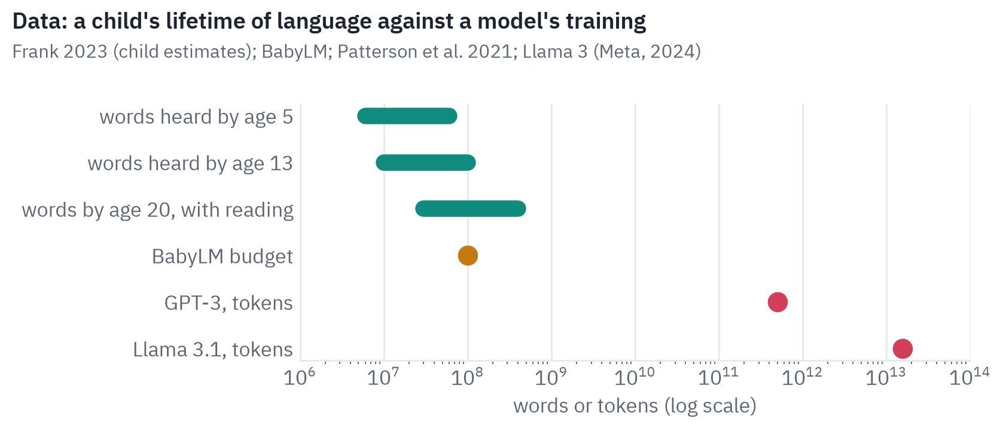
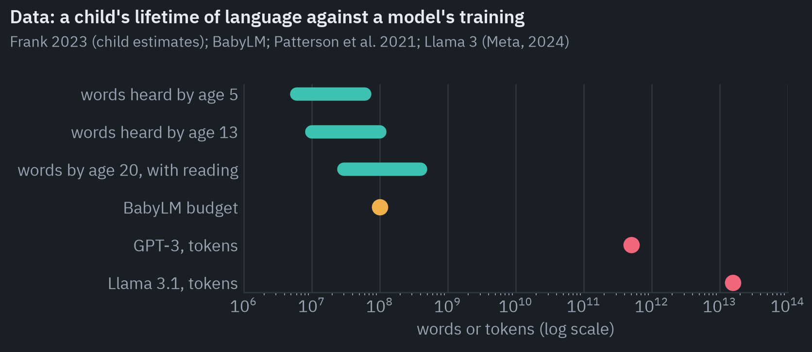

The comparison is not quite fair to the child, who also sees, touches, moves and is taught by people who care, and arrives with priors that evolution spent a long time on. It is also not quite fair to the model, which has to learn from text alone what a child gets from the world.

The BabyLM challenge trains models on a child's budget of 100 million words: the best come within a few points of people on tests of grammar and stay near chance on world knowledge[<a href="#ref-60" id="cite-64" data-ref="60" aria-label="Reference 60: Hu et al., 2024. arxiv.org.">60</a>].

### Speed and breadth

The models win where machines always win. A neuron fires at most a few hundred times a second; a model writes a page while a person reads a sentence. A model can be copied a million times, read a library in a day and remember the details.

One synapse stores about 4.7 bits[<a href="#ref-61" id="cite-65" data-ref="61" aria-label="Reference 61: Bartol et al., 2015. doi.org.">61</a>], one parameter of a language model about 3.6 bits[<a href="#ref-62" id="cite-66" data-ref="62" aria-label="Reference 62: Morris et al., 2025. arxiv.org.">62</a>], and a large model has hundreds to thousands of times fewer parameters than a brain has synapses while knowing far more facts than any person.

Per answer, a chatbot costs about a minute of brain time. Per lesson learned, the brain is cheaper by orders of magnitude in data, and probably in energy too.

## What is missing

A list of what the brain has and AI models don't would be long. Five items on it come up again and again in the evidence.

*Learning that never stops.* People learn from one example and keep learning for decades without forgetting what they knew. Models learn from millions of examples, in a separate training phase, and forget when trained further[<a href="#ref-39" id="cite-67" data-ref="39" aria-label="Reference 39: Dohare et al., 2024. doi.org.">39</a>].

The brain's solution seems to involve two learning systems, a fast hippocampus and a slow cortex, and sleep to move memories between them[<a href="#ref-63" id="cite-68" data-ref="63" aria-label="Reference 63: Kumaran et al., 2016. doi.org.">63</a>]; nothing like that runs in a deployed model.

*A body.* The systems that the models match best, language and vision, are the ones that can be trained from data on the internet. The ones they match worst, movement, intuitive physics and space, are the ones a body learns by acting.

*Wanting something.* A brain is driven by needs, curiosity and a reward system tuned by evolution. A model optimises what its trainers chose, and does nothing when nobody asks it anything.

*Knowing what it doesn't know.* People are imperfect judges of their own knowledge, but they can usually tell a guess from a memory. Models trained to please are confidently wrong, and users trust long, fluent explanations more than they should[<a href="#ref-64" id="cite-69" data-ref="64" aria-label="Reference 64: Steyvers et al., 2025. doi.org.">64</a>].

*Sleep and neuromodulation.* The brain changes its own learning rate, attention and mood with a handful of chemicals, and reorganises its memories every night. There is no clear counterpart in any current AI system.

Whether there is something it is like to be a model, the question of consciousness, is a separate story, and a hard one.

The most careful attempt so far, which checked current systems against the signatures that the leading scientific theories of consciousness predict, concluded that no current AI system is conscious and that there is no obvious technical barrier to building one that would meet those signatures[<a href="#ref-65" id="cite-70" data-ref="65" aria-label="Reference 65: Butlin et al., 2023. arxiv.org.">65</a>].

## What follows

Five conclusions seem safe.

First, the convergence is real. Networks trained only to do what the brain does, recognise objects, predict words, predict reward, have repeatedly turned out to resemble the brain more than models designed to resemble it.

The likeliest reason is not that engineers copied the brain, but that the same problem, solved from the same kind of data, pushes any good solution toward similar representations.

Second, the resemblance is mostly in *what* is represented, not *how* it is computed. A transformer reads a whole sentence at once; the brain hears it one word after another. Linear maps find shared information in very different machinery.

Third, the similarity scores have saturated, and our methods are part of the reason. Better models stopped becoming more brain-like in vision, and in language much of the measured similarity is word meaning and statistics of the experiment.

Fourth, a language model is a model of one part of the brain. It matches the language network, which in people is not where thinking happens, and everything else it does has to be compared with other systems, one at a time.

Fifth, the brain is not a slower GPU. It learns from far less, on less energy, all its life, inside a body, and the systems where models are furthest from it are the ones that make that possible.

The figures, the TD-learning model behind the dopamine chart and the preparation of the language atlas as code: [articles/brain_ai](https://github.com/xmarva/transformers-from-scratch/tree/main/articles/brain_ai).

## References

1. {:#ref-1} Tuckute et al., 2024. [doi.org](https://doi.org/10.1038/s41562-023-01783-7). <a class="ref-back" href="#cite-1" aria-label="Back to the text">&#8617;</a>
2. {:#ref-2} Khaligh-Razavi & Kriegeskorte, 2014. [doi.org](https://doi.org/10.1371/journal.pcbi.1003915). <a class="ref-back" href="#cite-2" aria-label="Back to the text">&#8617;</a>
3. {:#ref-3} Caucheteux & King, 2022. [doi.org](https://doi.org/10.1038/s42003-022-03036-1). <a class="ref-back" href="#cite-3" aria-label="Back to the text">&#8617;</a>
4. {:#ref-4} Schrimpf et al., 2021. [doi.org](https://doi.org/10.1073/pnas.2105646118). <a class="ref-back" href="#cite-4" aria-label="Back to the text">&#8617;</a>
5. {:#ref-5} Hadidi et al., 2026. [doi.org](https://doi.org/10.1038/s41467-026-72253-7). <a class="ref-back" href="#cite-5" aria-label="Back to the text">&#8617;</a>
6. {:#ref-6} Antonello et al., 2023. [arxiv.org](https://arxiv.org/abs/2305.11863). <a class="ref-back" href="#cite-8" aria-label="Back to the text">&#8617;</a>
7. {:#ref-7} Hosseini et al., 2024. [doi.org](https://doi.org/10.1162/nol_a_00137). <a class="ref-back" href="#cite-9" aria-label="Back to the text">&#8617;</a>
8. {:#ref-8} Kauf et al., 2024. [doi.org](https://doi.org/10.1162/nol_a_00116). <a class="ref-back" href="#cite-10" aria-label="Back to the text">&#8617;</a>
9. {:#ref-9} Goldstein et al., 2022. [doi.org](https://doi.org/10.1038/s41593-022-01026-4). <a class="ref-back" href="#cite-12" aria-label="Back to the text">&#8617;</a>
10. {:#ref-10} Schönmann et al., 2026. [doi.org](https://doi.org/10.7554/eLife.106543). <a class="ref-back" href="#cite-13" aria-label="Back to the text">&#8617;</a>
11. {:#ref-11} Fedorenko & Varley, 2016. [doi.org](https://doi.org/10.1111/nyas.13046). <a class="ref-back" href="#cite-14" aria-label="Back to the text">&#8617;</a>
12. {:#ref-12} Fedorenko et al., 2024. [doi.org](https://doi.org/10.1038/s41583-024-00802-4). <a class="ref-back" href="#cite-15" aria-label="Back to the text">&#8617;</a>
13. {:#ref-13} Mahowald et al., 2024. [doi.org](https://doi.org/10.1016/j.tics.2024.01.011). <a class="ref-back" href="#cite-16" aria-label="Back to the text">&#8617;</a>
14. {:#ref-14} AlKhamissi et al., 2025. [arxiv.org](https://arxiv.org/abs/2503.01830). <a class="ref-back" href="#cite-17" aria-label="Back to the text">&#8617;</a>
15. {:#ref-15} Tang et al., 2023. [doi.org](https://doi.org/10.1038/s41593-023-01304-9). <a class="ref-back" href="#cite-18" aria-label="Back to the text">&#8617;</a>
16. {:#ref-16} Card et al., 2024. [doi.org](https://doi.org/10.1056/NEJMoa2314132). <a class="ref-back" href="#cite-19" aria-label="Back to the text">&#8617;</a>
17. {:#ref-17} Yamins et al., 2014. [doi.org](https://doi.org/10.1073/pnas.1403112111). <a class="ref-back" href="#cite-20" aria-label="Back to the text">&#8617;</a>
18. {:#ref-18} Schrimpf et al., 2018. [doi.org](https://doi.org/10.1101/407007). <a class="ref-back" href="#cite-21" aria-label="Back to the text">&#8617;</a>
19. {:#ref-19} Linsley et al., 2023. [arxiv.org](https://arxiv.org/abs/2306.03779). <a class="ref-back" href="#cite-22" aria-label="Back to the text">&#8617;</a>
20. {:#ref-20} Gokce & Schrimpf, 2025. [arxiv.org](https://arxiv.org/abs/2411.05712). <a class="ref-back" href="#cite-23" aria-label="Back to the text">&#8617;</a>
21. {:#ref-21} Conwell et al., 2024. [doi.org](https://doi.org/10.1038/s41467-024-53147-y). <a class="ref-back" href="#cite-24" aria-label="Back to the text">&#8617;</a>
22. {:#ref-22} Geirhos et al., 2019. [arxiv.org](https://arxiv.org/abs/1811.12231). <a class="ref-back" href="#cite-25" aria-label="Back to the text">&#8617;</a>
23. {:#ref-23} Bonnen et al., 2024. [arxiv.org](https://arxiv.org/abs/2409.05862). <a class="ref-back" href="#cite-26" aria-label="Back to the text">&#8617;</a>
24. {:#ref-24} Ramakrishnan et al., 2025. [arxiv.org](https://arxiv.org/abs/2410.06468). <a class="ref-back" href="#cite-27" aria-label="Back to the text">&#8617;</a>
25. {:#ref-25} Guo et al., 2022. [arxiv.org](https://arxiv.org/abs/2206.11228). <a class="ref-back" href="#cite-28" aria-label="Back to the text">&#8617;</a>
26. {:#ref-26} Elsayed et al., 2018. [arxiv.org](https://arxiv.org/abs/1802.08195). <a class="ref-back" href="#cite-29" aria-label="Back to the text">&#8617;</a>
27. {:#ref-27} Allen et al., 2022. [doi.org](https://doi.org/10.1038/s41593-021-00962-x). <a class="ref-back" href="#cite-30" aria-label="Back to the text">&#8617;</a>
28. {:#ref-28} Scotti et al., 2024. [arxiv.org](https://arxiv.org/abs/2403.11207). <a class="ref-back" href="#cite-31" aria-label="Back to the text">&#8617;</a>
29. {:#ref-29} Shirakawa et al., 2025. [arxiv.org](https://arxiv.org/abs/2405.10078). <a class="ref-back" href="#cite-32" aria-label="Back to the text">&#8617;</a>
30. {:#ref-30} Hafting et al., 2005. [doi.org](https://doi.org/10.1038/nature03721). <a class="ref-back" href="#cite-33" aria-label="Back to the text">&#8617;</a>
31. {:#ref-31} Banino et al., 2018. [doi.org](https://doi.org/10.1038/s41586-018-0102-6). <a class="ref-back" href="#cite-34" aria-label="Back to the text">&#8617;</a>
32. {:#ref-32} Schaeffer et al., 2022. [doi.org](https://doi.org/10.1101/2022.08.07.503109). <a class="ref-back" href="#cite-35" aria-label="Back to the text">&#8617;</a>
33. {:#ref-33} Vafa et al., 2024. [arxiv.org](https://arxiv.org/abs/2406.03689). <a class="ref-back" href="#cite-36" aria-label="Back to the text">&#8617;</a>
34. {:#ref-34} Cowan, 2001. [doi.org](https://doi.org/10.1017/S0140525X01003922). <a class="ref-back" href="#cite-37" aria-label="Back to the text">&#8617;</a>
35. {:#ref-35} Liu et al., 2024. [doi.org](https://doi.org/10.1162/tacl_a_00638). <a class="ref-back" href="#cite-38" aria-label="Back to the text">&#8617;</a>
36. {:#ref-36} Ramsauer et al., 2021. [arxiv.org](https://arxiv.org/abs/2008.02217). <a class="ref-back" href="#cite-39" aria-label="Back to the text">&#8617;</a>
37. {:#ref-37} Girardeau et al., 2009. [doi.org](https://doi.org/10.1038/nn.2384). <a class="ref-back" href="#cite-40" aria-label="Back to the text">&#8617;</a>
38. {:#ref-38} Fernández-Ruiz et al., 2019. [doi.org](https://doi.org/10.1126/science.aax0758). <a class="ref-back" href="#cite-41" aria-label="Back to the text">&#8617;</a>
39. {:#ref-39} Dohare et al., 2024. [doi.org](https://doi.org/10.1038/s41586-024-07711-7). <a class="ref-back" href="#cite-42" aria-label="Back to the text">&#8617;</a>
40. {:#ref-40} Schultz et al., 1997. [doi.org](https://doi.org/10.1126/science.275.5306.1593). <a class="ref-back" href="#cite-43" aria-label="Back to the text">&#8617;</a>
41. {:#ref-41} Dabney et al., 2020. [doi.org](https://doi.org/10.1038/s41586-019-1924-6). <a class="ref-back" href="#cite-44" aria-label="Back to the text">&#8617;</a>
42. {:#ref-42} Masset et al., 2025. [doi.org](https://doi.org/10.1038/s41586-025-08929-9). <a class="ref-back" href="#cite-45" aria-label="Back to the text">&#8617;</a>
43. {:#ref-43} Sousa et al., 2025. [doi.org](https://doi.org/10.1038/s41586-025-09089-6). <a class="ref-back" href="#cite-46" aria-label="Back to the text">&#8617;</a>
44. {:#ref-44} Jeong et al., 2022. [doi.org](https://doi.org/10.1126/science.abq6740). <a class="ref-back" href="#cite-47" aria-label="Back to the text">&#8617;</a>
45. {:#ref-45} Gao et al., 2023. [arxiv.org](https://arxiv.org/abs/2210.10760). <a class="ref-back" href="#cite-48" aria-label="Back to the text">&#8617;</a>
46. {:#ref-46} Sharma et al., 2023. [arxiv.org](https://arxiv.org/abs/2310.13548). <a class="ref-back" href="#cite-49" aria-label="Back to the text">&#8617;</a>
47. {:#ref-47} OpenAI, 2023. [arxiv.org](https://arxiv.org/abs/2303.08774). <a class="ref-back" href="#cite-50" aria-label="Back to the text">&#8617;</a>
48. {:#ref-48} Garrido et al., 2025. [arxiv.org](https://arxiv.org/abs/2502.11831). <a class="ref-back" href="#cite-51" aria-label="Back to the text">&#8617;</a>
49. {:#ref-49} Brohan et al., 2023. [arxiv.org](https://arxiv.org/abs/2307.15818). <a class="ref-back" href="#cite-52" aria-label="Back to the text">&#8617;</a>
50. {:#ref-50} Assran et al., 2025. [arxiv.org](https://arxiv.org/abs/2506.09985). <a class="ref-back" href="#cite-53" aria-label="Back to the text">&#8617;</a>
51. {:#ref-51} Aldarondo et al., 2024. [doi.org](https://doi.org/10.1038/s41586-024-07633-4). <a class="ref-back" href="#cite-54" aria-label="Back to the text">&#8617;</a>
52. {:#ref-52} Levy & Calvert, 2021. [doi.org](https://doi.org/10.1073/pnas.2008173118). <a class="ref-back" href="#cite-55" aria-label="Back to the text">&#8617;</a>
53. {:#ref-53} Patterson et al., 2021. [arxiv.org](https://arxiv.org/abs/2104.10350). <a class="ref-back" href="#cite-56" aria-label="Back to the text">&#8617;</a>
54. {:#ref-54} Meta, 2024. [arxiv.org](https://arxiv.org/abs/2407.21783). <a class="ref-back" href="#cite-57" aria-label="Back to the text">&#8617;</a>
55. {:#ref-55} Epoch AI, 2025. [epoch.ai](https://epoch.ai/data-insights/grok-4-training-resources). <a class="ref-back" href="#cite-58" aria-label="Back to the text">&#8617;</a>
56. {:#ref-56} Elsworth et al., 2025. [arxiv.org](https://arxiv.org/abs/2508.15734). <a class="ref-back" href="#cite-59" aria-label="Back to the text">&#8617;</a>
57. {:#ref-57} You, 2025. [epoch.ai](https://epoch.ai/gradient-updates/how-much-energy-does-chatgpt-use). <a class="ref-back" href="#cite-60" aria-label="Back to the text">&#8617;</a>
58. {:#ref-58} Carlsmith, 2020. [openphilanthropy.org](https://www.openphilanthropy.org/research/how-much-computational-power-does-it-take-to-match-the-human-brain/). <a class="ref-back" href="#cite-61" aria-label="Back to the text">&#8617;</a>
59. {:#ref-59} Frank, 2023. [doi.org](https://doi.org/10.1016/j.tics.2023.08.007). <a class="ref-back" href="#cite-62" aria-label="Back to the text">&#8617;</a>
60. {:#ref-60} Hu et al., 2024. [arxiv.org](https://arxiv.org/abs/2412.05149). <a class="ref-back" href="#cite-64" aria-label="Back to the text">&#8617;</a>
61. {:#ref-61} Bartol et al., 2015. [doi.org](https://doi.org/10.7554/eLife.10778). <a class="ref-back" href="#cite-65" aria-label="Back to the text">&#8617;</a>
62. {:#ref-62} Morris et al., 2025. [arxiv.org](https://arxiv.org/abs/2505.24832). <a class="ref-back" href="#cite-66" aria-label="Back to the text">&#8617;</a>
63. {:#ref-63} Kumaran et al., 2016. [doi.org](https://doi.org/10.1016/j.tics.2016.05.004). <a class="ref-back" href="#cite-68" aria-label="Back to the text">&#8617;</a>
64. {:#ref-64} Steyvers et al., 2025. [doi.org](https://doi.org/10.1038/s42256-024-00976-7). <a class="ref-back" href="#cite-69" aria-label="Back to the text">&#8617;</a>
65. {:#ref-65} Butlin et al., 2023. [arxiv.org](https://arxiv.org/abs/2308.08708). <a class="ref-back" href="#cite-70" aria-label="Back to the text">&#8617;</a>
{: .tfs-refs}


