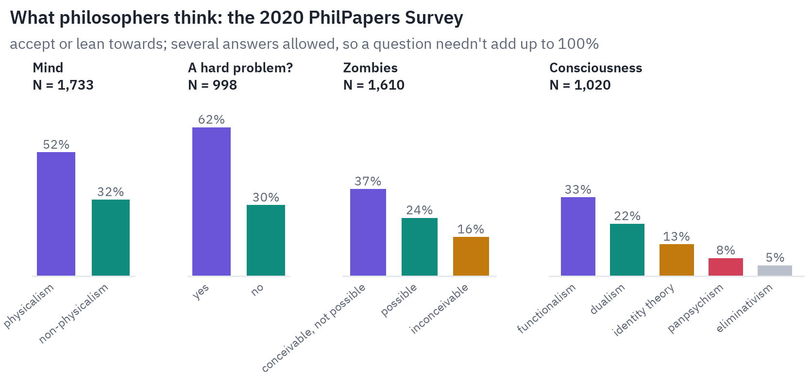
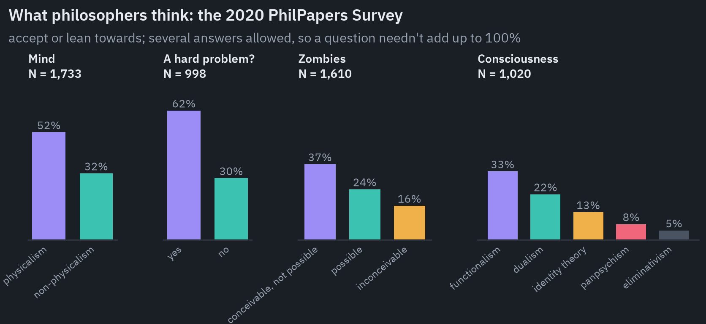
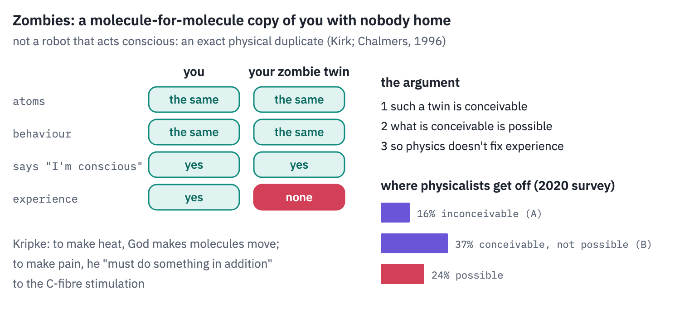
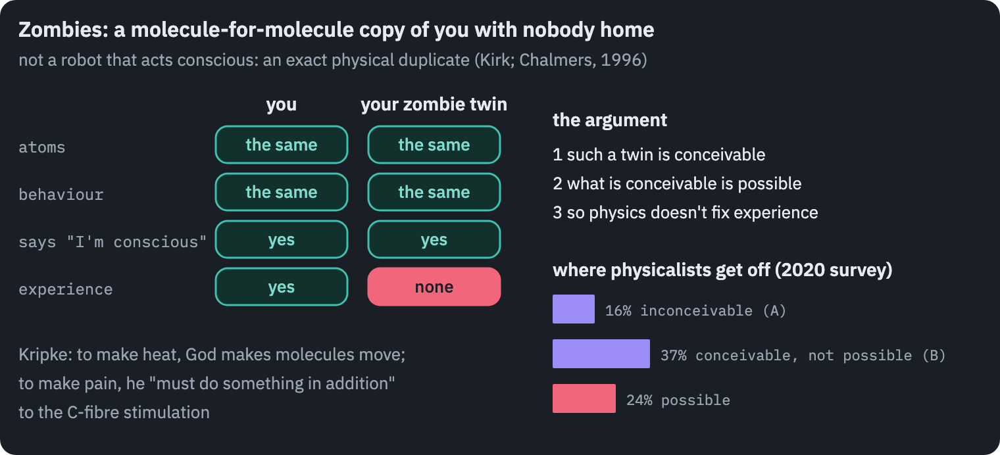
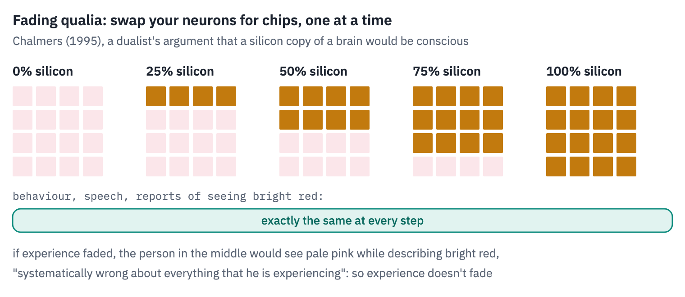
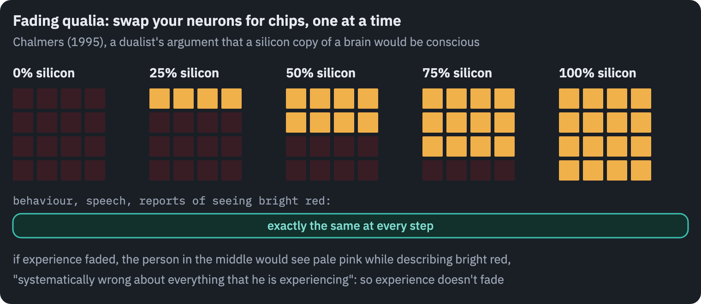
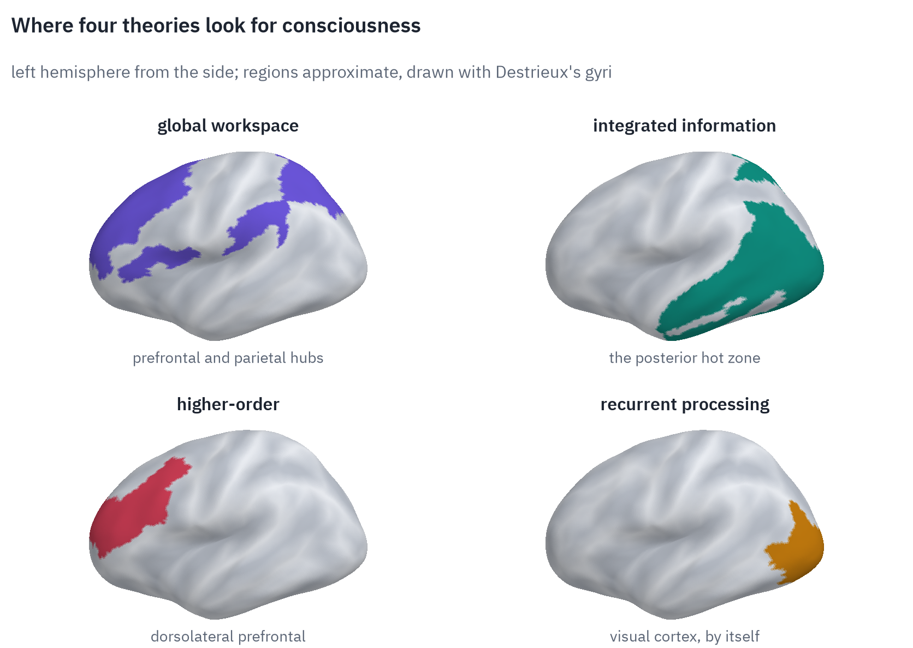
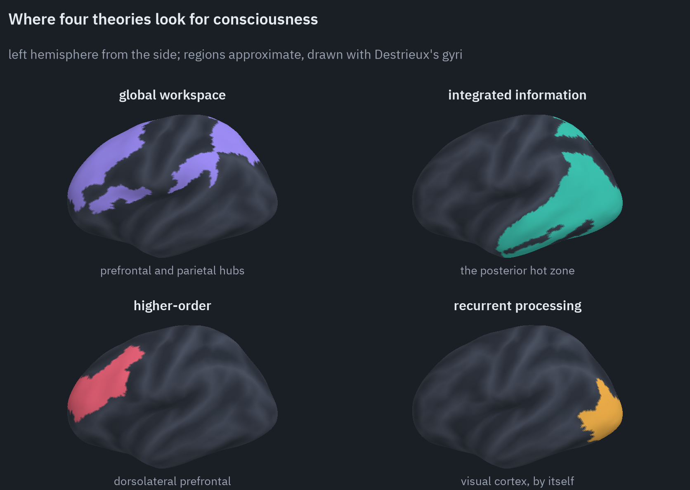
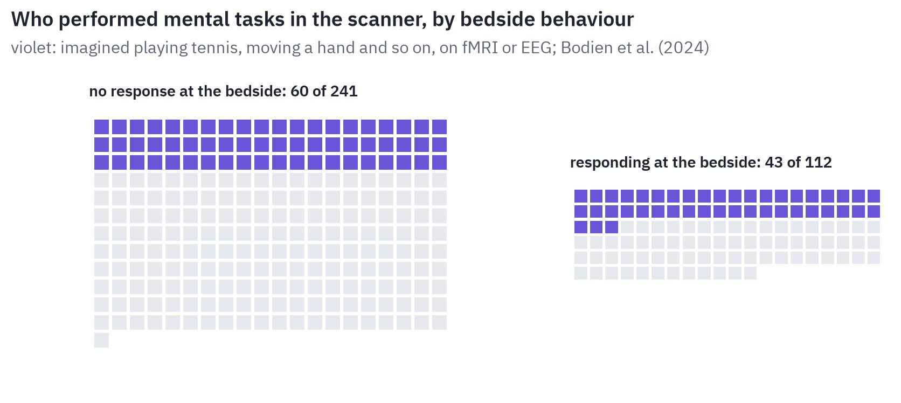
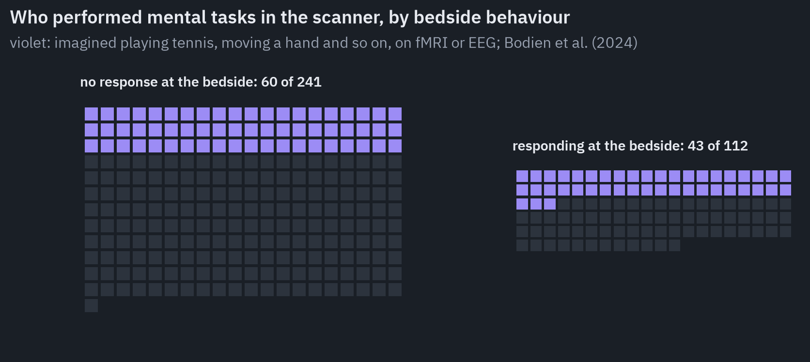



<aside class="tldr" markdown="1">

In short

"Consciousness is what the brain does" may well be true, and it still doesn't explain why any of what the brain does is felt. Most philosophers lean physicalist, and most of them also think there is a hard problem.

The thought experiments, from Mary's room to fading qualia, are tools for finding out which kind of physicalist you are. The scientific theories disagree about where in the brain consciousness lives, and the first preregistered head-to-head test, published in 2025, found key predictions of both leading theories wrong.

Meanwhile the question has become practical: in hospitals, where a quarter of patients who seem unresponsive turn out to follow instructions, and in AI.

62%of philosophers say there is a hard problem of consciousness; 52% lean physicalist

60 of 241patients with no response to commands performed mental tasks in a scanner

0 of 655prefrontal electrodes showed the ignition one leading theory predicted

</aside>

In 1998 the neuroscientist Christof Koch bet the philosopher David Chalmers that within twenty-five years science would find the mechanism by which the brain's neurons produce consciousness. On 23 June 2023, at a conference in New York, they agreed publicly that it hadn't, and declared Chalmers the winner[<a href="#ref-1" id="cite-1" data-ref="1" aria-label="Reference 1: Lenharo, 2023. doi.org.">1</a>].

The occasion was the first results of an experiment designed to make that kind of progress.

The two most influential scientific theories of consciousness had agreed in advance on predictions where they disagreed, theory-neutral labs had recorded 256 people with fMRI, MEG and electrodes inside the skull, and both theories had come out with some of their own predictions failed[<a href="#ref-2" id="cite-2" data-ref="2" aria-label="Reference 2: Cogitate Consortium, 2025. doi.org.">2</a>].

If you work in machine learning or engineering, you probably think the question is settled in principle: consciousness is something the brain does, the details are for neuroscience, and philosophers who talk about a "hard problem" are making a mystery out of a gap in the data.

This post is written for you. It is not an argument against physicalism. It is an argument that physicalism is a family of positions that disagree about the most interesting question, and that the thought experiments philosophers use are the fastest way to find out which member of the family you are.

## What exactly is the problem?

In 1974 Thomas Nagel gave the definition that most of the field still uses: "an organism has conscious mental states if and only if there is something that it is like to be that organism"[<a href="#ref-3" id="cite-3" data-ref="3" aria-label="Reference 3: Nagel, 1974. doi.org.">3</a>]. His example was a bat.

Bats find their way by echolocation, and imagining hanging upside down in a cave and listening for echoes tells me what it would be like for *me* to behave like a bat, not what it is like for a bat to be a bat.

Every subjective fact is tied to a point of view, Nagel argued, while physical science works by abandoning points of view.

Nagel did not conclude that physicalism is false. He wrote: "It would be a mistake to conclude that physicalism must be false." His point was that we don't understand *how* it could be true, as a pre-Socratic philosopher who said that matter is energy would not have understood what he was saying.

In 1995 David Chalmers sharpened this into a distinction that gave the field its vocabulary[<a href="#ref-4" id="cite-4" data-ref="4" aria-label="Reference 4: Chalmers, 1995. consc.net.">4</a>]. The *easy problems* of consciousness are to explain functions: how we discriminate stimuli and react to them, integrate information, report our mental states, focus attention, control behaviour deliberately, and differ awake from asleep.

They are easy only in the sense that we know what an explanation would look like: a mechanism that performs the function. The *hard problem* is the question left after all of them are solved: "Why is the performance of these functions accompanied by experience?"

Twelve years earlier Joseph Levine had put the same worry as a gap in explanation rather than in reality[<a href="#ref-5" id="cite-5" data-ref="5" aria-label="Reference 5: Levine, 1983. informationphilosopher.com.">5</a>]. "Heat is the motion of molecules" explains: once you know how molecules move, you see why anything with that motion warms your hand and melts ice.

"Pain is the firing of C-fibres" explains why pain makes you wince and withdraw, and leaves something out: "what is left unexplained by the discovery of C-fiber firing is why pain should feel the way it does!" Levine was explicit that this doesn't show materialism false. It shows that the identity, even if true, doesn't explain.

One more distinction prevents a lot of confusion, especially in conversations about AI. Ned Block separated *access consciousness*, information that is available to reasoning and to the control of speech and action, from *phenomenal consciousness*: "Phenomenal consciousness is experience; the phenomenally conscious aspect of a state is what it is like to be in that state"[<a href="#ref-6" id="cite-6" data-ref="6" aria-label="Reference 6: Block, 1995. doi.org.">6</a>].

Access is a function and could be engineered. Phenomenal consciousness is what the hard problem is about. Much of the talk about whether a model "is conscious" slides from one to the other without noticing.

## Why "it's just what the brain does" isn't an answer

The slogan can be true and still not do the job you want from it. Here is why, in four steps.

First, it states a thesis and doesn't explain anything. When J. J. C. Smart defended the identity of sensations with brain processes in 1959, he offered it as a hypothesis supported by simplicity, not as an explanation of why brain processes feel like something[<a href="#ref-7" id="cite-7" data-ref="7" aria-label="Reference 7: Smart, 1959. doi.org.">7</a>].

Second, "what the brain does" is ambiguous between the two main kinds of physicalism. Is it the brain's *function*, the pattern of causes and effects, which a silicon copy or a nation of people with radios could reproduce?

Or is it the brain's *biology*, which they couldn't? The slogan can't decide whether a machine could be conscious, and that is the question everyone actually asks.

Third, physicalists disagree among themselves about what is left over once the functions are explained. Chalmers sorted them into types[<a href="#ref-8" id="cite-8" data-ref="8" aria-label="Reference 8: Chalmers, 2003. consc.net.">8</a>]. *Type-A* physicalists, like Daniel Dennett, say nothing is left: there is no hard problem beyond the easy ones.

*Type-B* physicalists say there is a real gap in our understanding but not in the world: experience is physical, and we just can't see it a priori, as people couldn't see a priori that water is H₂O. *Type-C* physicalists say the gap is real and science will close it.

Fourth, the philosophers who have thought hardest about it don't find it obvious. In the 2020 PhilPapers survey of 1,785 professional philosophers, 52% accepted or leaned towards physicalism about the mind and 32% towards non-physicalism; asked whether there is a hard problem of consciousness, 62% said yes and 30% no[<a href="#ref-9" id="cite-9" data-ref="9" aria-label="Reference 9: Bourget &amp; Chalmers, 2023. doi.org.">9</a>]. Many physicalists, in other words, think the hard problem is real.

The honest starting point is Nagel's: physicalism may be true, and we don't yet understand how. The rest of the debate is about what kind of explanation would close that gap, or whether it needs closing.

## Six thought experiments, and what each one tests

Thought experiments in philosophy of mind work like unit tests: each isolates one assumption and shows what you are committed to if you accept it. You don't have to accept the conclusion to learn something from where you resist.

### Mary's room: is knowing all the physical facts knowing everything?

Frank Jackson's Mary is a brilliant scientist who has lived all her life in a black-and-white room, seeing the world through a black-and-white television[<a href="#ref-10" id="cite-10" data-ref="10" aria-label="Reference 10: Jackson, 1982. doi.org.">10</a>]. She knows everything physical there is to know about colour vision: the wavelengths, the retina, the neurons, how it all leads someone to say "the sky is blue".

In the 1986 version she knows *all* physical facts, completed physics and every functional role included[<a href="#ref-11" id="cite-11" data-ref="11" aria-label="Reference 11: Jackson, 1986. doi.org.">11</a>]. Then she walks out and sees a red tomato. Does she learn something?

"It seems just obvious that she will learn something about the world and our visual experience of it," Jackson wrote. If she does, her complete physical knowledge was not complete knowledge, and physicalism is false.

Physicalists have three main replies. She learns no new fact but gains new abilities, to imagine, remember and recognise red, as David Lewis and Laurence Nemirow argued. She becomes acquainted with something she knew about.

Or, the most common reply today, she learns an old physical fact under a new concept, a phenomenal concept that she can only have by having the experience, as you can know that the morning star is the evening star without being able to recognise it at dawn[<a href="#ref-12" id="cite-12" data-ref="12" aria-label="Reference 12: Loar, 1990. doi.org.">12</a>].

And then there is the twist that most popular accounts leave out: Jackson himself gave up the argument.

By 1995 he had concluded that if experiences were epiphenomenal, causing nothing, as his own version of the argument made them, nobody could know about them, so something had to be wrong with it; he later joined the physicalists[<a href="#ref-13" id="cite-13" data-ref="13" aria-label="Reference 13: Nida-Rümelin &amp; O Conaill, 2024. plato.stanford.edu.">13</a>].

### Zombies: is a molecule-for-molecule copy of you necessarily conscious?

A philosophical zombie is not a robot that acts conscious. It is an exact physical duplicate of you, atom for atom, that behaves exactly as you do, says the same things, including "I'm conscious", and has no experience at all: "There is nothing it is like to be a zombie"[<a href="#ref-14" id="cite-14" data-ref="14" aria-label="Reference 14: Chalmers, 1996. global.oup.com.">14</a>].

Nobody thinks zombies exist. The argument is about whether they are possible: if a zombie world is conceivable in a strict sense, then it is possible, and if it is possible, the physical facts don't fix the facts about experience, and physicalism is false[<a href="#ref-15" id="cite-15" data-ref="15" aria-label="Reference 15: Kirk, 2023. plato.stanford.edu.">15</a>].

The argument has an ancestor in Saul Kripke's lectures of 1970. To make heat, God need only make molecules move; there is nothing more to heat than that, and the sensation of warmth is a separate thing.

To make pain, Kripke argued, God "must do something in addition to the mere creation of the C-fiber stimulation": he must make it felt[<a href="#ref-16" id="cite-16" data-ref="16" aria-label="Reference 16: Kripke, 1980. hup.harvard.edu.">16</a>].

The survey shows where physicalists get off. In 2020, 16% of philosophers said zombies are inconceivable, the type-A answer; 37% said conceivable but not possible, the type-B answer; 24% said possible.

The modal physicalist grants that you can imagine a zombie and denies that imagining it tells you anything about what is possible, as you can imagine water that isn't H₂O.

### The inverted spectrum: could your red be my green?

John Locke asked whether a violet might produce in one person the idea that a marigold produces in another, with nobody ever able to tell, since both would call violets violet.

If such an inversion were possible between two people who behave identically, behaviourism would be false; between two people with identical functional organisation, functionalism; only between two physical duplicates would it threaten physicalism[<a href="#ref-17" id="cite-17" data-ref="17" aria-label="Reference 17: Byrne, 2025. plato.stanford.edu.">17</a>].

Here empirical science pushes back on a thought experiment. Colour space isn't symmetric: there are more distinguishable shades between red and blue than between green and yellow, dark yellow is brown while dark blue is still blue, and red looks warm.

A naive red-green inversion would show up in behaviour. Defenders retreat to symmetric cases that are harder to picture.

### The China brain: would a nation of people with radios have a mind?

In 1978 Ned Block imagined converting the government of China to functionalism and having it run a human mind for an hour[<a href="#ref-18" id="cite-18" data-ref="18" aria-label="Reference 18: Block, 1980. doi.org.">18</a>].

Each citizen gets a two-way radio and follows instructions that together implement the machine table describing your mind; letters displayed on satellites, visible across the country, keep track of which state the whole system is in.

If functionalism is right, the system has your mental states, including the felt ones. Is anybody there, besides a billion people with radios? (Block chose China because it "has a billion inhabitants", not, as is often said, because that matches the number of neurons; a brain has about 86 billion.)

Most people's intuition says no one is there. The functionalist replies that intuitions about huge, slow systems are unreliable, and that the mind would belong to the system, not to any citizen.

### Fading and dancing qualia: a dualist's argument for conscious machines

The thought experiment that should interest engineers most comes from a dualist. Chalmers asks you to replace your neurons, one at a time, with silicon chips that do exactly the same local job ([Chalmers, 1995b](https://consc.net/papers/qualia.html)). Your behaviour never changes, because each chip does what the neuron did.

Suppose the end result, a silicon copy of your brain, had no experience. Then somewhere in the middle there is a person with half-faded experience, who sees pale pink where you saw bright red, while saying exactly what you would say about the bright red.

"The crucial point here is that Joe is systematically wrong about everything that he is experiencing." Chalmers finds that implausible, and concludes that experience doesn't fade: a fine-grained functional copy of a conscious brain is conscious, in silicon or anything else.

The "dancing" version installs a silicon circuit that sees blue where you see red as a backup and flips a switch between it and your own neurons: "My experiences are switching from red to blue, but I do not notice any change."

That is the standard philosophical argument that consciousness doesn't depend on carbon, and its author believes experience is not physical. Being a dualist about what experience is and a functionalist about which systems have it is a consistent position.

### Nagel's bat, once more

The bat belongs on this list because it tests something different: the limits of imagination rather than of physics. Learning everything about echolocation tells you what a bat does with sound. Whether that will ever tell you what it is like to be a bat is the question that keeps every other thought experiment alive.

## The positions: a map

The thought experiments sort people into positions, and the positions are easiest to remember as answers to three questions.

### Physicalism without a hard problem: illusionism and eliminativism

*Illusionism*, defended by Keith Frankish and in its classic form by Daniel Dennett, is the most radical physicalism and the most often misunderstood. "This is the view that phenomenal consciousness, as usually conceived, is illusory"[<a href="#ref-19" id="cite-19" data-ref="19" aria-label="Reference 19: Frankish, 2016. keithfrankish.com.">19</a>].

Illusionists don't deny that you see, feel pain or have experiences in the everyday sense. They deny that experiences have the special properties philosophers attribute to them, intrinsic, private, ineffable qualities, and say that introspection misrepresents ordinary physical states as having them.

The hard problem becomes the *illusion problem*: why do experiences seem to have phenomenal properties? Frankish is candid about the cost: if zombies lack only phenomenal consciousness in the philosophers' technical sense, then "in this technical sense, we are zombies."

Dennett's 1988 essay "Quining qualia" set out to destroy faith in the very concept with fifteen thought experiments, and concluded that "there simply are no qualia at all"[<a href="#ref-20" id="cite-20" data-ref="20" aria-label="Reference 20: Dennett, 1988. doi.org.">20</a>]. *Eliminativism* goes further and says that much of our everyday psychological vocabulary will be dropped by a mature science of the mind.

The objection to all of this is short. Chalmers calls it Moorean: it is more certain that people sometimes feel pain than that any premise of the illusionist argument is true[<a href="#ref-21" id="cite-21" data-ref="21" aria-label="Reference 21: Chalmers, 2018. consc.net.">21</a>].

Galen Strawson called the denial of experience the strangest thing in the history of human thought. Illusionists reply that an illusion of experience needn't itself be experienced, any more than a misprint in a map needs to be printed twice.

### Physicalism with a gap: identity, functionalism and the phenomenal-concept strategy

The *identity theory* of the 1950s said that sensations are brain processes, as lightning is an electrical discharge. Its trouble was multiple realisability: octopuses, birds and people all seem to feel pain with very different nervous systems, so pain can't be identical to one kind of neural process[<a href="#ref-22" id="cite-22" data-ref="22" aria-label="Reference 22: Putnam, 1967. plato.stanford.edu.">22</a>].

*Functionalism* answered by identifying a mental state with its role in the system rather than with its stuff, which makes minds possible in any substrate, including silicon. It is the most popular single answer among philosophers, at 33% on the survey's question about consciousness, ahead of dualism at 22% and identity theory at 13%.

The most common way physicalists handle the hard problem today is the *phenomenal-concept strategy* of Brian Loar and David Papineau. The gap between experience and brain is real, but it is a gap between two kinds of concept, not two kinds of thing: one we get by having an experience, the other from theory.

Two concepts can pick out one thing without our being able to see that they do, as "water" and "H₂O" did.

Chalmers's objection is a dilemma: whatever feature of phenomenal concepts is supposed to explain the gap must either itself be physically explicable, in which case it can't explain why a zombie wouldn't have it too, or not, in which case physicalism has given up[<a href="#ref-23" id="cite-23" data-ref="23" aria-label="Reference 23: Chalmers, 2007. consc.net.">23</a>].

### Physicalism about consciousness, but not of the functional kind: biological naturalism and mysterianism

John Searle's *biological naturalism* holds that consciousness is a real, subjective biological phenomenon, caused by the brain's specific processes as liquidity is a feature of water, and that running the right program is not enough[<a href="#ref-24" id="cite-24" data-ref="24" aria-label="Reference 24: Searle, 1992. doi.org.">24</a>].

The objection is that it never says which causal powers of the brain matter, and if it's their organisation, it is functionalism under another name. Anil Seth's view that experience is rooted in our nature as living, self-regulating "beast machines" is close to it in spirit.

Colin McGinn's *mysterianism* is the modest version: some natural property of the brain explains consciousness, but our minds are "cognitively closed" to it, as a dog's mind is to calculus. "How can technicolour phenomenology arise from soggy grey matter?"[<a href="#ref-25" id="cite-25" data-ref="25" aria-label="Reference 25: McGinn, 1989. doi.org.">25</a>]. It is hard to argue with and hard to make use of.

### Dualism: experience is not physical

*Property dualism*, Chalmers's own view, holds that experiences are fundamental features of the world, tied to physical organisation by laws of nature we haven't yet found, much as electromagnetism had to be added to mechanics.

Its main problem is causal: if physics is complete, non-physical experiences have nothing left to do, and then our talk about experience isn't caused by experience.

*Epiphenomenalism* accepts that consequence: experience is caused by the brain and causes nothing, like the whistle of a steam train, in Thomas Huxley's image. William James's reply still stands: a property with no effects could not have been selected by evolution.

*Substance dualism*, Descartes' view that the mind is a separate thing, has modern defenders but faces the old objection his correspondent Elisabeth of Bohemia raised in 1643: how could an unextended mind move an extended body? Today the objection is that every physical effect seems to have a sufficient physical cause, leaving nothing for a mind to do.

### Monism of a different kind: panpsychism, Russellian monism, idealism

The most surprising turn in recent philosophy of mind has been the return of *panpsychism*, the view that some fundamental physical entities have, in Chalmers's words, mental states[<a href="#ref-26" id="cite-26" data-ref="26" aria-label="Reference 26: Chalmers, 2015. consc.net.">26</a>].

Its best argument comes from Bertrand Russell and Arthur Eddington: physics describes what mass and charge *do*, their structure and dynamics, and is silent about what they intrinsically *are*. Experience is the one intrinsic nature we know from the inside, so perhaps that is what the structure is the structure of.

This is *Russellian monism*; Galen Strawson put the argument bluntly: "Real physicalists must accept that at least some ultimates are intrinsically experience-involving"[<a href="#ref-27" id="cite-27" data-ref="27" aria-label="Reference 27: Strawson, 2008. doi.org.">27</a>]. Panpsychism does not say that rocks have feelings; a rock, like a crowd, need not be a subject.

Its own defenders name its hardest problem: *combination*. How do many tiny subjects add up to one big subject, mine? The existence of a hundred subjects doesn't seem to require a hundred-and-first[<a href="#ref-28" id="cite-28" data-ref="28" aria-label="Reference 28: Chalmers, 2017. doi.org.">28</a>].

William James had put it in 1890: a hundred feelings packed together each remain "shut in its own skin, windowless, ignorant of what the other feelings are and mean". On the survey, panpsychism was the answer of 8% of philosophers.

*Idealism*, the view that reality is fundamentally mental, survives in Bernardo Kastrup's "analytic idealism", where individual minds are dissociated parts of one universal consciousness. It reverses the combination problem: how does one mind split into many?

## The scientific theories: where in the brain, and why

Philosophers ask what consciousness is. Neuroscientists ask which brain activity distinguishes seeing something from not seeing it, while the stimulus stays the same: a word flashed so briefly that sometimes you see it and sometimes you don't, two images competing for one eye.

The answers have grown into theories, more than two hundred by one count[<a href="#ref-29" id="cite-29" data-ref="29" aria-label="Reference 29: Kuhn, 2024. doi.org.">29</a>]. Six of them matter most.

*Global neuronal workspace theory* (Bernard Baars, Stanislas Dehaene, Jean-Pierre Changeux) says the brain runs many specialised processors unconsciously, and information becomes conscious when it wins entry to a limited-capacity workspace and is broadcast to all of them at once, available for report, memory and planning ([Dehaene & Naccache, 2001](https://doi.org/10.1016/S0010-0277(00)00123-2)).

Entry is a sudden, all-or-none *ignition* in a network of prefrontal and parietal cortex, about 300 milliseconds after a stimulus. Engineers will recognise the design: Baars took it from the "blackboard" architectures of early AI.

*Integrated information theory* (Giulio Tononi, Christof Koch) starts from the other end, from properties it says every experience has, and asks what a physical system must be like to have them.

Its answer: consciousness *is* a system's maximally irreducible cause–effect structure, its quantity is integrated information, Φ, and its seat in the brain is a "posterior hot zone" of sensory cortex[<a href="#ref-30" id="cite-30" data-ref="30" aria-label="Reference 30: Albantakis et al., 2023. doi.org.">30</a>].

It has striking consequences: a feed-forward network has Φ = 0 however intelligent it is, and a simple grid of logic gates can have more Φ than a brain, a consequence Tononi accepted when the computer scientist Scott Aaronson pointed it out[<a href="#ref-31" id="cite-31" data-ref="31" aria-label="Reference 31: Aaronson, 2014. scottaaronson.blog.">31</a>]. It also concedes that Φ can't be computed for any realistic system.

*Higher-order theories* (David Rosenthal, Hakwan Lau, Joseph LeDoux) say a state is conscious when you are, in a suitable way, aware of being in it, through a representation of the state itself[<a href="#ref-32" id="cite-32" data-ref="32" aria-label="Reference 32: Brown et al., 2019. doi.org.">32</a>].

*Recurrent processing theory* (Victor Lamme) says visual experience begins when higher visual areas feed signals back to lower ones, no frontal cortex needed: the first fast sweep up the visual hierarchy is unconscious ([Lamme & Roelfsema, 2000](https://doi.org/10.1016/S0166-2236(00)01657-X)).

*Predictive processing*, in Anil Seth's version, says perception is the brain's best guess about the causes of its signals, a "controlled hallucination", and that the deepest guesses are about the state of the body itself[<a href="#ref-33" id="cite-33" data-ref="33" aria-label="Reference 33: Seth &amp; Tsakiris, 2018. doi.org.">33</a>].

And Michael Graziano's *attention schema theory* says the brain builds a simplified model of its own attention, and "the content of this internal model leads a brain to conclude that it has a subjective experience"[<a href="#ref-34" id="cite-34" data-ref="34" aria-label="Reference 34: Graziano &amp; Webb, 2015. doi.org.">34</a>], which makes it a scientific cousin of illusionism.

## Putting two theories to the test

The usual way theories of consciousness are tested makes it easy for each to declare victory, since each team runs the experiments its theory suggests.

In 2018 the Templeton World Charity Foundation brought proponents of the two leading theories, Tononi and Koch for integrated information and Dehaene for the global workspace, together to do something different: agree in advance on three predictions where the theories conflict and on what result would count against each, and let theory-neutral labs collect the data[<a href="#ref-35" id="cite-35" data-ref="35" aria-label="Reference 35: Melloni et al., 2023. doi.org.">35</a>].

Participants looked at clearly visible faces, objects, letters and false fonts for half a second to a second and a half while 256 of them were recorded by fMRI, MEG or electrodes in the brains of epilepsy patients[<a href="#ref-2" id="cite-36" data-ref="2" aria-label="Reference 2: Cogitate Consortium, 2025. doi.org.">2</a>].

Both theories passed something and failed something. For integrated information, the content of experience could be decoded from posterior cortex, and adding prefrontal cortex didn't help, as predicted; but the sustained synchronisation within posterior cortex that the theory predicted was absent.

For the global workspace, the category of the object was decodable in prefrontal cortex, but the theory predicted a second ignition when the stimulus disappeared, and "none of the 655 electrodes measured the temporal profile predicted by GNWT", while the identity and orientation of faces, both clearly seen, were barely represented in prefrontal cortex at all.

The consortium's summary: the results "align with some predictions of IIT and GNWT, while substantially challenging key tenets of both theories."

Two lessons came out of it, and neither is the one the headlines wanted. First, the experiment tested where and when each theory expects activity in the brain, not its core definition of consciousness; as the authors wrote, theorists "could respond to challenging data by modifying the proposed biological implementation while retaining the mathematical or computational core".

Second, the early press coverage, which presented the results as a win for integrated information, provoked 124 researchers to sign a letter calling the theory pseudoscience, and a public dispute that ended up in *Nature Neuroscience*[<a href="#ref-36" id="cite-37" data-ref="36" aria-label="Reference 36: IIT-Concerned et al., 2025. doi.org.">36</a>, <a href="#ref-37" id="cite-38" data-ref="37" aria-label="Reference 37: Tononi et al., 2025. doi.org.">37</a>].

A quieter result may matter more. A brain wave called the P3b, appearing about 300 ms after a stimulus, was long treated as a signature of consciousness.

When people saw stimuli but didn't have to report them, it vanished: "we found a robust P3b in the report condition, but no P3b whatsoever in the no-report condition"[<a href="#ref-38" id="cite-39" data-ref="38" aria-label="Reference 38: Cohen et al., 2020. doi.org.">38</a>]. Much of what looked like the brain becoming conscious of something may have been the brain preparing to say so.

## Why it matters: patients who seem to be absent

The question stops being academic in an intensive care unit. In 2006 Adrian Owen and colleagues put a young woman who met the clinical criteria for a vegetative state into a scanner and asked her to imagine playing tennis, then to imagine walking through her home.

Her brain lit up in the motor and spatial areas that light up in healthy volunteers, "in a manner indistinguishable from that of healthy volunteers"[<a href="#ref-39" id="cite-40" data-ref="39" aria-label="Reference 39: Owen et al., 2006. doi.org.">39</a>].

In 2024 a study at six centres tested 353 adults with disorders of consciousness. Of the 241 who showed no observable response to commands, 60, a quarter, performed the imagery tasks in fMRI or EEG[<a href="#ref-40" id="cite-41" data-ref="40" aria-label="Reference 40: Bodien et al., 2024. doi.org.">40</a>].

The group included patients in coma and in a minimally conscious state, not only vegetative ones, and the tests missed many patients who could respond. But a quarter is a lot of people misjudged.

A test inspired by integrated information theory, the *perturbational complexity index*, takes a different route. It knocks on the cortex with a magnetic pulse and measures how complex the echo is in the EEG: a conscious brain responds with activity that is both widespread and varied, an unconscious one with a simple, local or uniform response[<a href="#ref-41" id="cite-42" data-ref="41" aria-label="Reference 41: Casali et al., 2013. doi.org.">41</a>].

In a benchmark of 150 subjects, awake, dreaming, deeply asleep and under different anaesthetics, a single threshold of 0.31 separated conscious from unconscious states without a single error, and it caught 36 of 38 minimally conscious patients[<a href="#ref-42" id="cite-43" data-ref="42" aria-label="Reference 42: Casarotto et al., 2016. doi.org.">42</a>].

Nine of 43 patients diagnosed as vegetative had high complexity, a hint that some of them might be conscious and unable to show it. The index measures a capacity, calibrated against what people later report, and its success doesn't make integrated information theory true.

## And AI?

Every theory above gives a different answer for a language model, which is why the question can't be settled by asking the model.

Butlin, Long and seventeen colleagues took the theories that are compatible with *computational functionalism*, the assumption that the right computation is enough, and turned each into "indicator properties": recurrent processing, a global workspace, higher-order monitoring, an attention schema, predictive processing, agency and embodiment.

They checked current systems against the list and concluded: "Our analysis suggests that no current AI systems are conscious," adding that "there are no obvious technical barriers to building AI systems which satisfy these indicators"[<a href="#ref-43" id="cite-44" data-ref="43" aria-label="Reference 43: Butlin et al., 2023. arxiv.org.">43</a>].

Chalmers put numbers on his uncertainty, explicitly as illustrations: under 10% for current language models, and 25% or more that within a decade there will be extended systems, with senses, memory, a workspace and agency, that are conscious[<a href="#ref-44" id="cite-45" data-ref="44" aria-label="Reference 44: Chalmers, 2023. arxiv.org.">44</a>].

Integrated information theory gives the opposite answer for a different reason: a conventional computer would "experience next to nothing" whatever it computes, because what matters is the causal structure of the hardware, not the software[<a href="#ref-45" id="cite-46" data-ref="45" aria-label="Reference 45: Tononi &amp; Koch, 2015. doi.org.">45</a>].

Seth argues that consciousness may depend on being alive, so "real artificial consciousness is unlikely along current trajectories"[<a href="#ref-46" id="cite-47" data-ref="46" aria-label="Reference 46: Seth, 2025. doi.org.">46</a>]; in October 2026 he, Block and Tononi wrote together that they "feel that consciousness in AI is extraordinarily unlikely" in today's digital systems[<a href="#ref-47" id="cite-48" data-ref="47" aria-label="Reference 47: Seth et al., 2026. doi.org.">47</a>].

Meanwhile the functional side keeps moving. In July 2026 interpretability researchers at Anthropic reported that language models "maintain a small, privileged set of representations bearing some of the functional hallmarks of conscious access", something like a global workspace[<a href="#ref-48" id="cite-49" data-ref="48" aria-label="Reference 48: Gurnee et al., 2026. arxiv.org.">48</a>].

That is a claim about access, Block's first kind of consciousness, not about experience, and it is exactly the kind of finding that each position will read differently: as a step toward machine consciousness, as irrelevant to it, or as a model of how a system comes to believe it is conscious.

The last reading is the one Chalmers himself recommends as common ground. The *meta-problem* of consciousness is "the problem of explaining why we think that there is a problem of consciousness"[<a href="#ref-21" id="cite-50" data-ref="21" aria-label="Reference 21: Chalmers, 2018. consc.net.">21</a>].

It is an easy problem, a question about behaviour and mechanisms, and it can now be studied in machines: why do systems trained on human text say they have an inner life, and what in them produces the saying?

Chalmers wrote that if he were a materialist, he would be an illusionist. An illusionist would say that answering the meta-problem is all there ever was to answer.

## What a physicalist can take from this

Five conclusions seem fair.

The hard problem is not a gap in the data. It is the observation that explaining every function of the brain, which is the job of neuroscience, leaves open why the functions are felt.

You can deny that this is a further question, as type-A physicalists do, but then denying it is your theory of consciousness, and you should be ready to defend it.

"Physicalism" is a decision, not a theory. Within it you still have to choose whether consciousness is its function or its biology, whether the hard problem is real and how to deal with it, and the choice decides what you think about machines.

The thought experiments are tools for finding your position, not proofs. Mary's room converted its own author. The fading-qualia argument for silicon consciousness came from a dualist.

The science is progressing, mostly by eliminating things. Report is not experience, prefrontal cortex is not obviously where content lives, and no current theory survived its first preregistered test intact.

The practical questions, which patients are conscious and whether a machine ever could be, won't wait for the philosophical one to be settled. The best we can do is to be clear about which theory each answer assumes.

## References

1. {:#ref-1} Lenharo, 2023. [doi.org](https://doi.org/10.1038/d41586-023-02120-8). <a class="ref-back" href="#cite-1" aria-label="Back to the text">&#8617;</a>
2. {:#ref-2} Cogitate Consortium, 2025. [doi.org](https://doi.org/10.1038/s41586-025-08888-1). <a class="ref-back" href="#cite-2" aria-label="Back to the text">&#8617;</a>
3. {:#ref-3} Nagel, 1974. [doi.org](https://doi.org/10.2307/2183914). <a class="ref-back" href="#cite-3" aria-label="Back to the text">&#8617;</a>
4. {:#ref-4} Chalmers, 1995. [consc.net](https://consc.net/papers/facing.html). <a class="ref-back" href="#cite-4" aria-label="Back to the text">&#8617;</a>
5. {:#ref-5} Levine, 1983. [informationphilosopher.com](https://informationphilosopher.com/solutions/philosophers/levine/Explanatory_Gap.pdf). <a class="ref-back" href="#cite-5" aria-label="Back to the text">&#8617;</a>
6. {:#ref-6} Block, 1995. [doi.org](https://doi.org/10.1017/S0140525X00038188). <a class="ref-back" href="#cite-6" aria-label="Back to the text">&#8617;</a>
7. {:#ref-7} Smart, 1959. [doi.org](https://doi.org/10.2307/2182164). <a class="ref-back" href="#cite-7" aria-label="Back to the text">&#8617;</a>
8. {:#ref-8} Chalmers, 2003. [consc.net](https://consc.net/papers/nature.pdf). <a class="ref-back" href="#cite-8" aria-label="Back to the text">&#8617;</a>
9. {:#ref-9} Bourget & Chalmers, 2023. [doi.org](https://doi.org/10.3998/phimp.2109). <a class="ref-back" href="#cite-9" aria-label="Back to the text">&#8617;</a>
10. {:#ref-10} Jackson, 1982. [doi.org](https://doi.org/10.2307/2960077). <a class="ref-back" href="#cite-10" aria-label="Back to the text">&#8617;</a>
11. {:#ref-11} Jackson, 1986. [doi.org](https://doi.org/10.2307/2026143). <a class="ref-back" href="#cite-11" aria-label="Back to the text">&#8617;</a>
12. {:#ref-12} Loar, 1990. [doi.org](https://doi.org/10.2307/2214188). <a class="ref-back" href="#cite-12" aria-label="Back to the text">&#8617;</a>
13. {:#ref-13} Nida-Rümelin & O Conaill, 2024. [plato.stanford.edu](https://plato.stanford.edu/entries/qualia-knowledge/). <a class="ref-back" href="#cite-13" aria-label="Back to the text">&#8617;</a>
14. {:#ref-14} Chalmers, 1996. [global.oup.com](https://global.oup.com/academic/product/the-conscious-mind-9780195117899). <a class="ref-back" href="#cite-14" aria-label="Back to the text">&#8617;</a>
15. {:#ref-15} Kirk, 2023. [plato.stanford.edu](https://plato.stanford.edu/entries/zombies/). <a class="ref-back" href="#cite-15" aria-label="Back to the text">&#8617;</a>
16. {:#ref-16} Kripke, 1980. [hup.harvard.edu](https://www.hup.harvard.edu/books/9780674598461). <a class="ref-back" href="#cite-16" aria-label="Back to the text">&#8617;</a>
17. {:#ref-17} Byrne, 2025. [plato.stanford.edu](https://plato.stanford.edu/entries/qualia-inverted/). <a class="ref-back" href="#cite-17" aria-label="Back to the text">&#8617;</a>
18. {:#ref-18} Block, 1980. [doi.org](https://doi.org/10.4159/harvard.9780674594623.c31). <a class="ref-back" href="#cite-18" aria-label="Back to the text">&#8617;</a>
19. {:#ref-19} Frankish, 2016. [keithfrankish.com](https://keithfrankish.com/eprints/Frankish_2016_Illusionism_as_a_theory_of_consciousness_eprint.pdf). <a class="ref-back" href="#cite-19" aria-label="Back to the text">&#8617;</a>
20. {:#ref-20} Dennett, 1988. [doi.org](https://doi.org/10.1093/acprof:oso/9780198522379.003.0003). <a class="ref-back" href="#cite-20" aria-label="Back to the text">&#8617;</a>
21. {:#ref-21} Chalmers, 2018. [consc.net](https://consc.net/papers/metaproblem.pdf). <a class="ref-back" href="#cite-21" aria-label="Back to the text">&#8617;</a>
22. {:#ref-22} Putnam, 1967. [plato.stanford.edu](https://plato.stanford.edu/entries/multiple-realizability/). <a class="ref-back" href="#cite-22" aria-label="Back to the text">&#8617;</a>
23. {:#ref-23} Chalmers, 2007. [consc.net](https://consc.net/papers/pceg.pdf). <a class="ref-back" href="#cite-23" aria-label="Back to the text">&#8617;</a>
24. {:#ref-24} Searle, 1992. [doi.org](https://doi.org/10.7551/mitpress/5834.001.0001). <a class="ref-back" href="#cite-24" aria-label="Back to the text">&#8617;</a>
25. {:#ref-25} McGinn, 1989. [doi.org](https://doi.org/10.1093/mind/XCVIII.391.349). <a class="ref-back" href="#cite-25" aria-label="Back to the text">&#8617;</a>
26. {:#ref-26} Chalmers, 2015. [consc.net](https://consc.net/papers/panpsychism.pdf). <a class="ref-back" href="#cite-26" aria-label="Back to the text">&#8617;</a>
27. {:#ref-27} Strawson, 2008. [doi.org](https://doi.org/10.1093/acprof:oso/9780199267422.003.0003). <a class="ref-back" href="#cite-27" aria-label="Back to the text">&#8617;</a>
28. {:#ref-28} Chalmers, 2017. [doi.org](https://doi.org/10.1093/acprof:oso/9780199359943.003.0008). <a class="ref-back" href="#cite-28" aria-label="Back to the text">&#8617;</a>
29. {:#ref-29} Kuhn, 2024. [doi.org](https://doi.org/10.1016/j.pbiomolbio.2023.12.003). <a class="ref-back" href="#cite-29" aria-label="Back to the text">&#8617;</a>
30. {:#ref-30} Albantakis et al., 2023. [doi.org](https://doi.org/10.1371/journal.pcbi.1011465). <a class="ref-back" href="#cite-30" aria-label="Back to the text">&#8617;</a>
31. {:#ref-31} Aaronson, 2014. [scottaaronson.blog](https://scottaaronson.blog/?p=1823). <a class="ref-back" href="#cite-31" aria-label="Back to the text">&#8617;</a>
32. {:#ref-32} Brown et al., 2019. [doi.org](https://doi.org/10.1016/j.tics.2019.06.009). <a class="ref-back" href="#cite-32" aria-label="Back to the text">&#8617;</a>
33. {:#ref-33} Seth & Tsakiris, 2018. [doi.org](https://doi.org/10.1016/j.tics.2018.08.008). <a class="ref-back" href="#cite-33" aria-label="Back to the text">&#8617;</a>
34. {:#ref-34} Graziano & Webb, 2015. [doi.org](https://doi.org/10.3389/fpsyg.2015.00500). <a class="ref-back" href="#cite-34" aria-label="Back to the text">&#8617;</a>
35. {:#ref-35} Melloni et al., 2023. [doi.org](https://doi.org/10.1371/journal.pone.0268577). <a class="ref-back" href="#cite-35" aria-label="Back to the text">&#8617;</a>
36. {:#ref-36} IIT-Concerned et al., 2025. [doi.org](https://doi.org/10.1038/s41593-025-01881-x). <a class="ref-back" href="#cite-37" aria-label="Back to the text">&#8617;</a>
37. {:#ref-37} Tononi et al., 2025. [doi.org](https://doi.org/10.1038/s41593-025-01880-y). <a class="ref-back" href="#cite-38" aria-label="Back to the text">&#8617;</a>
38. {:#ref-38} Cohen et al., 2020. [doi.org](https://doi.org/10.1523/JNEUROSCI.0120-20.2020). <a class="ref-back" href="#cite-39" aria-label="Back to the text">&#8617;</a>
39. {:#ref-39} Owen et al., 2006. [doi.org](https://doi.org/10.1126/science.1130197). <a class="ref-back" href="#cite-40" aria-label="Back to the text">&#8617;</a>
40. {:#ref-40} Bodien et al., 2024. [doi.org](https://doi.org/10.1056/NEJMoa2400645). <a class="ref-back" href="#cite-41" aria-label="Back to the text">&#8617;</a>
41. {:#ref-41} Casali et al., 2013. [doi.org](https://doi.org/10.1126/scitranslmed.3006294). <a class="ref-back" href="#cite-42" aria-label="Back to the text">&#8617;</a>
42. {:#ref-42} Casarotto et al., 2016. [doi.org](https://doi.org/10.1002/ana.24779). <a class="ref-back" href="#cite-43" aria-label="Back to the text">&#8617;</a>
43. {:#ref-43} Butlin et al., 2023. [arxiv.org](https://arxiv.org/abs/2308.08708). <a class="ref-back" href="#cite-44" aria-label="Back to the text">&#8617;</a>
44. {:#ref-44} Chalmers, 2023. [arxiv.org](https://arxiv.org/abs/2303.07103). <a class="ref-back" href="#cite-45" aria-label="Back to the text">&#8617;</a>
45. {:#ref-45} Tononi & Koch, 2015. [doi.org](https://doi.org/10.1098/rstb.2014.0167). <a class="ref-back" href="#cite-46" aria-label="Back to the text">&#8617;</a>
46. {:#ref-46} Seth, 2025. [doi.org](https://doi.org/10.1017/S0140525X25000032). <a class="ref-back" href="#cite-47" aria-label="Back to the text">&#8617;</a>
47. {:#ref-47} Seth et al., 2026. [doi.org](https://doi.org/10.1038/d41586-026-03313-7). <a class="ref-back" href="#cite-48" aria-label="Back to the text">&#8617;</a>
48. {:#ref-48} Gurnee et al., 2026. [arxiv.org](https://arxiv.org/abs/2607.15495). <a class="ref-back" href="#cite-49" aria-label="Back to the text">&#8617;</a>
{: .tfs-refs}


