

<aside class="tldr" markdown="1">

In short

The free energy principle says that anything that keeps existing can be described as minimising one quantity, variational free energy, an upper bound on how surprising its sensations are under its own model of the world.

It does so in three ways: by changing its beliefs (perception), its model (learning) and the world (action). The mathematics is the same as the objective machine learning maximises in variational autoencoders, with the sign flipped.

As a principle it can't be falsified, and its author says so; what can be tested are the specific theories built on it, like predictive coding, and the evidence for those is real but mixed.

≈8,000citations of Friston's 2010 paper, depending on the database

&lt;4%error predicting how rat neurons in a dish would rewire, from their first 10 sessions

"mixed"the verdict of a 2020 review on the brain evidence for predictive processing

</aside>

When Karl Friston was eight, he watched woodlice in a hot garden. They scurried about, and he decided that the scurrying had no purpose: they simply moved faster in the sun and slower in the shade.

Nobody told a woodlouse to seek the shade; it ended up there because it slowed down when it got there. He has said that the same principle underwrites the mathematics he spent the next half century developing[<a href="#ref-1" id="cite-1" data-ref="1" aria-label="Reference 1: Fortier &amp; Friedman, 2018. aliusresearch.org.">1</a>].

Friston is best known to neuroscientists for something more practical: statistical parametric mapping, the method behind a large share of all brain-imaging studies[<a href="#ref-2" id="cite-2" data-ref="2" aria-label="Reference 2: Friston et al., 1994. doi.org.">2</a>].

In 2016 a ranking of influence in neuroscience by Semantic Scholar put him first[<a href="#ref-3" id="cite-3" data-ref="3" aria-label="Reference 3: UCL, 2016. web.archive.org.">3</a>]. His 2010 paper "The free-energy principle: a unified brain theory?" has been cited about eight thousand times[<a href="#ref-4" id="cite-4" data-ref="4" aria-label="Reference 4: Friston, 2010. doi.org.">4</a>]. And the principle is also famous for something else: almost nobody can explain it.

This post tries. It uses the formulas, because the principle is a mathematical statement and loses its meaning without them, but every symbol is explained, and each step comes with what it means in plain words. It ends with what the principle predicts, what has been tested, and the strongest arguments against it.

## What is the free energy principle?

Anything that persists, a cell, a fish, a person, stays within a small range of states: a fish stays in water, your body temperature stays near 37 °C.

In the language of probability, it keeps its sensations *unsurprising*. It can't measure surprise directly, so it does something cleverer: it keeps a model of the world, and it minimises a quantity called *variational free energy*, which can be computed from that model and is never smaller than surprise.

There are three ways to make free energy smaller: change your beliefs to fit what you sense, which is perception; change your model over time, which is learning; or change what you sense by acting on the world, which is action. That is the whole principle; the rest is working out what it implies.

## Surprisal and why living things keep it low

Start with a definition. If a creature's model of the world assigns probability $$p(o)$$ to an observation $$o$$, the *surprisal* of that observation is

$$\Im(o) = -\ln p(o).$$

An observation the model expects, with probability near 1, has surprisal near 0; an improbable one has large surprisal. Surprisal is a property of the observation relative to a model, not a feeling.

A fish's model of its world assigns high probability to being wet, so being on dry land is highly surprising, in this technical sense and in every other.

Friston's argument for why living things should keep surprisal low runs as follows. Anything that stays the kind of thing it is spends its time in a limited set of states. The probability distribution over its states is therefore concentrated, which means it has low entropy.

Entropy is average surprisal, and if the system is *ergodic*, if averaging over time gives the same answer as averaging over all the states it could be in, then keeping surprisal low moment to moment keeps entropy low over a lifetime[<a href="#ref-5" id="cite-5" data-ref="5" aria-label="Reference 5: Friston, 2012. doi.org.">5</a>].

"Biological agents must therefore minimize the long-term average of surprise to ensure that their sensory entropy remains low"[<a href="#ref-4" id="cite-6" data-ref="4" aria-label="Reference 4: Friston, 2010. doi.org.">4</a>].

Two traps

This entropy is the Shannon entropy of a probability distribution, not the entropy of thermodynamics; living things don't violate the second law, they keep their own states ordered while exporting disorder to their surroundings. And ergodicity is an assumption, not a fact about organisms, which do grow, age and die.

## Variational free energy and the ELBO

There is a problem. To compute $$p(o)$$ a creature would have to add up the probability of the observation over every possible cause of it, every hidden state $$x$$ of the world that could have produced it:

$$p(o) = \int p(o \mid x)\, p(x)\, dx.$$

That integral is intractable for anything interesting. As Friston puts it, "a system cannot know whether its sensations are surprising and could not avoid them even if it did know"[<a href="#ref-4" id="cite-7" data-ref="4" aria-label="Reference 4: Friston, 2010. doi.org.">4</a>].

The way out is an old trick from statistics. The creature keeps a *belief* about the causes, a probability distribution $$q(x)$$ that it can represent, for instance in neural activity, and scores that belief with the *variational free energy*:

$$F[q, o] = \mathbb{E}_{q(x)}\big[\ln q(x) - \ln p(o, x)\big].$$

Here $$p(o, x) = p(o \mid x)\,p(x)$$ is the creature's *generative model*: how likely each hidden cause is, and what observations each cause would produce. $$F$$ needs only the model and the belief, both of which the creature has. One line of algebra rewrites it in the form that explains everything else:

$$F = D_{\mathrm{KL}}\big[q(x) \,\Vert\, p(x \mid o)\big] - \ln p(o).$$

The first term is the *Kullback–Leibler divergence* between the belief and the true posterior, the distribution over causes that perfect Bayesian inference would give; it is never negative and is zero only when the belief is exactly right.

The second term is the surprisal. So free energy is surprisal plus a non-negative error: $$F \ge \Im(o)$$, whatever the belief. Lower $$F$$ by improving the belief, and two things happen at once: the belief gets closer to the truth, and $$F$$ becomes a tighter estimate of surprisal.

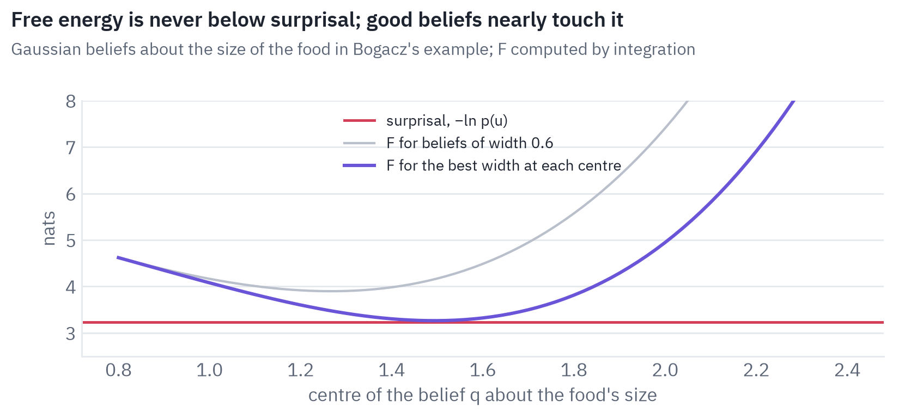
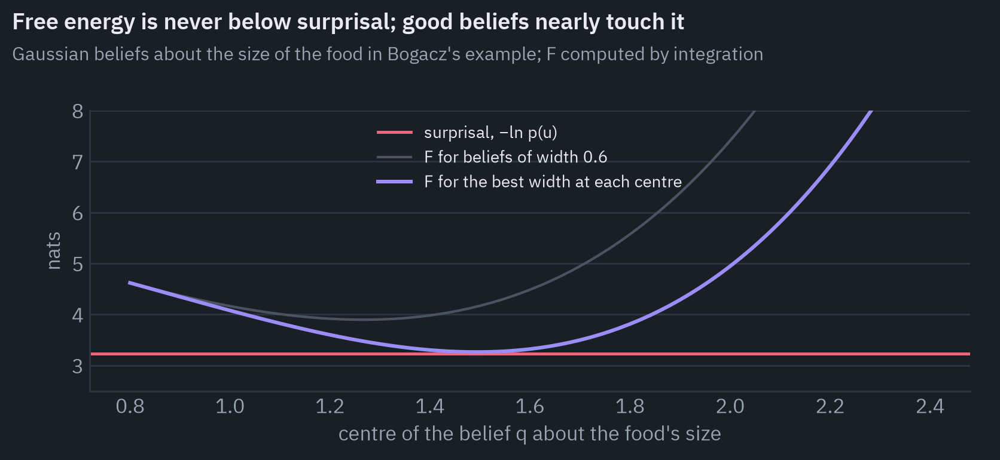

The chart computes this for the example of the next section: free energy for a range of beliefs, each a bell curve centred at a different value, against the surprisal of the observation. No belief gets below the line; the best ones nearly touch it.

The same quantity has a second decomposition, which explains why the principle has so much to say about learning:

$$F = \underbrace{D_{\mathrm{KL}}\big[q(x) \,\Vert\, p(x)\big]}_{\text{complexity}} - \underbrace{\mathbb{E}_{q(x)}\big[\ln p(o \mid x)\big]}_{\text{accuracy}}.$$

*Accuracy* is how well the believed causes predict the observation. *Complexity* is how far the belief has moved from what the creature expected before it looked. Minimising free energy is finding the simplest explanation that fits the data, Occam's razor written as an equation.

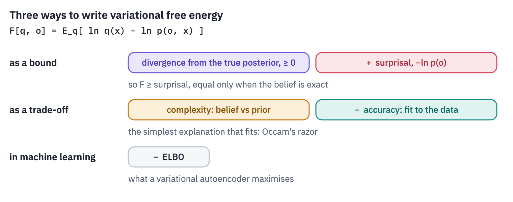
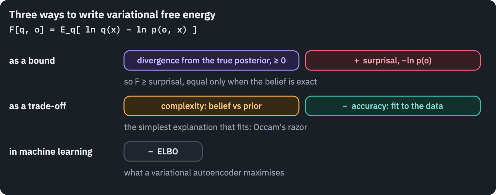

If you work in machine learning, you have met $$F$$ already. A variational autoencoder is trained to maximise the *evidence lower bound*, the ELBO, which is exactly $$-F$$ with the data called $$x$$ and the hidden causes called $$z$$[<a href="#ref-6" id="cite-8" data-ref="6" aria-label="Reference 6: Kingma &amp; Welling, 2014. arxiv.org.">6</a>].

Active-inference papers say it outright: "The variational free energy is the negative evidence lower bound that is optimised in variational Bayes in machine learning"[<a href="#ref-7" id="cite-9" data-ref="7" aria-label="Reference 7: Da Costa et al., 2020. doi.org.">7</a>].

The idea of a brain doing this goes back to the Helmholtz machine of Dayan, Hinton, Neal and Zemel in 1995[<a href="#ref-8" id="cite-10" data-ref="8" aria-label="Reference 8: Dayan et al., 1995. doi.org.">8</a>], named after Hermann von Helmholtz, who described perception as unconscious inference in the 1860s.

Why the name

The formula has the same shape as the Helmholtz free energy of statistical physics, energy minus temperature times entropy, if you call $$-\ln p(o, x)$$ the energy and set the temperature to 1. The mathematics is shared; there are no joules in it.

## Predictive coding and precision

Free energy says what perception optimises, not how a brain could do it. To get a mechanism, Friston assumes that the generative model is Gaussian: an observation is a prediction from the hidden cause plus noise, and the cause has a bell-shaped prior.

Then free energy turns, up to constants, into a sum of squared *prediction errors*, each weighted by its *precision*, the inverse of its variance[<a href="#ref-9" id="cite-11" data-ref="9" aria-label="Reference 9: Bogacz, 2017. doi.org.">9</a>]:

$$\begin{aligned} F(\mu) &\approx \tfrac12\,\Pi_o\,\big(o - g(\mu)\big)^2 \\ &\quad {}+ \tfrac12\,\Pi_x\,\big(\mu - \eta\big)^2 + \text{const}. \end{aligned}$$

Here $$\mu$$ is the creature's best guess about the hidden cause, $$g(\mu)$$ is the observation that guess predicts, $$\eta$$ is what it expected before looking, and $$\Pi_o$$ and $$\Pi_x$$ are how much it trusts its senses and its prior.

Perception is then gradient descent: the guess moves until the error from below, the senses, balances the error from above, the prior.

Rafal Bogacz's tutorial makes this concrete with a creature that has one light receptor and wants to know how big a piece of food is. Light grows with the area of the food, so a food of size $$v$$ gives light $$g(v) = v^2$$ plus noise.

The creature expects food of size 3, observes a light intensity of 2, and both the prior and the sensor have variance 1. A size of 3 would give light 9, far from 2; a size of $$\sqrt 2 \approx 1.41$$ would match the light perfectly but contradicts the prior. Where does the guess settle?

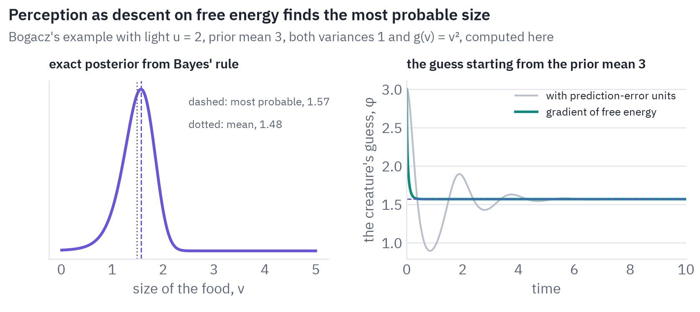
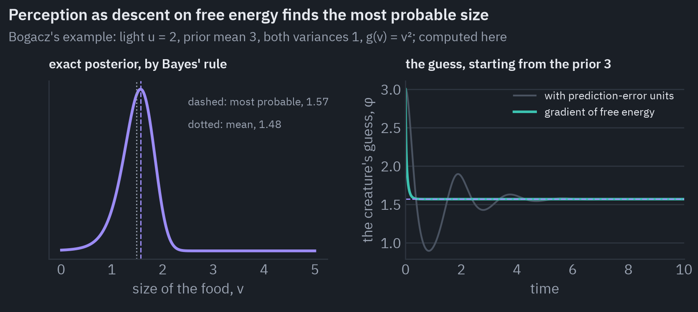

The left panel is the exact answer, computed by Bayes' rule on a grid. The right panel is the creature's guess following the gradient of free energy from its prior expectation, computed here exactly as in Bogacz's exercises.

It settles near 1.57, at the peak of the exact posterior. Bogacz's text: "it rapidly converges to the value of ϕ≈1.6, which is also the value that maximizes the exact posterior probability."

The guess finds the most probable size, not the average one, which is about 1.48 for this lopsided posterior; a single number cannot carry uncertainty, which is one of the approximations the scheme pays for its simplicity.

How the charts in this post are computed

They come from the formulas above, not from the papers' figures. For the bound, the joint probability of Bogacz's example, a normal prior on the size with mean 3 and variance 1 times a normal likelihood of the light with mean $$v^2$$ and variance 1, is evaluated on a fine grid of sizes.

Surprisal is minus the log of its integral, and free energy is the integral of $$q(v)\,[\ln q(v) - \ln p(u, v)]$$ for each Gaussian belief $$q$$.

The guess follows Bogacz's second exercise: small Euler steps along the gradient of $$\ln p(v) + \ln p(u \mid v)$$, starting at the prior mean. The thinner line is his third exercise, where the same descent runs through two prediction-error units, one for the prior and one for the senses. The risk and ambiguity bars further down use the two-state examples of Smith, Friston and Whyte's tutorial, combined by the formula for $$G$$.

Put many such units in a hierarchy and you get *predictive coding*. Each level sends predictions down to the level below and receives back the error: what the prediction failed to explain. Rao and Ballard proposed in 1999 that feedback connections in the visual cortex "carry predictions of lower-level neural activities" and feedforward connections carry the residual errors[<a href="#ref-10" id="cite-12" data-ref="10" aria-label="Reference 10: Rao &amp; Ballard, 1999. doi.org.">10</a>].

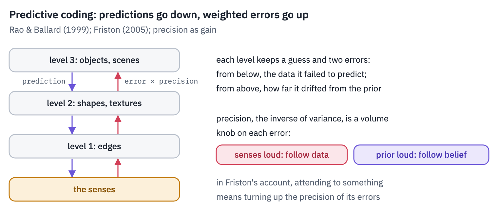
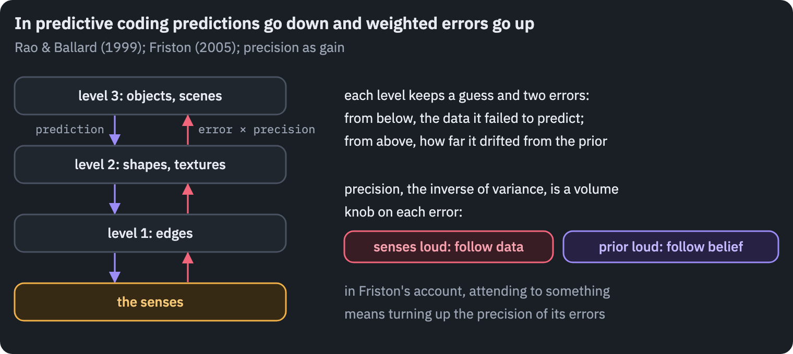

Precision is the most interesting knob in the scheme. It sets how loudly each error is heard.

Turn up the precision of the senses and the guess follows the data; turn up the precision of the prior and the guess follows expectations. In Friston's account attention *is* precision: attending to something means trusting its prediction errors more.

With Gaussian assumptions, minimising free energy is gradient descent on prediction errors weighted by precision. It finds the most probable cause, not a full posterior.

## Active inference and expected free energy

Here the free energy principle departs from ordinary Bayesian perception. Free energy depends on the observation, and a creature can change its observations by acting. If your model predicts that your arm is raised, there are two ways to remove the error: revise the belief, or raise the arm.

Friston calls the second *active inference*, and in his account movement works this way: the motor system receives predictions of how the body should feel, and reflexes fulfil them[<a href="#ref-11" id="cite-13" data-ref="11" aria-label="Reference 11: Friston, Kilner &amp; Harrison, 2006. doi.org.">11</a>].

Because only the accuracy term depends on what is sensed, "action can reduce free energy only by increasing accuracy (that is, selectively sampling data that are predicted)"[<a href="#ref-4" id="cite-14" data-ref="4" aria-label="Reference 4: Friston, 2010. doi.org.">4</a>].

To plan, a creature needs to score futures it hasn't seen yet.

For that, active inference uses a second quantity, the *expected free energy* of a policy $$\pi$$, a sequence of actions[<a href="#ref-12" id="cite-15" data-ref="12" aria-label="Reference 12: Friston et al., 2017. doi.org.">12</a>]. It too can be split in two ways. One reads as *risk plus ambiguity*[<a href="#ref-13" id="cite-16" data-ref="13" aria-label="Reference 13: Smith et al., 2022. doi.org.">13</a>]:

$$\begin{aligned} G(\pi) &= \underbrace{D_{\mathrm{KL}}\big[q(o \mid \pi) \,\Vert\, p(o \mid C)\big]}_{\text{risk}} \\ &\quad {}+ \underbrace{\mathbb{E}_{q(x \mid \pi)}\big[H[p(o \mid x)]\big]}_{\text{ambiguity}}. \end{aligned}$$

*Risk* is how far the outcomes the policy is expected to bring are from the outcomes the creature prefers, $$p(o \mid C)$$. *Ambiguity* is how noisy the link from states to observations will be: a policy that leads somewhere you can't see clearly is ambiguous.

The other split reads the same quantity as minus the expected *information gain*, how much the outcomes would teach about the world, minus the *pragmatic value*, how well they match preferences. A creature choosing policies with low expected free energy is curious and goal-directed by the same token.

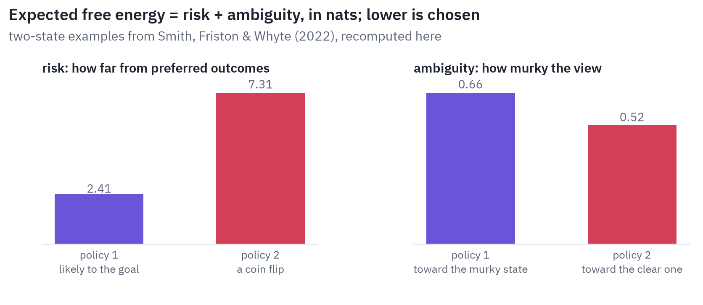
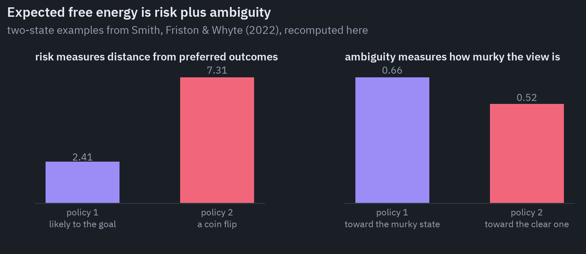

One feature of this needs saying plainly, because it surprises everyone. There is no reward.

Preferences enter as a probability distribution over observations: the creature *expects* to see what it prefers, and acts to make those expectations come true. Friston's colleagues call this an optimism bias written into the model.

It also answers the oldest objection to the principle, the *dark room problem*. If creatures minimise surprise, why don't they find a dark, quiet room and stay there?

Friston's reply is that surprise is always relative to the creature's model, and a creature whose model, shaped by evolution, predicts a varied world full of food and company finds a dark room surprising[<a href="#ref-14" id="cite-17" data-ref="14" aria-label="Reference 14: Friston, Thornton &amp; Clark, 2012. doi.org.">14</a>].

Expected free energy adds a second answer: a dark room is maximally ambiguous, so the first thing an active-inference agent does there is switch on the light.

## Markov blankets

The principle's most ambitious version starts from physics, not brains. It asks: what does it take for anything to exist as something separate from its surroundings?

In probability, a *Markov blanket* of a variable is a set of other variables that, once known, makes everything else irrelevant to it. In a Bayesian network it is the variable's parents, children and its children's other parents, a notion due to Judea Pearl.

Friston carries it into dynamics: a thing is a set of *internal* states separated from *external* states by a blanket of *sensory* states, which the outside affects and the inside doesn't, and *active* states, which the inside affects and the outside doesn't[<a href="#ref-15" id="cite-18" data-ref="15" aria-label="Reference 15: Friston, 2013. doi.org.">15</a>].

A cell's membrane is the obvious example; a candle flame, Friston notes, isn't one, because its molecules are swept away almost instantly.

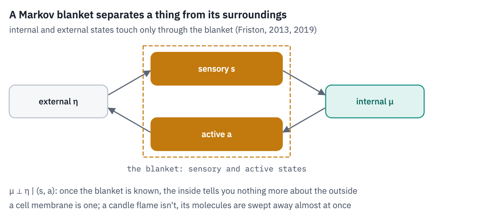
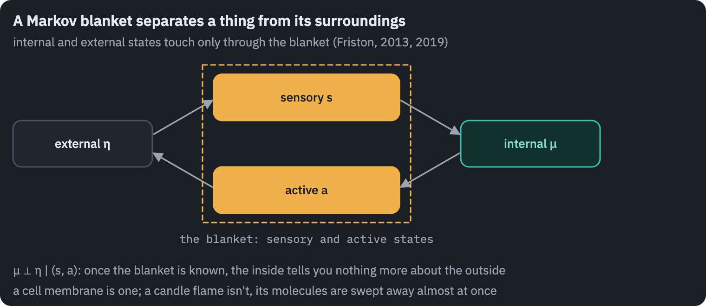

The 2019 monograph "A free energy principle for a particular physics" claims that for any system that settles into a characteristic set of states and has such a blanket, the internal states can be read *as if* they were performing Bayesian inference about the external ones, minimising free energy[<a href="#ref-16" id="cite-19" data-ref="16" aria-label="Reference 16: Friston, 2019. arxiv.org.">16</a>].

The assumptions are many and technical: random dynamics of a particular form, a steady state that the system keeps returning to, coupling sparse enough to produce a blanket, and restrictions on how internal and external states can circulate around each other. Several of them have been challenged, as we'll see.

## Experimental evidence

The principle itself makes no prediction that could fail; we'll come back to that. The process theories built on it do.

*Predictive coding in the brain.* Expectation effects in the brain are well documented: the mismatch negativity, a brain response to an unexpected sound in a sequence, is robust and widely replicated. Whether the brain implements predictive coding in particular is less clear.

A 2020 review, co-written by Andy Clark, one of the framework's best-known philosophers, concluded that "on the whole it must be concluded that the empirical support for each of PP's key hypotheses is mixed"[<a href="#ref-17" id="cite-20" data-ref="17" aria-label="Reference 17: Walsh et al., 2020. doi.org.">17</a>]. A 2024 audit by an active-inference modeller found "modest support"[<a href="#ref-18" id="cite-21" data-ref="18" aria-label="Reference 18: Hodson et al., 2024. doi.org.">18</a>].

Recordings in monkey visual cortex found responses to expected and pattern-violating stimuli "nearly identical"[<a href="#ref-19" id="cite-22" data-ref="19" aria-label="Reference 19: Solomon et al., 2021. doi.org.">19</a>], while neurons in layer 2/3 of mouse visual cortex compute a difference between what the animal's movement predicts and what it sees, as a prediction-error unit should[<a href="#ref-20" id="cite-23" data-ref="20" aria-label="Reference 20: Jordan &amp; Keller, 2020. doi.org.">20</a>].

*Neurons in a dish.* The most direct test of the principle itself came in 2023. Isomura, Friston and colleagues grew rat cortical neurons on a grid of 64 electrodes and stimulated them with mixtures of two hidden signals.

The networks learned to separate the sources, and a model derived from free-energy minimisation, set up from the first 10 training sessions alone, predicted how the networks' connections would change over the next 90 with an error under 4%[<a href="#ref-21" id="cite-24" data-ref="21" aria-label="Reference 21: Isomura et al., 2023. doi.org.">21</a>].

The authors are careful about what that shows: the principle "is sometimes considered to be experimentally irrefutable", so they framed this as a test of predictive power, and "showing the existence of such a mapping alone is insufficient as an empirical validation."

*Pong.* A year earlier, the company Cortical Labs and Friston's group taught neurons in a dish to play the video game Pong. Missing the ball triggered unpredictable stimulation; the cultures learned to rally longer within five minutes, which the authors explained as acting to avoid unpredictable input[<a href="#ref-22" id="cite-25" data-ref="22" aria-label="Reference 22: Kagan et al., 2022. doi.org.">22</a>].

The paper's title said the neurons "exhibit sentience", in the minimal sense of being "responsive to sensory impressions", and thirty neuroscientists wrote to the journal to object[<a href="#ref-23" id="cite-26" data-ref="23" aria-label="Reference 23: Balci et al., 2023. doi.org.">23</a>].

A detail matters more than the word: cultures that got no stimulation at all after a miss also learned, less well, which weakens the reading that unpredictability was what taught them.

*Psychiatry.* The idea that some symptoms reflect aberrant precision, trusting the senses too little or too much relative to expectations, has been applied to psychosis[<a href="#ref-24" id="cite-27" data-ref="24" aria-label="Reference 24: Adams et al., 2013. doi.org.">24</a>] and autism[<a href="#ref-25" id="cite-28" data-ref="25" aria-label="Reference 25: Lawson et al., 2014. doi.org.">25</a>].

Adults with autism were found to be "less surprised than neurotypical adults when their expectations are violated" in a volatile task[<a href="#ref-26" id="cite-29" data-ref="26" aria-label="Reference 26: Lawson et al., 2017. doi.org.">26</a>]. For psychosis the direction is disputed: "some studies implicate weakened prior beliefs in psychosis, and others find stronger priors"[<a href="#ref-27" id="cite-30" data-ref="27" aria-label="Reference 27: Sterzer et al., 2018. doi.org.">27</a>].

The brain clearly uses expectations. Whether it computes them by predictive coding is mixed in the evidence, and direct tests of the principle itself are still few.

## Criticism of the free energy principle

*It can't be falsified, and its author agrees.* "The free energy principle is what it is—a principle. Like Hamilton's Principle of Stationary Action, it cannot be falsified"[<a href="#ref-1" id="cite-31" data-ref="1" aria-label="Reference 1: Fortier &amp; Friedman, 2018. aliusresearch.org.">1</a>].

Friston's colleagues defend this as the difference between a principle, "a piece of mathematical reasoning, which can be developed into a method", and the theories built with it, which can be tested once mapped to data; they also concede that "the FEP itself has nothing instructive to say of the demarcations defining life or consciousness per se"[<a href="#ref-28" id="cite-32" data-ref="28" aria-label="Reference 28: Ramstead et al., 2023. doi.org.">28</a>].

Critics accept the distinction and draw the consequence: if the principle explains any behaviour, it explains none in particular, and the work of explanation is done by the specific models.

Samuel Gershman put it most precisely: "FEP does not have a fixed set of distinctive claims. Rather, it makes different claims under different sets of assumptions"[<a href="#ref-29" id="cite-33" data-ref="29" aria-label="Reference 29: Gershman, 2019. doi.org.">29</a>].

*The Markov blankets are doing a different job from Pearl's.* Bruineberg, Dołęga, Dewhurst and Baltieri distinguish "Pearl blankets", a tool for reasoning about a model, from "Friston blankets", a claim about where things end in the world, and argue that moving from one to the other "requires additional philosophical premises and cannot be justified by an appeal to the success of the mathematical framework alone"[<a href="#ref-30" id="cite-34" data-ref="30" aria-label="Reference 30: Bruineberg et al., 2022. doi.org.">30</a>].

*The physics holds only in special cases.* Aguilera, Millidge, Tschantz and Buckley checked the 2019 derivations on the simplest systems where they can be checked, linear stochastic ones, and found the required conditions "are only valid for a very narrow space of parameters"; a central step, equating the dynamics of average states with the average of the dynamics, "does not hold in general even for linear stochastic systems"[<a href="#ref-31" id="cite-35" data-ref="31" aria-label="Reference 31: Aguilera et al., 2022. doi.org.">31</a>].

Biehl, Pollock and Kanai showed by counterexample that the original "free energy lemma, when taken at face value, is wrong", while noting that this doesn't settle whether the general idea is worth pursuing[<a href="#ref-32" id="cite-36" data-ref="32" aria-label="Reference 32: Biehl et al., 2021. doi.org.">32</a>].

*Curiosity is put in, not derived.* Millidge, Tschantz and Buckley showed that the natural extension of free energy into the future discourages exploration rather than encouraging it: "exploration does not directly follow from free energy minimization into the future"[<a href="#ref-33" id="cite-37" data-ref="33" aria-label="Reference 33: Millidge et al., 2021. doi.org.">33</a>]. Expected free energy is a choice, not a consequence.

*In AI, it hasn't yet won anything.* Comparisons of active-inference agents with reinforcement learning are mostly on small problems, and one careful study found that among deep active-inference models, "the models able to solve the dSprites environment are the ones that maximize rewards"[<a href="#ref-34" id="cite-38" data-ref="34" aria-label="Reference 34: Champion et al., 2024. doi.org.">34</a>].

The machine-learning connection runs the other way: predictive coding networks, it turns out, can approximate backpropagation, "converges asymptotically (and in practice, rapidly) to exact backprop gradients on arbitrary computation graphs"[<a href="#ref-35" id="cite-39" data-ref="35" aria-label="Reference 35: Millidge et al., 2022. doi.org.">35</a>].

## How to read the free energy principle

The free energy principle is best read as three things stacked on each other, and most arguments about it come from mixing them up.

At the bottom is mathematics: variational free energy is a bound on surprisal, and minimising it is approximate Bayesian inference. That part is uncontroversial and is used every day in machine learning under another name.

In the middle is a framework: perception, learning and action described as minimising the same quantity, with attention as precision and preferences as expectations. It is a genuinely useful way to think, and it has produced testable process theories, predictive coding first among them. Those theories have some support and some trouble, as theories should.

At the top are the grand claims: that every living thing, by virtue of existing, can be described as inferring its world, and that this tells us what life, mind or consciousness are.

Here the principle's defenders themselves concede that it says little about life or consciousness as such, and its critics argue that the physics behind it holds only in special cases.

If you take one thing from it, take the middle layer: the brain as a machine that predicts, weighs its errors by how much it trusts them, and acts to make its predictions come true. Unlike the principle, that picture makes predictions an experiment can refute.

The calculations and the figures as code: [articles/friston](https://github.com/xmarva/transformers-from-scratch/tree/main/articles/friston).

## References

1. {:#ref-1} Fortier & Friedman, 2018. [aliusresearch.org](https://www.aliusresearch.org/library/pdfs/alius-bulletin/issue-02/alius-bulletin-issue-02-friston-of-woodlice-and-men-a-bayesian-account-of-cognition-life-and.pdf). <a class="ref-back" href="#cite-1" aria-label="Back to the text">&#8617;</a>
2. {:#ref-2} Friston et al., 1994. [doi.org](https://doi.org/10.1002/hbm.460020402). <a class="ref-back" href="#cite-2" aria-label="Back to the text">&#8617;</a>
3. {:#ref-3} UCL, 2016. [web.archive.org](https://web.archive.org/web/20200901070740/https://www.ucl.ac.uk/ion/news/2016/nov/most-influential-brain-scientists-modern-era). <a class="ref-back" href="#cite-3" aria-label="Back to the text">&#8617;</a>
4. {:#ref-4} Friston, 2010. [doi.org](https://doi.org/10.1038/nrn2787). <a class="ref-back" href="#cite-4" aria-label="Back to the text">&#8617;</a>
5. {:#ref-5} Friston, 2012. [doi.org](https://doi.org/10.3390/e14112100). <a class="ref-back" href="#cite-5" aria-label="Back to the text">&#8617;</a>
6. {:#ref-6} Kingma & Welling, 2014. [arxiv.org](https://arxiv.org/abs/1312.6114). <a class="ref-back" href="#cite-8" aria-label="Back to the text">&#8617;</a>
7. {:#ref-7} Da Costa et al., 2020. [doi.org](https://doi.org/10.1016/j.jmp.2020.102447). <a class="ref-back" href="#cite-9" aria-label="Back to the text">&#8617;</a>
8. {:#ref-8} Dayan et al., 1995. [doi.org](https://doi.org/10.1162/neco.1995.7.5.889). <a class="ref-back" href="#cite-10" aria-label="Back to the text">&#8617;</a>
9. {:#ref-9} Bogacz, 2017. [doi.org](https://doi.org/10.1016/j.jmp.2015.11.003). <a class="ref-back" href="#cite-11" aria-label="Back to the text">&#8617;</a>
10. {:#ref-10} Rao & Ballard, 1999. [doi.org](https://doi.org/10.1038/4580). <a class="ref-back" href="#cite-12" aria-label="Back to the text">&#8617;</a>
11. {:#ref-11} Friston, Kilner & Harrison, 2006. [doi.org](https://doi.org/10.1016/j.jphysparis.2006.10.001). <a class="ref-back" href="#cite-13" aria-label="Back to the text">&#8617;</a>
12. {:#ref-12} Friston et al., 2017. [doi.org](https://doi.org/10.1162/NECO_a_00912). <a class="ref-back" href="#cite-15" aria-label="Back to the text">&#8617;</a>
13. {:#ref-13} Smith et al., 2022. [doi.org](https://doi.org/10.1016/j.jmp.2021.102632). <a class="ref-back" href="#cite-16" aria-label="Back to the text">&#8617;</a>
14. {:#ref-14} Friston, Thornton & Clark, 2012. [doi.org](https://doi.org/10.3389/fpsyg.2012.00130). <a class="ref-back" href="#cite-17" aria-label="Back to the text">&#8617;</a>
15. {:#ref-15} Friston, 2013. [doi.org](https://doi.org/10.1098/rsif.2013.0475). <a class="ref-back" href="#cite-18" aria-label="Back to the text">&#8617;</a>
16. {:#ref-16} Friston, 2019. [arxiv.org](https://arxiv.org/abs/1906.10184). <a class="ref-back" href="#cite-19" aria-label="Back to the text">&#8617;</a>
17. {:#ref-17} Walsh et al., 2020. [doi.org](https://doi.org/10.1111/nyas.14321). <a class="ref-back" href="#cite-20" aria-label="Back to the text">&#8617;</a>
18. {:#ref-18} Hodson et al., 2024. [doi.org](https://doi.org/10.1016/j.neubiorev.2023.105473). <a class="ref-back" href="#cite-21" aria-label="Back to the text">&#8617;</a>
19. {:#ref-19} Solomon et al., 2021. [doi.org](https://doi.org/10.1093/cercor/bhab014). <a class="ref-back" href="#cite-22" aria-label="Back to the text">&#8617;</a>
20. {:#ref-20} Jordan & Keller, 2020. [doi.org](https://doi.org/10.1016/j.neuron.2020.09.024). <a class="ref-back" href="#cite-23" aria-label="Back to the text">&#8617;</a>
21. {:#ref-21} Isomura et al., 2023. [doi.org](https://doi.org/10.1038/s41467-023-40141-z). <a class="ref-back" href="#cite-24" aria-label="Back to the text">&#8617;</a>
22. {:#ref-22} Kagan et al., 2022. [doi.org](https://doi.org/10.1016/j.neuron.2022.09.001). <a class="ref-back" href="#cite-25" aria-label="Back to the text">&#8617;</a>
23. {:#ref-23} Balci et al., 2023. [doi.org](https://doi.org/10.1016/j.neuron.2023.02.009). <a class="ref-back" href="#cite-26" aria-label="Back to the text">&#8617;</a>
24. {:#ref-24} Adams et al., 2013. [doi.org](https://doi.org/10.3389/fpsyt.2013.00047). <a class="ref-back" href="#cite-27" aria-label="Back to the text">&#8617;</a>
25. {:#ref-25} Lawson et al., 2014. [doi.org](https://doi.org/10.3389/fnhum.2014.00302). <a class="ref-back" href="#cite-28" aria-label="Back to the text">&#8617;</a>
26. {:#ref-26} Lawson et al., 2017. [doi.org](https://doi.org/10.1038/nn.4615). <a class="ref-back" href="#cite-29" aria-label="Back to the text">&#8617;</a>
27. {:#ref-27} Sterzer et al., 2018. [doi.org](https://doi.org/10.1016/j.biopsych.2018.05.015). <a class="ref-back" href="#cite-30" aria-label="Back to the text">&#8617;</a>
28. {:#ref-28} Ramstead et al., 2023. [doi.org](https://doi.org/10.1098/rsfs.2022.0029). <a class="ref-back" href="#cite-32" aria-label="Back to the text">&#8617;</a>
29. {:#ref-29} Gershman, 2019. [doi.org](https://doi.org/10.51628/001c.10839). <a class="ref-back" href="#cite-33" aria-label="Back to the text">&#8617;</a>
30. {:#ref-30} Bruineberg et al., 2022. [doi.org](https://doi.org/10.1017/S0140525X21002351). <a class="ref-back" href="#cite-34" aria-label="Back to the text">&#8617;</a>
31. {:#ref-31} Aguilera et al., 2022. [doi.org](https://doi.org/10.1016/j.plrev.2021.11.001). <a class="ref-back" href="#cite-35" aria-label="Back to the text">&#8617;</a>
32. {:#ref-32} Biehl et al., 2021. [doi.org](https://doi.org/10.3390/e23030293). <a class="ref-back" href="#cite-36" aria-label="Back to the text">&#8617;</a>
33. {:#ref-33} Millidge et al., 2021. [doi.org](https://doi.org/10.1162/neco_a_01354). <a class="ref-back" href="#cite-37" aria-label="Back to the text">&#8617;</a>
34. {:#ref-34} Champion et al., 2024. [doi.org](https://doi.org/10.1162/neco_a_01697). <a class="ref-back" href="#cite-38" aria-label="Back to the text">&#8617;</a>
35. {:#ref-35} Millidge et al., 2022. [doi.org](https://doi.org/10.1162/neco_a_01497). <a class="ref-back" href="#cite-39" aria-label="Back to the text">&#8617;</a>
{: .tfs-refs}


