

<p class="tfs-links"><strong>Transformer architectures: from BERT to diffusion</strong> · lesson 6 of 15 · <a href="/teaching/">all lessons</a> · <a href="https://www.kaggle.com/code/qmarva/transformer-architectures-06-modern-llms">run on Kaggle</a> · <a href="https://colab.research.google.com/github/xmarva/transformers-from-scratch/blob/main/notebooks/colab/a06_modern.ipynb">open in Colab</a> · <a href="https://github.com/xmarva/transformers-from-scratch">code on GitHub</a></p>

Give Llama 3.1 8B a long contract to read, 128,000 tokens of it, and before it writes the first word of its answer it has to keep the whole contract in GPU memory: a key and a value for every token, in every head of every one of its 32 layers.

That memory, the KV cache, comes out larger than the model's own weights. Its predecessor of the same width, Llama 2 7B, kept a key and a value for each of its 32 heads, four times as much per token.

Llama 3 keeps one pair for every four query heads, a change called grouped-query attention, and almost nobody trains a model without it any more.

Lesson 5 of the first course followed the changes Llama made to the original Transformer: RMSNorm, rotary positions, SwiGLU. This lesson follows what came after Llama, and there is a pattern in it.

Open the configuration file of any open model released since 2023 and nearly every setting that differs from Llama answers one of two problems: memory while the model generates, and stability while it trains.

The first gave us grouped-query attention, sliding windows and models that mix local and global layers. The second gave us QK-norm and soft-capping, small changes that keep attention from tearing a training run apart.


**What you'll do**

1. Read the configuration files of a dozen models from Mistral 7B to gpt-oss and find what changed.
2. Write grouped-query attention, find out what happens when a trained GPT-2 is forced to share its keys and
   values, and count the KV cache of every model in the table.
3. Make small Transformers diverge on purpose, then keep them alive with QK-norm and soft-capping.
4. Write Qwen3 in PyTorch, load the official weights of Qwen3-0.6B and match Hugging Face's outputs, then let it
   think out loud and not.
5. Give Qwen3 a sliding window it was never trained with, the way Mistral and Gemma build theirs, and see what it
   keeps and what it loses.
6. Write LoRA from scratch and teach the 0.6B model to turn voice commands into JSON, in English and in Russian,
   against a model seven times its size.

**What you need**: a GPU. On Kaggle, *Settings → Accelerator → GPU*; on Colab, *Runtime → Change runtime type → T4
GPU*. The notebook downloads Qwen3-0.6B (1.5 GB), Qwen3-4B (8 GB), GPT-2 (550 MB) and the MASSIVE dataset (40 MB),
trains a few small models and two LoRA adapters; on a T4 it runs in about 70 minutes.

## Setup

One small helper package, `tfs`, draws the course's plots and token chips and knows where the notebook runs
(Kaggle, Colab or your own machine). Everything the lesson teaches is written out in the notebook itself.

```python
import importlib.util
import subprocess
import sys

TFS = "git+https://github.com/xmarva/transformers-from-scratch@main"
if importlib.util.find_spec("tfs") is None:
    subprocess.check_call([sys.executable, "-m", "pip", "install", "-q", TFS])

from tfs import env
from tfs.viz import table, token_chips, use_course_style

env.quiet()  # no progress bars or environment warnings in the outputs
SEED = 42
env.seed_everything(SEED)
COLORS = use_course_style()
WORK_DIR = env.work_dir()
```

```python
import json
import math
import random
import re
import tarfile
import time
import urllib.request

import matplotlib.pyplot as plt
import numpy as np
import pandas as pd
import torch
import torch.nn as nn
import torch.nn.functional as F
from huggingface_hub import HfApi, hf_hub_download
from safetensors.torch import load_file
from transformers import AutoTokenizer
# the reference implementations, for the checks
from transformers import AutoModelForCausalLM, GPT2LMHeadModel

SMOKE = env.smoke()  # CI runs the lesson on a small slice; you run it in full
device = "cuda" if torch.cuda.is_available() else "cpu"
HALF = torch.float16 if device == "cuda" else torch.float32  # 16-bit matmuls crawl on a CPU
assert device == "cuda" or SMOKE, "This lesson trains models and runs a 4B one: use a GPU"
if device == "cuda":
    print("GPU:", torch.cuda.get_device_name(0))
```

<pre class="tfs-printed" markdown="0"><code>GPU: Tesla T4</code></pre>

## 1. A dozen configs

Every model on Hugging Face comes with a `config.json`, a few dozen lines that say how wide the model is, how many layers and heads it has and which of the tricks of its year it uses.

It is the fastest way to read an architecture: the code behind it is usually shared with a dozen other models, and the config is what makes this one different. We download the configs of fourteen models released between September 2023 and August 2025.

The official repositories of Llama and Gemma ask you to accept a licence before you can download even the config, so for those we read the same files from Unsloth's public copies.

```python
MODELS = [  # repository, name, released; Llama and Gemma from Unsloth's public copies
    ("mistralai/Mistral-7B-v0.1", "Mistral 7B", "2023-09"),
    ("unsloth/gemma-2-9b", "Gemma 2 9B", "2024-06"),
    ("unsloth/Meta-Llama-3.1-8B", "Llama 3.1 8B", "2024-07"),
    ("unsloth/Llama-3.2-1B", "Llama 3.2 1B", "2024-09"),
    ("Qwen/Qwen2.5-7B", "Qwen2.5 7B", "2024-09"),
    ("allenai/OLMo-2-1124-7B", "OLMo 2 7B", "2024-11"),
    ("microsoft/phi-4", "Phi-4 14B", "2024-12"),
    ("mistralai/Mistral-Small-24B-Base-2501", "Mistral Small 24B", "2025-01"),
    ("unsloth/gemma-3-1b-pt", "Gemma 3 1B", "2025-03"),
    ("unsloth/gemma-3-27b-pt", "Gemma 3 27B", "2025-03"),
    ("Qwen/Qwen3-0.6B", "Qwen3 0.6B", "2025-04"),
    ("Qwen/Qwen3-8B", "Qwen3 8B", "2025-04"),
    ("HuggingFaceTB/SmolLM3-3B", "SmolLM3 3B", "2025-07"),
    ("openai/gpt-oss-20b", "gpt-oss 20B", "2025-08"),
]


def text_config(repo):
    with open(hf_hub_download(repo, "config.json")) as f:
        config = json.load(f)
    if "text_config" in config:  # a multimodal model keeps its language model here
        config = config["text_config"]
    if not config.get("head_dim"):
        config["head_dim"] = config["hidden_size"] // config["num_attention_heads"]
    return config


configs = {}
for repo, name, _ in MODELS:
    configs[name] = text_config(repo)
print(len(configs), "configs")
```

<pre class="tfs-printed" markdown="0"><code>14 configs</code></pre>

Three settings need a word before the table. Some models give a layer either *global* attention, over everything before it, or *local* attention, over a window of the last few thousand tokens; section 7 is about why, and the config says it in one of three ways.

Soft-capping, one of the subjects of section 4, has a setting of its own, `attn_logit_softcapping`. QK-norm, the other, doesn't appear in the config at all, because it is written into the model's code: we note the model types whose code has it.

And Gemma's configs don't say whether the input and output embeddings are tied, because Gemma's code ties them unless told otherwise.

```python
# model types whose attention normalises queries and keys
QK_NORM = {"qwen3", "olmo2", "gemma3_text"}


def layer_kinds(c):
    n = c["num_hidden_layers"]
    if c.get("layer_types"):
        return ["local" if kind == "sliding_attention" else "global"
                for kind in c["layer_types"]]
    if c.get("sliding_window_pattern"):  # Gemma 3: every sixth layer is global
        pattern = c["sliding_window_pattern"]
        return ["global" if (i + 1) % pattern == 0 else "local" for i in range(n)]
    if c["model_type"] == "gemma2":  # Gemma 2 alternates, starting with a local layer
        return ["local" if i % 2 == 0 else "global" for i in range(n)]
    if c.get("sliding_window") and c.get("use_sliding_window", True):
        return ["local"] * n
    return ["global"] * n


def attention_summary(c):
    kinds = layer_kinds(c)
    local = kinds.count("local")
    if local == 0:
        return "all global"
    if local == len(kinds):
        return f"all local, {c['sliding_window']}"
    return f"{local} local : {len(kinds) - local} global, {c['sliding_window']}"


def tied(c):  # Gemma's configs leave the key out, and Gemma's code ties by default
    return c.get("tie_word_embeddings", c["model_type"].startswith("gemma"))


rows = []
for _, name, released in MODELS:
    c = configs[name]
    rows.append({
        "model": name,
        "released": released,
        "layers": c["num_hidden_layers"],
        "width": c["hidden_size"],
        "query heads": c["num_attention_heads"],
        "KV heads": c["num_key_value_heads"],
        "head size": c["head_dim"],
        "attention": attention_summary(c),
        "QK-norm": "yes" if c["model_type"] in QK_NORM else "",
        "soft-cap": c.get("attn_logit_softcapping") or "",
        "vocabulary": c["vocab_size"],
        "tied": "yes" if tied(c) else "",
    })
table(pd.DataFrame(rows))
```

<div class="tfs-table-wrap"><table class="tfs-table" style="border-collapse:collapse;font-family:'IBM Plex Sans', -apple-system, 'Segoe UI', Roboto, Helvetica, Arial, sans-serif;font-size:13.5px;line-height:1.45;margin:4px 0 8px;"><thead><tr><th style="padding:7px 14px;border-bottom:2px solid #B9C0CB;font-weight:600;color:#5B6575;font-size:12px;letter-spacing:0.02em;text-align:left;">model</th><th style="padding:7px 14px;border-bottom:2px solid #B9C0CB;font-weight:600;color:#5B6575;font-size:12px;letter-spacing:0.02em;text-align:left;">released</th><th style="padding:7px 14px;border-bottom:2px solid #B9C0CB;font-weight:600;color:#5B6575;font-size:12px;letter-spacing:0.02em;text-align:right;">layers</th><th style="padding:7px 14px;border-bottom:2px solid #B9C0CB;font-weight:600;color:#5B6575;font-size:12px;letter-spacing:0.02em;text-align:right;">width</th><th style="padding:7px 14px;border-bottom:2px solid #B9C0CB;font-weight:600;color:#5B6575;font-size:12px;letter-spacing:0.02em;text-align:right;">query heads</th><th style="padding:7px 14px;border-bottom:2px solid #B9C0CB;font-weight:600;color:#5B6575;font-size:12px;letter-spacing:0.02em;text-align:right;">KV heads</th><th style="padding:7px 14px;border-bottom:2px solid #B9C0CB;font-weight:600;color:#5B6575;font-size:12px;letter-spacing:0.02em;text-align:right;">head size</th><th style="padding:7px 14px;border-bottom:2px solid #B9C0CB;font-weight:600;color:#5B6575;font-size:12px;letter-spacing:0.02em;text-align:left;">attention</th><th style="padding:7px 14px;border-bottom:2px solid #B9C0CB;font-weight:600;color:#5B6575;font-size:12px;letter-spacing:0.02em;text-align:left;">QK-norm</th><th style="padding:7px 14px;border-bottom:2px solid #B9C0CB;font-weight:600;color:#5B6575;font-size:12px;letter-spacing:0.02em;text-align:left;">soft-cap</th><th style="padding:7px 14px;border-bottom:2px solid #B9C0CB;font-weight:600;color:#5B6575;font-size:12px;letter-spacing:0.02em;text-align:right;">vocabulary</th><th style="padding:7px 14px;border-bottom:2px solid #B9C0CB;font-weight:600;color:#5B6575;font-size:12px;letter-spacing:0.02em;text-align:left;">tied</th></tr></thead><tbody><tr><td style="padding:7px 14px;border-bottom:1px solid #E6E9EE;vertical-align:top;text-align:left;max-width:460px;white-space:normal;">Mistral 7B</td><td style="padding:7px 14px;border-bottom:1px solid #E6E9EE;vertical-align:top;text-align:left;max-width:460px;white-space:normal;">2023-09</td><td style="padding:7px 14px;border-bottom:1px solid #E6E9EE;vertical-align:top;text-align:right;font-variant-numeric:tabular-nums;max-width:460px;white-space:normal;">32</td><td style="padding:7px 14px;border-bottom:1px solid #E6E9EE;vertical-align:top;text-align:right;font-variant-numeric:tabular-nums;max-width:460px;white-space:normal;">4,096</td><td style="padding:7px 14px;border-bottom:1px solid #E6E9EE;vertical-align:top;text-align:right;font-variant-numeric:tabular-nums;max-width:460px;white-space:normal;">32</td><td style="padding:7px 14px;border-bottom:1px solid #E6E9EE;vertical-align:top;text-align:right;font-variant-numeric:tabular-nums;max-width:460px;white-space:normal;">8</td><td style="padding:7px 14px;border-bottom:1px solid #E6E9EE;vertical-align:top;text-align:right;font-variant-numeric:tabular-nums;max-width:460px;white-space:normal;">128</td><td style="padding:7px 14px;border-bottom:1px solid #E6E9EE;vertical-align:top;text-align:left;max-width:460px;white-space:normal;">all local, 4096</td><td style="padding:7px 14px;border-bottom:1px solid #E6E9EE;vertical-align:top;text-align:left;max-width:460px;white-space:normal;"></td><td style="padding:7px 14px;border-bottom:1px solid #E6E9EE;vertical-align:top;text-align:left;max-width:460px;white-space:normal;"></td><td style="padding:7px 14px;border-bottom:1px solid #E6E9EE;vertical-align:top;text-align:right;font-variant-numeric:tabular-nums;max-width:460px;white-space:normal;">32,000</td><td style="padding:7px 14px;border-bottom:1px solid #E6E9EE;vertical-align:top;text-align:left;max-width:460px;white-space:normal;"></td></tr><tr><td style="padding:7px 14px;border-bottom:1px solid #E6E9EE;vertical-align:top;text-align:left;max-width:460px;white-space:normal;">Gemma 2 9B</td><td style="padding:7px 14px;border-bottom:1px solid #E6E9EE;vertical-align:top;text-align:left;max-width:460px;white-space:normal;">2024-06</td><td style="padding:7px 14px;border-bottom:1px solid #E6E9EE;vertical-align:top;text-align:right;font-variant-numeric:tabular-nums;max-width:460px;white-space:normal;">42</td><td style="padding:7px 14px;border-bottom:1px solid #E6E9EE;vertical-align:top;text-align:right;font-variant-numeric:tabular-nums;max-width:460px;white-space:normal;">3,584</td><td style="padding:7px 14px;border-bottom:1px solid #E6E9EE;vertical-align:top;text-align:right;font-variant-numeric:tabular-nums;max-width:460px;white-space:normal;">16</td><td style="padding:7px 14px;border-bottom:1px solid #E6E9EE;vertical-align:top;text-align:right;font-variant-numeric:tabular-nums;max-width:460px;white-space:normal;">8</td><td style="padding:7px 14px;border-bottom:1px solid #E6E9EE;vertical-align:top;text-align:right;font-variant-numeric:tabular-nums;max-width:460px;white-space:normal;">256</td><td style="padding:7px 14px;border-bottom:1px solid #E6E9EE;vertical-align:top;text-align:left;max-width:460px;white-space:normal;">21 local : 21 global, 4096</td><td style="padding:7px 14px;border-bottom:1px solid #E6E9EE;vertical-align:top;text-align:left;max-width:460px;white-space:normal;"></td><td style="padding:7px 14px;border-bottom:1px solid #E6E9EE;vertical-align:top;text-align:right;font-variant-numeric:tabular-nums;max-width:460px;white-space:normal;">50.00</td><td style="padding:7px 14px;border-bottom:1px solid #E6E9EE;vertical-align:top;text-align:right;font-variant-numeric:tabular-nums;max-width:460px;white-space:normal;">256,000</td><td style="padding:7px 14px;border-bottom:1px solid #E6E9EE;vertical-align:top;text-align:left;max-width:460px;white-space:normal;">yes</td></tr><tr><td style="padding:7px 14px;border-bottom:1px solid #E6E9EE;vertical-align:top;text-align:left;max-width:460px;white-space:normal;">Llama 3.1 8B</td><td style="padding:7px 14px;border-bottom:1px solid #E6E9EE;vertical-align:top;text-align:left;max-width:460px;white-space:normal;">2024-07</td><td style="padding:7px 14px;border-bottom:1px solid #E6E9EE;vertical-align:top;text-align:right;font-variant-numeric:tabular-nums;max-width:460px;white-space:normal;">32</td><td style="padding:7px 14px;border-bottom:1px solid #E6E9EE;vertical-align:top;text-align:right;font-variant-numeric:tabular-nums;max-width:460px;white-space:normal;">4,096</td><td style="padding:7px 14px;border-bottom:1px solid #E6E9EE;vertical-align:top;text-align:right;font-variant-numeric:tabular-nums;max-width:460px;white-space:normal;">32</td><td style="padding:7px 14px;border-bottom:1px solid #E6E9EE;vertical-align:top;text-align:right;font-variant-numeric:tabular-nums;max-width:460px;white-space:normal;">8</td><td style="padding:7px 14px;border-bottom:1px solid #E6E9EE;vertical-align:top;text-align:right;font-variant-numeric:tabular-nums;max-width:460px;white-space:normal;">128</td><td style="padding:7px 14px;border-bottom:1px solid #E6E9EE;vertical-align:top;text-align:left;max-width:460px;white-space:normal;">all global</td><td style="padding:7px 14px;border-bottom:1px solid #E6E9EE;vertical-align:top;text-align:left;max-width:460px;white-space:normal;"></td><td style="padding:7px 14px;border-bottom:1px solid #E6E9EE;vertical-align:top;text-align:left;max-width:460px;white-space:normal;"></td><td style="padding:7px 14px;border-bottom:1px solid #E6E9EE;vertical-align:top;text-align:right;font-variant-numeric:tabular-nums;max-width:460px;white-space:normal;">128,256</td><td style="padding:7px 14px;border-bottom:1px solid #E6E9EE;vertical-align:top;text-align:left;max-width:460px;white-space:normal;"></td></tr><tr><td style="padding:7px 14px;border-bottom:1px solid #E6E9EE;vertical-align:top;text-align:left;max-width:460px;white-space:normal;">Llama 3.2 1B</td><td style="padding:7px 14px;border-bottom:1px solid #E6E9EE;vertical-align:top;text-align:left;max-width:460px;white-space:normal;">2024-09</td><td style="padding:7px 14px;border-bottom:1px solid #E6E9EE;vertical-align:top;text-align:right;font-variant-numeric:tabular-nums;max-width:460px;white-space:normal;">16</td><td style="padding:7px 14px;border-bottom:1px solid #E6E9EE;vertical-align:top;text-align:right;font-variant-numeric:tabular-nums;max-width:460px;white-space:normal;">2,048</td><td style="padding:7px 14px;border-bottom:1px solid #E6E9EE;vertical-align:top;text-align:right;font-variant-numeric:tabular-nums;max-width:460px;white-space:normal;">32</td><td style="padding:7px 14px;border-bottom:1px solid #E6E9EE;vertical-align:top;text-align:right;font-variant-numeric:tabular-nums;max-width:460px;white-space:normal;">8</td><td style="padding:7px 14px;border-bottom:1px solid #E6E9EE;vertical-align:top;text-align:right;font-variant-numeric:tabular-nums;max-width:460px;white-space:normal;">64</td><td style="padding:7px 14px;border-bottom:1px solid #E6E9EE;vertical-align:top;text-align:left;max-width:460px;white-space:normal;">all global</td><td style="padding:7px 14px;border-bottom:1px solid #E6E9EE;vertical-align:top;text-align:left;max-width:460px;white-space:normal;"></td><td style="padding:7px 14px;border-bottom:1px solid #E6E9EE;vertical-align:top;text-align:left;max-width:460px;white-space:normal;"></td><td style="padding:7px 14px;border-bottom:1px solid #E6E9EE;vertical-align:top;text-align:right;font-variant-numeric:tabular-nums;max-width:460px;white-space:normal;">128,256</td><td style="padding:7px 14px;border-bottom:1px solid #E6E9EE;vertical-align:top;text-align:left;max-width:460px;white-space:normal;">yes</td></tr><tr><td style="padding:7px 14px;border-bottom:1px solid #E6E9EE;vertical-align:top;text-align:left;max-width:460px;white-space:normal;">Qwen2.5 7B</td><td style="padding:7px 14px;border-bottom:1px solid #E6E9EE;vertical-align:top;text-align:left;max-width:460px;white-space:normal;">2024-09</td><td style="padding:7px 14px;border-bottom:1px solid #E6E9EE;vertical-align:top;text-align:right;font-variant-numeric:tabular-nums;max-width:460px;white-space:normal;">28</td><td style="padding:7px 14px;border-bottom:1px solid #E6E9EE;vertical-align:top;text-align:right;font-variant-numeric:tabular-nums;max-width:460px;white-space:normal;">3,584</td><td style="padding:7px 14px;border-bottom:1px solid #E6E9EE;vertical-align:top;text-align:right;font-variant-numeric:tabular-nums;max-width:460px;white-space:normal;">28</td><td style="padding:7px 14px;border-bottom:1px solid #E6E9EE;vertical-align:top;text-align:right;font-variant-numeric:tabular-nums;max-width:460px;white-space:normal;">4</td><td style="padding:7px 14px;border-bottom:1px solid #E6E9EE;vertical-align:top;text-align:right;font-variant-numeric:tabular-nums;max-width:460px;white-space:normal;">128</td><td style="padding:7px 14px;border-bottom:1px solid #E6E9EE;vertical-align:top;text-align:left;max-width:460px;white-space:normal;">all global</td><td style="padding:7px 14px;border-bottom:1px solid #E6E9EE;vertical-align:top;text-align:left;max-width:460px;white-space:normal;"></td><td style="padding:7px 14px;border-bottom:1px solid #E6E9EE;vertical-align:top;text-align:left;max-width:460px;white-space:normal;"></td><td style="padding:7px 14px;border-bottom:1px solid #E6E9EE;vertical-align:top;text-align:right;font-variant-numeric:tabular-nums;max-width:460px;white-space:normal;">152,064</td><td style="padding:7px 14px;border-bottom:1px solid #E6E9EE;vertical-align:top;text-align:left;max-width:460px;white-space:normal;"></td></tr><tr><td style="padding:7px 14px;border-bottom:1px solid #E6E9EE;vertical-align:top;text-align:left;max-width:460px;white-space:normal;">OLMo 2 7B</td><td style="padding:7px 14px;border-bottom:1px solid #E6E9EE;vertical-align:top;text-align:left;max-width:460px;white-space:normal;">2024-11</td><td style="padding:7px 14px;border-bottom:1px solid #E6E9EE;vertical-align:top;text-align:right;font-variant-numeric:tabular-nums;max-width:460px;white-space:normal;">32</td><td style="padding:7px 14px;border-bottom:1px solid #E6E9EE;vertical-align:top;text-align:right;font-variant-numeric:tabular-nums;max-width:460px;white-space:normal;">4,096</td><td style="padding:7px 14px;border-bottom:1px solid #E6E9EE;vertical-align:top;text-align:right;font-variant-numeric:tabular-nums;max-width:460px;white-space:normal;">32</td><td style="padding:7px 14px;border-bottom:1px solid #E6E9EE;vertical-align:top;text-align:right;font-variant-numeric:tabular-nums;max-width:460px;white-space:normal;">32</td><td style="padding:7px 14px;border-bottom:1px solid #E6E9EE;vertical-align:top;text-align:right;font-variant-numeric:tabular-nums;max-width:460px;white-space:normal;">128</td><td style="padding:7px 14px;border-bottom:1px solid #E6E9EE;vertical-align:top;text-align:left;max-width:460px;white-space:normal;">all global</td><td style="padding:7px 14px;border-bottom:1px solid #E6E9EE;vertical-align:top;text-align:left;max-width:460px;white-space:normal;">yes</td><td style="padding:7px 14px;border-bottom:1px solid #E6E9EE;vertical-align:top;text-align:left;max-width:460px;white-space:normal;"></td><td style="padding:7px 14px;border-bottom:1px solid #E6E9EE;vertical-align:top;text-align:right;font-variant-numeric:tabular-nums;max-width:460px;white-space:normal;">100,352</td><td style="padding:7px 14px;border-bottom:1px solid #E6E9EE;vertical-align:top;text-align:left;max-width:460px;white-space:normal;"></td></tr><tr><td style="padding:7px 14px;border-bottom:1px solid #E6E9EE;vertical-align:top;text-align:left;max-width:460px;white-space:normal;">Phi-4 14B</td><td style="padding:7px 14px;border-bottom:1px solid #E6E9EE;vertical-align:top;text-align:left;max-width:460px;white-space:normal;">2024-12</td><td style="padding:7px 14px;border-bottom:1px solid #E6E9EE;vertical-align:top;text-align:right;font-variant-numeric:tabular-nums;max-width:460px;white-space:normal;">40</td><td style="padding:7px 14px;border-bottom:1px solid #E6E9EE;vertical-align:top;text-align:right;font-variant-numeric:tabular-nums;max-width:460px;white-space:normal;">5,120</td><td style="padding:7px 14px;border-bottom:1px solid #E6E9EE;vertical-align:top;text-align:right;font-variant-numeric:tabular-nums;max-width:460px;white-space:normal;">40</td><td style="padding:7px 14px;border-bottom:1px solid #E6E9EE;vertical-align:top;text-align:right;font-variant-numeric:tabular-nums;max-width:460px;white-space:normal;">10</td><td style="padding:7px 14px;border-bottom:1px solid #E6E9EE;vertical-align:top;text-align:right;font-variant-numeric:tabular-nums;max-width:460px;white-space:normal;">128</td><td style="padding:7px 14px;border-bottom:1px solid #E6E9EE;vertical-align:top;text-align:left;max-width:460px;white-space:normal;">all global</td><td style="padding:7px 14px;border-bottom:1px solid #E6E9EE;vertical-align:top;text-align:left;max-width:460px;white-space:normal;"></td><td style="padding:7px 14px;border-bottom:1px solid #E6E9EE;vertical-align:top;text-align:left;max-width:460px;white-space:normal;"></td><td style="padding:7px 14px;border-bottom:1px solid #E6E9EE;vertical-align:top;text-align:right;font-variant-numeric:tabular-nums;max-width:460px;white-space:normal;">100,352</td><td style="padding:7px 14px;border-bottom:1px solid #E6E9EE;vertical-align:top;text-align:left;max-width:460px;white-space:normal;"></td></tr><tr><td style="padding:7px 14px;border-bottom:1px solid #E6E9EE;vertical-align:top;text-align:left;max-width:460px;white-space:normal;">Mistral Small 24B</td><td style="padding:7px 14px;border-bottom:1px solid #E6E9EE;vertical-align:top;text-align:left;max-width:460px;white-space:normal;">2025-01</td><td style="padding:7px 14px;border-bottom:1px solid #E6E9EE;vertical-align:top;text-align:right;font-variant-numeric:tabular-nums;max-width:460px;white-space:normal;">40</td><td style="padding:7px 14px;border-bottom:1px solid #E6E9EE;vertical-align:top;text-align:right;font-variant-numeric:tabular-nums;max-width:460px;white-space:normal;">5,120</td><td style="padding:7px 14px;border-bottom:1px solid #E6E9EE;vertical-align:top;text-align:right;font-variant-numeric:tabular-nums;max-width:460px;white-space:normal;">32</td><td style="padding:7px 14px;border-bottom:1px solid #E6E9EE;vertical-align:top;text-align:right;font-variant-numeric:tabular-nums;max-width:460px;white-space:normal;">8</td><td style="padding:7px 14px;border-bottom:1px solid #E6E9EE;vertical-align:top;text-align:right;font-variant-numeric:tabular-nums;max-width:460px;white-space:normal;">128</td><td style="padding:7px 14px;border-bottom:1px solid #E6E9EE;vertical-align:top;text-align:left;max-width:460px;white-space:normal;">all global</td><td style="padding:7px 14px;border-bottom:1px solid #E6E9EE;vertical-align:top;text-align:left;max-width:460px;white-space:normal;"></td><td style="padding:7px 14px;border-bottom:1px solid #E6E9EE;vertical-align:top;text-align:left;max-width:460px;white-space:normal;"></td><td style="padding:7px 14px;border-bottom:1px solid #E6E9EE;vertical-align:top;text-align:right;font-variant-numeric:tabular-nums;max-width:460px;white-space:normal;">131,072</td><td style="padding:7px 14px;border-bottom:1px solid #E6E9EE;vertical-align:top;text-align:left;max-width:460px;white-space:normal;"></td></tr><tr><td style="padding:7px 14px;border-bottom:1px solid #E6E9EE;vertical-align:top;text-align:left;max-width:460px;white-space:normal;">Gemma 3 1B</td><td style="padding:7px 14px;border-bottom:1px solid #E6E9EE;vertical-align:top;text-align:left;max-width:460px;white-space:normal;">2025-03</td><td style="padding:7px 14px;border-bottom:1px solid #E6E9EE;vertical-align:top;text-align:right;font-variant-numeric:tabular-nums;max-width:460px;white-space:normal;">26</td><td style="padding:7px 14px;border-bottom:1px solid #E6E9EE;vertical-align:top;text-align:right;font-variant-numeric:tabular-nums;max-width:460px;white-space:normal;">1,152</td><td style="padding:7px 14px;border-bottom:1px solid #E6E9EE;vertical-align:top;text-align:right;font-variant-numeric:tabular-nums;max-width:460px;white-space:normal;">4</td><td style="padding:7px 14px;border-bottom:1px solid #E6E9EE;vertical-align:top;text-align:right;font-variant-numeric:tabular-nums;max-width:460px;white-space:normal;">1</td><td style="padding:7px 14px;border-bottom:1px solid #E6E9EE;vertical-align:top;text-align:right;font-variant-numeric:tabular-nums;max-width:460px;white-space:normal;">256</td><td style="padding:7px 14px;border-bottom:1px solid #E6E9EE;vertical-align:top;text-align:left;max-width:460px;white-space:normal;">22 local : 4 global, 512</td><td style="padding:7px 14px;border-bottom:1px solid #E6E9EE;vertical-align:top;text-align:left;max-width:460px;white-space:normal;">yes</td><td style="padding:7px 14px;border-bottom:1px solid #E6E9EE;vertical-align:top;text-align:left;max-width:460px;white-space:normal;"></td><td style="padding:7px 14px;border-bottom:1px solid #E6E9EE;vertical-align:top;text-align:right;font-variant-numeric:tabular-nums;max-width:460px;white-space:normal;">262,144</td><td style="padding:7px 14px;border-bottom:1px solid #E6E9EE;vertical-align:top;text-align:left;max-width:460px;white-space:normal;">yes</td></tr><tr><td style="padding:7px 14px;border-bottom:1px solid #E6E9EE;vertical-align:top;text-align:left;max-width:460px;white-space:normal;">Gemma 3 27B</td><td style="padding:7px 14px;border-bottom:1px solid #E6E9EE;vertical-align:top;text-align:left;max-width:460px;white-space:normal;">2025-03</td><td style="padding:7px 14px;border-bottom:1px solid #E6E9EE;vertical-align:top;text-align:right;font-variant-numeric:tabular-nums;max-width:460px;white-space:normal;">62</td><td style="padding:7px 14px;border-bottom:1px solid #E6E9EE;vertical-align:top;text-align:right;font-variant-numeric:tabular-nums;max-width:460px;white-space:normal;">5,376</td><td style="padding:7px 14px;border-bottom:1px solid #E6E9EE;vertical-align:top;text-align:right;font-variant-numeric:tabular-nums;max-width:460px;white-space:normal;">32</td><td style="padding:7px 14px;border-bottom:1px solid #E6E9EE;vertical-align:top;text-align:right;font-variant-numeric:tabular-nums;max-width:460px;white-space:normal;">16</td><td style="padding:7px 14px;border-bottom:1px solid #E6E9EE;vertical-align:top;text-align:right;font-variant-numeric:tabular-nums;max-width:460px;white-space:normal;">128</td><td style="padding:7px 14px;border-bottom:1px solid #E6E9EE;vertical-align:top;text-align:left;max-width:460px;white-space:normal;">52 local : 10 global, 1024</td><td style="padding:7px 14px;border-bottom:1px solid #E6E9EE;vertical-align:top;text-align:left;max-width:460px;white-space:normal;">yes</td><td style="padding:7px 14px;border-bottom:1px solid #E6E9EE;vertical-align:top;text-align:left;max-width:460px;white-space:normal;"></td><td style="padding:7px 14px;border-bottom:1px solid #E6E9EE;vertical-align:top;text-align:right;font-variant-numeric:tabular-nums;max-width:460px;white-space:normal;">262,208</td><td style="padding:7px 14px;border-bottom:1px solid #E6E9EE;vertical-align:top;text-align:left;max-width:460px;white-space:normal;">yes</td></tr><tr><td style="padding:7px 14px;border-bottom:1px solid #E6E9EE;vertical-align:top;text-align:left;max-width:460px;white-space:normal;">Qwen3 0.6B</td><td style="padding:7px 14px;border-bottom:1px solid #E6E9EE;vertical-align:top;text-align:left;max-width:460px;white-space:normal;">2025-04</td><td style="padding:7px 14px;border-bottom:1px solid #E6E9EE;vertical-align:top;text-align:right;font-variant-numeric:tabular-nums;max-width:460px;white-space:normal;">28</td><td style="padding:7px 14px;border-bottom:1px solid #E6E9EE;vertical-align:top;text-align:right;font-variant-numeric:tabular-nums;max-width:460px;white-space:normal;">1,024</td><td style="padding:7px 14px;border-bottom:1px solid #E6E9EE;vertical-align:top;text-align:right;font-variant-numeric:tabular-nums;max-width:460px;white-space:normal;">16</td><td style="padding:7px 14px;border-bottom:1px solid #E6E9EE;vertical-align:top;text-align:right;font-variant-numeric:tabular-nums;max-width:460px;white-space:normal;">8</td><td style="padding:7px 14px;border-bottom:1px solid #E6E9EE;vertical-align:top;text-align:right;font-variant-numeric:tabular-nums;max-width:460px;white-space:normal;">128</td><td style="padding:7px 14px;border-bottom:1px solid #E6E9EE;vertical-align:top;text-align:left;max-width:460px;white-space:normal;">all global</td><td style="padding:7px 14px;border-bottom:1px solid #E6E9EE;vertical-align:top;text-align:left;max-width:460px;white-space:normal;">yes</td><td style="padding:7px 14px;border-bottom:1px solid #E6E9EE;vertical-align:top;text-align:left;max-width:460px;white-space:normal;"></td><td style="padding:7px 14px;border-bottom:1px solid #E6E9EE;vertical-align:top;text-align:right;font-variant-numeric:tabular-nums;max-width:460px;white-space:normal;">151,936</td><td style="padding:7px 14px;border-bottom:1px solid #E6E9EE;vertical-align:top;text-align:left;max-width:460px;white-space:normal;">yes</td></tr><tr><td style="padding:7px 14px;border-bottom:1px solid #E6E9EE;vertical-align:top;text-align:left;max-width:460px;white-space:normal;">Qwen3 8B</td><td style="padding:7px 14px;border-bottom:1px solid #E6E9EE;vertical-align:top;text-align:left;max-width:460px;white-space:normal;">2025-04</td><td style="padding:7px 14px;border-bottom:1px solid #E6E9EE;vertical-align:top;text-align:right;font-variant-numeric:tabular-nums;max-width:460px;white-space:normal;">36</td><td style="padding:7px 14px;border-bottom:1px solid #E6E9EE;vertical-align:top;text-align:right;font-variant-numeric:tabular-nums;max-width:460px;white-space:normal;">4,096</td><td style="padding:7px 14px;border-bottom:1px solid #E6E9EE;vertical-align:top;text-align:right;font-variant-numeric:tabular-nums;max-width:460px;white-space:normal;">32</td><td style="padding:7px 14px;border-bottom:1px solid #E6E9EE;vertical-align:top;text-align:right;font-variant-numeric:tabular-nums;max-width:460px;white-space:normal;">8</td><td style="padding:7px 14px;border-bottom:1px solid #E6E9EE;vertical-align:top;text-align:right;font-variant-numeric:tabular-nums;max-width:460px;white-space:normal;">128</td><td style="padding:7px 14px;border-bottom:1px solid #E6E9EE;vertical-align:top;text-align:left;max-width:460px;white-space:normal;">all global</td><td style="padding:7px 14px;border-bottom:1px solid #E6E9EE;vertical-align:top;text-align:left;max-width:460px;white-space:normal;">yes</td><td style="padding:7px 14px;border-bottom:1px solid #E6E9EE;vertical-align:top;text-align:left;max-width:460px;white-space:normal;"></td><td style="padding:7px 14px;border-bottom:1px solid #E6E9EE;vertical-align:top;text-align:right;font-variant-numeric:tabular-nums;max-width:460px;white-space:normal;">151,936</td><td style="padding:7px 14px;border-bottom:1px solid #E6E9EE;vertical-align:top;text-align:left;max-width:460px;white-space:normal;"></td></tr><tr><td style="padding:7px 14px;border-bottom:1px solid #E6E9EE;vertical-align:top;text-align:left;max-width:460px;white-space:normal;">SmolLM3 3B</td><td style="padding:7px 14px;border-bottom:1px solid #E6E9EE;vertical-align:top;text-align:left;max-width:460px;white-space:normal;">2025-07</td><td style="padding:7px 14px;border-bottom:1px solid #E6E9EE;vertical-align:top;text-align:right;font-variant-numeric:tabular-nums;max-width:460px;white-space:normal;">36</td><td style="padding:7px 14px;border-bottom:1px solid #E6E9EE;vertical-align:top;text-align:right;font-variant-numeric:tabular-nums;max-width:460px;white-space:normal;">2,048</td><td style="padding:7px 14px;border-bottom:1px solid #E6E9EE;vertical-align:top;text-align:right;font-variant-numeric:tabular-nums;max-width:460px;white-space:normal;">16</td><td style="padding:7px 14px;border-bottom:1px solid #E6E9EE;vertical-align:top;text-align:right;font-variant-numeric:tabular-nums;max-width:460px;white-space:normal;">4</td><td style="padding:7px 14px;border-bottom:1px solid #E6E9EE;vertical-align:top;text-align:right;font-variant-numeric:tabular-nums;max-width:460px;white-space:normal;">128</td><td style="padding:7px 14px;border-bottom:1px solid #E6E9EE;vertical-align:top;text-align:left;max-width:460px;white-space:normal;">all global</td><td style="padding:7px 14px;border-bottom:1px solid #E6E9EE;vertical-align:top;text-align:left;max-width:460px;white-space:normal;"></td><td style="padding:7px 14px;border-bottom:1px solid #E6E9EE;vertical-align:top;text-align:left;max-width:460px;white-space:normal;"></td><td style="padding:7px 14px;border-bottom:1px solid #E6E9EE;vertical-align:top;text-align:right;font-variant-numeric:tabular-nums;max-width:460px;white-space:normal;">128,256</td><td style="padding:7px 14px;border-bottom:1px solid #E6E9EE;vertical-align:top;text-align:left;max-width:460px;white-space:normal;">yes</td></tr><tr><td style="padding:7px 14px;border-bottom:1px solid #E6E9EE;vertical-align:top;text-align:left;max-width:460px;white-space:normal;">gpt-oss 20B</td><td style="padding:7px 14px;border-bottom:1px solid #E6E9EE;vertical-align:top;text-align:left;max-width:460px;white-space:normal;">2025-08</td><td style="padding:7px 14px;border-bottom:1px solid #E6E9EE;vertical-align:top;text-align:right;font-variant-numeric:tabular-nums;max-width:460px;white-space:normal;">24</td><td style="padding:7px 14px;border-bottom:1px solid #E6E9EE;vertical-align:top;text-align:right;font-variant-numeric:tabular-nums;max-width:460px;white-space:normal;">2,880</td><td style="padding:7px 14px;border-bottom:1px solid #E6E9EE;vertical-align:top;text-align:right;font-variant-numeric:tabular-nums;max-width:460px;white-space:normal;">64</td><td style="padding:7px 14px;border-bottom:1px solid #E6E9EE;vertical-align:top;text-align:right;font-variant-numeric:tabular-nums;max-width:460px;white-space:normal;">8</td><td style="padding:7px 14px;border-bottom:1px solid #E6E9EE;vertical-align:top;text-align:right;font-variant-numeric:tabular-nums;max-width:460px;white-space:normal;">64</td><td style="padding:7px 14px;border-bottom:1px solid #E6E9EE;vertical-align:top;text-align:left;max-width:460px;white-space:normal;">12 local : 12 global, 128</td><td style="padding:7px 14px;border-bottom:1px solid #E6E9EE;vertical-align:top;text-align:left;max-width:460px;white-space:normal;"></td><td style="padding:7px 14px;border-bottom:1px solid #E6E9EE;vertical-align:top;text-align:left;max-width:460px;white-space:normal;"></td><td style="padding:7px 14px;border-bottom:1px solid #E6E9EE;vertical-align:top;text-align:right;font-variant-numeric:tabular-nums;max-width:460px;white-space:normal;">201,088</td><td style="padding:7px 14px;border-bottom:1px solid #E6E9EE;vertical-align:top;text-align:left;max-width:460px;white-space:normal;"></td></tr></tbody></table></div>

Read it column by column and the history of two years falls out.

*KV heads* is the first column that tells the models apart. Only OLMo 2 still has as many key-value heads as query
heads; every other model shares one key-value head among two to eight query heads, and Gemma 3 1B goes all the
way to a single key-value head for all four of its query heads. That is grouped-query attention, section 3.

*Head size* used to be the width divided by the number of heads. In Qwen3 0.6B it is not: sixteen heads of 128
make the queries 2,048 wide in a model only 1,024 wide. The width of attention became a setting of its own,
chosen for the attention kernels and the KV cache, not derived from the rest.

*Attention* shows the second way to save memory, local layers. Mistral 7B made every layer local with a window of 4,096 tokens; its version 0.3 and Mistral Small went back to global attention everywhere, and Ministral 8B made three layers in four local again.

Gemma 2 alternates, Gemma 3 keeps one global layer in six, gpt-oss alternates with a window of only 128.

*QK-norm* and *soft-cap* are the stability tricks of section 4. Gemma 2 squashed its scores; Gemma 3, OLMo 2 and
Qwen3 normalise queries and keys instead.

*Vocabulary* grew from Mistral's 32,000 to over 262,000 in Gemma 3: more languages, fewer tokens per sentence,
and in a small model a large share of all parameters. That is why small models often *tie* their input and output
embeddings, using one matrix for both; Gemma ties them at every size.

A few settings didn't fit in the table. SmolLM3 drops rotary positions from every fourth layer, which see the
tokens with no positions at all; Gemma 3 27B scales its scores by the width per head of the whole model, 168,
rather than by its head size, 128; the RoPE base, the number that sets the slowest rotation of rotary positions,
went from 10,000 in Mistral 7B to 100 million in Mistral Small. Long context, where that number matters, is
lesson 9.

```python
print("SmolLM3 layers with rotary positions (1) and without (0):")
print(configs["SmolLM3 3B"]["no_rope_layers"])
gemma = configs["Gemma 3 27B"]
print("Gemma 3 27B scales scores by 1/sqrt of", gemma["query_pre_attn_scalar"],
      "with heads of", gemma["head_dim"])
for name in ["Mistral 7B", "Mistral Small 24B", "Llama 3.1 8B", "Qwen3 8B"]:
    print(f"{name}: RoPE base {configs[name]['rope_theta']:,.0f}")
```

<pre class="tfs-printed" markdown="0"><code>SmolLM3 layers with rotary positions (1) and without (0):
[1, 1, 1, 0, 1, 1, 1, 0, 1, 1, 1, 0, 1, 1, 1, 0, 1, 1, 1, 0, 1, 1, 1, 0, 1, 1, 1, 0, 1, 1, 1, 0, 1, 1, 1, 0]
Gemma 3 27B scales scores by 1/sqrt of 168 with heads of 128
Mistral 7B: RoPE base 10,000
Mistral Small 24B: RoPE base 100,000,000
Llama 3.1 8B: RoPE base 500,000
Qwen3 8B: RoPE base 1,000,000</code></pre>

## 2. The decoder block they share

Under the settings, the fourteen models are variations of one machine, the one [lesson 5 of the first course](https://blog.korolevalab.com/blog/2026/transformers-from-scratch-05-llama/) built step by step: a stack of decoder blocks with a residual connection around attention and around the feed-forward network, RMSNorm, rotary positions applied to queries and keys, a gated feed-forward network, and in most of them no biases at all.

Most put the norm before attention and before the feed-forward network and gate with SiLU, as Llama does. OLMo 2 normalises the outputs of the two instead of their inputs, Gemma 2 and 3 normalise both and gate with GELU, and gpt-oss replaces the feed-forward network with a mixture of experts, the subject of lesson 7.

GPT-2, in lesson 4, had LayerNorm, learned positions and GELU; of its block only the residual stream, the causal mask and, in most models, the norm before each part survived.


What is left to change are the details of attention, and that is where the two pressures act. The rest of the
lesson takes them in the order they arrive when you run a model: first generation, where memory runs out, then
training, where stability does.

## 3. Grouped-query attention

Generating text is a strange workload for a GPU. To write one token the model multiplies a single vector by every weight matrix it has, and attends to every token before it.

The multiplications are trivial; moving the numbers is not. Each new token reads all the weights from memory once, which is shared by everyone in the batch, and reads its own sequence's KV cache, which is shared by nobody.

In 2019 Noam Shazeer put it plainly: incremental inference "is often slow, due to the memory-bandwidth cost of repeatedly loading the large "keys" and "values" tensors" <sup class="cite">[<a href="#ref-1" id="cite-1" data-ref="1" aria-label="Reference 1: Shazeer, N. (2019). Fast Transformer decoding: one write-head is all you need. arXiv:1911.02150.">1</a>]</sup>.

The cache for one token holds a key and a value of $$d_h$$ numbers for each of $$n_{kv}$$ heads in each of $$L$$
layers, in $$b$$ bytes per number:

$$\text{KV bytes per token} = 2 \cdot L \cdot n_{kv} \cdot d_h \cdot b.$$

In the original Transformer every query head had its own keys and values, so $$n_{kv} = n_h$$. Shazeer's
*multi-query attention* kept all the query heads and gave them a single key-value head between them,
$$n_{kv} = 1$$: "the keys and values are shared across all of the different attention "heads"". The cache shrank
by the number of heads, and decoding sped up, at the price of what Shazeer called "only minor quality
degradation". The authors of the next idea put it less kindly: MQA "can lead to quality degradation and training
instability".

In 2023 a Google team proposed the middle ground, *grouped-query attention*: split the $$n_h$$ query heads into
$$n_{kv}$$ groups and give each group one key-value head<sup class="cite">[<a href="#ref-2" id="cite-2" data-ref="2" aria-label="Reference 2: Ainslie, J., Lee-Thorp, J., de Jong, M., Zemlyanskiy, Y., Lebrón, F., &amp; Sanghai, S. (2023). GQA: training generalized multi-query Transformer models from multi-head checkpoints. EMNLP 2023.">2</a>]</sup>.
Their verdict: GQA "achieves quality close to multi-head attention with comparable speed to MQA".

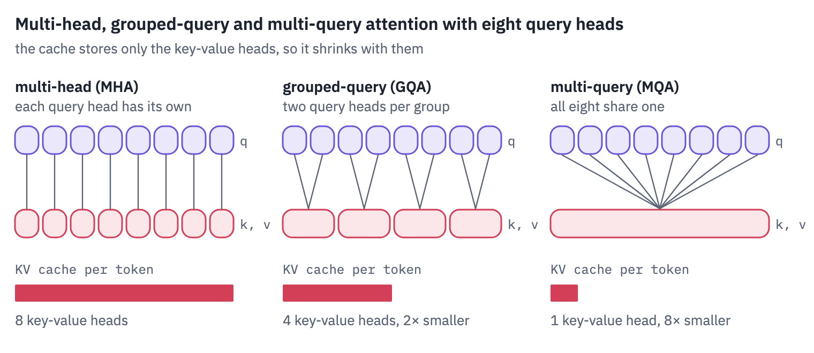
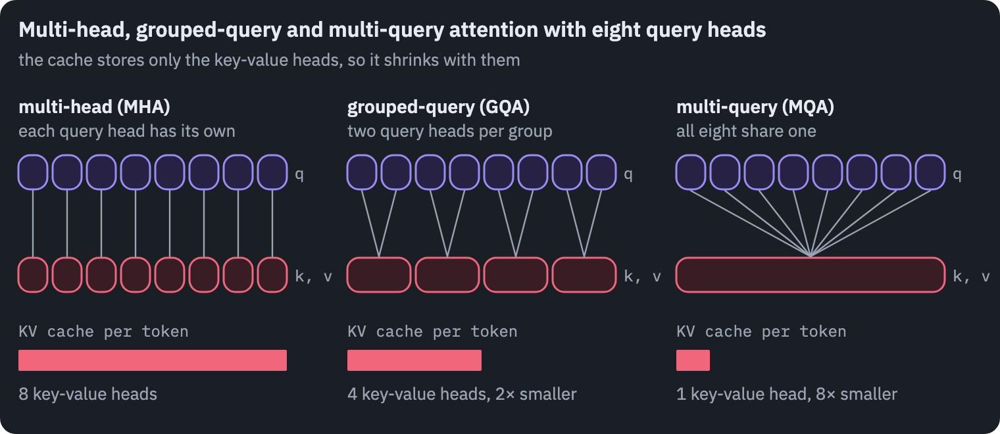

In code the sharing costs one line: before the scores are computed, each key-value head is repeated for the
query heads of its group. Query head $$h$$ reads key-value head $$\lfloor h / g \rfloor$$, where $$g = n_h / n_{kv}$$
is the size of a group.

```python
def grouped_attention(q, k, v, mask):
    group = q.shape[1] // k.shape[1]  # query heads per key-value head
    k = k.repeat_interleave(group, dim=1)  # heads 0..g-1 read key-value head 0, and so on
    v = v.repeat_interleave(group, dim=1)
    scores = q @ k.transpose(-1, -2) / math.sqrt(q.shape[-1])
    scores = scores.masked_fill(~mask, float("-inf"))
    return scores.softmax(dim=-1) @ v


q = torch.randn(1, 8, 5, 16)  # batch, query heads, tokens, head size
k = torch.randn(1, 2, 5, 16)  # two key-value heads: groups of four
v = torch.randn(1, 2, 5, 16)
mask = torch.ones(5, 5, dtype=torch.bool).tril()
ours = grouped_attention(q, k, v, mask)
reference = F.scaled_dot_product_attention(q, k, v, attn_mask=mask, enable_gqa=True)
print("output", tuple(ours.shape))
print("max difference from PyTorch's GQA:", (ours - reference).abs().max().item())
```

<pre class="tfs-printed" markdown="0"><code>output (1, 8, 5, 16)
max difference from PyTorch&#x27;s GQA: 2.384185791015625e-07</code></pre>

The repeat makes a copy for clarity; fused attention kernels such as FlashAttention read the shared head in place,
which is the point: in a group of $$g$$, every key and value read from memory serves $$g$$ query heads instead of
one. The cache is $$g$$ times smaller *and* each byte of it does $$g$$ times more work.

Why not take an existing model and share its heads? Ainslie et al. did exactly that, but they then trained the converted model further with 5% of its original pre-training compute, and they had a reason.

Here is GPT-2 small, twelve heads in each of twelve layers, forced to share: within each group of heads we replace every head's key and value projections by their average, the conversion the GQA paper found best, and measure the loss on Wikipedia text it has never seen. No training afterwards.

```python
gpt2 = GPT2LMHeadModel.from_pretrained("openai-community/gpt2").to(device).eval()
gpt2_tok = AutoTokenizer.from_pretrained("openai-community/gpt2")
WIKITEXT = "Salesforce/wikitext"
path = hf_hub_download(WIKITEXT, "wikitext-103-raw-v1/test-00000-of-00001.parquet",
                       repo_type="dataset")
wiki = "".join(pd.read_parquet(path)["text"].tolist())
wiki_ids = gpt2_tok(wiki[:200_000]).input_ids[:8 * 1024]
wiki_batch = torch.tensor(wiki_ids, device=device).view(8, 1024)
original = {name: value.clone() for name, value in gpt2.state_dict().items()}


def share_heads(model, kv_heads):
    d = model.config.n_embd
    heads = model.config.n_head
    size = heads // kv_heads  # query heads per group
    for block in model.transformer.h:
        weight = block.attn.c_attn.weight.data  # columns: queries | keys | values
        bias = block.attn.c_attn.bias.data
        for part in [1, 2]:  # keys, then values
            columns = slice(part * d, (part + 1) * d)
            w = weight[:, columns].view(d, heads, d // heads)
            b = bias[columns].view(heads, d // heads)
            for g in range(kv_heads):
                group = slice(g * size, (g + 1) * size)
                w[:, group] = w[:, group].mean(dim=1, keepdim=True)
                b[group] = b[group].mean(dim=0, keepdim=True)


shared = []
for kv_heads in [12, 6, 4, 3, 2, 1]:
    gpt2.load_state_dict(original)
    share_heads(gpt2, kv_heads)
    with torch.no_grad():
        loss = gpt2(wiki_batch, labels=wiki_batch).loss.item()
    shared.append({"key-value heads": kv_heads, "query heads per group": 12 // kv_heads,
                   "loss": loss, "perplexity": math.exp(loss)})
table(pd.DataFrame(shared))
```

<div class="tfs-table-wrap"><table class="tfs-table" style="border-collapse:collapse;font-family:'IBM Plex Sans', -apple-system, 'Segoe UI', Roboto, Helvetica, Arial, sans-serif;font-size:13.5px;line-height:1.45;margin:4px 0 8px;"><thead><tr><th style="padding:7px 14px;border-bottom:2px solid #B9C0CB;font-weight:600;color:#5B6575;font-size:12px;letter-spacing:0.02em;text-align:right;">key-value heads</th><th style="padding:7px 14px;border-bottom:2px solid #B9C0CB;font-weight:600;color:#5B6575;font-size:12px;letter-spacing:0.02em;text-align:right;">query heads per group</th><th style="padding:7px 14px;border-bottom:2px solid #B9C0CB;font-weight:600;color:#5B6575;font-size:12px;letter-spacing:0.02em;text-align:right;">loss</th><th style="padding:7px 14px;border-bottom:2px solid #B9C0CB;font-weight:600;color:#5B6575;font-size:12px;letter-spacing:0.02em;text-align:right;">perplexity</th></tr></thead><tbody><tr><td style="padding:7px 14px;border-bottom:1px solid #E6E9EE;vertical-align:top;text-align:right;font-variant-numeric:tabular-nums;max-width:460px;white-space:normal;">12</td><td style="padding:7px 14px;border-bottom:1px solid #E6E9EE;vertical-align:top;text-align:right;font-variant-numeric:tabular-nums;max-width:460px;white-space:normal;">1</td><td style="padding:7px 14px;border-bottom:1px solid #E6E9EE;vertical-align:top;text-align:right;font-variant-numeric:tabular-nums;max-width:460px;white-space:normal;">3.49</td><td style="padding:7px 14px;border-bottom:1px solid #E6E9EE;vertical-align:top;text-align:right;font-variant-numeric:tabular-nums;max-width:460px;white-space:normal;">32.65</td></tr><tr><td style="padding:7px 14px;border-bottom:1px solid #E6E9EE;vertical-align:top;text-align:right;font-variant-numeric:tabular-nums;max-width:460px;white-space:normal;">6</td><td style="padding:7px 14px;border-bottom:1px solid #E6E9EE;vertical-align:top;text-align:right;font-variant-numeric:tabular-nums;max-width:460px;white-space:normal;">2</td><td style="padding:7px 14px;border-bottom:1px solid #E6E9EE;vertical-align:top;text-align:right;font-variant-numeric:tabular-nums;max-width:460px;white-space:normal;">6.59</td><td style="padding:7px 14px;border-bottom:1px solid #E6E9EE;vertical-align:top;text-align:right;font-variant-numeric:tabular-nums;max-width:460px;white-space:normal;">728.08</td></tr><tr><td style="padding:7px 14px;border-bottom:1px solid #E6E9EE;vertical-align:top;text-align:right;font-variant-numeric:tabular-nums;max-width:460px;white-space:normal;">4</td><td style="padding:7px 14px;border-bottom:1px solid #E6E9EE;vertical-align:top;text-align:right;font-variant-numeric:tabular-nums;max-width:460px;white-space:normal;">3</td><td style="padding:7px 14px;border-bottom:1px solid #E6E9EE;vertical-align:top;text-align:right;font-variant-numeric:tabular-nums;max-width:460px;white-space:normal;">6.93</td><td style="padding:7px 14px;border-bottom:1px solid #E6E9EE;vertical-align:top;text-align:right;font-variant-numeric:tabular-nums;max-width:460px;white-space:normal;">1,025.99</td></tr><tr><td style="padding:7px 14px;border-bottom:1px solid #E6E9EE;vertical-align:top;text-align:right;font-variant-numeric:tabular-nums;max-width:460px;white-space:normal;">3</td><td style="padding:7px 14px;border-bottom:1px solid #E6E9EE;vertical-align:top;text-align:right;font-variant-numeric:tabular-nums;max-width:460px;white-space:normal;">4</td><td style="padding:7px 14px;border-bottom:1px solid #E6E9EE;vertical-align:top;text-align:right;font-variant-numeric:tabular-nums;max-width:460px;white-space:normal;">7.12</td><td style="padding:7px 14px;border-bottom:1px solid #E6E9EE;vertical-align:top;text-align:right;font-variant-numeric:tabular-nums;max-width:460px;white-space:normal;">1,238.80</td></tr><tr><td style="padding:7px 14px;border-bottom:1px solid #E6E9EE;vertical-align:top;text-align:right;font-variant-numeric:tabular-nums;max-width:460px;white-space:normal;">2</td><td style="padding:7px 14px;border-bottom:1px solid #E6E9EE;vertical-align:top;text-align:right;font-variant-numeric:tabular-nums;max-width:460px;white-space:normal;">6</td><td style="padding:7px 14px;border-bottom:1px solid #E6E9EE;vertical-align:top;text-align:right;font-variant-numeric:tabular-nums;max-width:460px;white-space:normal;">7.02</td><td style="padding:7px 14px;border-bottom:1px solid #E6E9EE;vertical-align:top;text-align:right;font-variant-numeric:tabular-nums;max-width:460px;white-space:normal;">1,113.92</td></tr><tr><td style="padding:7px 14px;border-bottom:1px solid #E6E9EE;vertical-align:top;text-align:right;font-variant-numeric:tabular-nums;max-width:460px;white-space:normal;">1</td><td style="padding:7px 14px;border-bottom:1px solid #E6E9EE;vertical-align:top;text-align:right;font-variant-numeric:tabular-nums;max-width:460px;white-space:normal;">12</td><td style="padding:7px 14px;border-bottom:1px solid #E6E9EE;vertical-align:top;text-align:right;font-variant-numeric:tabular-nums;max-width:460px;white-space:normal;">7.20</td><td style="padding:7px 14px;border-bottom:1px solid #E6E9EE;vertical-align:top;text-align:right;font-variant-numeric:tabular-nums;max-width:460px;white-space:normal;">1,342.50</td></tr></tbody></table></div>

Sharing ruins the model. With every head on its own, GPT-2 reads Wikipedia as well as it ever did.

Halve the key-value heads and its perplexity grows by more than an order of magnitude, and with fewer heads it stays about that bad. Each head of a trained model learned its own keys and values, and their average is none of them.

So a model is either trained with grouped queries from the start, as Llama 3 and most models after it were, or converted and then trained again.

Here is what it buys, for every model of section 1: the KV cache of one sequence of 32,768 tokens in 16-bit numbers, against the cache the same model would need with a key-value head for every query head. A local layer keeps only its window, and we count that too; section 7 explains it.

```python
def kv_cache_bytes(c, tokens, kv_heads=None, windows=True):
    if kv_heads is None:
        kv_heads = c["num_key_value_heads"]
    total = 0
    for kind in layer_kinds(c):
        local = windows and kind == "local"
        kept = min(tokens, c["sliding_window"]) if local else tokens
        total += 2 * kept * kv_heads * c["head_dim"] * 2  # keys and values, 2 bytes each
    return total


context = 32_768
names = [name for _, name, _ in MODELS]
actual = [kv_cache_bytes(configs[n], context) / 1e9 for n in names]
full = []
for n in names:
    every_head = configs[n]["num_attention_heads"]
    full.append(kv_cache_bytes(configs[n], context, every_head, windows=False) / 1e9)
fig, ax = plt.subplots(figsize=(7.6, 5.2))
y = np.arange(len(names))
ax.barh(y, full, color=COLORS["grid"],
        label="a key-value head for every query head, all global")
ax.barh(y, actual, color=COLORS["att"], label="as configured")
for k in range(len(names)):
    ax.text(actual[k] + 0.4, k, f"{actual[k]:.1f} GB", va="center",
            color=COLORS["muted"], fontsize=9)
ax.set_yticks(y, names)
ax.invert_yaxis()
ax.set_xlabel(f"KV cache of one sequence of {context:,} tokens, GB")
ax.set_title("What grouped queries and local layers save")
ax.legend(frameon=False, loc="upper center", bbox_to_anchor=(0.5, -0.12), ncol=2)
ax.grid(axis="x")
ax.grid(axis="y", visible=False)
plt.show()
```

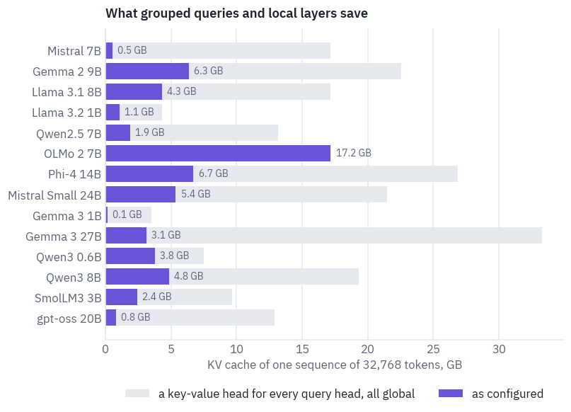

The grey bars are what these models would need with neither trick. Grouped queries alone cut the cache by the size of a group, two to eight times; local layers cut it further, and in Gemma 3 and gpt-oss the few global layers end up holding nearly all of it.

OLMo 2, with a key-value head for every query head and no local layers, needs the largest cache in the table, although it is far from the largest model.

And the claim this lesson opened with, checked: Llama 3.1 8B's cache at its full context of 131,072 tokens against
its weights, both in 16 bits.

```python
llama = configs["Llama 3.1 8B"]
metadata = HfApi().get_safetensors_metadata("unsloth/Meta-Llama-3.1-8B")
llama_params = sum(metadata.parameter_count.values())
print(f"weights: {llama_params * 2 / 1e9:.1f} GB")
print(f"KV cache at 131,072 tokens: {kv_cache_bytes(llama, 131_072) / 1e9:.1f} GB")
print(f"the same with a key-value head per query head: "
      f"{kv_cache_bytes(llama, 131_072, llama['num_attention_heads']) / 1e9:.1f} GB")
```

<pre class="tfs-printed" markdown="0"><code>weights: 16.1 GB
KV cache at 131,072 tokens: 17.2 GB
the same with a key-value head per query head: 68.7 GB</code></pre>

## 4. Training stability, QK-norm and soft-capping

The second pressure shows up during training, and it shows up late, which is what makes it expensive. In 2023 a Google team scaling a Vision Transformer to 22 billion parameters watched their 8-billion-parameter run diverge after a few thousand steps.

The cause was the attention scores: they grew without bound, the softmax over them turned into a one-hot vector, every head looked at a single token with an entropy near zero, and the loss went up <sup class="cite">[<a href="#ref-3" id="cite-3" data-ref="3" aria-label="Reference 3: Dehghani, M., Djolonga, J., Mustafa, B., et al. (2023). Scaling vision Transformers to 22 billion parameters. ICML 2023.">3</a>]</sup>.

The mechanism is easy to see in the formula. The score of query $$i$$ for key $$j$$ is

$$s_{ij} = \frac{q_i \cdot k_j}{\sqrt{d_h}}, \qquad q_i = W_Q x_i, \quad k_j = W_K x_j.$$

Both $$q$$ and $$k$$ grow with their weight matrices, so if training scales both $$W_Q$$ and $$W_K$$ by a factor
$$c$$, the scores grow by $$c^2$$. A softmax doesn't care about the scale of its inputs until it does: multiply
scores of 1, 2 and 3 by 30 and almost all the weight lands on the largest. Past that point the gradient through
the softmax vanishes for every other key, and a head that has collapsed onto one token has no way back.

Two fixes are in the table of section 1. *QK-norm* normalises each query and each key before the dot product, the same RMSNorm as everywhere else, with its own learned scale $$g$$.

Qwen3 and Gemma 3 apply it to one head's vector at a time, with one scale shared by the heads of a layer; OLMo 2 normalises the whole projection at once.

$$\hat q = g_q \odot \frac{q}{\text{rms}(q)}, \qquad \hat k = g_k \odot \frac{k}{\text{rms}(k)},$$

$$s_{ij} = \frac{\hat q_i \cdot \hat k_j}{\sqrt{d_h}}.$$

Now $$\lVert \hat q \rVert = \sqrt{d_h}$$ before the scale, and the score can only grow if training grows $$g_q$$
and $$g_k$$ themselves, slowly and in plain sight. *Soft-capping*, Gemma 2's fix, leaves the scores alone until
they get large and then bends them smoothly towards a ceiling $$c$$:

$$s \;\leftarrow\; c \cdot \tanh\!\left(\frac{s}{c}\right).$$

Gemma 2 used $$c = 50$$ in attention and $$c = 30$$ on the final logits, the scores of the vocabulary<sup class="cite">[<a href="#ref-4" id="cite-4" data-ref="4" aria-label="Reference 4: Gemma Team (2024). Gemma 2: improving open language models at a practical size. arXiv:2408.00118.">4</a>]</sup>.

```python
s = np.linspace(-150, 150, 601)
fig, ax = plt.subplots(figsize=(6.4, 3.2))
ax.plot(s, s, color=COLORS["line"], linestyle="--", label="no cap")
ax.plot(s, 50 * np.tanh(s / 50), color=COLORS["att"],
        label="50 · tanh(s / 50), Gemma 2's attention")
ax.plot(s, 30 * np.tanh(s / 30), color=COLORS["dec"],
        label="30 · tanh(s / 30), its final logits")
ax.set_ylim(-80, 80)
ax.set_xlabel("score before the cap")
ax.set_ylabel("score after")
ax.set_title("Soft-capping bends large scores towards a ceiling")
ax.legend(frameon=False, loc="upper left")
plt.show()
```

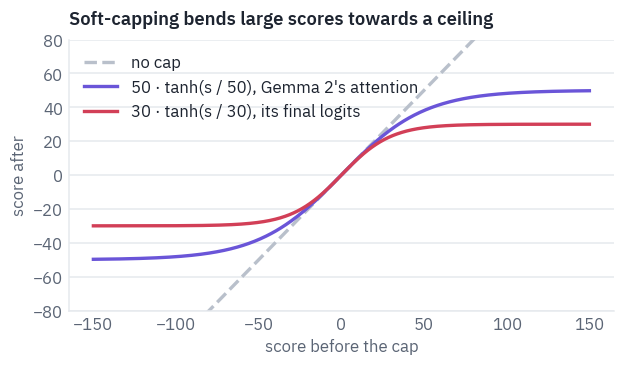

Gemma 3 dropped soft-capping in favour of QK-norm: "we replace the soft-capping of Gemma 2 with QK-norm"<sup class="cite">[<a href="#ref-5" id="cite-5" data-ref="5" aria-label="Reference 5: Gemma Team (2025). Gemma 3 technical report. arXiv:2503.19786.">5</a>]</sup>. The two are not equivalent: a cap only limits the score, while
QK-norm limits the vectors that make it, and leaves the model a learned scale to set how sharp attention may get.

You don't need 8 billion parameters to watch this happen. Wortsman et al. showed that the same instabilities "also appear in small models when training at high learning rates"<sup class="cite">[<a href="#ref-6" id="cite-6" data-ref="6" aria-label="Reference 6: Wortsman, M., Liu, P. J., Xiao, L., et al. (2023). Small-scale proxies for large-scale Transformer training instabilities. ICLR 2024.">6</a>]</sup>, and that turns a disaster costing millions into an experiment costing minutes.

Below is a small Transformer of the modern kind, six layers wide 384, reading Wikipedia byte by byte, with a switch for its attention: plain, with QK-norm, or with a soft cap at 50. It computes its scores by hand so that we can record the largest one in every layer as it trains.

```python
class Norm(nn.Module):
    def __init__(self, dim):
        super().__init__()
        self.weight = nn.Parameter(torch.ones(dim))

    def forward(self, x):
        return self.weight * x * torch.rsqrt(x.pow(2).mean(dim=-1, keepdim=True) + 1e-6)


def rope_rotate(x, theta=10000.0):
    t, d = x.shape[-2], x.shape[-1]
    inv_freq = 1.0 / theta ** (torch.arange(0, d, 2, device=x.device).float() / d)
    angles = torch.arange(t, device=x.device).float()[:, None] * inv_freq
    angles = torch.cat([angles, angles], dim=-1)
    half = d // 2
    rotated = torch.cat([-x[..., half:], x[..., :half]], dim=-1)
    return x * angles.cos() + rotated * angles.sin()


class TinyAttention(nn.Module):
    def __init__(self, d, heads, variant):
        super().__init__()
        self.heads, self.head_dim, self.variant = heads, d // heads, variant
        self.qkv = nn.Linear(d, 3 * d, bias=False)
        self.out = nn.Linear(d, d, bias=False)
        if variant == "QK-norm":
            self.q_norm = Norm(self.head_dim)
            self.k_norm = Norm(self.head_dim)
        self.peak = 0.0

    def forward(self, x):
        b, t, d = x.shape
        q, k, v = self.qkv(x).view(b, t, 3, self.heads, self.head_dim).unbind(dim=2)
        if self.variant == "QK-norm":
            q, k = self.q_norm(q), self.k_norm(k)
        q = rope_rotate(q.transpose(1, 2))
        k = rope_rotate(k.transpose(1, 2))
        v = v.transpose(1, 2)
        scores = q @ k.transpose(-1, -2) / math.sqrt(self.head_dim)
        causal = torch.ones(t, t, dtype=torch.bool, device=x.device).tril()
        self.peak = scores.detach().masked_fill(~causal, 0).abs().amax()
        if self.variant == "soft-cap":
            scores = 50 * torch.tanh(scores / 50)
        weights = scores.masked_fill(~causal, float("-inf")).softmax(dim=-1)
        return self.out((weights @ v).transpose(1, 2).reshape(b, t, d))


class TinyBlock(nn.Module):
    def __init__(self, d, heads, variant):
        super().__init__()
        self.norm1, self.norm2 = Norm(d), Norm(d)
        self.attention = TinyAttention(d, heads, variant)
        hidden = 1024
        self.gate = nn.Linear(d, hidden, bias=False)
        self.up = nn.Linear(d, hidden, bias=False)
        self.down = nn.Linear(hidden, d, bias=False)

    def forward(self, x):
        x = x + self.attention(self.norm1(x))
        h = self.norm2(x)
        return x + self.down(F.silu(self.gate(h)) * self.up(h))


class TinyLM(nn.Module):
    def __init__(self, variant, d=384, layers=6, heads=6):
        super().__init__()
        self.embed = nn.Embedding(256, d)  # one row per byte
        self.blocks = nn.ModuleList([TinyBlock(d, heads, variant) for _ in range(layers)])
        self.norm = Norm(d)
        self.head = nn.Linear(d, 256, bias=False)
        for module in self.modules():
            if isinstance(module, (nn.Linear, nn.Embedding)):
                nn.init.normal_(module.weight, std=0.02)

    def forward(self, x):
        h = self.embed(x)
        for block in self.blocks:
            h = block(h)
        return self.head(self.norm(h))
```

The training loop is lesson 4's: AdamW, a warm-up, a cosine decay, the gradient clipped at 1. The only thing we
turn is the peak learning rate.

```python
def wiki_bytes(split):
    name = f"wikitext-2-raw-v1/{split}-00000-of-00001.parquet"
    path = hf_hub_download(WIKITEXT, name, repo_type="dataset")
    text = "".join(pd.read_parquet(path)["text"].tolist())
    return torch.tensor(list(text.encode("utf-8")), dtype=torch.long)


train_bytes, valid_bytes = wiki_bytes("train"), wiki_bytes("validation")
STEPS = 30 if SMOKE else 600


def batch_of(data, generator, batch=32, length=256):
    starts = torch.randint(0, len(data) - length - 1, (batch,), generator=generator)
    x = torch.stack([data[s:s + length] for s in starts])
    y = torch.stack([data[s + 1:s + length + 1] for s in starts])
    return x.to(device), y.to(device)


def train_tiny(variant, peak_lr, steps=STEPS, warmup=100):
    torch.manual_seed(0)
    model = TinyLM(variant).to(device)
    optimizer = torch.optim.AdamW(model.parameters(), lr=peak_lr, betas=(0.9, 0.95),
                                  weight_decay=0.0)
    generator = torch.Generator().manual_seed(0)
    history = []
    for step in range(steps):
        if step < warmup:
            lr = peak_lr * (step + 1) / warmup
        else:
            progress = (step - warmup) / max(steps - warmup, 1)
            lr = peak_lr * (0.1 + 0.45 * (1 + math.cos(math.pi * progress)))
        for group in optimizer.param_groups:
            group["lr"] = lr
        x, y = batch_of(train_bytes, generator)
        loss = F.cross_entropy(model(x).flatten(0, 1), y.flatten())
        optimizer.zero_grad(set_to_none=True)
        loss.backward()
        torch.nn.utils.clip_grad_norm_(model.parameters(), 1.0)
        optimizer.step()
        if step % 5 == 0:
            peak = max(float(block.attention.peak) for block in model.blocks)
            history.append({"step": step, "loss": loss.item(), "peak score": peak})
    generator = torch.Generator().manual_seed(1)
    with torch.no_grad():
        losses = [F.cross_entropy(model(x).flatten(0, 1), y.flatten()).item()
                  for x, y in [batch_of(valid_bytes, generator) for _ in range(10)]]
    return pd.DataFrame(history), float(np.mean(losses))
```

```python
RATES = [3e-3, 3e-2] if SMOKE else [1e-3, 1e-2, 1e-1]
SHOWN = RATES[1]  # the rate whose run the right-hand plot follows
VARIANTS = ["plain", "QK-norm", "soft-cap"]
runs = {}
start = time.time()
for variant in VARIANTS:
    for rate in RATES:
        runs[variant, rate] = train_tiny(variant, rate)
print(f"{len(runs)} runs in {time.time() - start:.0f} s")
results = [{"attention": v, "peak learning rate": r, "validation loss": runs[v, r][1]}
           for v in VARIANTS for r in RATES]
table(pd.DataFrame(results).pivot(index="peak learning rate", columns="attention",
                                  values="validation loss").reset_index(), digits=3)
```

<pre class="tfs-printed" markdown="0"><code>9 runs in 1565 s</code></pre>

<div class="tfs-table-wrap"><table class="tfs-table" style="border-collapse:collapse;font-family:'IBM Plex Sans', -apple-system, 'Segoe UI', Roboto, Helvetica, Arial, sans-serif;font-size:13.5px;line-height:1.45;margin:4px 0 8px;"><thead><tr><th style="padding:7px 14px;border-bottom:2px solid #B9C0CB;font-weight:600;color:#5B6575;font-size:12px;letter-spacing:0.02em;text-align:right;">peak learning rate</th><th style="padding:7px 14px;border-bottom:2px solid #B9C0CB;font-weight:600;color:#5B6575;font-size:12px;letter-spacing:0.02em;text-align:right;">QK-norm</th><th style="padding:7px 14px;border-bottom:2px solid #B9C0CB;font-weight:600;color:#5B6575;font-size:12px;letter-spacing:0.02em;text-align:right;">plain</th><th style="padding:7px 14px;border-bottom:2px solid #B9C0CB;font-weight:600;color:#5B6575;font-size:12px;letter-spacing:0.02em;text-align:right;">soft-cap</th></tr></thead><tbody><tr><td style="padding:7px 14px;border-bottom:1px solid #E6E9EE;vertical-align:top;text-align:right;font-variant-numeric:tabular-nums;max-width:460px;white-space:normal;">0.001</td><td style="padding:7px 14px;border-bottom:1px solid #E6E9EE;vertical-align:top;text-align:right;font-variant-numeric:tabular-nums;max-width:460px;white-space:normal;">1.380</td><td style="padding:7px 14px;border-bottom:1px solid #E6E9EE;vertical-align:top;text-align:right;font-variant-numeric:tabular-nums;max-width:460px;white-space:normal;">1.428</td><td style="padding:7px 14px;border-bottom:1px solid #E6E9EE;vertical-align:top;text-align:right;font-variant-numeric:tabular-nums;max-width:460px;white-space:normal;">1.428</td></tr><tr><td style="padding:7px 14px;border-bottom:1px solid #E6E9EE;vertical-align:top;text-align:right;font-variant-numeric:tabular-nums;max-width:460px;white-space:normal;">0.010</td><td style="padding:7px 14px;border-bottom:1px solid #E6E9EE;vertical-align:top;text-align:right;font-variant-numeric:tabular-nums;max-width:460px;white-space:normal;">1.440</td><td style="padding:7px 14px;border-bottom:1px solid #E6E9EE;vertical-align:top;text-align:right;font-variant-numeric:tabular-nums;max-width:460px;white-space:normal;">1.994</td><td style="padding:7px 14px;border-bottom:1px solid #E6E9EE;vertical-align:top;text-align:right;font-variant-numeric:tabular-nums;max-width:460px;white-space:normal;">1.570</td></tr><tr><td style="padding:7px 14px;border-bottom:1px solid #E6E9EE;vertical-align:top;text-align:right;font-variant-numeric:tabular-nums;max-width:460px;white-space:normal;">0.100</td><td style="padding:7px 14px;border-bottom:1px solid #E6E9EE;vertical-align:top;text-align:right;font-variant-numeric:tabular-nums;max-width:460px;white-space:normal;">1.622</td><td style="padding:7px 14px;border-bottom:1px solid #E6E9EE;vertical-align:top;text-align:right;font-variant-numeric:tabular-nums;max-width:460px;white-space:normal;">2.692</td><td style="padding:7px 14px;border-bottom:1px solid #E6E9EE;vertical-align:top;text-align:right;font-variant-numeric:tabular-nums;max-width:460px;white-space:normal;">2.447</td></tr></tbody></table></div>

```python
fig, axes = plt.subplots(1, 2, figsize=(10, 3.6))
for variant, color in zip(VARIANTS, [COLORS["dec"], COLORS["enc"], COLORS["att"]]):
    finals = [runs[variant, rate][1] for rate in RATES]
    axes[0].plot(RATES, finals, marker="o", color=color, label=variant)
    history = runs[variant, SHOWN][0]
    axes[1].plot(history["step"], history["peak score"], color=color, label=variant)
axes[0].set_xscale("log")
axes[0].set_xlabel("peak learning rate")
axes[0].set_ylabel("validation loss, nats per byte")
axes[0].set_title("Final loss against learning rate")
axes[1].set_yscale("log")
axes[1].set_xlabel("step")
axes[1].set_ylabel("largest attention score")
axes[1].set_title(f"The largest score at a learning rate of {SHOWN:g}")
axes[0].legend(frameon=False)
plt.show()
```

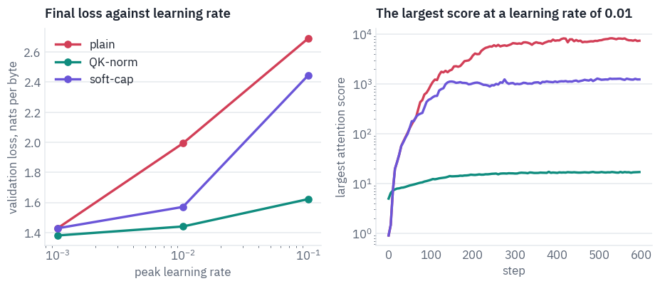

At the smallest learning rate the three models end close together. Raise it and they part: the plain model's loss
climbs fastest, soft-capping holds it back at the middle rate but not at the highest, and the model with QK-norm
barely notices, and is a little better even at the lowest rate.

The right-hand plot shows why. In the plain model the largest score grows by orders of magnitude within the first couple of hundred steps and stays there, so its softmax is nearly one-hot. With QK-norm it stays in the tens.

The soft-capped model's raw scores also grow far past the cap of 50, though less than the plain model's, and the cap only squashes them on the way into the softmax: past the ceiling the tanh is flat and passes back almost no gradient.

## 5. Qwen3 in PyTorch

Qwen3 is a family of eight models that Alibaba's Qwen team released in April 2025, from 0.6 to 235 billion parameters, six of them dense and two mixtures of experts, all under Apache 2.0 and trained on "36 trillion tokens" in "119 languages and dialects"<sup class="cite">[<a href="#ref-7" id="cite-7" data-ref="7" aria-label="Reference 7: Qwen Team (2025). Qwen3 technical report. arXiv:2505.09388.">7</a>]</sup>.

The report describes the dense models in two sentences: like Qwen2.5 they use grouped-query attention, SwiGLU, rotary positions and RMSNorm with pre-normalisation, and then "we remove QKV-bias used in Qwen2 […] and introduce QK-Norm […] to the attention mechanism to ensure stable training for Qwen3". That is the whole difference from the skeleton of section 2, and we already have every piece.

The smallest, Qwen3-0.6B, fits on a phone and runs comfortably on a T4. Its config:

```python
REPO = "Qwen/Qwen3-0.6B"
config = text_config(REPO)
keys = ["hidden_size", "num_hidden_layers", "num_attention_heads", "num_key_value_heads",
        "head_dim", "intermediate_size", "vocab_size", "rope_theta", "rms_norm_eps",
        "tie_word_embeddings"]
for key in keys:
    print(f"{key:22} {config[key]}")
```

<pre class="tfs-printed" markdown="0"><code>hidden_size            1024
num_hidden_layers      28
num_attention_heads    16
num_key_value_heads    8
head_dim               128
intermediate_size      3072
vocab_size             151936
rope_theta             1000000
rms_norm_eps           1e-06
tie_word_embeddings    True</code></pre>

The norm is RMSNorm, computed in 32-bit floats whatever the dtype of the model, as Qwen's code does; the same class
serves the residual stream and, applied to vectors of 128, the queries and keys.

```python
class RMSNorm(nn.Module):
    def __init__(self, dim, eps):
        super().__init__()
        self.eps = eps
        self.weight = nn.Parameter(torch.ones(dim))

    def forward(self, x):
        dtype = x.dtype
        x = x.float()
        x = x * torch.rsqrt(x.pow(2).mean(dim=-1, keepdim=True) + self.eps)
        return self.weight * x.to(dtype)
```

Rotary positions as in lesson 5 of the first course, in the convention Qwen's weights were trained with: the
vector is split into halves rather than interleaved pairs, so dimension $$i$$ is rotated together with dimension
$$i + d_h/2$$. With a base of a million, the slowest pair turns once every few million tokens. The tables of
cosines and sines are computed once per forward pass, for the positions of every row of the batch.

```python
def rope_tables(positions, head_dim, theta):
    exponents = torch.arange(0, head_dim, 2, device=positions.device).float() / head_dim
    inv_freq = 1.0 / theta ** exponents
    angles = positions.float()[..., None] * inv_freq
    angles = torch.cat([angles, angles], dim=-1)
    return angles.cos()[:, None], angles.sin()[:, None]  # shaped to broadcast over heads


def rotate(x, cos, sin):
    half = x.shape[-1] // 2
    rotated = torch.cat([-x[..., half:], x[..., :half]], dim=-1)
    return x * cos.to(x.dtype) + rotated * sin.to(x.dtype)
```

Attention puts sections 3 and 4 together. Queries take 16 heads of 128, keys and values 8: groups of two. QK-norm comes after the projection and before the rotation, one norm for all query heads and one for all key heads.

The cache stores keys and values with 8 heads, before they are repeated, which is where grouped queries save memory; the repeat happens on the way into the attention kernel. The attention itself is PyTorch's `scaled_dot_product_attention`, which on a GPU usually runs a fused kernel that never writes out the matrix of scores.

```python
class Cache:
    def __init__(self):
        self.k = None
        self.v = None

    def add(self, k, v):
        if self.k is not None:
            k = torch.cat([self.k, k], dim=2)
            v = torch.cat([self.v, v], dim=2)
        self.k, self.v = k, v
        return k, v


class Attention(nn.Module):
    def __init__(self, config):
        super().__init__()
        d = config["hidden_size"]
        self.heads = config["num_attention_heads"]
        self.kv_heads = config["num_key_value_heads"]
        self.head_dim = config["head_dim"]
        self.q_proj = nn.Linear(d, self.heads * self.head_dim, bias=False)
        self.k_proj = nn.Linear(d, self.kv_heads * self.head_dim, bias=False)
        self.v_proj = nn.Linear(d, self.kv_heads * self.head_dim, bias=False)
        self.o_proj = nn.Linear(self.heads * self.head_dim, d, bias=False)
        self.q_norm = RMSNorm(self.head_dim, config["rms_norm_eps"])
        self.k_norm = RMSNorm(self.head_dim, config["rms_norm_eps"])

    def forward(self, x, cos, sin, mask, cache=None):
        b, t, _ = x.shape
        q = self.q_proj(x).view(b, t, self.heads, self.head_dim)
        k = self.k_proj(x).view(b, t, self.kv_heads, self.head_dim)
        v = self.v_proj(x).view(b, t, self.kv_heads, self.head_dim)
        q = rotate(self.q_norm(q).transpose(1, 2), cos, sin)
        k = rotate(self.k_norm(k).transpose(1, 2), cos, sin)
        v = v.transpose(1, 2)
        if cache is not None:
            k, v = cache.add(k, v)
        group = self.heads // self.kv_heads
        k = k.repeat_interleave(group, dim=1)
        v = v.repeat_interleave(group, dim=1)
        out = F.scaled_dot_product_attention(q, k, v, attn_mask=mask)
        return self.o_proj(out.transpose(1, 2).reshape(b, t, -1))
```

The feed-forward network is SwiGLU with no biases, and the block is pre-norm with two residual connections. In
Qwen3-0.6B, 1.7B and 4B the last step multiplies by the embedding matrix itself, because they tie their input and
output embeddings; from 8B up the output matrix is a separate one, and the class takes either.

```python
class FeedForward(nn.Module):
    def __init__(self, config):
        super().__init__()
        d, hidden = config["hidden_size"], config["intermediate_size"]
        self.gate_proj = nn.Linear(d, hidden, bias=False)
        self.up_proj = nn.Linear(d, hidden, bias=False)
        self.down_proj = nn.Linear(hidden, d, bias=False)

    def forward(self, x):
        return self.down_proj(F.silu(self.gate_proj(x)) * self.up_proj(x))


class Block(nn.Module):
    def __init__(self, config):
        super().__init__()
        self.input_layernorm = RMSNorm(config["hidden_size"], config["rms_norm_eps"])
        self.self_attn = Attention(config)
        d, eps = config["hidden_size"], config["rms_norm_eps"]
        self.post_attention_layernorm = RMSNorm(d, eps)
        self.mlp = FeedForward(config)

    def forward(self, x, cos, sin, mask, cache=None):
        x = x + self.self_attn(self.input_layernorm(x), cos, sin, mask, cache)
        return x + self.mlp(self.post_attention_layernorm(x))


class Qwen3(nn.Module):
    def __init__(self, config):
        super().__init__()
        self.config = config
        self.embed_tokens = nn.Embedding(config["vocab_size"], config["hidden_size"])
        n_layers = config["num_hidden_layers"]
        self.layers = nn.ModuleList([Block(config) for _ in range(n_layers)])
        self.norm = RMSNorm(config["hidden_size"], config["rms_norm_eps"])
        self.tied = config.get("tie_word_embeddings", False)
        if not self.tied:  # Qwen3-8B and larger have an output matrix of their own
            d, vocab = config["hidden_size"], config["vocab_size"]
            self.lm_head = nn.Linear(d, vocab, bias=False)

    def hidden(self, ids, positions, mask, caches=None):
        x = self.embed_tokens(ids)
        c = self.config
        cos, sin = rope_tables(positions, c["head_dim"], c["rope_theta"])
        for i, layer in enumerate(self.layers):
            # one mask for all layers, or a list with one per layer (section 7)
            layer_mask = mask[i] if isinstance(mask, list) else mask
            cache = caches[i] if caches is not None else None
            x = layer(x, cos, sin, layer_mask, cache)
        return self.norm(x)

    def logits(self, h):
        if self.tied:
            return h @ self.embed_tokens.weight.T  # the output layer is the embeddings
        return self.lm_head(h)

    def forward(self, ids, positions, mask, caches=None):
        return self.logits(self.hidden(ids, positions, mask, caches))
```

## 6. The official weights in our code

We named our modules the way Qwen's checkpoint names its tensors, so the transplant is a matter of dropping the
prefix `model.`. The checkpoint of a tied model also stores `lm_head.weight`, an exact copy of the embedding
matrix that the model never needs, and we skip it; `load_state_dict` refuses anything else missing or left over.

```python
def load_qwen3(repo, dtype):
    config = text_config(repo)
    files = ["model.safetensors"]
    try:
        with open(hf_hub_download(repo, "model.safetensors.index.json")) as f:
            files = sorted(set(json.load(f)["weight_map"].values()))
    except Exception:
        pass  # a small model comes in one file
    state = {}
    for name in files:
        state.update(load_file(hf_hub_download(repo, name)))
    renamed = {}
    for key, value in state.items():
        if key == "lm_head.weight" and config.get("tie_word_embeddings", False):
            continue  # a copy of the embeddings
        renamed[key.removeprefix("model.")] = value.to(dtype)
    with torch.device("meta"):  # no memory for the random weights we are about to replace
        model = Qwen3(config)
    model.load_state_dict(renamed, strict=True, assign=True)
    return model.to(device).eval()


model = load_qwen3(REPO, torch.float32)
tok = AutoTokenizer.from_pretrained(REPO)
state = load_file(hf_hub_download(REPO, "model.safetensors"))
same = torch.equal(state["lm_head.weight"], state["model.embed_tokens.weight"])
print("lm_head equals the embeddings:", same)
del state
```

<pre class="tfs-printed" markdown="0"><code>lm_head equals the embeddings: True</code></pre>

Where are the 596 million parameters? Not where you'd guess from a large model.

```python
parts = {"embeddings (tied)": 0, "attention": 0, "QK-norm": 0, "feed-forward": 0,
         "other norms": 0}
for name, p in model.named_parameters():
    if name.startswith("embed_tokens"):
        parts["embeddings (tied)"] += p.numel()
    elif "q_norm" in name or "k_norm" in name:
        parts["QK-norm"] += p.numel()
    elif "self_attn" in name:
        parts["attention"] += p.numel()
    elif "mlp" in name:
        parts["feed-forward"] += p.numel()
    else:
        parts["other norms"] += p.numel()
total = sum(parts.values())
table(pd.DataFrame({"part": list(parts), "parameters": list(parts.values()),
                    "share": [f"{n / total:.1%}" for n in parts.values()]}))
```

<div class="tfs-table-wrap"><table class="tfs-table" style="border-collapse:collapse;font-family:'IBM Plex Sans', -apple-system, 'Segoe UI', Roboto, Helvetica, Arial, sans-serif;font-size:13.5px;line-height:1.45;margin:4px 0 8px;"><thead><tr><th style="padding:7px 14px;border-bottom:2px solid #B9C0CB;font-weight:600;color:#5B6575;font-size:12px;letter-spacing:0.02em;text-align:left;">part</th><th style="padding:7px 14px;border-bottom:2px solid #B9C0CB;font-weight:600;color:#5B6575;font-size:12px;letter-spacing:0.02em;text-align:right;">parameters</th><th style="padding:7px 14px;border-bottom:2px solid #B9C0CB;font-weight:600;color:#5B6575;font-size:12px;letter-spacing:0.02em;text-align:left;">share</th></tr></thead><tbody><tr><td style="padding:7px 14px;border-bottom:1px solid #E6E9EE;vertical-align:top;text-align:left;max-width:460px;white-space:normal;">embeddings (tied)</td><td style="padding:7px 14px;border-bottom:1px solid #E6E9EE;vertical-align:top;text-align:right;font-variant-numeric:tabular-nums;max-width:460px;white-space:normal;">155,582,464</td><td style="padding:7px 14px;border-bottom:1px solid #E6E9EE;vertical-align:top;text-align:left;max-width:460px;white-space:normal;">26.1%</td></tr><tr><td style="padding:7px 14px;border-bottom:1px solid #E6E9EE;vertical-align:top;text-align:left;max-width:460px;white-space:normal;">attention</td><td style="padding:7px 14px;border-bottom:1px solid #E6E9EE;vertical-align:top;text-align:right;font-variant-numeric:tabular-nums;max-width:460px;white-space:normal;">176,160,768</td><td style="padding:7px 14px;border-bottom:1px solid #E6E9EE;vertical-align:top;text-align:left;max-width:460px;white-space:normal;">29.6%</td></tr><tr><td style="padding:7px 14px;border-bottom:1px solid #E6E9EE;vertical-align:top;text-align:left;max-width:460px;white-space:normal;">QK-norm</td><td style="padding:7px 14px;border-bottom:1px solid #E6E9EE;vertical-align:top;text-align:right;font-variant-numeric:tabular-nums;max-width:460px;white-space:normal;">7,168</td><td style="padding:7px 14px;border-bottom:1px solid #E6E9EE;vertical-align:top;text-align:left;max-width:460px;white-space:normal;">0.0%</td></tr><tr><td style="padding:7px 14px;border-bottom:1px solid #E6E9EE;vertical-align:top;text-align:left;max-width:460px;white-space:normal;">feed-forward</td><td style="padding:7px 14px;border-bottom:1px solid #E6E9EE;vertical-align:top;text-align:right;font-variant-numeric:tabular-nums;max-width:460px;white-space:normal;">264,241,152</td><td style="padding:7px 14px;border-bottom:1px solid #E6E9EE;vertical-align:top;text-align:left;max-width:460px;white-space:normal;">44.3%</td></tr><tr><td style="padding:7px 14px;border-bottom:1px solid #E6E9EE;vertical-align:top;text-align:left;max-width:460px;white-space:normal;">other norms</td><td style="padding:7px 14px;border-bottom:1px solid #E6E9EE;vertical-align:top;text-align:right;font-variant-numeric:tabular-nums;max-width:460px;white-space:normal;">58,368</td><td style="padding:7px 14px;border-bottom:1px solid #E6E9EE;vertical-align:top;text-align:left;max-width:460px;white-space:normal;">0.0%</td></tr></tbody></table></div>

About a quarter of the model is the embedding table, 151,936 rows of 1,024 numbers, one row per token, used twice: at the input and, tied, at the output.

Attention has a larger share than in older models because its heads are wider than the model itself. QK-norm adds a few thousand parameters, next to nothing for what section 4 showed it does.

The check, as in every lesson: the same tokens through our model and through Hugging Face's, in 32-bit floats.

```python
reference = AutoModelForCausalLM.from_pretrained(REPO, dtype=torch.float32)
reference = reference.to(device).eval()
text = ("The Rhine rises in the Swiss Alps, flows through Lake Constance and along "
        "the French–German border, and reaches the North Sea through a delta in the "
        "Netherlands.")
ids = tok(text, return_tensors="pt").input_ids.to(device)
t = ids.shape[1]
positions = torch.arange(t, device=device)[None]
causal = torch.ones(t, t, dtype=torch.bool, device=device).tril()
with torch.no_grad():
    ours = model(ids, positions, causal)
    theirs = reference(ids).logits
print("tokens:", t)
print("largest logit:", f"{theirs.abs().max().item():.2f}")
print("max difference:", f"{(ours - theirs).abs().max().item():.2e}")
del reference
```

<pre class="tfs-printed" markdown="0"><code>tokens: 34
largest logit: 24.74
max difference: 6.96e-05</code></pre>

Our model and Hugging Face's agree to within the rounding of 32-bit arithmetic, so the transplant is exact: the
classes above are all there is to Qwen3.

Generation is lesson 4's loop, extended to a batch of prompts of different lengths. The prompts are padded on the left, so that every row's last token is in the same column; padding gets no attention, and positions are counted from each row's first real token.

Every token is allowed to see itself, so that a row of pure padding never ends up with nothing to attend to, which would fill it with NaN.

```python
@torch.no_grad()
def generate(model, prompts, max_new_tokens, stop_id, prefix=None):
    b = len(prompts)
    width = max(len(p) for p in prompts)
    ids = torch.full((b, width), stop_id, device=device)
    real = torch.zeros(b, width, dtype=torch.bool, device=device)
    for i, p in enumerate(prompts):
        ids[i, width - len(p):] = torch.tensor(p, device=device)
        real[i, width - len(p):] = True
    caches = [Cache() for _ in model.layers]
    start = 0
    if prefix is not None:  # section 8: keys and values of a shared start, computed once
        for cache, (k, v) in zip(caches, prefix["kv"]):
            cache.k, cache.v = k.expand(b, -1, -1, -1), v.expand(b, -1, -1, -1)
        start = prefix["length"]
        shared = torch.ones(b, start, dtype=torch.bool, device=device)
        real = torch.cat([shared, real], dim=1)
    positions = (real.long().cumsum(dim=1) - 1).clamp(min=0)[:, start:]
    causal = torch.ones(width, start + width, dtype=torch.bool, device=device)
    causal = causal.tril(diagonal=start)
    itself = torch.zeros(width, start + width, dtype=torch.bool, device=device)
    itself[torch.arange(width), start + torch.arange(width)] = True
    mask = (causal & real[:, None, None, :]) | itself
    h = model.hidden(ids, positions, mask, caches)
    next_ids = model.logits(h[:, -1]).argmax(dim=-1)
    written = [next_ids]
    done = next_ids == stop_id
    position = positions[:, -1]
    for _ in range(max_new_tokens - 1):
        if bool(done.all()):
            break
        position = position + 1
        real = torch.cat([real, torch.ones(b, 1, dtype=torch.bool, device=device)], dim=1)
        mask = real[:, None, None, :]
        h = model.hidden(next_ids[:, None], position[:, None], mask, caches)
        next_ids = model.logits(h[:, -1]).argmax(dim=-1)
        next_ids = torch.where(done, torch.full_like(next_ids, stop_id), next_ids)
        written.append(next_ids)
        done = done | (next_ids == stop_id)
    rows = []
    for row in torch.stack(written, dim=1).tolist():
        rows.append(row[:row.index(stop_id)] if stop_id in row else row)
    return rows
```

Qwen3 is one model with two modes. In thinking mode it first writes its reasoning between `<think>` and `</think>`,
then the answer; in non-thinking mode the chat template inserts an empty `<think></think>` and the model answers at
once. The template is part of the tokenizer, so the switch is one argument:

```python
IM_END = tok.convert_tokens_to_ids("<|im_end|>")
question = ("Lena is three years older than Max. In five years their ages will add up "
            "to 41. How old is Max now?")
messages = [{"role": "user", "content": question}]
for thinking in [False, True]:
    prompt = tok.apply_chat_template(messages, tokenize=False, add_generation_prompt=True,
                                     enable_thinking=thinking)
    written = generate(model, [tok(prompt).input_ids], 2000 if thinking else 400, IM_END)[0]
    answer = tok.decode(written)
    print(f"--- thinking {'on' if thinking else 'off'}, {len(written)} tokens")
    print(answer if len(answer) < 1500 else answer[:700] + "\n[…]\n" + answer[-500:])
```

<pre class="tfs-printed" markdown="0"><code>--- thinking off, 211 tokens
We are given:

- Lena is **three years older** than Max.
- In **five years**, their **ages will add up to 41**.

Let’s define:

- Let Max’s current age be $ x $.
- Then Lena’s current age is $ x + 3 $.

In **five years**, their ages will be:

- Max: $ x + 5 $
- Lena: $ x + 3 + 5 = x + 8 $

So, their ages in five years add up to:

$$
(x + 5) + (x + 8) = 2x + 13
$$

We are told this sum is 41:

$$
2x + 13 = 41
$$

Subtract 13 from both sides:

$$
2x = 28
$$

Divide by 2:

$$
x = 14
$$

### ✅ Final Answer:
Max is **14 years old now**.
--- thinking on, 1576 tokens
&lt;think&gt;
Okay, let&#x27;s see. Lena is three years older than Max. So if I let Max&#x27;s current age be something, then Lena&#x27;s age would be Max&#x27;s age plus three. Let me write that down.

Let me assign variables. Let M represent Max&#x27;s current age. Then Lena&#x27;s age would be M + 3. 

Now, the problem says that in five years, their ages will add up to 41. So I need to figure out their ages in five years and then set up an equation. 

In five years, Max&#x27;s age will be M + 5, and Lena&#x27;s age will be (M + 3) + 5. Let me calculate that. 

So adding those together: (M + 5) + (M + 3 + 5) = 41. Wait, maybe I should just add them directly. 

Alternatively, maybe I can write it as (M + 5) + (M + 3 + 5) = 41. Let me c
[…]
herefore, we can set up the equation:

$$
(M + 5) + (M + 8) = 41
$$

Simplifying:

$$
2M + 13 = 41
$$

Subtract 13 from both sides:

$$
2M = 28
$$

Divide by 2:

$$
M = 14
$$

---

**Verification:**

- Max&#x27;s current age: $ 14 $
- Lena&#x27;s current age: $ 14 + 3 = 17 $
- In five years: Max will be $ 14 + 5 = 19 $, and Lena will be $ 17 + 5 = 22 $
- Sum of their ages in five years: $ 19 + 22 = 41 $, which matches the problem statement.

---

**Final Answer:**

Max is currently $\boxed{14}$ years old.</code></pre>

Both answers are right. Without thinking the model writes a tidy solution at once. With thinking it first talks to itself for several times as many tokens, sets up the equation, doubts it, sets it up again and checks the result, and only then writes the same answer.

On a problem this easy the thinking buys nothing; it pays on problems where the first attempt goes wrong, and either way it is paid for in tokens.

## 7. Sliding-window attention and local layers

Grouped queries shrink the cache per token; a sliding window caps the number of tokens. In a *local* layer each
token attends only to the last $$W$$ tokens, itself included:

$$\text{token } i \text{ sees token } j \quad \Longleftrightarrow \quad i - W < j \le i.$$

Mistral 7B, in September 2023, gave every layer a window of 4,096 tokens and pointed out that the window is not a
horizon: layer 2 sees layer 1's outputs, each of which already summarises a window, so information travels about
$$W$$ tokens further back with every layer ($$W - 1$$ with our mask; Mistral's paper lets a position see the $$W$$
tokens before itself). "At the last layer, using a window size of W=4096, we have a theoretical attention span of
approximately 131K tokens"<sup class="cite">[<a href="#ref-8" id="cite-8" data-ref="8" aria-label="Reference 8: Jiang, A. Q., Sablayrolles, A., Mensch, A., et al. (2023). Mistral 7B. arXiv:2310.06825.">8</a>]</sup>. Its cache never holds more
than $$W$$ tokens: a *rolling buffer* writes token $$i$$ into slot $$i \bmod W$$, over the token that has just left
the window, and on a 32k-token sequence "this reduces the cache memory usage by 8x, without impacting the model
quality".


The rolling buffer is a few lines on top of our `Cache`. It keeps at most $$W$$ keys and values; it doesn't even
need to keep them in order, because a token's position is already rotated into its key and attention doesn't care
where in memory a key sits.

```python
class RollingCache:
    def __init__(self, window):
        self.window = window
        self.k = None
        self.v = None
        self.seen = 0  # tokens written so far

    def add(self, k, v):
        for i in range(k.shape[2]):  # one token at a time, as during generation
            slot = self.seen % self.window
            if self.k is None:
                self.k = k[:, :, i:i + 1]
                self.v = v[:, :, i:i + 1]
            elif self.k.shape[2] < self.window:
                self.k = torch.cat([self.k, k[:, :, i:i + 1]], dim=2)
                self.v = torch.cat([self.v, v[:, :, i:i + 1]], dim=2)
            else:
                self.k[:, :, slot] = k[:, :, i]
                self.v[:, :, slot] = v[:, :, i]
            self.seen += 1
        return self.k, self.v
```

Two ways of computing the same thing must give the same answer: Qwen3 reading a text with a window of 16 in every
layer, once with the full causal cache and a banded mask, once token by token with a rolling buffer of 16 slots
and no mask at all. Qwen3 was not trained with a window, but the arithmetic doesn't know that.

```python
W = 16
t = ids.shape[1]
i = torch.arange(t, device=device)
band = (i[None, :] <= i[:, None]) & (i[:, None] - i[None, :] < W)
with torch.no_grad():
    banded = model(ids, positions, band)
    caches = [RollingCache(W) for _ in model.layers]
    stepwise = []
    for step in range(t):
        keys = min(step + 1, W)
        everything = torch.ones(1, 1, 1, keys, dtype=torch.bool, device=device)
        token, where = ids[:, step:step + 1], positions[:, step:step + 1]
        stepwise.append(model(token, where, everything, caches))
    stepwise = torch.cat(stepwise, dim=1)
print("tokens:", t, "window:", W, "slots in each cache:", caches[0].k.shape[2])
print("max difference:", f"{(banded - stepwise).abs().max().item():.2e}")
```

<pre class="tfs-printed" markdown="0"><code>tokens: 34 window: 16 slots in each cache: 16
max difference: 1.01e-04</code></pre>

The two agree to rounding error, and the buffer never holds more than its 16 slots: a rolling cache is another way
of storing what the banded mask lets each token see.

Gemma 2 made local attention common again: it alternated local and global layers, one to one.

Gemma 3 went to five local layers for every global one with a window of 1,024 (512 in the 1B model, says its config), Ministral 8B to three for every global one with a window of 32,768, and gpt-oss alternates again with a window of only 128 tokens.

The global layers carry information across the whole context; the local ones, half of the layers or more, cost a fixed amount of memory however long the context grows. Here are the layers of every model of section 1 that has local ones:

```python
mixed = [name for name in names if "local" in layer_kinds(configs[name])]
longest = max(configs[n]["num_hidden_layers"] for n in mixed)
fig, ax = plt.subplots(figsize=(9.6, 0.42 * len(mixed) + 1.0))
for row, name in enumerate(mixed):
    for layer, kind in enumerate(layer_kinds(configs[name])):
        color = COLORS["att"] if kind == "global" else COLORS["att_tint"]
        cell = plt.Rectangle((layer, row - 0.36), 0.86, 0.72, color=color, linewidth=0)
        ax.add_patch(cell)
    window = configs[name]["sliding_window"]
    ax.text(longest + 0.8, row, f"window {window:,}", va="center",
            color=COLORS["muted"], fontsize=9)
ax.set_xlim(-0.5, longest + 9)
ax.set_ylim(len(mixed) - 0.4, -0.6)
ax.set_yticks(range(len(mixed)), mixed)
ax.set_xlabel("layer (dark: global attention, light: local)")
ax.set_title("Where the global layers are")
ax.grid(False)
ax.spines["left"].set_visible(False)
ax.spines["bottom"].set_visible(False)
plt.show()
```

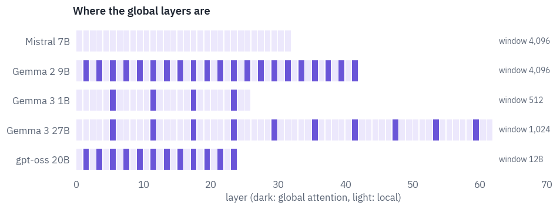

How much does a model lose when most of its layers stop seeing far? Gemma's authors answer for models trained that way: "We observe minimal impact on perplexity when changing this ratio", and "the sliding window can be reduced significantly without impacting perplexity".

We can ask a different question, of a model trained without any window: what happens to Qwen3 if we impose one?

We take a dozen Wikipedia articles of at least 4,096 tokens and measure the loss of predicting each token, averaged by its position, under several masks: global attention everywhere, as trained; a window of 512 in every layer; Gemma 3's pattern, five local layers of 512 and then one global; and the same two with the first four tokens of the text kept visible to every layer, for a reason the results will make clear.

```python
articles, current = [], []
for line in pd.read_parquet(path)["text"].tolist():
    # a new top-level heading, " = Title = ", starts an article
    if re.match(r"^ = [^=].* = \n$", line) and current:
        articles.append("".join(current))
        current = []
    current.append(line)
articles.append("".join(current))
LENGTH = 1024 if SMOKE else 4096
long_texts = []
for article in articles:
    article_ids = tok(article).input_ids
    if len(article_ids) >= LENGTH:
        long_texts.append(article_ids[:LENGTH])
long_texts = long_texts[:2 if SMOKE else 12]
print(len(long_texts), "articles of", LENGTH, "tokens")
```

<pre class="tfs-printed" markdown="0"><code>12 articles of 4096 tokens</code></pre>

```python
n_layers = config["num_hidden_layers"]
i = torch.arange(LENGTH, device=device)
causal = i[None, :] <= i[:, None]


def window_mask(window, sink=0):
    mask = causal & (i[:, None] - i[None, :] < window)
    if sink:
        mask = mask | (causal & (i[None, :] < sink))  # the first `sink` tokens stay visible
    return mask


def local_global(window, sink=0):
    local = window_mask(window, sink)
    return [causal if (k + 1) % 6 == 0 else local for k in range(n_layers)]


SETUPS = {
    "global everywhere (as trained)": [causal] * n_layers,
    "window of 512 everywhere": [window_mask(512)] * n_layers,
    "5 local : 1 global": local_global(512),
    "window of 512 + first 4 tokens": [window_mask(512, sink=4)] * n_layers,
    "5 local : 1 global + first 4 tokens": local_global(512, sink=4),
}
by_position = {}
for name, masks in SETUPS.items():
    total = torch.zeros(LENGTH - 1, device=device)
    for article_ids in long_texts:
        x = torch.tensor([article_ids], device=device)
        with torch.no_grad():
            h = model.hidden(x, i[None], masks)
            logits = model.logits(h[0, :-1]).float()
        total += F.cross_entropy(logits, x[0, 1:], reduction="none")
    by_position[name] = (total / len(long_texts)).cpu().numpy()

edges = [e for e in [0, 512, 1024, 2048] if e < LENGTH - 1] + [LENGTH - 1]
summary = []
for name, losses in by_position.items():
    row = {"attention": name}
    for lo, hi in zip(edges[:-1], edges[1:]):
        row[f"tokens {lo}–{hi}"] = losses[lo:hi].mean()
    summary.append(row)
table(pd.DataFrame(summary), digits=3)
```

<div class="tfs-table-wrap"><table class="tfs-table" style="border-collapse:collapse;font-family:'IBM Plex Sans', -apple-system, 'Segoe UI', Roboto, Helvetica, Arial, sans-serif;font-size:13.5px;line-height:1.45;margin:4px 0 8px;"><thead><tr><th style="padding:7px 14px;border-bottom:2px solid #B9C0CB;font-weight:600;color:#5B6575;font-size:12px;letter-spacing:0.02em;text-align:left;">attention</th><th style="padding:7px 14px;border-bottom:2px solid #B9C0CB;font-weight:600;color:#5B6575;font-size:12px;letter-spacing:0.02em;text-align:right;">tokens 0–512</th><th style="padding:7px 14px;border-bottom:2px solid #B9C0CB;font-weight:600;color:#5B6575;font-size:12px;letter-spacing:0.02em;text-align:right;">tokens 512–1024</th><th style="padding:7px 14px;border-bottom:2px solid #B9C0CB;font-weight:600;color:#5B6575;font-size:12px;letter-spacing:0.02em;text-align:right;">tokens 1024–2048</th><th style="padding:7px 14px;border-bottom:2px solid #B9C0CB;font-weight:600;color:#5B6575;font-size:12px;letter-spacing:0.02em;text-align:right;">tokens 2048–4095</th></tr></thead><tbody><tr><td style="padding:7px 14px;border-bottom:1px solid #E6E9EE;vertical-align:top;text-align:left;max-width:460px;white-space:normal;">global everywhere (as trained)</td><td style="padding:7px 14px;border-bottom:1px solid #E6E9EE;vertical-align:top;text-align:right;font-variant-numeric:tabular-nums;max-width:460px;white-space:normal;">3.066</td><td style="padding:7px 14px;border-bottom:1px solid #E6E9EE;vertical-align:top;text-align:right;font-variant-numeric:tabular-nums;max-width:460px;white-space:normal;">2.981</td><td style="padding:7px 14px;border-bottom:1px solid #E6E9EE;vertical-align:top;text-align:right;font-variant-numeric:tabular-nums;max-width:460px;white-space:normal;">2.935</td><td style="padding:7px 14px;border-bottom:1px solid #E6E9EE;vertical-align:top;text-align:right;font-variant-numeric:tabular-nums;max-width:460px;white-space:normal;">2.812</td></tr><tr><td style="padding:7px 14px;border-bottom:1px solid #E6E9EE;vertical-align:top;text-align:left;max-width:460px;white-space:normal;">window of 512 everywhere</td><td style="padding:7px 14px;border-bottom:1px solid #E6E9EE;vertical-align:top;text-align:right;font-variant-numeric:tabular-nums;max-width:460px;white-space:normal;">3.066</td><td style="padding:7px 14px;border-bottom:1px solid #E6E9EE;vertical-align:top;text-align:right;font-variant-numeric:tabular-nums;max-width:460px;white-space:normal;">6.366</td><td style="padding:7px 14px;border-bottom:1px solid #E6E9EE;vertical-align:top;text-align:right;font-variant-numeric:tabular-nums;max-width:460px;white-space:normal;">6.085</td><td style="padding:7px 14px;border-bottom:1px solid #E6E9EE;vertical-align:top;text-align:right;font-variant-numeric:tabular-nums;max-width:460px;white-space:normal;">6.009</td></tr><tr><td style="padding:7px 14px;border-bottom:1px solid #E6E9EE;vertical-align:top;text-align:left;max-width:460px;white-space:normal;">5 local : 1 global</td><td style="padding:7px 14px;border-bottom:1px solid #E6E9EE;vertical-align:top;text-align:right;font-variant-numeric:tabular-nums;max-width:460px;white-space:normal;">3.066</td><td style="padding:7px 14px;border-bottom:1px solid #E6E9EE;vertical-align:top;text-align:right;font-variant-numeric:tabular-nums;max-width:460px;white-space:normal;">5.604</td><td style="padding:7px 14px;border-bottom:1px solid #E6E9EE;vertical-align:top;text-align:right;font-variant-numeric:tabular-nums;max-width:460px;white-space:normal;">5.734</td><td style="padding:7px 14px;border-bottom:1px solid #E6E9EE;vertical-align:top;text-align:right;font-variant-numeric:tabular-nums;max-width:460px;white-space:normal;">5.543</td></tr><tr><td style="padding:7px 14px;border-bottom:1px solid #E6E9EE;vertical-align:top;text-align:left;max-width:460px;white-space:normal;">window of 512 + first 4 tokens</td><td style="padding:7px 14px;border-bottom:1px solid #E6E9EE;vertical-align:top;text-align:right;font-variant-numeric:tabular-nums;max-width:460px;white-space:normal;">3.066</td><td style="padding:7px 14px;border-bottom:1px solid #E6E9EE;vertical-align:top;text-align:right;font-variant-numeric:tabular-nums;max-width:460px;white-space:normal;">3.058</td><td style="padding:7px 14px;border-bottom:1px solid #E6E9EE;vertical-align:top;text-align:right;font-variant-numeric:tabular-nums;max-width:460px;white-space:normal;">3.137</td><td style="padding:7px 14px;border-bottom:1px solid #E6E9EE;vertical-align:top;text-align:right;font-variant-numeric:tabular-nums;max-width:460px;white-space:normal;">3.042</td></tr><tr><td style="padding:7px 14px;border-bottom:1px solid #E6E9EE;vertical-align:top;text-align:left;max-width:460px;white-space:normal;">5 local : 1 global + first 4 tokens</td><td style="padding:7px 14px;border-bottom:1px solid #E6E9EE;vertical-align:top;text-align:right;font-variant-numeric:tabular-nums;max-width:460px;white-space:normal;">3.066</td><td style="padding:7px 14px;border-bottom:1px solid #E6E9EE;vertical-align:top;text-align:right;font-variant-numeric:tabular-nums;max-width:460px;white-space:normal;">3.057</td><td style="padding:7px 14px;border-bottom:1px solid #E6E9EE;vertical-align:top;text-align:right;font-variant-numeric:tabular-nums;max-width:460px;white-space:normal;">3.127</td><td style="padding:7px 14px;border-bottom:1px solid #E6E9EE;vertical-align:top;text-align:right;font-variant-numeric:tabular-nums;max-width:460px;white-space:normal;">3.030</td></tr></tbody></table></div>

```python
fig, ax = plt.subplots(figsize=(8, 3.8))
colors = [COLORS["ink"], COLORS["dec"], COLORS["data"], COLORS["att"], COLORS["enc"]]
for (name, losses), color in zip(by_position.items(), colors):
    smooth = np.convolve(losses, np.ones(64) / 64, mode="valid")
    ax.plot(np.arange(len(smooth)) + 32, smooth, color=color, label=name, linewidth=1.4)
ax.axvline(512, color=COLORS["line"], linestyle="--")
ax.text(530, 0.5, "the window ends", color=COLORS["muted"], fontsize=9, va="center",
        transform=ax.get_xaxis_transform())
ax.set_xlabel("position of the predicted token")
ax.set_ylabel("loss, averaged over 64 positions")
ax.set_title("Qwen3-0.6B with windows it was never trained with")
ax.legend(frameon=False, fontsize=8.5, loc="upper center", bbox_to_anchor=(0.5, -0.2),
          ncol=2)
plt.show()
```

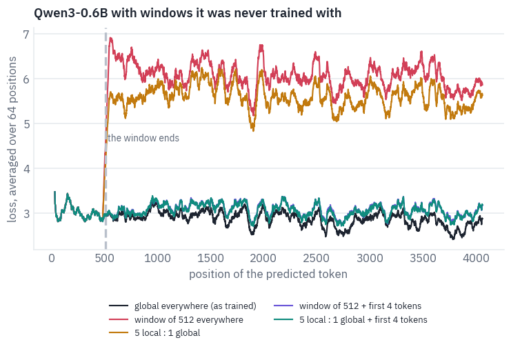

Up to the 512th token every mask is the same as global attention, and so is the loss. After it, a window of 512 in every layer is a disaster: the loss more than doubles and stays there.

One global layer in six helps only a little. The surprise is in the last two rows. Keep the first four tokens of the text visible to every layer, and the windowed model comes close to the global one all the way to the 4,096th token.

The first tokens matter not for what they say. Xiao et al. found that language models put a large share of their attention on the first tokens of a text, whatever those tokens are: a softmax has to give its weight to something, and the first tokens, visible to every later one, become the place to park it.

They called them *attention sinks*, and "keeping the KV of initial tokens will largely recover the performance of window attention"<sup class="cite">[<a href="#ref-9" id="cite-9" data-ref="9" aria-label="Reference 9: Xiao, G., Tian, Y., Chen, B., Han, S., &amp; Lewis, M. (2023). Efficient streaming language models with attention sinks. ICLR 2024.">9</a>]</sup>. Cut the sinks off with a window and the heads that used them have nowhere to put their attention.

The gap that remains between the rows with sinks and global attention is what the model really loses by not seeing far, and it grows with position, as global attention gets more context to use.

Models trained with windows from the start learn to live with them, and gpt-oss builds the sink into every head:
"Each attention head has a learned bias in the denominator of the softmax"<sup class="cite">[<a href="#ref-10" id="cite-10" data-ref="10" aria-label="Reference 10: OpenAI (2025). gpt-oss-120b &amp; gpt-oss-20b model card. arXiv:2508.10925.">10</a>]</sup>.

## 8. Teaching the small model a job with LoRA

A model of 0.6 billion parameters will not write your novel, but it can do one narrow job fast and cheaply, on a
laptop or a phone. The job here is the one every voice assistant does: turn a spoken command into a structured
request. "Wake me up at five am this week" should become

```json
{"intent": "alarm_set", "slots": [["time", "five am"], ["date", "this week"]]}
```

with the intent chosen from a fixed list and each slot's value copied word for word from the command, so that the
alarm app knows what to do.

The data is MASSIVE, which Amazon released in 2022: "1M realistic, parallel, labeled virtual assistant utterances" in 51 languages, with "18 domains, 60 intents, and 55 slots"<sup class="cite">[<a href="#ref-11" id="cite-11" data-ref="11" aria-label="Reference 11: FitzGerald, J., Hench, C., Peris, C., et al. (2022). MASSIVE: a 1M-example multilingual natural language understanding dataset with 51 typologically-diverse languages. ACL 2023. Data: github.com/alexa/massive, CC BY 4.0.">11</a>]</sup>.

Professional translators *localised* the English commands of an earlier dataset, SLURP, rather than translated them, so the Russian command about cultural events in California asks about the Leningrad region instead, and every slot is marked in the translation too. The licence is CC BY 4.0, and the official archive is 40 MB.

```python
DATA = WORK_DIR / "massive"
if not (DATA / "1.1").exists():
    DATA.mkdir(parents=True, exist_ok=True)
    url = ("https://amazon-massive-nlu-dataset.s3.amazonaws.com/"
           "amazon-massive-dataset-1.1.tar.gz")
    urllib.request.urlretrieve(url, DATA / "massive.tar.gz")
    with tarfile.open(DATA / "massive.tar.gz") as archive:
        archive.extractall(DATA)


def read_locale(locale):
    rows = []
    for line in open(DATA / "1.1" / "data" / f"{locale}.jsonl", encoding="utf-8"):
        row = json.loads(line)
        # slots are marked inside the command: "wake me up at [time : five am]"
        row["slots"] = [[kind, value.strip()] for kind, value
                        in re.findall(r"\[(\w+) : ([^\]]+)\]", row["annot_utt"])]
        rows.append(row)
    return rows


english, russian = read_locale("en-US"), read_locale("ru-RU")
russian_by_id = {row["id"]: row for row in russian}
for part in ["train", "dev", "test"]:
    count = sum(row["partition"] == part for row in english)
    print(part, count, "commands in each language")
intents = sorted({row["intent"] for row in english if row["partition"] == "train"})
slot_types = sorted({kind for row in english if row["partition"] == "train"
                     for kind, _ in row["slots"]})
print(len(intents), "intents,", len(slot_types), "slot types")
```

<pre class="tfs-printed" markdown="0"><code>train 11514 commands in each language
dev 2033 commands in each language
test 2974 commands in each language
60 intents, 55 slot types</code></pre>

```python
def target(row):
    return json.dumps({"intent": row["intent"], "slots": row["slots"]}, ensure_ascii=False)


random.seed(SEED)
candidates = [row for row in english
              if row["partition"] == "test" and len(row["slots"]) >= 2]
shown = random.sample(candidates, 4)
table(pd.DataFrame({"English": [row["utt"] for row in shown],
                    "Russian": [russian_by_id[row["id"]]["utt"] for row in shown],
                    "English JSON": [target(row) for row in shown],
                    "Russian JSON": [target(russian_by_id[row["id"]]) for row in shown]}))
```

<div class="tfs-table-wrap"><table class="tfs-table" style="border-collapse:collapse;font-family:'IBM Plex Sans', -apple-system, 'Segoe UI', Roboto, Helvetica, Arial, sans-serif;font-size:13.5px;line-height:1.45;margin:4px 0 8px;"><thead><tr><th style="padding:7px 14px;border-bottom:2px solid #B9C0CB;font-weight:600;color:#5B6575;font-size:12px;letter-spacing:0.02em;text-align:left;">English</th><th style="padding:7px 14px;border-bottom:2px solid #B9C0CB;font-weight:600;color:#5B6575;font-size:12px;letter-spacing:0.02em;text-align:left;">Russian</th><th style="padding:7px 14px;border-bottom:2px solid #B9C0CB;font-weight:600;color:#5B6575;font-size:12px;letter-spacing:0.02em;text-align:left;">English JSON</th><th style="padding:7px 14px;border-bottom:2px solid #B9C0CB;font-weight:600;color:#5B6575;font-size:12px;letter-spacing:0.02em;text-align:left;">Russian JSON</th></tr></thead><tbody><tr><td style="padding:7px 14px;border-bottom:1px solid #E6E9EE;vertical-align:top;text-align:left;max-width:460px;white-space:normal;">convert current time from g. m. t. to e. s. t.</td><td style="padding:7px 14px;border-bottom:1px solid #E6E9EE;vertical-align:top;text-align:left;max-width:460px;white-space:normal;">конвертировть текущее время со среднего времени по гринвичу в североамериканское восточное время</td><td style="padding:7px 14px;border-bottom:1px solid #E6E9EE;vertical-align:top;text-align:left;max-width:460px;white-space:normal;">{&quot;intent&quot;: &quot;datetime_convert&quot;, &quot;slots&quot;: [[&quot;time_zone&quot;, &quot;g. m. t.&quot;], [&quot;time_zone&quot;, &quot;e. s. t.&quot;]]}</td><td style="padding:7px 14px;border-bottom:1px solid #E6E9EE;vertical-align:top;text-align:left;max-width:460px;white-space:normal;">{&quot;intent&quot;: &quot;datetime_convert&quot;, &quot;slots&quot;: [[&quot;time_zone&quot;, &quot;среднего времени по гринвичу&quot;], [&quot;time_zone&quot;, &quot;североамериканское восточное время&quot;]]}</td></tr><tr><td style="padding:7px 14px;border-bottom:1px solid #E6E9EE;vertical-align:top;text-align:left;max-width:460px;white-space:normal;">play lady by kenny roger</td><td style="padding:7px 14px;border-bottom:1px solid #E6E9EE;vertical-align:top;text-align:left;max-width:460px;white-space:normal;">включи покинула чат клавы коки</td><td style="padding:7px 14px;border-bottom:1px solid #E6E9EE;vertical-align:top;text-align:left;max-width:460px;white-space:normal;">{&quot;intent&quot;: &quot;play_music&quot;, &quot;slots&quot;: [[&quot;song_name&quot;, &quot;lady&quot;], [&quot;artist_name&quot;, &quot;kenny roger&quot;]]}</td><td style="padding:7px 14px;border-bottom:1px solid #E6E9EE;vertical-align:top;text-align:left;max-width:460px;white-space:normal;">{&quot;intent&quot;: &quot;play_music&quot;, &quot;slots&quot;: [[&quot;song_name&quot;, &quot;покинула чат&quot;], [&quot;artist_name&quot;, &quot;клавы коки&quot;]]}</td></tr><tr><td style="padding:7px 14px;border-bottom:1px solid #E6E9EE;vertical-align:top;text-align:left;max-width:460px;white-space:normal;">add a lunch with mike</td><td style="padding:7px 14px;border-bottom:1px solid #E6E9EE;vertical-align:top;text-align:left;max-width:460px;white-space:normal;">добавь обед с михаилом</td><td style="padding:7px 14px;border-bottom:1px solid #E6E9EE;vertical-align:top;text-align:left;max-width:460px;white-space:normal;">{&quot;intent&quot;: &quot;calendar_set&quot;, &quot;slots&quot;: [[&quot;meal_type&quot;, &quot;lunch&quot;], [&quot;person&quot;, &quot;mike&quot;]]}</td><td style="padding:7px 14px;border-bottom:1px solid #E6E9EE;vertical-align:top;text-align:left;max-width:460px;white-space:normal;">{&quot;intent&quot;: &quot;calendar_set&quot;, &quot;slots&quot;: [[&quot;meal_type&quot;, &quot;обед&quot;], [&quot;person&quot;, &quot;михаилом&quot;]]}</td></tr><tr><td style="padding:7px 14px;border-bottom:1px solid #E6E9EE;vertical-align:top;text-align:left;max-width:460px;white-space:normal;">block one hour from ten tomorrow morning</td><td style="padding:7px 14px;border-bottom:1px solid #E6E9EE;vertical-align:top;text-align:left;max-width:460px;white-space:normal;">выдели один час с десяти завтрашним утром</td><td style="padding:7px 14px;border-bottom:1px solid #E6E9EE;vertical-align:top;text-align:left;max-width:460px;white-space:normal;">{&quot;intent&quot;: &quot;calendar_set&quot;, &quot;slots&quot;: [[&quot;time&quot;, &quot;one hour&quot;], [&quot;time&quot;, &quot;ten&quot;], [&quot;date&quot;, &quot;tomorrow&quot;], [&quot;timeofday&quot;, &quot;morning&quot;]]}</td><td style="padding:7px 14px;border-bottom:1px solid #E6E9EE;vertical-align:top;text-align:left;max-width:460px;white-space:normal;">{&quot;intent&quot;: &quot;calendar_set&quot;, &quot;slots&quot;: [[&quot;time&quot;, &quot;один час&quot;], [&quot;time&quot;, &quot;десяти&quot;], [&quot;date&quot;, &quot;завтрашним&quot;], [&quot;timeofday&quot;, &quot;утром&quot;]]}</td></tr></tbody></table></div>

The localisation shows in every row. Kenny Rogers's song became one by the Russian singer Klava Koka, and the slot keeps her name in the genitive the sentence puts it in, *клавы коки*; Mike became Mikhail, in the instrumental case, *михаилом*.

So a Russian slot value is not always in the form a dictionary gives, and a model has to copy it in the form it has in the command. The commands were written by people, typos included: *конвертировть* is missing a letter.

The score has three numbers, as in the MASSIVE paper: the share of commands whose intent is right, the F1 of the
slots, counting a slot as right only if both its type and its value match, and the share of commands where
everything matches exactly, which is what the alarm app needs. An answer that isn't valid JSON gets nothing.

```python
def parse(text):
    try:
        answer = json.loads(text.strip())
    except json.JSONDecodeError:
        return None
    if not isinstance(answer, dict) or not isinstance(answer.get("intent"), str):
        return None
    slots = []
    for slot in answer.get("slots", []) if isinstance(answer.get("slots"), list) else []:
        is_pair = isinstance(slot, list) and len(slot) == 2
        if is_pair and all(isinstance(s, str) for s in slot):
            slots.append((slot[0], slot[1].strip().lower()))
    return {"intent": answer["intent"], "slots": slots}


def score(rows, outputs):
    valid = intent = exact = 0
    found = wrong = missed = 0
    for row, output in zip(rows, outputs):
        gold = sorted((kind, value.lower()) for kind, value in row["slots"])
        answer = parse(output)
        if answer is None:
            missed += len(gold)
            continue
        valid += 1
        predicted = sorted(answer["slots"])
        intent += answer["intent"] == row["intent"]
        exact += answer["intent"] == row["intent"] and predicted == gold
        remaining = list(gold)
        for slot in predicted:
            if slot in remaining:
                found += 1
                remaining.remove(slot)
            else:
                wrong += 1
        missed += len(remaining)
    precision = found / max(found + wrong, 1)
    recall = found / max(found + missed, 1)
    f1 = 2 * precision * recall / max(precision + recall, 1e-9)
    n = len(rows)
    return {"valid JSON": valid / n, "intent": intent / n, "slot F1": f1,
            "exact": exact / n}


print(score(shown, [target(row) for row in shown]))
print(score(shown, ['{"intent": "alarm_set", "slots": []}'] * 4))
```

<pre class="tfs-printed" markdown="0"><code>{&#x27;valid JSON&#x27;: 1.0, &#x27;intent&#x27;: 1.0, &#x27;slot F1&#x27;: 1.0, &#x27;exact&#x27;: 1.0}
{&#x27;valid JSON&#x27;: 1.0, &#x27;intent&#x27;: 0.0, &#x27;slot F1&#x27;: 0.0, &#x27;exact&#x27;: 0.0}</code></pre>

**The baseline: ask nicely.** Without any training, a chat model can be told the task in its system prompt: the format, the 60 intents, the 55 slot types and three examples. That prompt runs to a few hundred tokens, as the next cell prints, and it is the same for every command.

Recomputing its keys and values for every request would be a waste, so we compute them once and start every batch from a copy: *prefix caching*, which serving engines such as vLLM do automatically, in blocks of tokens, whenever prompts share a start. Our `generate` already takes a prefix; here is how to make one.

```python
def schema_prompt(train_rows):
    examples = random.Random(0).sample([row for row in train_rows if row["slots"]], 3)
    lines = ["You turn commands for a voice assistant into JSON.",
             "Answer with one JSON object only: "
             '{"intent": INTENT, "slots": [[SLOT_TYPE, VALUE], ...]}.',
             "INTENT is exactly one of: " + ", ".join(intents) + ".",
             "SLOT_TYPE is exactly one of: " + ", ".join(slot_types) + ".",
             "VALUE is copied word for word from the command, in the command's language. "
             "Use an empty list when there are no slots.",
             "Examples:"]
    for row in examples:
        lines.append(row["utt"] + " -> " + target(row))
    return "\n".join(lines)


def chat_parts(system):
    marker = "<<COMMAND>>"
    messages = [{"role": "user", "content": marker}]
    if system:
        messages = [{"role": "system", "content": system}] + messages
    text = tok.apply_chat_template(messages, tokenize=False, add_generation_prompt=True,
                                   enable_thinking=False)
    return text.split(marker)  # what comes before the command, and after it


@torch.no_grad()
def make_prefix(model, prefix_ids):
    caches = [Cache() for _ in model.layers]
    t = len(prefix_ids)
    x = torch.tensor([prefix_ids], device=device)
    causal = torch.ones(t, t, dtype=torch.bool, device=device).tril()
    model.hidden(x, torch.arange(t, device=device)[None], causal, caches)
    return {"kv": [(cache.k, cache.v) for cache in caches], "length": t}


def run(model, rows, system=None, batch=64):
    before, after = chat_parts(system)
    prefix = make_prefix(model, tok(before, add_special_tokens=False).input_ids)
    prompts = [tok(row["utt"] + after, add_special_tokens=False).input_ids for row in rows]
    # similar lengths in a batch, so less padding
    order = sorted(range(len(rows)), key=lambda k: len(prompts[k]))
    outputs = [None] * len(rows)
    start = time.time()
    for s in range(0, len(order), batch):
        chosen = order[s:s + batch]
        answers = generate(model, [prompts[k] for k in chosen], 110, IM_END, prefix)
        for k, written in zip(chosen, answers):
            outputs[k] = tok.decode(written)
    return outputs, time.time() - start
```

The baselines run on a fixed sample of 500 test commands in each language, the same commands in English and in
Russian. Qwen3-0.6B and Qwen3-4B, the latter in 16-bit floats so that it fits on a T4: our class loads it unchanged,
since the dense models of the family share one architecture.

```python
train_en = [row for row in english if row["partition"] == "train"]
train_ru = [row for row in russian if row["partition"] == "train"]
test_en = [row for row in english if row["partition"] == "test"]
test_ru = [russian_by_id[row["id"]] for row in test_en]
if SMOKE:
    test_en, test_ru = test_en[:32], test_ru[:32]
sample = sorted(random.Random(7).sample(range(len(test_en)), min(500, len(test_en))))
sample_en = [test_en[k] for k in sample]
sample_ru = [test_ru[k] for k in sample]
system = schema_prompt(train_en)
print(len(tok(system).input_ids), "tokens in the system prompt")

scores = []
outputs = {}
model = model.to(HALF)
baselines = [(REPO, 64)] if SMOKE else [(REPO, 64), ("Qwen/Qwen3-4B", 16)]
for repo, batch in baselines:
    if repo != REPO:
        del model
        torch.cuda.empty_cache()
        model = load_qwen3(repo, HALF)
    name = repo.split("/")[1]
    for language, rows in [("English", sample_en), ("Russian", sample_ru)]:
        written, seconds = run(model, rows, system, batch)
        method = name.removeprefix("Qwen3-") + ", instructions"
        outputs[method, language] = written
        scores.append({"method": method, "language": language, "commands": len(rows),
                       **score(rows, written), "seconds": seconds})
table(pd.DataFrame(scores), digits=3)
```

<pre class="tfs-printed" markdown="0"><code>582 tokens in the system prompt</code></pre>

<div class="tfs-table-wrap"><table class="tfs-table" style="border-collapse:collapse;font-family:'IBM Plex Sans', -apple-system, 'Segoe UI', Roboto, Helvetica, Arial, sans-serif;font-size:13.5px;line-height:1.45;margin:4px 0 8px;"><thead><tr><th style="padding:7px 14px;border-bottom:2px solid #B9C0CB;font-weight:600;color:#5B6575;font-size:12px;letter-spacing:0.02em;text-align:left;">method</th><th style="padding:7px 14px;border-bottom:2px solid #B9C0CB;font-weight:600;color:#5B6575;font-size:12px;letter-spacing:0.02em;text-align:left;">language</th><th style="padding:7px 14px;border-bottom:2px solid #B9C0CB;font-weight:600;color:#5B6575;font-size:12px;letter-spacing:0.02em;text-align:right;">commands</th><th style="padding:7px 14px;border-bottom:2px solid #B9C0CB;font-weight:600;color:#5B6575;font-size:12px;letter-spacing:0.02em;text-align:right;">valid JSON</th><th style="padding:7px 14px;border-bottom:2px solid #B9C0CB;font-weight:600;color:#5B6575;font-size:12px;letter-spacing:0.02em;text-align:right;">intent</th><th style="padding:7px 14px;border-bottom:2px solid #B9C0CB;font-weight:600;color:#5B6575;font-size:12px;letter-spacing:0.02em;text-align:right;">slot F1</th><th style="padding:7px 14px;border-bottom:2px solid #B9C0CB;font-weight:600;color:#5B6575;font-size:12px;letter-spacing:0.02em;text-align:right;">exact</th><th style="padding:7px 14px;border-bottom:2px solid #B9C0CB;font-weight:600;color:#5B6575;font-size:12px;letter-spacing:0.02em;text-align:right;">seconds</th></tr></thead><tbody><tr><td style="padding:7px 14px;border-bottom:1px solid #E6E9EE;vertical-align:top;text-align:left;max-width:460px;white-space:normal;">0.6B, instructions</td><td style="padding:7px 14px;border-bottom:1px solid #E6E9EE;vertical-align:top;text-align:left;max-width:460px;white-space:normal;">English</td><td style="padding:7px 14px;border-bottom:1px solid #E6E9EE;vertical-align:top;text-align:right;font-variant-numeric:tabular-nums;max-width:460px;white-space:normal;">500</td><td style="padding:7px 14px;border-bottom:1px solid #E6E9EE;vertical-align:top;text-align:right;font-variant-numeric:tabular-nums;max-width:460px;white-space:normal;">0.990</td><td style="padding:7px 14px;border-bottom:1px solid #E6E9EE;vertical-align:top;text-align:right;font-variant-numeric:tabular-nums;max-width:460px;white-space:normal;">0.460</td><td style="padding:7px 14px;border-bottom:1px solid #E6E9EE;vertical-align:top;text-align:right;font-variant-numeric:tabular-nums;max-width:460px;white-space:normal;">0.170</td><td style="padding:7px 14px;border-bottom:1px solid #E6E9EE;vertical-align:top;text-align:right;font-variant-numeric:tabular-nums;max-width:460px;white-space:normal;">0.048</td><td style="padding:7px 14px;border-bottom:1px solid #E6E9EE;vertical-align:top;text-align:right;font-variant-numeric:tabular-nums;max-width:460px;white-space:normal;">56.494</td></tr><tr><td style="padding:7px 14px;border-bottom:1px solid #E6E9EE;vertical-align:top;text-align:left;max-width:460px;white-space:normal;">0.6B, instructions</td><td style="padding:7px 14px;border-bottom:1px solid #E6E9EE;vertical-align:top;text-align:left;max-width:460px;white-space:normal;">Russian</td><td style="padding:7px 14px;border-bottom:1px solid #E6E9EE;vertical-align:top;text-align:right;font-variant-numeric:tabular-nums;max-width:460px;white-space:normal;">500</td><td style="padding:7px 14px;border-bottom:1px solid #E6E9EE;vertical-align:top;text-align:right;font-variant-numeric:tabular-nums;max-width:460px;white-space:normal;">0.924</td><td style="padding:7px 14px;border-bottom:1px solid #E6E9EE;vertical-align:top;text-align:right;font-variant-numeric:tabular-nums;max-width:460px;white-space:normal;">0.346</td><td style="padding:7px 14px;border-bottom:1px solid #E6E9EE;vertical-align:top;text-align:right;font-variant-numeric:tabular-nums;max-width:460px;white-space:normal;">0.030</td><td style="padding:7px 14px;border-bottom:1px solid #E6E9EE;vertical-align:top;text-align:right;font-variant-numeric:tabular-nums;max-width:460px;white-space:normal;">0.010</td><td style="padding:7px 14px;border-bottom:1px solid #E6E9EE;vertical-align:top;text-align:right;font-variant-numeric:tabular-nums;max-width:460px;white-space:normal;">73.703</td></tr><tr><td style="padding:7px 14px;border-bottom:1px solid #E6E9EE;vertical-align:top;text-align:left;max-width:460px;white-space:normal;">4B, instructions</td><td style="padding:7px 14px;border-bottom:1px solid #E6E9EE;vertical-align:top;text-align:left;max-width:460px;white-space:normal;">English</td><td style="padding:7px 14px;border-bottom:1px solid #E6E9EE;vertical-align:top;text-align:right;font-variant-numeric:tabular-nums;max-width:460px;white-space:normal;">500</td><td style="padding:7px 14px;border-bottom:1px solid #E6E9EE;vertical-align:top;text-align:right;font-variant-numeric:tabular-nums;max-width:460px;white-space:normal;">0.998</td><td style="padding:7px 14px;border-bottom:1px solid #E6E9EE;vertical-align:top;text-align:right;font-variant-numeric:tabular-nums;max-width:460px;white-space:normal;">0.694</td><td style="padding:7px 14px;border-bottom:1px solid #E6E9EE;vertical-align:top;text-align:right;font-variant-numeric:tabular-nums;max-width:460px;white-space:normal;">0.344</td><td style="padding:7px 14px;border-bottom:1px solid #E6E9EE;vertical-align:top;text-align:right;font-variant-numeric:tabular-nums;max-width:460px;white-space:normal;">0.184</td><td style="padding:7px 14px;border-bottom:1px solid #E6E9EE;vertical-align:top;text-align:right;font-variant-numeric:tabular-nums;max-width:460px;white-space:normal;">148.817</td></tr><tr><td style="padding:7px 14px;border-bottom:1px solid #E6E9EE;vertical-align:top;text-align:left;max-width:460px;white-space:normal;">4B, instructions</td><td style="padding:7px 14px;border-bottom:1px solid #E6E9EE;vertical-align:top;text-align:left;max-width:460px;white-space:normal;">Russian</td><td style="padding:7px 14px;border-bottom:1px solid #E6E9EE;vertical-align:top;text-align:right;font-variant-numeric:tabular-nums;max-width:460px;white-space:normal;">500</td><td style="padding:7px 14px;border-bottom:1px solid #E6E9EE;vertical-align:top;text-align:right;font-variant-numeric:tabular-nums;max-width:460px;white-space:normal;">1.000</td><td style="padding:7px 14px;border-bottom:1px solid #E6E9EE;vertical-align:top;text-align:right;font-variant-numeric:tabular-nums;max-width:460px;white-space:normal;">0.632</td><td style="padding:7px 14px;border-bottom:1px solid #E6E9EE;vertical-align:top;text-align:right;font-variant-numeric:tabular-nums;max-width:460px;white-space:normal;">0.267</td><td style="padding:7px 14px;border-bottom:1px solid #E6E9EE;vertical-align:top;text-align:right;font-variant-numeric:tabular-nums;max-width:460px;white-space:normal;">0.128</td><td style="padding:7px 14px;border-bottom:1px solid #E6E9EE;vertical-align:top;text-align:right;font-variant-numeric:tabular-nums;max-width:460px;white-space:normal;">173.983</td></tr></tbody></table></div>

Instructions alone don't make either model a voice assistant. Both write valid JSON nearly every time, so the format is not the problem; the content is. The 0.6B model picks the right intent for fewer than half of the commands and gets few slots right.

The 4B model does much better on intents, yet fewer than one command in five comes out exactly right, it takes several times as long, and both models do worse in Russian.

**LoRA.** Fine-tuning all 596 million parameters would work, but AdamW keeps two numbers per parameter on top of
the parameter and its gradient, and a model per task is a lot of models. In 2021 a Microsoft team hypothesised that
the change fine-tuning makes to a weight matrix has a low "intrinsic rank", and proposed to learn only that change, as
a product of two thin matrices<sup class="cite">[<a href="#ref-12" id="cite-12" data-ref="12" aria-label="Reference 12: Hu, E. J., Shen, Y., Wallis, P., Allen-Zhu, Z., Li, Y., Wang, S., Wang, L., &amp; Chen, W. (2021). LoRA: low-rank adaptation of large language models. ICLR 2022.">12</a>]</sup>. A frozen weight
$$W \in \mathbb{R}^{d_{out} \times d_{in}}$$ becomes

$$W' = W + \frac{\alpha}{r} B A,$$

$$A \in \mathbb{R}^{r \times d_{in}}, \qquad B \in \mathbb{R}^{d_{out} \times r},$$

with a rank $$r$$ of 8 or 16 where $$d_{in}$$ and $$d_{out}$$ are in the thousands. $$B$$ starts at zero, so the model starts exactly where it was; the factor $$\alpha / r$$ saves retuning the learning rate when the rank changes.

For GPT-3 the paper reported that LoRA "can reduce the number of trainable parameters by 10,000 times and the GPU memory requirement by 3 times", and since $$BA$$ can be added into $$W$$ after training, the fine-tuned model runs exactly as fast as the original.

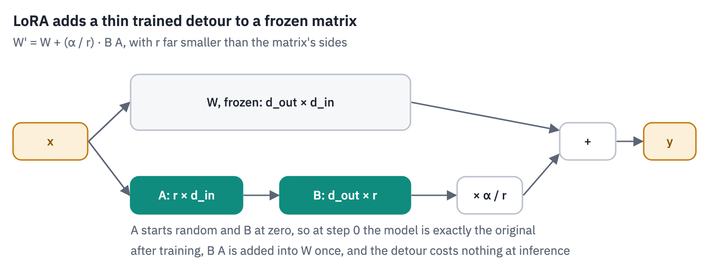
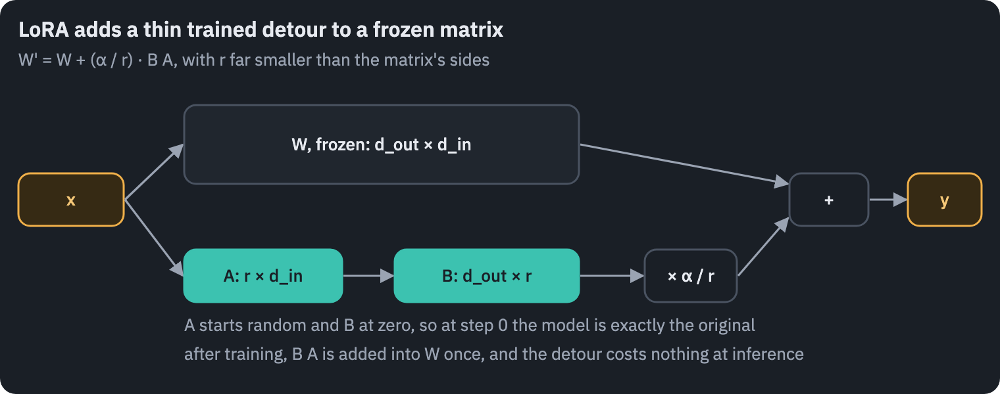

```python
class LoRA(nn.Module):
    def __init__(self, base, rank=16, alpha=32):
        super().__init__()
        self.base = base  # the frozen linear layer
        where = base.weight.device
        self.A = nn.Parameter(torch.empty(rank, base.in_features, device=where))
        nn.init.kaiming_uniform_(self.A, a=math.sqrt(5))  # as PEFT; the paper: Gaussian
        self.B = nn.Parameter(torch.zeros(base.out_features, rank, device=where))
        self.scale = alpha / rank

    def forward(self, x):
        low_rank = (x @ self.A.T.to(x.dtype)) @ self.B.T.to(x.dtype)
        return self.base(x) + low_rank * self.scale


TARGETS = ["q_proj", "k_proj", "v_proj", "o_proj", "gate_proj", "up_proj", "down_proj"]


def add_lora(model):
    for p in model.parameters():
        p.requires_grad = False
    for block in model.layers:
        for part in [block.self_attn, block.mlp]:
            for name in TARGETS:
                if hasattr(part, name):
                    setattr(part, name, LoRA(getattr(part, name)))
    return [p for p in model.parameters() if p.requires_grad]
```

The training examples are chat turns with no system prompt at all: the command as the user's message, the JSON as the assistant's answer, followed by `<|im_end|>` so that the model learns to stop. The loss counts only the answer's tokens.

The frozen model stays in 16-bit floats; the LoRA matrices, their gradients and AdamW's state are 32-bit, and a gradient scaler keeps the 16-bit backward pass from underflowing. We train for one pass over the 11,514 English training commands, 32 to a step.

The 32 go through the model eight at a time and their gradients add up before the step: the step is the same, and long commands don't run a T4 out of memory.

```python
def examples_of(rows):
    before, after = chat_parts(None)
    examples = []
    for row in rows:
        prompt = tok(before + row["utt"] + after, add_special_tokens=False).input_ids
        answer = tok(target(row), add_special_tokens=False).input_ids + [IM_END]
        examples.append((prompt, answer))
    return examples


def answer_loss(model, chunk):
    """The loss summed over the answers' tokens of a few examples, padded to one width."""
    n = len(chunk)
    width = max(len(p) + len(a) for p, a in chunk)
    ids = torch.full((n, width), IM_END, device=device)
    labels = torch.full((n, width), -100, device=device)
    real = torch.zeros(n, width, dtype=torch.bool, device=device)
    for k, (prompt, answer) in enumerate(chunk):
        sequence = prompt + answer
        ids[k, :len(sequence)] = torch.tensor(sequence, device=device)
        # the logits at position p predict the token at p + 1
        first, last = len(prompt) - 1, len(sequence) - 1
        labels[k, first:last] = torch.tensor(answer, device=device)
        real[k, :len(sequence)] = True
    positions = torch.arange(width, device=device)[None].expand(n, -1)
    causal = torch.ones(width, width, dtype=torch.bool, device=device).tril()
    itself = torch.eye(width, dtype=torch.bool, device=device)
    mask = (causal & real[:, None, None, :]) | itself
    h = model.hidden(ids, positions, mask)
    scored = labels != -100
    logits = model.logits(h[scored]).float()
    return F.cross_entropy(logits, labels[scored], reduction="sum")


def train_lora(model, rows, batch=4 if SMOKE else 32, micro=2 if SMOKE else 8,
               peak_lr=2e-4, warmup=30):
    params = add_lora(model)
    optimizer = torch.optim.AdamW(params, lr=peak_lr, weight_decay=0.0)
    scaler = torch.amp.GradScaler(enabled=device == "cuda")
    examples = examples_of(rows)
    order = list(range(len(examples)))
    random.Random(1).shuffle(order)
    if SMOKE:
        order = order[:4 * batch]
    history = []
    model.train()
    for step, s in enumerate(range(0, len(order), batch)):
        chunk = [examples[k] for k in order[s:s + batch]]
        tokens = sum(len(answer) for _, answer in chunk)
        for group in optimizer.param_groups:
            group["lr"] = peak_lr * min(1.0, (step + 1) / warmup)
        optimizer.zero_grad(set_to_none=True)
        total = 0.0
        for m in range(0, len(chunk), micro):  # the pieces' gradients add up
            loss = answer_loss(model, chunk[m:m + micro]) / tokens
            scaler.scale(loss).backward()
            total += loss.item()
        scaler.unscale_(optimizer)
        torch.nn.utils.clip_grad_norm_(params, 1.0)
        scaler.step(optimizer)
        scaler.update()
        history.append(total)
    model.eval()
    return params, history
```

```python
del model
torch.cuda.empty_cache()
model = load_qwen3(REPO, HALF)
start = time.time()
params, history = train_lora(model, train_en)
trained = sum(p.numel() for p in params)
frozen = sum(p.numel() for p in model.parameters()) - trained
print(f"{len(history)} steps in {time.time() - start:.0f} s")
print(f"trained {trained:,} parameters, {trained / frozen:.2%} of the frozen {frozen:,}")

fig, ax = plt.subplots(figsize=(6.4, 3.0))
ax.plot(history, color=COLORS["enc"], linewidth=1)
ax.set_yscale("log")
ax.set_xlabel("step (32 commands each)")
ax.set_ylabel("loss on the answer's tokens")
ax.set_title("LoRA on Qwen3-0.6B trained on English commands only")
plt.show()
```

<pre class="tfs-printed" markdown="0"><code>360 steps in 328 s
trained 10,092,544 parameters, 1.69% of the frozen 596,049,920</code></pre>

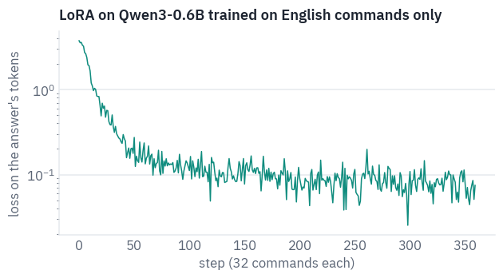

The adapter has never seen a Russian command, and it gets no instructions: just the command, as in training.

```python
def evaluate(model, method):
    for language, rows in [("English", test_en), ("Russian", test_ru)]:
        written, seconds = run(model, rows)
        outputs[method, language] = written
        scores.append({"method": method, "language": language, "commands": len(rows),
                       **score(rows, written), "seconds": seconds})


evaluate(model, "0.6B + LoRA, en")
table(pd.DataFrame(scores), digits=3)
```

<div class="tfs-table-wrap"><table class="tfs-table" style="border-collapse:collapse;font-family:'IBM Plex Sans', -apple-system, 'Segoe UI', Roboto, Helvetica, Arial, sans-serif;font-size:13.5px;line-height:1.45;margin:4px 0 8px;"><thead><tr><th style="padding:7px 14px;border-bottom:2px solid #B9C0CB;font-weight:600;color:#5B6575;font-size:12px;letter-spacing:0.02em;text-align:left;">method</th><th style="padding:7px 14px;border-bottom:2px solid #B9C0CB;font-weight:600;color:#5B6575;font-size:12px;letter-spacing:0.02em;text-align:left;">language</th><th style="padding:7px 14px;border-bottom:2px solid #B9C0CB;font-weight:600;color:#5B6575;font-size:12px;letter-spacing:0.02em;text-align:right;">commands</th><th style="padding:7px 14px;border-bottom:2px solid #B9C0CB;font-weight:600;color:#5B6575;font-size:12px;letter-spacing:0.02em;text-align:right;">valid JSON</th><th style="padding:7px 14px;border-bottom:2px solid #B9C0CB;font-weight:600;color:#5B6575;font-size:12px;letter-spacing:0.02em;text-align:right;">intent</th><th style="padding:7px 14px;border-bottom:2px solid #B9C0CB;font-weight:600;color:#5B6575;font-size:12px;letter-spacing:0.02em;text-align:right;">slot F1</th><th style="padding:7px 14px;border-bottom:2px solid #B9C0CB;font-weight:600;color:#5B6575;font-size:12px;letter-spacing:0.02em;text-align:right;">exact</th><th style="padding:7px 14px;border-bottom:2px solid #B9C0CB;font-weight:600;color:#5B6575;font-size:12px;letter-spacing:0.02em;text-align:right;">seconds</th></tr></thead><tbody><tr><td style="padding:7px 14px;border-bottom:1px solid #E6E9EE;vertical-align:top;text-align:left;max-width:460px;white-space:normal;">0.6B, instructions</td><td style="padding:7px 14px;border-bottom:1px solid #E6E9EE;vertical-align:top;text-align:left;max-width:460px;white-space:normal;">English</td><td style="padding:7px 14px;border-bottom:1px solid #E6E9EE;vertical-align:top;text-align:right;font-variant-numeric:tabular-nums;max-width:460px;white-space:normal;">500</td><td style="padding:7px 14px;border-bottom:1px solid #E6E9EE;vertical-align:top;text-align:right;font-variant-numeric:tabular-nums;max-width:460px;white-space:normal;">0.990</td><td style="padding:7px 14px;border-bottom:1px solid #E6E9EE;vertical-align:top;text-align:right;font-variant-numeric:tabular-nums;max-width:460px;white-space:normal;">0.460</td><td style="padding:7px 14px;border-bottom:1px solid #E6E9EE;vertical-align:top;text-align:right;font-variant-numeric:tabular-nums;max-width:460px;white-space:normal;">0.170</td><td style="padding:7px 14px;border-bottom:1px solid #E6E9EE;vertical-align:top;text-align:right;font-variant-numeric:tabular-nums;max-width:460px;white-space:normal;">0.048</td><td style="padding:7px 14px;border-bottom:1px solid #E6E9EE;vertical-align:top;text-align:right;font-variant-numeric:tabular-nums;max-width:460px;white-space:normal;">56.494</td></tr><tr><td style="padding:7px 14px;border-bottom:1px solid #E6E9EE;vertical-align:top;text-align:left;max-width:460px;white-space:normal;">0.6B, instructions</td><td style="padding:7px 14px;border-bottom:1px solid #E6E9EE;vertical-align:top;text-align:left;max-width:460px;white-space:normal;">Russian</td><td style="padding:7px 14px;border-bottom:1px solid #E6E9EE;vertical-align:top;text-align:right;font-variant-numeric:tabular-nums;max-width:460px;white-space:normal;">500</td><td style="padding:7px 14px;border-bottom:1px solid #E6E9EE;vertical-align:top;text-align:right;font-variant-numeric:tabular-nums;max-width:460px;white-space:normal;">0.924</td><td style="padding:7px 14px;border-bottom:1px solid #E6E9EE;vertical-align:top;text-align:right;font-variant-numeric:tabular-nums;max-width:460px;white-space:normal;">0.346</td><td style="padding:7px 14px;border-bottom:1px solid #E6E9EE;vertical-align:top;text-align:right;font-variant-numeric:tabular-nums;max-width:460px;white-space:normal;">0.030</td><td style="padding:7px 14px;border-bottom:1px solid #E6E9EE;vertical-align:top;text-align:right;font-variant-numeric:tabular-nums;max-width:460px;white-space:normal;">0.010</td><td style="padding:7px 14px;border-bottom:1px solid #E6E9EE;vertical-align:top;text-align:right;font-variant-numeric:tabular-nums;max-width:460px;white-space:normal;">73.703</td></tr><tr><td style="padding:7px 14px;border-bottom:1px solid #E6E9EE;vertical-align:top;text-align:left;max-width:460px;white-space:normal;">4B, instructions</td><td style="padding:7px 14px;border-bottom:1px solid #E6E9EE;vertical-align:top;text-align:left;max-width:460px;white-space:normal;">English</td><td style="padding:7px 14px;border-bottom:1px solid #E6E9EE;vertical-align:top;text-align:right;font-variant-numeric:tabular-nums;max-width:460px;white-space:normal;">500</td><td style="padding:7px 14px;border-bottom:1px solid #E6E9EE;vertical-align:top;text-align:right;font-variant-numeric:tabular-nums;max-width:460px;white-space:normal;">0.998</td><td style="padding:7px 14px;border-bottom:1px solid #E6E9EE;vertical-align:top;text-align:right;font-variant-numeric:tabular-nums;max-width:460px;white-space:normal;">0.694</td><td style="padding:7px 14px;border-bottom:1px solid #E6E9EE;vertical-align:top;text-align:right;font-variant-numeric:tabular-nums;max-width:460px;white-space:normal;">0.344</td><td style="padding:7px 14px;border-bottom:1px solid #E6E9EE;vertical-align:top;text-align:right;font-variant-numeric:tabular-nums;max-width:460px;white-space:normal;">0.184</td><td style="padding:7px 14px;border-bottom:1px solid #E6E9EE;vertical-align:top;text-align:right;font-variant-numeric:tabular-nums;max-width:460px;white-space:normal;">148.817</td></tr><tr><td style="padding:7px 14px;border-bottom:1px solid #E6E9EE;vertical-align:top;text-align:left;max-width:460px;white-space:normal;">4B, instructions</td><td style="padding:7px 14px;border-bottom:1px solid #E6E9EE;vertical-align:top;text-align:left;max-width:460px;white-space:normal;">Russian</td><td style="padding:7px 14px;border-bottom:1px solid #E6E9EE;vertical-align:top;text-align:right;font-variant-numeric:tabular-nums;max-width:460px;white-space:normal;">500</td><td style="padding:7px 14px;border-bottom:1px solid #E6E9EE;vertical-align:top;text-align:right;font-variant-numeric:tabular-nums;max-width:460px;white-space:normal;">1.000</td><td style="padding:7px 14px;border-bottom:1px solid #E6E9EE;vertical-align:top;text-align:right;font-variant-numeric:tabular-nums;max-width:460px;white-space:normal;">0.632</td><td style="padding:7px 14px;border-bottom:1px solid #E6E9EE;vertical-align:top;text-align:right;font-variant-numeric:tabular-nums;max-width:460px;white-space:normal;">0.267</td><td style="padding:7px 14px;border-bottom:1px solid #E6E9EE;vertical-align:top;text-align:right;font-variant-numeric:tabular-nums;max-width:460px;white-space:normal;">0.128</td><td style="padding:7px 14px;border-bottom:1px solid #E6E9EE;vertical-align:top;text-align:right;font-variant-numeric:tabular-nums;max-width:460px;white-space:normal;">173.983</td></tr><tr><td style="padding:7px 14px;border-bottom:1px solid #E6E9EE;vertical-align:top;text-align:left;max-width:460px;white-space:normal;">0.6B + LoRA, en</td><td style="padding:7px 14px;border-bottom:1px solid #E6E9EE;vertical-align:top;text-align:left;max-width:460px;white-space:normal;">English</td><td style="padding:7px 14px;border-bottom:1px solid #E6E9EE;vertical-align:top;text-align:right;font-variant-numeric:tabular-nums;max-width:460px;white-space:normal;">2,974</td><td style="padding:7px 14px;border-bottom:1px solid #E6E9EE;vertical-align:top;text-align:right;font-variant-numeric:tabular-nums;max-width:460px;white-space:normal;">1.000</td><td style="padding:7px 14px;border-bottom:1px solid #E6E9EE;vertical-align:top;text-align:right;font-variant-numeric:tabular-nums;max-width:460px;white-space:normal;">0.854</td><td style="padding:7px 14px;border-bottom:1px solid #E6E9EE;vertical-align:top;text-align:right;font-variant-numeric:tabular-nums;max-width:460px;white-space:normal;">0.768</td><td style="padding:7px 14px;border-bottom:1px solid #E6E9EE;vertical-align:top;text-align:right;font-variant-numeric:tabular-nums;max-width:460px;white-space:normal;">0.655</td><td style="padding:7px 14px;border-bottom:1px solid #E6E9EE;vertical-align:top;text-align:right;font-variant-numeric:tabular-nums;max-width:460px;white-space:normal;">121.610</td></tr><tr><td style="padding:7px 14px;border-bottom:1px solid #E6E9EE;vertical-align:top;text-align:left;max-width:460px;white-space:normal;">0.6B + LoRA, en</td><td style="padding:7px 14px;border-bottom:1px solid #E6E9EE;vertical-align:top;text-align:left;max-width:460px;white-space:normal;">Russian</td><td style="padding:7px 14px;border-bottom:1px solid #E6E9EE;vertical-align:top;text-align:right;font-variant-numeric:tabular-nums;max-width:460px;white-space:normal;">2,974</td><td style="padding:7px 14px;border-bottom:1px solid #E6E9EE;vertical-align:top;text-align:right;font-variant-numeric:tabular-nums;max-width:460px;white-space:normal;">0.999</td><td style="padding:7px 14px;border-bottom:1px solid #E6E9EE;vertical-align:top;text-align:right;font-variant-numeric:tabular-nums;max-width:460px;white-space:normal;">0.764</td><td style="padding:7px 14px;border-bottom:1px solid #E6E9EE;vertical-align:top;text-align:right;font-variant-numeric:tabular-nums;max-width:460px;white-space:normal;">0.430</td><td style="padding:7px 14px;border-bottom:1px solid #E6E9EE;vertical-align:top;text-align:right;font-variant-numeric:tabular-nums;max-width:460px;white-space:normal;">0.396</td><td style="padding:7px 14px;border-bottom:1px solid #E6E9EE;vertical-align:top;text-align:right;font-variant-numeric:tabular-nums;max-width:460px;white-space:normal;">155.080</td></tr></tbody></table></div>

One pass over the English commands, a few minutes on a T4 and ten million trained parameters change the picture. On the whole English test set the adapted 0.6B model gets about two commands in three exactly right, several times as many as the 4B model given instructions, and it answers faster.

The more surprising row is Russian. The adapter never saw a Russian command, yet the model gets a good share of them exactly right: the skill it learned, find the intent and copy the words, carries over to a language Qwen3 learned in pretraining.

For scale, the MASSIVE paper's baselines, multilingual models of a few hundred million parameters fine-tuned in full, reach 69.7–72.5% exact match in English when trained on all 51 languages, and 42.6–52.8% in Russian when trained on English alone (its Table 7).

After one pass, with a small fraction of its parameters trained, our model lands a few points below the first range and somewhat below the second.

And the promise that LoRA costs nothing at inference, checked: add $$\frac{\alpha}{r}BA$$ into every frozen matrix,
drop the extra path, and the logits stay the same up to 16-bit rounding.

```python
def merge(model):
    for block in model.layers:
        for part in [block.self_attn, block.mlp]:
            for name in TARGETS:
                layer = getattr(part, name, None)
                if isinstance(layer, LoRA):
                    with torch.no_grad():
                        delta = (layer.B.float() @ layer.A.float()) * layer.scale
                        layer.base.weight += delta.to(layer.base.weight.dtype)
                    setattr(part, name, layer.base)


probe = tok(chat_parts(None)[0] + "wake me up at five am this week" + chat_parts(None)[1],
            add_special_tokens=False).input_ids
x = torch.tensor([probe], device=device)
t = x.shape[1]
causal = torch.ones(t, t, dtype=torch.bool, device=device).tril()
with torch.no_grad():
    before_merge = model(x, torch.arange(t, device=device)[None], causal).float()
    merge(model)
    after_merge = model(x, torch.arange(t, device=device)[None], causal).float()
print("parameters now:", f"{sum(p.numel() for p in model.parameters()):,}")
print("largest logit:", f"{before_merge.abs().max().item():.1f}")
difference = (before_merge - after_merge).abs().max().item()
print("max difference after merging:", f"{difference:.3f}")
```

<pre class="tfs-printed" markdown="0"><code>parameters now: 596,049,920
largest logit: 35.3
max difference after merging: 0.080</code></pre>

After the merge the model has exactly as many parameters as before training, and its logits move only by what
rounding the merged weights to 16 bits does. The adapter is now part of the weights, and the model runs as fast as
it did before training.

Now the same recipe with the Russian training commands added, 23,028 commands in all, still one pass.

```python
del model
torch.cuda.empty_cache()
model = load_qwen3(REPO, HALF)
start = time.time()
params, history_both = train_lora(model, train_en + train_ru)
print(f"{len(history_both)} steps in {time.time() - start:.0f} s")
evaluate(model, "0.6B + LoRA, en+ru")
table(pd.DataFrame(scores), digits=3)
```

<pre class="tfs-printed" markdown="0"><code>720 steps in 664 s</code></pre>

<div class="tfs-table-wrap"><table class="tfs-table" style="border-collapse:collapse;font-family:'IBM Plex Sans', -apple-system, 'Segoe UI', Roboto, Helvetica, Arial, sans-serif;font-size:13.5px;line-height:1.45;margin:4px 0 8px;"><thead><tr><th style="padding:7px 14px;border-bottom:2px solid #B9C0CB;font-weight:600;color:#5B6575;font-size:12px;letter-spacing:0.02em;text-align:left;">method</th><th style="padding:7px 14px;border-bottom:2px solid #B9C0CB;font-weight:600;color:#5B6575;font-size:12px;letter-spacing:0.02em;text-align:left;">language</th><th style="padding:7px 14px;border-bottom:2px solid #B9C0CB;font-weight:600;color:#5B6575;font-size:12px;letter-spacing:0.02em;text-align:right;">commands</th><th style="padding:7px 14px;border-bottom:2px solid #B9C0CB;font-weight:600;color:#5B6575;font-size:12px;letter-spacing:0.02em;text-align:right;">valid JSON</th><th style="padding:7px 14px;border-bottom:2px solid #B9C0CB;font-weight:600;color:#5B6575;font-size:12px;letter-spacing:0.02em;text-align:right;">intent</th><th style="padding:7px 14px;border-bottom:2px solid #B9C0CB;font-weight:600;color:#5B6575;font-size:12px;letter-spacing:0.02em;text-align:right;">slot F1</th><th style="padding:7px 14px;border-bottom:2px solid #B9C0CB;font-weight:600;color:#5B6575;font-size:12px;letter-spacing:0.02em;text-align:right;">exact</th><th style="padding:7px 14px;border-bottom:2px solid #B9C0CB;font-weight:600;color:#5B6575;font-size:12px;letter-spacing:0.02em;text-align:right;">seconds</th></tr></thead><tbody><tr><td style="padding:7px 14px;border-bottom:1px solid #E6E9EE;vertical-align:top;text-align:left;max-width:460px;white-space:normal;">0.6B, instructions</td><td style="padding:7px 14px;border-bottom:1px solid #E6E9EE;vertical-align:top;text-align:left;max-width:460px;white-space:normal;">English</td><td style="padding:7px 14px;border-bottom:1px solid #E6E9EE;vertical-align:top;text-align:right;font-variant-numeric:tabular-nums;max-width:460px;white-space:normal;">500</td><td style="padding:7px 14px;border-bottom:1px solid #E6E9EE;vertical-align:top;text-align:right;font-variant-numeric:tabular-nums;max-width:460px;white-space:normal;">0.990</td><td style="padding:7px 14px;border-bottom:1px solid #E6E9EE;vertical-align:top;text-align:right;font-variant-numeric:tabular-nums;max-width:460px;white-space:normal;">0.460</td><td style="padding:7px 14px;border-bottom:1px solid #E6E9EE;vertical-align:top;text-align:right;font-variant-numeric:tabular-nums;max-width:460px;white-space:normal;">0.170</td><td style="padding:7px 14px;border-bottom:1px solid #E6E9EE;vertical-align:top;text-align:right;font-variant-numeric:tabular-nums;max-width:460px;white-space:normal;">0.048</td><td style="padding:7px 14px;border-bottom:1px solid #E6E9EE;vertical-align:top;text-align:right;font-variant-numeric:tabular-nums;max-width:460px;white-space:normal;">56.494</td></tr><tr><td style="padding:7px 14px;border-bottom:1px solid #E6E9EE;vertical-align:top;text-align:left;max-width:460px;white-space:normal;">0.6B, instructions</td><td style="padding:7px 14px;border-bottom:1px solid #E6E9EE;vertical-align:top;text-align:left;max-width:460px;white-space:normal;">Russian</td><td style="padding:7px 14px;border-bottom:1px solid #E6E9EE;vertical-align:top;text-align:right;font-variant-numeric:tabular-nums;max-width:460px;white-space:normal;">500</td><td style="padding:7px 14px;border-bottom:1px solid #E6E9EE;vertical-align:top;text-align:right;font-variant-numeric:tabular-nums;max-width:460px;white-space:normal;">0.924</td><td style="padding:7px 14px;border-bottom:1px solid #E6E9EE;vertical-align:top;text-align:right;font-variant-numeric:tabular-nums;max-width:460px;white-space:normal;">0.346</td><td style="padding:7px 14px;border-bottom:1px solid #E6E9EE;vertical-align:top;text-align:right;font-variant-numeric:tabular-nums;max-width:460px;white-space:normal;">0.030</td><td style="padding:7px 14px;border-bottom:1px solid #E6E9EE;vertical-align:top;text-align:right;font-variant-numeric:tabular-nums;max-width:460px;white-space:normal;">0.010</td><td style="padding:7px 14px;border-bottom:1px solid #E6E9EE;vertical-align:top;text-align:right;font-variant-numeric:tabular-nums;max-width:460px;white-space:normal;">73.703</td></tr><tr><td style="padding:7px 14px;border-bottom:1px solid #E6E9EE;vertical-align:top;text-align:left;max-width:460px;white-space:normal;">4B, instructions</td><td style="padding:7px 14px;border-bottom:1px solid #E6E9EE;vertical-align:top;text-align:left;max-width:460px;white-space:normal;">English</td><td style="padding:7px 14px;border-bottom:1px solid #E6E9EE;vertical-align:top;text-align:right;font-variant-numeric:tabular-nums;max-width:460px;white-space:normal;">500</td><td style="padding:7px 14px;border-bottom:1px solid #E6E9EE;vertical-align:top;text-align:right;font-variant-numeric:tabular-nums;max-width:460px;white-space:normal;">0.998</td><td style="padding:7px 14px;border-bottom:1px solid #E6E9EE;vertical-align:top;text-align:right;font-variant-numeric:tabular-nums;max-width:460px;white-space:normal;">0.694</td><td style="padding:7px 14px;border-bottom:1px solid #E6E9EE;vertical-align:top;text-align:right;font-variant-numeric:tabular-nums;max-width:460px;white-space:normal;">0.344</td><td style="padding:7px 14px;border-bottom:1px solid #E6E9EE;vertical-align:top;text-align:right;font-variant-numeric:tabular-nums;max-width:460px;white-space:normal;">0.184</td><td style="padding:7px 14px;border-bottom:1px solid #E6E9EE;vertical-align:top;text-align:right;font-variant-numeric:tabular-nums;max-width:460px;white-space:normal;">148.817</td></tr><tr><td style="padding:7px 14px;border-bottom:1px solid #E6E9EE;vertical-align:top;text-align:left;max-width:460px;white-space:normal;">4B, instructions</td><td style="padding:7px 14px;border-bottom:1px solid #E6E9EE;vertical-align:top;text-align:left;max-width:460px;white-space:normal;">Russian</td><td style="padding:7px 14px;border-bottom:1px solid #E6E9EE;vertical-align:top;text-align:right;font-variant-numeric:tabular-nums;max-width:460px;white-space:normal;">500</td><td style="padding:7px 14px;border-bottom:1px solid #E6E9EE;vertical-align:top;text-align:right;font-variant-numeric:tabular-nums;max-width:460px;white-space:normal;">1.000</td><td style="padding:7px 14px;border-bottom:1px solid #E6E9EE;vertical-align:top;text-align:right;font-variant-numeric:tabular-nums;max-width:460px;white-space:normal;">0.632</td><td style="padding:7px 14px;border-bottom:1px solid #E6E9EE;vertical-align:top;text-align:right;font-variant-numeric:tabular-nums;max-width:460px;white-space:normal;">0.267</td><td style="padding:7px 14px;border-bottom:1px solid #E6E9EE;vertical-align:top;text-align:right;font-variant-numeric:tabular-nums;max-width:460px;white-space:normal;">0.128</td><td style="padding:7px 14px;border-bottom:1px solid #E6E9EE;vertical-align:top;text-align:right;font-variant-numeric:tabular-nums;max-width:460px;white-space:normal;">173.983</td></tr><tr><td style="padding:7px 14px;border-bottom:1px solid #E6E9EE;vertical-align:top;text-align:left;max-width:460px;white-space:normal;">0.6B + LoRA, en</td><td style="padding:7px 14px;border-bottom:1px solid #E6E9EE;vertical-align:top;text-align:left;max-width:460px;white-space:normal;">English</td><td style="padding:7px 14px;border-bottom:1px solid #E6E9EE;vertical-align:top;text-align:right;font-variant-numeric:tabular-nums;max-width:460px;white-space:normal;">2,974</td><td style="padding:7px 14px;border-bottom:1px solid #E6E9EE;vertical-align:top;text-align:right;font-variant-numeric:tabular-nums;max-width:460px;white-space:normal;">1.000</td><td style="padding:7px 14px;border-bottom:1px solid #E6E9EE;vertical-align:top;text-align:right;font-variant-numeric:tabular-nums;max-width:460px;white-space:normal;">0.854</td><td style="padding:7px 14px;border-bottom:1px solid #E6E9EE;vertical-align:top;text-align:right;font-variant-numeric:tabular-nums;max-width:460px;white-space:normal;">0.768</td><td style="padding:7px 14px;border-bottom:1px solid #E6E9EE;vertical-align:top;text-align:right;font-variant-numeric:tabular-nums;max-width:460px;white-space:normal;">0.655</td><td style="padding:7px 14px;border-bottom:1px solid #E6E9EE;vertical-align:top;text-align:right;font-variant-numeric:tabular-nums;max-width:460px;white-space:normal;">121.610</td></tr><tr><td style="padding:7px 14px;border-bottom:1px solid #E6E9EE;vertical-align:top;text-align:left;max-width:460px;white-space:normal;">0.6B + LoRA, en</td><td style="padding:7px 14px;border-bottom:1px solid #E6E9EE;vertical-align:top;text-align:left;max-width:460px;white-space:normal;">Russian</td><td style="padding:7px 14px;border-bottom:1px solid #E6E9EE;vertical-align:top;text-align:right;font-variant-numeric:tabular-nums;max-width:460px;white-space:normal;">2,974</td><td style="padding:7px 14px;border-bottom:1px solid #E6E9EE;vertical-align:top;text-align:right;font-variant-numeric:tabular-nums;max-width:460px;white-space:normal;">0.999</td><td style="padding:7px 14px;border-bottom:1px solid #E6E9EE;vertical-align:top;text-align:right;font-variant-numeric:tabular-nums;max-width:460px;white-space:normal;">0.764</td><td style="padding:7px 14px;border-bottom:1px solid #E6E9EE;vertical-align:top;text-align:right;font-variant-numeric:tabular-nums;max-width:460px;white-space:normal;">0.430</td><td style="padding:7px 14px;border-bottom:1px solid #E6E9EE;vertical-align:top;text-align:right;font-variant-numeric:tabular-nums;max-width:460px;white-space:normal;">0.396</td><td style="padding:7px 14px;border-bottom:1px solid #E6E9EE;vertical-align:top;text-align:right;font-variant-numeric:tabular-nums;max-width:460px;white-space:normal;">155.080</td></tr><tr><td style="padding:7px 14px;border-bottom:1px solid #E6E9EE;vertical-align:top;text-align:left;max-width:460px;white-space:normal;">0.6B + LoRA, en+ru</td><td style="padding:7px 14px;border-bottom:1px solid #E6E9EE;vertical-align:top;text-align:left;max-width:460px;white-space:normal;">English</td><td style="padding:7px 14px;border-bottom:1px solid #E6E9EE;vertical-align:top;text-align:right;font-variant-numeric:tabular-nums;max-width:460px;white-space:normal;">2,974</td><td style="padding:7px 14px;border-bottom:1px solid #E6E9EE;vertical-align:top;text-align:right;font-variant-numeric:tabular-nums;max-width:460px;white-space:normal;">1.000</td><td style="padding:7px 14px;border-bottom:1px solid #E6E9EE;vertical-align:top;text-align:right;font-variant-numeric:tabular-nums;max-width:460px;white-space:normal;">0.869</td><td style="padding:7px 14px;border-bottom:1px solid #E6E9EE;vertical-align:top;text-align:right;font-variant-numeric:tabular-nums;max-width:460px;white-space:normal;">0.774</td><td style="padding:7px 14px;border-bottom:1px solid #E6E9EE;vertical-align:top;text-align:right;font-variant-numeric:tabular-nums;max-width:460px;white-space:normal;">0.677</td><td style="padding:7px 14px;border-bottom:1px solid #E6E9EE;vertical-align:top;text-align:right;font-variant-numeric:tabular-nums;max-width:460px;white-space:normal;">122.265</td></tr><tr><td style="padding:7px 14px;border-bottom:1px solid #E6E9EE;vertical-align:top;text-align:left;max-width:460px;white-space:normal;">0.6B + LoRA, en+ru</td><td style="padding:7px 14px;border-bottom:1px solid #E6E9EE;vertical-align:top;text-align:left;max-width:460px;white-space:normal;">Russian</td><td style="padding:7px 14px;border-bottom:1px solid #E6E9EE;vertical-align:top;text-align:right;font-variant-numeric:tabular-nums;max-width:460px;white-space:normal;">2,974</td><td style="padding:7px 14px;border-bottom:1px solid #E6E9EE;vertical-align:top;text-align:right;font-variant-numeric:tabular-nums;max-width:460px;white-space:normal;">1.000</td><td style="padding:7px 14px;border-bottom:1px solid #E6E9EE;vertical-align:top;text-align:right;font-variant-numeric:tabular-nums;max-width:460px;white-space:normal;">0.851</td><td style="padding:7px 14px;border-bottom:1px solid #E6E9EE;vertical-align:top;text-align:right;font-variant-numeric:tabular-nums;max-width:460px;white-space:normal;">0.714</td><td style="padding:7px 14px;border-bottom:1px solid #E6E9EE;vertical-align:top;text-align:right;font-variant-numeric:tabular-nums;max-width:460px;white-space:normal;">0.622</td><td style="padding:7px 14px;border-bottom:1px solid #E6E9EE;vertical-align:top;text-align:right;font-variant-numeric:tabular-nums;max-width:460px;white-space:normal;">144.666</td></tr></tbody></table></div>

```python
methods = ["0.6B, instructions", "4B, instructions",
           "0.6B + LoRA, en", "0.6B + LoRA, en+ru"]
bar_colors = [COLORS["line"], COLORS["line"], COLORS["enc"], COLORS["enc"]]
fig, axes = plt.subplots(1, 2, figsize=(10, 3.4), sharey=True)
for ax, language, rows in zip(axes, ["English", "Russian"], [sample_en, sample_ru]):
    values = []
    for method in methods:
        written = outputs.get((method, language))
        if written is not None and len(written) > len(rows):  # scored on the whole test set
            written = [written[k] for k in sample]
        values.append(score(rows, written)["exact"] if written is not None else 0)
    ax.barh(methods, values, color=bar_colors)
    for k, value in enumerate(values):
        ax.text(value + 0.01, k, f"{value:.0%}", va="center", color=COLORS["muted"],
                fontsize=9)
    ax.set_xlim(0, 1)
    ax.set_title(f"Exactly right on the same {len(rows)} {language} commands")
    ax.grid(axis="x")
    ax.grid(axis="y", visible=False)
axes[0].invert_yaxis()
plt.show()
```

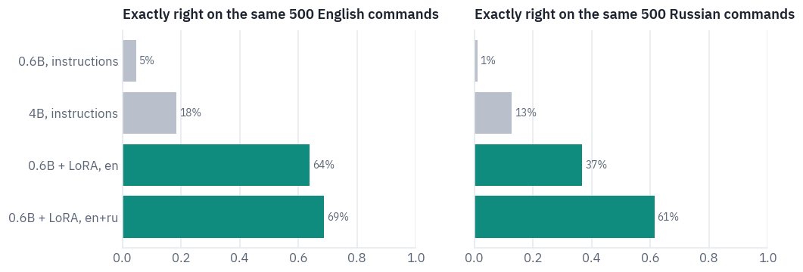

The Russian commands lift the Russian score most of the way to the English one, and English loses nothing; if
anything it gains a little. That brings the 0.6B model close to the paper's models trained on all 51 languages,
which reach 66.2–69.2% exact match in Russian, after a few minutes of training on a free GPU.

The mistakes that are left are worth reading, especially in Russian, where a slot's value is a word in some case
of a declension and has to be copied in exactly that case.

```python
mistakes = []
for row, written in zip(test_ru, outputs["0.6B + LoRA, en+ru", "Russian"]):
    if score([row], [written])["exact"] < 1:
        mistakes.append({"command": row["utt"], "correct": target(row), "model": written})
random.Random(3).shuffle(mistakes)
table(pd.DataFrame(mistakes[:8]))
```

<div class="tfs-table-wrap"><table class="tfs-table" style="border-collapse:collapse;font-family:'IBM Plex Sans', -apple-system, 'Segoe UI', Roboto, Helvetica, Arial, sans-serif;font-size:13.5px;line-height:1.45;margin:4px 0 8px;"><thead><tr><th style="padding:7px 14px;border-bottom:2px solid #B9C0CB;font-weight:600;color:#5B6575;font-size:12px;letter-spacing:0.02em;text-align:left;">command</th><th style="padding:7px 14px;border-bottom:2px solid #B9C0CB;font-weight:600;color:#5B6575;font-size:12px;letter-spacing:0.02em;text-align:left;">correct</th><th style="padding:7px 14px;border-bottom:2px solid #B9C0CB;font-weight:600;color:#5B6575;font-size:12px;letter-spacing:0.02em;text-align:left;">model</th></tr></thead><tbody><tr><td style="padding:7px 14px;border-bottom:1px solid #E6E9EE;vertical-align:top;text-align:left;max-width:460px;white-space:normal;">у меня встреча в полдень сегодня</td><td style="padding:7px 14px;border-bottom:1px solid #E6E9EE;vertical-align:top;text-align:left;max-width:460px;white-space:normal;">{&quot;intent&quot;: &quot;calendar_set&quot;, &quot;slots&quot;: [[&quot;event_name&quot;, &quot;встреча&quot;], [&quot;timeofday&quot;, &quot;полдень&quot;], [&quot;date&quot;, &quot;сегодня&quot;]]}</td><td style="padding:7px 14px;border-bottom:1px solid #E6E9EE;vertical-align:top;text-align:left;max-width:460px;white-space:normal;">{&quot;intent&quot;: &quot;calendar_query&quot;, &quot;slots&quot;: [[&quot;event_name&quot;, &quot;встреча&quot;], [&quot;timeofday&quot;, &quot;полдень&quot;], [&quot;date&quot;, &quot;сегодня&quot;]]}</td></tr><tr><td style="padding:7px 14px;border-bottom:1px solid #E6E9EE;vertical-align:top;text-align:left;max-width:460px;white-space:normal;">музыка король и шут</td><td style="padding:7px 14px;border-bottom:1px solid #E6E9EE;vertical-align:top;text-align:left;max-width:460px;white-space:normal;">{&quot;intent&quot;: &quot;play_music&quot;, &quot;slots&quot;: [[&quot;artist_name&quot;, &quot;король и шут&quot;]]}</td><td style="padding:7px 14px;border-bottom:1px solid #E6E9EE;vertical-align:top;text-align:left;max-width:460px;white-space:normal;">{&quot;intent&quot;: &quot;play_music&quot;, &quot;slots&quot;: [[&quot;song_name&quot;, &quot;король и шут&quot;]]}</td></tr><tr><td style="padding:7px 14px;border-bottom:1px solid #E6E9EE;vertical-align:top;text-align:left;max-width:460px;white-space:normal;">закажи пиццу с колбасками в доминос пицце</td><td style="padding:7px 14px;border-bottom:1px solid #E6E9EE;vertical-align:top;text-align:left;max-width:460px;white-space:normal;">{&quot;intent&quot;: &quot;takeaway_order&quot;, &quot;slots&quot;: [[&quot;food_type&quot;, &quot;пиццу&quot;], [&quot;ingredient&quot;, &quot;колбасками&quot;], [&quot;business_name&quot;, &quot;доминос пицце&quot;]]}</td><td style="padding:7px 14px;border-bottom:1px solid #E6E9EE;vertical-align:top;text-align:left;max-width:460px;white-space:normal;">{&quot;intent&quot;: &quot;takeaway_order&quot;, &quot;slots&quot;: [[&quot;food_type&quot;, &quot;пиццу с колбасками&quot;], [&quot;business_name&quot;, &quot;доминос пицце&quot;]]}</td></tr><tr><td style="padding:7px 14px;border-bottom:1px solid #E6E9EE;vertical-align:top;text-align:left;max-width:460px;white-space:normal;">какие магазины рядом со мной</td><td style="padding:7px 14px;border-bottom:1px solid #E6E9EE;vertical-align:top;text-align:left;max-width:460px;white-space:normal;">{&quot;intent&quot;: &quot;recommendation_locations&quot;, &quot;slots&quot;: [[&quot;business_type&quot;, &quot;магазины&quot;]]}</td><td style="padding:7px 14px;border-bottom:1px solid #E6E9EE;vertical-align:top;text-align:left;max-width:460px;white-space:normal;">{&quot;intent&quot;: &quot;recommendation_locations&quot;, &quot;slots&quot;: []}</td></tr><tr><td style="padding:7px 14px;border-bottom:1px solid #E6E9EE;vertical-align:top;text-align:left;max-width:460px;white-space:normal;">где алла пугачева покупает одежду своим детям</td><td style="padding:7px 14px;border-bottom:1px solid #E6E9EE;vertical-align:top;text-align:left;max-width:460px;white-space:normal;">{&quot;intent&quot;: &quot;general_quirky&quot;, &quot;slots&quot;: [[&quot;person&quot;, &quot;алла пугачева&quot;]]}</td><td style="padding:7px 14px;border-bottom:1px solid #E6E9EE;vertical-align:top;text-align:left;max-width:460px;white-space:normal;">{&quot;intent&quot;: &quot;qa_factoid&quot;, &quot;slots&quot;: [[&quot;person&quot;, &quot;алла пугачева&quot;]]}</td></tr><tr><td style="padding:7px 14px;border-bottom:1px solid #E6E9EE;vertical-align:top;text-align:left;max-width:460px;white-space:normal;">сколько антон готов вложить в мою компанию на собрании которое состоится сегодня в пять двадцать вечера</td><td style="padding:7px 14px;border-bottom:1px solid #E6E9EE;vertical-align:top;text-align:left;max-width:460px;white-space:normal;">{&quot;intent&quot;: &quot;calendar_query&quot;, &quot;slots&quot;: [[&quot;person&quot;, &quot;антон&quot;], [&quot;event_name&quot;, &quot;собрании&quot;], [&quot;date&quot;, &quot;сегодня&quot;], [&quot;time&quot;, &quot;пять двадцать вечера&quot;]]}</td><td style="padding:7px 14px;border-bottom:1px solid #E6E9EE;vertical-align:top;text-align:left;max-width:460px;white-space:normal;">{&quot;intent&quot;: &quot;social_post&quot;, &quot;slots&quot;: [[&quot;person&quot;, &quot;антон&quot;], [&quot;event_name&quot;, &quot;собрании&quot;], [&quot;time&quot;, &quot;пять двадцать вечера&quot;]]}</td></tr><tr><td style="padding:7px 14px;border-bottom:1px solid #E6E9EE;vertical-align:top;text-align:left;max-width:460px;white-space:normal;">восход в москве по владивостокскому времени</td><td style="padding:7px 14px;border-bottom:1px solid #E6E9EE;vertical-align:top;text-align:left;max-width:460px;white-space:normal;">{&quot;intent&quot;: &quot;datetime_convert&quot;, &quot;slots&quot;: [[&quot;time&quot;, &quot;восход&quot;], [&quot;place_name&quot;, &quot;москве&quot;], [&quot;place_name&quot;, &quot;владивостокскому&quot;]]}</td><td style="padding:7px 14px;border-bottom:1px solid #E6E9EE;vertical-align:top;text-align:left;max-width:460px;white-space:normal;">{&quot;intent&quot;: &quot;datetime_convert&quot;, &quot;slots&quot;: [[&quot;place_name&quot;, &quot;восход&quot;], [&quot;place_name&quot;, &quot;москве&quot;], [&quot;place_name&quot;, &quot;владивостокскому&quot;]]}</td></tr><tr><td style="padding:7px 14px;border-bottom:1px solid #E6E9EE;vertical-align:top;text-align:left;max-width:460px;white-space:normal;">хочу побольше узнать о ярмарке на этих выходных</td><td style="padding:7px 14px;border-bottom:1px solid #E6E9EE;vertical-align:top;text-align:left;max-width:460px;white-space:normal;">{&quot;intent&quot;: &quot;general_quirky&quot;, &quot;slots&quot;: [[&quot;date&quot;, &quot;на этих выходных&quot;]]}</td><td style="padding:7px 14px;border-bottom:1px solid #E6E9EE;vertical-align:top;text-align:left;max-width:460px;white-space:normal;">{&quot;intent&quot;: &quot;recommendation_events&quot;, &quot;slots&quot;: [[&quot;event_name&quot;, &quot;ярмарке&quot;], [&quot;date&quot;, &quot;на этих выходных&quot;]]}</td></tr></tbody></table></div>

None of these mistakes is about grammar. The model copies every value in the form the command has it, *колбасками*, *москве*, *владивостокскому*. What it gets wrong is the annotation.

Some are plain errors: Король и Шут is a band, not a song, and *магазины* should have been marked as a type of business. Some are boundaries: is the order *пиццу с колбасками*, or a pizza plus an ingredient?

And some are judgement calls where the reference itself is debatable: does "у меня встреча в полдень сегодня" add a meeting or ask about one, and is a question about where Alla Pugacheva buys her children's clothes a quirky remark or a factual question?

Part of the distance between two thirds right and all right is disagreement of this kind, which no model will remove.

## 9. Where these models are the right tool

Every model in this lesson is a decoder, and by now they differ less in what they are than in how they spend memory. That makes the config the first thing to read when you choose one.

Two models with the same number of parameters can need very different amounts of memory per conversation: count the key-value heads, the head size and the local layers, as section 3 did, and you know how many users and how much context fit on your GPU before you download a single weight.

Lesson 8 does that sum for a T4 and adds DeepSeek's latent attention, which compresses the cache further still.

For a narrow job with a fixed format, such as extraction, routing, classification with a reason, or turning text into a call to your own API, a small model with LoRA is the cheapest thing that works.

Here it beat a model seven times its size that was given the task in words, and it learned the Russian version of the job from a few minutes of examples.

The adapter is a few dozen megabytes, so one base model in memory can serve many jobs by swapping adapters, and after merging it runs as fast as the base model.

For anything that needs knowledge or open reasoning, size matters more than any trick in this lesson. A 0.6B model
knows what fits in 0.6 billion numbers, and thinking mode buys accuracy with tokens, which on a long problem means
thousands of them.

The tricks themselves are now the default, and you will rarely choose them: nearly every new model shares its keys and values among query heads, by grouped queries or, in DeepSeek's models, by compressing them; QK-norm is common, and local layers are spreading.

What this lesson left out is the next step in each direction. gpt-oss and the larger Qwen3 models are mixtures of experts, which spend only a fraction of their parameters on each token: lesson 7. Long context, and the RoPE bases of a hundred million in the table of section 1, are lesson 9.

Qwen3's passport, and the family tree with this lesson's branch:


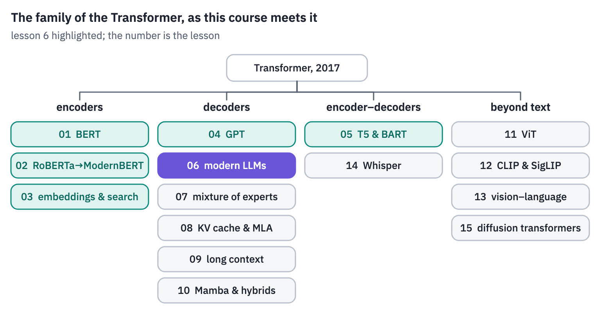
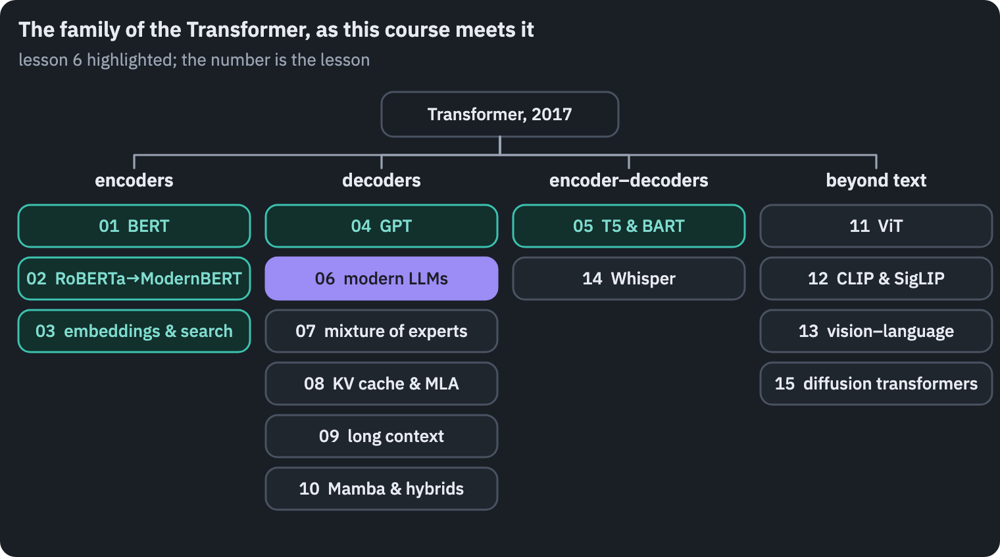

## References

1. {:#ref-1} Shazeer, N. (2019). [Fast Transformer decoding: one write-head is all you need](https://arxiv.org/abs/1911.02150). arXiv:1911.02150. <a class="ref-back" href="#cite-1" aria-label="Back to the text">&#8617;</a>
2. {:#ref-2} Ainslie, J., Lee-Thorp, J., de Jong, M., Zemlyanskiy, Y., Lebrón, F., & Sanghai, S. (2023). [GQA: training generalized multi-query Transformer models from multi-head checkpoints](https://arxiv.org/abs/2305.13245). *EMNLP 2023*. <a class="ref-back" href="#cite-2" aria-label="Back to the text">&#8617;</a>
3. {:#ref-3} Dehghani, M., Djolonga, J., Mustafa, B., et al. (2023). [Scaling vision Transformers to 22 billion parameters](https://arxiv.org/abs/2302.05442). *ICML 2023*. <a class="ref-back" href="#cite-3" aria-label="Back to the text">&#8617;</a>
4. {:#ref-4} Gemma Team (2024). [Gemma 2: improving open language models at a practical size](https://arxiv.org/abs/2408.00118). arXiv:2408.00118. <a class="ref-back" href="#cite-4" aria-label="Back to the text">&#8617;</a>
5. {:#ref-5} Gemma Team (2025). [Gemma 3 technical report](https://arxiv.org/abs/2503.19786). arXiv:2503.19786. <a class="ref-back" href="#cite-5" aria-label="Back to the text">&#8617;</a>
6. {:#ref-6} Wortsman, M., Liu, P. J., Xiao, L., et al. (2023). [Small-scale proxies for large-scale Transformer training instabilities](https://arxiv.org/abs/2309.14322). *ICLR 2024*. <a class="ref-back" href="#cite-6" aria-label="Back to the text">&#8617;</a>
7. {:#ref-7} Qwen Team (2025). [Qwen3 technical report](https://arxiv.org/abs/2505.09388). arXiv:2505.09388. <a class="ref-back" href="#cite-7" aria-label="Back to the text">&#8617;</a>
8. {:#ref-8} Jiang, A. Q., Sablayrolles, A., Mensch, A., et al. (2023). [Mistral 7B](https://arxiv.org/abs/2310.06825). arXiv:2310.06825. <a class="ref-back" href="#cite-8" aria-label="Back to the text">&#8617;</a>
9. {:#ref-9} Xiao, G., Tian, Y., Chen, B., Han, S., & Lewis, M. (2023). [Efficient streaming language models with attention sinks](https://arxiv.org/abs/2309.17453). *ICLR 2024*. <a class="ref-back" href="#cite-9" aria-label="Back to the text">&#8617;</a>
10. {:#ref-10} OpenAI (2025). [gpt-oss-120b & gpt-oss-20b model card](https://arxiv.org/abs/2508.10925). arXiv:2508.10925. <a class="ref-back" href="#cite-10" aria-label="Back to the text">&#8617;</a>
11. {:#ref-11} FitzGerald, J., Hench, C., Peris, C., et al. (2022). [MASSIVE: a 1M-example multilingual natural language understanding dataset with 51 typologically-diverse languages](https://arxiv.org/abs/2204.08582). *ACL 2023*. Data: [github.com/alexa/massive](https://github.com/alexa/massive), CC BY 4.0. <a class="ref-back" href="#cite-11" aria-label="Back to the text">&#8617;</a>
12. {:#ref-12} Hu, E. J., Shen, Y., Wallis, P., Allen-Zhu, Z., Li, Y., Wang, S., Wang, L., & Chen, W. (2021). [LoRA: low-rank adaptation of large language models](https://arxiv.org/abs/2106.09685). *ICLR 2022*. <a class="ref-back" href="#cite-12" aria-label="Back to the text">&#8617;</a>
13. {:#ref-13} OLMo Team (2024). [2 OLMo 2 furious](https://arxiv.org/abs/2501.00656). arXiv:2501.00656.
{: .tfs-refs}


<p class="tfs-neighbours"><a href="/blog/2026/transformer-architectures-05-t5/">← Lesson 5: T5 & BART</a></p>


