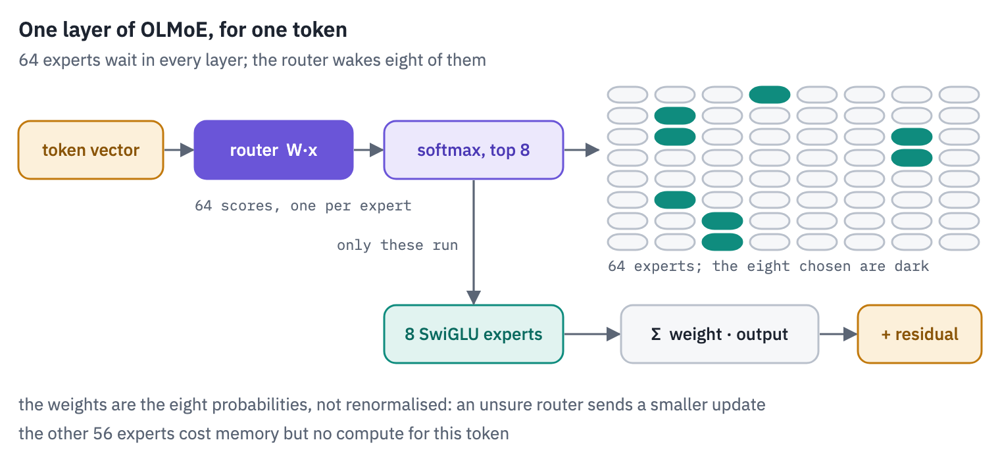
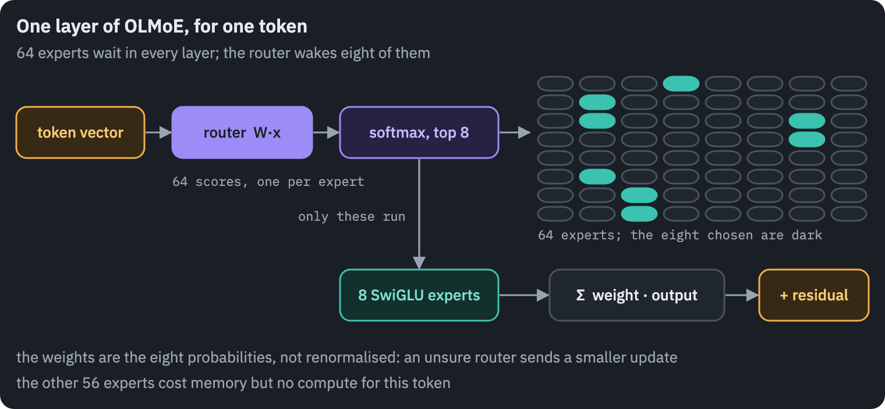
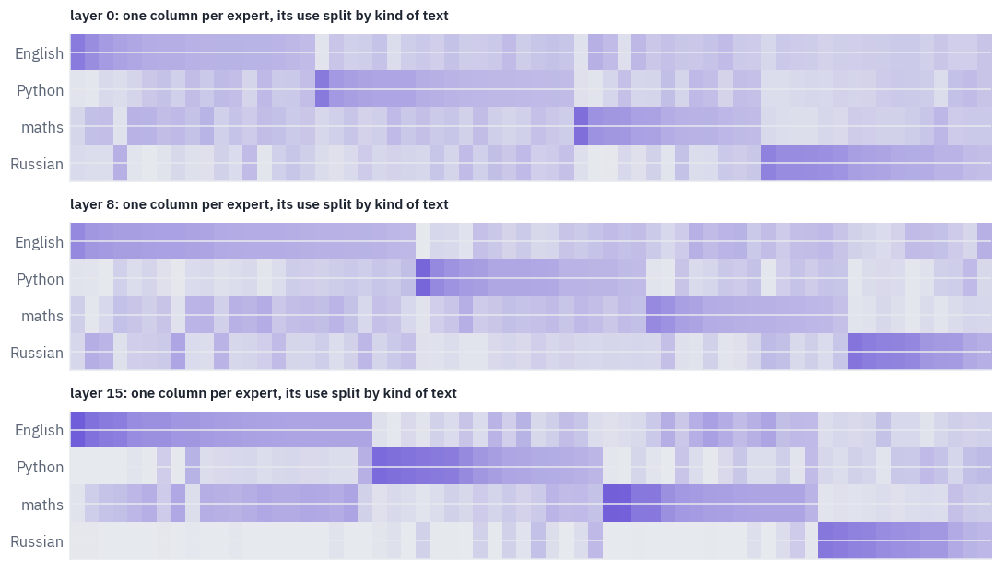
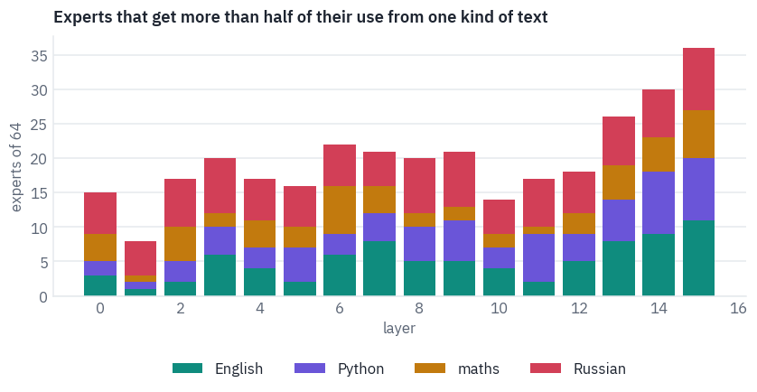
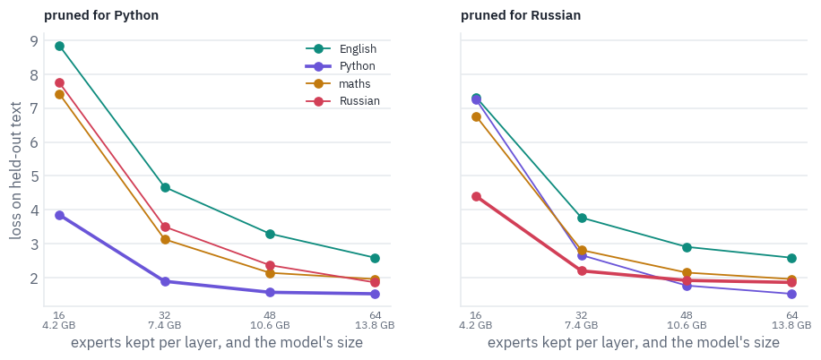
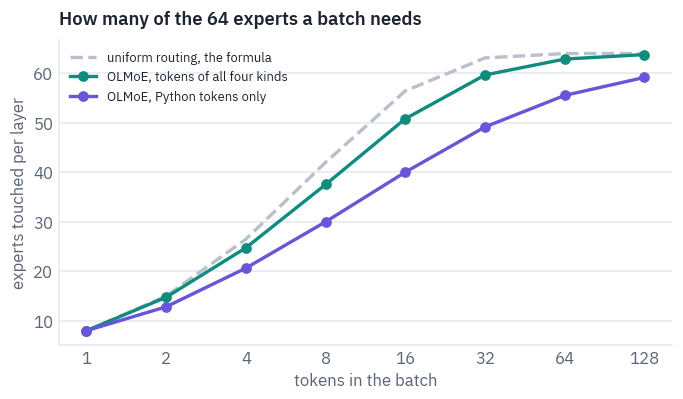
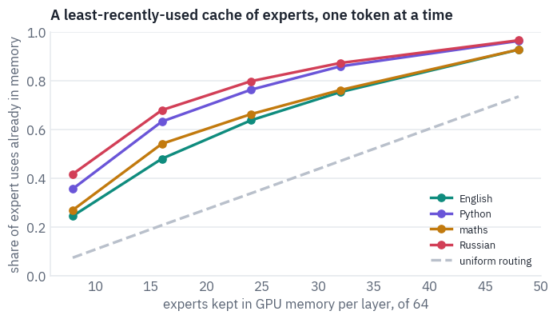
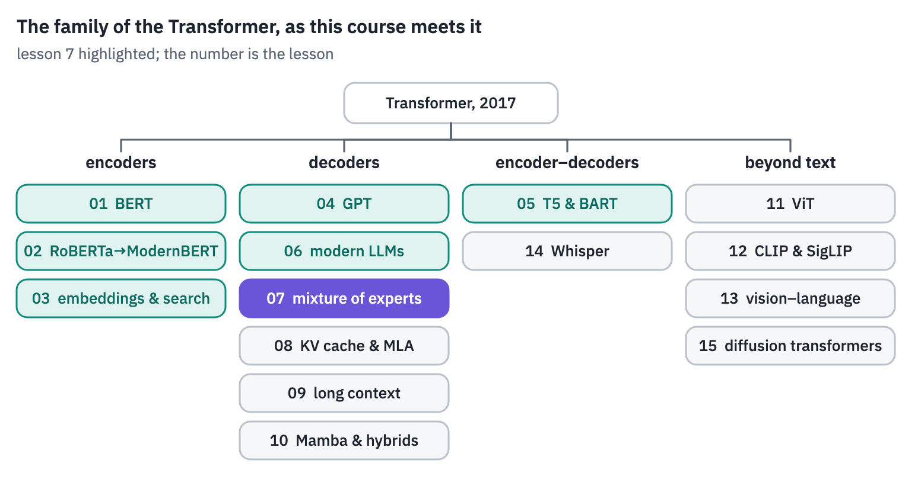
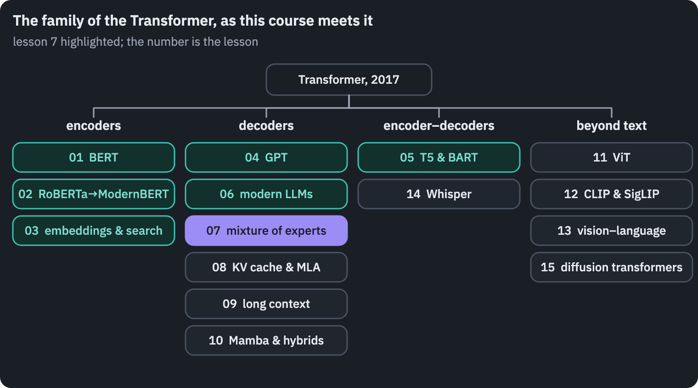



<p class="tfs-links"><strong>Transformer architectures: from BERT to diffusion</strong> · lesson 7 of 15 · <a href="/teaching/">all lessons</a> · <a href="https://www.kaggle.com/code/qmarva/transformer-architectures-07-mixture-of-experts">run on Kaggle</a> · <a href="https://colab.research.google.com/github/xmarva/transformers-from-scratch/blob/main/notebooks/colab/a07_moe.ipynb">open in Colab</a> · <a href="https://github.com/xmarva/transformers-from-scratch">code on GitHub</a></p>

OLMoE-1B-7B has seven billion parameters and uses about one and a third billion of them for each token. Every one of its sixteen layers holds 64 feed-forward networks, the *experts*, and a small linear layer, the *router*, picks eight of them for each token.

Nobody tells the router what an expert is for. Whatever division of labour the experts end up with, they found it themselves during training on five trillion tokens.

In a dense model every token goes through every weight, so there is nothing to watch. A mixture can be watched: feed it Python and see which experts light up, feed it Russian, a language it barely saw in training, and watch again.

Then you can act on what you saw, throw away the experts a job doesn't use, and keep a smaller model that still does the job.

A [post on this blog](https://blog.korolevalab.com/blog/2026/mixture-of-experts/) built a mixture of experts from
scratch, trained it next to dense models and compared the ways of keeping its experts busy. This lesson takes the
next step, to a real model trained at scale: we read how nine production mixtures are built, write OLMoE in
PyTorch, load the official weights and look inside.




**What you'll do**

1. Read the configs of nine mixtures, from Mixtral to gpt-oss, and see how the design moved.
2. Write the router four ways, find out which of them are the same function, and dispatch tokens to experts
   without computing what nobody asked for.
3. Write OLMoE in PyTorch, load its official weights across two GPUs and match Hugging Face's outputs.
4. Route English, Python, school maths and Russian through it and find out which experts each one uses.
5. Prune the experts a single kind of text doesn't use, and measure what a smaller model costs.
6. Measure how often a token needs the same experts as the token before it, which decides whether a mixture can
   live partly outside GPU memory.

**What you need**: two GPUs. On Kaggle, *Settings → Accelerator → GPU T4 x2*; OLMoE's weights take 13 GB in 16-bit
floats, more than one T4 has to spare. The notebook downloads OLMoE (14 GB), a slice of Russian Wikipedia (250 MB)
and two small datasets; on two T4s it runs in about five minutes.

## Setup

One small helper package, `tfs`, draws the course's plots and token chips and knows where the notebook runs
(Kaggle, Colab or your own machine). Everything the lesson teaches is written out in the notebook itself.

```python
import importlib.util
import subprocess
import sys

TFS = "git+https://github.com/xmarva/transformers-from-scratch@main"
if importlib.util.find_spec("tfs") is None:
    subprocess.check_call([sys.executable, "-m", "pip", "install", "-q", TFS])

from tfs import env
from tfs.viz import table, token_chips, use_course_style

env.quiet()  # no progress bars or environment warnings in the outputs
SEED = 42
env.seed_everything(SEED)
COLORS = use_course_style()
WORK_DIR = env.work_dir()
```

```python
import json
import re
import subprocess
import sys
import sysconfig
import time
from collections import OrderedDict
from html import escape
from pathlib import Path

import matplotlib.pyplot as plt
import numpy as np
import pandas as pd
import pyarrow.parquet as pq
import torch
import torch.nn as nn
import torch.nn.functional as F
from IPython.display import HTML, display
from matplotlib.colors import LinearSegmentedColormap, to_rgb
from huggingface_hub import hf_hub_download
from safetensors.torch import load_file
from transformers import AutoTokenizer

SMOKE = env.smoke()  # CI runs the lesson on a small slice; you run it in full
device = "cuda" if torch.cuda.is_available() else "cpu"
GPUS = [f"cuda:{i}" for i in range(torch.cuda.device_count())] or ["cpu"]
HALF = torch.float16 if device == "cuda" else torch.float32  # 16-bit matmuls crawl on a CPU
assert device == "cuda" or SMOKE, "This lesson runs a 7B model: use two GPUs"
for name in GPUS:
    if name != "cpu":
        print(name, torch.cuda.get_device_name(name))
```

<pre class="tfs-printed" markdown="0"><code>cuda:0 Tesla T4
cuda:1 Tesla T4</code></pre>

## 1. Nine mixtures side by side

As in lesson 6, the fastest way to read an architecture is its `config.json`. Here are the configs of nine
mixtures released between December 2023 and August 2025, with the total and active parameter counts their papers
and model cards give. Every model calls its settings a little differently, so the reading takes a few lines.

```python
# repository, name, released, total / active parameters from the paper or the model card
MOE_MODELS = [
    ("mistralai/Mixtral-8x7B-v0.1", "Mixtral 8x7B", "2023-12", "47B / 13B"),
    ("Qwen/Qwen1.5-MoE-A2.7B", "Qwen1.5-MoE", "2024-03", "14.3B / 2.7B"),
    ("deepseek-ai/DeepSeek-V2-Lite", "DeepSeek-V2-Lite", "2024-05", "15.7B / 2.4B"),
    ("allenai/OLMoE-1B-7B-0924", "OLMoE", "2024-09", "6.9B / 1.3B"),
    ("ibm-granite/granite-3.1-3b-a800m-base", "Granite 3.1 3B", "2024-12", "3.3B / 0.8B"),
    ("deepseek-ai/DeepSeek-V3", "DeepSeek-V3", "2024-12", "671B / 37B"),
    ("Qwen/Qwen3-30B-A3B", "Qwen3-30B-A3B", "2025-04", "30.5B / 3.3B"),
    ("openai/gpt-oss-20b", "gpt-oss-20b", "2025-08", "20.9B / 3.6B"),
    ("openai/gpt-oss-120b", "gpt-oss-120b", "2025-08", "116.8B / 5.1B"),
]


def read_config(repo):
    with open(hf_hub_download(repo, "config.json")) as f:
        return json.load(f)


def first(c, *keys, default=0):
    for key in keys:
        if c.get(key) is not None:
            return c[key]
    return default


def router_order(c):
    kind = c["model_type"]
    if kind in ("granitemoe", "gpt_oss"):
        return "top-k, softmax"
    if c.get("scoring_func") == "sigmoid":
        return "sigmoid + bias, top-k, renormalise"
    renorm = kind == "mixtral" or c.get("norm_topk_prob")
    return "softmax, top-k" + (", renormalise" if renorm else "")


configs = {name: read_config(repo) for repo, name, _, _ in MOE_MODELS}
rows = []
for _, name, released, sizes in MOE_MODELS:
    c = configs[name]
    experts = first(c, "num_local_experts", "num_experts", "n_routed_experts")
    top_k = c["num_experts_per_tok"]
    shared = first(c, "n_shared_experts")
    if c.get("shared_expert_intermediate_size"):
        shared = c["shared_expert_intermediate_size"] // first(c, "moe_intermediate_size")
    rows.append(
        {
            "model": name,
            "released": released,
            "total / active": sizes,
            "layers": c["num_hidden_layers"],
            "dense layers": first(c, "first_k_dense_replace"),
            "experts": experts,
            "per token": top_k,
            "shared": shared,
            "expert width": first(c, "moe_intermediate_size", "intermediate_size"),
            "model width": c["hidden_size"],
            "router": router_order(c),
        }
    )
table(pd.DataFrame(rows))
```

<div class="tfs-table-wrap"><table class="tfs-table" style="border-collapse:collapse;font-family:'IBM Plex Sans', -apple-system, 'Segoe UI', Roboto, Helvetica, Arial, sans-serif;font-size:13.5px;line-height:1.45;margin:4px 0 8px;"><thead><tr><th style="padding:7px 14px;border-bottom:2px solid #B9C0CB;font-weight:600;color:#5B6575;font-size:12px;letter-spacing:0.02em;text-align:left;">model</th><th style="padding:7px 14px;border-bottom:2px solid #B9C0CB;font-weight:600;color:#5B6575;font-size:12px;letter-spacing:0.02em;text-align:left;">released</th><th style="padding:7px 14px;border-bottom:2px solid #B9C0CB;font-weight:600;color:#5B6575;font-size:12px;letter-spacing:0.02em;text-align:left;">total / active</th><th style="padding:7px 14px;border-bottom:2px solid #B9C0CB;font-weight:600;color:#5B6575;font-size:12px;letter-spacing:0.02em;text-align:right;">layers</th><th style="padding:7px 14px;border-bottom:2px solid #B9C0CB;font-weight:600;color:#5B6575;font-size:12px;letter-spacing:0.02em;text-align:right;">dense layers</th><th style="padding:7px 14px;border-bottom:2px solid #B9C0CB;font-weight:600;color:#5B6575;font-size:12px;letter-spacing:0.02em;text-align:right;">experts</th><th style="padding:7px 14px;border-bottom:2px solid #B9C0CB;font-weight:600;color:#5B6575;font-size:12px;letter-spacing:0.02em;text-align:right;">per token</th><th style="padding:7px 14px;border-bottom:2px solid #B9C0CB;font-weight:600;color:#5B6575;font-size:12px;letter-spacing:0.02em;text-align:right;">shared</th><th style="padding:7px 14px;border-bottom:2px solid #B9C0CB;font-weight:600;color:#5B6575;font-size:12px;letter-spacing:0.02em;text-align:right;">expert width</th><th style="padding:7px 14px;border-bottom:2px solid #B9C0CB;font-weight:600;color:#5B6575;font-size:12px;letter-spacing:0.02em;text-align:right;">model width</th><th style="padding:7px 14px;border-bottom:2px solid #B9C0CB;font-weight:600;color:#5B6575;font-size:12px;letter-spacing:0.02em;text-align:left;">router</th></tr></thead><tbody><tr><td style="padding:7px 14px;border-bottom:1px solid #E6E9EE;vertical-align:top;text-align:left;max-width:460px;white-space:normal;">Mixtral 8x7B</td><td style="padding:7px 14px;border-bottom:1px solid #E6E9EE;vertical-align:top;text-align:left;max-width:460px;white-space:normal;">2023-12</td><td style="padding:7px 14px;border-bottom:1px solid #E6E9EE;vertical-align:top;text-align:left;max-width:460px;white-space:normal;">47B / 13B</td><td style="padding:7px 14px;border-bottom:1px solid #E6E9EE;vertical-align:top;text-align:right;font-variant-numeric:tabular-nums;max-width:460px;white-space:normal;">32</td><td style="padding:7px 14px;border-bottom:1px solid #E6E9EE;vertical-align:top;text-align:right;font-variant-numeric:tabular-nums;max-width:460px;white-space:normal;">0</td><td style="padding:7px 14px;border-bottom:1px solid #E6E9EE;vertical-align:top;text-align:right;font-variant-numeric:tabular-nums;max-width:460px;white-space:normal;">8</td><td style="padding:7px 14px;border-bottom:1px solid #E6E9EE;vertical-align:top;text-align:right;font-variant-numeric:tabular-nums;max-width:460px;white-space:normal;">2</td><td style="padding:7px 14px;border-bottom:1px solid #E6E9EE;vertical-align:top;text-align:right;font-variant-numeric:tabular-nums;max-width:460px;white-space:normal;">0</td><td style="padding:7px 14px;border-bottom:1px solid #E6E9EE;vertical-align:top;text-align:right;font-variant-numeric:tabular-nums;max-width:460px;white-space:normal;">14,336</td><td style="padding:7px 14px;border-bottom:1px solid #E6E9EE;vertical-align:top;text-align:right;font-variant-numeric:tabular-nums;max-width:460px;white-space:normal;">4,096</td><td style="padding:7px 14px;border-bottom:1px solid #E6E9EE;vertical-align:top;text-align:left;max-width:460px;white-space:normal;">softmax, top-k, renormalise</td></tr><tr><td style="padding:7px 14px;border-bottom:1px solid #E6E9EE;vertical-align:top;text-align:left;max-width:460px;white-space:normal;">Qwen1.5-MoE</td><td style="padding:7px 14px;border-bottom:1px solid #E6E9EE;vertical-align:top;text-align:left;max-width:460px;white-space:normal;">2024-03</td><td style="padding:7px 14px;border-bottom:1px solid #E6E9EE;vertical-align:top;text-align:left;max-width:460px;white-space:normal;">14.3B / 2.7B</td><td style="padding:7px 14px;border-bottom:1px solid #E6E9EE;vertical-align:top;text-align:right;font-variant-numeric:tabular-nums;max-width:460px;white-space:normal;">24</td><td style="padding:7px 14px;border-bottom:1px solid #E6E9EE;vertical-align:top;text-align:right;font-variant-numeric:tabular-nums;max-width:460px;white-space:normal;">0</td><td style="padding:7px 14px;border-bottom:1px solid #E6E9EE;vertical-align:top;text-align:right;font-variant-numeric:tabular-nums;max-width:460px;white-space:normal;">60</td><td style="padding:7px 14px;border-bottom:1px solid #E6E9EE;vertical-align:top;text-align:right;font-variant-numeric:tabular-nums;max-width:460px;white-space:normal;">4</td><td style="padding:7px 14px;border-bottom:1px solid #E6E9EE;vertical-align:top;text-align:right;font-variant-numeric:tabular-nums;max-width:460px;white-space:normal;">4</td><td style="padding:7px 14px;border-bottom:1px solid #E6E9EE;vertical-align:top;text-align:right;font-variant-numeric:tabular-nums;max-width:460px;white-space:normal;">1,408</td><td style="padding:7px 14px;border-bottom:1px solid #E6E9EE;vertical-align:top;text-align:right;font-variant-numeric:tabular-nums;max-width:460px;white-space:normal;">2,048</td><td style="padding:7px 14px;border-bottom:1px solid #E6E9EE;vertical-align:top;text-align:left;max-width:460px;white-space:normal;">softmax, top-k</td></tr><tr><td style="padding:7px 14px;border-bottom:1px solid #E6E9EE;vertical-align:top;text-align:left;max-width:460px;white-space:normal;">DeepSeek-V2-Lite</td><td style="padding:7px 14px;border-bottom:1px solid #E6E9EE;vertical-align:top;text-align:left;max-width:460px;white-space:normal;">2024-05</td><td style="padding:7px 14px;border-bottom:1px solid #E6E9EE;vertical-align:top;text-align:left;max-width:460px;white-space:normal;">15.7B / 2.4B</td><td style="padding:7px 14px;border-bottom:1px solid #E6E9EE;vertical-align:top;text-align:right;font-variant-numeric:tabular-nums;max-width:460px;white-space:normal;">27</td><td style="padding:7px 14px;border-bottom:1px solid #E6E9EE;vertical-align:top;text-align:right;font-variant-numeric:tabular-nums;max-width:460px;white-space:normal;">1</td><td style="padding:7px 14px;border-bottom:1px solid #E6E9EE;vertical-align:top;text-align:right;font-variant-numeric:tabular-nums;max-width:460px;white-space:normal;">64</td><td style="padding:7px 14px;border-bottom:1px solid #E6E9EE;vertical-align:top;text-align:right;font-variant-numeric:tabular-nums;max-width:460px;white-space:normal;">6</td><td style="padding:7px 14px;border-bottom:1px solid #E6E9EE;vertical-align:top;text-align:right;font-variant-numeric:tabular-nums;max-width:460px;white-space:normal;">2</td><td style="padding:7px 14px;border-bottom:1px solid #E6E9EE;vertical-align:top;text-align:right;font-variant-numeric:tabular-nums;max-width:460px;white-space:normal;">1,408</td><td style="padding:7px 14px;border-bottom:1px solid #E6E9EE;vertical-align:top;text-align:right;font-variant-numeric:tabular-nums;max-width:460px;white-space:normal;">2,048</td><td style="padding:7px 14px;border-bottom:1px solid #E6E9EE;vertical-align:top;text-align:left;max-width:460px;white-space:normal;">softmax, top-k</td></tr><tr><td style="padding:7px 14px;border-bottom:1px solid #E6E9EE;vertical-align:top;text-align:left;max-width:460px;white-space:normal;">OLMoE</td><td style="padding:7px 14px;border-bottom:1px solid #E6E9EE;vertical-align:top;text-align:left;max-width:460px;white-space:normal;">2024-09</td><td style="padding:7px 14px;border-bottom:1px solid #E6E9EE;vertical-align:top;text-align:left;max-width:460px;white-space:normal;">6.9B / 1.3B</td><td style="padding:7px 14px;border-bottom:1px solid #E6E9EE;vertical-align:top;text-align:right;font-variant-numeric:tabular-nums;max-width:460px;white-space:normal;">16</td><td style="padding:7px 14px;border-bottom:1px solid #E6E9EE;vertical-align:top;text-align:right;font-variant-numeric:tabular-nums;max-width:460px;white-space:normal;">0</td><td style="padding:7px 14px;border-bottom:1px solid #E6E9EE;vertical-align:top;text-align:right;font-variant-numeric:tabular-nums;max-width:460px;white-space:normal;">64</td><td style="padding:7px 14px;border-bottom:1px solid #E6E9EE;vertical-align:top;text-align:right;font-variant-numeric:tabular-nums;max-width:460px;white-space:normal;">8</td><td style="padding:7px 14px;border-bottom:1px solid #E6E9EE;vertical-align:top;text-align:right;font-variant-numeric:tabular-nums;max-width:460px;white-space:normal;">0</td><td style="padding:7px 14px;border-bottom:1px solid #E6E9EE;vertical-align:top;text-align:right;font-variant-numeric:tabular-nums;max-width:460px;white-space:normal;">1,024</td><td style="padding:7px 14px;border-bottom:1px solid #E6E9EE;vertical-align:top;text-align:right;font-variant-numeric:tabular-nums;max-width:460px;white-space:normal;">2,048</td><td style="padding:7px 14px;border-bottom:1px solid #E6E9EE;vertical-align:top;text-align:left;max-width:460px;white-space:normal;">softmax, top-k</td></tr><tr><td style="padding:7px 14px;border-bottom:1px solid #E6E9EE;vertical-align:top;text-align:left;max-width:460px;white-space:normal;">Granite 3.1 3B</td><td style="padding:7px 14px;border-bottom:1px solid #E6E9EE;vertical-align:top;text-align:left;max-width:460px;white-space:normal;">2024-12</td><td style="padding:7px 14px;border-bottom:1px solid #E6E9EE;vertical-align:top;text-align:left;max-width:460px;white-space:normal;">3.3B / 0.8B</td><td style="padding:7px 14px;border-bottom:1px solid #E6E9EE;vertical-align:top;text-align:right;font-variant-numeric:tabular-nums;max-width:460px;white-space:normal;">32</td><td style="padding:7px 14px;border-bottom:1px solid #E6E9EE;vertical-align:top;text-align:right;font-variant-numeric:tabular-nums;max-width:460px;white-space:normal;">0</td><td style="padding:7px 14px;border-bottom:1px solid #E6E9EE;vertical-align:top;text-align:right;font-variant-numeric:tabular-nums;max-width:460px;white-space:normal;">40</td><td style="padding:7px 14px;border-bottom:1px solid #E6E9EE;vertical-align:top;text-align:right;font-variant-numeric:tabular-nums;max-width:460px;white-space:normal;">8</td><td style="padding:7px 14px;border-bottom:1px solid #E6E9EE;vertical-align:top;text-align:right;font-variant-numeric:tabular-nums;max-width:460px;white-space:normal;">0</td><td style="padding:7px 14px;border-bottom:1px solid #E6E9EE;vertical-align:top;text-align:right;font-variant-numeric:tabular-nums;max-width:460px;white-space:normal;">512</td><td style="padding:7px 14px;border-bottom:1px solid #E6E9EE;vertical-align:top;text-align:right;font-variant-numeric:tabular-nums;max-width:460px;white-space:normal;">1,536</td><td style="padding:7px 14px;border-bottom:1px solid #E6E9EE;vertical-align:top;text-align:left;max-width:460px;white-space:normal;">top-k, softmax</td></tr><tr><td style="padding:7px 14px;border-bottom:1px solid #E6E9EE;vertical-align:top;text-align:left;max-width:460px;white-space:normal;">DeepSeek-V3</td><td style="padding:7px 14px;border-bottom:1px solid #E6E9EE;vertical-align:top;text-align:left;max-width:460px;white-space:normal;">2024-12</td><td style="padding:7px 14px;border-bottom:1px solid #E6E9EE;vertical-align:top;text-align:left;max-width:460px;white-space:normal;">671B / 37B</td><td style="padding:7px 14px;border-bottom:1px solid #E6E9EE;vertical-align:top;text-align:right;font-variant-numeric:tabular-nums;max-width:460px;white-space:normal;">61</td><td style="padding:7px 14px;border-bottom:1px solid #E6E9EE;vertical-align:top;text-align:right;font-variant-numeric:tabular-nums;max-width:460px;white-space:normal;">3</td><td style="padding:7px 14px;border-bottom:1px solid #E6E9EE;vertical-align:top;text-align:right;font-variant-numeric:tabular-nums;max-width:460px;white-space:normal;">256</td><td style="padding:7px 14px;border-bottom:1px solid #E6E9EE;vertical-align:top;text-align:right;font-variant-numeric:tabular-nums;max-width:460px;white-space:normal;">8</td><td style="padding:7px 14px;border-bottom:1px solid #E6E9EE;vertical-align:top;text-align:right;font-variant-numeric:tabular-nums;max-width:460px;white-space:normal;">1</td><td style="padding:7px 14px;border-bottom:1px solid #E6E9EE;vertical-align:top;text-align:right;font-variant-numeric:tabular-nums;max-width:460px;white-space:normal;">2,048</td><td style="padding:7px 14px;border-bottom:1px solid #E6E9EE;vertical-align:top;text-align:right;font-variant-numeric:tabular-nums;max-width:460px;white-space:normal;">7,168</td><td style="padding:7px 14px;border-bottom:1px solid #E6E9EE;vertical-align:top;text-align:left;max-width:460px;white-space:normal;">sigmoid + bias, top-k, renormalise</td></tr><tr><td style="padding:7px 14px;border-bottom:1px solid #E6E9EE;vertical-align:top;text-align:left;max-width:460px;white-space:normal;">Qwen3-30B-A3B</td><td style="padding:7px 14px;border-bottom:1px solid #E6E9EE;vertical-align:top;text-align:left;max-width:460px;white-space:normal;">2025-04</td><td style="padding:7px 14px;border-bottom:1px solid #E6E9EE;vertical-align:top;text-align:left;max-width:460px;white-space:normal;">30.5B / 3.3B</td><td style="padding:7px 14px;border-bottom:1px solid #E6E9EE;vertical-align:top;text-align:right;font-variant-numeric:tabular-nums;max-width:460px;white-space:normal;">48</td><td style="padding:7px 14px;border-bottom:1px solid #E6E9EE;vertical-align:top;text-align:right;font-variant-numeric:tabular-nums;max-width:460px;white-space:normal;">0</td><td style="padding:7px 14px;border-bottom:1px solid #E6E9EE;vertical-align:top;text-align:right;font-variant-numeric:tabular-nums;max-width:460px;white-space:normal;">128</td><td style="padding:7px 14px;border-bottom:1px solid #E6E9EE;vertical-align:top;text-align:right;font-variant-numeric:tabular-nums;max-width:460px;white-space:normal;">8</td><td style="padding:7px 14px;border-bottom:1px solid #E6E9EE;vertical-align:top;text-align:right;font-variant-numeric:tabular-nums;max-width:460px;white-space:normal;">0</td><td style="padding:7px 14px;border-bottom:1px solid #E6E9EE;vertical-align:top;text-align:right;font-variant-numeric:tabular-nums;max-width:460px;white-space:normal;">768</td><td style="padding:7px 14px;border-bottom:1px solid #E6E9EE;vertical-align:top;text-align:right;font-variant-numeric:tabular-nums;max-width:460px;white-space:normal;">2,048</td><td style="padding:7px 14px;border-bottom:1px solid #E6E9EE;vertical-align:top;text-align:left;max-width:460px;white-space:normal;">softmax, top-k, renormalise</td></tr><tr><td style="padding:7px 14px;border-bottom:1px solid #E6E9EE;vertical-align:top;text-align:left;max-width:460px;white-space:normal;">gpt-oss-20b</td><td style="padding:7px 14px;border-bottom:1px solid #E6E9EE;vertical-align:top;text-align:left;max-width:460px;white-space:normal;">2025-08</td><td style="padding:7px 14px;border-bottom:1px solid #E6E9EE;vertical-align:top;text-align:left;max-width:460px;white-space:normal;">20.9B / 3.6B</td><td style="padding:7px 14px;border-bottom:1px solid #E6E9EE;vertical-align:top;text-align:right;font-variant-numeric:tabular-nums;max-width:460px;white-space:normal;">24</td><td style="padding:7px 14px;border-bottom:1px solid #E6E9EE;vertical-align:top;text-align:right;font-variant-numeric:tabular-nums;max-width:460px;white-space:normal;">0</td><td style="padding:7px 14px;border-bottom:1px solid #E6E9EE;vertical-align:top;text-align:right;font-variant-numeric:tabular-nums;max-width:460px;white-space:normal;">32</td><td style="padding:7px 14px;border-bottom:1px solid #E6E9EE;vertical-align:top;text-align:right;font-variant-numeric:tabular-nums;max-width:460px;white-space:normal;">4</td><td style="padding:7px 14px;border-bottom:1px solid #E6E9EE;vertical-align:top;text-align:right;font-variant-numeric:tabular-nums;max-width:460px;white-space:normal;">0</td><td style="padding:7px 14px;border-bottom:1px solid #E6E9EE;vertical-align:top;text-align:right;font-variant-numeric:tabular-nums;max-width:460px;white-space:normal;">2,880</td><td style="padding:7px 14px;border-bottom:1px solid #E6E9EE;vertical-align:top;text-align:right;font-variant-numeric:tabular-nums;max-width:460px;white-space:normal;">2,880</td><td style="padding:7px 14px;border-bottom:1px solid #E6E9EE;vertical-align:top;text-align:left;max-width:460px;white-space:normal;">top-k, softmax</td></tr><tr><td style="padding:7px 14px;border-bottom:1px solid #E6E9EE;vertical-align:top;text-align:left;max-width:460px;white-space:normal;">gpt-oss-120b</td><td style="padding:7px 14px;border-bottom:1px solid #E6E9EE;vertical-align:top;text-align:left;max-width:460px;white-space:normal;">2025-08</td><td style="padding:7px 14px;border-bottom:1px solid #E6E9EE;vertical-align:top;text-align:left;max-width:460px;white-space:normal;">116.8B / 5.1B</td><td style="padding:7px 14px;border-bottom:1px solid #E6E9EE;vertical-align:top;text-align:right;font-variant-numeric:tabular-nums;max-width:460px;white-space:normal;">36</td><td style="padding:7px 14px;border-bottom:1px solid #E6E9EE;vertical-align:top;text-align:right;font-variant-numeric:tabular-nums;max-width:460px;white-space:normal;">0</td><td style="padding:7px 14px;border-bottom:1px solid #E6E9EE;vertical-align:top;text-align:right;font-variant-numeric:tabular-nums;max-width:460px;white-space:normal;">128</td><td style="padding:7px 14px;border-bottom:1px solid #E6E9EE;vertical-align:top;text-align:right;font-variant-numeric:tabular-nums;max-width:460px;white-space:normal;">4</td><td style="padding:7px 14px;border-bottom:1px solid #E6E9EE;vertical-align:top;text-align:right;font-variant-numeric:tabular-nums;max-width:460px;white-space:normal;">0</td><td style="padding:7px 14px;border-bottom:1px solid #E6E9EE;vertical-align:top;text-align:right;font-variant-numeric:tabular-nums;max-width:460px;white-space:normal;">2,880</td><td style="padding:7px 14px;border-bottom:1px solid #E6E9EE;vertical-align:top;text-align:right;font-variant-numeric:tabular-nums;max-width:460px;white-space:normal;">2,880</td><td style="padding:7px 14px;border-bottom:1px solid #E6E9EE;vertical-align:top;text-align:left;max-width:460px;white-space:normal;">top-k, softmax</td></tr></tbody></table></div>

Three things changed in under two years.

*The experts got smaller and more numerous.* Mixtral has eight experts as wide as a dense model's feed-forward network and sends each token to two. OLMoE, Qwen3 and DeepSeek-V3 use 64 to 256 narrow experts and send each token to eight.

DeepSeek's argument for this, *fine-grained experts*, is combinatorial: two experts out of sixteen can be chosen in 120 ways, eight out of 64 in "4,426,165,368"<sup class="cite">[<a href="#ref-1" id="cite-1" data-ref="1" aria-label="Reference 1: Dai, D., Deng, C., Zhao, C., et al. (2024). DeepSeekMoE: towards ultimate expert specialization in mixture-of-experts language models. ACL 2024.">1</a>]</sup>, so a token gets a mix much closer to what it needs. gpt-oss went the other way, to 32 or 128 wide experts and four per token.

*Some models keep experts that every token uses.* DeepSeek's *shared experts* hold the knowledge every token needs, so that the routed ones don't each keep a copy of it: "Regardless of the router module, each token will be deterministically assigned to these shared experts."

Qwen1.5-MoE had them; Qwen3 dropped them; OLMoE tested one and found that "sharing an expert performs slightly worse"<sup class="cite">[<a href="#ref-2" id="cite-2" data-ref="2" aria-label="Reference 2: Muennighoff, N., Soldaini, L., Groeneveld, D., et al. (2024). OLMoE: open mixture-of-experts language models. ICLR 2025.">2</a>]</sup>.

*The routers disagree on the order of operations.* Some take a softmax over all experts and keep the top $$k$$
probabilities; some keep the top $$k$$ scores and take a softmax over those; DeepSeek-V3 scores experts with a
sigmoid and adds a bias that only affects which experts are chosen. Section 2 shows which of these differences
matter.

Under the routing, every model here is the decoder of lesson 6 with its feed-forward network replaced. Attention,
norms and positions don't change, which is why the table has no column for them.

## 2. The router and the experts

A mixture-of-experts layer computes, for a token vector $$x$$ and experts $$E_1, \dots, E_n$$,

$$y = \sum_{i \in \mathcal{T}} g_i(x)\, E_i(x),$$

where $$\mathcal{T}$$ is the set of the $$k$$ chosen experts and $$g_i$$ their weights. The router is a single
matrix $$W_r$$ with one row per expert; its scores are $$s = W_r x$$. The four routers of the table differ only in
how they turn $$s$$ into $$\mathcal{T}$$ and $$g$$.

```python
def softmax_topk(s, k):  # OLMoE, Qwen1.5-MoE, DeepSeek-V2-Lite
    weights, chosen = s.softmax(dim=-1).topk(k, dim=-1)
    return weights, chosen


def softmax_topk_renorm(s, k):  # Mixtral, Qwen3
    weights, chosen = softmax_topk(s, k)
    return weights / weights.sum(dim=-1, keepdim=True), chosen


def topk_softmax(s, k):  # Granite, gpt-oss
    top, chosen = s.topk(k, dim=-1)
    return top.softmax(dim=-1), chosen


def sigmoid_bias(s, k, bias):  # DeepSeek-V3: the bias picks the experts, not their weights
    affinity = s.sigmoid()
    chosen = (affinity + bias).topk(k, dim=-1).indices
    weights = affinity.gather(-1, chosen)
    return weights / weights.sum(dim=-1, keepdim=True), chosen


torch.manual_seed(0)
s = torch.randn(1000, 64) * 2  # scores of 1,000 tokens for 64 experts
results = {
    "softmax, top-k": softmax_topk(s, 8),
    "softmax, top-k, renormalise": softmax_topk_renorm(s, 8),
    "top-k, softmax": topk_softmax(s, 8),
    "sigmoid + bias, top-k, renormalise": sigmoid_bias(s, 8, torch.zeros(64)),
}
reference_w, reference_i = results["top-k, softmax"]
rows = []
for name, (w, i) in results.items():
    rows.append(
        {
            "router": name,
            "same experts as top-k, softmax": bool(torch.equal(i, reference_i)),
            "largest weight difference": f"{(w - reference_w).abs().max().item():.2e}",
            "weights sum to": f"{w.sum(dim=-1).mean().item():.3f}",
        }
    )
table(pd.DataFrame(rows))
```

<div class="tfs-table-wrap"><table class="tfs-table" style="border-collapse:collapse;font-family:'IBM Plex Sans', -apple-system, 'Segoe UI', Roboto, Helvetica, Arial, sans-serif;font-size:13.5px;line-height:1.45;margin:4px 0 8px;"><thead><tr><th style="padding:7px 14px;border-bottom:2px solid #B9C0CB;font-weight:600;color:#5B6575;font-size:12px;letter-spacing:0.02em;text-align:left;">router</th><th style="padding:7px 14px;border-bottom:2px solid #B9C0CB;font-weight:600;color:#5B6575;font-size:12px;letter-spacing:0.02em;text-align:left;">same experts as top-k, softmax</th><th style="padding:7px 14px;border-bottom:2px solid #B9C0CB;font-weight:600;color:#5B6575;font-size:12px;letter-spacing:0.02em;text-align:left;">largest weight difference</th><th style="padding:7px 14px;border-bottom:2px solid #B9C0CB;font-weight:600;color:#5B6575;font-size:12px;letter-spacing:0.02em;text-align:left;">weights sum to</th></tr></thead><tbody><tr><td style="padding:7px 14px;border-bottom:1px solid #E6E9EE;vertical-align:top;text-align:left;max-width:460px;white-space:normal;">softmax, top-k</td><td style="padding:7px 14px;border-bottom:1px solid #E6E9EE;vertical-align:top;text-align:left;max-width:460px;white-space:normal;">True</td><td style="padding:7px 14px;border-bottom:1px solid #E6E9EE;vertical-align:top;text-align:left;max-width:460px;white-space:normal;">2.23e-01</td><td style="padding:7px 14px;border-bottom:1px solid #E6E9EE;vertical-align:top;text-align:left;max-width:460px;white-space:normal;">0.744</td></tr><tr><td style="padding:7px 14px;border-bottom:1px solid #E6E9EE;vertical-align:top;text-align:left;max-width:460px;white-space:normal;">softmax, top-k, renormalise</td><td style="padding:7px 14px;border-bottom:1px solid #E6E9EE;vertical-align:top;text-align:left;max-width:460px;white-space:normal;">True</td><td style="padding:7px 14px;border-bottom:1px solid #E6E9EE;vertical-align:top;text-align:left;max-width:460px;white-space:normal;">1.79e-07</td><td style="padding:7px 14px;border-bottom:1px solid #E6E9EE;vertical-align:top;text-align:left;max-width:460px;white-space:normal;">1.000</td></tr><tr><td style="padding:7px 14px;border-bottom:1px solid #E6E9EE;vertical-align:top;text-align:left;max-width:460px;white-space:normal;">top-k, softmax</td><td style="padding:7px 14px;border-bottom:1px solid #E6E9EE;vertical-align:top;text-align:left;max-width:460px;white-space:normal;">True</td><td style="padding:7px 14px;border-bottom:1px solid #E6E9EE;vertical-align:top;text-align:left;max-width:460px;white-space:normal;">0.00e+00</td><td style="padding:7px 14px;border-bottom:1px solid #E6E9EE;vertical-align:top;text-align:left;max-width:460px;white-space:normal;">1.000</td></tr><tr><td style="padding:7px 14px;border-bottom:1px solid #E6E9EE;vertical-align:top;text-align:left;max-width:460px;white-space:normal;">sigmoid + bias, top-k, renormalise</td><td style="padding:7px 14px;border-bottom:1px solid #E6E9EE;vertical-align:top;text-align:left;max-width:460px;white-space:normal;">True</td><td style="padding:7px 14px;border-bottom:1px solid #E6E9EE;vertical-align:top;text-align:left;max-width:460px;white-space:normal;">8.51e-01</td><td style="padding:7px 14px;border-bottom:1px solid #E6E9EE;vertical-align:top;text-align:left;max-width:460px;white-space:normal;">1.000</td></tr></tbody></table></div>

All four routers choose the same experts here, and that is no accident: a softmax and a sigmoid never change the order of the scores, and without a bias the top $$k$$ scores stay the top $$k$$ under any increasing function. They differ in the weights.

Two of them are in fact one function: a softmax over all experts followed by renormalising the top $$k$$ gives exactly what a softmax over the top $$k$$ scores gives, because the experts left out cancel between numerator and denominator.

Mixtral and Qwen3 on one side, Granite and gpt-oss on the other, write the same router in two orders. OLMoE's is the odd one out: its eight weights add up to less than one, by however much probability the router gave to the experts it didn't choose.

DeepSeek-V3's sigmoid gives yet other weights, and its bias, which is zero here, is what lets it steer the choice without touching them.

The experts themselves are lesson 5's SwiGLU network of the first course, one per expert, each much narrower than a dense model's. The naive way to run a layer is to run every expert on every token and multiply most of the results by zero.

The way that saves the compute groups the tokens by expert: sort the (token, expert) pairs by expert, run each expert once on its own group, and add each result back to its token, weighted.

```python
class Experts(nn.Module):
    """n SwiGLU networks kept as two stacked weights, one row of experts per tensor."""

    def __init__(self, n, width, hidden):
        super().__init__()
        self.gate_up = nn.Parameter(
            torch.empty(n, 2 * hidden, width)
        )  # gate rows, then up rows
        self.down = nn.Parameter(torch.empty(n, width, hidden))

    def run(self, e, x):
        gate, up = (x @ self.gate_up[e].T).chunk(2, dim=-1)
        return (F.silu(gate) * up) @ self.down[e].T


def dispatch(experts, x, weights, chosen):
    """Run each expert once, on the tokens that chose it; add the results back, weighted."""
    k = chosen.shape[-1]
    pairs = chosen.flatten()
    order = pairs.argsort(stable=True)
    tokens = order // k  # the token each sorted pair came from
    w = weights.flatten()[order]
    counts = pairs.bincount(minlength=experts.gate_up.shape[0]).tolist()
    out = torch.zeros_like(x)
    start = 0
    for e, n in enumerate(counts):
        if n:
            rows = tokens[start : start + n]
            out.index_add_(
                0, rows, (experts.run(e, x[rows]) * w[start : start + n, None]).to(x.dtype)
            )
        start += n
    return out


def dense_run(experts, x, weights, chosen):
    """The same layer computed the wasteful way: every expert on every token."""
    n = experts.gate_up.shape[0]
    gate = torch.zeros(x.shape[0], n, dtype=weights.dtype).scatter(1, chosen, weights)
    outputs = torch.stack(
        [experts.run(e, x) for e in range(n)], dim=1
    )  # tokens x experts x width
    return (outputs * gate[..., None]).sum(dim=1)


torch.manual_seed(0)
toy = Experts(64, 256, 128)
nn.init.normal_(toy.gate_up, std=0.05)
nn.init.normal_(toy.down, std=0.05)
x = torch.randn(512, 256)
weights, chosen = softmax_topk(x @ torch.randn(256, 64) * 0.1, 8)
timings = {}
for name, fn in [
    ("every expert on every token", dense_run),
    ("grouped by expert", dispatch),
]:
    start = time.time()
    with torch.no_grad():
        y = fn(toy, x, weights, chosen)
    timings[name] = (time.time() - start, y)
difference = (
    (timings["grouped by expert"][1] - timings["every expert on every token"][1])
    .abs()
    .max()
)
for name, (seconds, _) in timings.items():
    print(f"{name:28} {seconds * 1000:7.1f} ms")
print("max difference:", f"{difference.item():.2e}")
```

<pre class="tfs-printed" markdown="0"><code>every expert on every token    153.9 ms
grouped by expert               63.0 ms
max difference: 5.96e-08</code></pre>

The two ways agree to the last digits a 32-bit float carries, and grouping by expert is already faster on a CPU even at this toy size, though each expert sees only a few dozen tokens.

The gap grows with the number of experts: the wasteful way pays for all of them, the grouped one for the eight a token chose.

Production kernels go further and run all the groups in one *grouped* matrix multiplication, but the arithmetic is
the one above. How the router is kept from sending everything to a few favourites, the auxiliary loss of Switch
Transformer and the bias of DeepSeek-V3, is in the blog post linked at the top; OLMoE was trained with the loss.

## 3. OLMoE in PyTorch

OLMoE comes from the Allen Institute for AI, which published everything needed to rebuild it: the weights, the
training data, the code and the logs. It is "a fully open, state-of-the-art language model" with "6.9B total
parameters, of which only 1.3B are activated", trained on "5.1 trillion tokens"<sup class="cite">[<a href="#ref-2" id="cite-3" data-ref="2" aria-label="Reference 2: Muennighoff, N., Soldaini, L., Groeneveld, D., et al. (2024). OLMoE: open mixture-of-experts language models. ICLR 2025.">2</a>]</sup>. Its config:

```python
REPO = "allenai/OLMoE-1B-7B-0924"
olmoe_config = configs["OLMoE"]
olmoe_config.setdefault("rms_norm_eps", 1e-5)  # not in the config: the library default
keys = [
    "hidden_size",
    "num_hidden_layers",
    "num_attention_heads",
    "num_key_value_heads",
    "num_experts",
    "num_experts_per_tok",
    "intermediate_size",
    "vocab_size",
    "norm_topk_prob",
    "tie_word_embeddings",
]
for key in keys:
    print(f"{key:22} {olmoe_config[key]}")
print(f"{'rope_theta':22} {olmoe_config.get('rope_theta')}")
```

<pre class="tfs-printed" markdown="0"><code>hidden_size            2048
num_hidden_layers      16
num_attention_heads    16
num_key_value_heads    16
num_experts            64
num_experts_per_tok    8
intermediate_size      1024
vocab_size             50304
norm_topk_prob         False
tie_word_embeddings    False
rope_theta             10000.0</code></pre>

Sixteen heads with sixteen key-value heads: OLMoE uses plain multi-head attention, not lesson 6's grouped queries. It does use QK-norm, with one difference from Qwen3: the norm runs over the whole query and key projections, 2,048 numbers each, before they are split into heads.

The router takes a softmax over all 64 experts and keeps the eight largest probabilities *without* renormalising them, so a token whose router is unsure gets a smaller total update from its experts than one whose router is sure.

Everything outside the experts is lesson 6's code with those two changes. One more change is for the GPU, not the model: the residual stream is kept in 32-bit floats between layers.

OLMoE was trained in bfloat16, which has a much wider range than the float16 a T4 offers, and the residual stream, a running sum over 32 sublayers, is where large values build up.

```python
class RMSNorm(nn.Module):
    def __init__(self, dim, eps):
        super().__init__()
        self.eps = eps
        self.weight = nn.Parameter(torch.ones(dim))

    def forward(self, x):
        x32 = x.float()
        x32 = x32 * torch.rsqrt(x32.pow(2).mean(dim=-1, keepdim=True) + self.eps)
        return self.weight * x32.to(self.weight.dtype)


def rope_tables(positions, head_dim, theta):
    exponents = torch.arange(0, head_dim, 2, device=positions.device).float() / head_dim
    angles = positions.float()[..., None] / theta**exponents
    angles = torch.cat([angles, angles], dim=-1)
    return angles.cos()[:, None], angles.sin()[:, None]


def rotate(x, cos, sin):
    half = x.shape[-1] // 2
    rotated = torch.cat([-x[..., half:], x[..., :half]], dim=-1)
    return x * cos.to(x.dtype) + rotated * sin.to(x.dtype)


class Attention(nn.Module):
    def __init__(self, c):
        super().__init__()
        d = c["hidden_size"]
        self.heads = c["num_attention_heads"]
        self.head_dim = d // self.heads
        self.q_proj = nn.Linear(d, d, bias=False)
        self.k_proj = nn.Linear(d, d, bias=False)
        self.v_proj = nn.Linear(d, d, bias=False)
        self.o_proj = nn.Linear(d, d, bias=False)
        self.q_norm = RMSNorm(
            d, c["rms_norm_eps"]
        )  # over the whole projection, before the heads
        self.k_norm = RMSNorm(d, c["rms_norm_eps"])

    def forward(self, x, cos, sin, mask):
        b, t, _ = x.shape
        shape = (b, t, self.heads, self.head_dim)
        q = rotate(self.q_norm(self.q_proj(x)).view(shape).transpose(1, 2), cos, sin)
        k = rotate(self.k_norm(self.k_proj(x)).view(shape).transpose(1, 2), cos, sin)
        v = self.v_proj(x).view(shape).transpose(1, 2)
        out = F.scaled_dot_product_attention(q, k, v, attn_mask=mask)
        return self.o_proj(out.transpose(1, 2).reshape(b, t, -1))


class MoE(nn.Module):
    def __init__(self, c):
        super().__init__()
        d, n = c["hidden_size"], c["num_experts"]
        self.k = c["num_experts_per_tok"]
        self.gate = nn.Linear(d, n, bias=False)  # the router
        self.experts = Experts(n, d, c["intermediate_size"])
        self.keep = None  # section 5: a mask of the experts a pruned model still has
        self.trace = None  # section 4: a list that collects every token's chosen experts

    def forward(self, x):
        b, t, d = x.shape
        flat = x.reshape(-1, d)
        scores = self.gate(flat).float()
        if self.keep is not None:
            scores = scores.masked_fill(~self.keep, float("-inf"))
        weights, chosen = softmax_topk(scores, self.k)  # no renormalisation in OLMoE
        if self.trace is not None:
            self.trace.append(chosen.to(torch.uint8).cpu())
        return dispatch(self.experts, flat, weights, chosen).view(b, t, d)


class Block(nn.Module):
    def __init__(self, c):
        super().__init__()
        self.input_layernorm = RMSNorm(c["hidden_size"], c["rms_norm_eps"])
        self.self_attn = Attention(c)
        self.post_attention_layernorm = RMSNorm(c["hidden_size"], c["rms_norm_eps"])
        self.mlp = MoE(c)

    def forward(self, x, cos, sin, mask):  # x: the residual stream, in 32-bit floats
        x = x + self.self_attn(self.input_layernorm(x), cos, sin, mask).float()
        return x + self.mlp(self.post_attention_layernorm(x)).float()


class OLMoE(nn.Module):
    def __init__(self, c):
        super().__init__()
        self.config = c
        self.embed_tokens = nn.Embedding(c["vocab_size"], c["hidden_size"])
        self.layers = nn.ModuleList([Block(c) for _ in range(c["num_hidden_layers"])])
        self.norm = RMSNorm(c["hidden_size"], c["rms_norm_eps"])
        self.lm_head = nn.Linear(c["hidden_size"], c["vocab_size"], bias=False)

    def hidden(self, ids, mask):
        c = self.config
        positions = torch.arange(ids.shape[1], device=ids.device)[None]
        x = self.embed_tokens(ids).float()
        tables = {}
        for layer in self.layers:
            where = layer.input_layernorm.weight.device  # layers may sit on different GPUs
            if where not in tables:
                theta = c.get("rope_theta") or 10000.0
                tables[where] = rope_tables(
                    positions.to(where), c["hidden_size"] // c["num_attention_heads"], theta
                )
            x = layer(x.to(where), *tables[where], mask.to(where))
        return self.norm(x.to(self.norm.weight.device))

    def logits(self, h):
        return self.lm_head(h.to(self.lm_head.weight.device)).float()

    def forward(self, ids, mask):
        return self.logits(self.hidden(ids, mask))
```

The checkpoint stores each expert's three matrices separately, 3,072 tensors in all; we stack them into the two tensors per layer that `Experts` keeps.

The weights go straight from each file to the GPU that will use them, so the 13 GB never sit in the machine's memory at once: the first half of the layers lives on the first T4, the second half and the output layer on the second.

```python
def placement(c, gpus):
    n = c["num_hidden_layers"]
    return {i: gpus[i * len(gpus) // n] for i in range(n)}


def checkpoint_files(source):
    if Path(source).is_dir():  # a model saved to disk (the smoke run builds a small one)
        return sorted(str(p) for p in Path(source).glob("*.safetensors"))
    try:
        with open(hf_hub_download(source, "model.safetensors.index.json")) as f:
            names = sorted(set(json.load(f)["weight_map"].values()))
    except Exception:
        names = ["model.safetensors"]
    return [hf_hub_download(source, name) for name in names]


def load_olmoe(source, c, dtype, gpus):
    where = placement(c, gpus)
    with torch.device("meta"):
        model = OLMoE(c)

    def target(key):
        match = re.match(r"layers\.(\d+)\.", key)
        return (
            where[int(match.group(1))]
            if match
            else (gpus[0] if "embed" in key else gpus[-1])
        )

    state, pending = {}, {}
    n = c["num_experts"]
    for path in checkpoint_files(source):
        for key, value in load_file(path).items():
            key = key.removeprefix("model.")
            expert = re.match(
                r"(layers\.\d+\.mlp\.experts)\.(\d+)\.(gate|up|down)_proj\.weight", key
            )
            if expert:  # one expert's matrix: wait for all of them, then stack
                prefix, e, part = expert.group(1), int(expert.group(2)), expert.group(3)
                pending.setdefault(prefix, {})[(e, part)] = value
                parts = pending[prefix]
                if len(parts) == 3 * n:
                    device = target(prefix)
                    gate_up = torch.stack(
                        [
                            torch.cat([parts[(e, "gate")], parts[(e, "up")]])
                            for e in range(n)
                        ]
                    )
                    down = torch.stack([parts[(e, "down")] for e in range(n)])
                    state[prefix + ".gate_up"] = gate_up.to(device, dtype)
                    state[prefix + ".down"] = down.to(device, dtype)
                    del pending[prefix]
                continue
            key = key.replace("experts.gate_up_proj", "experts.gate_up")  # already stacked
            key = key.replace("experts.down_proj", "experts.down")
            state[key] = value.to(target(key), dtype)
    model.load_state_dict(state, strict=True, assign=True)
    return model.eval()
```

The check, as always: the same tokens through our model and through Hugging Face's. Two copies of OLMoE don't fit on
two T4s together, so Hugging Face's runs first, in a separate process, saves its logits and exits.

```python
tok = AutoTokenizer.from_pretrained(REPO)
text = (
    "The Rhine rises in the Swiss Alps, flows through Lake Constance and along "
    "the French–German border, and reaches the North Sea through a delta in the "
    "Netherlands."
)
check_ids = tok(text, return_tensors="pt").input_ids
torch.save(check_ids, WORK_DIR / "check_ids.pt")

if SMOKE:  # a small OLMoE with random weights stands in for the real one
    from transformers import OlmoeConfig, OlmoeForCausalLM

    small = OlmoeConfig(
        vocab_size=olmoe_config["vocab_size"],
        hidden_size=64,
        intermediate_size=32,
        num_hidden_layers=2,
        num_attention_heads=4,
        num_key_value_heads=4,
        num_experts=16,
        num_experts_per_tok=4,
        eos_token_id=0,
        pad_token_id=1,
    )
    torch.manual_seed(0)
    reference = OlmoeForCausalLM(small).eval()
    SOURCE = WORK_DIR / "olmoe-small"
    reference.save_pretrained(SOURCE)
    with torch.no_grad():
        theirs = reference(check_ids).logits.float()
    olmoe_config = json.loads((SOURCE / "config.json").read_text())
    olmoe_config.setdefault("rope_theta", 10000.0)
else:
    SOURCE = REPO
    script = f"""
import torch
from transformers import AutoModelForCausalLM
model = AutoModelForCausalLM.from_pretrained(
    "{REPO}", dtype=torch.float16, device_map="auto")
ids = torch.load("{WORK_DIR / "check_ids.pt"}").to("cuda:0")
with torch.no_grad():
    torch.save(model(ids).logits.float().cpu(), "{WORK_DIR / "theirs.pt"}")
"""
    subprocess.run([sys.executable, "-c", script], check=True)
    theirs = torch.load(WORK_DIR / "theirs.pt")

model = load_olmoe(SOURCE, olmoe_config, HALF, GPUS)
t = check_ids.shape[1]
causal = torch.ones(t, t, dtype=torch.bool).tril()
with torch.no_grad():
    ours = model(check_ids.to(GPUS[0]), causal).cpu()
print("tokens:", t)
print("largest logit:", f"{theirs.abs().max().item():.2f}")
print("max difference:", f"{(ours - theirs).abs().max().item():.2e}")
print(
    "same next-token prediction everywhere:",
    bool((ours.argmax(-1) == theirs.argmax(-1)).all()),
)
```

<pre class="tfs-printed" markdown="0"><code>tokens: 35
largest logit: 23.70
max difference: 6.41e-01
same next-token prediction everywhere: True</code></pre>

Every next-token prediction is the same as Hugging Face's. The logits differ more than in earlier lessons, for two reasons that have nothing to do with the arithmetic being wrong; the smoke test of this notebook, which runs a small random OLMoE in 32-bit floats, agrees with Hugging Face's to the seventh digit.

Here both models run in 16-bit floats, ours with the residual stream in 32 bits and theirs without, so their rounding differs. And a mixture amplifies small differences: when two experts have nearly the same score for the eighth place, a rounding error decides which one runs, and the token gets a different expert's output.

Where do the parameters live?

```python
parts = {"embeddings and output": 0, "attention": 0, "routers": 0, "experts": 0, "norms": 0}
for name, p in model.named_parameters():
    if "experts" in name:
        parts["experts"] += p.numel()
    elif "mlp.gate" in name:
        parts["routers"] += p.numel()
    elif "self_attn" in name and "norm" not in name:
        parts["attention"] += p.numel()
    elif "embed" in name or "lm_head" in name:
        parts["embeddings and output"] += p.numel()
    else:
        parts["norms"] += p.numel()
total = sum(parts.values())
c = olmoe_config
per_expert = 3 * c["hidden_size"] * c["intermediate_size"]
active = (
    total
    - parts["experts"]
    + c["num_hidden_layers"] * c["num_experts_per_tok"] * per_expert
)
table(
    pd.DataFrame(
        {
            "part": list(parts),
            "parameters": list(parts.values()),
            "share": [f"{n / total:.1%}" for n in parts.values()],
        }
    )
)
print(f"used for one token: {active:,} of {total:,} ({active / total:.0%})")
```

<pre class="tfs-printed" markdown="0"><code>used for one token: 1,282,017,280 of 6,919,161,856 (19%)</code></pre>

Nearly all of OLMoE is experts. A token runs through all the attention, the embeddings and one eighth of the
experts, a fifth of the model in all, which is where the 1B in its name comes from. The routers that decide all of
this are a rounding error: one matrix of 64 rows per layer.

## 4. Which experts fire

Four kinds of text, each from its own corpus. English is Wikipedia articles from WikiText-103, as in lesson 6. Python is the source code of Python's own standard library, which is on every machine that runs this notebook.

Maths is the 1,319 school word problems of GSM8K's test set with their worked solutions<sup class="cite">[<a href="#ref-3" id="cite-4" data-ref="3" aria-label="Reference 3: Cobbe, K., Kosaraju, V., Bavarian, M., et al. (2021). Training verifiers to solve math word problems. arXiv:2110.14168. Data: GSM8K, MIT licence.">3</a>]</sup>, which mix English, numbers and arithmetic. Russian is articles from a slice of Russian Wikipedia.

OLMoE's training data is overwhelmingly English, and its tokenizer shows it: a Russian word falls apart into many
more tokens than an English one. Each text is cut into windows of 512 tokens; most go to measuring how the experts
are used, and a few are held out for section 5.

```python
LENGTH = 64 if SMOKE else 512
CALIBRATION, HELD_OUT = (2, 1) if SMOKE else (48, 16)


def windows(texts, n):
    ids = []
    for text in texts:
        ids.extend(tok(text, add_special_tokens=False).input_ids + [tok.eos_token_id])
        if len(ids) >= n * LENGTH:
            break
    ids = ids[: n * LENGTH]
    return torch.tensor(ids).view(n, LENGTH)


def english_texts():
    name = "wikitext-103-raw-v1/test-00000-of-00001.parquet"
    path = hf_hub_download("Salesforce/wikitext", name, repo_type="dataset")
    return ["".join(pd.read_parquet(path)["text"].tolist())]


def python_texts():
    root = Path(sysconfig.get_paths()["stdlib"])
    modules = [
        "argparse",
        "difflib",
        "fractions",
        "statistics",
        "textwrap",
        "heapq",
        "dataclasses",
        "pathlib",
        "calendar",
        "ipaddress",
        "csv",
        "shlex",
        "string",
        "gettext",
        "tokenize",
    ]
    files = [root / f"{m}.py" for m in modules if (root / f"{m}.py").exists()]
    files += [p for p in sorted(root.glob("json/*.py")) + sorted(root.glob("email/*.py"))]
    return [f.read_text(errors="ignore") for f in files]


def maths_texts():
    path = hf_hub_download(
        "openai/gsm8k", "main/test-00000-of-00001.parquet", repo_type="dataset"
    )
    frame = pd.read_parquet(path)
    # the solutions carry calculator annotations, <<48/2=24>>, that no reader sees
    return [
        q + "\n" + re.sub(r"<<[^>]*>>", "", a) + "\n"
        for q, a in zip(frame.question, frame.answer)
    ]


def russian_texts():
    path = hf_hub_download(
        "wikimedia/wikipedia",
        "20231101.ru/train-00002-of-00021.parquet",
        repo_type="dataset",
    )
    texts = (
        pq.ParquetFile(path).read_row_group(0, columns=["text"]).column("text").to_pylist()
    )
    return [t for t in texts if len(t) > 2000]  # whole articles, not stubs


corpora = {
    "English": english_texts(),
    "Python": python_texts(),
    "maths": maths_texts(),
    "Russian": russian_texts(),
}
DOMAINS = list(corpora)
data = {}
for name, texts in corpora.items():
    all_ids = windows(texts, CALIBRATION + HELD_OUT)
    data[name] = {"calibration": all_ids[:CALIBRATION], "held out": all_ids[CALIBRATION:]}
words = {
    "English": "The river flows through the old town and into the sea.",
    "Russian": "Река течёт через старый город и впадает в море.",
}
for language, sentence in words.items():
    print(
        f"{language:8} {len(sentence.split())} words -> "
        f"{len(tok(sentence).input_ids)} tokens"
    )
print({name: tuple(d["calibration"].shape) for name, d in data.items()})
```

<pre class="tfs-printed" markdown="0"><code>English  11 words -&gt; 12 tokens
Russian  9 words -&gt; 26 tokens
{&#x27;English&#x27;: (48, 512), &#x27;Python&#x27;: (48, 512), &#x27;maths&#x27;: (48, 512), &#x27;Russian&#x27;: (48, 512)}</code></pre>

Now the routing. A trace is switched on in every layer's router, each corpus goes through the model, and every
token leaves behind the eight experts it chose in each layer.

```python
BATCH = 2 if SMOKE else 8
n_layers, n_experts = olmoe_config["num_hidden_layers"], olmoe_config["num_experts"]


def causal_mask(ids):
    t = ids.shape[1]
    return torch.ones(t, t, dtype=torch.bool).tril()


def route(batches):
    """Every token's chosen experts in every layer: tokens x layers x k."""
    for layer in model.layers:
        layer.mlp.trace = []
    with torch.no_grad():
        for i in range(0, len(batches), BATCH):
            chunk = batches[i : i + BATCH]
            model.hidden(chunk.to(GPUS[0]), causal_mask(chunk))
    traces = torch.stack([torch.cat(layer.mlp.trace) for layer in model.layers], dim=1)
    for layer in model.layers:
        layer.mlp.trace = None
    return traces


start = time.time()
traces = {name: route(d["calibration"]) for name, d in data.items()}
print(
    f"routed {sum(len(t) for t in traces.values()):,} tokens in {time.time() - start:.0f} s"
)

# usage[d, l, e]: the share of domain d's tokens that chose expert e in layer l
usage = np.zeros((len(DOMAINS), n_layers, n_experts))
for d, name in enumerate(DOMAINS):
    t = traces[name].long().numpy()
    for layer in range(n_layers):
        usage[d, layer] = np.bincount(t[:, layer].flatten(), minlength=n_experts) / len(t)
```

<pre class="tfs-printed" markdown="0"><code>routed 98,304 tokens in 18 s</code></pre>

Each token picks eight experts, so a domain's usage in a layer adds up to eight.

To ask what an expert prefers, we compare its usage across the four domains: an expert used equally by all four has no preference; one used by a single domain and nobody else is that domain's expert. The heat map shows three layers, with the experts sorted by the domain they prefer.

```python
preference = usage / usage.sum(axis=0, keepdims=True).clip(
    min=1e-9
)  # share per domain, per expert
shades = LinearSegmentedColormap.from_list("share", [COLORS["grid"], COLORS["att"]])
shown_layers = [0, n_layers // 2, n_layers - 1]
fig, axes = plt.subplots(
    len(shown_layers), 1, figsize=(10, 1.15 * len(shown_layers) * len(DOMAINS) / 2.4)
)
for ax, layer in zip(np.atleast_1d(axes), shown_layers):
    p = preference[:, layer]
    order = np.lexsort((-p.max(axis=0), p.argmax(axis=0)))
    ax.imshow(p[:, order], aspect="auto", cmap=shades, vmin=0, vmax=1)
    ax.set_yticks(range(len(DOMAINS)), DOMAINS)
    ax.set_xticks([])
    ax.set_title(
        f"layer {layer}: one column per expert, its use split by kind of text",
        fontsize=10,
        loc="left",
    )
plt.tight_layout()
plt.show()
```



The experts have divided the work, and they did it in every layer. In each panel a block of experts belongs to each kind of text, dark in one row and pale in the others.

The blocks sharpen with depth: in the first layer many experts are still shared, while in the last most of them serve one kind of text and ignore the rest.

Russian has its own experts from the very first layer, which makes sense for a language whose tokens look nothing like the others: Cyrillic letters and fragments of words that English text never produces.

The same thing counted across all sixteen layers: in each layer, how many experts get more than half of their use
from one kind of text.

```python
threshold = 0.5
specialists = np.stack(
    [
        (preference.argmax(axis=0) == d) & (preference.max(axis=0) > threshold)
        for d in range(len(DOMAINS))
    ]
).sum(axis=2)  # domains x layers
fig, ax = plt.subplots(figsize=(9, 3.4))
bottom = np.zeros(n_layers)
for d, name in enumerate(DOMAINS):
    ax.bar(
        range(n_layers),
        specialists[d],
        bottom=bottom,
        label=name,
        color=[COLORS["enc"], COLORS["att"], COLORS["data"], COLORS["dec"]][d],
    )
    bottom += specialists[d]
ax.set_xlabel("layer")
ax.set_ylabel(f"experts of {n_experts}")
ax.set_title("Experts that get more than half of their use from one kind of text")
ax.legend(frameon=False, ncol=4, loc="upper center", bbox_to_anchor=(0.5, -0.2))
plt.show()
```



The count grows towards the last layers, where more than half of the experts take most of their work from a single kind of text.

This is what OLMoE's authors found on their own data, "experts exhibit domain and vocabulary specialization", and it is the opposite of what Mistral found in Mixtral, where "the selection of experts appears to be more aligned with the syntax rather than the domain".

OLMoE's authors have an explanation: Mixtral was not trained as a mixture from scratch but "upcycled from Mistral", its experts copied from one dense network, and they never grew apart as much.

Specialisation also shows from the other side. How many of the 64 experts does a domain need in a layer to cover
most of its routing? A domain that spreads evenly over all of them needs most of the layer; a domain with its own
experts needs few.

```python
def footprint(u, share):
    """How many experts, taken from the most used down, carry `share` of the routing."""
    ordered = np.sort(u)[::-1]
    return int(np.searchsorted(np.cumsum(ordered) / ordered.sum(), share) + 1)


rows = []
for d, name in enumerate(DOMAINS):
    for share in [0.5, 0.9]:
        counts = [footprint(usage[d, layer], share) for layer in range(n_layers)]
        rows.append(
            {
                "text": name,
                "share of routing": f"{share:.0%}",
                "experts needed, fewest layer": min(counts),
                "median layer": int(np.median(counts)),
                "most layer": max(counts),
            }
        )
table(pd.DataFrame(rows))
```

<div class="tfs-table-wrap"><table class="tfs-table" style="border-collapse:collapse;font-family:'IBM Plex Sans', -apple-system, 'Segoe UI', Roboto, Helvetica, Arial, sans-serif;font-size:13.5px;line-height:1.45;margin:4px 0 8px;"><thead><tr><th style="padding:7px 14px;border-bottom:2px solid #B9C0CB;font-weight:600;color:#5B6575;font-size:12px;letter-spacing:0.02em;text-align:left;">text</th><th style="padding:7px 14px;border-bottom:2px solid #B9C0CB;font-weight:600;color:#5B6575;font-size:12px;letter-spacing:0.02em;text-align:left;">share of routing</th><th style="padding:7px 14px;border-bottom:2px solid #B9C0CB;font-weight:600;color:#5B6575;font-size:12px;letter-spacing:0.02em;text-align:right;">experts needed, fewest layer</th><th style="padding:7px 14px;border-bottom:2px solid #B9C0CB;font-weight:600;color:#5B6575;font-size:12px;letter-spacing:0.02em;text-align:right;">median layer</th><th style="padding:7px 14px;border-bottom:2px solid #B9C0CB;font-weight:600;color:#5B6575;font-size:12px;letter-spacing:0.02em;text-align:right;">most layer</th></tr></thead><tbody><tr><td style="padding:7px 14px;border-bottom:1px solid #E6E9EE;vertical-align:top;text-align:left;max-width:460px;white-space:normal;">English</td><td style="padding:7px 14px;border-bottom:1px solid #E6E9EE;vertical-align:top;text-align:left;max-width:460px;white-space:normal;">50%</td><td style="padding:7px 14px;border-bottom:1px solid #E6E9EE;vertical-align:top;text-align:right;font-variant-numeric:tabular-nums;max-width:460px;white-space:normal;">16</td><td style="padding:7px 14px;border-bottom:1px solid #E6E9EE;vertical-align:top;text-align:right;font-variant-numeric:tabular-nums;max-width:460px;white-space:normal;">19</td><td style="padding:7px 14px;border-bottom:1px solid #E6E9EE;vertical-align:top;text-align:right;font-variant-numeric:tabular-nums;max-width:460px;white-space:normal;">21</td></tr><tr><td style="padding:7px 14px;border-bottom:1px solid #E6E9EE;vertical-align:top;text-align:left;max-width:460px;white-space:normal;">English</td><td style="padding:7px 14px;border-bottom:1px solid #E6E9EE;vertical-align:top;text-align:left;max-width:460px;white-space:normal;">90%</td><td style="padding:7px 14px;border-bottom:1px solid #E6E9EE;vertical-align:top;text-align:right;font-variant-numeric:tabular-nums;max-width:460px;white-space:normal;">43</td><td style="padding:7px 14px;border-bottom:1px solid #E6E9EE;vertical-align:top;text-align:right;font-variant-numeric:tabular-nums;max-width:460px;white-space:normal;">47</td><td style="padding:7px 14px;border-bottom:1px solid #E6E9EE;vertical-align:top;text-align:right;font-variant-numeric:tabular-nums;max-width:460px;white-space:normal;">53</td></tr><tr><td style="padding:7px 14px;border-bottom:1px solid #E6E9EE;vertical-align:top;text-align:left;max-width:460px;white-space:normal;">Python</td><td style="padding:7px 14px;border-bottom:1px solid #E6E9EE;vertical-align:top;text-align:left;max-width:460px;white-space:normal;">50%</td><td style="padding:7px 14px;border-bottom:1px solid #E6E9EE;vertical-align:top;text-align:right;font-variant-numeric:tabular-nums;max-width:460px;white-space:normal;">6</td><td style="padding:7px 14px;border-bottom:1px solid #E6E9EE;vertical-align:top;text-align:right;font-variant-numeric:tabular-nums;max-width:460px;white-space:normal;">7</td><td style="padding:7px 14px;border-bottom:1px solid #E6E9EE;vertical-align:top;text-align:right;font-variant-numeric:tabular-nums;max-width:460px;white-space:normal;">17</td></tr><tr><td style="padding:7px 14px;border-bottom:1px solid #E6E9EE;vertical-align:top;text-align:left;max-width:460px;white-space:normal;">Python</td><td style="padding:7px 14px;border-bottom:1px solid #E6E9EE;vertical-align:top;text-align:left;max-width:460px;white-space:normal;">90%</td><td style="padding:7px 14px;border-bottom:1px solid #E6E9EE;vertical-align:top;text-align:right;font-variant-numeric:tabular-nums;max-width:460px;white-space:normal;">30</td><td style="padding:7px 14px;border-bottom:1px solid #E6E9EE;vertical-align:top;text-align:right;font-variant-numeric:tabular-nums;max-width:460px;white-space:normal;">33</td><td style="padding:7px 14px;border-bottom:1px solid #E6E9EE;vertical-align:top;text-align:right;font-variant-numeric:tabular-nums;max-width:460px;white-space:normal;">49</td></tr><tr><td style="padding:7px 14px;border-bottom:1px solid #E6E9EE;vertical-align:top;text-align:left;max-width:460px;white-space:normal;">maths</td><td style="padding:7px 14px;border-bottom:1px solid #E6E9EE;vertical-align:top;text-align:left;max-width:460px;white-space:normal;">50%</td><td style="padding:7px 14px;border-bottom:1px solid #E6E9EE;vertical-align:top;text-align:right;font-variant-numeric:tabular-nums;max-width:460px;white-space:normal;">11</td><td style="padding:7px 14px;border-bottom:1px solid #E6E9EE;vertical-align:top;text-align:right;font-variant-numeric:tabular-nums;max-width:460px;white-space:normal;">14</td><td style="padding:7px 14px;border-bottom:1px solid #E6E9EE;vertical-align:top;text-align:right;font-variant-numeric:tabular-nums;max-width:460px;white-space:normal;">19</td></tr><tr><td style="padding:7px 14px;border-bottom:1px solid #E6E9EE;vertical-align:top;text-align:left;max-width:460px;white-space:normal;">maths</td><td style="padding:7px 14px;border-bottom:1px solid #E6E9EE;vertical-align:top;text-align:left;max-width:460px;white-space:normal;">90%</td><td style="padding:7px 14px;border-bottom:1px solid #E6E9EE;vertical-align:top;text-align:right;font-variant-numeric:tabular-nums;max-width:460px;white-space:normal;">39</td><td style="padding:7px 14px;border-bottom:1px solid #E6E9EE;vertical-align:top;text-align:right;font-variant-numeric:tabular-nums;max-width:460px;white-space:normal;">44</td><td style="padding:7px 14px;border-bottom:1px solid #E6E9EE;vertical-align:top;text-align:right;font-variant-numeric:tabular-nums;max-width:460px;white-space:normal;">51</td></tr><tr><td style="padding:7px 14px;border-bottom:1px solid #E6E9EE;vertical-align:top;text-align:left;max-width:460px;white-space:normal;">Russian</td><td style="padding:7px 14px;border-bottom:1px solid #E6E9EE;vertical-align:top;text-align:left;max-width:460px;white-space:normal;">50%</td><td style="padding:7px 14px;border-bottom:1px solid #E6E9EE;vertical-align:top;text-align:right;font-variant-numeric:tabular-nums;max-width:460px;white-space:normal;">5</td><td style="padding:7px 14px;border-bottom:1px solid #E6E9EE;vertical-align:top;text-align:right;font-variant-numeric:tabular-nums;max-width:460px;white-space:normal;">9</td><td style="padding:7px 14px;border-bottom:1px solid #E6E9EE;vertical-align:top;text-align:right;font-variant-numeric:tabular-nums;max-width:460px;white-space:normal;">15</td></tr><tr><td style="padding:7px 14px;border-bottom:1px solid #E6E9EE;vertical-align:top;text-align:left;max-width:460px;white-space:normal;">Russian</td><td style="padding:7px 14px;border-bottom:1px solid #E6E9EE;vertical-align:top;text-align:left;max-width:460px;white-space:normal;">90%</td><td style="padding:7px 14px;border-bottom:1px solid #E6E9EE;vertical-align:top;text-align:right;font-variant-numeric:tabular-nums;max-width:460px;white-space:normal;">14</td><td style="padding:7px 14px;border-bottom:1px solid #E6E9EE;vertical-align:top;text-align:right;font-variant-numeric:tabular-nums;max-width:460px;white-space:normal;">37</td><td style="padding:7px 14px;border-bottom:1px solid #E6E9EE;vertical-align:top;text-align:right;font-variant-numeric:tabular-nums;max-width:460px;white-space:normal;">45</td></tr></tbody></table></div>

English spreads over the most experts: covering half of its routing takes a quarter to a third of a layer, and covering nine tenths takes most of the layer.

Python and Russian are concentrated: a handful of experts carry half of their routing in a typical layer. That is the difference between a model's main language, which uses the whole model, and the kinds of text it can afford to delegate to a few specialists.

Last, the tokens themselves. Below, a sentence of each kind with every token coloured by the domain its first
expert prefers, in the first and the last layer.

```python
samples = {
    "English": "The museum opens at nine and closes at six on weekdays.",
    "Python": "for line in open(path):\n    if line.startswith('#'):\n        continue",
    "maths": "She buys 3 boxes of 12 eggs and uses 7, so 36 - 7 = 29 are left.",
    "Russian": "Музей открывается в девять утра и закрывается в шесть вечера.",
}
palette = [COLORS["enc"], COLORS["att"], COLORS["data"], COLORS["dec"]]


def chip(piece, color):
    r, g, b = (int(255 * v) for v in to_rgb(color))
    return (
        f'<span style="background:rgba({r},{g},{b},0.32);border-radius:4px;padding:1px 3px;'
        f'margin:1px;font-family:monospace;white-space:pre">{escape(piece)}</span>'
    )


lines = ['<div style="line-height:2.1">']
for name, sentence in samples.items():
    ids = tok(sentence, return_tensors="pt").input_ids
    trace = route(ids)
    pieces = [tok.decode([i]).replace("\n", "↵") for i in ids[0].tolist()]
    lines.append(f"<div><b>{name}</b></div>")
    for layer in [0, n_layers - 1]:
        chips = []
        for piece, chosen_experts in zip(pieces, trace[:, layer]):
            liked = int(preference[:, layer, int(chosen_experts[0])].argmax())
            chips.append(chip(piece, palette[liked]))
        lines.append(
            f'<div><span style="opacity:0.6">layer {layer}&nbsp;</span>'
            f'{"".join(chips)}</div>'
        )
legend = "".join(chip(d, palette[i]) for i, d in enumerate(DOMAINS))
caption = '<span style="opacity:0.6">the first expert prefers&nbsp;</span>'
lines.append(f"<div>{caption}{legend}</div></div>")
display(HTML("".join(lines)))
```

<div class="tfs-table-wrap"><div style="line-height:2.1"><div><b>English</b></div><div><span style="opacity:0.6">layer 0&nbsp;</span><span style="background:rgba(15,140,126,0.32);border-radius:4px;padding:1px 3px;margin:1px;font-family:monospace;white-space:pre">The</span><span style="background:rgba(15,140,126,0.32);border-radius:4px;padding:1px 3px;margin:1px;font-family:monospace;white-space:pre"> museum</span><span style="background:rgba(106,85,216,0.32);border-radius:4px;padding:1px 3px;margin:1px;font-family:monospace;white-space:pre"> opens</span><span style="background:rgba(194,122,14,0.32);border-radius:4px;padding:1px 3px;margin:1px;font-family:monospace;white-space:pre"> at</span><span style="background:rgba(15,140,126,0.32);border-radius:4px;padding:1px 3px;margin:1px;font-family:monospace;white-space:pre"> nine</span><span style="background:rgba(194,122,14,0.32);border-radius:4px;padding:1px 3px;margin:1px;font-family:monospace;white-space:pre"> and</span><span style="background:rgba(106,85,216,0.32);border-radius:4px;padding:1px 3px;margin:1px;font-family:monospace;white-space:pre"> closes</span><span style="background:rgba(106,85,216,0.32);border-radius:4px;padding:1px 3px;margin:1px;font-family:monospace;white-space:pre"> at</span><span style="background:rgba(15,140,126,0.32);border-radius:4px;padding:1px 3px;margin:1px;font-family:monospace;white-space:pre"> six</span><span style="background:rgba(194,122,14,0.32);border-radius:4px;padding:1px 3px;margin:1px;font-family:monospace;white-space:pre"> on</span><span style="background:rgba(15,140,126,0.32);border-radius:4px;padding:1px 3px;margin:1px;font-family:monospace;white-space:pre"> week</span><span style="background:rgba(106,85,216,0.32);border-radius:4px;padding:1px 3px;margin:1px;font-family:monospace;white-space:pre">days</span><span style="background:rgba(15,140,126,0.32);border-radius:4px;padding:1px 3px;margin:1px;font-family:monospace;white-space:pre">.</span></div><div><span style="opacity:0.6">layer 15&nbsp;</span><span style="background:rgba(15,140,126,0.32);border-radius:4px;padding:1px 3px;margin:1px;font-family:monospace;white-space:pre">The</span><span style="background:rgba(15,140,126,0.32);border-radius:4px;padding:1px 3px;margin:1px;font-family:monospace;white-space:pre"> museum</span><span style="background:rgba(194,122,14,0.32);border-radius:4px;padding:1px 3px;margin:1px;font-family:monospace;white-space:pre"> opens</span><span style="background:rgba(194,122,14,0.32);border-radius:4px;padding:1px 3px;margin:1px;font-family:monospace;white-space:pre"> at</span><span style="background:rgba(210,63,87,0.32);border-radius:4px;padding:1px 3px;margin:1px;font-family:monospace;white-space:pre"> nine</span><span style="background:rgba(15,140,126,0.32);border-radius:4px;padding:1px 3px;margin:1px;font-family:monospace;white-space:pre"> and</span><span style="background:rgba(194,122,14,0.32);border-radius:4px;padding:1px 3px;margin:1px;font-family:monospace;white-space:pre"> closes</span><span style="background:rgba(194,122,14,0.32);border-radius:4px;padding:1px 3px;margin:1px;font-family:monospace;white-space:pre"> at</span><span style="background:rgba(194,122,14,0.32);border-radius:4px;padding:1px 3px;margin:1px;font-family:monospace;white-space:pre"> six</span><span style="background:rgba(194,122,14,0.32);border-radius:4px;padding:1px 3px;margin:1px;font-family:monospace;white-space:pre"> on</span><span style="background:rgba(15,140,126,0.32);border-radius:4px;padding:1px 3px;margin:1px;font-family:monospace;white-space:pre"> week</span><span style="background:rgba(15,140,126,0.32);border-radius:4px;padding:1px 3px;margin:1px;font-family:monospace;white-space:pre">days</span><span style="background:rgba(194,122,14,0.32);border-radius:4px;padding:1px 3px;margin:1px;font-family:monospace;white-space:pre">.</span></div><div><b>Python</b></div><div><span style="opacity:0.6">layer 0&nbsp;</span><span style="background:rgba(15,140,126,0.32);border-radius:4px;padding:1px 3px;margin:1px;font-family:monospace;white-space:pre">for</span><span style="background:rgba(194,122,14,0.32);border-radius:4px;padding:1px 3px;margin:1px;font-family:monospace;white-space:pre"> line</span><span style="background:rgba(106,85,216,0.32);border-radius:4px;padding:1px 3px;margin:1px;font-family:monospace;white-space:pre"> in</span><span style="background:rgba(15,140,126,0.32);border-radius:4px;padding:1px 3px;margin:1px;font-family:monospace;white-space:pre"> open</span><span style="background:rgba(194,122,14,0.32);border-radius:4px;padding:1px 3px;margin:1px;font-family:monospace;white-space:pre">(</span><span style="background:rgba(15,140,126,0.32);border-radius:4px;padding:1px 3px;margin:1px;font-family:monospace;white-space:pre">path</span><span style="background:rgba(15,140,126,0.32);border-radius:4px;padding:1px 3px;margin:1px;font-family:monospace;white-space:pre">):</span><span style="background:rgba(15,140,126,0.32);border-radius:4px;padding:1px 3px;margin:1px;font-family:monospace;white-space:pre">↵</span><span style="background:rgba(15,140,126,0.32);border-radius:4px;padding:1px 3px;margin:1px;font-family:monospace;white-space:pre">    </span><span style="background:rgba(15,140,126,0.32);border-radius:4px;padding:1px 3px;margin:1px;font-family:monospace;white-space:pre">if</span><span style="background:rgba(106,85,216,0.32);border-radius:4px;padding:1px 3px;margin:1px;font-family:monospace;white-space:pre"> line</span><span style="background:rgba(106,85,216,0.32);border-radius:4px;padding:1px 3px;margin:1px;font-family:monospace;white-space:pre">.</span><span style="background:rgba(194,122,14,0.32);border-radius:4px;padding:1px 3px;margin:1px;font-family:monospace;white-space:pre">start</span><span style="background:rgba(194,122,14,0.32);border-radius:4px;padding:1px 3px;margin:1px;font-family:monospace;white-space:pre">sw</span><span style="background:rgba(106,85,216,0.32);border-radius:4px;padding:1px 3px;margin:1px;font-family:monospace;white-space:pre">ith</span><span style="background:rgba(210,63,87,0.32);border-radius:4px;padding:1px 3px;margin:1px;font-family:monospace;white-space:pre">(&#x27;#</span><span style="background:rgba(15,140,126,0.32);border-radius:4px;padding:1px 3px;margin:1px;font-family:monospace;white-space:pre">&#x27;):</span><span style="background:rgba(15,140,126,0.32);border-radius:4px;padding:1px 3px;margin:1px;font-family:monospace;white-space:pre">↵</span><span style="background:rgba(15,140,126,0.32);border-radius:4px;padding:1px 3px;margin:1px;font-family:monospace;white-space:pre">        </span><span style="background:rgba(15,140,126,0.32);border-radius:4px;padding:1px 3px;margin:1px;font-family:monospace;white-space:pre">continue</span></div><div><span style="opacity:0.6">layer 15&nbsp;</span><span style="background:rgba(15,140,126,0.32);border-radius:4px;padding:1px 3px;margin:1px;font-family:monospace;white-space:pre">for</span><span style="background:rgba(106,85,216,0.32);border-radius:4px;padding:1px 3px;margin:1px;font-family:monospace;white-space:pre"> line</span><span style="background:rgba(106,85,216,0.32);border-radius:4px;padding:1px 3px;margin:1px;font-family:monospace;white-space:pre"> in</span><span style="background:rgba(106,85,216,0.32);border-radius:4px;padding:1px 3px;margin:1px;font-family:monospace;white-space:pre"> open</span><span style="background:rgba(210,63,87,0.32);border-radius:4px;padding:1px 3px;margin:1px;font-family:monospace;white-space:pre">(</span><span style="background:rgba(106,85,216,0.32);border-radius:4px;padding:1px 3px;margin:1px;font-family:monospace;white-space:pre">path</span><span style="background:rgba(106,85,216,0.32);border-radius:4px;padding:1px 3px;margin:1px;font-family:monospace;white-space:pre">):</span><span style="background:rgba(210,63,87,0.32);border-radius:4px;padding:1px 3px;margin:1px;font-family:monospace;white-space:pre">↵</span><span style="background:rgba(210,63,87,0.32);border-radius:4px;padding:1px 3px;margin:1px;font-family:monospace;white-space:pre">    </span><span style="background:rgba(106,85,216,0.32);border-radius:4px;padding:1px 3px;margin:1px;font-family:monospace;white-space:pre">if</span><span style="background:rgba(106,85,216,0.32);border-radius:4px;padding:1px 3px;margin:1px;font-family:monospace;white-space:pre"> line</span><span style="background:rgba(106,85,216,0.32);border-radius:4px;padding:1px 3px;margin:1px;font-family:monospace;white-space:pre">.</span><span style="background:rgba(106,85,216,0.32);border-radius:4px;padding:1px 3px;margin:1px;font-family:monospace;white-space:pre">start</span><span style="background:rgba(210,63,87,0.32);border-radius:4px;padding:1px 3px;margin:1px;font-family:monospace;white-space:pre">sw</span><span style="background:rgba(106,85,216,0.32);border-radius:4px;padding:1px 3px;margin:1px;font-family:monospace;white-space:pre">ith</span><span style="background:rgba(106,85,216,0.32);border-radius:4px;padding:1px 3px;margin:1px;font-family:monospace;white-space:pre">(&#x27;#</span><span style="background:rgba(106,85,216,0.32);border-radius:4px;padding:1px 3px;margin:1px;font-family:monospace;white-space:pre">&#x27;):</span><span style="background:rgba(210,63,87,0.32);border-radius:4px;padding:1px 3px;margin:1px;font-family:monospace;white-space:pre">↵</span><span style="background:rgba(210,63,87,0.32);border-radius:4px;padding:1px 3px;margin:1px;font-family:monospace;white-space:pre">        </span><span style="background:rgba(106,85,216,0.32);border-radius:4px;padding:1px 3px;margin:1px;font-family:monospace;white-space:pre">continue</span></div><div><b>maths</b></div><div><span style="opacity:0.6">layer 0&nbsp;</span><span style="background:rgba(15,140,126,0.32);border-radius:4px;padding:1px 3px;margin:1px;font-family:monospace;white-space:pre">She</span><span style="background:rgba(15,140,126,0.32);border-radius:4px;padding:1px 3px;margin:1px;font-family:monospace;white-space:pre"> buys</span><span style="background:rgba(15,140,126,0.32);border-radius:4px;padding:1px 3px;margin:1px;font-family:monospace;white-space:pre"> 3</span><span style="background:rgba(210,63,87,0.32);border-radius:4px;padding:1px 3px;margin:1px;font-family:monospace;white-space:pre"> boxes</span><span style="background:rgba(15,140,126,0.32);border-radius:4px;padding:1px 3px;margin:1px;font-family:monospace;white-space:pre"> of</span><span style="background:rgba(210,63,87,0.32);border-radius:4px;padding:1px 3px;margin:1px;font-family:monospace;white-space:pre"> 12</span><span style="background:rgba(194,122,14,0.32);border-radius:4px;padding:1px 3px;margin:1px;font-family:monospace;white-space:pre"> eggs</span><span style="background:rgba(15,140,126,0.32);border-radius:4px;padding:1px 3px;margin:1px;font-family:monospace;white-space:pre"> and</span><span style="background:rgba(106,85,216,0.32);border-radius:4px;padding:1px 3px;margin:1px;font-family:monospace;white-space:pre"> uses</span><span style="background:rgba(106,85,216,0.32);border-radius:4px;padding:1px 3px;margin:1px;font-family:monospace;white-space:pre"> 7</span><span style="background:rgba(194,122,14,0.32);border-radius:4px;padding:1px 3px;margin:1px;font-family:monospace;white-space:pre">,</span><span style="background:rgba(106,85,216,0.32);border-radius:4px;padding:1px 3px;margin:1px;font-family:monospace;white-space:pre"> so</span><span style="background:rgba(194,122,14,0.32);border-radius:4px;padding:1px 3px;margin:1px;font-family:monospace;white-space:pre"> 36</span><span style="background:rgba(210,63,87,0.32);border-radius:4px;padding:1px 3px;margin:1px;font-family:monospace;white-space:pre"> -</span><span style="background:rgba(106,85,216,0.32);border-radius:4px;padding:1px 3px;margin:1px;font-family:monospace;white-space:pre"> 7</span><span style="background:rgba(194,122,14,0.32);border-radius:4px;padding:1px 3px;margin:1px;font-family:monospace;white-space:pre"> =</span><span style="background:rgba(15,140,126,0.32);border-radius:4px;padding:1px 3px;margin:1px;font-family:monospace;white-space:pre"> 29</span><span style="background:rgba(210,63,87,0.32);border-radius:4px;padding:1px 3px;margin:1px;font-family:monospace;white-space:pre"> are</span><span style="background:rgba(210,63,87,0.32);border-radius:4px;padding:1px 3px;margin:1px;font-family:monospace;white-space:pre"> left</span><span style="background:rgba(15,140,126,0.32);border-radius:4px;padding:1px 3px;margin:1px;font-family:monospace;white-space:pre">.</span></div><div><span style="opacity:0.6">layer 15&nbsp;</span><span style="background:rgba(106,85,216,0.32);border-radius:4px;padding:1px 3px;margin:1px;font-family:monospace;white-space:pre">She</span><span style="background:rgba(194,122,14,0.32);border-radius:4px;padding:1px 3px;margin:1px;font-family:monospace;white-space:pre"> buys</span><span style="background:rgba(194,122,14,0.32);border-radius:4px;padding:1px 3px;margin:1px;font-family:monospace;white-space:pre"> 3</span><span style="background:rgba(194,122,14,0.32);border-radius:4px;padding:1px 3px;margin:1px;font-family:monospace;white-space:pre"> boxes</span><span style="background:rgba(194,122,14,0.32);border-radius:4px;padding:1px 3px;margin:1px;font-family:monospace;white-space:pre"> of</span><span style="background:rgba(194,122,14,0.32);border-radius:4px;padding:1px 3px;margin:1px;font-family:monospace;white-space:pre"> 12</span><span style="background:rgba(194,122,14,0.32);border-radius:4px;padding:1px 3px;margin:1px;font-family:monospace;white-space:pre"> eggs</span><span style="background:rgba(15,140,126,0.32);border-radius:4px;padding:1px 3px;margin:1px;font-family:monospace;white-space:pre"> and</span><span style="background:rgba(194,122,14,0.32);border-radius:4px;padding:1px 3px;margin:1px;font-family:monospace;white-space:pre"> uses</span><span style="background:rgba(194,122,14,0.32);border-radius:4px;padding:1px 3px;margin:1px;font-family:monospace;white-space:pre"> 7</span><span style="background:rgba(15,140,126,0.32);border-radius:4px;padding:1px 3px;margin:1px;font-family:monospace;white-space:pre">,</span><span style="background:rgba(194,122,14,0.32);border-radius:4px;padding:1px 3px;margin:1px;font-family:monospace;white-space:pre"> so</span><span style="background:rgba(194,122,14,0.32);border-radius:4px;padding:1px 3px;margin:1px;font-family:monospace;white-space:pre"> 36</span><span style="background:rgba(106,85,216,0.32);border-radius:4px;padding:1px 3px;margin:1px;font-family:monospace;white-space:pre"> -</span><span style="background:rgba(106,85,216,0.32);border-radius:4px;padding:1px 3px;margin:1px;font-family:monospace;white-space:pre"> 7</span><span style="background:rgba(106,85,216,0.32);border-radius:4px;padding:1px 3px;margin:1px;font-family:monospace;white-space:pre"> =</span><span style="background:rgba(194,122,14,0.32);border-radius:4px;padding:1px 3px;margin:1px;font-family:monospace;white-space:pre"> 29</span><span style="background:rgba(194,122,14,0.32);border-radius:4px;padding:1px 3px;margin:1px;font-family:monospace;white-space:pre"> are</span><span style="background:rgba(194,122,14,0.32);border-radius:4px;padding:1px 3px;margin:1px;font-family:monospace;white-space:pre"> left</span><span style="background:rgba(194,122,14,0.32);border-radius:4px;padding:1px 3px;margin:1px;font-family:monospace;white-space:pre">.</span></div><div><b>Russian</b></div><div><span style="opacity:0.6">layer 0&nbsp;</span><span style="background:rgba(15,140,126,0.32);border-radius:4px;padding:1px 3px;margin:1px;font-family:monospace;white-space:pre">М</span><span style="background:rgba(210,63,87,0.32);border-radius:4px;padding:1px 3px;margin:1px;font-family:monospace;white-space:pre">у</span><span style="background:rgba(210,63,87,0.32);border-radius:4px;padding:1px 3px;margin:1px;font-family:monospace;white-space:pre">з</span><span style="background:rgba(210,63,87,0.32);border-radius:4px;padding:1px 3px;margin:1px;font-family:monospace;white-space:pre">ей</span><span style="background:rgba(210,63,87,0.32);border-radius:4px;padding:1px 3px;margin:1px;font-family:monospace;white-space:pre"> от</span><span style="background:rgba(194,122,14,0.32);border-radius:4px;padding:1px 3px;margin:1px;font-family:monospace;white-space:pre">к</span><span style="background:rgba(210,63,87,0.32);border-radius:4px;padding:1px 3px;margin:1px;font-family:monospace;white-space:pre">ры</span><span style="background:rgba(210,63,87,0.32);border-radius:4px;padding:1px 3px;margin:1px;font-family:monospace;white-space:pre">ва</span><span style="background:rgba(210,63,87,0.32);border-radius:4px;padding:1px 3px;margin:1px;font-family:monospace;white-space:pre">ется</span><span style="background:rgba(210,63,87,0.32);border-radius:4px;padding:1px 3px;margin:1px;font-family:monospace;white-space:pre"> в</span><span style="background:rgba(210,63,87,0.32);border-radius:4px;padding:1px 3px;margin:1px;font-family:monospace;white-space:pre"> д</span><span style="background:rgba(210,63,87,0.32);border-radius:4px;padding:1px 3px;margin:1px;font-family:monospace;white-space:pre">ев</span><span style="background:rgba(210,63,87,0.32);border-radius:4px;padding:1px 3px;margin:1px;font-family:monospace;white-space:pre">ят</span><span style="background:rgba(210,63,87,0.32);border-radius:4px;padding:1px 3px;margin:1px;font-family:monospace;white-space:pre">ь</span><span style="background:rgba(210,63,87,0.32);border-radius:4px;padding:1px 3px;margin:1px;font-family:monospace;white-space:pre"> у</span><span style="background:rgba(210,63,87,0.32);border-radius:4px;padding:1px 3px;margin:1px;font-family:monospace;white-space:pre">т</span><span style="background:rgba(106,85,216,0.32);border-radius:4px;padding:1px 3px;margin:1px;font-family:monospace;white-space:pre">ра</span><span style="background:rgba(210,63,87,0.32);border-radius:4px;padding:1px 3px;margin:1px;font-family:monospace;white-space:pre"> и</span><span style="background:rgba(210,63,87,0.32);border-radius:4px;padding:1px 3px;margin:1px;font-family:monospace;white-space:pre"> з</span><span style="background:rgba(210,63,87,0.32);border-radius:4px;padding:1px 3px;margin:1px;font-family:monospace;white-space:pre">ак</span><span style="background:rgba(210,63,87,0.32);border-radius:4px;padding:1px 3px;margin:1px;font-family:monospace;white-space:pre">ры</span><span style="background:rgba(210,63,87,0.32);border-radius:4px;padding:1px 3px;margin:1px;font-family:monospace;white-space:pre">ва</span><span style="background:rgba(210,63,87,0.32);border-radius:4px;padding:1px 3px;margin:1px;font-family:monospace;white-space:pre">ется</span><span style="background:rgba(210,63,87,0.32);border-radius:4px;padding:1px 3px;margin:1px;font-family:monospace;white-space:pre"> в</span><span style="background:rgba(210,63,87,0.32);border-radius:4px;padding:1px 3px;margin:1px;font-family:monospace;white-space:pre"> ш</span><span style="background:rgba(210,63,87,0.32);border-radius:4px;padding:1px 3px;margin:1px;font-family:monospace;white-space:pre">ест</span><span style="background:rgba(194,122,14,0.32);border-radius:4px;padding:1px 3px;margin:1px;font-family:monospace;white-space:pre">ь</span><span style="background:rgba(210,63,87,0.32);border-radius:4px;padding:1px 3px;margin:1px;font-family:monospace;white-space:pre"> в</span><span style="background:rgba(106,85,216,0.32);border-radius:4px;padding:1px 3px;margin:1px;font-family:monospace;white-space:pre">еч</span><span style="background:rgba(210,63,87,0.32);border-radius:4px;padding:1px 3px;margin:1px;font-family:monospace;white-space:pre">ер</span><span style="background:rgba(15,140,126,0.32);border-radius:4px;padding:1px 3px;margin:1px;font-family:monospace;white-space:pre">а</span><span style="background:rgba(15,140,126,0.32);border-radius:4px;padding:1px 3px;margin:1px;font-family:monospace;white-space:pre">.</span></div><div><span style="opacity:0.6">layer 15&nbsp;</span><span style="background:rgba(210,63,87,0.32);border-radius:4px;padding:1px 3px;margin:1px;font-family:monospace;white-space:pre">М</span><span style="background:rgba(210,63,87,0.32);border-radius:4px;padding:1px 3px;margin:1px;font-family:monospace;white-space:pre">у</span><span style="background:rgba(210,63,87,0.32);border-radius:4px;padding:1px 3px;margin:1px;font-family:monospace;white-space:pre">з</span><span style="background:rgba(210,63,87,0.32);border-radius:4px;padding:1px 3px;margin:1px;font-family:monospace;white-space:pre">ей</span><span style="background:rgba(210,63,87,0.32);border-radius:4px;padding:1px 3px;margin:1px;font-family:monospace;white-space:pre"> от</span><span style="background:rgba(210,63,87,0.32);border-radius:4px;padding:1px 3px;margin:1px;font-family:monospace;white-space:pre">к</span><span style="background:rgba(210,63,87,0.32);border-radius:4px;padding:1px 3px;margin:1px;font-family:monospace;white-space:pre">ры</span><span style="background:rgba(210,63,87,0.32);border-radius:4px;padding:1px 3px;margin:1px;font-family:monospace;white-space:pre">ва</span><span style="background:rgba(210,63,87,0.32);border-radius:4px;padding:1px 3px;margin:1px;font-family:monospace;white-space:pre">ется</span><span style="background:rgba(210,63,87,0.32);border-radius:4px;padding:1px 3px;margin:1px;font-family:monospace;white-space:pre"> в</span><span style="background:rgba(210,63,87,0.32);border-radius:4px;padding:1px 3px;margin:1px;font-family:monospace;white-space:pre"> д</span><span style="background:rgba(210,63,87,0.32);border-radius:4px;padding:1px 3px;margin:1px;font-family:monospace;white-space:pre">ев</span><span style="background:rgba(210,63,87,0.32);border-radius:4px;padding:1px 3px;margin:1px;font-family:monospace;white-space:pre">ят</span><span style="background:rgba(210,63,87,0.32);border-radius:4px;padding:1px 3px;margin:1px;font-family:monospace;white-space:pre">ь</span><span style="background:rgba(210,63,87,0.32);border-radius:4px;padding:1px 3px;margin:1px;font-family:monospace;white-space:pre"> у</span><span style="background:rgba(210,63,87,0.32);border-radius:4px;padding:1px 3px;margin:1px;font-family:monospace;white-space:pre">т</span><span style="background:rgba(210,63,87,0.32);border-radius:4px;padding:1px 3px;margin:1px;font-family:monospace;white-space:pre">ра</span><span style="background:rgba(210,63,87,0.32);border-radius:4px;padding:1px 3px;margin:1px;font-family:monospace;white-space:pre"> и</span><span style="background:rgba(210,63,87,0.32);border-radius:4px;padding:1px 3px;margin:1px;font-family:monospace;white-space:pre"> з</span><span style="background:rgba(210,63,87,0.32);border-radius:4px;padding:1px 3px;margin:1px;font-family:monospace;white-space:pre">ак</span><span style="background:rgba(210,63,87,0.32);border-radius:4px;padding:1px 3px;margin:1px;font-family:monospace;white-space:pre">ры</span><span style="background:rgba(210,63,87,0.32);border-radius:4px;padding:1px 3px;margin:1px;font-family:monospace;white-space:pre">ва</span><span style="background:rgba(210,63,87,0.32);border-radius:4px;padding:1px 3px;margin:1px;font-family:monospace;white-space:pre">ется</span><span style="background:rgba(210,63,87,0.32);border-radius:4px;padding:1px 3px;margin:1px;font-family:monospace;white-space:pre"> в</span><span style="background:rgba(210,63,87,0.32);border-radius:4px;padding:1px 3px;margin:1px;font-family:monospace;white-space:pre"> ш</span><span style="background:rgba(210,63,87,0.32);border-radius:4px;padding:1px 3px;margin:1px;font-family:monospace;white-space:pre">ест</span><span style="background:rgba(210,63,87,0.32);border-radius:4px;padding:1px 3px;margin:1px;font-family:monospace;white-space:pre">ь</span><span style="background:rgba(210,63,87,0.32);border-radius:4px;padding:1px 3px;margin:1px;font-family:monospace;white-space:pre"> в</span><span style="background:rgba(210,63,87,0.32);border-radius:4px;padding:1px 3px;margin:1px;font-family:monospace;white-space:pre">еч</span><span style="background:rgba(210,63,87,0.32);border-radius:4px;padding:1px 3px;margin:1px;font-family:monospace;white-space:pre">ер</span><span style="background:rgba(210,63,87,0.32);border-radius:4px;padding:1px 3px;margin:1px;font-family:monospace;white-space:pre">а</span><span style="background:rgba(210,63,87,0.32);border-radius:4px;padding:1px 3px;margin:1px;font-family:monospace;white-space:pre">.</span></div><div><span style="opacity:0.6">the first expert prefers&nbsp;</span><span style="background:rgba(15,140,126,0.32);border-radius:4px;padding:1px 3px;margin:1px;font-family:monospace;white-space:pre">English</span><span style="background:rgba(106,85,216,0.32);border-radius:4px;padding:1px 3px;margin:1px;font-family:monospace;white-space:pre">Python</span><span style="background:rgba(194,122,14,0.32);border-radius:4px;padding:1px 3px;margin:1px;font-family:monospace;white-space:pre">maths</span><span style="background:rgba(210,63,87,0.32);border-radius:4px;padding:1px 3px;margin:1px;font-family:monospace;white-space:pre">Russian</span></div></div></div>

The colours tell the same story token by token. The Russian sentence goes to experts that prefer Russian almost everywhere, already in the first layer, where a token is still mostly what it looks like.

The Python line starts out mixed, many of its words sent to experts that prefer English, and ends almost entirely with Python's experts, except its line breaks and indentation, which go, oddly, to experts that prefer Russian.

The maths problem ends with its own experts, except for the arithmetic, `-`, `7` and `=`, which goes to the experts that prefer code.

And the English sentence, in the last layer, sends more than half of its tokens to the experts of the maths problems, which are English too: by then the router sorts tokens less by language than by what should come next, and a sentence about opening hours reads a lot like a word problem.

## 5. A smaller model for one kind of text

If a domain uses only part of a layer's experts, the rest are dead weight for it.

Pruning them is the cheapest way to shrink a mixture for one job: keep, in every layer, the $$N$$ experts the domain used most on the calibration text, forbid the router to choose the others (their scores become $$-\infty$$ before the softmax), and measure the loss on held-out text of the same kind and of the other kinds.

No training: whatever the pruned model can still do, it could do already.

```python
def loss_on(batches):
    total, count = 0.0, 0
    with torch.no_grad():
        for i in range(0, len(batches), BATCH):
            ids = batches[i : i + BATCH].to(GPUS[0])
            logits = model(ids, causal_mask(ids))
            target = ids[:, 1:].to(logits.device)
            total += F.cross_entropy(
                logits[:, :-1].flatten(0, 1), target.flatten(), reduction="sum"
            ).item()
            count += target.numel()
    return total / count


def prune_for(domain, keep):
    d = DOMAINS.index(domain)
    for layer, block in enumerate(model.layers):
        mask = torch.zeros(n_experts, dtype=torch.bool)
        mask[np.argsort(-usage[d, layer])[:keep]] = True
        block.mlp.keep = mask.to(block.mlp.gate.weight.device)


def unprune():
    for block in model.layers:
        block.mlp.keep = None


KEEP = [n_experts, n_experts // 4 * 3, n_experts // 2, n_experts // 4]
TARGETS = ["Python", "Russian"]
results = []
start = time.time()
unprune()
full = {name: loss_on(data[name]["held out"]) for name in DOMAINS}
for target in TARGETS:
    for keep in KEEP[1:]:
        prune_for(target, keep)
        for name in DOMAINS:
            results.append(
                {
                    "pruned for": target,
                    "experts kept": keep,
                    "text": name,
                    "loss": loss_on(data[name]["held out"]),
                }
            )
unprune()
for target in TARGETS:
    for name in DOMAINS:
        results.append(
            {
                "pruned for": target,
                "experts kept": n_experts,
                "text": name,
                "loss": full[name],
            }
        )
results = pd.DataFrame(results)
print(f"{len(results)} evaluations in {time.time() - start:.0f} s")
table(
    results.pivot_table(
        index=["pruned for", "text"], columns="experts kept", values="loss"
    ).reset_index(),
    digits=3,
)
```

<pre class="tfs-printed" markdown="0"><code>32 evaluations in 45 s</code></pre>

<div class="tfs-table-wrap"><table class="tfs-table" style="border-collapse:collapse;font-family:'IBM Plex Sans', -apple-system, 'Segoe UI', Roboto, Helvetica, Arial, sans-serif;font-size:13.5px;line-height:1.45;margin:4px 0 8px;"><thead><tr><th style="padding:7px 14px;border-bottom:2px solid #B9C0CB;font-weight:600;color:#5B6575;font-size:12px;letter-spacing:0.02em;text-align:left;">pruned for</th><th style="padding:7px 14px;border-bottom:2px solid #B9C0CB;font-weight:600;color:#5B6575;font-size:12px;letter-spacing:0.02em;text-align:left;">text</th><th style="padding:7px 14px;border-bottom:2px solid #B9C0CB;font-weight:600;color:#5B6575;font-size:12px;letter-spacing:0.02em;text-align:right;">16</th><th style="padding:7px 14px;border-bottom:2px solid #B9C0CB;font-weight:600;color:#5B6575;font-size:12px;letter-spacing:0.02em;text-align:right;">32</th><th style="padding:7px 14px;border-bottom:2px solid #B9C0CB;font-weight:600;color:#5B6575;font-size:12px;letter-spacing:0.02em;text-align:right;">48</th><th style="padding:7px 14px;border-bottom:2px solid #B9C0CB;font-weight:600;color:#5B6575;font-size:12px;letter-spacing:0.02em;text-align:right;">64</th></tr></thead><tbody><tr><td style="padding:7px 14px;border-bottom:1px solid #E6E9EE;vertical-align:top;text-align:left;max-width:460px;white-space:normal;">Python</td><td style="padding:7px 14px;border-bottom:1px solid #E6E9EE;vertical-align:top;text-align:left;max-width:460px;white-space:normal;">English</td><td style="padding:7px 14px;border-bottom:1px solid #E6E9EE;vertical-align:top;text-align:right;font-variant-numeric:tabular-nums;max-width:460px;white-space:normal;">8.842</td><td style="padding:7px 14px;border-bottom:1px solid #E6E9EE;vertical-align:top;text-align:right;font-variant-numeric:tabular-nums;max-width:460px;white-space:normal;">4.672</td><td style="padding:7px 14px;border-bottom:1px solid #E6E9EE;vertical-align:top;text-align:right;font-variant-numeric:tabular-nums;max-width:460px;white-space:normal;">3.298</td><td style="padding:7px 14px;border-bottom:1px solid #E6E9EE;vertical-align:top;text-align:right;font-variant-numeric:tabular-nums;max-width:460px;white-space:normal;">2.589</td></tr><tr><td style="padding:7px 14px;border-bottom:1px solid #E6E9EE;vertical-align:top;text-align:left;max-width:460px;white-space:normal;">Python</td><td style="padding:7px 14px;border-bottom:1px solid #E6E9EE;vertical-align:top;text-align:left;max-width:460px;white-space:normal;">Python</td><td style="padding:7px 14px;border-bottom:1px solid #E6E9EE;vertical-align:top;text-align:right;font-variant-numeric:tabular-nums;max-width:460px;white-space:normal;">3.853</td><td style="padding:7px 14px;border-bottom:1px solid #E6E9EE;vertical-align:top;text-align:right;font-variant-numeric:tabular-nums;max-width:460px;white-space:normal;">1.895</td><td style="padding:7px 14px;border-bottom:1px solid #E6E9EE;vertical-align:top;text-align:right;font-variant-numeric:tabular-nums;max-width:460px;white-space:normal;">1.571</td><td style="padding:7px 14px;border-bottom:1px solid #E6E9EE;vertical-align:top;text-align:right;font-variant-numeric:tabular-nums;max-width:460px;white-space:normal;">1.526</td></tr><tr><td style="padding:7px 14px;border-bottom:1px solid #E6E9EE;vertical-align:top;text-align:left;max-width:460px;white-space:normal;">Python</td><td style="padding:7px 14px;border-bottom:1px solid #E6E9EE;vertical-align:top;text-align:left;max-width:460px;white-space:normal;">Russian</td><td style="padding:7px 14px;border-bottom:1px solid #E6E9EE;vertical-align:top;text-align:right;font-variant-numeric:tabular-nums;max-width:460px;white-space:normal;">7.749</td><td style="padding:7px 14px;border-bottom:1px solid #E6E9EE;vertical-align:top;text-align:right;font-variant-numeric:tabular-nums;max-width:460px;white-space:normal;">3.504</td><td style="padding:7px 14px;border-bottom:1px solid #E6E9EE;vertical-align:top;text-align:right;font-variant-numeric:tabular-nums;max-width:460px;white-space:normal;">2.369</td><td style="padding:7px 14px;border-bottom:1px solid #E6E9EE;vertical-align:top;text-align:right;font-variant-numeric:tabular-nums;max-width:460px;white-space:normal;">1.861</td></tr><tr><td style="padding:7px 14px;border-bottom:1px solid #E6E9EE;vertical-align:top;text-align:left;max-width:460px;white-space:normal;">Python</td><td style="padding:7px 14px;border-bottom:1px solid #E6E9EE;vertical-align:top;text-align:left;max-width:460px;white-space:normal;">maths</td><td style="padding:7px 14px;border-bottom:1px solid #E6E9EE;vertical-align:top;text-align:right;font-variant-numeric:tabular-nums;max-width:460px;white-space:normal;">7.421</td><td style="padding:7px 14px;border-bottom:1px solid #E6E9EE;vertical-align:top;text-align:right;font-variant-numeric:tabular-nums;max-width:460px;white-space:normal;">3.132</td><td style="padding:7px 14px;border-bottom:1px solid #E6E9EE;vertical-align:top;text-align:right;font-variant-numeric:tabular-nums;max-width:460px;white-space:normal;">2.145</td><td style="padding:7px 14px;border-bottom:1px solid #E6E9EE;vertical-align:top;text-align:right;font-variant-numeric:tabular-nums;max-width:460px;white-space:normal;">1.960</td></tr><tr><td style="padding:7px 14px;border-bottom:1px solid #E6E9EE;vertical-align:top;text-align:left;max-width:460px;white-space:normal;">Russian</td><td style="padding:7px 14px;border-bottom:1px solid #E6E9EE;vertical-align:top;text-align:left;max-width:460px;white-space:normal;">English</td><td style="padding:7px 14px;border-bottom:1px solid #E6E9EE;vertical-align:top;text-align:right;font-variant-numeric:tabular-nums;max-width:460px;white-space:normal;">7.319</td><td style="padding:7px 14px;border-bottom:1px solid #E6E9EE;vertical-align:top;text-align:right;font-variant-numeric:tabular-nums;max-width:460px;white-space:normal;">3.771</td><td style="padding:7px 14px;border-bottom:1px solid #E6E9EE;vertical-align:top;text-align:right;font-variant-numeric:tabular-nums;max-width:460px;white-space:normal;">2.909</td><td style="padding:7px 14px;border-bottom:1px solid #E6E9EE;vertical-align:top;text-align:right;font-variant-numeric:tabular-nums;max-width:460px;white-space:normal;">2.589</td></tr><tr><td style="padding:7px 14px;border-bottom:1px solid #E6E9EE;vertical-align:top;text-align:left;max-width:460px;white-space:normal;">Russian</td><td style="padding:7px 14px;border-bottom:1px solid #E6E9EE;vertical-align:top;text-align:left;max-width:460px;white-space:normal;">Python</td><td style="padding:7px 14px;border-bottom:1px solid #E6E9EE;vertical-align:top;text-align:right;font-variant-numeric:tabular-nums;max-width:460px;white-space:normal;">7.251</td><td style="padding:7px 14px;border-bottom:1px solid #E6E9EE;vertical-align:top;text-align:right;font-variant-numeric:tabular-nums;max-width:460px;white-space:normal;">2.667</td><td style="padding:7px 14px;border-bottom:1px solid #E6E9EE;vertical-align:top;text-align:right;font-variant-numeric:tabular-nums;max-width:460px;white-space:normal;">1.769</td><td style="padding:7px 14px;border-bottom:1px solid #E6E9EE;vertical-align:top;text-align:right;font-variant-numeric:tabular-nums;max-width:460px;white-space:normal;">1.526</td></tr><tr><td style="padding:7px 14px;border-bottom:1px solid #E6E9EE;vertical-align:top;text-align:left;max-width:460px;white-space:normal;">Russian</td><td style="padding:7px 14px;border-bottom:1px solid #E6E9EE;vertical-align:top;text-align:left;max-width:460px;white-space:normal;">Russian</td><td style="padding:7px 14px;border-bottom:1px solid #E6E9EE;vertical-align:top;text-align:right;font-variant-numeric:tabular-nums;max-width:460px;white-space:normal;">4.401</td><td style="padding:7px 14px;border-bottom:1px solid #E6E9EE;vertical-align:top;text-align:right;font-variant-numeric:tabular-nums;max-width:460px;white-space:normal;">2.203</td><td style="padding:7px 14px;border-bottom:1px solid #E6E9EE;vertical-align:top;text-align:right;font-variant-numeric:tabular-nums;max-width:460px;white-space:normal;">1.921</td><td style="padding:7px 14px;border-bottom:1px solid #E6E9EE;vertical-align:top;text-align:right;font-variant-numeric:tabular-nums;max-width:460px;white-space:normal;">1.861</td></tr><tr><td style="padding:7px 14px;border-bottom:1px solid #E6E9EE;vertical-align:top;text-align:left;max-width:460px;white-space:normal;">Russian</td><td style="padding:7px 14px;border-bottom:1px solid #E6E9EE;vertical-align:top;text-align:left;max-width:460px;white-space:normal;">maths</td><td style="padding:7px 14px;border-bottom:1px solid #E6E9EE;vertical-align:top;text-align:right;font-variant-numeric:tabular-nums;max-width:460px;white-space:normal;">6.761</td><td style="padding:7px 14px;border-bottom:1px solid #E6E9EE;vertical-align:top;text-align:right;font-variant-numeric:tabular-nums;max-width:460px;white-space:normal;">2.815</td><td style="padding:7px 14px;border-bottom:1px solid #E6E9EE;vertical-align:top;text-align:right;font-variant-numeric:tabular-nums;max-width:460px;white-space:normal;">2.151</td><td style="padding:7px 14px;border-bottom:1px solid #E6E9EE;vertical-align:top;text-align:right;font-variant-numeric:tabular-nums;max-width:460px;white-space:normal;">1.960</td></tr></tbody></table></div>

The same numbers as a chart, with the memory of each pruned model in the second axis' labels: the experts we keep,
plus everything that isn't an expert.

```python
def gigabytes(keep):
    rest = total - parts["experts"]
    return (rest + parts["experts"] * keep / n_experts) * 2 / 1e9  # 16-bit weights


fig, axes = plt.subplots(1, len(TARGETS), figsize=(10, 3.6), sharey=True)
for ax, target in zip(axes, TARGETS):
    chunk = results[results["pruned for"] == target]
    for d, name in enumerate(DOMAINS):
        line = chunk[chunk.text == name].sort_values("experts kept")
        ax.plot(
            line["experts kept"],
            line["loss"],
            marker="o",
            color=palette[d],
            label=name,
            linewidth=2.4 if name == target else 1.2,
        )
    ax.set_xticks(KEEP, [f"{k}\n{gigabytes(k):.1f} GB" for k in KEEP], fontsize=8)
    ax.set_xlabel("experts kept per layer, and the model's size")
    ax.set_title(f"pruned for {target}", fontsize=10)
axes[0].set_ylabel("loss on held-out text")
axes[0].legend(frameon=False, fontsize=8.5)
plt.show()
```



Pruning works in one direction only. Keep three quarters of the experts that Python uses, and Python barely notices, while every other kind of text gets visibly worse; the same holds for Russian.

At half the experts even the target domain pays a real price, and at a quarter the model falls apart for everything. So a mixture can be trimmed for a narrow job by a quarter without any training, which saves a quarter of the experts' memory; cutting deeper would need fine-tuning to recover what is lost.

## 6. Experts in and out of GPU memory

A mixture saves compute, not memory: all 64 experts of every layer have to be somewhere, even though a token uses
eight. Two numbers decide whether some of them can live elsewhere, in the CPU's memory or on disk, and be fetched
when needed.

The first is how many experts a *batch* of tokens touches. If routing were uniform, $$B$$ tokens choosing $$k$$ of
$$E$$ experts each would touch on average

$$E \left(1 - \left(1 - \frac{k}{E}\right)^{B}\right)$$

experts per layer, so a few dozen tokens in a batch already need nearly all of them. Real routing is not uniform,
and we have the traces to measure it.

```python
mixed = torch.cat(
    [traces[name] for name in DOMAINS]
)  # every routed token, of all four kinds
rng = np.random.default_rng(0)
sizes = [1, 2, 4, 8, 16, 32, 64, 128]
touched_real, touched_one = [], []
for b in sizes:
    picks = [mixed[rng.choice(len(mixed), b, replace=False)].long() for _ in range(50)]
    touched_real.append(
        np.mean(
            [
                [len(set(p[:, layer].flatten().tolist())) for layer in range(n_layers)]
                for p in picks
            ]
        )
    )
    one = traces["Python"]
    picks = [one[rng.choice(len(one), b, replace=False)].long() for _ in range(50)]
    touched_one.append(
        np.mean(
            [
                [len(set(p[:, layer].flatten().tolist())) for layer in range(n_layers)]
                for p in picks
            ]
        )
    )
k = olmoe_config["num_experts_per_tok"]
uniform = [n_experts * (1 - (1 - k / n_experts) ** b) for b in sizes]
fig, ax = plt.subplots(figsize=(7.2, 3.6))
ax.plot(
    sizes,
    uniform,
    color=COLORS["line"],
    linestyle="--",
    label="uniform routing, the formula",
)
ax.plot(
    sizes,
    touched_real,
    marker="o",
    color=COLORS["enc"],
    label="OLMoE, tokens of all four kinds",
)
ax.plot(
    sizes, touched_one, marker="o", color=COLORS["att"], label="OLMoE, Python tokens only"
)
ax.set_xscale("log", base=2)
ax.set_xticks(sizes, [str(s) for s in sizes])
ax.set_xlabel("tokens in the batch")
ax.set_ylabel("experts touched per layer")
ax.set_title(f"How many of the {n_experts} experts a batch needs")
ax.legend(frameon=False, fontsize=8.5)
plt.show()
```



A batch of real tokens touches fewer experts than the formula predicts, because tokens of a kind prefer the same experts; a batch of Python alone touches fewer still.

But the curves join the formula's soon enough: a few dozen tokens of mixed text already need most of every layer. That is why serving a mixture needs all its experts in fast memory as soon as more than a few users share a GPU.

DeepSeek goes the other way: its paper describes generation on 320 GPUs, "each GPU hosts only one expert", so that every GPU gets a full batch of tokens for the one expert it holds<sup class="cite">[<a href="#ref-4" id="cite-5" data-ref="4" aria-label="Reference 4: DeepSeek-AI (2024). DeepSeek-V3 technical report. arXiv:2412.19437.">4</a>]</sup>.

The second number matters when a single user generates text one token at a time, as on a laptop: how often does the next token need an expert that the previous tokens already loaded?

We keep a cache of $$C$$ experts per layer in GPU memory, evict the one used longest ago when a new one is needed, and count the hits along the real sequence of tokens.

```python
def lru_hit_rate(trace, capacity):
    hits = total = 0
    for layer in range(trace.shape[1]):
        cache = OrderedDict()
        for chosen_experts in trace[:, layer].tolist():
            for e in chosen_experts:
                total += 1
                if e in cache:
                    hits += 1
                    cache.move_to_end(e)
                else:
                    cache[e] = True
                    if len(cache) > capacity:
                        cache.popitem(last=False)
    return hits / total


capacities = [8, 16, 24, 32, 48]
sequence = {
    name: traces[name][: 4 * LENGTH] for name in DOMAINS
}  # four windows in reading order
random_trace = torch.stack(
    [
        torch.stack([torch.randperm(n_experts)[:k] for _ in range(n_layers)])
        for _ in range(4 * LENGTH)
    ]
)
fig, ax = plt.subplots(figsize=(7.2, 3.6))
for d, name in enumerate(DOMAINS):
    ax.plot(
        capacities,
        [lru_hit_rate(sequence[name], c) for c in capacities],
        marker="o",
        color=palette[d],
        label=name,
    )
ax.plot(
    capacities,
    [lru_hit_rate(random_trace, c) for c in capacities],
    linestyle="--",
    color=COLORS["line"],
    label="uniform routing",
)
ax.set_xlabel(f"experts kept in GPU memory per layer, of {n_experts}")
ax.set_ylabel("share of expert uses already in memory")
ax.set_title("A least-recently-used cache of experts, one token at a time")
ax.set_ylim(0, 1)
ax.legend(frameon=False, fontsize=8.5)
plt.show()
```



For a single user the picture is much better. Consecutive tokens of one text keep asking for the same experts, so a cache that holds a quarter of each layer's experts already finds half to two thirds of what the next token needs, several times as often as random routing would; Russian and Python, with their small footprints, cache best.

This is what offloading schemes for running large mixtures on small GPUs rely on: the experts in use stay on the GPU, the rest wait in the CPU's memory, and a miss costs one transfer of an expert's weights.

## 7. Where mixtures are the right tool

A mixture of experts buys a big model's knowledge at a small model's compute per token, and pays in memory.

That trade suits a provider serving many users at once: the batch is large, every expert is busy, and the memory of all the experts is spread over enough GPUs that it doesn't matter. This is why the largest open models of the last two years, DeepSeek-V3, Qwen3-235B, Kimi K2 and gpt-oss-120b, are mixtures.

On one GPU with one user the trade is worse. You hold 7 billion parameters to compute with 1.3, while a dense model of the same memory would put all of it to work for every token.

A mixture makes sense here when the memory is there anyway, when you can offload the experts a text doesn't use, as section 6 showed works, or when you need the specialisation itself: section 5's pruning gives a smaller model for one kind of text without training.

Fine-tuning a mixture has its own traps. The router can be trained or frozen; training it on a narrow dataset can undo the balance it learned, so freezing it is the safer default.

Adapters such as lesson 6's LoRA can go on the attention and on the experts alike. Long context, lesson 9, and the memory of the KV cache, lesson 8, apply to a mixture unchanged: its attention is a dense model's.

OLMoE's passport, and the family tree with this lesson's branch:





## References

1. {:#ref-1} Dai, D., Deng, C., Zhao, C., et al. (2024). [DeepSeekMoE: towards ultimate expert specialization in mixture-of-experts language models](https://arxiv.org/abs/2401.06066). *ACL 2024*. <a class="ref-back" href="#cite-1" aria-label="Back to the text">&#8617;</a>
2. {:#ref-2} Muennighoff, N., Soldaini, L., Groeneveld, D., et al. (2024). [OLMoE: open mixture-of-experts language models](https://arxiv.org/abs/2409.02060). *ICLR 2025*. <a class="ref-back" href="#cite-2" aria-label="Back to the text">&#8617;</a>
3. {:#ref-3} Cobbe, K., Kosaraju, V., Bavarian, M., et al. (2021). [Training verifiers to solve math word problems](https://arxiv.org/abs/2110.14168). arXiv:2110.14168. Data: GSM8K, MIT licence. <a class="ref-back" href="#cite-4" aria-label="Back to the text">&#8617;</a>
4. {:#ref-4} DeepSeek-AI (2024). [DeepSeek-V3 technical report](https://arxiv.org/abs/2412.19437). arXiv:2412.19437. <a class="ref-back" href="#cite-5" aria-label="Back to the text">&#8617;</a>
5. {:#ref-5} Shazeer, N., Mirhoseini, A., Maziarz, K., et al. (2017). [Outrageously large neural networks: the sparsely-gated mixture-of-experts layer](https://arxiv.org/abs/1701.06538). *ICLR 2017*.
6. {:#ref-6} Lepikhin, D., Lee, H., Xu, Y., et al. (2020). [GShard: scaling giant models with conditional computation and automatic sharding](https://arxiv.org/abs/2006.16668). *ICLR 2021*.
7. {:#ref-7} Fedus, W., Zoph, B., & Shazeer, N. (2021). [Switch Transformers: scaling to trillion parameter models with simple and efficient sparsity](https://arxiv.org/abs/2101.03961). *JMLR 2022*.
8. {:#ref-8} Zoph, B., Bello, I., Kumar, S., et al. (2022). [ST-MoE: designing stable and transferable sparse expert models](https://arxiv.org/abs/2202.08906). arXiv:2202.08906.
9. {:#ref-9} Jiang, A. Q., Sablayrolles, A., Roux, A., et al. (2024). [Mixtral of experts](https://arxiv.org/abs/2401.04088). arXiv:2401.04088.
10. {:#ref-10} Qwen Team (2025). [Qwen3 technical report](https://arxiv.org/abs/2505.09388). arXiv:2505.09388.
11. {:#ref-11} OpenAI (2025). [gpt-oss-120b & gpt-oss-20b model card](https://arxiv.org/abs/2508.10925). arXiv:2508.10925.
{: .tfs-refs}



