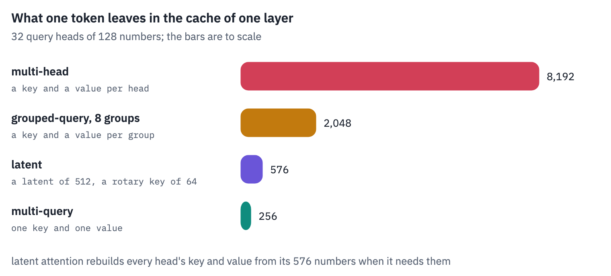
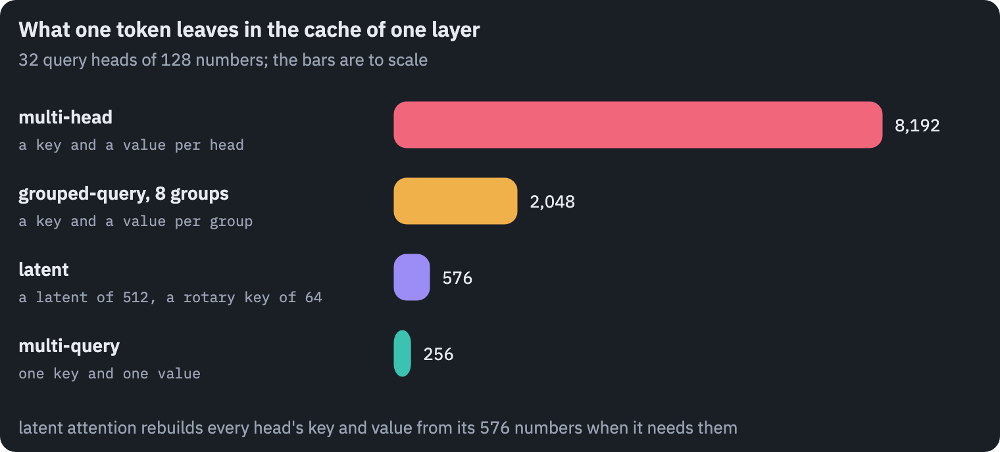
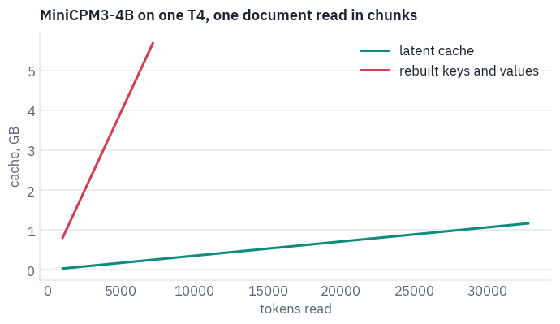
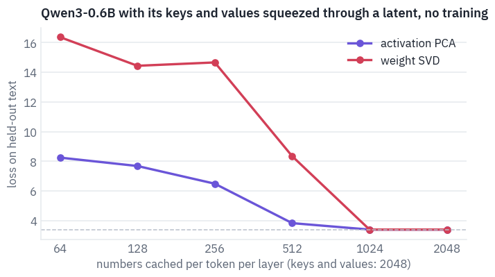
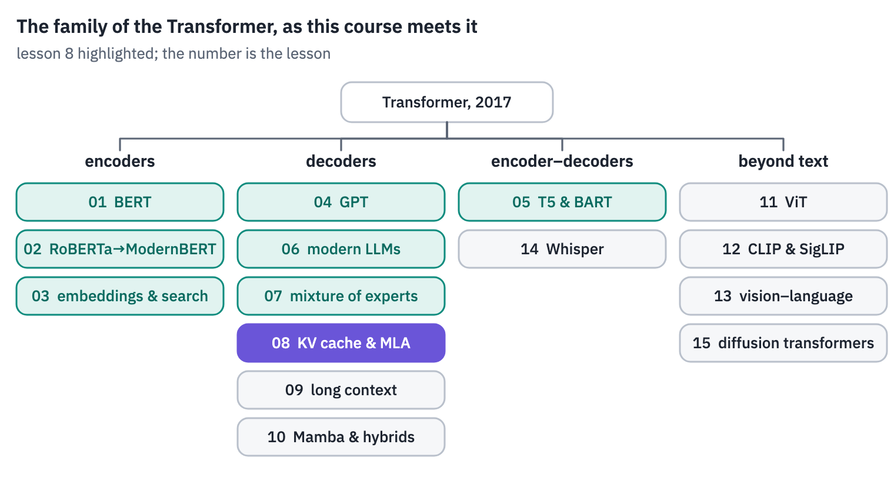
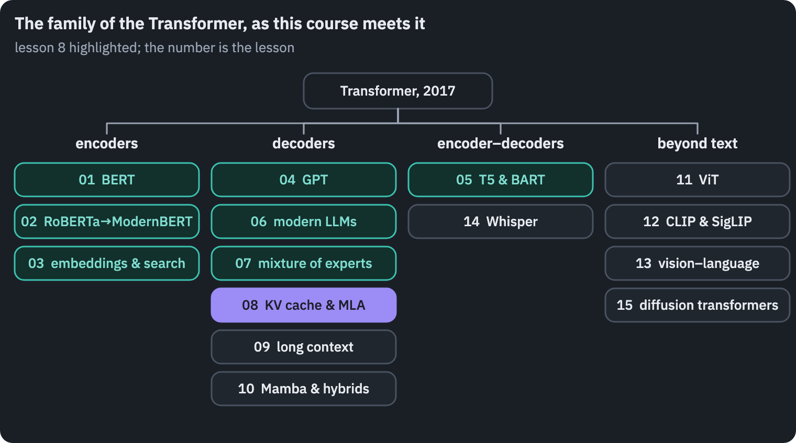



<p class="tfs-links"><strong>Transformer architectures: from BERT to diffusion</strong> · lesson 8 of 15 · <a href="/teaching/">all lessons</a> · <a href="https://www.kaggle.com/code/qmarva/transformer-architectures-08-kv-cache-and-mla">run on Kaggle</a> · <a href="https://colab.research.google.com/github/xmarva/transformers-from-scratch/blob/main/notebooks/colab/a08_kv.ipynb">open in Colab</a> · <a href="https://github.com/xmarva/transformers-from-scratch">code on GitHub</a></p>

A chat with a language model keeps a key and a value for every token it has read, in every layer, for as long as the chat lasts.

Lesson 6 counted that memory and showed the first two ways to cut it: share keys and values among query heads, and stop distant layers from looking far back.

This lesson is about the third way, the one DeepSeek introduced in 2024: don't store keys and values at all. Store a short vector per token, a *latent*, from which every head's key and value can be recomputed when needed.

DeepSeek-V3 has 128 query heads and 61 layers, and a token in its cache takes about half the memory it takes in Llama 3.1 8B, a model eighty times smaller. That trick, *multi-head latent attention*, is the subject of most of this lesson.

We write it from scratch, find out why it needs its own handling of positions, load a small model built on it, and measure on a T4 what it buys and what it costs.

Then we try to turn lesson 6's Qwen3 into a latent model without any training, and look at the levers that work on any model: fewer bits per number, and a cache organised like virtual memory.




**What you'll do**

1. Count what one token costs in the cache of ten models, and how many conversations fit next to them on a T4.
2. Write multi-head latent attention in its two forms, the one that rebuilds keys and values and the one that never
   does, and check that they agree.
3. Find out, with numbers, why rotary positions break the second form, and how DeepSeek mends it.
4. Write MiniCPM3-4B, a latent-attention model that fits a T4, load its official weights and match Hugging Face.
5. Measure how long a context fits with a latent cache and with a cache of rebuilt keys and values, and what each
   costs per generated token.
6. Compress lesson 6's Qwen3 into a latent model without training, two ways, and quantize its cache to fewer bits.

**What you need**: a GPU. On Kaggle, *Settings → Accelerator → GPU*; on Colab, *Runtime → Change runtime type → T4
GPU*. The notebook downloads MiniCPM3-4B (8 GB) and Qwen3-0.6B (1.5 GB); on a T4 it runs in about ten
minutes.

## Setup

One small helper package, `tfs`, draws the course's plots and token chips and knows where the notebook runs
(Kaggle, Colab or your own machine). Everything the lesson teaches is written out in the notebook itself.

```python
import importlib.util
import subprocess
import sys

TFS = "git+https://github.com/xmarva/transformers-from-scratch@main"
if importlib.util.find_spec("tfs") is None:
    subprocess.check_call([sys.executable, "-m", "pip", "install", "-q", TFS])

from tfs import env
from tfs.viz import table, token_chips, use_course_style

env.quiet()  # no progress bars or environment warnings in the outputs
SEED = 42
env.seed_everything(SEED)
COLORS = use_course_style()
WORK_DIR = env.work_dir()
```

```python
import json
import math
import subprocess
import sys
import time
from pathlib import Path

import matplotlib.pyplot as plt
import numpy as np
import pandas as pd
import torch
import torch.nn as nn
import torch.nn.functional as F
from huggingface_hub import hf_hub_download
from safetensors.torch import load_file
from transformers import AutoModelForCausalLM, AutoTokenizer

SMOKE = env.smoke()  # CI runs the lesson on a small slice; you run it in full
device = "cuda" if torch.cuda.is_available() else "cpu"
HALF = torch.float16 if device == "cuda" else torch.float32  # 16-bit matmuls crawl on a CPU
assert device == "cuda" or SMOKE, "This lesson runs a 4B model: use a GPU"
if device == "cuda":
    print("GPU:", torch.cuda.get_device_name(0))
```

<pre class="tfs-printed" markdown="0"><code>GPU: Tesla T4</code></pre>

## 1. What a token costs

For the models of lesson 6 the cost of a token is a plain product: two (a key and a value) times the
layers $$L$$, the key-value heads $$n_{kv}$$ and the head size $$d_h$$, in bytes per number $$b$$:

$$\text{bytes per token} = 2 \cdot L \cdot n_{kv} \cdot d_h \cdot b.$$

A latent-attention model stores, per layer, one compressed vector of $$d_c$$ numbers and one rotary key of
$$d_h^R$$ numbers shared by all heads:

$$\text{bytes per token} = (d_c + d_h^R) \cdot L \cdot b.$$

Here are ten models read from their configs, with every layer's cache counted in full.

```python
CACHE_MODELS = [  # repository, name; Llama and Gemma from Unsloth's public copies
    ("unsloth/Meta-Llama-3.1-8B", "Llama 3.1 8B"),
    ("mistralai/Mistral-7B-v0.1", "Mistral 7B"),
    ("Qwen/Qwen3-8B", "Qwen3 8B"),
    ("unsloth/gemma-3-27b-pt", "Gemma 3 27B"),
    ("deepseek-ai/deepseek-llm-67b-base", "DeepSeek 67B"),
    ("deepseek-ai/DeepSeek-V2-Lite", "DeepSeek-V2-Lite"),
    ("deepseek-ai/DeepSeek-V2", "DeepSeek-V2"),
    ("deepseek-ai/DeepSeek-V3", "DeepSeek-V3"),
    ("moonshotai/Kimi-K2-Instruct", "Kimi K2"),
    ("openbmb/MiniCPM3-4B", "MiniCPM3 4B"),
]


def read_config(repo):
    with open(hf_hub_download(repo, "config.json")) as f:
        c = json.load(f)
    return c.get("text_config", c)


def cache_elements(c):
    """Numbers kept per token, all layers."""
    layers = c["num_hidden_layers"]
    if c.get("kv_lora_rank"):
        return (c["kv_lora_rank"] + c["qk_rope_head_dim"]) * layers
    head = c.get("head_dim") or c["hidden_size"] // c["num_attention_heads"]
    return 2 * layers * c.get("num_key_value_heads", c["num_attention_heads"]) * head


configs = {name: read_config(repo) for repo, name in CACHE_MODELS}
CHAT = 8192  # tokens in one conversation
rows = []
for _, name in CACHE_MODELS:
    c = configs[name]
    per_token = cache_elements(c) * 2  # 16-bit numbers
    latent = bool(c.get("kv_lora_rank"))
    rows.append(
        {
            "model": name,
            "layers": c["num_hidden_layers"],
            "query heads": c["num_attention_heads"],
            "kept per layer": (
                f"latent {c['kv_lora_rank']} + rope {c['qk_rope_head_dim']}"
                if latent
                else f"{c.get('num_key_value_heads', c['num_attention_heads'])} kv heads"
            ),
            "KiB per token": per_token / 1024,
            "GB per 8k chat": per_token * CHAT / 1e9,
            "8k chats in 10 GB": int(10e9 // (per_token * CHAT)),
        }
    )
budget = pd.DataFrame(rows)
table(budget, digits=1)
```

<div class="tfs-table-wrap"><table class="tfs-table" style="border-collapse:collapse;font-family:'IBM Plex Sans', -apple-system, 'Segoe UI', Roboto, Helvetica, Arial, sans-serif;font-size:13.5px;line-height:1.45;margin:4px 0 8px;"><thead><tr><th style="padding:7px 14px;border-bottom:2px solid #B9C0CB;font-weight:600;color:#5B6575;font-size:12px;letter-spacing:0.02em;text-align:left;">model</th><th style="padding:7px 14px;border-bottom:2px solid #B9C0CB;font-weight:600;color:#5B6575;font-size:12px;letter-spacing:0.02em;text-align:right;">layers</th><th style="padding:7px 14px;border-bottom:2px solid #B9C0CB;font-weight:600;color:#5B6575;font-size:12px;letter-spacing:0.02em;text-align:right;">query heads</th><th style="padding:7px 14px;border-bottom:2px solid #B9C0CB;font-weight:600;color:#5B6575;font-size:12px;letter-spacing:0.02em;text-align:left;">kept per layer</th><th style="padding:7px 14px;border-bottom:2px solid #B9C0CB;font-weight:600;color:#5B6575;font-size:12px;letter-spacing:0.02em;text-align:right;">KiB per token</th><th style="padding:7px 14px;border-bottom:2px solid #B9C0CB;font-weight:600;color:#5B6575;font-size:12px;letter-spacing:0.02em;text-align:right;">GB per 8k chat</th><th style="padding:7px 14px;border-bottom:2px solid #B9C0CB;font-weight:600;color:#5B6575;font-size:12px;letter-spacing:0.02em;text-align:right;">8k chats in 10 GB</th></tr></thead><tbody><tr><td style="padding:7px 14px;border-bottom:1px solid #E6E9EE;vertical-align:top;text-align:left;max-width:460px;white-space:normal;">Llama 3.1 8B</td><td style="padding:7px 14px;border-bottom:1px solid #E6E9EE;vertical-align:top;text-align:right;font-variant-numeric:tabular-nums;max-width:460px;white-space:normal;">32</td><td style="padding:7px 14px;border-bottom:1px solid #E6E9EE;vertical-align:top;text-align:right;font-variant-numeric:tabular-nums;max-width:460px;white-space:normal;">32</td><td style="padding:7px 14px;border-bottom:1px solid #E6E9EE;vertical-align:top;text-align:left;max-width:460px;white-space:normal;">8 kv heads</td><td style="padding:7px 14px;border-bottom:1px solid #E6E9EE;vertical-align:top;text-align:right;font-variant-numeric:tabular-nums;max-width:460px;white-space:normal;">128.0</td><td style="padding:7px 14px;border-bottom:1px solid #E6E9EE;vertical-align:top;text-align:right;font-variant-numeric:tabular-nums;max-width:460px;white-space:normal;">1.1</td><td style="padding:7px 14px;border-bottom:1px solid #E6E9EE;vertical-align:top;text-align:right;font-variant-numeric:tabular-nums;max-width:460px;white-space:normal;">9</td></tr><tr><td style="padding:7px 14px;border-bottom:1px solid #E6E9EE;vertical-align:top;text-align:left;max-width:460px;white-space:normal;">Mistral 7B</td><td style="padding:7px 14px;border-bottom:1px solid #E6E9EE;vertical-align:top;text-align:right;font-variant-numeric:tabular-nums;max-width:460px;white-space:normal;">32</td><td style="padding:7px 14px;border-bottom:1px solid #E6E9EE;vertical-align:top;text-align:right;font-variant-numeric:tabular-nums;max-width:460px;white-space:normal;">32</td><td style="padding:7px 14px;border-bottom:1px solid #E6E9EE;vertical-align:top;text-align:left;max-width:460px;white-space:normal;">8 kv heads</td><td style="padding:7px 14px;border-bottom:1px solid #E6E9EE;vertical-align:top;text-align:right;font-variant-numeric:tabular-nums;max-width:460px;white-space:normal;">128.0</td><td style="padding:7px 14px;border-bottom:1px solid #E6E9EE;vertical-align:top;text-align:right;font-variant-numeric:tabular-nums;max-width:460px;white-space:normal;">1.1</td><td style="padding:7px 14px;border-bottom:1px solid #E6E9EE;vertical-align:top;text-align:right;font-variant-numeric:tabular-nums;max-width:460px;white-space:normal;">9</td></tr><tr><td style="padding:7px 14px;border-bottom:1px solid #E6E9EE;vertical-align:top;text-align:left;max-width:460px;white-space:normal;">Qwen3 8B</td><td style="padding:7px 14px;border-bottom:1px solid #E6E9EE;vertical-align:top;text-align:right;font-variant-numeric:tabular-nums;max-width:460px;white-space:normal;">36</td><td style="padding:7px 14px;border-bottom:1px solid #E6E9EE;vertical-align:top;text-align:right;font-variant-numeric:tabular-nums;max-width:460px;white-space:normal;">32</td><td style="padding:7px 14px;border-bottom:1px solid #E6E9EE;vertical-align:top;text-align:left;max-width:460px;white-space:normal;">8 kv heads</td><td style="padding:7px 14px;border-bottom:1px solid #E6E9EE;vertical-align:top;text-align:right;font-variant-numeric:tabular-nums;max-width:460px;white-space:normal;">144.0</td><td style="padding:7px 14px;border-bottom:1px solid #E6E9EE;vertical-align:top;text-align:right;font-variant-numeric:tabular-nums;max-width:460px;white-space:normal;">1.2</td><td style="padding:7px 14px;border-bottom:1px solid #E6E9EE;vertical-align:top;text-align:right;font-variant-numeric:tabular-nums;max-width:460px;white-space:normal;">8</td></tr><tr><td style="padding:7px 14px;border-bottom:1px solid #E6E9EE;vertical-align:top;text-align:left;max-width:460px;white-space:normal;">Gemma 3 27B</td><td style="padding:7px 14px;border-bottom:1px solid #E6E9EE;vertical-align:top;text-align:right;font-variant-numeric:tabular-nums;max-width:460px;white-space:normal;">62</td><td style="padding:7px 14px;border-bottom:1px solid #E6E9EE;vertical-align:top;text-align:right;font-variant-numeric:tabular-nums;max-width:460px;white-space:normal;">32</td><td style="padding:7px 14px;border-bottom:1px solid #E6E9EE;vertical-align:top;text-align:left;max-width:460px;white-space:normal;">16 kv heads</td><td style="padding:7px 14px;border-bottom:1px solid #E6E9EE;vertical-align:top;text-align:right;font-variant-numeric:tabular-nums;max-width:460px;white-space:normal;">496.0</td><td style="padding:7px 14px;border-bottom:1px solid #E6E9EE;vertical-align:top;text-align:right;font-variant-numeric:tabular-nums;max-width:460px;white-space:normal;">4.2</td><td style="padding:7px 14px;border-bottom:1px solid #E6E9EE;vertical-align:top;text-align:right;font-variant-numeric:tabular-nums;max-width:460px;white-space:normal;">2</td></tr><tr><td style="padding:7px 14px;border-bottom:1px solid #E6E9EE;vertical-align:top;text-align:left;max-width:460px;white-space:normal;">DeepSeek 67B</td><td style="padding:7px 14px;border-bottom:1px solid #E6E9EE;vertical-align:top;text-align:right;font-variant-numeric:tabular-nums;max-width:460px;white-space:normal;">95</td><td style="padding:7px 14px;border-bottom:1px solid #E6E9EE;vertical-align:top;text-align:right;font-variant-numeric:tabular-nums;max-width:460px;white-space:normal;">64</td><td style="padding:7px 14px;border-bottom:1px solid #E6E9EE;vertical-align:top;text-align:left;max-width:460px;white-space:normal;">8 kv heads</td><td style="padding:7px 14px;border-bottom:1px solid #E6E9EE;vertical-align:top;text-align:right;font-variant-numeric:tabular-nums;max-width:460px;white-space:normal;">380.0</td><td style="padding:7px 14px;border-bottom:1px solid #E6E9EE;vertical-align:top;text-align:right;font-variant-numeric:tabular-nums;max-width:460px;white-space:normal;">3.2</td><td style="padding:7px 14px;border-bottom:1px solid #E6E9EE;vertical-align:top;text-align:right;font-variant-numeric:tabular-nums;max-width:460px;white-space:normal;">3</td></tr><tr><td style="padding:7px 14px;border-bottom:1px solid #E6E9EE;vertical-align:top;text-align:left;max-width:460px;white-space:normal;">DeepSeek-V2-Lite</td><td style="padding:7px 14px;border-bottom:1px solid #E6E9EE;vertical-align:top;text-align:right;font-variant-numeric:tabular-nums;max-width:460px;white-space:normal;">27</td><td style="padding:7px 14px;border-bottom:1px solid #E6E9EE;vertical-align:top;text-align:right;font-variant-numeric:tabular-nums;max-width:460px;white-space:normal;">16</td><td style="padding:7px 14px;border-bottom:1px solid #E6E9EE;vertical-align:top;text-align:left;max-width:460px;white-space:normal;">latent 512 + rope 64</td><td style="padding:7px 14px;border-bottom:1px solid #E6E9EE;vertical-align:top;text-align:right;font-variant-numeric:tabular-nums;max-width:460px;white-space:normal;">30.4</td><td style="padding:7px 14px;border-bottom:1px solid #E6E9EE;vertical-align:top;text-align:right;font-variant-numeric:tabular-nums;max-width:460px;white-space:normal;">0.3</td><td style="padding:7px 14px;border-bottom:1px solid #E6E9EE;vertical-align:top;text-align:right;font-variant-numeric:tabular-nums;max-width:460px;white-space:normal;">39</td></tr><tr><td style="padding:7px 14px;border-bottom:1px solid #E6E9EE;vertical-align:top;text-align:left;max-width:460px;white-space:normal;">DeepSeek-V2</td><td style="padding:7px 14px;border-bottom:1px solid #E6E9EE;vertical-align:top;text-align:right;font-variant-numeric:tabular-nums;max-width:460px;white-space:normal;">60</td><td style="padding:7px 14px;border-bottom:1px solid #E6E9EE;vertical-align:top;text-align:right;font-variant-numeric:tabular-nums;max-width:460px;white-space:normal;">128</td><td style="padding:7px 14px;border-bottom:1px solid #E6E9EE;vertical-align:top;text-align:left;max-width:460px;white-space:normal;">latent 512 + rope 64</td><td style="padding:7px 14px;border-bottom:1px solid #E6E9EE;vertical-align:top;text-align:right;font-variant-numeric:tabular-nums;max-width:460px;white-space:normal;">67.5</td><td style="padding:7px 14px;border-bottom:1px solid #E6E9EE;vertical-align:top;text-align:right;font-variant-numeric:tabular-nums;max-width:460px;white-space:normal;">0.6</td><td style="padding:7px 14px;border-bottom:1px solid #E6E9EE;vertical-align:top;text-align:right;font-variant-numeric:tabular-nums;max-width:460px;white-space:normal;">17</td></tr><tr><td style="padding:7px 14px;border-bottom:1px solid #E6E9EE;vertical-align:top;text-align:left;max-width:460px;white-space:normal;">DeepSeek-V3</td><td style="padding:7px 14px;border-bottom:1px solid #E6E9EE;vertical-align:top;text-align:right;font-variant-numeric:tabular-nums;max-width:460px;white-space:normal;">61</td><td style="padding:7px 14px;border-bottom:1px solid #E6E9EE;vertical-align:top;text-align:right;font-variant-numeric:tabular-nums;max-width:460px;white-space:normal;">128</td><td style="padding:7px 14px;border-bottom:1px solid #E6E9EE;vertical-align:top;text-align:left;max-width:460px;white-space:normal;">latent 512 + rope 64</td><td style="padding:7px 14px;border-bottom:1px solid #E6E9EE;vertical-align:top;text-align:right;font-variant-numeric:tabular-nums;max-width:460px;white-space:normal;">68.6</td><td style="padding:7px 14px;border-bottom:1px solid #E6E9EE;vertical-align:top;text-align:right;font-variant-numeric:tabular-nums;max-width:460px;white-space:normal;">0.6</td><td style="padding:7px 14px;border-bottom:1px solid #E6E9EE;vertical-align:top;text-align:right;font-variant-numeric:tabular-nums;max-width:460px;white-space:normal;">17</td></tr><tr><td style="padding:7px 14px;border-bottom:1px solid #E6E9EE;vertical-align:top;text-align:left;max-width:460px;white-space:normal;">Kimi K2</td><td style="padding:7px 14px;border-bottom:1px solid #E6E9EE;vertical-align:top;text-align:right;font-variant-numeric:tabular-nums;max-width:460px;white-space:normal;">61</td><td style="padding:7px 14px;border-bottom:1px solid #E6E9EE;vertical-align:top;text-align:right;font-variant-numeric:tabular-nums;max-width:460px;white-space:normal;">64</td><td style="padding:7px 14px;border-bottom:1px solid #E6E9EE;vertical-align:top;text-align:left;max-width:460px;white-space:normal;">latent 512 + rope 64</td><td style="padding:7px 14px;border-bottom:1px solid #E6E9EE;vertical-align:top;text-align:right;font-variant-numeric:tabular-nums;max-width:460px;white-space:normal;">68.6</td><td style="padding:7px 14px;border-bottom:1px solid #E6E9EE;vertical-align:top;text-align:right;font-variant-numeric:tabular-nums;max-width:460px;white-space:normal;">0.6</td><td style="padding:7px 14px;border-bottom:1px solid #E6E9EE;vertical-align:top;text-align:right;font-variant-numeric:tabular-nums;max-width:460px;white-space:normal;">17</td></tr><tr><td style="padding:7px 14px;border-bottom:1px solid #E6E9EE;vertical-align:top;text-align:left;max-width:460px;white-space:normal;">MiniCPM3 4B</td><td style="padding:7px 14px;border-bottom:1px solid #E6E9EE;vertical-align:top;text-align:right;font-variant-numeric:tabular-nums;max-width:460px;white-space:normal;">62</td><td style="padding:7px 14px;border-bottom:1px solid #E6E9EE;vertical-align:top;text-align:right;font-variant-numeric:tabular-nums;max-width:460px;white-space:normal;">40</td><td style="padding:7px 14px;border-bottom:1px solid #E6E9EE;vertical-align:top;text-align:left;max-width:460px;white-space:normal;">latent 256 + rope 32</td><td style="padding:7px 14px;border-bottom:1px solid #E6E9EE;vertical-align:top;text-align:right;font-variant-numeric:tabular-nums;max-width:460px;white-space:normal;">34.9</td><td style="padding:7px 14px;border-bottom:1px solid #E6E9EE;vertical-align:top;text-align:right;font-variant-numeric:tabular-nums;max-width:460px;white-space:normal;">0.3</td><td style="padding:7px 14px;border-bottom:1px solid #E6E9EE;vertical-align:top;text-align:right;font-variant-numeric:tabular-nums;max-width:460px;white-space:normal;">34</td></tr></tbody></table></div>

The spread is wide. The dense models of lesson 6 sit in a narrow band, and Gemma 3 27B tops the table only because we counted every layer in full; its local layers keep a window, as lesson 6 showed, and a real Gemma cache is far smaller.

The latent models are a different class: DeepSeek-V3, with 128 query heads and 61 layers, keeps about half of what Llama 3.1 8B keeps per token, and MiniCPM3 a quarter.

DeepSeek's own headline for this is bigger, a cache "reduced by 93.3%" against DeepSeek 67B. By our count from the
configs, latent attention alone cuts the cache by about four fifths; the rest of the way to 93.3% comes from storing
the cache in about six bits per number, which the paper mentions a few sections later.

"10 GB" is roughly what a T4 has left once a 4-billion-parameter model sits in it in 16-bit floats, so the last
column is how many people could talk to such a model at once if it had each architecture's cache.

## 2. Latent attention

DeepSeek-V2 describes it in a dozen equations<sup class="cite">[<a href="#ref-1" id="cite-1" data-ref="1" aria-label="Reference 1: DeepSeek-AI (2024). DeepSeek-V2: a strong, economical, and efficient mixture-of-experts language model. arXiv:2405.04434.">1</a>]</sup>. For a token
with hidden state $$h_t$$, the keys and values of all heads come from one compressed vector:

$$c_t^{KV} = W^{DKV} h_t,$$

$$k_t^C = W^{UK} c_t^{KV}, \qquad v_t^C = W^{UV} c_t^{KV},$$

where $$c_t^{KV}$$ has $$d_c$$ numbers, far fewer than the $$2 n_h d_h$$ of the keys and values it stands for.
"MLA only needs to cache $$c_t^{KV}$$", and more than that: "since $$W^{UK}$$ can be absorbed into $$W^Q$$, and
$$W^{UV}$$ can be absorbed into $$W^O$$, we even do not need to compute keys and values out for attention."

The absorption is one line of algebra. The score of query $$q_t$$ against key $$k_j = W^{UK} c_j$$ in one head is

$$q_t^\top k_j = q_t^\top W^{UK} c_j = \big((W^{UK})^\top q_t\big)^\top c_j,$$

so instead of rebuilding a key for every cached token we move the query into the latent space once, and score it
against the cached latents directly. The same happens on the way out: a mix of values is $$W^{UV}$$ times a mix of
latents, and $$W^{UV}$$ can be applied after the mixing, or folded into the output projection.

Positions are handled separately, for a reason section 3 explains: each head gets a few more query dimensions, and
all heads share one more key, $$k_t^R$$, both rotated by RoPE. The cache holds $$c_t^{KV}$$ and $$k_t^R$$.
Here is a layer of it, written so that the same weights can run either way.

```python
class RMSNorm(nn.Module):
    def __init__(self, dim, eps=1e-5):
        super().__init__()
        self.eps = eps
        self.weight = nn.Parameter(torch.ones(dim))

    def forward(self, x):
        x32 = x.float()
        x32 = x32 * torch.rsqrt(x32.pow(2).mean(dim=-1, keepdim=True) + self.eps)
        return self.weight * x32.to(self.weight.dtype)


def rotate(x, cos, sin):
    half = x.shape[-1] // 2
    rotated = torch.cat([-x[..., half:], x[..., :half]], dim=-1)
    return x * cos.to(x.dtype) + rotated * sin.to(x.dtype)


class LatentCache:
    """What latent attention keeps per token: the latent and the shared rotary key."""

    def __init__(self):
        self.c, self.k_rope = None, None

    def add(self, c, k_rope):
        if self.c is not None:
            c, k_rope = (
                torch.cat([self.c, c], dim=1),
                torch.cat([self.k_rope, k_rope], dim=2),
            )
        self.c, self.k_rope = c, k_rope
        return c, k_rope

    def bytes(self):
        return (
            self.c.numel() * self.c.element_size()
            + self.k_rope.numel() * self.k_rope.element_size()
        )


class ExpandedCache:
    """What a plain cache would keep: every head's key and value, rebuilt."""

    def __init__(self):
        self.k, self.v = None, None

    def add(self, k, v):
        if self.k is not None:
            k, v = torch.cat([self.k, k], dim=2), torch.cat([self.v, v], dim=2)
        self.k, self.v = k, v
        return k, v

    def bytes(self):
        return (
            self.k.numel() * self.k.element_size() + self.v.numel() * self.v.element_size()
        )


class MLA(nn.Module):
    def __init__(self, c):
        super().__init__()
        d, self.heads = c["hidden_size"], c["num_attention_heads"]
        self.nope, self.rope = c["qk_nope_head_dim"], c["qk_rope_head_dim"]
        self.v_dim = (
            c.get("v_head_dim") or d // self.heads
        )  # MiniCPM3's config leaves it out
        self.rank = c["kv_lora_rank"]
        q_rank = c["q_lora_rank"]
        eps = c.get("rms_norm_eps", 1e-5)
        self.q_a_proj = nn.Linear(d, q_rank, bias=False)  # queries are compressed too
        self.q_a_layernorm = RMSNorm(q_rank, eps)
        self.q_b_proj = nn.Linear(q_rank, self.heads * (self.nope + self.rope), bias=False)
        self.kv_a_proj_with_mqa = nn.Linear(
            d, self.rank + self.rope, bias=False
        )  # c and k_rope
        self.kv_a_layernorm = RMSNorm(self.rank, eps)
        self.kv_b_proj = nn.Linear(
            self.rank, self.heads * (self.nope + self.v_dim), bias=False
        )
        self.o_proj = nn.Linear(self.heads * self.v_dim, d, bias=False)
        self.scale = (self.nope + self.rope) ** -0.5

    def queries(self, x, cos, sin):
        b, t, _ = x.shape
        q = self.q_b_proj(self.q_a_layernorm(self.q_a_proj(x)))
        q = q.view(b, t, self.heads, self.nope + self.rope).transpose(1, 2)
        q_nope, q_rope = q.split([self.nope, self.rope], dim=-1)
        return q_nope, rotate(q_rope, cos, sin)

    def latents(self, x, cos, sin):
        b, t, _ = x.shape
        c, k_rope = self.kv_a_proj_with_mqa(x).split([self.rank, self.rope], dim=-1)
        k_rope = rotate(k_rope.view(b, t, 1, self.rope).transpose(1, 2), cos, sin)
        return self.kv_a_layernorm(c), k_rope  # b x t x rank, and b x 1 x t x rope

    def up(self):
        """W_UK and W_UV, one block per head: heads x (nope + v) x rank."""
        return self.kv_b_proj.weight.view(self.heads, self.nope + self.v_dim, self.rank)

    def expand(self, c, k_rope):
        b, t, _ = c.shape
        kv = (
            self.kv_b_proj(c).view(b, t, self.heads, self.nope + self.v_dim).transpose(1, 2)
        )
        k_nope, v = kv.split([self.nope, self.v_dim], dim=-1)
        k = torch.cat([k_nope, k_rope.expand(-1, self.heads, -1, -1)], dim=-1)
        return k, v

    def forward(self, x, cos, sin, mask, cache=None, absorb=False):
        b, t, _ = x.shape
        q_nope, q_rope = self.queries(x, cos, sin)
        c, k_rope = self.latents(x, cos, sin)
        if isinstance(cache, ExpandedCache):
            k, v = cache.add(*self.expand(c, k_rope))
        else:
            if cache is not None:
                c, k_rope = cache.add(c, k_rope)
            if not absorb:  # rebuild every head's keys and values, then ordinary attention
                k, v = self.expand(c, k_rope)
        if absorb:  # score against the latents themselves; keys and values are never built
            w_uk, w_uv = self.up().split([self.nope, self.v_dim], dim=1)
            q_latent = torch.einsum("bhtn,hnr->bhtr", q_nope, w_uk)
            scores = (
                q_latent @ c.unsqueeze(1).transpose(-1, -2)
                + q_rope @ k_rope.transpose(-1, -2)
            ) * self.scale
            weights = scores.float().masked_fill(~mask, float("-inf")).softmax(dim=-1)
            mixed = weights.to(c.dtype) @ c.unsqueeze(1)  # b x heads x t x rank
            out = torch.einsum("bhtr,hvr->bhtv", mixed, w_uv)
        else:
            q = torch.cat([q_nope, q_rope], dim=-1)
            out = F.scaled_dot_product_attention(q, k, v, attn_mask=mask, scale=self.scale)
        return self.o_proj(out.transpose(1, 2).reshape(b, t, -1))
```

Two runs of the same random layer, one rebuilding keys and values and one absorbing the up-projections, must give
the same output. In 32-bit floats they do, up to the order of the additions:

```python
def rope_tables(positions, dim, theta=10000.0, factors=None):
    exponents = torch.arange(0, dim, 2, device=positions.device).float() / dim
    inv_freq = 1.0 / theta**exponents
    if factors is not None:  # MiniCPM3's long-context RoPE stretches each frequency
        inv_freq = inv_freq / torch.tensor(
            factors, device=positions.device, dtype=torch.float
        )
    angles = positions.float()[..., None] * inv_freq
    angles = torch.cat([angles, angles], dim=-1)
    return angles.cos()[:, None], angles.sin()[:, None]


small = {
    "hidden_size": 256,
    "num_attention_heads": 8,
    "qk_nope_head_dim": 32,
    "qk_rope_head_dim": 16,
    "v_head_dim": 32,
    "kv_lora_rank": 64,
    "q_lora_rank": 96,
}
torch.manual_seed(0)
layer = MLA(small)
for p in layer.parameters():
    nn.init.normal_(p, std=0.08) if p.dim() > 1 else None
x = torch.randn(2, 40, 256)
cos, sin = rope_tables(torch.arange(40)[None], 16)
causal = torch.ones(40, 40, dtype=torch.bool).tril()
with torch.no_grad():
    rebuilt = layer(x, cos, sin, causal)
    absorbed = layer(x, cos, sin, causal, absorb=True)
print("max difference:", f"{(rebuilt - absorbed).abs().max().item():.2e}")
heads, head = small["num_attention_heads"], small["qk_nope_head_dim"]
per_token = {
    "rebuilt keys and values": heads
    * (head + small["qk_rope_head_dim"] + small["v_head_dim"]),
    "latent and rotary key": small["kv_lora_rank"] + small["qk_rope_head_dim"],
}
print("numbers cached per token per layer:", per_token)
```

<pre class="tfs-printed" markdown="0"><code>max difference: 9.24e-07
numbers cached per token per layer: {&#x27;rebuilt keys and values&#x27;: 640, &#x27;latent and rotary key&#x27;: 80}</code></pre>

The two forms agree to the rounding of 32-bit floats, so the absorbed one is not an approximation; it is the same arithmetic in a different order. What changes is what has to be kept.

In this toy layer the rebuilt keys and values take eight times the memory of the latent and the rotary key, and in a real model the ratio is larger, because real models have more and wider heads per latent.

## 3. Why positions need their own dimensions

With rotary positions the key of token $$j$$ is not $$W^{UK} c_j$$ but $$R_j W^{UK} c_j$$, where $$R_j$$ rotates by
an angle that depends on $$j$$; the query is rotated too, by $$R_t$$. The score becomes

$$q_t^\top R_t^\top R_j W^{UK} c_j,$$

and the matrix between the query and the latent now depends on both positions. It cannot be folded into the query
once and for all: in DeepSeek's words, "a RoPE matrix related to the currently generating token will lie between
$$W^Q$$ and $$W^{UK}$$ and matrix multiplication does not obey a commutative law. As a result, we must recompute
the keys for all the prefix tokens during inference". Their fix is to keep the rotation out of the compressed part
altogether and give it a few dimensions of its own, the *decoupled* rotary query and key of the layer above.

The failure is easy to see. Rotate the keys built from latents, the obvious design, and try to absorb anyway:

```python
torch.manual_seed(1)
t, r, dh = 32, 64, 32
w_uk = torch.randn(dh, r) / math.sqrt(r)
latents = torch.randn(t, r)
query = torch.randn(dh)
cos1, sin1 = rope_tables(torch.arange(t)[None], dh)
keys = rotate((latents @ w_uk.T)[None, None], cos1, sin1)[
    0, 0
]  # rotated after the up-projection
q_rot = rotate(query.expand(1, 1, t, dh), cos1[:, :, -1:], sin1[:, :, -1:])[0, 0, 0]
honest = keys @ q_rot  # the scores the model needs, for the query at the last position
absorbed_scores = latents @ (w_uk.T @ q_rot)  # absorb W_UK as if no rotation sat between
without_rope = latents @ (w_uk.T @ query)
print(
    "scores with rotated keys vs absorbed:  max difference",
    f"{(honest - absorbed_scores).abs().max().item():.2f}",
)
print(
    "the same without RoPE:                  max difference",
    f"{((latents @ w_uk.T) @ query - without_rope).abs().max().item():.2e}",
)
```

<pre class="tfs-printed" markdown="0"><code>scores with rotated keys vs absorbed:  max difference 15.72
the same without RoPE:                  max difference 3.34e-06</code></pre>

Absorbing past rotated keys gives scores that have nothing to do with the right ones, while without the rotation the
absorbed scores are exact. That is the whole reason for the decoupled design: the rotary part is small, shared by
all heads and cached as is, and the large compressed part never rotates, so it can be absorbed.

## 4. MiniCPM3 in PyTorch

DeepSeek's own latent-attention models are too large for a T4: even DeepSeek-V2-Lite needs, in its card's words, "40GB*1 GPU" for inference in 16-bit floats.

MiniCPM3-4B from OpenBMB uses the same layout, DeepSeek-V2's names and all, at a size that fits: 62 layers, 40 heads, a latent of 256 numbers and a rotary key of 32. Its weights come under the MiniCPM model licence, free for research. Its config:

```python
REPO = "openbmb/MiniCPM3-4B"
mini_config = configs["MiniCPM3 4B"]
for key in [
    "hidden_size",
    "num_hidden_layers",
    "num_attention_heads",
    "kv_lora_rank",
    "q_lora_rank",
    "qk_nope_head_dim",
    "qk_rope_head_dim",
    "intermediate_size",
    "vocab_size",
    "scale_emb",
    "scale_depth",
    "dim_model_base",
]:
    print(f"{key:20} {mini_config.get(key)}")
```

<pre class="tfs-printed" markdown="0"><code>hidden_size          2560
num_hidden_layers    62
num_attention_heads  40
kv_lora_rank         256
q_lora_rank          768
qk_nope_head_dim     64
qk_rope_head_dim     32
intermediate_size    6400
vocab_size           73448
scale_emb            12
scale_depth          1.4
dim_model_base       256</code></pre>

Three numbers in it are MiniCPM's own, from the "tensor programs" way of setting up training: the embeddings are multiplied by `scale_emb`, each residual branch by `scale_depth` over the square root of the number of layers, and the last hidden state is divided by `hidden_size / dim_model_base` before the output layer.

The rotary positions use per-frequency stretch factors, `short_factor`, that the config lists. Everything else is the decoder of lesson 6 with the attention above.

```python
class FeedForward(nn.Module):
    def __init__(self, c):
        super().__init__()
        d, hidden = c["hidden_size"], c["intermediate_size"]
        self.gate_proj = nn.Linear(d, hidden, bias=False)
        self.up_proj = nn.Linear(d, hidden, bias=False)
        self.down_proj = nn.Linear(hidden, d, bias=False)

    def forward(self, x):
        return self.down_proj(F.silu(self.gate_proj(x)) * self.up_proj(x))


class Block(nn.Module):
    def __init__(self, c):
        super().__init__()
        eps = c.get("rms_norm_eps", 1e-5)
        self.input_layernorm = RMSNorm(c["hidden_size"], eps)
        self.self_attn = MLA(c)
        self.post_attention_layernorm = RMSNorm(c["hidden_size"], eps)
        self.mlp = FeedForward(c)
        self.residual_scale = c["scale_depth"] / math.sqrt(c["num_hidden_layers"])

    def forward(self, x, cos, sin, mask, cache=None, absorb=False):
        h = self.self_attn(self.input_layernorm(x), cos, sin, mask, cache, absorb)
        x = (
            x + h.float() * self.residual_scale
        )  # the residual stream stays in 32-bit floats
        return x + self.mlp(self.post_attention_layernorm(x)).float() * self.residual_scale


class MiniCPM3(nn.Module):
    def __init__(self, c):
        super().__init__()
        self.config = c
        self.embed_tokens = nn.Embedding(c["vocab_size"], c["hidden_size"])
        self.layers = nn.ModuleList([Block(c) for _ in range(c["num_hidden_layers"])])
        self.norm = RMSNorm(c["hidden_size"], c.get("rms_norm_eps", 1e-5))
        self.lm_head = nn.Linear(c["hidden_size"], c["vocab_size"], bias=False)
        scaling = c.get("rope_scaling") or {}
        self.factors = scaling.get("short_factor")
        self.theta = c.get("rope_theta", 10000.0)

    def hidden(self, ids, mask, caches=None, start=0, absorb=False):
        positions = torch.arange(start, start + ids.shape[1], device=ids.device)[None]
        cos, sin = rope_tables(
            positions, self.config["qk_rope_head_dim"], self.theta, self.factors
        )
        x = self.embed_tokens(ids).float() * self.config["scale_emb"]
        for i, layer in enumerate(self.layers):
            cache = caches[i] if caches is not None else None
            x = layer(x, cos, sin, mask, cache, absorb)
        return self.norm(x)

    def logits(self, h):
        c = self.config
        return self.lm_head(h / (c["hidden_size"] / c["dim_model_base"])).float()

    def forward(self, ids, mask, caches=None, start=0, absorb=False):
        return self.logits(self.hidden(ids, mask, caches, start, absorb))


def load_minicpm3(source, c, dtype):
    if Path(source).is_dir():  # the smoke run's small model, saved to disk
        state = load_file(str(next(Path(source).glob("*.safetensors"))))
    else:
        path = hf_hub_download(source, "pytorch_model.bin")
        state = torch.load(path, map_location="cpu", weights_only=True, mmap=True)
    state = {k.removeprefix("model."): v.to(dtype) for k, v in state.items()}
    state.setdefault(
        "lm_head.weight", state["embed_tokens.weight"]
    )  # tied when it isn't stored
    with torch.device("meta"):
        model = MiniCPM3(c)
    model.load_state_dict(state, strict=True, assign=True)
    return model.to(device).eval()
```

The check: our model and Hugging Face's on the same tokens. As in lesson 7, the reference runs first in a process
of its own, so that the two copies are never in memory together.

```python
tok = AutoTokenizer.from_pretrained(REPO)
text = (
    "The Rhine rises in the Swiss Alps, flows through Lake Constance and along "
    "the French–German border, and reaches the North Sea through a delta in the "
    "Netherlands."
)
check_ids = tok(text, return_tensors="pt").input_ids
torch.save(check_ids, WORK_DIR / "check_ids.pt")

if SMOKE:  # a small MiniCPM3 with random weights stands in for the real one
    from transformers import MiniCPM3Config, MiniCPM3ForCausalLM

    small_config = MiniCPM3Config(
        vocab_size=mini_config["vocab_size"],
        hidden_size=128,
        intermediate_size=256,
        num_hidden_layers=2,
        num_attention_heads=4,
        num_key_value_heads=4,
        kv_lora_rank=32,
        q_lora_rank=48,
        qk_nope_head_dim=16,
        qk_rope_head_dim=8,
        scale_emb=12,
        scale_depth=1.4,
        dim_model_base=32,
        tie_word_embeddings=True,
    )
    torch.manual_seed(0)
    reference = MiniCPM3ForCausalLM(small_config).eval()
    SOURCE = WORK_DIR / "minicpm3-small"
    reference.save_pretrained(SOURCE)
    with torch.no_grad():
        theirs = reference(check_ids).logits.float()
    mini_config = json.loads((SOURCE / "config.json").read_text())
    mini_config.pop("rope_scaling", None)
else:
    SOURCE = REPO
    script = f"""
import torch
from transformers import AutoConfig, AutoModelForCausalLM
config = AutoConfig.from_pretrained("{REPO}")
# the library's RoPE wants a stretch factor the config omits; 32k of 32k is 1
config.rope_parameters["factor"] = 1.0
model = AutoModelForCausalLM.from_pretrained("{REPO}", config=config, dtype=torch.float16)
model = model.to("cuda").eval()
ids = torch.load("{WORK_DIR / "check_ids.pt"}").to("cuda")
with torch.no_grad():
    torch.save(model(ids).logits.float().cpu(), "{WORK_DIR / "theirs.pt"}")
"""
    subprocess.run([sys.executable, "-c", script], check=True)
    theirs = torch.load(WORK_DIR / "theirs.pt")

model = load_minicpm3(SOURCE, mini_config, HALF)
t = check_ids.shape[1]
causal = torch.ones(t, t, dtype=torch.bool, device=device).tril()
with torch.no_grad():
    ours = model(check_ids.to(device), causal).cpu()
    ours_absorbed = model(check_ids.to(device), causal, absorb=True).cpu()
print("tokens:", t)
print("largest logit:", f"{theirs.abs().max().item():.2f}")
print(
    "max difference, keys and values rebuilt:", f"{(ours - theirs).abs().max().item():.2e}"
)
print("max difference, absorbed:", f"{(ours_absorbed - theirs).abs().max().item():.2e}")
```

<pre class="tfs-printed" markdown="0"><code>tokens: 36
largest logit: 30.34
max difference, keys and values rebuilt: 8.59e-02
max difference, absorbed: 1.07e-01</code></pre>

Both forms of our model agree with Hugging Face's within the rounding of 16-bit floats over 62 layers; in 32-bit
floats, on the small random model this notebook's smoke test uses, the difference is a few millionths. The weights
load into our classes unchanged: MiniCPM3 is DeepSeek-V2's attention with smaller numbers.

Generation is lesson 4's loop with a cache per layer. `generate` takes the kind of cache and whether to absorb, so
the same weights can run with a latent cache and absorption, as DeepSeek serves its models, or with a cache of
rebuilt keys and values, the way the code published with MiniCPM3 runs it.

```python
@torch.no_grad()
def generate(model, ids, steps, cache_kind=LatentCache, absorb=True):
    caches = [cache_kind() for _ in model.layers]
    t = ids.shape[1]
    mask = torch.ones(t, t, dtype=torch.bool, device=device).tril()
    logits = model(ids, mask, caches, absorb=absorb and cache_kind is LatentCache)
    out = [logits[:, -1].argmax(-1)]
    for step in range(steps - 1):
        mask = torch.ones(1, t + step + 1, dtype=torch.bool, device=device)
        logits = model(
            out[-1][:, None],
            mask,
            caches,
            start=t + step,
            absorb=absorb and cache_kind is LatentCache,
        )
        out.append(logits[:, -1].argmax(-1))
    return torch.stack(out, dim=1), caches


messages = [{"role": "user", "content": "Explain in two sentences why the sky is blue."}]
prompt = tok.apply_chat_template(messages, tokenize=False, add_generation_prompt=True)
ids = tok(prompt, return_tensors="pt", add_special_tokens=False).input_ids.to(device)
written, caches = generate(model, ids, 12 if SMOKE else 80)
print(tok.decode(written[0], skip_special_tokens=True))
cached = sum(c.bytes() for c in caches)
print(f"cache: {cached / 1024:.0f} KiB for {ids.shape[1] + written.shape[1] - 1} tokens")
```

<pre class="tfs-printed" markdown="0"><code>The sky appears blue because the Earth&#x27;s atmosphere scatters sunlight in all directions. Blue light is scattered more than other colors because it travels as shorter, smaller waves.
cache: 3453 KiB for 99 tokens</code></pre>

## 5. The budget on a T4

The table of section 1 is arithmetic. Here is the measurement: one long document read into MiniCPM3 in chunks of a thousand tokens, with each kind of cache, until the GPU runs out of memory.

Each chunk attends to everything before it; with the latent cache the keys and values of one layer are rebuilt for the chunk and thrown away, so only the latents stay.

```python
def long_document(n_tokens):
    name = "wikitext-103-raw-v1/test-00000-of-00001.parquet"
    path = hf_hub_download("Salesforce/wikitext", name, repo_type="dataset")
    ids = tok("".join(pd.read_parquet(path)["text"].tolist())[: n_tokens * 8]).input_ids[
        :n_tokens
    ]
    return torch.tensor(ids)[None]


CHUNK = 64 if SMOKE else 1024
LIMIT = 512 if SMOKE else 32768
document = long_document(LIMIT).to(device)


@torch.no_grad()
def read_until_full(cache_kind):
    caches = [cache_kind() for _ in model.layers]
    reached, kept = 0, []
    torch.cuda.empty_cache() if device == "cuda" else None
    try:
        for start in range(0, document.shape[1], CHUNK):
            chunk = document[:, start : start + CHUNK]
            n = chunk.shape[1]
            mask = torch.ones(n, start + n, dtype=torch.bool, device=device).tril(
                diagonal=start
            )
            model.hidden(chunk, mask, caches, start=start)
            reached = start + n
            kept.append((reached, sum(c.bytes() for c in caches)))
    except torch.cuda.OutOfMemoryError:
        pass
    del caches
    torch.cuda.empty_cache() if device == "cuda" else None
    return reached, kept


capacity = {}
for name, kind in [
    ("latent cache", LatentCache),
    ("rebuilt keys and values", ExpandedCache),
]:
    reached, kept = read_until_full(kind)
    capacity[name] = kept
    print(
        f"{name:26} read {reached:6,} tokens before running out"
        if reached < LIMIT
        else f"{name:26} read all {reached:,} tokens"
    )

fig, ax = plt.subplots(figsize=(7.4, 3.6))
for (name, kept), color in zip(capacity.items(), [COLORS["enc"], COLORS["dec"]]):
    ax.plot(
        [k for k, _ in kept],
        [b / 1e9 for _, b in kept],
        color=color,
        label=name,
        linewidth=2,
    )
ax.set_xlabel("tokens read")
ax.set_ylabel("cache, GB")
ax.set_title("MiniCPM3-4B on one T4, one document read in chunks")
ax.legend(frameon=False)
plt.show()
```

<pre class="tfs-printed" markdown="0"><code>latent cache               read all 32,768 tokens
rebuilt keys and values    read  7,168 tokens before running out</code></pre>



The latent cache read the whole document, all 32,768 tokens, with a cache of about a gigabyte. The cache of rebuilt keys and values ran out of memory a little past a fifth of it.

The model is the same and so are the weights; only what we chose to keep differs. And the second curve is not a strawman: the code that was published with MiniCPM3, and vLLM's implementation of it, both cache rebuilt keys and values.

Memory is half the story; the other half is time. With the latent cache, every new token either rebuilds the keys and values of the whole context in every layer, or absorbs and works in the latent space, where each head's score is a dot product over the 256 + 32 numbers of the latent instead of the 64 + 32 of a key.

We time one step of generation at several context lengths, three ways.

```python
@torch.no_grad()
def step_time(context, cache_kind, absorb, repeats=5):
    """Median time of one new token after `context` tokens; NaN if the cache doesn't fit."""
    caches = [cache_kind() for _ in model.layers]
    try:
        for start in range(0, context, CHUNK):
            chunk = document[:, start : min(start + CHUNK, context)]
            n = chunk.shape[1]
            mask = torch.ones(n, start + n, dtype=torch.bool, device=device).tril(
                diagonal=start
            )
            model.hidden(chunk, mask, caches, start=start)
        token = document[:, context : context + 1]
        mask = torch.ones(1, context + 1, dtype=torch.bool, device=device)
        timings = []
        for _ in range(repeats):
            if device == "cuda":
                torch.cuda.synchronize()
            begin = time.time()
            model.hidden(token, mask, caches, start=context, absorb=absorb)
            if device == "cuda":
                torch.cuda.synchronize()
            timings.append(time.time() - begin)
            for (
                cache
            ) in caches:  # take the step back out, so every repeat sees the same context
                if isinstance(cache, LatentCache):
                    cache.c, cache.k_rope = cache.c[:, :-1], cache.k_rope[:, :, :-1]
                else:
                    cache.k, cache.v = cache.k[:, :, :-1], cache.v[:, :, :-1]
        return float(np.median(timings))
    except torch.cuda.OutOfMemoryError:
        return float("nan")
    finally:
        del caches
        if device == "cuda":
            torch.cuda.empty_cache()


contexts = [128, 256] if SMOKE else [1024, 2048, 4096, 8192]
ways = [
    ("latent cache, rebuilt each step", LatentCache, False),
    ("latent cache, absorbed", LatentCache, True),
    ("rebuilt keys and values cached", ExpandedCache, False),
]
speed = []
for context in contexts:
    for name, kind, absorb in ways:
        speed.append(
            {
                "context": context,
                "way": name,
                "ms per token": 1000 * step_time(context, kind, absorb),
            }
        )
speed = pd.DataFrame(speed)
table(
    speed.pivot(index="way", columns="context", values="ms per token").reset_index(),
    digits=1,
)
```

<div class="tfs-table-wrap"><table class="tfs-table" style="border-collapse:collapse;font-family:'IBM Plex Sans', -apple-system, 'Segoe UI', Roboto, Helvetica, Arial, sans-serif;font-size:13.5px;line-height:1.45;margin:4px 0 8px;"><thead><tr><th style="padding:7px 14px;border-bottom:2px solid #B9C0CB;font-weight:600;color:#5B6575;font-size:12px;letter-spacing:0.02em;text-align:left;">way</th><th style="padding:7px 14px;border-bottom:2px solid #B9C0CB;font-weight:600;color:#5B6575;font-size:12px;letter-spacing:0.02em;text-align:right;">1024</th><th style="padding:7px 14px;border-bottom:2px solid #B9C0CB;font-weight:600;color:#5B6575;font-size:12px;letter-spacing:0.02em;text-align:right;">2048</th><th style="padding:7px 14px;border-bottom:2px solid #B9C0CB;font-weight:600;color:#5B6575;font-size:12px;letter-spacing:0.02em;text-align:right;">4096</th><th style="padding:7px 14px;border-bottom:2px solid #B9C0CB;font-weight:600;color:#5B6575;font-size:12px;letter-spacing:0.02em;text-align:right;">8192</th></tr></thead><tbody><tr><td style="padding:7px 14px;border-bottom:1px solid #E6E9EE;vertical-align:top;text-align:left;max-width:460px;white-space:normal;">latent cache, absorbed</td><td style="padding:7px 14px;border-bottom:1px solid #E6E9EE;vertical-align:top;text-align:right;font-variant-numeric:tabular-nums;max-width:460px;white-space:normal;">120.3</td><td style="padding:7px 14px;border-bottom:1px solid #E6E9EE;vertical-align:top;text-align:right;font-variant-numeric:tabular-nums;max-width:460px;white-space:normal;">120.4</td><td style="padding:7px 14px;border-bottom:1px solid #E6E9EE;vertical-align:top;text-align:right;font-variant-numeric:tabular-nums;max-width:460px;white-space:normal;">117.4</td><td style="padding:7px 14px;border-bottom:1px solid #E6E9EE;vertical-align:top;text-align:right;font-variant-numeric:tabular-nums;max-width:460px;white-space:normal;">128.5</td></tr><tr><td style="padding:7px 14px;border-bottom:1px solid #E6E9EE;vertical-align:top;text-align:left;max-width:460px;white-space:normal;">latent cache, rebuilt each step</td><td style="padding:7px 14px;border-bottom:1px solid #E6E9EE;vertical-align:top;text-align:right;font-variant-numeric:tabular-nums;max-width:460px;white-space:normal;">106.7</td><td style="padding:7px 14px;border-bottom:1px solid #E6E9EE;vertical-align:top;text-align:right;font-variant-numeric:tabular-nums;max-width:460px;white-space:normal;">104.6</td><td style="padding:7px 14px;border-bottom:1px solid #E6E9EE;vertical-align:top;text-align:right;font-variant-numeric:tabular-nums;max-width:460px;white-space:normal;">142.1</td><td style="padding:7px 14px;border-bottom:1px solid #E6E9EE;vertical-align:top;text-align:right;font-variant-numeric:tabular-nums;max-width:460px;white-space:normal;">261.8</td></tr><tr><td style="padding:7px 14px;border-bottom:1px solid #E6E9EE;vertical-align:top;text-align:left;max-width:460px;white-space:normal;">rebuilt keys and values cached</td><td style="padding:7px 14px;border-bottom:1px solid #E6E9EE;vertical-align:top;text-align:right;font-variant-numeric:tabular-nums;max-width:460px;white-space:normal;">104.2</td><td style="padding:7px 14px;border-bottom:1px solid #E6E9EE;vertical-align:top;text-align:right;font-variant-numeric:tabular-nums;max-width:460px;white-space:normal;">99.3</td><td style="padding:7px 14px;border-bottom:1px solid #E6E9EE;vertical-align:top;text-align:right;font-variant-numeric:tabular-nums;max-width:460px;white-space:normal;">125.6</td><td style="padding:7px 14px;border-bottom:1px solid #E6E9EE;vertical-align:top;text-align:right;font-variant-numeric:tabular-nums;max-width:460px;white-space:normal;">nan</td></tr></tbody></table></div>

Three different behaviours. With absorption, a new token costs the same at every context length here: the time goes into the rest of the model, reading 8 GB of weights and running 62 layers, and the scores against a few thousand latents are cheap next to that.

Rebuilding the keys and values at every step costs more and more as the context grows, because it rebuilds all of them, every time. Caching rebuilt keys and values is the fastest at short contexts, since the attention is then ordinary, and runs out of memory before 8,192 tokens.

Absorption is not free either. Per cached token each head scores over the 256 + 32 numbers of the latent instead of the 64 + 32 of a key, and mixes 256 numbers instead of 64, so the attention does several times the arithmetic.

On a large GPU with many heads that arithmetic dominates; DeepSeek's kernel notes say that "the MLA kernel is compute-bound despite being a decoding-stage attention kernel".

That is why serving engines use each form where it fits: vLLM's documentation describes the rebuilt form for reading a prompt and the absorbed one for generating, the first "compute friendly", the second "data-movement friendly".

## 6. A latent cache for a model that wasn't trained with one

If latent attention is this good, why not convert existing models? People have tried.

MHA2MLA factorises the key and value weights jointly with an SVD and then fine-tunes on "0.6% to 1%" of the data<sup class="cite">[<a href="#ref-2" id="cite-2" data-ref="2" aria-label="Reference 2: Ji, T., Guo, B., Wu, Y., et al. (2025). Towards economical inference: enabling DeepSeek&#x27;s multi-head latent attention in any Transformer-based LLMs. arXiv:2502.14837.">2</a>]</sup>; TransMLA instead runs principal component analysis on the keys and values the model actually produces, and without any training reports that "we compressed the KV cache of LLaMA-2 by 68.75%, with only a 1.65% performance drop"<sup class="cite">[<a href="#ref-3" id="cite-3" data-ref="3" aria-label="Reference 3: Meng, F., Tang, P., Yao, Z., et al. (2025). TransMLA: multi-head latent attention is all you need. arXiv:2502.07864.">3</a>]</sup>.

We can try the simplest version on lesson 6's Qwen3-0.6B. In each layer the keys (before their norm and rotation)
and the values come from two matrices, together 2,048 numbers per token. Replace them by a down-projection to $$r$$
numbers, the latent we would cache, and an up-projection back:

$$\begin{bmatrix} k \\ v \end{bmatrix} = W x \;\approx\; B\,(A x),$$

$$A \in \mathbb{R}^{r \times d}, \qquad B \in \mathbb{R}^{2048 \times r}.$$

Two ways to choose $$A$$ and $$B$$. The *weight SVD* takes the best rank-$$r$$ approximation of $$W$$ itself. The *activation PCA* takes the $$r$$ directions along which the keys and values of real text vary most, measured on a few thousand tokens, and projects onto those.

The first treats every direction of the input as equally likely; the second knows which inputs the model actually sees. We measure the loss on held-out text as $$r$$ shrinks.

The rotation still has to happen after the up-projection, so this model can cache the latent but not absorb; the point is how much the keys and values can be compressed at all.

```python
QWEN = "Qwen/Qwen3-0.6B"
del model
torch.cuda.empty_cache() if device == "cuda" else None
qwen_tok = AutoTokenizer.from_pretrained(QWEN)
if SMOKE:
    from transformers import Qwen3Config, Qwen3ForCausalLM

    torch.manual_seed(0)
    qwen = Qwen3ForCausalLM(
        Qwen3Config(
            vocab_size=qwen_tok.vocab_size + 300,
            hidden_size=64,
            intermediate_size=128,
            num_hidden_layers=2,
            num_attention_heads=4,
            num_key_value_heads=2,
            head_dim=16,
        )
    )
    qwen = qwen.to(device).eval()
else:
    qwen = AutoModelForCausalLM.from_pretrained(QWEN, dtype=HALF).to(device).eval()

name = "wikitext-103-raw-v1/test-00000-of-00001.parquet"
path = hf_hub_download("Salesforce/wikitext", name, repo_type="dataset")
wiki = "".join(pd.read_parquet(path)["text"].tolist())
qwen_ids = qwen_tok(wiki[: 400_000 if not SMOKE else 20_000]).input_ids
SEQ = 64 if SMOKE else 512
n_windows = len(qwen_ids) // SEQ
windows = torch.tensor(qwen_ids[: n_windows * SEQ]).view(n_windows, SEQ)
calibration, held_out = (
    windows[: n_windows // 2],
    windows[n_windows // 2 :][: 4 if SMOKE else 32],
)


def loss_on(batches, batch=8):
    total, count = 0.0, 0
    with torch.no_grad():
        for i in range(0, len(batches), batch):
            ids = batches[i : i + batch].to(device)
            logits = qwen(ids).logits.float()
            total += F.cross_entropy(
                logits[:, :-1].flatten(0, 1), ids[:, 1:].flatten(), reduction="sum"
            ).item()
            count += ids[:, 1:].numel()
    return total / count


attention = [layer.self_attn for layer in qwen.model.layers]
modules = [
    (a.k_proj, a.v_proj) for a in attention
]  # the original projections, put back after each test
original = [(k.weight.detach(), v.weight.detach()) for k, v in modules]
kv_width = original[0][0].shape[0] + original[0][1].shape[0]

# the keys (before norm and rotation) and values of real text, for the PCA
inputs = [[] for _ in attention]
hooks = [
    a.k_proj.register_forward_hook(
        lambda m, i, o, k=k: inputs[k].append(i[0].detach().float().flatten(0, 1).cpu())
    )
    for k, a in enumerate(attention)
]
with torch.no_grad():
    for i in range(0, min(len(calibration), 4 if SMOKE else 16), 4):
        qwen(calibration[i : i + 4].to(device))
for hook in hooks:
    hook.remove()


class LowRank(nn.Module):
    """y = B (A x): the projection goes through r numbers."""

    def __init__(self, a, b):
        super().__init__()
        self.a, self.b = nn.Parameter(a), nn.Parameter(b)

    def forward(self, x):
        return (x @ self.a.T) @ self.b.T


def compress(rank, method):
    for k, a in enumerate(attention):
        w = torch.cat(original[k]).float()  # (2048 x d): keys, then values
        if method == "weight SVD":
            u, s, vt = torch.linalg.svd(w, full_matrices=False)
            down, up = s[:rank, None] * vt[:rank], u[:, :rank]
        else:
            x = torch.cat(inputs[k]).to(w.device)
            y = x @ w.T  # the keys and values this layer produced
            directions = torch.linalg.eigh(y.T @ y / len(y)).eigenvectors[:, -rank:]
            down, up = directions.T @ w, directions
        n_k = original[k][0].shape[0]
        dtype = original[k][0].dtype
        a.k_proj = LowRank(down.to(dtype), up[:n_k].to(dtype))
        a.v_proj = LowRank(down.to(dtype), up[n_k:].to(dtype))


def restore():
    for a, (k_proj, v_proj) in zip(attention, modules):
        a.k_proj, a.v_proj = k_proj, v_proj


base_loss = loss_on(held_out)
ranks = [kv_width // 2, kv_width // 4, kv_width // 8, kv_width // 16, kv_width // 32]
conversion = [
    {"method": m, "latent": kv_width, "loss": base_loss}
    for m in ["weight SVD", "activation PCA"]
]
for method in ["weight SVD", "activation PCA"]:
    for rank in ranks:
        compress(rank, method)
        conversion.append({"method": method, "latent": rank, "loss": loss_on(held_out)})
restore()
conversion = pd.DataFrame(conversion)
fig, ax = plt.subplots(figsize=(7.2, 3.6))
for (method, chunk), color in zip(
    conversion.groupby("method"), [COLORS["att"], COLORS["dec"]]
):
    chunk = chunk.sort_values("latent")
    ax.plot(chunk["latent"], chunk["loss"], marker="o", color=color, label=method)
ax.axhline(base_loss, color=COLORS["line"], linestyle="--", linewidth=1)
ax.set_xscale("log", base=2)
ax.set_xticks([kv_width] + ranks, [str(r) for r in [kv_width] + ranks])
ax.set_xlabel(f"numbers cached per token per layer (keys and values: {kv_width})")
ax.set_ylabel("loss on held-out text")
ax.set_title("Qwen3-0.6B with its keys and values squeezed through a latent, no training")
ax.legend(frameon=False)
plt.show()
```



At 1,024 numbers both methods lose nothing, and that is the first lesson of this experiment: Qwen3-0.6B's hidden
state is only 1,024 numbers wide, so its keys and values, 2,048 numbers computed linearly from it, carry no more
information than the hidden state itself. The model caches twice what it needs.

Below that the two methods part. The weight SVD falls apart quickly, the activation PCA degrades gently, which is why TransMLA works with the keys and values the model actually produces. But even the PCA loses noticeably at a quarter of the original cache, and the loss grows from there.

A model can be converted, but not for free: the published conversions all fine-tune afterwards, MHA2MLA on a fraction of a percent of the pre-training data, and the rotary positions have to be split out first, which our experiment didn't attempt.

## 7. Fewer bits per number

The lever that works on every model is the number format. KIVI found that keys and values want different treatment: "the key cache should be quantized per-channel ... In contrast, the value cache should be quantized per-token", because "in key cache, some fixed channels exhibit very large magnitudes, whereas in value cache, there is no significant pattern for outliers"<sup class="cite">[<a href="#ref-4" id="cite-4" data-ref="4" aria-label="Reference 4: Liu, Z., Yuan, J., Jin, H., et al. (2024). KIVI: a tuning-free asymmetric 2bit quantization for KV cache. ICML 2024.">4</a>]</sup>.

We try both groupings on Qwen3's keys and values at 8, 4 and 2 bits, rounding them on the way into the cache and measuring the loss.

```python
def fake_quantize(x, bits, dim):
    """Round x to 2**bits levels per slice along `dim`, then back to floats."""
    low, high = x.amin(dim=dim, keepdim=True), x.amax(dim=dim, keepdim=True)
    step = (high - low).clamp(min=1e-8) / (2**bits - 1)
    return ((x - low) / step).round() * step + low


class Quantized(nn.Module):
    def __init__(self, inner, bits, dim):
        super().__init__()
        self.inner, self.bits, self.dim = inner, bits, dim

    def forward(self, x):
        return fake_quantize(self.inner(x), self.bits, self.dim)


def quantize_cache(bits, keys_by, values_by):
    by = {"channel": 1, "token": 2}  # outputs are batch x tokens x channels
    for a, (k_proj, v_proj) in zip(attention, modules):
        a.k_proj = Quantized(k_proj, bits, by[keys_by])
        a.v_proj = Quantized(v_proj, bits, by[values_by])


quantization = [{"bits": 16, "grouping": "none", "loss": base_loss}]
for bits in [8, 4, 2]:
    for keys_by, values_by in [("channel", "token"), ("token", "token")]:
        quantize_cache(bits, keys_by, values_by)
        quantization.append(
            {
                "bits": bits,
                "grouping": f"keys per {keys_by}, values per {values_by}",
                "loss": loss_on(held_out),
            }
        )
restore()
table(pd.DataFrame(quantization), digits=3)
```

<div class="tfs-table-wrap"><table class="tfs-table" style="border-collapse:collapse;font-family:'IBM Plex Sans', -apple-system, 'Segoe UI', Roboto, Helvetica, Arial, sans-serif;font-size:13.5px;line-height:1.45;margin:4px 0 8px;"><thead><tr><th style="padding:7px 14px;border-bottom:2px solid #B9C0CB;font-weight:600;color:#5B6575;font-size:12px;letter-spacing:0.02em;text-align:right;">bits</th><th style="padding:7px 14px;border-bottom:2px solid #B9C0CB;font-weight:600;color:#5B6575;font-size:12px;letter-spacing:0.02em;text-align:left;">grouping</th><th style="padding:7px 14px;border-bottom:2px solid #B9C0CB;font-weight:600;color:#5B6575;font-size:12px;letter-spacing:0.02em;text-align:right;">loss</th></tr></thead><tbody><tr><td style="padding:7px 14px;border-bottom:1px solid #E6E9EE;vertical-align:top;text-align:right;font-variant-numeric:tabular-nums;max-width:460px;white-space:normal;">16</td><td style="padding:7px 14px;border-bottom:1px solid #E6E9EE;vertical-align:top;text-align:left;max-width:460px;white-space:normal;">none</td><td style="padding:7px 14px;border-bottom:1px solid #E6E9EE;vertical-align:top;text-align:right;font-variant-numeric:tabular-nums;max-width:460px;white-space:normal;">3.403</td></tr><tr><td style="padding:7px 14px;border-bottom:1px solid #E6E9EE;vertical-align:top;text-align:right;font-variant-numeric:tabular-nums;max-width:460px;white-space:normal;">8</td><td style="padding:7px 14px;border-bottom:1px solid #E6E9EE;vertical-align:top;text-align:left;max-width:460px;white-space:normal;">keys per channel, values per token</td><td style="padding:7px 14px;border-bottom:1px solid #E6E9EE;vertical-align:top;text-align:right;font-variant-numeric:tabular-nums;max-width:460px;white-space:normal;">3.403</td></tr><tr><td style="padding:7px 14px;border-bottom:1px solid #E6E9EE;vertical-align:top;text-align:right;font-variant-numeric:tabular-nums;max-width:460px;white-space:normal;">8</td><td style="padding:7px 14px;border-bottom:1px solid #E6E9EE;vertical-align:top;text-align:left;max-width:460px;white-space:normal;">keys per token, values per token</td><td style="padding:7px 14px;border-bottom:1px solid #E6E9EE;vertical-align:top;text-align:right;font-variant-numeric:tabular-nums;max-width:460px;white-space:normal;">3.404</td></tr><tr><td style="padding:7px 14px;border-bottom:1px solid #E6E9EE;vertical-align:top;text-align:right;font-variant-numeric:tabular-nums;max-width:460px;white-space:normal;">4</td><td style="padding:7px 14px;border-bottom:1px solid #E6E9EE;vertical-align:top;text-align:left;max-width:460px;white-space:normal;">keys per channel, values per token</td><td style="padding:7px 14px;border-bottom:1px solid #E6E9EE;vertical-align:top;text-align:right;font-variant-numeric:tabular-nums;max-width:460px;white-space:normal;">3.554</td></tr><tr><td style="padding:7px 14px;border-bottom:1px solid #E6E9EE;vertical-align:top;text-align:right;font-variant-numeric:tabular-nums;max-width:460px;white-space:normal;">4</td><td style="padding:7px 14px;border-bottom:1px solid #E6E9EE;vertical-align:top;text-align:left;max-width:460px;white-space:normal;">keys per token, values per token</td><td style="padding:7px 14px;border-bottom:1px solid #E6E9EE;vertical-align:top;text-align:right;font-variant-numeric:tabular-nums;max-width:460px;white-space:normal;">3.687</td></tr><tr><td style="padding:7px 14px;border-bottom:1px solid #E6E9EE;vertical-align:top;text-align:right;font-variant-numeric:tabular-nums;max-width:460px;white-space:normal;">2</td><td style="padding:7px 14px;border-bottom:1px solid #E6E9EE;vertical-align:top;text-align:left;max-width:460px;white-space:normal;">keys per channel, values per token</td><td style="padding:7px 14px;border-bottom:1px solid #E6E9EE;vertical-align:top;text-align:right;font-variant-numeric:tabular-nums;max-width:460px;white-space:normal;">10.709</td></tr><tr><td style="padding:7px 14px;border-bottom:1px solid #E6E9EE;vertical-align:top;text-align:right;font-variant-numeric:tabular-nums;max-width:460px;white-space:normal;">2</td><td style="padding:7px 14px;border-bottom:1px solid #E6E9EE;vertical-align:top;text-align:left;max-width:460px;white-space:normal;">keys per token, values per token</td><td style="padding:7px 14px;border-bottom:1px solid #E6E9EE;vertical-align:top;text-align:right;font-variant-numeric:tabular-nums;max-width:460px;white-space:normal;">13.827</td></tr></tbody></table></div>

Eight bits cost nothing measurable, which is why an 8-bit or FP8 cache is a switch in serving engines.

At four bits the grouping matters: keys rounded per channel keep the loss noticeably closer to the original than keys rounded per token, as KIVI predicts, because a few channels of the keys carry much larger numbers than the rest.

At two bits both break down here. KIVI gets to two bits with more care than this sketch: it rounds keys in small groups of tokens rather than over the whole text, and keeps the most recent tokens in full precision.

Our per-channel rounding also looks at the whole sequence at once, which a cache filled one token at a time cannot do.

## 8. Where each lever fits

Every lever in this lesson trades something, and they combine.

Grouped queries, from lesson 6, are now the default: they cost a little quality and nothing else, and nearly every new model has them. Local layers, also lesson 6, cut the cache of most layers to a window and need the model to be trained that way.

Latent attention cuts deepest, to about a quarter of what grouped queries with eight groups would keep at the same size, at the price of more arithmetic per generated token, and it too has to be trained in, or converted and fine-tuned.

The levers that need no retraining are the number format and the memory manager. An 8-bit cache halves the memory for free, as we saw, and lower formats need care.

The memory manager matters more than it sounds: before vLLM, in its authors' measurement, "only 20.4% - 38.2% of the KV cache memory is used to store the actual token states in the existing systems"<sup class="cite">[<a href="#ref-5" id="cite-5" data-ref="5" aria-label="Reference 5: Kwon, W., Li, Z., Zhuang, S., et al. (2023). Efficient memory management for large language model serving with PagedAttention. SOSP 2023.">5</a>]</sup>, the rest lost to caches reserved for the longest possible answer.

PagedAttention stores the cache in fixed blocks, like an operating system's pages, and shares the blocks of a common prefix between requests, lesson 6's prefix caching done by the server.

The industry combines all of these. Character.AI, by its own account, cut its cache by "more than 20X" with multi-query attention, one global layer in six, keys and values shared between neighbouring layers, and 8-bit numbers: "We use int8 quantization on model weights, activations, and attention KV cache" <sup class="cite">[<a href="#ref-6" id="cite-6" data-ref="6" aria-label="Reference 6: Character.AI, 2024. web.archive.org.">6</a>]</sup>.

Sharing between layers is its own research line, from cross-layer attention<sup class="cite">[<a href="#ref-7" id="cite-7" data-ref="7" aria-label="Reference 7: Brandon, W., Mishra, M., Nrusimha, A., et al. (2024). Reducing Transformer key-value cache size with cross-layer attention. arXiv:2405.12981.">7</a>]</sup> to YOCO, which keeps one cache for the whole model<sup class="cite">[<a href="#ref-8" id="cite-8" data-ref="8" aria-label="Reference 8: Sun, Y., Dong, L., Zhu, Y., et al. (2024). You only cache once: decoder-decoder architectures for language models. NeurIPS 2024.">8</a>]</sup>. And when nothing else is left, the cache can be cut by forgetting: H2O keeps the few tokens that collect most of the attention and drops the rest<sup class="cite">[<a href="#ref-9" id="cite-9" data-ref="9" aria-label="Reference 9: Zhang, Z., Sheng, Y., Zhou, T., et al. (2023). H2O: heavy-hitter oracle for efficient generative inference of large language models. NeurIPS 2023.">9</a>]</sup>.

For a T4 the practical answer is the table of section 1 with the weights subtracted: a 4B model in 16-bit floats
leaves room for a handful of long conversations with a grouped-query cache, several times more with a latent one,
and twice as many again with an 8-bit cache.

DeepSeek-V2's passport, the model that introduced latent attention, and the family tree with this lesson's branch:





## References

1. {:#ref-1} DeepSeek-AI (2024). [DeepSeek-V2: a strong, economical, and efficient mixture-of-experts language model](https://arxiv.org/abs/2405.04434). arXiv:2405.04434. <a class="ref-back" href="#cite-1" aria-label="Back to the text">&#8617;</a>
2. {:#ref-2} Ji, T., Guo, B., Wu, Y., et al. (2025). [Towards economical inference: enabling DeepSeek's multi-head latent attention in any Transformer-based LLMs](https://arxiv.org/abs/2502.14837). arXiv:2502.14837. <a class="ref-back" href="#cite-2" aria-label="Back to the text">&#8617;</a>
3. {:#ref-3} Meng, F., Tang, P., Yao, Z., et al. (2025). [TransMLA: multi-head latent attention is all you need](https://arxiv.org/abs/2502.07864). arXiv:2502.07864. <a class="ref-back" href="#cite-3" aria-label="Back to the text">&#8617;</a>
4. {:#ref-4} Liu, Z., Yuan, J., Jin, H., et al. (2024). [KIVI: a tuning-free asymmetric 2bit quantization for KV cache](https://arxiv.org/abs/2402.02750). *ICML 2024*. <a class="ref-back" href="#cite-4" aria-label="Back to the text">&#8617;</a>
5. {:#ref-5} Kwon, W., Li, Z., Zhuang, S., et al. (2023). [Efficient memory management for large language model serving with PagedAttention](https://arxiv.org/abs/2309.06180). *SOSP 2023*. <a class="ref-back" href="#cite-5" aria-label="Back to the text">&#8617;</a>
6. {:#ref-6} Character.AI, 2024. [web.archive.org](https://web.archive.org/web/20240620140946/https://research.character.ai/optimizing-inference/). <a class="ref-back" href="#cite-6" aria-label="Back to the text">&#8617;</a>
7. {:#ref-7} Brandon, W., Mishra, M., Nrusimha, A., et al. (2024). [Reducing Transformer key-value cache size with cross-layer attention](https://arxiv.org/abs/2405.12981). arXiv:2405.12981. <a class="ref-back" href="#cite-7" aria-label="Back to the text">&#8617;</a>
8. {:#ref-8} Sun, Y., Dong, L., Zhu, Y., et al. (2024). [You only cache once: decoder-decoder architectures for language models](https://arxiv.org/abs/2405.05254). *NeurIPS 2024*. <a class="ref-back" href="#cite-8" aria-label="Back to the text">&#8617;</a>
9. {:#ref-9} Zhang, Z., Sheng, Y., Zhou, T., et al. (2023). [H2O: heavy-hitter oracle for efficient generative inference of large language models](https://arxiv.org/abs/2306.14048). *NeurIPS 2023*. <a class="ref-back" href="#cite-9" aria-label="Back to the text">&#8617;</a>
10. {:#ref-10} DeepSeek-AI (2024). [DeepSeek-V3 technical report](https://arxiv.org/abs/2412.19437). arXiv:2412.19437.
11. {:#ref-11} Kimi Team (2025). [Kimi K2: open agentic intelligence](https://arxiv.org/abs/2507.20534). arXiv:2507.20534.
12. {:#ref-12} Shazeer, N. (2019). [Fast Transformer decoding: one write-head is all you need](https://arxiv.org/abs/1911.02150). arXiv:1911.02150.
13. {:#ref-13} Ainslie, J., Lee-Thorp, J., de Jong, M., et al. (2023). [GQA: training generalized multi-query Transformer models from multi-head checkpoints](https://arxiv.org/abs/2305.13245). *EMNLP 2023*.
14. {:#ref-14} Hooper, C., Kim, S., Mohammadzadeh, H., et al. (2024). [KVQuant: towards 10 million context length LLM inference with KV cache quantization](https://arxiv.org/abs/2401.18079). *NeurIPS 2024*.
15. {:#ref-15} OpenBMB (2024). [MiniCPM3-4B](https://huggingface.co/openbmb/MiniCPM3-4B), model card and weights under the MiniCPM model licence.
{: .tfs-refs}



