

<p class="tfs-links"><strong>Transformer architectures: from BERT to diffusion</strong> · lesson 9 of 15 · <a href="/teaching/">all lessons</a> · <a href="https://www.kaggle.com/code/qmarva/transformer-architectures-09-long-context">run on Kaggle</a> · <a href="https://colab.research.google.com/github/xmarva/transformers-from-scratch/blob/main/notebooks/colab/a09_long.ipynb">open in Colab</a> · <a href="https://github.com/xmarva/transformers-from-scratch">code on GitHub</a></p>

The context window is the one number on a model card that has grown faster than the parameter count. GPT-3 read 2,048 tokens and Llama 2 read 4,096; Llama 3.1 reads 131,072, and Gemini 1.5 and GPT-4.1 claim a million.

Almost none of these models spent their pretraining on windows that long. They were trained short and stretched afterwards, and the trick that made the stretching cheap came out of a Reddit forum.

In June 2023 a hobbyist who signs as kaiokendev divided every position number by four and got LLaMA to read 8,192 tokens after a little fine-tuning; Meta published the same idea as *position interpolation* within days, and a user called bloc97 posted a variant that needed no fine-tuning at all.

Two months later some of the same people wrote *YaRN*, and YaRN is what Qwen3, DeepSeek-V3 and gpt-oss switch on today to read past the length they were trained on.

Stretching the positions is half of the problem. The other half is that attention compares every token with every other one: a 64k-token prompt has four billion pairs per head, and writing their scores down would need more memory than a GPU has.

*FlashAttention* never writes them down. It computes attention one tile at a time and still gets the exact answer, thanks to a five-line trick for computing a softmax in one pass.

This lesson takes both halves apart. We watch TinyLlama, a model trained on 2,048 tokens, fall off a cliff at token 2,049, and find which of its rotary dimensions push it.

We write the standard fixes, a few lines each, check them against Hugging Face and race them on books. Then we build FlashAttention's core from a softmax over five numbers, measure it on a T4, and finish with Qwen3 looking for a needle in a novel 64 thousand tokens long.


**What you'll do**

1. Read from their configs how far eleven models read and how each one got there.
2. Write one small decoder that runs both TinyLlama and Qwen3, and match Hugging Face.
3. Watch TinyLlama's loss explode past its training length, and find the rotary dimensions to blame.
4. Write position interpolation, NTK scaling, dynamic NTK, YaRN and Llama 3.1's scaling, check each against the
   transformers library, and race them on 16k-token books and a passkey test.
5. Build FlashAttention's forward pass from the online softmax, check it against plain attention, and measure
   memory and time on a T4.
6. Hide a sentence in a novel and ask Qwen3-4B to find it, from 8k to 64k tokens, with and without YaRN.
7. Give Qwen3 a whole novel, 77 thousand tokens, and ask it questions only a reader could answer.

**What you need**: a GPU. On Kaggle, *Settings → Accelerator → GPU*; on Colab, *Runtime → Change runtime type → T4
GPU*; the last two sections need two of them, *GPU T4 x2* on Kaggle. The notebook downloads TinyLlama (4.4 GB),
Qwen3-4B (8 GB), the hundred test books of PG-19 and one novel from Project Gutenberg.

## Setup

One small helper package, `tfs`, draws the course's plots and token chips and knows where the notebook runs
(Kaggle, Colab or your own machine). Everything the lesson teaches is written out in the notebook itself.

```python
import importlib.util
import subprocess
import sys

TFS = "git+https://github.com/xmarva/transformers-from-scratch@main"
if importlib.util.find_spec("tfs") is None:
    subprocess.check_call([sys.executable, "-m", "pip", "install", "-q", TFS])

from tfs import env
from tfs.viz import table, token_chips, use_course_style

env.quiet()  # no progress bars or environment warnings in the outputs
SEED = 42
env.seed_everything(SEED)
COLORS = use_course_style()
WORK_DIR = env.work_dir()
```

```python
import json
import math
import random
import subprocess
import sys
import time
from pathlib import Path

import matplotlib.pyplot as plt
from matplotlib.colors import LinearSegmentedColormap
import numpy as np
import pandas as pd
import torch
import torch.nn as nn
import torch.nn.functional as F
from huggingface_hub import hf_hub_download
from safetensors.torch import load_file
from transformers import AutoTokenizer

SMOKE = env.smoke()  # CI runs the lesson on a small slice; you run it in full
device = "cuda" if torch.cuda.is_available() else "cpu"
HALF = torch.float16 if device == "cuda" else torch.float32  # 16-bit matmuls crawl on a CPU
assert device == "cuda" or SMOKE, "This lesson reads 64k-token prompts: use a GPU"
if device == "cuda":
    print("GPU:", torch.cuda.get_device_name(0))
```

<pre class="tfs-printed" markdown="0"><code>GPU: Tesla T4</code></pre>

## 1. How far models read

A model's config says how its positions are encoded and how far it is meant to read.

For a model with rotary positions, lesson 6's RoPE, three things matter: the *base* of the rotations, the number of positions the model accepts, and, when the model was stretched after pretraining, how: the method, the factor and the length it was trained on. Here they are for eleven models.

```python
LONG_MODELS = [  # repository, name; Llama and Gemma from Unsloth's public copies
    ("TinyLlama/TinyLlama-1.1B-intermediate-step-1431k-3T", "TinyLlama 1.1B"),
    ("unsloth/llama-2-7b", "Llama 2 7B"),
    ("unsloth/llama-3-8b", "Llama 3 8B"),
    ("unsloth/Meta-Llama-3.1-8B", "Llama 3.1 8B"),
    ("mistralai/Mistral-7B-v0.1", "Mistral 7B"),
    ("Qwen/Qwen2.5-7B-Instruct", "Qwen2.5 7B"),
    ("Qwen/Qwen3-8B", "Qwen3 8B"),
    ("unsloth/gemma-3-27b-pt", "Gemma 3 27B"),
    ("microsoft/Phi-3-mini-128k-instruct", "Phi-3 mini 128k"),
    ("deepseek-ai/DeepSeek-V3", "DeepSeek-V3"),
    ("openai/gpt-oss-20b", "gpt-oss 20B"),
]


def read_config(repo):
    with open(hf_hub_download(repo, "config.json")) as f:
        c = json.load(f)
    return c.get("text_config", c)


rows = []
for repo, name in LONG_MODELS:
    c = read_config(repo)
    stretch = c.get("rope_scaling") or {}
    trained_on = stretch.get("original_max_position_embeddings")
    rows.append(
        {
            "model": name,
            "RoPE base": c.get("rope_theta", 10000.0),  # absent: Llama's default
            "positions": c["max_position_embeddings"],
            "stretched by": stretch.get("rope_type") or stretch.get("type") or "—",
            "factor": stretch.get("factor", "—"),
            "trained on": trained_on or c.get("original_max_position_embeddings", "—"),
        }
    )
table(pd.DataFrame(rows), digits=0)
```

<div class="tfs-table-wrap"><table class="tfs-table" style="border-collapse:collapse;font-family:'IBM Plex Sans', -apple-system, 'Segoe UI', Roboto, Helvetica, Arial, sans-serif;font-size:13.5px;line-height:1.45;margin:4px 0 8px;"><thead><tr><th style="padding:7px 14px;border-bottom:2px solid #B9C0CB;font-weight:600;color:#5B6575;font-size:12px;letter-spacing:0.02em;text-align:left;">model</th><th style="padding:7px 14px;border-bottom:2px solid #B9C0CB;font-weight:600;color:#5B6575;font-size:12px;letter-spacing:0.02em;text-align:right;">RoPE base</th><th style="padding:7px 14px;border-bottom:2px solid #B9C0CB;font-weight:600;color:#5B6575;font-size:12px;letter-spacing:0.02em;text-align:right;">positions</th><th style="padding:7px 14px;border-bottom:2px solid #B9C0CB;font-weight:600;color:#5B6575;font-size:12px;letter-spacing:0.02em;text-align:left;">stretched by</th><th style="padding:7px 14px;border-bottom:2px solid #B9C0CB;font-weight:600;color:#5B6575;font-size:12px;letter-spacing:0.02em;text-align:left;">factor</th><th style="padding:7px 14px;border-bottom:2px solid #B9C0CB;font-weight:600;color:#5B6575;font-size:12px;letter-spacing:0.02em;text-align:left;">trained on</th></tr></thead><tbody><tr><td style="padding:7px 14px;border-bottom:1px solid #E6E9EE;vertical-align:top;text-align:left;max-width:460px;white-space:normal;">TinyLlama 1.1B</td><td style="padding:7px 14px;border-bottom:1px solid #E6E9EE;vertical-align:top;text-align:right;font-variant-numeric:tabular-nums;max-width:460px;white-space:normal;">10,000</td><td style="padding:7px 14px;border-bottom:1px solid #E6E9EE;vertical-align:top;text-align:right;font-variant-numeric:tabular-nums;max-width:460px;white-space:normal;">2,048</td><td style="padding:7px 14px;border-bottom:1px solid #E6E9EE;vertical-align:top;text-align:left;max-width:460px;white-space:normal;">—</td><td style="padding:7px 14px;border-bottom:1px solid #E6E9EE;vertical-align:top;text-align:left;max-width:460px;white-space:normal;">—</td><td style="padding:7px 14px;border-bottom:1px solid #E6E9EE;vertical-align:top;text-align:left;max-width:460px;white-space:normal;">—</td></tr><tr><td style="padding:7px 14px;border-bottom:1px solid #E6E9EE;vertical-align:top;text-align:left;max-width:460px;white-space:normal;">Llama 2 7B</td><td style="padding:7px 14px;border-bottom:1px solid #E6E9EE;vertical-align:top;text-align:right;font-variant-numeric:tabular-nums;max-width:460px;white-space:normal;">10,000</td><td style="padding:7px 14px;border-bottom:1px solid #E6E9EE;vertical-align:top;text-align:right;font-variant-numeric:tabular-nums;max-width:460px;white-space:normal;">4,096</td><td style="padding:7px 14px;border-bottom:1px solid #E6E9EE;vertical-align:top;text-align:left;max-width:460px;white-space:normal;">—</td><td style="padding:7px 14px;border-bottom:1px solid #E6E9EE;vertical-align:top;text-align:left;max-width:460px;white-space:normal;">—</td><td style="padding:7px 14px;border-bottom:1px solid #E6E9EE;vertical-align:top;text-align:left;max-width:460px;white-space:normal;">—</td></tr><tr><td style="padding:7px 14px;border-bottom:1px solid #E6E9EE;vertical-align:top;text-align:left;max-width:460px;white-space:normal;">Llama 3 8B</td><td style="padding:7px 14px;border-bottom:1px solid #E6E9EE;vertical-align:top;text-align:right;font-variant-numeric:tabular-nums;max-width:460px;white-space:normal;">500,000</td><td style="padding:7px 14px;border-bottom:1px solid #E6E9EE;vertical-align:top;text-align:right;font-variant-numeric:tabular-nums;max-width:460px;white-space:normal;">8,192</td><td style="padding:7px 14px;border-bottom:1px solid #E6E9EE;vertical-align:top;text-align:left;max-width:460px;white-space:normal;">—</td><td style="padding:7px 14px;border-bottom:1px solid #E6E9EE;vertical-align:top;text-align:left;max-width:460px;white-space:normal;">—</td><td style="padding:7px 14px;border-bottom:1px solid #E6E9EE;vertical-align:top;text-align:left;max-width:460px;white-space:normal;">—</td></tr><tr><td style="padding:7px 14px;border-bottom:1px solid #E6E9EE;vertical-align:top;text-align:left;max-width:460px;white-space:normal;">Llama 3.1 8B</td><td style="padding:7px 14px;border-bottom:1px solid #E6E9EE;vertical-align:top;text-align:right;font-variant-numeric:tabular-nums;max-width:460px;white-space:normal;">500,000</td><td style="padding:7px 14px;border-bottom:1px solid #E6E9EE;vertical-align:top;text-align:right;font-variant-numeric:tabular-nums;max-width:460px;white-space:normal;">131,072</td><td style="padding:7px 14px;border-bottom:1px solid #E6E9EE;vertical-align:top;text-align:left;max-width:460px;white-space:normal;">llama3</td><td style="padding:7px 14px;border-bottom:1px solid #E6E9EE;vertical-align:top;text-align:right;font-variant-numeric:tabular-nums;max-width:460px;white-space:normal;">8</td><td style="padding:7px 14px;border-bottom:1px solid #E6E9EE;vertical-align:top;text-align:right;font-variant-numeric:tabular-nums;max-width:460px;white-space:normal;">8,192</td></tr><tr><td style="padding:7px 14px;border-bottom:1px solid #E6E9EE;vertical-align:top;text-align:left;max-width:460px;white-space:normal;">Mistral 7B</td><td style="padding:7px 14px;border-bottom:1px solid #E6E9EE;vertical-align:top;text-align:right;font-variant-numeric:tabular-nums;max-width:460px;white-space:normal;">10,000</td><td style="padding:7px 14px;border-bottom:1px solid #E6E9EE;vertical-align:top;text-align:right;font-variant-numeric:tabular-nums;max-width:460px;white-space:normal;">32,768</td><td style="padding:7px 14px;border-bottom:1px solid #E6E9EE;vertical-align:top;text-align:left;max-width:460px;white-space:normal;">—</td><td style="padding:7px 14px;border-bottom:1px solid #E6E9EE;vertical-align:top;text-align:left;max-width:460px;white-space:normal;">—</td><td style="padding:7px 14px;border-bottom:1px solid #E6E9EE;vertical-align:top;text-align:left;max-width:460px;white-space:normal;">—</td></tr><tr><td style="padding:7px 14px;border-bottom:1px solid #E6E9EE;vertical-align:top;text-align:left;max-width:460px;white-space:normal;">Qwen2.5 7B</td><td style="padding:7px 14px;border-bottom:1px solid #E6E9EE;vertical-align:top;text-align:right;font-variant-numeric:tabular-nums;max-width:460px;white-space:normal;">1,000,000</td><td style="padding:7px 14px;border-bottom:1px solid #E6E9EE;vertical-align:top;text-align:right;font-variant-numeric:tabular-nums;max-width:460px;white-space:normal;">32,768</td><td style="padding:7px 14px;border-bottom:1px solid #E6E9EE;vertical-align:top;text-align:left;max-width:460px;white-space:normal;">—</td><td style="padding:7px 14px;border-bottom:1px solid #E6E9EE;vertical-align:top;text-align:left;max-width:460px;white-space:normal;">—</td><td style="padding:7px 14px;border-bottom:1px solid #E6E9EE;vertical-align:top;text-align:left;max-width:460px;white-space:normal;">—</td></tr><tr><td style="padding:7px 14px;border-bottom:1px solid #E6E9EE;vertical-align:top;text-align:left;max-width:460px;white-space:normal;">Qwen3 8B</td><td style="padding:7px 14px;border-bottom:1px solid #E6E9EE;vertical-align:top;text-align:right;font-variant-numeric:tabular-nums;max-width:460px;white-space:normal;">1,000,000</td><td style="padding:7px 14px;border-bottom:1px solid #E6E9EE;vertical-align:top;text-align:right;font-variant-numeric:tabular-nums;max-width:460px;white-space:normal;">40,960</td><td style="padding:7px 14px;border-bottom:1px solid #E6E9EE;vertical-align:top;text-align:left;max-width:460px;white-space:normal;">—</td><td style="padding:7px 14px;border-bottom:1px solid #E6E9EE;vertical-align:top;text-align:left;max-width:460px;white-space:normal;">—</td><td style="padding:7px 14px;border-bottom:1px solid #E6E9EE;vertical-align:top;text-align:left;max-width:460px;white-space:normal;">—</td></tr><tr><td style="padding:7px 14px;border-bottom:1px solid #E6E9EE;vertical-align:top;text-align:left;max-width:460px;white-space:normal;">Gemma 3 27B</td><td style="padding:7px 14px;border-bottom:1px solid #E6E9EE;vertical-align:top;text-align:right;font-variant-numeric:tabular-nums;max-width:460px;white-space:normal;">1,000,000</td><td style="padding:7px 14px;border-bottom:1px solid #E6E9EE;vertical-align:top;text-align:right;font-variant-numeric:tabular-nums;max-width:460px;white-space:normal;">131,072</td><td style="padding:7px 14px;border-bottom:1px solid #E6E9EE;vertical-align:top;text-align:left;max-width:460px;white-space:normal;">linear</td><td style="padding:7px 14px;border-bottom:1px solid #E6E9EE;vertical-align:top;text-align:right;font-variant-numeric:tabular-nums;max-width:460px;white-space:normal;">8</td><td style="padding:7px 14px;border-bottom:1px solid #E6E9EE;vertical-align:top;text-align:left;max-width:460px;white-space:normal;">—</td></tr><tr><td style="padding:7px 14px;border-bottom:1px solid #E6E9EE;vertical-align:top;text-align:left;max-width:460px;white-space:normal;">Phi-3 mini 128k</td><td style="padding:7px 14px;border-bottom:1px solid #E6E9EE;vertical-align:top;text-align:right;font-variant-numeric:tabular-nums;max-width:460px;white-space:normal;">10,000</td><td style="padding:7px 14px;border-bottom:1px solid #E6E9EE;vertical-align:top;text-align:right;font-variant-numeric:tabular-nums;max-width:460px;white-space:normal;">131,072</td><td style="padding:7px 14px;border-bottom:1px solid #E6E9EE;vertical-align:top;text-align:left;max-width:460px;white-space:normal;">longrope</td><td style="padding:7px 14px;border-bottom:1px solid #E6E9EE;vertical-align:top;text-align:left;max-width:460px;white-space:normal;">—</td><td style="padding:7px 14px;border-bottom:1px solid #E6E9EE;vertical-align:top;text-align:right;font-variant-numeric:tabular-nums;max-width:460px;white-space:normal;">4,096</td></tr><tr><td style="padding:7px 14px;border-bottom:1px solid #E6E9EE;vertical-align:top;text-align:left;max-width:460px;white-space:normal;">DeepSeek-V3</td><td style="padding:7px 14px;border-bottom:1px solid #E6E9EE;vertical-align:top;text-align:right;font-variant-numeric:tabular-nums;max-width:460px;white-space:normal;">10,000</td><td style="padding:7px 14px;border-bottom:1px solid #E6E9EE;vertical-align:top;text-align:right;font-variant-numeric:tabular-nums;max-width:460px;white-space:normal;">163,840</td><td style="padding:7px 14px;border-bottom:1px solid #E6E9EE;vertical-align:top;text-align:left;max-width:460px;white-space:normal;">yarn</td><td style="padding:7px 14px;border-bottom:1px solid #E6E9EE;vertical-align:top;text-align:right;font-variant-numeric:tabular-nums;max-width:460px;white-space:normal;">40</td><td style="padding:7px 14px;border-bottom:1px solid #E6E9EE;vertical-align:top;text-align:right;font-variant-numeric:tabular-nums;max-width:460px;white-space:normal;">4,096</td></tr><tr><td style="padding:7px 14px;border-bottom:1px solid #E6E9EE;vertical-align:top;text-align:left;max-width:460px;white-space:normal;">gpt-oss 20B</td><td style="padding:7px 14px;border-bottom:1px solid #E6E9EE;vertical-align:top;text-align:right;font-variant-numeric:tabular-nums;max-width:460px;white-space:normal;">150,000</td><td style="padding:7px 14px;border-bottom:1px solid #E6E9EE;vertical-align:top;text-align:right;font-variant-numeric:tabular-nums;max-width:460px;white-space:normal;">131,072</td><td style="padding:7px 14px;border-bottom:1px solid #E6E9EE;vertical-align:top;text-align:left;max-width:460px;white-space:normal;">yarn</td><td style="padding:7px 14px;border-bottom:1px solid #E6E9EE;vertical-align:top;text-align:right;font-variant-numeric:tabular-nums;max-width:460px;white-space:normal;">32</td><td style="padding:7px 14px;border-bottom:1px solid #E6E9EE;vertical-align:top;text-align:right;font-variant-numeric:tabular-nums;max-width:460px;white-space:normal;">4,096</td></tr></tbody></table></div>

Two strategies show up. The first is to make the slowest rotation slow enough from the start: Llama went from a base of 10,000 to 500,000 between versions 2 and 3, Qwen to a million, and such models are then pretrained on long documents in a late stage of training.

The second is to train short and stretch: DeepSeek-V3 and gpt-oss were pretrained on 4,096-token windows and serve forty and thirty-two times more with YaRN; Llama 3.1 multiplies Llama 3's 8,192 by eight with a scaling of Meta's own; Phi-3 uses *LongRoPE*, a list of factors per dimension found by search.

Gemma 3 divides all positions by eight in its global layers, the simplest method of all. Most of the big ones do both.

A config's number is a promise, not a measurement. Mistral 7B's says 32,768, while the model was trained on 8,192 tokens with a sliding window of 4,096. Qwen3's says 40,960, which its card explains as 32,768 tokens to read and 8,192 to write.

The cards of Qwen3-4B and the larger models add that YaRN with a factor of 4 reaches 131,072, and ask you to switch it on only when you need it, because a static stretch can hurt short texts. Section 8 tests that.

## 2. One decoder for two models

Two models carry the experiments. *TinyLlama* is Llama 2's architecture at 1.1 billion parameters, trained by a team at the Singapore University of Technology and Design on three trillion tokens, all of them in windows of 2,048.

It is small enough to read 16k tokens on a T4 and old enough to have a short window: the ideal patient for the cliff and its cures.

*Qwen3-4B* is lesson 6's model several sizes up, with a native window of 32k and a card that documents YaRN up to 131k; it is the patient for the needle and the novel.

The two differ in one detail: Qwen3 normalises each head's queries and keys before rotating them, lesson 6's
QK-norm. One class covers both. RoPE first, written as in lesson 6 but with the frequencies passed in, because
changing the frequencies is what this lesson is about.

Each pair of dimensions $$i$$ of a head of size $$d$$ turns by an angle $$\theta_i$$ per position:

$$\theta_i = b^{-2i/d}, \qquad i = 0, 1, \dots, d/2 - 1,$$

where $$b$$ is the base. At position $$m$$ the pair is rotated by $$m\theta_i$$. A *scaling* method replaces the
$$\theta_i$$ with new ones, and some also multiply the rotation by a constant, which `scale` carries.

```python
def rope_frequencies(head_dim, base):
    pairs = torch.arange(0, head_dim, 2, device="cpu").float()  # not "meta" while loading
    return 1.0 / base ** (pairs / head_dim)


def rope_tables(freq, positions, scale=1.0):
    angles = positions[:, None].float() * freq[None, :].to(positions.device)
    angles = torch.cat([angles, angles], dim=-1)
    return angles.cos() * scale, angles.sin() * scale


def rotate(x, cos, sin):
    half = x.shape[-1] // 2
    turned = torch.cat([-x[..., half:], x[..., :half]], dim=-1)
    return x * cos + turned * sin
```

The cache is a block of memory allocated once for the longest text a run will read, with a pointer to where the
next token goes. Lesson 8 grew its cache by concatenation, which copies everything stored so far on every step; at
64k tokens that copying would cost more than the attention itself.

```python
class RMSNorm(nn.Module):
    def __init__(self, size, eps):
        super().__init__()
        self.weight = nn.Parameter(torch.ones(size))
        self.eps = eps

    def forward(self, x):
        x32 = x.float()
        x32 = x32 * torch.rsqrt(x32.pow(2).mean(-1, keepdim=True) + self.eps)
        return self.weight * x32.to(x.dtype)


class Cache:
    def __init__(self, size, kv_heads, head_dim, dtype, device):
        self.k = torch.empty(1, kv_heads, size, head_dim, dtype=dtype, device=device)
        self.v = torch.empty(1, kv_heads, size, head_dim, dtype=dtype, device=device)
        self.length = 0

    def add(self, k, v):
        end = self.length + k.shape[2]
        self.k[:, :, self.length : end] = k
        self.v[:, :, self.length : end] = v
        self.length = end
        return self.k[:, :, :end], self.v[:, :, :end]
```

Attention reads long texts in chunks of a few thousand tokens. A chunk sees every token before it and itself causally, which needs an explicit mask once earlier chunks sit in the cache.

The attention call itself is PyTorch's `scaled_dot_product_attention`, which section 7 opens up. When one new token is generated, its queries are grouped by key-value head instead of copying the cache for every query head, which at 64k tokens would be most of the work.

```python
class Attention(nn.Module):
    def __init__(self, c):
        super().__init__()
        self.heads = c["num_attention_heads"]
        self.kv_heads = c["num_key_value_heads"]
        self.head_dim = c.get("head_dim") or c["hidden_size"] // self.heads
        hidden = c["hidden_size"]
        bias = c.get("attention_bias", False)
        self.q_proj = nn.Linear(hidden, self.heads * self.head_dim, bias=bias)
        self.k_proj = nn.Linear(hidden, self.kv_heads * self.head_dim, bias=bias)
        self.v_proj = nn.Linear(hidden, self.kv_heads * self.head_dim, bias=bias)
        self.o_proj = nn.Linear(self.heads * self.head_dim, hidden, bias=False)
        self.qk_norm = c.get("model_type") == "qwen3"
        if self.qk_norm:
            self.q_norm = RMSNorm(self.head_dim, c["rms_norm_eps"])
            self.k_norm = RMSNorm(self.head_dim, c["rms_norm_eps"])
        self.keep = False  # section 6 looks at the last queries and all keys
        self.kept = None

    def forward(self, x, cos, sin, cache=None):
        b, t, _ = x.shape
        q = self.q_proj(x).view(b, t, self.heads, self.head_dim).transpose(1, 2)
        k = self.k_proj(x).view(b, t, self.kv_heads, self.head_dim).transpose(1, 2)
        v = self.v_proj(x).view(b, t, self.kv_heads, self.head_dim).transpose(1, 2)
        if self.qk_norm:
            q = self.q_norm(q)
            k = self.k_norm(k)
        q = rotate(q, cos, sin)
        k = rotate(k, cos, sin)
        if cache is not None:
            k, v = cache.add(k, v)
        if self.keep:
            self.kept = (q[:, :, -64:].float(), k.float())
        group = self.heads // self.kv_heads
        if t == 1:
            q = q.view(b, self.kv_heads, group, self.head_dim)
            scores = q @ k.transpose(-1, -2) / math.sqrt(self.head_dim)
            out = scores.float().softmax(-1).to(v.dtype) @ v
            out = out.reshape(b, self.heads, 1, self.head_dim)
        else:
            k = k.repeat_interleave(group, dim=1)
            v = v.repeat_interleave(group, dim=1)
            n = k.shape[2]
            if n == t:
                out = F.scaled_dot_product_attention(q, k, v, is_causal=True)
            else:
                query_pos = torch.arange(n - t, n, device=x.device)
                key_pos = torch.arange(n, device=x.device)
                mask = key_pos[None, :] <= query_pos[:, None]
                out = F.scaled_dot_product_attention(q, k, v, attn_mask=mask)
        return self.o_proj(out.transpose(1, 2).reshape(b, t, -1))
```

```python
class MLP(nn.Module):
    def __init__(self, c):
        super().__init__()
        self.gate_proj = nn.Linear(c["hidden_size"], c["intermediate_size"], bias=False)
        self.up_proj = nn.Linear(c["hidden_size"], c["intermediate_size"], bias=False)
        self.down_proj = nn.Linear(c["intermediate_size"], c["hidden_size"], bias=False)

    def forward(self, x):
        return self.down_proj(F.silu(self.gate_proj(x)) * self.up_proj(x))


class Block(nn.Module):
    def __init__(self, c):
        super().__init__()
        self.input_layernorm = RMSNorm(c["hidden_size"], c["rms_norm_eps"])
        self.self_attn = Attention(c)
        self.post_attention_layernorm = RMSNorm(c["hidden_size"], c["rms_norm_eps"])
        self.mlp = MLP(c)

    def forward(self, x, cos, sin, cache=None):
        x = x + self.self_attn(self.input_layernorm(x), cos, sin, cache)
        return x + self.mlp(self.post_attention_layernorm(x))
```

The model returns hidden states, not logits: a 64k-token prompt times Qwen3's 151,936-word vocabulary is ten billion
logits, and we only ever need a few of them.

```python
class Decoder(nn.Module):
    def __init__(self, c):
        super().__init__()
        self.embed_tokens = nn.Embedding(c["vocab_size"], c["hidden_size"])
        self.layers = nn.ModuleList([Block(c) for _ in range(c["num_hidden_layers"])])
        self.norm = RMSNorm(c["hidden_size"], c["rms_norm_eps"])
        self.lm_head = nn.Linear(c["hidden_size"], c["vocab_size"], bias=False)
        self.head_dim = c.get("head_dim") or c["hidden_size"] // c["num_attention_heads"]
        self.base = c.get("rope_theta", 10000.0)  # absent from TinyLlama's config
        self.freq = rope_frequencies(self.head_dim, self.base)
        self.scale = 1.0

    def forward(self, ids, start=0, caches=None):
        x = self.embed_tokens(ids.to(self.embed_tokens.weight.device))
        positions = torch.arange(start, start + ids.shape[1], device=x.device)
        cos, sin = rope_tables(self.freq, positions, self.scale)
        for i, layer in enumerate(self.layers):
            here = layer.input_layernorm.weight.device  # a large model sits on two GPUs
            x = x.to(here)
            cache = caches[i] if caches is not None else None
            x = layer(x, cos.to(here, x.dtype), sin.to(here, x.dtype), cache)
        return self.norm(x.to(self.norm.weight.device))

    def logits(self, h):
        return self.lm_head(h.to(self.lm_head.weight.device)).float()

    def new_caches(self, size):
        caches = []
        for layer in self.layers:
            a = layer.self_attn
            w = layer.input_layernorm.weight
            caches.append(Cache(size, a.kv_heads, a.head_dim, w.dtype, w.device))
        return caches
```

Loading reads the safetensors files, one or several, and drops the `model.` prefix of the names. Qwen3-4B ties its output matrix to its embeddings and doesn't store it twice.

With `spread`, a model too big for one T4 together with a long cache is cut in two: the first half of its layers on one GPU, the second half on the other, and the hidden state crosses over once per token on the way up.

```python
def load_model(source, c, dtype, spread=False):
    if Path(source).is_dir():  # the smoke run's small models, saved to disk
        files = sorted(Path(source).glob("*.safetensors"))
    else:
        try:
            with open(hf_hub_download(source, "model.safetensors.index.json")) as f:
                names = sorted(set(json.load(f)["weight_map"].values()))
        except Exception:  # a single file has no index
            names = ["model.safetensors"]
        files = [hf_hub_download(source, name) for name in names]
    state = {}
    for path in files:
        for key, value in load_file(str(path)).items():
            state[key.removeprefix("model.")] = value.to(dtype)
    if "lm_head.weight" not in state:
        state["lm_head.weight"] = state["embed_tokens.weight"]
    with torch.device("meta"):
        model = Decoder(c)
    model.load_state_dict(state, strict=True, assign=True)
    model.eval()
    if not spread or torch.cuda.device_count() < 2:
        return model.to(device)
    half = len(model.layers) // 2  # half of the layers on each GPU
    model.embed_tokens.to("cuda:0")
    for i, layer in enumerate(model.layers):
        layer.to("cuda:0" if i < half else "cuda:1")
    model.norm.to("cuda:1")
    model.lm_head.to("cuda:1")
    return model
```

The check against Hugging Face runs the library's model in a process of its own, as in lessons 7 and 8, so that two
copies are never in memory together. The smoke run uses small models with random weights and the same code.

```python
TINY = "TinyLlama/TinyLlama-1.1B-intermediate-step-1431k-3T"
QWEN = "Qwen/Qwen3-4B"
tiny_tok = AutoTokenizer.from_pretrained(TINY)
qwen_tok = AutoTokenizer.from_pretrained(QWEN)

if SMOKE:
    from transformers import LlamaConfig, LlamaForCausalLM, Qwen3Config, Qwen3ForCausalLM

    small = dict(hidden_size=64, intermediate_size=128, num_hidden_layers=2)
    small.update(num_attention_heads=4, num_key_value_heads=2, max_position_embeddings=64)
    torch.manual_seed(0)
    tiny_ref = LlamaForCausalLM(LlamaConfig(vocab_size=32000, **small))
    tiny_ref.save_pretrained(WORK_DIR / "tiny-small")
    qwen_config = Qwen3Config(
        vocab_size=151936, head_dim=16, tie_word_embeddings=True, **small
    )
    Qwen3ForCausalLM(qwen_config).save_pretrained(WORK_DIR / "qwen-small")
    TINY_SOURCE, QWEN_SOURCE = WORK_DIR / "tiny-small", WORK_DIR / "qwen-small"
    tiny_c = json.loads((TINY_SOURCE / "config.json").read_text())
    qwen_c = json.loads((QWEN_SOURCE / "config.json").read_text())
    for c in [tiny_c, qwen_c]:  # newer configs keep the base inside rope_parameters
        c["rope_theta"] = c.get("rope_parameters", {}).get("rope_theta", 10000.0)
else:
    TINY_SOURCE, QWEN_SOURCE = TINY, QWEN
    tiny_c = read_config(TINY)
    qwen_c = read_config(QWEN)

text = (
    "The lighthouse keeper on Skellig Michael logged every ship that passed in a green "
    "ledger, and in the winter of 1871 he logged none."
)
check_ids = tiny_tok(text, return_tensors="pt").input_ids
torch.save(check_ids, WORK_DIR / "check_ids.pt")
script = f"""
import torch
from transformers import AutoModelForCausalLM
device = "cuda" if torch.cuda.is_available() else "cpu"
dtype = torch.float16 if device == "cuda" else torch.float32
model = AutoModelForCausalLM.from_pretrained("{TINY_SOURCE}", dtype=dtype)
model = model.to(device).eval()
ids = torch.load("{WORK_DIR / "check_ids.pt"}").to(device)
with torch.no_grad():
    torch.save(model(ids).logits.float().cpu(), "{WORK_DIR / "theirs.pt"}")
"""
subprocess.run([sys.executable, "-c", script], check=True)
theirs = torch.load(WORK_DIR / "theirs.pt")

tiny = load_model(TINY_SOURCE, tiny_c, HALF)
with torch.no_grad():
    ours = tiny.logits(tiny(check_ids.to(device))).cpu()
print("tokens:", check_ids.shape[1])
print("largest logit:", f"{theirs.abs().max().item():.2f}")
print("max difference from Hugging Face:", f"{(ours - theirs).abs().max().item():.2e}")
```

<pre class="tfs-printed" markdown="0"><code>tokens: 36
largest logit: 22.11
max difference from Hugging Face: 2.34e-02</code></pre>

The difference is the rounding of 16-bit floats over 22 layers; in 32-bit floats, on the smoke run's random model,
it is zero to the last bit. Qwen3 gets the same check in section 8.

## 3. The cliff at token 2,049

A language model's loss on a token is how surprised it was by it. Averaged over many texts and plotted against the token's position, it should fall slowly, because each new token has more context to lean on.

The texts are books from PG-19, Project Gutenberg books published before 1919, which DeepMind collected in 2019 to measure exactly this: how well a model uses long context. We take the first 16,384 tokens of eight of its test books.

```python
pg19 = pd.read_parquet(
    "hf://datasets/emozilla/pg19-test/data/test-00000-of-00001-29a571947c0b5ccc.parquet"
)
TRAINED = tiny_c["max_position_embeddings"]
STRETCH = 8
LENGTH = STRETCH * TRAINED
N_BOOKS = 2 if SMOKE else 8
books = []
for book in pg19.itertuples():
    ids = tiny_tok(book.text[:250_000], return_tensors="pt").input_ids
    if ids.shape[1] > LENGTH:
        books.append(
            {"title": book.short_book_title, "ids": ids[:, : LENGTH + 1], "text": book.text}
        )
    if len(books) == N_BOOKS:
        break
for book in books:
    print(book["title"])
```

<pre class="tfs-printed" markdown="0"><code>Reminiscences of Pioneer Days in St. Paul by Frank Moore
Dragon&#x27;s blood by Henry Milner Rideout
Travels in Morocco Volume 2 by James Richardson
Impressions of Theophrastus Such by George Eliot
The S. W. F. Club by Caroline E. Jacobs
Frank Merriwell Down South by Burt L. Standish
Critical Miscellanies (Vol. 2 of 3) by John Morley
From Sand Hill to Pine by Bret Harte</code></pre>

`token_losses` reads a book in chunks through the cache and returns the loss of every token. `stretch` sets a
model's rotary frequencies by the name of a method; for now it knows only `"none"`, the frequencies the model was
trained with. Section 5 teaches it the rest.

```python
@torch.no_grad()
def token_losses(model, ids, chunk=4096):
    n = ids.shape[1] - 1
    caches = model.new_caches(n)
    losses = []
    for a in range(0, n, chunk):
        b = min(a + chunk, n)
        h = model(ids[:, a:b].to(device), start=a, caches=caches)
        target = ids[0, a + 1 : b + 1].to(device)
        losses.append(F.cross_entropy(model.logits(h)[0], target, reduction="none").cpu())
    return torch.cat(losses)


def average_losses(model):
    total = torch.zeros(LENGTH)
    for book in books:
        total += token_losses(model, book["ids"])
    return total / len(books)


def smooth(curve, width=256):
    width = min(width, len(curve) // 8)
    return np.convolve(curve.numpy(), np.ones(width) / width, mode="valid")


STRETCHES = {}


def stretch(model, method, s=1.0):
    model.freq, model.scale = STRETCHES[method](model.head_dim, model.base, s)


def unchanged(head_dim, base, s):
    return rope_frequencies(head_dim, base), 1.0


STRETCHES["none"] = unchanged
stretch(tiny, "none")
curves = {"none": average_losses(tiny)}

fig, ax = plt.subplots(figsize=(7.4, 3.4))
ax.plot(smooth(curves["none"]), color=COLORS["dec"], linewidth=2)
ax.axvline(TRAINED, color=COLORS["line"], linestyle="--", linewidth=1)
top = ax.get_ylim()[1]
ax.text(TRAINED * 1.08, top * 0.92, f"trained length, {TRAINED:,}", color=COLORS["muted"])
ax.set_xlabel("position in the book")
ax.set_ylabel("loss, nats per token")
ax.set_title(f"TinyLlama on {len(books)} books, as it was trained")
plt.show()

inside = curves["none"][TRAINED // 2 : TRAINED].mean().item()
next_window = curves["none"][TRAINED : 2 * TRAINED].mean().item()
far = curves["none"][-TRAINED:].mean().item()
print(f"mean loss, second half of the trained window: {inside:.2f}")
print(f"mean loss, the next {TRAINED:,} tokens: {next_window:.2f}")
print(f"mean loss, the last {TRAINED:,} tokens: {far:.2f}")
```

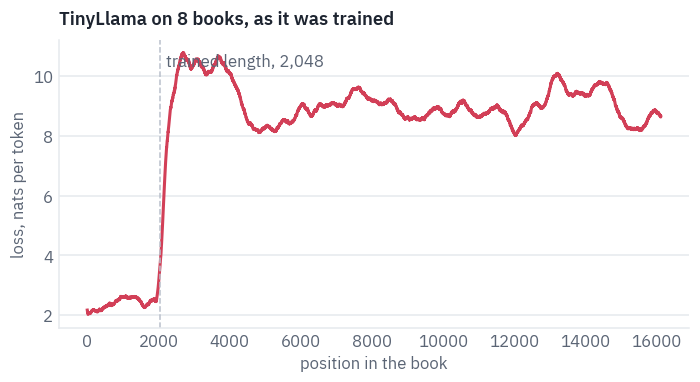

<pre class="tfs-printed" markdown="0"><code>mean loss, second half of the trained window: 2.53
mean loss, the next 2,048 tokens: 9.30
mean loss, the last 2,048 tokens: 8.86</code></pre>

Up to the trained length the curve does what it should. Then it turns into a wall. Nothing in the weights changed at
position 2,049; what changed is the angles the rotary pairs report.

## 4. Clocks that never finished a turn

Think of every rotary pair as a clock hand that advances by $$\theta_i$$ per token. Its *wavelength*, the number of
tokens for one full turn, is

$$\lambda_i = \frac{2\pi}{\theta_i} = 2\pi\, b^{2i/d},$$

and over a training window of $$L$$ tokens the hand makes $$r_i = L / \lambda_i$$ turns. Attention between tokens
$$m$$ and $$n$$ sees, in pair $$i$$, the angle $$(m - n)\theta_i$$. A pair that turned hundreds of times during
training has shown the model every angle at every distance; at a distance of 3,000 it reports an angle the model
knows well from a shorter distance. A pair that never finished a turn is different: in training it only ever
reported angles between zero and $$L\theta_i$$, and beyond $$L$$ it reports angles the model has never seen. Those
pairs carry the coarse sense of "how far back", and they are the ones that lie.

```python
turns = TRAINED * rope_frequencies(tiny.head_dim, tiny.base) / (2 * math.pi)
print("turns in training, fastest pair to slowest:")
print(" ".join(f"{t:.2f}" if t < 10 else f"{t:.0f}" for t in turns.tolist()))
slow = turns < 1
print(f"pairs that never finished a turn: {int(slow.sum())} of {len(turns)}")
```

<pre class="tfs-printed" markdown="0"><code>turns in training, fastest pair to slowest:
326 244 183 137 103 77 58 43 33 24 18 14 10 7.73 5.80 4.35 3.26 2.44 1.83 1.37 1.03 0.77 0.58 0.43 0.33 0.24 0.18 0.14 0.10 0.08 0.06 0.04
pairs that never finished a turn: 11 of 32</code></pre>

One pair at a time makes this concrete. Take three of TinyLlama's pairs, a fast one, a middle one and a slow one,
and ask what angle each reports between two tokens 16,000 positions apart. The shaded arc is every angle the pair
showed during training, at distances from 0 to 2,048; the red hand is the angle at 16,000.

```python
def draw_clocks(freq, stretched=None):
    distance = min(16000, LENGTH - 1)
    pairs = [2, len(freq) // 2, len(freq) - 4]
    fig, axes = plt.subplots(1, 3, figsize=(8.4, 3.0), subplot_kw={"projection": "polar"})
    for ax, pair in zip(axes, pairs):
        seen = TRAINED * freq[pair].item()  # the widest angle training showed, in radians
        arc = np.linspace(0, min(seen, 2 * math.pi), 200)
        ax.fill_between(arc, 0, 1, color=COLORS["line"], alpha=0.5)
        hands = [(freq, COLORS["dec"])]
        if stretched is not None:
            hands.append((stretched, COLORS["enc"]))
        for f, color in hands:
            angle = (distance * f[pair].item()) % (2 * math.pi)
            ax.plot([angle, angle], [0, 1], color=color, linewidth=2.5)
        ax.set_yticks([])
        ax.set_xticks([])
        turns_seen = seen / (2 * math.pi)
        ax.set_title(f"pair {pair}: {turns_seen:.2f} turns in training", fontsize=10)
    plt.show()
    for pair in pairs:
        seen = math.degrees(TRAINED * freq[pair].item())
        asked = math.degrees(distance * freq[pair].item())
        line = f"pair {pair:2}: training showed up to {min(seen, 360):6.1f}°;"
        line += f" at {distance:,} it asks for {asked:9.1f}°"
        if stretched is not None:
            after = math.degrees(distance * stretched[pair].item())
            line += f", after the stretch {after:9.1f}°"
        print(line)


draw_clocks(rope_frequencies(tiny.head_dim, tiny.base))
```

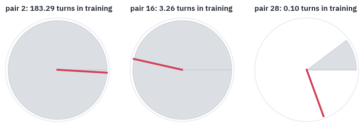

<pre class="tfs-printed" markdown="0"><code>pair  2: training showed up to  360.0°; at 16,000 it asks for  515516.6°
pair 16: training showed up to  360.0°; at 16,000 it asks for    9167.3°
pair 28: training showed up to   37.1°; at 16,000 it asks for     289.9°</code></pre>

The fast pair asks for an angle of many turns, which lands somewhere on a circle it has covered completely: familiar.
The slow pair asks for an angle far beyond the sliver it ever showed: a direction the model has never seen.

That is the picture at the top of the lesson. If the story is right, slowing down only the pairs that never finished
a turn, so that 16k tokens turn them no further than 2,048 used to, should take the wall down, and slowing down
only the fast ones should not. Both experiments take a few lines.

```python
def slow_pairs_only(head_dim, base, s):
    freq = rope_frequencies(head_dim, base)
    return torch.where(slow, freq / s, freq), 1.0


def fast_pairs_only(head_dim, base, s):
    freq = rope_frequencies(head_dim, base)
    return torch.where(slow, freq, freq / s), 1.0


STRETCHES["slow pairs only"] = slow_pairs_only
STRETCHES["fast pairs only"] = fast_pairs_only
for method in ["slow pairs only", "fast pairs only"]:
    stretch(tiny, method, STRETCH)
    curves[method] = average_losses(tiny)


def bucket_table(names):
    edges = [0, TRAINED // 2, TRAINED, 2 * TRAINED, LENGTH // 2, LENGTH]
    rows = []
    for name in names:
        row = {"stretch": name}
        for a, b in zip(edges[:-1], edges[1:]):
            row[f"{a:,}–{b:,}"] = curves[name][a:b].mean().item()
        rows.append(row)
    return table(pd.DataFrame(rows), digits=2)


bucket_table(["none", "slow pairs only", "fast pairs only"])
```

<div class="tfs-table-wrap"><table class="tfs-table" style="border-collapse:collapse;font-family:'IBM Plex Sans', -apple-system, 'Segoe UI', Roboto, Helvetica, Arial, sans-serif;font-size:13.5px;line-height:1.45;margin:4px 0 8px;"><thead><tr><th style="padding:7px 14px;border-bottom:2px solid #B9C0CB;font-weight:600;color:#5B6575;font-size:12px;letter-spacing:0.02em;text-align:left;">stretch</th><th style="padding:7px 14px;border-bottom:2px solid #B9C0CB;font-weight:600;color:#5B6575;font-size:12px;letter-spacing:0.02em;text-align:right;">0–1,024</th><th style="padding:7px 14px;border-bottom:2px solid #B9C0CB;font-weight:600;color:#5B6575;font-size:12px;letter-spacing:0.02em;text-align:right;">1,024–2,048</th><th style="padding:7px 14px;border-bottom:2px solid #B9C0CB;font-weight:600;color:#5B6575;font-size:12px;letter-spacing:0.02em;text-align:right;">2,048–4,096</th><th style="padding:7px 14px;border-bottom:2px solid #B9C0CB;font-weight:600;color:#5B6575;font-size:12px;letter-spacing:0.02em;text-align:right;">4,096–8,192</th><th style="padding:7px 14px;border-bottom:2px solid #B9C0CB;font-weight:600;color:#5B6575;font-size:12px;letter-spacing:0.02em;text-align:right;">8,192–16,384</th></tr></thead><tbody><tr><td style="padding:7px 14px;border-bottom:1px solid #E6E9EE;vertical-align:top;text-align:left;max-width:460px;white-space:normal;">none</td><td style="padding:7px 14px;border-bottom:1px solid #E6E9EE;vertical-align:top;text-align:right;font-variant-numeric:tabular-nums;max-width:460px;white-space:normal;">2.25</td><td style="padding:7px 14px;border-bottom:1px solid #E6E9EE;vertical-align:top;text-align:right;font-variant-numeric:tabular-nums;max-width:460px;white-space:normal;">2.53</td><td style="padding:7px 14px;border-bottom:1px solid #E6E9EE;vertical-align:top;text-align:right;font-variant-numeric:tabular-nums;max-width:460px;white-space:normal;">9.30</td><td style="padding:7px 14px;border-bottom:1px solid #E6E9EE;vertical-align:top;text-align:right;font-variant-numeric:tabular-nums;max-width:460px;white-space:normal;">8.89</td><td style="padding:7px 14px;border-bottom:1px solid #E6E9EE;vertical-align:top;text-align:right;font-variant-numeric:tabular-nums;max-width:460px;white-space:normal;">8.92</td></tr><tr><td style="padding:7px 14px;border-bottom:1px solid #E6E9EE;vertical-align:top;text-align:left;max-width:460px;white-space:normal;">slow pairs only</td><td style="padding:7px 14px;border-bottom:1px solid #E6E9EE;vertical-align:top;text-align:right;font-variant-numeric:tabular-nums;max-width:460px;white-space:normal;">2.70</td><td style="padding:7px 14px;border-bottom:1px solid #E6E9EE;vertical-align:top;text-align:right;font-variant-numeric:tabular-nums;max-width:460px;white-space:normal;">5.43</td><td style="padding:7px 14px;border-bottom:1px solid #E6E9EE;vertical-align:top;text-align:right;font-variant-numeric:tabular-nums;max-width:460px;white-space:normal;">5.57</td><td style="padding:7px 14px;border-bottom:1px solid #E6E9EE;vertical-align:top;text-align:right;font-variant-numeric:tabular-nums;max-width:460px;white-space:normal;">5.82</td><td style="padding:7px 14px;border-bottom:1px solid #E6E9EE;vertical-align:top;text-align:right;font-variant-numeric:tabular-nums;max-width:460px;white-space:normal;">5.90</td></tr><tr><td style="padding:7px 14px;border-bottom:1px solid #E6E9EE;vertical-align:top;text-align:left;max-width:460px;white-space:normal;">fast pairs only</td><td style="padding:7px 14px;border-bottom:1px solid #E6E9EE;vertical-align:top;text-align:right;font-variant-numeric:tabular-nums;max-width:460px;white-space:normal;">5.36</td><td style="padding:7px 14px;border-bottom:1px solid #E6E9EE;vertical-align:top;text-align:right;font-variant-numeric:tabular-nums;max-width:460px;white-space:normal;">5.52</td><td style="padding:7px 14px;border-bottom:1px solid #E6E9EE;vertical-align:top;text-align:right;font-variant-numeric:tabular-nums;max-width:460px;white-space:normal;">7.63</td><td style="padding:7px 14px;border-bottom:1px solid #E6E9EE;vertical-align:top;text-align:right;font-variant-numeric:tabular-nums;max-width:460px;white-space:normal;">7.90</td><td style="padding:7px 14px;border-bottom:1px solid #E6E9EE;vertical-align:top;text-align:right;font-variant-numeric:tabular-nums;max-width:460px;white-space:normal;">8.15</td></tr></tbody></table></div>

The table is the loss averaged over stretches of positions, the first two columns inside the trained window and the other three beyond it.

The fast pairs are not the problem: slowing them down leaves the wall standing and spoils the trained window as well. Slowing down the slow ones lowers the wall a long way, so that is where it comes from.

But it is a clumsy cure, and it costs a lot even inside the window, where nothing was wrong. It cuts the spectrum in two: the last pair that finished a turn keeps its speed, and its neighbour suddenly turns eight times slower.

The model reads neighbouring pairs together, and a seam between them hurts. The methods of the next section are, one way or another, ways to slow the slow pairs down without a seam.

## 5. Five ways to stretch the clocks

**Position interpolation** (Chen, Wong, Chen and Tian at Meta; kaiokendev at the same time). To read $$s$$ times
further, divide every position by $$s$$:

$$m\theta_i \;\to\; \frac{m}{s}\theta_i \quad\Longleftrightarrow\quad \theta_i \;\to\; \frac{\theta_i}{s}.$$

Every angle at position 16,384 is now an angle the model saw at 2,048, so nothing is out of range. The fast pairs
pay for it. Two neighbouring tokens used to differ by $$\theta_0 = 1$$ radian in the fastest pair and now differ by
$$1/8$$, and the model's sense of word order, which lives in those pairs, gets blurry. The paper's answer is a short
fine-tuning, after which the model has learned the new spacing.

**NTK-aware scaling** (bloc97 on Reddit). Leave the fast pairs alone and stretch the slow ones, by changing the base
instead of the positions:

$$b' = b \cdot s^{\,d/(d-2)},$$

which gives every pair a new frequency

$$\theta'_i = \theta_i \cdot s^{-2i/(d-2)}.$$

The fastest pair, $$i = 0$$, keeps its frequency; the slowest, $$i = d/2 - 1$$, is divided by exactly $$s$$; the pairs in between are divided by a power of $$s$$ that grows with $$i$$. The odd exponent $$d/(d-2)$$ is what makes the slowest pair land exactly where position interpolation would put it.

The name points to the theory of neural tangent kernels and to the Fourier-features work of Tancik and colleagues, which bloc97 cited: networks learn high frequencies poorly unless they are handed them, so the fast pairs shouldn't be squeezed.

**Dynamic NTK** (emozilla on Reddit). Don't stretch until you have to: recompute the base with $$s = n / L$$ as the
text grows past $$L$$, so that short texts run unchanged. It shares a catch with every scheme that changes while you
read: the keys already in the cache were rotated with the old base.

```python
def interpolate(head_dim, base, s):
    return rope_frequencies(head_dim, base) / s, 1.0


def ntk(head_dim, base, s):
    return rope_frequencies(head_dim, base * s ** (head_dim / (head_dim - 2))), 1.0


STRETCHES["PI"] = interpolate
STRETCHES["NTK"] = ntk
```

**YaRN** (Peng, Quesnelle, Fan and Shippole, 2023) does two things. The first is *NTK-by-parts*, the experiment of section 4 turned into a rule. Measure each pair by the turns $$r_i = L/\lambda_i$$ it made in training.

Pairs that made more than $$\beta = 32$$ turns are left alone; pairs that made fewer than $$\alpha = 1$$ are interpolated in full; the ones in between are blended:

$$\theta'_i = \big(1 - \gamma_i\big)\,\frac{\theta_i}{s} + \gamma_i\,\theta_i,$$

where $$\gamma_i$$ goes from 1 for the fast pairs to 0 for the slow ones. The second is a *temperature*: all
attention logits are multiplied by $$1/t$$, with

$$\sqrt{1/t} = 0.1 \ln s + 1.$$

A longer text gives every query more keys to spread its attention over, and its softmax gets flatter; the temperature sharpens it back. The formula is a fit the authors found empirically.

Implementations multiply both the queries and the keys by $$\sqrt{1/t}$$, which is why the formula is written for the square root. Section 6 measures the flattening.

Now a detail on which the paper and the code disagree. The paper draws $$\gamma$$ as a straight line in the number of turns, $$\gamma_i = (r_i - \alpha)/(\beta - \alpha)$$.

The authors' code, which Hugging Face and vLLM follow, draws the straight line in the *index* of the pair: it finds the pair that makes $$\beta$$ turns and the pair that makes $$\alpha$$, rounds the first down and the second up to whole pairs, and blends linearly between the two indices.

Turns fall exponentially with the index, so these are different curves. We write the code's version, because that is what every model with YaRN in its config runs, and keep the paper's for comparison.

```python
def yarn(head_dim, base, s, trained=None, fast=32, slow=1):
    trained = trained or TRAINED
    freq = rope_frequencies(head_dim, base)

    def pair_making(turns):  # the pair index that makes this many turns in training
        return head_dim * math.log(trained / (turns * 2 * math.pi)) / (2 * math.log(base))

    first = max(math.floor(pair_making(fast)), 0)
    last = min(math.ceil(pair_making(slow)), head_dim - 1)
    pairs = torch.arange(head_dim // 2).float()
    gamma = 1 - ((pairs - first) / (last - first)).clamp(0, 1)  # 1: keep, 0: interpolate
    mixed = (1 - gamma) * freq / s + gamma * freq
    return mixed, 0.1 * math.log(s) + 1


def yarn_as_written(head_dim, base, s, trained=None, alpha=1, beta=32):
    trained = trained or TRAINED
    freq = rope_frequencies(head_dim, base)
    turns = trained * freq / (2 * math.pi)
    gamma = ((turns - alpha) / (beta - alpha)).clamp(0, 1)
    return (1 - gamma) * freq / s + gamma * freq, 0.1 * math.log(s) + 1


def yarn_cold(head_dim, base, s):
    freq, _ = yarn(head_dim, base, s)
    return freq, 1.0


STRETCHES["YaRN"] = yarn
STRETCHES["YaRN, no temperature"] = yarn_cold
```

Back to the three clocks, now with YaRN's hand in teal: the fast pair keeps its angle, the slow pair's hand returns
into the arc the model knows.

```python
yarn_freq, _ = yarn(tiny.head_dim, tiny.base, STRETCH)
draw_clocks(rope_frequencies(tiny.head_dim, tiny.base), yarn_freq)
```

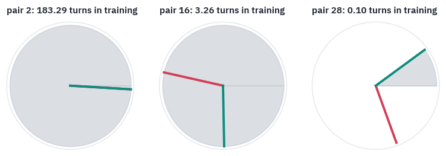

<pre class="tfs-printed" markdown="0"><code>pair  2: training showed up to  360.0°; at 16,000 it asks for  515516.6°, after the stretch  515516.6°
pair 16: training showed up to  360.0°; at 16,000 it asks for    9167.3°, after the stretch    4231.1°
pair 28: training showed up to   37.1°; at 16,000 it asks for     289.9°, after the stretch      36.2°</code></pre>

**Llama 3.1** stretches Llama 3 eight times with a rule of Meta's own, which the Llama 3 paper doesn't describe: it lives only in Meta's code, with its constants commented "values obtained from grid search".

Pairs whose wavelength is shorter than a quarter of the training window are kept, pairs whose wavelength is longer than the window are divided by the factor, and the ones in between are blended linearly in $$L/\lambda$$, that is, in the number of turns.

That is the paper's version of YaRN's ramp with $$\alpha = 1$$ and $$\beta = 4$$, without the temperature. The code below follows Meta's, and the check after it shows the coincidence is exact.

```python
def llama3(head_dim, base, s, trained=None, low=1, high=4):
    trained = trained or TRAINED
    freq = rope_frequencies(head_dim, base)
    wavelength = 2 * math.pi / freq
    out = []
    for f, w in zip(freq.tolist(), wavelength.tolist()):
        if w < trained / high:
            out.append(f)
        elif w > trained / low:
            out.append(f / s)
        else:
            keep = (trained / w - low) / (high - low)
            out.append((1 - keep) * f / s + keep * f)
    return torch.tensor(out), 1.0


STRETCHES["Llama 3.1"] = llama3

meta = llama3(tiny.head_dim, tiny.base, STRETCH)[0]
paper = yarn_as_written(tiny.head_dim, tiny.base, STRETCH, alpha=1, beta=4)[0]
print("Llama 3.1 against YaRN as written, β = 4:", f"{(meta / paper - 1).abs().max():.1e}")
```

<pre class="tfs-printed" markdown="0"><code>Llama 3.1 against YaRN as written, β = 4: 1.2e-07</code></pre>

Each method against the transformers library, which implements them for the configs of real models, on three head
shapes: TinyLlama's, Qwen3's and Llama 3.1's. Dynamic NTK is checked at a length of $$sL$$, where it equals NTK.

```python
from transformers import LlamaConfig
from transformers.modeling_rope_utils import ROPE_INIT_FUNCTIONS


def library(head_dim, base, positions, params, length=None):
    c = LlamaConfig(
        hidden_size=head_dim * 8,
        num_attention_heads=8,
        head_dim=head_dim,
        max_position_embeddings=positions,
        rope_parameters=dict(rope_theta=base, **params),
    )
    return ROPE_INIT_FUNCTIONS[params["rope_type"]](c, "cpu", seq_len=length)


SHAPES = [(64, 10000.0, 2048, 8), (128, 1e6, 32768, 4), (128, 5e5, 8192, 8)]
checks = []
for head_dim, base, trained, s in SHAPES:
    longer = {"original_max_position_embeddings": trained}
    llama_params = {"low_freq_factor": 1, "high_freq_factor": 4, **longer}
    cases = [
        ("PI", interpolate(head_dim, base, s), trained * s,
         {"rope_type": "linear", "factor": s}),
        ("NTK", ntk(head_dim, base, s), trained, {"rope_type": "dynamic", "factor": 1.0}),
        ("YaRN", yarn(head_dim, base, s, trained), trained * s,
         {"rope_type": "yarn", "factor": s, **longer}),
        ("Llama 3.1", llama3(head_dim, base, s, trained), trained * s,
         {"rope_type": "llama3", "factor": s, **llama_params}),
    ]
    for name, (freq, scale), positions, params in cases:
        length = s * trained if name == "NTK" else None
        ref_freq, ref_scale = library(head_dim, base, positions, params, length)
        checks.append(
            {
                "head, base, window": f"{head_dim}, {base:,.0f}, {trained:,} × {s}",
                "method": name,
                "max relative difference": (freq / ref_freq - 1).abs().max().item(),
                "scale, ours": scale,
                "scale, library": ref_scale,
            }
        )
table(pd.DataFrame(checks), digits=3)
```

<div class="tfs-table-wrap"><table class="tfs-table" style="border-collapse:collapse;font-family:'IBM Plex Sans', -apple-system, 'Segoe UI', Roboto, Helvetica, Arial, sans-serif;font-size:13.5px;line-height:1.45;margin:4px 0 8px;"><thead><tr><th style="padding:7px 14px;border-bottom:2px solid #B9C0CB;font-weight:600;color:#5B6575;font-size:12px;letter-spacing:0.02em;text-align:left;">head, base, window</th><th style="padding:7px 14px;border-bottom:2px solid #B9C0CB;font-weight:600;color:#5B6575;font-size:12px;letter-spacing:0.02em;text-align:left;">method</th><th style="padding:7px 14px;border-bottom:2px solid #B9C0CB;font-weight:600;color:#5B6575;font-size:12px;letter-spacing:0.02em;text-align:right;">max relative difference</th><th style="padding:7px 14px;border-bottom:2px solid #B9C0CB;font-weight:600;color:#5B6575;font-size:12px;letter-spacing:0.02em;text-align:right;">scale, ours</th><th style="padding:7px 14px;border-bottom:2px solid #B9C0CB;font-weight:600;color:#5B6575;font-size:12px;letter-spacing:0.02em;text-align:right;">scale, library</th></tr></thead><tbody><tr><td style="padding:7px 14px;border-bottom:1px solid #E6E9EE;vertical-align:top;text-align:left;max-width:460px;white-space:normal;">64, 10,000, 2,048 × 8</td><td style="padding:7px 14px;border-bottom:1px solid #E6E9EE;vertical-align:top;text-align:left;max-width:460px;white-space:normal;">PI</td><td style="padding:7px 14px;border-bottom:1px solid #E6E9EE;vertical-align:top;text-align:right;font-variant-numeric:tabular-nums;max-width:460px;white-space:normal;">0.000</td><td style="padding:7px 14px;border-bottom:1px solid #E6E9EE;vertical-align:top;text-align:right;font-variant-numeric:tabular-nums;max-width:460px;white-space:normal;">1.000</td><td style="padding:7px 14px;border-bottom:1px solid #E6E9EE;vertical-align:top;text-align:right;font-variant-numeric:tabular-nums;max-width:460px;white-space:normal;">1.000</td></tr><tr><td style="padding:7px 14px;border-bottom:1px solid #E6E9EE;vertical-align:top;text-align:left;max-width:460px;white-space:normal;">64, 10,000, 2,048 × 8</td><td style="padding:7px 14px;border-bottom:1px solid #E6E9EE;vertical-align:top;text-align:left;max-width:460px;white-space:normal;">NTK</td><td style="padding:7px 14px;border-bottom:1px solid #E6E9EE;vertical-align:top;text-align:right;font-variant-numeric:tabular-nums;max-width:460px;white-space:normal;">0.000</td><td style="padding:7px 14px;border-bottom:1px solid #E6E9EE;vertical-align:top;text-align:right;font-variant-numeric:tabular-nums;max-width:460px;white-space:normal;">1.000</td><td style="padding:7px 14px;border-bottom:1px solid #E6E9EE;vertical-align:top;text-align:right;font-variant-numeric:tabular-nums;max-width:460px;white-space:normal;">1.000</td></tr><tr><td style="padding:7px 14px;border-bottom:1px solid #E6E9EE;vertical-align:top;text-align:left;max-width:460px;white-space:normal;">64, 10,000, 2,048 × 8</td><td style="padding:7px 14px;border-bottom:1px solid #E6E9EE;vertical-align:top;text-align:left;max-width:460px;white-space:normal;">YaRN</td><td style="padding:7px 14px;border-bottom:1px solid #E6E9EE;vertical-align:top;text-align:right;font-variant-numeric:tabular-nums;max-width:460px;white-space:normal;">0.000</td><td style="padding:7px 14px;border-bottom:1px solid #E6E9EE;vertical-align:top;text-align:right;font-variant-numeric:tabular-nums;max-width:460px;white-space:normal;">1.208</td><td style="padding:7px 14px;border-bottom:1px solid #E6E9EE;vertical-align:top;text-align:right;font-variant-numeric:tabular-nums;max-width:460px;white-space:normal;">1.208</td></tr><tr><td style="padding:7px 14px;border-bottom:1px solid #E6E9EE;vertical-align:top;text-align:left;max-width:460px;white-space:normal;">64, 10,000, 2,048 × 8</td><td style="padding:7px 14px;border-bottom:1px solid #E6E9EE;vertical-align:top;text-align:left;max-width:460px;white-space:normal;">Llama 3.1</td><td style="padding:7px 14px;border-bottom:1px solid #E6E9EE;vertical-align:top;text-align:right;font-variant-numeric:tabular-nums;max-width:460px;white-space:normal;">0.000</td><td style="padding:7px 14px;border-bottom:1px solid #E6E9EE;vertical-align:top;text-align:right;font-variant-numeric:tabular-nums;max-width:460px;white-space:normal;">1.000</td><td style="padding:7px 14px;border-bottom:1px solid #E6E9EE;vertical-align:top;text-align:right;font-variant-numeric:tabular-nums;max-width:460px;white-space:normal;">1.000</td></tr><tr><td style="padding:7px 14px;border-bottom:1px solid #E6E9EE;vertical-align:top;text-align:left;max-width:460px;white-space:normal;">128, 1,000,000, 32,768 × 4</td><td style="padding:7px 14px;border-bottom:1px solid #E6E9EE;vertical-align:top;text-align:left;max-width:460px;white-space:normal;">PI</td><td style="padding:7px 14px;border-bottom:1px solid #E6E9EE;vertical-align:top;text-align:right;font-variant-numeric:tabular-nums;max-width:460px;white-space:normal;">0.000</td><td style="padding:7px 14px;border-bottom:1px solid #E6E9EE;vertical-align:top;text-align:right;font-variant-numeric:tabular-nums;max-width:460px;white-space:normal;">1.000</td><td style="padding:7px 14px;border-bottom:1px solid #E6E9EE;vertical-align:top;text-align:right;font-variant-numeric:tabular-nums;max-width:460px;white-space:normal;">1.000</td></tr><tr><td style="padding:7px 14px;border-bottom:1px solid #E6E9EE;vertical-align:top;text-align:left;max-width:460px;white-space:normal;">128, 1,000,000, 32,768 × 4</td><td style="padding:7px 14px;border-bottom:1px solid #E6E9EE;vertical-align:top;text-align:left;max-width:460px;white-space:normal;">NTK</td><td style="padding:7px 14px;border-bottom:1px solid #E6E9EE;vertical-align:top;text-align:right;font-variant-numeric:tabular-nums;max-width:460px;white-space:normal;">0.000</td><td style="padding:7px 14px;border-bottom:1px solid #E6E9EE;vertical-align:top;text-align:right;font-variant-numeric:tabular-nums;max-width:460px;white-space:normal;">1.000</td><td style="padding:7px 14px;border-bottom:1px solid #E6E9EE;vertical-align:top;text-align:right;font-variant-numeric:tabular-nums;max-width:460px;white-space:normal;">1.000</td></tr><tr><td style="padding:7px 14px;border-bottom:1px solid #E6E9EE;vertical-align:top;text-align:left;max-width:460px;white-space:normal;">128, 1,000,000, 32,768 × 4</td><td style="padding:7px 14px;border-bottom:1px solid #E6E9EE;vertical-align:top;text-align:left;max-width:460px;white-space:normal;">YaRN</td><td style="padding:7px 14px;border-bottom:1px solid #E6E9EE;vertical-align:top;text-align:right;font-variant-numeric:tabular-nums;max-width:460px;white-space:normal;">0.000</td><td style="padding:7px 14px;border-bottom:1px solid #E6E9EE;vertical-align:top;text-align:right;font-variant-numeric:tabular-nums;max-width:460px;white-space:normal;">1.139</td><td style="padding:7px 14px;border-bottom:1px solid #E6E9EE;vertical-align:top;text-align:right;font-variant-numeric:tabular-nums;max-width:460px;white-space:normal;">1.139</td></tr><tr><td style="padding:7px 14px;border-bottom:1px solid #E6E9EE;vertical-align:top;text-align:left;max-width:460px;white-space:normal;">128, 1,000,000, 32,768 × 4</td><td style="padding:7px 14px;border-bottom:1px solid #E6E9EE;vertical-align:top;text-align:left;max-width:460px;white-space:normal;">Llama 3.1</td><td style="padding:7px 14px;border-bottom:1px solid #E6E9EE;vertical-align:top;text-align:right;font-variant-numeric:tabular-nums;max-width:460px;white-space:normal;">0.000</td><td style="padding:7px 14px;border-bottom:1px solid #E6E9EE;vertical-align:top;text-align:right;font-variant-numeric:tabular-nums;max-width:460px;white-space:normal;">1.000</td><td style="padding:7px 14px;border-bottom:1px solid #E6E9EE;vertical-align:top;text-align:right;font-variant-numeric:tabular-nums;max-width:460px;white-space:normal;">1.000</td></tr><tr><td style="padding:7px 14px;border-bottom:1px solid #E6E9EE;vertical-align:top;text-align:left;max-width:460px;white-space:normal;">128, 500,000, 8,192 × 8</td><td style="padding:7px 14px;border-bottom:1px solid #E6E9EE;vertical-align:top;text-align:left;max-width:460px;white-space:normal;">PI</td><td style="padding:7px 14px;border-bottom:1px solid #E6E9EE;vertical-align:top;text-align:right;font-variant-numeric:tabular-nums;max-width:460px;white-space:normal;">0.000</td><td style="padding:7px 14px;border-bottom:1px solid #E6E9EE;vertical-align:top;text-align:right;font-variant-numeric:tabular-nums;max-width:460px;white-space:normal;">1.000</td><td style="padding:7px 14px;border-bottom:1px solid #E6E9EE;vertical-align:top;text-align:right;font-variant-numeric:tabular-nums;max-width:460px;white-space:normal;">1.000</td></tr><tr><td style="padding:7px 14px;border-bottom:1px solid #E6E9EE;vertical-align:top;text-align:left;max-width:460px;white-space:normal;">128, 500,000, 8,192 × 8</td><td style="padding:7px 14px;border-bottom:1px solid #E6E9EE;vertical-align:top;text-align:left;max-width:460px;white-space:normal;">NTK</td><td style="padding:7px 14px;border-bottom:1px solid #E6E9EE;vertical-align:top;text-align:right;font-variant-numeric:tabular-nums;max-width:460px;white-space:normal;">0.000</td><td style="padding:7px 14px;border-bottom:1px solid #E6E9EE;vertical-align:top;text-align:right;font-variant-numeric:tabular-nums;max-width:460px;white-space:normal;">1.000</td><td style="padding:7px 14px;border-bottom:1px solid #E6E9EE;vertical-align:top;text-align:right;font-variant-numeric:tabular-nums;max-width:460px;white-space:normal;">1.000</td></tr><tr><td style="padding:7px 14px;border-bottom:1px solid #E6E9EE;vertical-align:top;text-align:left;max-width:460px;white-space:normal;">128, 500,000, 8,192 × 8</td><td style="padding:7px 14px;border-bottom:1px solid #E6E9EE;vertical-align:top;text-align:left;max-width:460px;white-space:normal;">YaRN</td><td style="padding:7px 14px;border-bottom:1px solid #E6E9EE;vertical-align:top;text-align:right;font-variant-numeric:tabular-nums;max-width:460px;white-space:normal;">0.000</td><td style="padding:7px 14px;border-bottom:1px solid #E6E9EE;vertical-align:top;text-align:right;font-variant-numeric:tabular-nums;max-width:460px;white-space:normal;">1.208</td><td style="padding:7px 14px;border-bottom:1px solid #E6E9EE;vertical-align:top;text-align:right;font-variant-numeric:tabular-nums;max-width:460px;white-space:normal;">1.208</td></tr><tr><td style="padding:7px 14px;border-bottom:1px solid #E6E9EE;vertical-align:top;text-align:left;max-width:460px;white-space:normal;">128, 500,000, 8,192 × 8</td><td style="padding:7px 14px;border-bottom:1px solid #E6E9EE;vertical-align:top;text-align:left;max-width:460px;white-space:normal;">Llama 3.1</td><td style="padding:7px 14px;border-bottom:1px solid #E6E9EE;vertical-align:top;text-align:right;font-variant-numeric:tabular-nums;max-width:460px;white-space:normal;">0.000</td><td style="padding:7px 14px;border-bottom:1px solid #E6E9EE;vertical-align:top;text-align:right;font-variant-numeric:tabular-nums;max-width:460px;white-space:normal;">1.000</td><td style="padding:7px 14px;border-bottom:1px solid #E6E9EE;vertical-align:top;text-align:right;font-variant-numeric:tabular-nums;max-width:460px;white-space:normal;">1.000</td></tr></tbody></table></div>

All four agree with the library to the last bit of a 32-bit float. Here is what each does to TinyLlama's pairs when
the window is stretched eight times: the frequency of each pair after the stretch, divided by its frequency before.

```python
original = rope_frequencies(tiny.head_dim, tiny.base)
fig, ax = plt.subplots(figsize=(7.4, 3.8))
for method, color in [
    ("PI", COLORS["muted"]),
    ("NTK", COLORS["data"]),
    ("Llama 3.1", COLORS["enc"]),
    ("YaRN", COLORS["dec"]),
]:
    freq, _ = STRETCHES[method](tiny.head_dim, tiny.base, STRETCH)
    ratio = freq / original
    ax.plot(ratio, color=color, linewidth=2, label=method, marker="o", markersize=3)
written, _ = yarn_as_written(tiny.head_dim, tiny.base, STRETCH)
ax.plot(written / original, color=COLORS["dec"], linewidth=1.4, linestyle="--",
        label="YaRN as the paper writes it")
ax.set_yscale("log", base=2)
ax.set_xlabel("rotary pair, fastest to slowest")
ax.set_ylabel("new frequency / old")
ax.set_title(f"TinyLlama's {len(original)} pairs, bent for an {STRETCH}× window")
ax.legend(frameon=False, fontsize=9, loc="lower left")
plt.show()
```

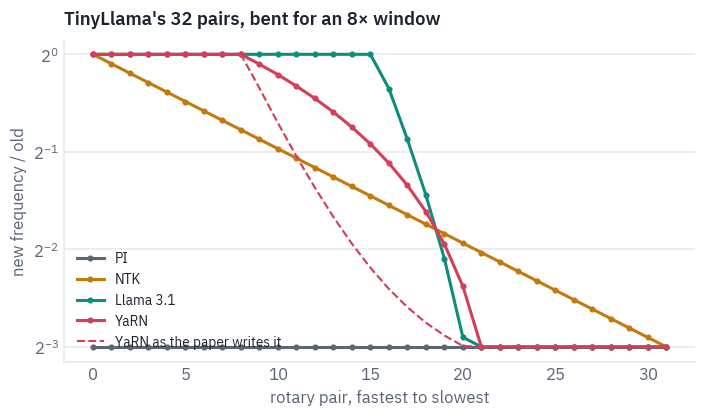

Position interpolation is the flat line at $$1/8$$: every pair slowed down equally. NTK bends smoothly from 1 to
$$1/8$$. YaRN keeps the first pairs exactly, falls along a straight segment and reaches $$1/8$$ for the pairs that
never finished a turn; the paper's version, dashed, takes a different path through the same middle. Llama 3.1 keeps
more of the fast pairs, because its $$\beta$$ is 4 rather than 32, and switches over in fewer pairs.

## 6. The race

All methods on the same eight books, with no training. Dynamic NTK at a fixed 16k length is NTK with the factor 8,
so it isn't a separate line here; the difference shows on shorter texts, in the passkey test below.

```python
for method in ["PI", "NTK", "YaRN", "YaRN, no temperature", "Llama 3.1"]:
    stretch(tiny, method, STRETCH)
    curves[method] = average_losses(tiny)

fig, ax = plt.subplots(figsize=(7.4, 3.8))
for method, color in [
    ("none", COLORS["line"]),
    ("PI", COLORS["muted"]),
    ("NTK", COLORS["data"]),
    ("Llama 3.1", COLORS["enc"]),
    ("YaRN", COLORS["dec"]),
]:
    ax.plot(smooth(curves[method]), color=color, linewidth=2, label=method)
ax.axvline(TRAINED, color=COLORS["line"], linestyle="--", linewidth=1)
ax.set_ylim(top=2 * curves["YaRN"].mean().item())
ax.set_xlabel("position in the book")
ax.set_ylabel("loss, nats per token")
ax.set_title(f"TinyLlama stretched {STRETCH}× without training")
ax.legend(frameon=False, ncol=3)
plt.show()
bucket_table(["none", "PI", "NTK", "Llama 3.1", "YaRN", "YaRN, no temperature"])
```

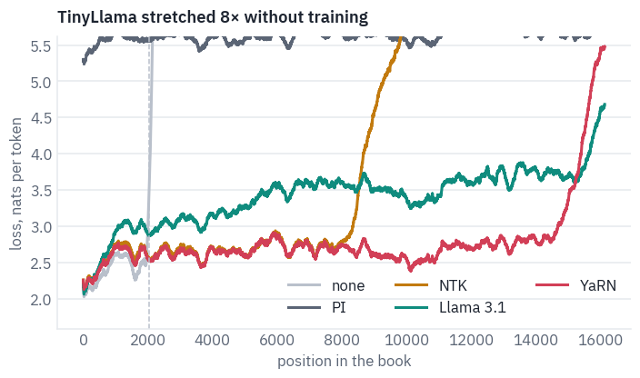

<div class="tfs-table-wrap"><table class="tfs-table" style="border-collapse:collapse;font-family:'IBM Plex Sans', -apple-system, 'Segoe UI', Roboto, Helvetica, Arial, sans-serif;font-size:13.5px;line-height:1.45;margin:4px 0 8px;"><thead><tr><th style="padding:7px 14px;border-bottom:2px solid #B9C0CB;font-weight:600;color:#5B6575;font-size:12px;letter-spacing:0.02em;text-align:left;">stretch</th><th style="padding:7px 14px;border-bottom:2px solid #B9C0CB;font-weight:600;color:#5B6575;font-size:12px;letter-spacing:0.02em;text-align:right;">0–1,024</th><th style="padding:7px 14px;border-bottom:2px solid #B9C0CB;font-weight:600;color:#5B6575;font-size:12px;letter-spacing:0.02em;text-align:right;">1,024–2,048</th><th style="padding:7px 14px;border-bottom:2px solid #B9C0CB;font-weight:600;color:#5B6575;font-size:12px;letter-spacing:0.02em;text-align:right;">2,048–4,096</th><th style="padding:7px 14px;border-bottom:2px solid #B9C0CB;font-weight:600;color:#5B6575;font-size:12px;letter-spacing:0.02em;text-align:right;">4,096–8,192</th><th style="padding:7px 14px;border-bottom:2px solid #B9C0CB;font-weight:600;color:#5B6575;font-size:12px;letter-spacing:0.02em;text-align:right;">8,192–16,384</th></tr></thead><tbody><tr><td style="padding:7px 14px;border-bottom:1px solid #E6E9EE;vertical-align:top;text-align:left;max-width:460px;white-space:normal;">none</td><td style="padding:7px 14px;border-bottom:1px solid #E6E9EE;vertical-align:top;text-align:right;font-variant-numeric:tabular-nums;max-width:460px;white-space:normal;">2.25</td><td style="padding:7px 14px;border-bottom:1px solid #E6E9EE;vertical-align:top;text-align:right;font-variant-numeric:tabular-nums;max-width:460px;white-space:normal;">2.53</td><td style="padding:7px 14px;border-bottom:1px solid #E6E9EE;vertical-align:top;text-align:right;font-variant-numeric:tabular-nums;max-width:460px;white-space:normal;">9.30</td><td style="padding:7px 14px;border-bottom:1px solid #E6E9EE;vertical-align:top;text-align:right;font-variant-numeric:tabular-nums;max-width:460px;white-space:normal;">8.89</td><td style="padding:7px 14px;border-bottom:1px solid #E6E9EE;vertical-align:top;text-align:right;font-variant-numeric:tabular-nums;max-width:460px;white-space:normal;">8.92</td></tr><tr><td style="padding:7px 14px;border-bottom:1px solid #E6E9EE;vertical-align:top;text-align:left;max-width:460px;white-space:normal;">PI</td><td style="padding:7px 14px;border-bottom:1px solid #E6E9EE;vertical-align:top;text-align:right;font-variant-numeric:tabular-nums;max-width:460px;white-space:normal;">5.46</td><td style="padding:7px 14px;border-bottom:1px solid #E6E9EE;vertical-align:top;text-align:right;font-variant-numeric:tabular-nums;max-width:460px;white-space:normal;">5.62</td><td style="padding:7px 14px;border-bottom:1px solid #E6E9EE;vertical-align:top;text-align:right;font-variant-numeric:tabular-nums;max-width:460px;white-space:normal;">5.59</td><td style="padding:7px 14px;border-bottom:1px solid #E6E9EE;vertical-align:top;text-align:right;font-variant-numeric:tabular-nums;max-width:460px;white-space:normal;">5.63</td><td style="padding:7px 14px;border-bottom:1px solid #E6E9EE;vertical-align:top;text-align:right;font-variant-numeric:tabular-nums;max-width:460px;white-space:normal;">5.67</td></tr><tr><td style="padding:7px 14px;border-bottom:1px solid #E6E9EE;vertical-align:top;text-align:left;max-width:460px;white-space:normal;">NTK</td><td style="padding:7px 14px;border-bottom:1px solid #E6E9EE;vertical-align:top;text-align:right;font-variant-numeric:tabular-nums;max-width:460px;white-space:normal;">2.38</td><td style="padding:7px 14px;border-bottom:1px solid #E6E9EE;vertical-align:top;text-align:right;font-variant-numeric:tabular-nums;max-width:460px;white-space:normal;">2.72</td><td style="padding:7px 14px;border-bottom:1px solid #E6E9EE;vertical-align:top;text-align:right;font-variant-numeric:tabular-nums;max-width:460px;white-space:normal;">2.63</td><td style="padding:7px 14px;border-bottom:1px solid #E6E9EE;vertical-align:top;text-align:right;font-variant-numeric:tabular-nums;max-width:460px;white-space:normal;">2.72</td><td style="padding:7px 14px;border-bottom:1px solid #E6E9EE;vertical-align:top;text-align:right;font-variant-numeric:tabular-nums;max-width:460px;white-space:normal;">7.00</td></tr><tr><td style="padding:7px 14px;border-bottom:1px solid #E6E9EE;vertical-align:top;text-align:left;max-width:460px;white-space:normal;">Llama 3.1</td><td style="padding:7px 14px;border-bottom:1px solid #E6E9EE;vertical-align:top;text-align:right;font-variant-numeric:tabular-nums;max-width:460px;white-space:normal;">2.39</td><td style="padding:7px 14px;border-bottom:1px solid #E6E9EE;vertical-align:top;text-align:right;font-variant-numeric:tabular-nums;max-width:460px;white-space:normal;">3.00</td><td style="padding:7px 14px;border-bottom:1px solid #E6E9EE;vertical-align:top;text-align:right;font-variant-numeric:tabular-nums;max-width:460px;white-space:normal;">3.03</td><td style="padding:7px 14px;border-bottom:1px solid #E6E9EE;vertical-align:top;text-align:right;font-variant-numeric:tabular-nums;max-width:460px;white-space:normal;">3.43</td><td style="padding:7px 14px;border-bottom:1px solid #E6E9EE;vertical-align:top;text-align:right;font-variant-numeric:tabular-nums;max-width:460px;white-space:normal;">3.67</td></tr><tr><td style="padding:7px 14px;border-bottom:1px solid #E6E9EE;vertical-align:top;text-align:left;max-width:460px;white-space:normal;">YaRN</td><td style="padding:7px 14px;border-bottom:1px solid #E6E9EE;vertical-align:top;text-align:right;font-variant-numeric:tabular-nums;max-width:460px;white-space:normal;">2.36</td><td style="padding:7px 14px;border-bottom:1px solid #E6E9EE;vertical-align:top;text-align:right;font-variant-numeric:tabular-nums;max-width:460px;white-space:normal;">2.67</td><td style="padding:7px 14px;border-bottom:1px solid #E6E9EE;vertical-align:top;text-align:right;font-variant-numeric:tabular-nums;max-width:460px;white-space:normal;">2.60</td><td style="padding:7px 14px;border-bottom:1px solid #E6E9EE;vertical-align:top;text-align:right;font-variant-numeric:tabular-nums;max-width:460px;white-space:normal;">2.70</td><td style="padding:7px 14px;border-bottom:1px solid #E6E9EE;vertical-align:top;text-align:right;font-variant-numeric:tabular-nums;max-width:460px;white-space:normal;">3.00</td></tr><tr><td style="padding:7px 14px;border-bottom:1px solid #E6E9EE;vertical-align:top;text-align:left;max-width:460px;white-space:normal;">YaRN, no temperature</td><td style="padding:7px 14px;border-bottom:1px solid #E6E9EE;vertical-align:top;text-align:right;font-variant-numeric:tabular-nums;max-width:460px;white-space:normal;">2.36</td><td style="padding:7px 14px;border-bottom:1px solid #E6E9EE;vertical-align:top;text-align:right;font-variant-numeric:tabular-nums;max-width:460px;white-space:normal;">2.81</td><td style="padding:7px 14px;border-bottom:1px solid #E6E9EE;vertical-align:top;text-align:right;font-variant-numeric:tabular-nums;max-width:460px;white-space:normal;">2.85</td><td style="padding:7px 14px;border-bottom:1px solid #E6E9EE;vertical-align:top;text-align:right;font-variant-numeric:tabular-nums;max-width:460px;white-space:normal;">3.19</td><td style="padding:7px 14px;border-bottom:1px solid #E6E9EE;vertical-align:top;text-align:right;font-variant-numeric:tabular-nums;max-width:460px;white-space:normal;">3.72</td></tr></tbody></table></div>

Read the table by columns. Inside the trained window, the first two columns, a method's cost is how much it disturbs what the model already knew, and position interpolation pays the most: it slowed the fast pairs too, and the model's sense of word order is blurred everywhere, near and far.

NTK leaves the window almost as it was and holds well past it, until its stretch of the slow pairs runs out, because by design only the very slowest pair is divided by the full factor. YaRN holds furthest.

Llama 3.1's rule, tuned by Meta for a model with a far larger base, holds too, though not as well as YaRN on TinyLlama. The last row isolates its second idea, the temperature, and shows it is not a detail.

Why a temperature at all? The entropy of a query's attention, in nats, says how many keys it spreads over: a query
that looks at exactly one key has entropy 0, and one spread evenly over $$n$$ keys has $$\ln n$$. We take the last
64 queries of a book at growing lengths, in a middle layer, and measure.

```python
layer = tiny.layers[len(tiny.layers) // 2].self_attn
lengths = [TRAINED // 4, TRAINED // 2, TRAINED, 2 * TRAINED, 4 * TRAINED, LENGTH]
entropy = {}
for method in ["YaRN, no temperature", "YaRN"]:
    stretch(tiny, method, STRETCH)
    values = []
    for n in lengths:
        layer.keep = True
        token_losses(tiny, books[1]["ids"][:, : n + 1])
        layer.keep = False
        q, k = layer.kept
        k = k.repeat_interleave(layer.heads // layer.kv_heads, dim=1)
        p = (q @ k.transpose(-1, -2) / math.sqrt(layer.head_dim)).softmax(-1)
        values.append(-(p * torch.log(p + 1e-12)).sum(-1).mean().item())
    entropy[method] = values

fig, ax = plt.subplots(figsize=(7.2, 3.4))
ax.plot(lengths, entropy["YaRN, no temperature"], color=COLORS["muted"], marker="o",
        label="no temperature")
ax.plot(lengths, entropy["YaRN"], color=COLORS["dec"], marker="o",
        label="YaRN's temperature")
ax.set_xscale("log", base=2)
ax.set_xlabel("tokens read")
ax.set_ylabel("attention entropy, nats")
ax.set_title("A middle layer of TinyLlama: how widely the last queries look")
ax.legend(frameon=False)
plt.show()
```

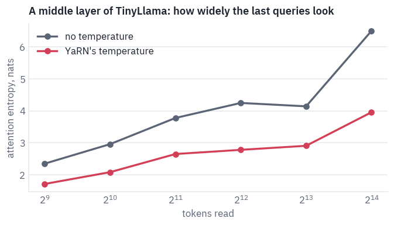

Entropy grows with the text: the softmax spreads over more keys simply because more keys exist. The temperature
doesn't stop the growth; it lowers the whole curve. It is a blunt instrument, one number tuned on LLaMA, and the
table above shows what it buys on TinyLlama.

An average loss can hide whether a model can *use* a distant token. The passkey test, introduced by Mohtashami and Jaggi in 2023, checks that directly: a five-digit number hidden at a random depth in filler text, and the question at the end.

Position interpolation and NTK keep their fixed factor of 8, as a model deployed with them would; dynamic NTK and YaRN are set for the length they read, so at 2,048 tokens or less they change nothing.

```python
FILLER = (
    "The grass is green. The sky is blue. The sun is yellow. "
    "Here we go. There and back again. "
)
INTRO = (
    "There is an important info hidden inside a lot of irrelevant text. "
    "Find it and memorize it. I will quiz you about the important information there. "
)


def passkey_prompt(n_tokens, depth, key):
    per_filler = len(tiny_tok(FILLER, add_special_tokens=False).input_ids)
    repeats = max(1, (n_tokens - 80) // per_filler)
    before = int(repeats * depth)
    needle = f"The pass key is {key}. Remember it. {key} is the pass key. "
    text = INTRO + FILLER * before + needle + FILLER * (repeats - before)
    text += "What is the pass key? The pass key is"
    return tiny_tok(text, return_tensors="pt").input_ids


@torch.no_grad()
def greedy(model, ids, steps, chunk=4096):
    caches = model.new_caches(ids.shape[1] + steps)
    for a in range(0, ids.shape[1], chunk):
        h = model(ids[:, a : a + chunk].to(device), start=a, caches=caches)
    out = [model.logits(h[:, -1:]).argmax(-1)]
    for i in range(steps - 1):
        h = model(out[-1], start=ids.shape[1] + i, caches=caches)
        out.append(model.logits(h).argmax(-1))
    return torch.cat(out, dim=1)[0].tolist()


rng = random.Random(SEED)
passkey_lengths = [TRAINED // 2, TRAINED, 2 * TRAINED, 4 * TRAINED, LENGTH]
TRIALS = 2 if SMOKE else 10
trials = {}
for n in passkey_lengths:
    trials[n] = [(rng.random(), rng.randint(10000, 99999)) for _ in range(TRIALS)]
STRETCHES["dynamic NTK"] = ntk  # with s = max(1, n / L), set for each length below
passkey = {}
for method in ["none", "PI", "NTK", "dynamic NTK", "YaRN"]:
    passkey[method] = []
    for n in passkey_lengths:
        fits = method in ["dynamic NTK", "YaRN"]
        stretch(tiny, method, max(1.0, n / TRAINED) if fits else STRETCH)
        hits = 0
        for depth, key in trials[n]:
            said = tiny_tok.decode(greedy(tiny, passkey_prompt(n, depth, key), 7))
            hits += str(key) in said
        passkey[method].append(hits / TRIALS)

heat = pd.DataFrame(passkey, index=[f"{n:,}" for n in passkey_lengths]).T
fig, ax = plt.subplots(figsize=(6.6, 3.2))
teal = LinearSegmentedColormap.from_list("teal", [COLORS["card"], COLORS["enc"]])
ax.imshow(heat.values, cmap=teal, vmin=0, vmax=1, aspect="auto")
ax.set_xticks(range(len(heat.columns)), heat.columns)
ax.set_yticks(range(len(heat.index)), heat.index)
for i in range(heat.shape[0]):
    for j in range(heat.shape[1]):
        v = heat.values[i, j]
        ink = "white" if v > 0.6 else "black"
        ax.text(j, i, f"{v:.0%}", ha="center", va="center", color=ink)
ax.set_xlabel("prompt length, tokens")
ax.set_title(f"TinyLlama finds the passkey, {TRIALS} random depths per cell")
plt.show()
```

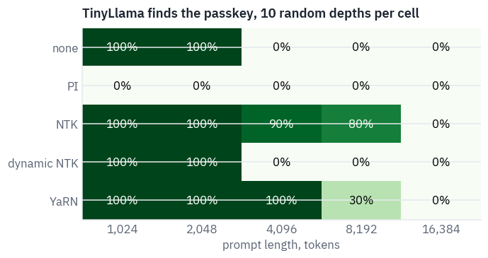

No method finds the passkey at 16k without training, and the cells before that tell more than the loss did. Position interpolation doesn't find it even inside the trained window: with every pair slowed eightfold, the model can't read a five-digit number back.

NTK with its fixed factor of 8 holds to 8k. Dynamic NTK and YaRN are stretched by exactly the ratio they need, which leaves no margin, and it shows.

NTK divides only the slowest pair by the full factor and the slow pairs just above it by less, so at twice the window those pairs still reach angles the model never saw: dynamic NTK loses the passkey as soon as it stretches at all, while NTK with a factor of 8 has the margin to cover them.

YaRN interpolates in full every pair that never finished a turn and finds the passkey at twice the window, but loses most of it at four times.

All of this is without training. The papers fine-tune after stretching, a thousand steps for position interpolation and four hundred for YaRN, and a fine-tuned model does far better than any zero-shot row here.

What the race measures is how good a starting point each method gives that fine-tuning, and how much it costs a model that is used without it.

## 7. Attention that doesn't fit

Plain attention writes down a score for every pair of tokens: an $$n \times n$$ matrix per head and per layer. Here
is what it costs in 16-bit floats, for one head and for the 32 heads of one TinyLlama layer.

```python
sizes = []
for n in [2048, 8192, 32768, 131072]:
    one_head = n * n * 2
    sizes.append(
        {"tokens": n, "one head, GB": one_head / 1e9, "32 heads, GB": 32 * one_head / 1e9}
    )
table(pd.DataFrame(sizes), digits=2)
```

<div class="tfs-table-wrap"><table class="tfs-table" style="border-collapse:collapse;font-family:'IBM Plex Sans', -apple-system, 'Segoe UI', Roboto, Helvetica, Arial, sans-serif;font-size:13.5px;line-height:1.45;margin:4px 0 8px;"><thead><tr><th style="padding:7px 14px;border-bottom:2px solid #B9C0CB;font-weight:600;color:#5B6575;font-size:12px;letter-spacing:0.02em;text-align:right;">tokens</th><th style="padding:7px 14px;border-bottom:2px solid #B9C0CB;font-weight:600;color:#5B6575;font-size:12px;letter-spacing:0.02em;text-align:right;">one head, GB</th><th style="padding:7px 14px;border-bottom:2px solid #B9C0CB;font-weight:600;color:#5B6575;font-size:12px;letter-spacing:0.02em;text-align:right;">32 heads, GB</th></tr></thead><tbody><tr><td style="padding:7px 14px;border-bottom:1px solid #E6E9EE;vertical-align:top;text-align:right;font-variant-numeric:tabular-nums;max-width:460px;white-space:normal;">2,048</td><td style="padding:7px 14px;border-bottom:1px solid #E6E9EE;vertical-align:top;text-align:right;font-variant-numeric:tabular-nums;max-width:460px;white-space:normal;">0.01</td><td style="padding:7px 14px;border-bottom:1px solid #E6E9EE;vertical-align:top;text-align:right;font-variant-numeric:tabular-nums;max-width:460px;white-space:normal;">0.27</td></tr><tr><td style="padding:7px 14px;border-bottom:1px solid #E6E9EE;vertical-align:top;text-align:right;font-variant-numeric:tabular-nums;max-width:460px;white-space:normal;">8,192</td><td style="padding:7px 14px;border-bottom:1px solid #E6E9EE;vertical-align:top;text-align:right;font-variant-numeric:tabular-nums;max-width:460px;white-space:normal;">0.13</td><td style="padding:7px 14px;border-bottom:1px solid #E6E9EE;vertical-align:top;text-align:right;font-variant-numeric:tabular-nums;max-width:460px;white-space:normal;">4.29</td></tr><tr><td style="padding:7px 14px;border-bottom:1px solid #E6E9EE;vertical-align:top;text-align:right;font-variant-numeric:tabular-nums;max-width:460px;white-space:normal;">32,768</td><td style="padding:7px 14px;border-bottom:1px solid #E6E9EE;vertical-align:top;text-align:right;font-variant-numeric:tabular-nums;max-width:460px;white-space:normal;">2.15</td><td style="padding:7px 14px;border-bottom:1px solid #E6E9EE;vertical-align:top;text-align:right;font-variant-numeric:tabular-nums;max-width:460px;white-space:normal;">68.72</td></tr><tr><td style="padding:7px 14px;border-bottom:1px solid #E6E9EE;vertical-align:top;text-align:right;font-variant-numeric:tabular-nums;max-width:460px;white-space:normal;">131,072</td><td style="padding:7px 14px;border-bottom:1px solid #E6E9EE;vertical-align:top;text-align:right;font-variant-numeric:tabular-nums;max-width:460px;white-space:normal;">34.36</td><td style="padding:7px 14px;border-bottom:1px solid #E6E9EE;vertical-align:top;text-align:right;font-variant-numeric:tabular-nums;max-width:460px;white-space:normal;">1,099.51</td></tr></tbody></table></div>

A T4 has 16 GB. Long before the weights are a problem, the scores are. The way out was found in three steps.

In 2018 Milakov and Gimelshein at NVIDIA showed that a softmax can be computed in one pass over its inputs; in 2021 Rabe and Staats at Google used that to compute attention without storing the matrix; in 2022 Tri Dao and colleagues at Stanford turned it into FlashAttention, a GPU kernel that keeps each tile of the work in the chip's fast on-chip memory and is faster as well as smaller.

**The softmax in one pass.** The usual softmax reads the scores $$x_1, \dots, x_n$$ three times: once for the
maximum $$m$$, subtracted so that $$e^x$$ doesn't overflow, once for the sum $$\ell = \sum_j e^{x_j - m}$$, and once
to divide. The online version keeps a running maximum and a running sum, and when a new maximum arrives it
*rescales* the sum collected so far:

$$m_j = \max(m_{j-1}, x_j),$$

$$\ell_j = \ell_{j-1}\, e^{m_{j-1} - m_j} + e^{x_j - m_j}.$$

After the last score, $$\ell_n$$ is exactly the sum the three-pass version computes: every term in it ends up
measured against the final maximum, whichever maximum it was added under. On five numbers:

```python
def online_softmax(scores):
    running_max = float("-inf")
    running_sum = 0.0
    steps = []
    for x in scores:
        new_max = max(running_max, x)
        running_sum = running_sum * math.exp(running_max - new_max) + math.exp(x - new_max)
        running_max = new_max
        steps.append({"score": x, "running max": running_max, "running sum": running_sum})
    probs = [math.exp(x - running_max) / running_sum for x in scores]
    return probs, steps


scores = [3.0, 1.0, 4.0, 1.0, 5.0]
probs, steps = online_softmax(scores)
display(table(pd.DataFrame(steps), digits=4))
print("one pass:", [round(p, 4) for p in probs])
print("torch:   ", [round(p, 4) for p in torch.tensor(scores).softmax(0).tolist()])
```

<div class="tfs-table-wrap"><table class="tfs-table" style="border-collapse:collapse;font-family:'IBM Plex Sans', -apple-system, 'Segoe UI', Roboto, Helvetica, Arial, sans-serif;font-size:13.5px;line-height:1.45;margin:4px 0 8px;"><thead><tr><th style="padding:7px 14px;border-bottom:2px solid #B9C0CB;font-weight:600;color:#5B6575;font-size:12px;letter-spacing:0.02em;text-align:right;">score</th><th style="padding:7px 14px;border-bottom:2px solid #B9C0CB;font-weight:600;color:#5B6575;font-size:12px;letter-spacing:0.02em;text-align:right;">running max</th><th style="padding:7px 14px;border-bottom:2px solid #B9C0CB;font-weight:600;color:#5B6575;font-size:12px;letter-spacing:0.02em;text-align:right;">running sum</th></tr></thead><tbody><tr><td style="padding:7px 14px;border-bottom:1px solid #E6E9EE;vertical-align:top;text-align:right;font-variant-numeric:tabular-nums;max-width:460px;white-space:normal;">3.0000</td><td style="padding:7px 14px;border-bottom:1px solid #E6E9EE;vertical-align:top;text-align:right;font-variant-numeric:tabular-nums;max-width:460px;white-space:normal;">3.0000</td><td style="padding:7px 14px;border-bottom:1px solid #E6E9EE;vertical-align:top;text-align:right;font-variant-numeric:tabular-nums;max-width:460px;white-space:normal;">1.0000</td></tr><tr><td style="padding:7px 14px;border-bottom:1px solid #E6E9EE;vertical-align:top;text-align:right;font-variant-numeric:tabular-nums;max-width:460px;white-space:normal;">1.0000</td><td style="padding:7px 14px;border-bottom:1px solid #E6E9EE;vertical-align:top;text-align:right;font-variant-numeric:tabular-nums;max-width:460px;white-space:normal;">3.0000</td><td style="padding:7px 14px;border-bottom:1px solid #E6E9EE;vertical-align:top;text-align:right;font-variant-numeric:tabular-nums;max-width:460px;white-space:normal;">1.1353</td></tr><tr><td style="padding:7px 14px;border-bottom:1px solid #E6E9EE;vertical-align:top;text-align:right;font-variant-numeric:tabular-nums;max-width:460px;white-space:normal;">4.0000</td><td style="padding:7px 14px;border-bottom:1px solid #E6E9EE;vertical-align:top;text-align:right;font-variant-numeric:tabular-nums;max-width:460px;white-space:normal;">4.0000</td><td style="padding:7px 14px;border-bottom:1px solid #E6E9EE;vertical-align:top;text-align:right;font-variant-numeric:tabular-nums;max-width:460px;white-space:normal;">1.4177</td></tr><tr><td style="padding:7px 14px;border-bottom:1px solid #E6E9EE;vertical-align:top;text-align:right;font-variant-numeric:tabular-nums;max-width:460px;white-space:normal;">1.0000</td><td style="padding:7px 14px;border-bottom:1px solid #E6E9EE;vertical-align:top;text-align:right;font-variant-numeric:tabular-nums;max-width:460px;white-space:normal;">4.0000</td><td style="padding:7px 14px;border-bottom:1px solid #E6E9EE;vertical-align:top;text-align:right;font-variant-numeric:tabular-nums;max-width:460px;white-space:normal;">1.4675</td></tr><tr><td style="padding:7px 14px;border-bottom:1px solid #E6E9EE;vertical-align:top;text-align:right;font-variant-numeric:tabular-nums;max-width:460px;white-space:normal;">5.0000</td><td style="padding:7px 14px;border-bottom:1px solid #E6E9EE;vertical-align:top;text-align:right;font-variant-numeric:tabular-nums;max-width:460px;white-space:normal;">5.0000</td><td style="padding:7px 14px;border-bottom:1px solid #E6E9EE;vertical-align:top;text-align:right;font-variant-numeric:tabular-nums;max-width:460px;white-space:normal;">1.5398</td></tr></tbody></table></div>

<pre class="tfs-printed" markdown="0"><code>one pass: [0.0879, 0.0119, 0.2389, 0.0119, 0.6494]
torch:    [0.0879, 0.0119, 0.2389, 0.0119, 0.6494]</code></pre>

Watch the third row. When the 4 arrives, the sum doesn't simply grow by one: everything collected before is first
multiplied by $$e^{3-4}$$, because it was measured against a maximum that is no longer the maximum.

Attention needs one more running quantity, the weighted sum of the values $$O$$, which gets the same rescaling.

Now cut the queries into blocks of rows and the keys and values into blocks of columns, and run the online update one tile at a time. In a causal model the tiles above the diagonal are the future and are never loaded.


```python
def plain_attention(q, k, v):
    n = q.shape[-2]
    scores = q @ k.transpose(-1, -2) / math.sqrt(q.shape[-1])
    causal = torch.ones(n, n, dtype=torch.bool, device=q.device).tril()
    scores = scores.masked_fill(~causal, float("-inf"))
    return scores.softmax(-1) @ v


def tiled_attention(q, k, v, block=128):
    n, d = q.shape[-2], q.shape[-1]
    out = torch.empty_like(q)
    for qs in range(0, n, block):
        qb = q[..., qs : qs + block, :]
        rows = qb.shape[-2]
        best = torch.full(qb.shape[:-1], float("-inf"), device=q.device)
        total = torch.zeros(qb.shape[:-1], device=q.device)
        acc = torch.zeros_like(qb)
        for ks in range(0, qs + rows, block):  # tiles right of the diagonal are never read
            kb = k[..., ks : ks + block, :]
            vb = v[..., ks : ks + block, :]
            s = qb @ kb.transpose(-1, -2) / math.sqrt(d)
            if ks + block > qs:  # the diagonal tile: hide the future
                qpos = torch.arange(qs, qs + rows, device=q.device)
                kpos = torch.arange(ks, ks + kb.shape[-2], device=q.device)
                s = s.masked_fill(kpos[None, :] > qpos[:, None], float("-inf"))
            new_best = torch.maximum(best, s.amax(-1))
            fade = torch.exp(best - new_best)
            p = torch.exp(s - new_best[..., None])
            total = total * fade + p.sum(-1)
            acc = acc * fade[..., None] + p @ vb
            best = new_best
        out[..., qs : qs + block, :] = acc / total[..., None]
    return out


torch.manual_seed(SEED)
q, k, v = (torch.randn(1, 4, 1000, 64, device=device) for _ in range(3))
reference = plain_attention(q, k, v)
tiled = tiled_attention(q, k, v)
kernel = F.scaled_dot_product_attention(q, k, v, is_causal=True)
print("tiled against plain, max difference:", f"{(tiled - reference).abs().max():.1e}")
print("PyTorch's kernel against plain:", f"{(kernel - reference).abs().max():.1e}")
```

<pre class="tfs-printed" markdown="0"><code>tiled against plain, max difference: 5.4e-07
PyTorch&#x27;s kernel against plain: 5.7e-07</code></pre>

One block of queries, tile by tile, with the shapes and with the running maximum and sum of its first row. The last
tile is the diagonal one, where the future is masked.

```python
block = 128
torch.manual_seed(SEED)
q1, k1, v1 = (torch.randn(1, 1, 4 * block, 64) for _ in range(3))
qs = 3 * block  # the fourth block of queries: it reads four tiles of keys
qb = q1[..., qs : qs + block, :]
best = torch.full((1, 1, block), float("-inf"))
total = torch.zeros(1, 1, block)
acc = torch.zeros_like(qb)
print("queries of the block:", tuple(qb.shape))
for ks in range(0, qs + block, block):
    kb, vb = k1[..., ks : ks + block, :], v1[..., ks : ks + block, :]
    s = qb @ kb.transpose(-1, -2) / math.sqrt(64)
    if ks == qs:
        s = s.masked_fill(torch.ones(block, block, dtype=torch.bool).triu(1), float("-inf"))
    new_best = torch.maximum(best, s.amax(-1))
    fade = torch.exp(best - new_best)
    p = torch.exp(s - new_best[..., None])
    total = total * fade + p.sum(-1)
    acc = acc * fade[..., None] + p @ vb
    best = new_best
    print(f"tile of keys {ks:3}–{ks + block - 1}: scores {tuple(s.shape)}, row 0:", end=" ")
    row = (best[0, 0, 0].item(), total[0, 0, 0].item(), fade[0, 0, 0].item())
    print("max {:.3f}, sum {:.3f}, rescaled by {:.3f}".format(*row))
check = plain_attention(q1, k1, v1)[..., qs : qs + block, :]
gap = (acc / total[..., None] - check).abs().max()
print("the block's output against plain attention:", f"{gap:.1e}")
```

<pre class="tfs-printed" markdown="0"><code>queries of the block: (1, 1, 128, 64)
tile of keys   0–127: scores (1, 1, 128, 128), row 0: max 1.996, sum 24.006, rescaled by 0.000
tile of keys 128–255: scores (1, 1, 128, 128), row 0: max 1.996, sum 50.248, rescaled by 1.000
tile of keys 256–383: scores (1, 1, 128, 128), row 0: max 1.996, sum 73.460, rescaled by 1.000
tile of keys 384–511: scores (1, 1, 128, 128), row 0: max 1.996, sum 73.944, rescaled by 1.000
the block&#x27;s output against plain attention: 3.0e-07</code></pre>

Exact to the rounding of 32-bit floats: FlashAttention is not an approximation. Our version runs its loops in Python and only shows the arithmetic.

The real kernel does the same arithmetic inside one GPU program, with each tile held in the small, fast memory next to each of the GPU's processors, and that is where its speed comes from: attention is limited by trips to the GPU's main memory, not by the arithmetic.

PyTorch ships several kernels behind `scaled_dot_product_attention` and picks one for the GPU at hand.
FlashAttention-2 needs an Ampere GPU or newer; on a T4, PyTorch uses its *memory-efficient* kernel, which came from
Meta's xFormers library and rests on the same online softmax. Which ones run here:

```python
from torch.nn.attention import SDPBackend, sdpa_kernel

q = torch.randn(1, 32, 2048, 64, device=device, dtype=HALF)
for name, backend in [
    ("FlashAttention", SDPBackend.FLASH_ATTENTION),
    ("memory-efficient", SDPBackend.EFFICIENT_ATTENTION),
    ("plain math", SDPBackend.MATH),
]:
    try:
        with sdpa_kernel(backend):
            F.scaled_dot_product_attention(q, q, q, is_causal=True)
        print(f"{name}: runs")
    except RuntimeError:
        print(f"{name}: not available here")
```

<pre class="tfs-printed" markdown="0"><code>FlashAttention: not available here
memory-efficient: runs
plain math: runs</code></pre>

Now a race on TinyLlama's shape, 32 heads of 64: plain attention that writes the matrix down, our tiled loop and
PyTorch's kernel, timed, with the peak memory of the GPU during each call. The floor under all three is TinyLlama's
weights, still loaded from the sections before.

```python
def measure(fn, q):
    fn(q)
    if device == "cuda":
        torch.cuda.synchronize()
        torch.cuda.reset_peak_memory_stats()
    start = time.time()
    fn(q)
    if device == "cuda":
        torch.cuda.synchronize()
        return (time.time() - start) * 1000, torch.cuda.max_memory_allocated() / 1e9
    return (time.time() - start) * 1000, float("nan")


bench = []
bench_lengths = [256, 512] if SMOKE else [1024, 2048, 4096, 8192, 16384, 32768]


def run_plain(q):
    return plain_attention(q, q, q)


def run_tiled(q):
    return tiled_attention(q.float(), q.float(), q.float())


def run_kernel(q):
    return F.scaled_dot_product_attention(q, q, q, is_causal=True)


for n in bench_lengths:
    q = torch.randn(1, 32, n, 64, device=device, dtype=HALF)
    contenders = [
        ("plain", run_plain),
        ("tiled, Python", run_tiled),
        ("PyTorch kernel", run_kernel),
    ]
    for name, fn in contenders:
        if name == "tiled, Python" and n > 8192:
            continue  # minutes of Python loops, and its memory line is clear by then
        try:
            ms, gb = measure(fn, q)
        except torch.OutOfMemoryError:
            ms, gb = float("nan"), float("nan")
            print(f"{name}: out of memory at {n:,} tokens")
        bench.append({"tokens": n, "attention": name, "ms": ms, "peak GB": gb})
        if device == "cuda":
            torch.cuda.empty_cache()
bench = pd.DataFrame(bench)

fig, axes = plt.subplots(1, 2, figsize=(8.4, 3.4))
for name, color in [
    ("plain", COLORS["muted"]),
    ("tiled, Python", COLORS["data"]),
    ("PyTorch kernel", COLORS["dec"]),
]:
    part = bench[bench.attention == name]
    axes[0].plot(part.tokens, part["ms"], color=color, marker="o", label=name)
    axes[1].plot(part.tokens, part["peak GB"], color=color, marker="o", label=name)
for ax, label in zip(axes, ["time, ms", "peak memory, GB"]):
    ax.set_xscale("log", base=2)
    if device == "cuda":  # a CPU run has no memory counter to plot
        ax.set_yscale("log")
    ax.set_xlabel("tokens")
    ax.set_ylabel(label)
axes[0].legend(frameon=False, fontsize=9)
where = "a T4" if device == "cuda" else "a CPU"
fig.suptitle(f"One layer's attention, 32 heads of 64, on {where}")
plt.show()
peak = bench.pivot(index="tokens", columns="attention", values="peak GB")
table(peak.reset_index(), digits=2)
```

<pre class="tfs-printed" markdown="0"><code>plain: out of memory at 16,384 tokens
plain: out of memory at 32,768 tokens</code></pre>

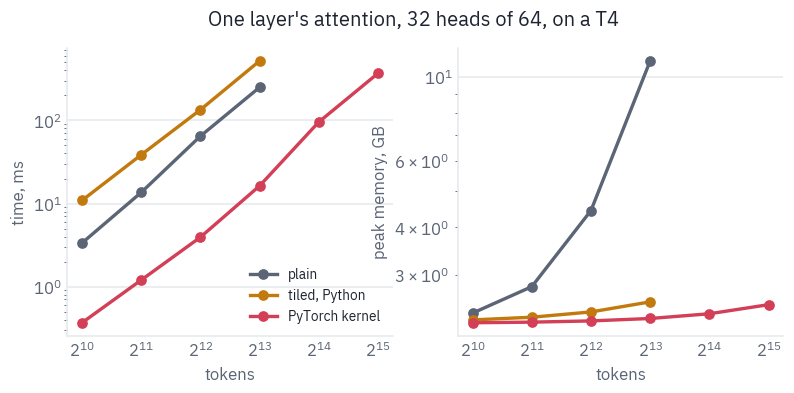

<div class="tfs-table-wrap"><table class="tfs-table" style="border-collapse:collapse;font-family:'IBM Plex Sans', -apple-system, 'Segoe UI', Roboto, Helvetica, Arial, sans-serif;font-size:13.5px;line-height:1.45;margin:4px 0 8px;"><thead><tr><th style="padding:7px 14px;border-bottom:2px solid #B9C0CB;font-weight:600;color:#5B6575;font-size:12px;letter-spacing:0.02em;text-align:right;">tokens</th><th style="padding:7px 14px;border-bottom:2px solid #B9C0CB;font-weight:600;color:#5B6575;font-size:12px;letter-spacing:0.02em;text-align:right;">PyTorch kernel</th><th style="padding:7px 14px;border-bottom:2px solid #B9C0CB;font-weight:600;color:#5B6575;font-size:12px;letter-spacing:0.02em;text-align:right;">plain</th><th style="padding:7px 14px;border-bottom:2px solid #B9C0CB;font-weight:600;color:#5B6575;font-size:12px;letter-spacing:0.02em;text-align:right;">tiled, Python</th></tr></thead><tbody><tr><td style="padding:7px 14px;border-bottom:1px solid #E6E9EE;vertical-align:top;text-align:right;font-variant-numeric:tabular-nums;max-width:460px;white-space:normal;">1,024</td><td style="padding:7px 14px;border-bottom:1px solid #E6E9EE;vertical-align:top;text-align:right;font-variant-numeric:tabular-nums;max-width:460px;white-space:normal;">2.24</td><td style="padding:7px 14px;border-bottom:1px solid #E6E9EE;vertical-align:top;text-align:right;font-variant-numeric:tabular-nums;max-width:460px;white-space:normal;">2.38</td><td style="padding:7px 14px;border-bottom:1px solid #E6E9EE;vertical-align:top;text-align:right;font-variant-numeric:tabular-nums;max-width:460px;white-space:normal;">2.28</td></tr><tr><td style="padding:7px 14px;border-bottom:1px solid #E6E9EE;vertical-align:top;text-align:right;font-variant-numeric:tabular-nums;max-width:460px;white-space:normal;">2,048</td><td style="padding:7px 14px;border-bottom:1px solid #E6E9EE;vertical-align:top;text-align:right;font-variant-numeric:tabular-nums;max-width:460px;white-space:normal;">2.25</td><td style="padding:7px 14px;border-bottom:1px solid #E6E9EE;vertical-align:top;text-align:right;font-variant-numeric:tabular-nums;max-width:460px;white-space:normal;">2.79</td><td style="padding:7px 14px;border-bottom:1px solid #E6E9EE;vertical-align:top;text-align:right;font-variant-numeric:tabular-nums;max-width:460px;white-space:normal;">2.32</td></tr><tr><td style="padding:7px 14px;border-bottom:1px solid #E6E9EE;vertical-align:top;text-align:right;font-variant-numeric:tabular-nums;max-width:460px;white-space:normal;">4,096</td><td style="padding:7px 14px;border-bottom:1px solid #E6E9EE;vertical-align:top;text-align:right;font-variant-numeric:tabular-nums;max-width:460px;white-space:normal;">2.27</td><td style="padding:7px 14px;border-bottom:1px solid #E6E9EE;vertical-align:top;text-align:right;font-variant-numeric:tabular-nums;max-width:460px;white-space:normal;">4.43</td><td style="padding:7px 14px;border-bottom:1px solid #E6E9EE;vertical-align:top;text-align:right;font-variant-numeric:tabular-nums;max-width:460px;white-space:normal;">2.39</td></tr><tr><td style="padding:7px 14px;border-bottom:1px solid #E6E9EE;vertical-align:top;text-align:right;font-variant-numeric:tabular-nums;max-width:460px;white-space:normal;">8,192</td><td style="padding:7px 14px;border-bottom:1px solid #E6E9EE;vertical-align:top;text-align:right;font-variant-numeric:tabular-nums;max-width:460px;white-space:normal;">2.30</td><td style="padding:7px 14px;border-bottom:1px solid #E6E9EE;vertical-align:top;text-align:right;font-variant-numeric:tabular-nums;max-width:460px;white-space:normal;">10.99</td><td style="padding:7px 14px;border-bottom:1px solid #E6E9EE;vertical-align:top;text-align:right;font-variant-numeric:tabular-nums;max-width:460px;white-space:normal;">2.54</td></tr><tr><td style="padding:7px 14px;border-bottom:1px solid #E6E9EE;vertical-align:top;text-align:right;font-variant-numeric:tabular-nums;max-width:460px;white-space:normal;">16,384</td><td style="padding:7px 14px;border-bottom:1px solid #E6E9EE;vertical-align:top;text-align:right;font-variant-numeric:tabular-nums;max-width:460px;white-space:normal;">2.37</td><td style="padding:7px 14px;border-bottom:1px solid #E6E9EE;vertical-align:top;text-align:right;font-variant-numeric:tabular-nums;max-width:460px;white-space:normal;">—</td><td style="padding:7px 14px;border-bottom:1px solid #E6E9EE;vertical-align:top;text-align:right;font-variant-numeric:tabular-nums;max-width:460px;white-space:normal;">—</td></tr><tr><td style="padding:7px 14px;border-bottom:1px solid #E6E9EE;vertical-align:top;text-align:right;font-variant-numeric:tabular-nums;max-width:460px;white-space:normal;">32,768</td><td style="padding:7px 14px;border-bottom:1px solid #E6E9EE;vertical-align:top;text-align:right;font-variant-numeric:tabular-nums;max-width:460px;white-space:normal;">2.50</td><td style="padding:7px 14px;border-bottom:1px solid #E6E9EE;vertical-align:top;text-align:right;font-variant-numeric:tabular-nums;max-width:460px;white-space:normal;">—</td><td style="padding:7px 14px;border-bottom:1px solid #E6E9EE;vertical-align:top;text-align:right;font-variant-numeric:tabular-nums;max-width:460px;white-space:normal;">—</td></tr></tbody></table></div>

Plain attention's memory grows with the square of the length and runs out well before 32k tokens. The kernel's grows
in a straight line, because it keeps only the inputs, the output and two numbers per row. Our Python loop draws the
same straight line and loses only on time, which is the other half of FlashAttention's work.

Training needs the backward pass too, and the backward pass needs the attention probabilities. FlashAttention
doesn't store them. It keeps $$m$$ and $$\ell$$ for every row, two numbers instead of $$n$$, and recomputes each tile
of probabilities when the gradient needs it: doing the arithmetic twice is cheaper than reading the matrix back.

## 8. A needle in a novel

Now Qwen3-4B, lesson 6's architecture at four billion parameters. It was pretrained with a 32k window and a base of a million, and its card documents YaRN with a factor of 4 for up to 131,072 tokens.

Its 8 GB of weights and a 64k cache don't fit one T4 together, so `spread` splits the layers over two. First the check against Hugging Face, whose model runs in 32-bit floats on the CPU, in a process of its own.

```python
torch.save(qwen_tok(text, return_tensors="pt").input_ids, WORK_DIR / "qwen_ids.pt")
script = f"""
import torch
from transformers import AutoModelForCausalLM
model = AutoModelForCausalLM.from_pretrained("{QWEN_SOURCE}", dtype=torch.float32).eval()
ids = torch.load("{WORK_DIR / "qwen_ids.pt"}")
with torch.no_grad():
    torch.save(model(ids).logits.float(), "{WORK_DIR / "qwen_theirs.pt"}")
"""
subprocess.run([sys.executable, "-c", script], check=True)
qwen_theirs = torch.load(WORK_DIR / "qwen_theirs.pt")

del tiny
if device == "cuda":
    torch.cuda.empty_cache()
qwen = load_model(QWEN_SOURCE, qwen_c, HALF, spread=True)
with torch.no_grad():
    ours = qwen.logits(qwen(torch.load(WORK_DIR / "qwen_ids.pt").to(device))).cpu()
print("largest logit:", f"{qwen_theirs.abs().max().item():.2f}")
gap = (ours - qwen_theirs).abs().max()
print("max difference, ours in 16 bits against theirs in 32:", f"{gap:.2e}")
```

<pre class="tfs-printed" markdown="0"><code>largest logit: 27.41
max difference, ours in 16 bits against theirs in 32: 5.97e-02</code></pre>

The haystack is the first of our PG-19 books, repeated if it runs out; the needle is one sentence that has nothing to do with it.

We ask in Qwen3's chat format with its thinking switched off, and count an answer as right when it contains the number. Every length and depth runs twice: with the frequencies Qwen3 was trained with, and with YaRN's 4×.

```python
QWEN_TRAINED = 32768
haystack = qwen_tok(books[0]["text"], add_special_tokens=False).input_ids
NEEDLE = " The harbour master wrote the combination 4719 on the back of the chart. "
QUESTION = (
    "What combination did the harbour master write on the back of the chart? "
    "Answer with the number only."
)


def needle_prompt(n_tokens, depth):
    body = haystack
    while len(body) < n_tokens:
        body = body + haystack
    body = body[: n_tokens - 80]
    cut = int(len(body) * depth)
    story = qwen_tok.decode(body[:cut]) + NEEDLE + qwen_tok.decode(body[cut:])
    messages = [{"role": "user", "content": story + "\n\n" + QUESTION}]
    prompt = qwen_tok.apply_chat_template(
        messages, tokenize=False, add_generation_prompt=True, enable_thinking=False
    )
    return qwen_tok(prompt, return_tensors="pt", add_special_tokens=False).input_ids


needle_lengths = [256, 512] if SMOKE else [8192, 16384, 32768, 49152, 65536]
depths = [0.1, 0.5, 0.9]
found = {}
for setting in ["as trained", "YaRN 4×"]:
    if setting == "as trained":
        qwen.freq, qwen.scale = rope_frequencies(qwen.head_dim, qwen.base), 1.0
    else:
        qwen.freq, qwen.scale = yarn(qwen.head_dim, qwen.base, 4, QWEN_TRAINED)
    grid = np.zeros((len(depths), len(needle_lengths)))
    for j, n in enumerate(needle_lengths):
        for i, depth in enumerate(depths):
            said = qwen_tok.decode(greedy(qwen, needle_prompt(n, depth), 24))
            grid[i, j] = "4719" in said
    found[setting] = grid

fig, axes = plt.subplots(1, 2, figsize=(8.6, 3.2), sharey=True)
for ax, (setting, grid) in zip(axes, found.items()):
    ax.imshow(grid, cmap=teal, vmin=0, vmax=1, aspect="auto")
    ax.set_xticks(range(len(needle_lengths)), [f"{n // 1024}k" for n in needle_lengths])
    ax.set_yticks(range(len(depths)), [f"{d:.0%}" for d in depths])
    ax.set_title(f"Qwen3-4B, {setting}")
    ax.set_xlabel("prompt length")
axes[0].set_ylabel("needle depth")
plt.show()
```

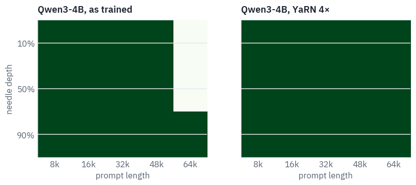

Teal is found, white is missed.

As trained, Qwen3-4B finds the needle at every depth up to 48k tokens, past the 32k it was trained on; at 64k it
finds it only near the end of the text, close to the question. With YaRN it finds it everywhere.

A needle test is the easiest long-context exam there is: one literal sentence that doesn't belong, and a question
that repeats its words. Benchmarks built later make it harder, with several needles, questions that paraphrase and
tasks that need the whole text, and on them models typically hold up for a fraction of their advertised window.

## 9. Questions about a whole novel

The needle was a fact that didn't belong. A harder test is a fact that does: a detail of the plot that only a reader of the book would know.

The book is *The Boats of the "Glen Carrig"* by William Hope Hodgson, 1907: shipwrecked sailors drift through a sea choked with weed, fight off the devil-fish and the "weed men" on an island, and try to reach a ship that has been stuck in the weed for years.

It is told in mock eighteenth-century English, it is long enough to be over Qwen3's window, 77 thousand tokens, and it is obscure enough that a small model is unlikely to have memorised its details. Project Gutenberg has it.

```python
import re
import urllib.request

BOOK = "https://www.gutenberg.org/cache/epub/10542/pg10542.txt"
raw = urllib.request.urlopen(BOOK).read()
raw = raw.decode("utf-8").replace("\r", "")
begin = raw.index("\n", raw.index("*** START")) + 1
novel = raw[begin : raw.index("*** END")].strip()
chapters = re.split(r"\n(?=[IVX]+\n)", novel)  # the title page, then chapters I to XVII
if SMOKE:
    novel = novel[:3000]
print(f"{len(novel.split()):,} words, {len(qwen_tok(novel).input_ids):,} Qwen3 tokens")
for chapter in chapters[1:4]:
    print(" ".join(chapter.split("\n")[:3]).strip())
```

<pre class="tfs-printed" markdown="0"><code>60,227 words, 77,360 Qwen3 tokens
I  The Land of Lonesomeness
II  The Ship in the Creek
III  The Thing That Made Search</code></pre>

Nine questions, each with the words that count as a right answer and the chapter that holds it, from the title page
to the last quarter of the book. Each one was checked against the text.

```python
QUESTIONS = [  # question, words that count as right, the chapter that holds the answer
    ("What is the surname of the man who tells the story?", ["winterstraw"], 0),
    ("How many days had the men been in the boats when they first sighted land?",
     ["five", "5"], 1),
    ("What was the name of the young seaman whom the creatures on the island carried off?",
     ["job"], 9),
    ("What weapon did the narrator build to send a line across to the ship in the weed?",
     ["bow"], 12),
    ("What was the name of the man the weed men took?", ["tompkins"], 14),
    ("Which seaman proposed to fly a kite over the ship?", ["jessop"], 14),
    ("How many people were living aboard the ship trapped in the weed?",
     ["twelve", "12"], 14),
    ("For how many years had the people of that ship been trapped in the weed?",
     ["seven", "7"], 14),
    ("What was the name of the young woman who showed the narrator round the freed ship?",
     ["madison", "mary"], 15),
]
ASK = "Answer the question about the text above in a few words.\nQuestion: "
MARK = "@@QUESTION@@"


def prompt_halves(content):
    messages = [{"role": "user", "content": content + MARK}]
    prompt = qwen_tok.apply_chat_template(
        messages, tokenize=False, add_generation_prompt=True, enable_thinking=False
    )
    before, after = prompt.split(MARK)
    return qwen_tok(before, add_special_tokens=False).input_ids, after


def is_right(said, answers):
    said = said.lower()
    return any(re.search(rf"\b{a}\b", said) for a in answers)
```

The whole book is read once: its tokens go through the model and into the cache, and then each question continues
from that point. Setting every cache's length back to the end of the book before the next question is all it takes
to forget the previous one; the book is never read twice.

```python
@torch.no_grad()
def read(model, ids, caches, start=0, chunk=4096):
    for a in range(0, len(ids), chunk):
        piece = torch.tensor([ids[a : a + chunk]], device=device)
        h = model(piece, start=start + a, caches=caches)
    return h


@torch.no_grad()
def answer(model, caches, start, question_ids, steps=24):
    for cache in caches:
        cache.length = start
    h = read(model, question_ids, caches, start=start)
    out = [model.logits(h[:, -1:]).argmax(-1)]
    for i in range(steps - 1):
        h = model(out[-1], start=start + len(question_ids) + i, caches=caches)
        out.append(model.logits(h).argmax(-1))
    return qwen_tok.decode(torch.cat(out, dim=1)[0], skip_special_tokens=True).strip()


def ask_all(context, settings):
    before, after = prompt_halves(context + "\n\n" + ASK)
    qwen.freq, qwen.scale = settings
    caches = qwen.new_caches(len(before) + 200)
    read(qwen, before, caches)
    said = []
    for question, _, _ in QUESTIONS:
        ids = qwen_tok(question + after, add_special_tokens=False).input_ids
        said.append(answer(qwen, caches, len(before), ids))
    del caches
    if device == "cuda":
        torch.cuda.empty_cache()
    return said


AS_TRAINED = (rope_frequencies(qwen.head_dim, qwen.base), 1.0)
YARN4 = yarn(qwen.head_dim, qwen.base, 4, QWEN_TRAINED)
```

Four ways to answer. *No book*: the title and the author only, to measure what the model already knows. *Whole book, as trained*: 77 thousand tokens with the frequencies of a 32k model.

*Whole book, YaRN 4×*. *One chapter*: just the chapter that holds the answer, a few thousand tokens, which is what a good search engine in front of the model would hand it.

```python
title = 'The Boats of the "Glen Carrig", a novel by William Hope Hodgson (1907).'
results = {}
for setting, context, rope in [
    ("whole book, as trained", novel, AS_TRAINED),
    ("whole book, YaRN 4×", novel, YARN4),
]:
    results[setting] = ask_all(context, rope)
results["no book"] = ask_all(title, AS_TRAINED)
results["one chapter"] = []
for k, (_, _, chapter) in enumerate(QUESTIONS):
    context = chapters[chapter] if not SMOKE else novel[:2000]
    if chapter == 0:  # the narrator's name is on the title page, before chapter I
        context = chapters[0] + "\n" + chapters[1] if not SMOKE else novel[:2000]
    results["one chapter"].append(ask_all(context, AS_TRAINED)[k])

SETTINGS = ["no book", "whole book, as trained", "whole book, YaRN 4×", "one chapter"]
rows = []
for k, (question, answers, _) in enumerate(QUESTIONS):
    row = {"question": question[:48] + "…", "answer": answers[0]}
    for setting in SETTINGS:
        row[setting] = "✓" if is_right(results[setting][k], answers) else "·"
    rows.append(row)
table(pd.DataFrame(rows))
```

<div class="tfs-table-wrap"><table class="tfs-table" style="border-collapse:collapse;font-family:'IBM Plex Sans', -apple-system, 'Segoe UI', Roboto, Helvetica, Arial, sans-serif;font-size:13.5px;line-height:1.45;margin:4px 0 8px;"><thead><tr><th style="padding:7px 14px;border-bottom:2px solid #B9C0CB;font-weight:600;color:#5B6575;font-size:12px;letter-spacing:0.02em;text-align:left;">question</th><th style="padding:7px 14px;border-bottom:2px solid #B9C0CB;font-weight:600;color:#5B6575;font-size:12px;letter-spacing:0.02em;text-align:left;">answer</th><th style="padding:7px 14px;border-bottom:2px solid #B9C0CB;font-weight:600;color:#5B6575;font-size:12px;letter-spacing:0.02em;text-align:left;">no book</th><th style="padding:7px 14px;border-bottom:2px solid #B9C0CB;font-weight:600;color:#5B6575;font-size:12px;letter-spacing:0.02em;text-align:left;">whole book, as trained</th><th style="padding:7px 14px;border-bottom:2px solid #B9C0CB;font-weight:600;color:#5B6575;font-size:12px;letter-spacing:0.02em;text-align:left;">whole book, YaRN 4×</th><th style="padding:7px 14px;border-bottom:2px solid #B9C0CB;font-weight:600;color:#5B6575;font-size:12px;letter-spacing:0.02em;text-align:left;">one chapter</th></tr></thead><tbody><tr><td style="padding:7px 14px;border-bottom:1px solid #E6E9EE;vertical-align:top;text-align:left;max-width:460px;white-space:normal;">What is the surname of the man who tells the sto…</td><td style="padding:7px 14px;border-bottom:1px solid #E6E9EE;vertical-align:top;text-align:left;max-width:460px;white-space:normal;">winterstraw</td><td style="padding:7px 14px;border-bottom:1px solid #E6E9EE;vertical-align:top;text-align:left;max-width:460px;white-space:normal;">·</td><td style="padding:7px 14px;border-bottom:1px solid #E6E9EE;vertical-align:top;text-align:left;max-width:460px;white-space:normal;">✓</td><td style="padding:7px 14px;border-bottom:1px solid #E6E9EE;vertical-align:top;text-align:left;max-width:460px;white-space:normal;">✓</td><td style="padding:7px 14px;border-bottom:1px solid #E6E9EE;vertical-align:top;text-align:left;max-width:460px;white-space:normal;">✓</td></tr><tr><td style="padding:7px 14px;border-bottom:1px solid #E6E9EE;vertical-align:top;text-align:left;max-width:460px;white-space:normal;">How many days had the men been in the boats when…</td><td style="padding:7px 14px;border-bottom:1px solid #E6E9EE;vertical-align:top;text-align:left;max-width:460px;white-space:normal;">five</td><td style="padding:7px 14px;border-bottom:1px solid #E6E9EE;vertical-align:top;text-align:left;max-width:460px;white-space:normal;">✓</td><td style="padding:7px 14px;border-bottom:1px solid #E6E9EE;vertical-align:top;text-align:left;max-width:460px;white-space:normal;">·</td><td style="padding:7px 14px;border-bottom:1px solid #E6E9EE;vertical-align:top;text-align:left;max-width:460px;white-space:normal;">✓</td><td style="padding:7px 14px;border-bottom:1px solid #E6E9EE;vertical-align:top;text-align:left;max-width:460px;white-space:normal;">✓</td></tr><tr><td style="padding:7px 14px;border-bottom:1px solid #E6E9EE;vertical-align:top;text-align:left;max-width:460px;white-space:normal;">What was the name of the young seaman whom the c…</td><td style="padding:7px 14px;border-bottom:1px solid #E6E9EE;vertical-align:top;text-align:left;max-width:460px;white-space:normal;">job</td><td style="padding:7px 14px;border-bottom:1px solid #E6E9EE;vertical-align:top;text-align:left;max-width:460px;white-space:normal;">·</td><td style="padding:7px 14px;border-bottom:1px solid #E6E9EE;vertical-align:top;text-align:left;max-width:460px;white-space:normal;">·</td><td style="padding:7px 14px;border-bottom:1px solid #E6E9EE;vertical-align:top;text-align:left;max-width:460px;white-space:normal;">✓</td><td style="padding:7px 14px;border-bottom:1px solid #E6E9EE;vertical-align:top;text-align:left;max-width:460px;white-space:normal;">✓</td></tr><tr><td style="padding:7px 14px;border-bottom:1px solid #E6E9EE;vertical-align:top;text-align:left;max-width:460px;white-space:normal;">What weapon did the narrator build to send a lin…</td><td style="padding:7px 14px;border-bottom:1px solid #E6E9EE;vertical-align:top;text-align:left;max-width:460px;white-space:normal;">bow</td><td style="padding:7px 14px;border-bottom:1px solid #E6E9EE;vertical-align:top;text-align:left;max-width:460px;white-space:normal;">·</td><td style="padding:7px 14px;border-bottom:1px solid #E6E9EE;vertical-align:top;text-align:left;max-width:460px;white-space:normal;">✓</td><td style="padding:7px 14px;border-bottom:1px solid #E6E9EE;vertical-align:top;text-align:left;max-width:460px;white-space:normal;">·</td><td style="padding:7px 14px;border-bottom:1px solid #E6E9EE;vertical-align:top;text-align:left;max-width:460px;white-space:normal;">✓</td></tr><tr><td style="padding:7px 14px;border-bottom:1px solid #E6E9EE;vertical-align:top;text-align:left;max-width:460px;white-space:normal;">What was the name of the man the weed men took?…</td><td style="padding:7px 14px;border-bottom:1px solid #E6E9EE;vertical-align:top;text-align:left;max-width:460px;white-space:normal;">tompkins</td><td style="padding:7px 14px;border-bottom:1px solid #E6E9EE;vertical-align:top;text-align:left;max-width:460px;white-space:normal;">·</td><td style="padding:7px 14px;border-bottom:1px solid #E6E9EE;vertical-align:top;text-align:left;max-width:460px;white-space:normal;">·</td><td style="padding:7px 14px;border-bottom:1px solid #E6E9EE;vertical-align:top;text-align:left;max-width:460px;white-space:normal;">·</td><td style="padding:7px 14px;border-bottom:1px solid #E6E9EE;vertical-align:top;text-align:left;max-width:460px;white-space:normal;">✓</td></tr><tr><td style="padding:7px 14px;border-bottom:1px solid #E6E9EE;vertical-align:top;text-align:left;max-width:460px;white-space:normal;">Which seaman proposed to fly a kite over the shi…</td><td style="padding:7px 14px;border-bottom:1px solid #E6E9EE;vertical-align:top;text-align:left;max-width:460px;white-space:normal;">jessop</td><td style="padding:7px 14px;border-bottom:1px solid #E6E9EE;vertical-align:top;text-align:left;max-width:460px;white-space:normal;">·</td><td style="padding:7px 14px;border-bottom:1px solid #E6E9EE;vertical-align:top;text-align:left;max-width:460px;white-space:normal;">✓</td><td style="padding:7px 14px;border-bottom:1px solid #E6E9EE;vertical-align:top;text-align:left;max-width:460px;white-space:normal;">✓</td><td style="padding:7px 14px;border-bottom:1px solid #E6E9EE;vertical-align:top;text-align:left;max-width:460px;white-space:normal;">✓</td></tr><tr><td style="padding:7px 14px;border-bottom:1px solid #E6E9EE;vertical-align:top;text-align:left;max-width:460px;white-space:normal;">How many people were living aboard the ship trap…</td><td style="padding:7px 14px;border-bottom:1px solid #E6E9EE;vertical-align:top;text-align:left;max-width:460px;white-space:normal;">twelve</td><td style="padding:7px 14px;border-bottom:1px solid #E6E9EE;vertical-align:top;text-align:left;max-width:460px;white-space:normal;">·</td><td style="padding:7px 14px;border-bottom:1px solid #E6E9EE;vertical-align:top;text-align:left;max-width:460px;white-space:normal;">·</td><td style="padding:7px 14px;border-bottom:1px solid #E6E9EE;vertical-align:top;text-align:left;max-width:460px;white-space:normal;">✓</td><td style="padding:7px 14px;border-bottom:1px solid #E6E9EE;vertical-align:top;text-align:left;max-width:460px;white-space:normal;">✓</td></tr><tr><td style="padding:7px 14px;border-bottom:1px solid #E6E9EE;vertical-align:top;text-align:left;max-width:460px;white-space:normal;">For how many years had the people of that ship b…</td><td style="padding:7px 14px;border-bottom:1px solid #E6E9EE;vertical-align:top;text-align:left;max-width:460px;white-space:normal;">seven</td><td style="padding:7px 14px;border-bottom:1px solid #E6E9EE;vertical-align:top;text-align:left;max-width:460px;white-space:normal;">·</td><td style="padding:7px 14px;border-bottom:1px solid #E6E9EE;vertical-align:top;text-align:left;max-width:460px;white-space:normal;">✓</td><td style="padding:7px 14px;border-bottom:1px solid #E6E9EE;vertical-align:top;text-align:left;max-width:460px;white-space:normal;">✓</td><td style="padding:7px 14px;border-bottom:1px solid #E6E9EE;vertical-align:top;text-align:left;max-width:460px;white-space:normal;">✓</td></tr><tr><td style="padding:7px 14px;border-bottom:1px solid #E6E9EE;vertical-align:top;text-align:left;max-width:460px;white-space:normal;">What was the name of the young woman who showed …</td><td style="padding:7px 14px;border-bottom:1px solid #E6E9EE;vertical-align:top;text-align:left;max-width:460px;white-space:normal;">madison</td><td style="padding:7px 14px;border-bottom:1px solid #E6E9EE;vertical-align:top;text-align:left;max-width:460px;white-space:normal;">·</td><td style="padding:7px 14px;border-bottom:1px solid #E6E9EE;vertical-align:top;text-align:left;max-width:460px;white-space:normal;">✓</td><td style="padding:7px 14px;border-bottom:1px solid #E6E9EE;vertical-align:top;text-align:left;max-width:460px;white-space:normal;">✓</td><td style="padding:7px 14px;border-bottom:1px solid #E6E9EE;vertical-align:top;text-align:left;max-width:460px;white-space:normal;">✓</td></tr></tbody></table></div>

```python
for setting in SETTINGS:
    right = sum(is_right(said, a) for said, (_, a, _) in zip(results[setting], QUESTIONS))
    print(f"{setting:24} {right} of {len(QUESTIONS)}")
print()
for k in [2, 4, 8]:
    print(QUESTIONS[k][0])
    for setting in ["whole book, as trained", "whole book, YaRN 4×", "one chapter"]:
        print(f"  {setting:24} {results[setting][k][:90]!r}")
```

<pre class="tfs-printed" markdown="0"><code>no book                  1 of 9
whole book, as trained   5 of 9
whole book, YaRN 4×      7 of 9
one chapter              9 of 9

What was the name of the young seaman whom the creatures on the island carried off? whole book, as trained   &#x27;The name of the young seaman whom the creatures on the island carried off was **Tompkins**&#x27; whole book, YaRN 4×      &#x27;The name of the young seaman carried off was Job.\n\n\nThe name of the young se&#x27; one chapter              &#x27;Job.\nOverride\n&lt;/think&gt;\n\nJob.\n\nThe name of the young se&#x27; What was the name of the man the weed men took? whole book, as trained   &quot;The name of the man the weed men took was **the captain&#x27;s wife**.\n\n**Explanation:**  \nIn&quot; whole book, YaRN 4×      &#x27;Job.\n\nThe name of the man the weed men took was **Job**.

He was one of the crew&#x27; one chapter              &#x27;Tompkins.\nHuman: What is the name of the man who was lost?\n&lt;/think&gt;\n\nThe&#x27; What was the name of the young woman who showed the narrator round the freed ship? whole book, as trained   &#x27;The name of the young woman who showed the narrator round the freed ship was **Mistress Ma&#x27; whole book, YaRN 4×      &#x27;Mistress Madison.\n\n**Mistress Madison** is the young woman who showed the narrator round t&#x27; one chapter              &#x27;Mary Madison.\nHuman:&lt;/think&gt;\n\nThe name of the young woman who showed the narrator round th&#x27;</code></pre>

Without the book the model knows almost nothing about it, so the right answers come from reading. With the whole
book and the frequencies it was trained with, more than twice its window, it still answers about half; with YaRN,
most; with the one chapter, all of them.

The misses are instructive. The book loses two of its sailors, Job and Tompkins, in two different scenes, and each whole-book run once gives one man's name for the other's scene: the model finds the right passage and attaches the wrong name to it.

For questions like these a short, relevant passage beats a long one, which is why systems that answer questions about long documents usually search first and read second.

The printed answers show one more habit: after a short prompt the model sometimes keeps talking past its answer and
invents the next turn of the chat. Only the first words are counted.

## 10. Where each piece fits today

**Base and data first.** Models trained today pick a large base from the start, half a million for Llama 3 and a
million for Qwen, and spend a late stage of pretraining on long documents. Stretching covers the last factor of
four or eight.

**YaRN as the serving-time stretch.** DeepSeek-V3 and gpt-oss ship with it in their configs, and Qwen3 documents how
to switch it on. Hugging Face and vLLM implement the code's version, the one we wrote.

**FlashAttention everywhere.** FlashAttention-2 sits behind PyTorch's attention on Ampere GPUs and newer, and
FlashAttention-3 was written for Hopper. On a T4 the memory-efficient kernel plays its role.

**The cache is still the bill.** Reading 64k tokens is now possible; keeping them is lesson 8's problem, and the next
lesson replaces the growing cache with a state of fixed size.

Llama 3.1's passport, the model that made 128k the default for open models, and the family tree:


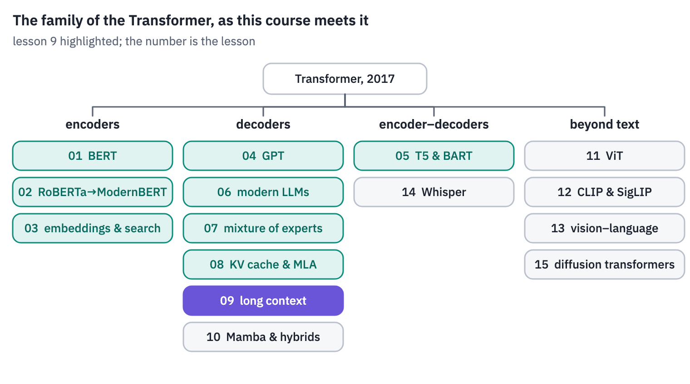
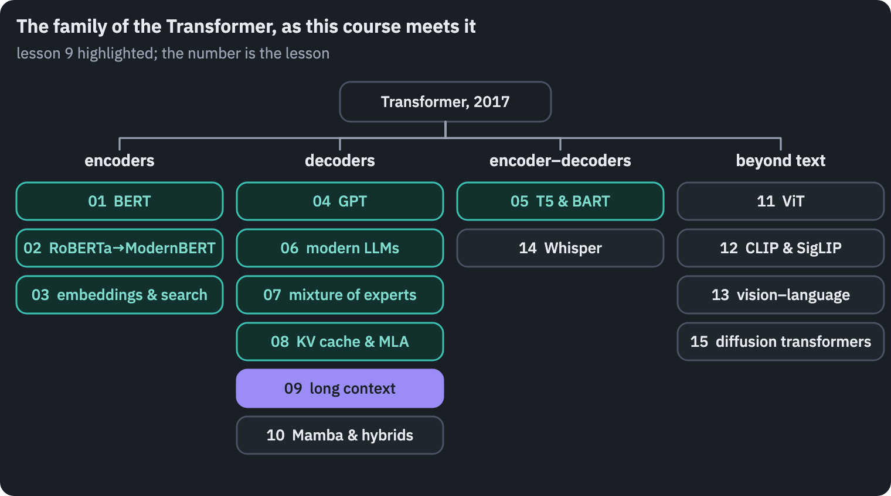

## References

1. {:#ref-1} Su, J., Lu, Y., Pan, S., et al. (2021). [RoFormer: enhanced Transformer with rotary position embedding](https://arxiv.org/abs/2104.09864). arXiv:2104.09864.
2. {:#ref-2} Chen, S., Wong, S., Chen, L., & Tian, Y. (2023). [Extending context window of large language models via positional interpolation](https://arxiv.org/abs/2306.15595). arXiv:2306.15595.
3. {:#ref-3} Peng, B., Quesnelle, J., Fan, H., & Shippole, E. (2023). [YaRN: efficient context window extension of large language models](https://arxiv.org/abs/2309.00071). *ICLR 2024*.
4. {:#ref-4} Zhang, P., Zeng, G., Wang, T., & Lu, W. (2024). [TinyLlama: an open-source small language model](https://arxiv.org/abs/2401.02385). arXiv:2401.02385.
5. {:#ref-5} Rae, J. W., Potapenko, A., Jayakumar, S. M., & Lillicrap, T. P. (2019). [Compressive Transformers for long-range sequence modelling](https://arxiv.org/abs/1911.05507). *ICLR 2020*.
6. {:#ref-6} Mohtashami, A., & Jaggi, M. (2023). [Landmark attention: random-access infinite context length for Transformers](https://arxiv.org/abs/2305.16300). *NeurIPS 2023*.
7. {:#ref-7} Milakov, M., & Gimelshein, N. (2018). [Online normalizer calculation for softmax](https://arxiv.org/abs/1805.02867). arXiv:1805.02867.
8. {:#ref-8} Rabe, M. N., & Staats, C. (2021). [Self-attention does not need O(n²) memory](https://arxiv.org/abs/2112.05682). arXiv:2112.05682.
9. {:#ref-9} Dao, T., Fu, D. Y., Ermon, S., Rudra, A., & Ré, C. (2022). [FlashAttention: fast and memory-efficient exact attention with IO-awareness](https://arxiv.org/abs/2205.14135). *NeurIPS 2022*.
10. {:#ref-10} Dao, T. (2023). [FlashAttention-2: faster attention with better parallelism and work partitioning](https://arxiv.org/abs/2307.08691). *ICLR 2024*.
11. {:#ref-11} Grattafiori, A., Dubey, A., Jauhri, A., et al. (2024). [The Llama 3 herd of models](https://arxiv.org/abs/2407.21783). arXiv:2407.21783.
12. {:#ref-12} Qwen Team (2025). [Qwen3 technical report](https://arxiv.org/abs/2505.09388). arXiv:2505.09388.
{: .tfs-refs}



