

<p class="tfs-links"><strong>Transformer architectures: from BERT to diffusion</strong> · lesson 10 of 15 · <a href="/teaching/">all lessons</a> · <a href="https://www.kaggle.com/code/qmarva/transformer-architectures-10-mamba-and-hybrids">run on Kaggle</a> · <a href="https://colab.research.google.com/github/xmarva/transformers-from-scratch/blob/main/notebooks/colab/a10_mamba.ipynb">open in Colab</a> · <a href="https://github.com/xmarva/transformers-from-scratch">code on GitHub</a></p>

Everything this course has built so far pays the same bill. Attention keeps every token it has read, in every layer, for as long as the conversation lasts (lesson 8), and compares every new token with all of them (lesson 9).

The bill grows with the text, and all the tricks of the last three lessons only make it grow more slowly.

A recurrent network doesn't pay it. It reads a token, updates a state of fixed size, and forgets the token; the
millionth token costs what the first one did. The trouble is that recurrent networks lost to Transformers for good
reasons: they train one token at a time, and their state forgets what matters as easily as what doesn't.

In December 2023 Albert Gu and Tri Dao, the same Tri Dao who wrote FlashAttention, published *Mamba*, a recurrent model that fixes both. It trains in parallel, like a Transformer, and its state decides, token by token, what to keep and what to let go.

The idea comes from an unexpected place, the *state space models* of control theory, the language of the Kalman filter that helped navigate Apollo to the Moon.

This lesson takes Mamba apart on the real weights of mamba-130m: the equation it starts from, how a continuous equation becomes a layer, what the model chooses to remember in a real sentence, the scan that makes a recurrence parallel, and generation with a state that never grows.

Then we look at what a fixed state costs, where Mamba ends up inside today's hybrid models, and train two small ones from scratch to see what selectivity buys.

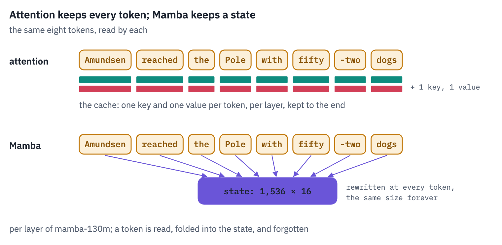
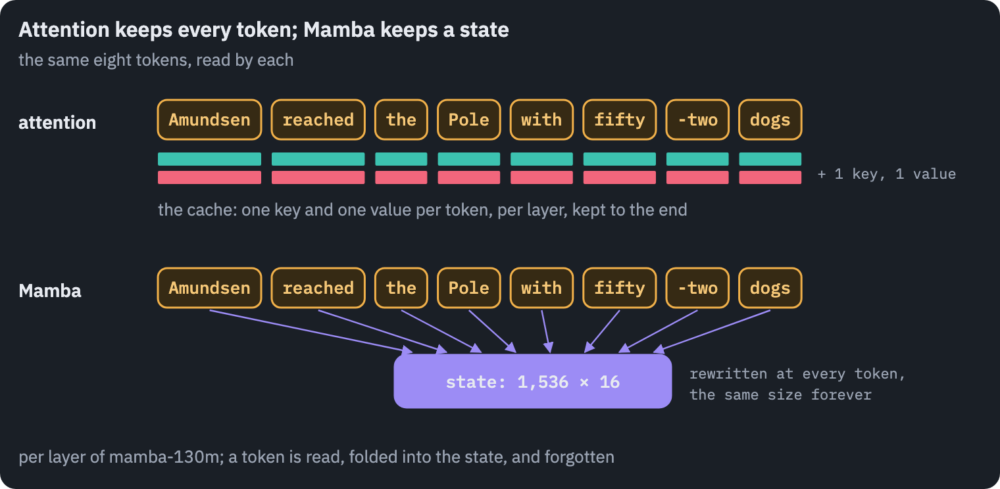

**What you'll do**

1. Write a state space model from its differential equation and turn it into a layer with exact and approximate
   discretisation.
2. Make it selective, as Mamba does, and write the whole Mamba block from scratch; load mamba-130m into it and match
   Hugging Face.
3. Watch what the trained model writes into its state and how long each of its channels remembers.
4. Write the scan twice, as a loop and as a parallel scan, and generate text with a state of fixed size, measured
   against a Transformer's growing cache.

## Setup

One small helper package, `tfs`, draws the course's plots and token chips and knows where the notebook runs
(Kaggle, Colab or your own machine). Everything the lesson teaches is written out in the notebook itself.

```python
import importlib.util
import subprocess
import sys

TFS = "git+https://github.com/xmarva/transformers-from-scratch@main"
if importlib.util.find_spec("tfs") is None:
    subprocess.check_call([sys.executable, "-m", "pip", "install", "-q", TFS])

from tfs import env
from tfs.viz import table, token_chips, use_course_style

env.quiet()  # no progress bars or environment warnings in the outputs
SEED = 42
env.seed_everything(SEED)
COLORS = use_course_style()
WORK_DIR = env.work_dir()
```

```python
import json
import math
import time

import matplotlib.pyplot as plt
from matplotlib.colors import LinearSegmentedColormap
import numpy as np
import pandas as pd
import torch
import torch.nn as nn
import torch.nn.functional as F
from huggingface_hub import hf_hub_download
from safetensors.torch import load_file
from transformers import AutoTokenizer

SMOKE = env.smoke()  # CI runs the lesson on a small slice; you run it in full
device = "cuda" if torch.cuda.is_available() else "cpu"
if device == "cuda":
    print("GPU:", torch.cuda.get_device_name(0))
```

<pre class="tfs-printed" markdown="0"><code>GPU: Tesla T4</code></pre>

## 1. A state that doesn't grow

A *state space model* describes a system by a vector of numbers, its state $$h(t) \in \mathbb{R}^N$$, that
changes over time under an input $$x(t)$$ and produces an output $$y(t)$$:

$$h'(t) = A\,h(t) + B\,x(t), \qquad y(t) = C\,h(t).$$

The first equation says how the state moves: $$A$$ ($$N \times N$$) is how it would drift on its own, $$B$$ ($$N \times 1$$) is how the input pushes it.

The second says what we read out of it. Rudolf Kálmán made this form the language of control theory in 1960, and it has run in autopilots, phone receivers and spacecraft since.

For a sequence model the useful case is a diagonal $$A$$ with negative entries $$a_1, \dots, a_N$$. The equations
then split into $$N$$ independent ones, and each is a *leaky integrator*:

$$h_n'(t) = a_n\,h_n(t) + b_n\,x(t).$$

Picture a bucket with a hole. The input pours water in; the hole lets a fraction $$\lvert a_n \rvert$$ of whatever
is inside leak out per unit of time. Without input, the level falls as $$e^{a_n t}$$: a bucket with a small hole,
$$a_n$$ near zero, keeps its water for a long time; one with a big hole forgets in an instant. A state of $$N$$
buckets with holes of different sizes keeps a record of the input at $$N$$ different time scales, recent and
distant, and $$C$$ mixes the levels into an output.

Here are four such buckets, fed one splash of input at $$t = 1$$ and a steady stream between $$t = 4$$ and $$6$$;
the curves are the exact solution of each equation.

```python
t = np.linspace(0, 10, 1001)
splash = (np.abs(t - 1) < 0.05) * 10.0  # a short burst whose total is 1
stream = ((t > 4) & (t < 6)) * 1.0
dt = t[1] - t[0]

fig, ax = plt.subplots(figsize=(7.4, 3.4))
colors = [COLORS["enc"], COLORS["att"], COLORS["data"], COLORS["dec"]]
for a, color in zip([-0.125, -0.25, -0.5, -1.0], colors):  # four holes, small to large
    level = np.zeros_like(t)
    for i in range(1, len(t)):  # exact step of h' = a h + x for constant x over dt
        x = splash[i - 1] + stream[i - 1]
        level[i] = level[i - 1] * math.exp(a * dt) + (math.exp(a * dt) - 1) / a * x
    ax.plot(t, level, color=color, linewidth=2, label=f"a = {a:g}")
ax.fill_between(t, 0, stream * 0.15, color=COLORS["line"], alpha=0.4, label="input")
ax.set_xlabel("time")
ax.set_ylabel("state")
ax.set_title("Four leaky buckets: the same input, four memories")
ax.legend(frameon=False, fontsize=9)
plt.show()
```

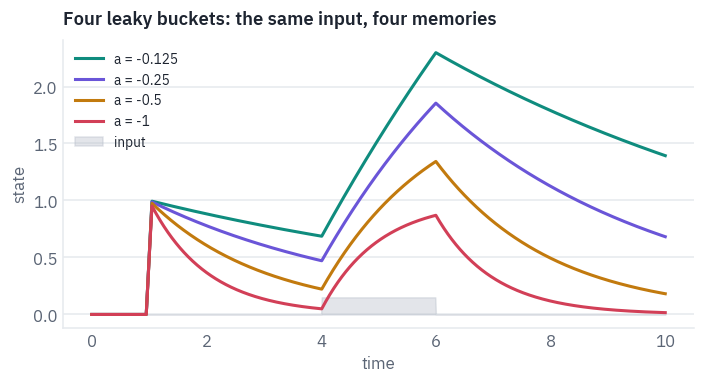

The bucket with the smallest hole still remembers the splash when the stream arrives; the one with the largest has
forgotten it within a unit of time and tracks only the present. That spread of memories is what a state space
layer is made of.

## 2. From an equation to a layer

Text doesn't arrive in continuous time; it arrives a token at a time. To turn the equation into a layer, assume
the input stays constant for a short time $$\Delta$$, the *step*, and solve the equation exactly over that time.
This is the *zero-order hold* of signal processing, and for a diagonal $$A$$ it gives, per channel,

$$h_t = \bar a\, h_{t-1} + \bar b\, x_t,$$

where

$$\bar a = e^{\Delta a}, \qquad \bar b = \frac{e^{\Delta a} - 1}{a}\, b.$$

$$\bar a$$ is the fraction of the state that survives one step: between 0 and 1, because $$a < 0$$. The state space
model has become a linear recurrence, an RNN without a nonlinearity inside the loop. That missing nonlinearity is
what will make it parallel in section 6.

Mamba's code takes a shortcut for $$\bar b$$. For small $$\Delta a$$, $$e^{\Delta a} - 1 \approx \Delta a$$, so
$$\bar b \approx \Delta\, b$$, the Euler step. Is that a big approximation? The ratio of the two is
$$(e^{\Delta a} - 1)/(\Delta a)$$, which depends only on the product $$\Delta a$$:

```python
for product in [0.001, 0.01, 0.1, 0.5, 1.0, 2.0, 5.0]:
    exact_over_euler = (1 - math.exp(-product)) / product
    print(f"|Δa| = {product:<5}  exact b̄ / Euler b̄ = {exact_over_euler:.3f}")
```

<pre class="tfs-printed" markdown="0"><code>|Δa| = 0.001  exact b̄ / Euler b̄ = 1.000
|Δa| = 0.01   exact b̄ / Euler b̄ = 0.995
|Δa| = 0.1    exact b̄ / Euler b̄ = 0.952
|Δa| = 0.5    exact b̄ / Euler b̄ = 0.787
|Δa| = 1.0    exact b̄ / Euler b̄ = 0.632
|Δa| = 2.0    exact b̄ / Euler b̄ = 0.432
|Δa| = 5.0    exact b̄ / Euler b̄ = 0.199</code></pre>

For a step that is small against the channel's time scale, the two agree; for a large one the Euler step
overestimates the input's weight. We'll measure in section 5 which regime the trained model lives in.

A model with fixed $$A$$, $$B$$, $$C$$ and $$\Delta$$ is *linear and time-invariant*: whatever the token, it is treated the same way.

S4, the 2021 model by Gu, Goel and Ré that started this line of work, was of this kind, and it could exploit that: a time-invariant recurrence is a convolution with a fixed kernel, and long convolutions are fast with the FFT.

S4 set records on the Long Range Arena, a benchmark of sequences up to 16k long, where the Transformers of its time did badly. On language it lagged behind. The reason is visible in the bucket picture: a fixed hole leaks the important word and the filler word at the same rate.

## 3. Selectivity

Mamba's change is one sentence long: make $$\Delta$$, $$B$$ and $$C$$ functions of the current token. Each token
then decides, through its own $$\Delta_t$$, how much of the state to keep and how much of itself to write:

$$h_t = e^{\Delta_t a}\, h_{t-1} + \Delta_t\, b_t\, x_t, \qquad y_t = c_t^{\top} h_t.$$

The step $$\Delta_t$$ works as a gate. A large $$\Delta_t$$ drives $$e^{\Delta_t a}$$ toward 0 and multiplies the token's input: the state is reset and the token is written in. A $$\Delta_t$$ near zero keeps the state as it was and lets the token pass without trace.

Gu and Dao call this *selectivity*, and they show its point on a toy task, *selective copying*: remember the coloured tokens scattered among noise tokens and reproduce them at the end.

A time-invariant model can't do it, because it can't tell a coloured token from noise; a selective one can, because noise tokens get a $$\Delta$$ near zero. Section 11 trains both kinds and checks.

Selectivity has a price: the recurrence is no longer a fixed convolution, so the FFT trick of S4 is gone. Mamba
pays it with a scan, section 6, and with a GPU kernel written for it.

## 4. The Mamba block

The selective state space model is the core of a block that also contains a short convolution and a gate. One
block, for a sequence of $$L$$ vectors of width $$D$$:

1. `in_proj` widens each vector to $$2E$$, with $$E = 2D$$, and splits it into a stream $$u$$ and a gate $$z$$.
2. `conv1d` mixes each channel of $$u$$ with its three predecessors, a causal convolution of width 4, then SiLU.
   It gives the state space model a little local context to compute its $$\Delta$$, $$B$$, $$C$$ from.
3. `x_proj` maps each $$u_t$$ to a low-rank seed of $$\Delta_t$$ (rank $$R$$), and to $$b_t$$ and $$c_t$$, $$N$$
   numbers each, shared by all $$E$$ channels.
4. `dt_proj` expands the seed to one step per channel, and a softplus keeps the steps positive.
5. The selective scan runs $$E$$ independent channels, each with a state of $$N$$ numbers, and adds a skip
   $$D \odot u$$.
6. The output is multiplied by $$\mathrm{SiLU}(z)$$, the gate, and `out_proj` narrows it back to $$D$$.


The matrix $$A$$ is stored as `A_log`, $$a = -e^{A_{\log}}$$, which keeps every entry negative whatever the
training does. Mamba-130m has $$D = 768$$, $$E = 1{,}536$$, $$N = 16$$, $$R = 48$$ and 24 such blocks with no
attention and no MLP between them: the block is the whole layer.

```python
REPO = "state-spaces/mamba-130m-hf"
mamba_config = json.load(open(hf_hub_download(REPO, "config.json")))
for key in [
    "hidden_size",
    "intermediate_size",
    "state_size",
    "time_step_rank",
    "conv_kernel",
    "num_hidden_layers",
    "vocab_size",
]:
    print(f"{key:18} {mamba_config[key]}")
```

<pre class="tfs-printed" markdown="0"><code>hidden_size        768
intermediate_size  1536
state_size         16
time_step_rank     48
conv_kernel        4
num_hidden_layers  24
vocab_size         50280</code></pre>

Two scans will be written in section 6; `Mixer` takes one as an argument. The loop is the definition: run the
recurrence one step at a time, for all channels and all $$N$$ state numbers at once.

```python
def scan_loop(decay, write, c):
    # decay, write: (batch, channels, L, N); c: (batch, L, N) -> y: (batch, channels, L)
    h = torch.zeros(decay.shape[0], decay.shape[1], decay.shape[3], device=decay.device)
    ys = []
    for t in range(decay.shape[2]):
        h = decay[:, :, t] * h + write[:, :, t]
        ys.append((h * c[:, None, t]).sum(-1))
    return torch.stack(ys, dim=-1)


class RMSNorm(nn.Module):
    def __init__(self, size, eps):
        super().__init__()
        self.weight = nn.Parameter(torch.ones(size))
        self.eps = eps

    def forward(self, x):
        x32 = x.float()
        x32 = x32 * torch.rsqrt(x32.pow(2).mean(-1, keepdim=True) + self.eps)
        return self.weight * x32.to(x.dtype)
```

```python
class Mixer(nn.Module):
    def __init__(self, c):
        super().__init__()
        d, e = c["hidden_size"], c["intermediate_size"]
        self.n, self.rank = c["state_size"], c["time_step_rank"]
        k = c["conv_kernel"]
        self.in_proj = nn.Linear(d, 2 * e, bias=c["use_bias"])
        self.conv1d = nn.Conv1d(e, e, k, groups=e, padding=k - 1, bias=c["use_conv_bias"])
        self.x_proj = nn.Linear(e, self.rank + 2 * self.n, bias=False)
        self.dt_proj = nn.Linear(self.rank, e, bias=True)
        self.A_log = nn.Parameter(torch.zeros(e, self.n))
        self.D = nn.Parameter(torch.ones(e))
        self.out_proj = nn.Linear(e, d, bias=c["use_bias"])
        self.scan = scan_loop
        self.keep = False  # section 5 reads the steps
        self.steps = None

    def forward(self, x):
        L = x.shape[1]
        u, gate = self.in_proj(x).transpose(1, 2).chunk(2, dim=1)  # (batch, E, L) each
        u = F.silu(self.conv1d(u)[..., :L])
        seed, b, c = self.x_proj(u.transpose(1, 2)).split(
            [self.rank, self.n, self.n], dim=-1
        )
        step = F.softplus(self.dt_proj(seed)).transpose(1, 2)  # (batch, E, L)
        if self.keep:
            self.steps = step.detach()
        a = -torch.exp(self.A_log.float())  # (E, N), every entry negative
        decay = torch.exp(step[..., None] * a[:, None, :])  # (batch, E, L, N)
        write = step[..., None] * b[:, None].float() * u[..., None].float()
        y = self.scan(decay, write, c.float()).to(u.dtype)
        y = y + u * self.D[None, :, None]
        y = y * F.silu(gate)
        return self.out_proj(y.transpose(1, 2))
```

```python
class Block(nn.Module):
    def __init__(self, c):
        super().__init__()
        self.norm = RMSNorm(c["hidden_size"], c["layer_norm_epsilon"])
        self.mixer = Mixer(c)

    def forward(self, x):
        return x + self.mixer(self.norm(x))


class Mamba(nn.Module):
    def __init__(self, c):
        super().__init__()
        self.embeddings = nn.Embedding(c["vocab_size"], c["hidden_size"])
        self.layers = nn.ModuleList([Block(c) for _ in range(c["num_hidden_layers"])])
        self.norm_f = RMSNorm(c["hidden_size"], c["layer_norm_epsilon"])
        self.lm_head = nn.Linear(c["hidden_size"], c["vocab_size"], bias=False)

    def forward(self, ids):
        x = self.embeddings(ids)
        for layer in self.layers:
            x = layer(x)
        return self.lm_head(self.norm_f(x)).float()
```

Where do the parameters of a block go? Counted from the class:

```python
block = Block(mamba_config)
rows = []
for name, p in block.mixer.named_parameters():
    rows.append(
        {
            "part": name,
            "shape": " × ".join(str(s) for s in p.shape),
            "parameters": p.numel(),
        }
    )
parts = pd.DataFrame(rows)
parts["share"] = parts.parameters / parts.parameters.sum()
table(parts, digits=3)
```

<div class="tfs-table-wrap"><table class="tfs-table" style="border-collapse:collapse;font-family:'IBM Plex Sans', -apple-system, 'Segoe UI', Roboto, Helvetica, Arial, sans-serif;font-size:13.5px;line-height:1.45;margin:4px 0 8px;"><thead><tr><th style="padding:7px 14px;border-bottom:2px solid #B9C0CB;font-weight:600;color:#5B6575;font-size:12px;letter-spacing:0.02em;text-align:left;">part</th><th style="padding:7px 14px;border-bottom:2px solid #B9C0CB;font-weight:600;color:#5B6575;font-size:12px;letter-spacing:0.02em;text-align:left;">shape</th><th style="padding:7px 14px;border-bottom:2px solid #B9C0CB;font-weight:600;color:#5B6575;font-size:12px;letter-spacing:0.02em;text-align:right;">parameters</th><th style="padding:7px 14px;border-bottom:2px solid #B9C0CB;font-weight:600;color:#5B6575;font-size:12px;letter-spacing:0.02em;text-align:right;">share</th></tr></thead><tbody><tr><td style="padding:7px 14px;border-bottom:1px solid #E6E9EE;vertical-align:top;text-align:left;max-width:460px;white-space:normal;">A_log</td><td style="padding:7px 14px;border-bottom:1px solid #E6E9EE;vertical-align:top;text-align:left;max-width:460px;white-space:normal;">1536 × 16</td><td style="padding:7px 14px;border-bottom:1px solid #E6E9EE;vertical-align:top;text-align:right;font-variant-numeric:tabular-nums;max-width:460px;white-space:normal;">24,576</td><td style="padding:7px 14px;border-bottom:1px solid #E6E9EE;vertical-align:top;text-align:right;font-variant-numeric:tabular-nums;max-width:460px;white-space:normal;">0.007</td></tr><tr><td style="padding:7px 14px;border-bottom:1px solid #E6E9EE;vertical-align:top;text-align:left;max-width:460px;white-space:normal;">D</td><td style="padding:7px 14px;border-bottom:1px solid #E6E9EE;vertical-align:top;text-align:left;max-width:460px;white-space:normal;">1536</td><td style="padding:7px 14px;border-bottom:1px solid #E6E9EE;vertical-align:top;text-align:right;font-variant-numeric:tabular-nums;max-width:460px;white-space:normal;">1,536</td><td style="padding:7px 14px;border-bottom:1px solid #E6E9EE;vertical-align:top;text-align:right;font-variant-numeric:tabular-nums;max-width:460px;white-space:normal;">0.000</td></tr><tr><td style="padding:7px 14px;border-bottom:1px solid #E6E9EE;vertical-align:top;text-align:left;max-width:460px;white-space:normal;">in_proj.weight</td><td style="padding:7px 14px;border-bottom:1px solid #E6E9EE;vertical-align:top;text-align:left;max-width:460px;white-space:normal;">3072 × 768</td><td style="padding:7px 14px;border-bottom:1px solid #E6E9EE;vertical-align:top;text-align:right;font-variant-numeric:tabular-nums;max-width:460px;white-space:normal;">2,359,296</td><td style="padding:7px 14px;border-bottom:1px solid #E6E9EE;vertical-align:top;text-align:right;font-variant-numeric:tabular-nums;max-width:460px;white-space:normal;">0.626</td></tr><tr><td style="padding:7px 14px;border-bottom:1px solid #E6E9EE;vertical-align:top;text-align:left;max-width:460px;white-space:normal;">conv1d.weight</td><td style="padding:7px 14px;border-bottom:1px solid #E6E9EE;vertical-align:top;text-align:left;max-width:460px;white-space:normal;">1536 × 1 × 4</td><td style="padding:7px 14px;border-bottom:1px solid #E6E9EE;vertical-align:top;text-align:right;font-variant-numeric:tabular-nums;max-width:460px;white-space:normal;">6,144</td><td style="padding:7px 14px;border-bottom:1px solid #E6E9EE;vertical-align:top;text-align:right;font-variant-numeric:tabular-nums;max-width:460px;white-space:normal;">0.002</td></tr><tr><td style="padding:7px 14px;border-bottom:1px solid #E6E9EE;vertical-align:top;text-align:left;max-width:460px;white-space:normal;">conv1d.bias</td><td style="padding:7px 14px;border-bottom:1px solid #E6E9EE;vertical-align:top;text-align:left;max-width:460px;white-space:normal;">1536</td><td style="padding:7px 14px;border-bottom:1px solid #E6E9EE;vertical-align:top;text-align:right;font-variant-numeric:tabular-nums;max-width:460px;white-space:normal;">1,536</td><td style="padding:7px 14px;border-bottom:1px solid #E6E9EE;vertical-align:top;text-align:right;font-variant-numeric:tabular-nums;max-width:460px;white-space:normal;">0.000</td></tr><tr><td style="padding:7px 14px;border-bottom:1px solid #E6E9EE;vertical-align:top;text-align:left;max-width:460px;white-space:normal;">x_proj.weight</td><td style="padding:7px 14px;border-bottom:1px solid #E6E9EE;vertical-align:top;text-align:left;max-width:460px;white-space:normal;">80 × 1536</td><td style="padding:7px 14px;border-bottom:1px solid #E6E9EE;vertical-align:top;text-align:right;font-variant-numeric:tabular-nums;max-width:460px;white-space:normal;">122,880</td><td style="padding:7px 14px;border-bottom:1px solid #E6E9EE;vertical-align:top;text-align:right;font-variant-numeric:tabular-nums;max-width:460px;white-space:normal;">0.033</td></tr><tr><td style="padding:7px 14px;border-bottom:1px solid #E6E9EE;vertical-align:top;text-align:left;max-width:460px;white-space:normal;">dt_proj.weight</td><td style="padding:7px 14px;border-bottom:1px solid #E6E9EE;vertical-align:top;text-align:left;max-width:460px;white-space:normal;">1536 × 48</td><td style="padding:7px 14px;border-bottom:1px solid #E6E9EE;vertical-align:top;text-align:right;font-variant-numeric:tabular-nums;max-width:460px;white-space:normal;">73,728</td><td style="padding:7px 14px;border-bottom:1px solid #E6E9EE;vertical-align:top;text-align:right;font-variant-numeric:tabular-nums;max-width:460px;white-space:normal;">0.020</td></tr><tr><td style="padding:7px 14px;border-bottom:1px solid #E6E9EE;vertical-align:top;text-align:left;max-width:460px;white-space:normal;">dt_proj.bias</td><td style="padding:7px 14px;border-bottom:1px solid #E6E9EE;vertical-align:top;text-align:left;max-width:460px;white-space:normal;">1536</td><td style="padding:7px 14px;border-bottom:1px solid #E6E9EE;vertical-align:top;text-align:right;font-variant-numeric:tabular-nums;max-width:460px;white-space:normal;">1,536</td><td style="padding:7px 14px;border-bottom:1px solid #E6E9EE;vertical-align:top;text-align:right;font-variant-numeric:tabular-nums;max-width:460px;white-space:normal;">0.000</td></tr><tr><td style="padding:7px 14px;border-bottom:1px solid #E6E9EE;vertical-align:top;text-align:left;max-width:460px;white-space:normal;">out_proj.weight</td><td style="padding:7px 14px;border-bottom:1px solid #E6E9EE;vertical-align:top;text-align:left;max-width:460px;white-space:normal;">768 × 1536</td><td style="padding:7px 14px;border-bottom:1px solid #E6E9EE;vertical-align:top;text-align:right;font-variant-numeric:tabular-nums;max-width:460px;white-space:normal;">1,179,648</td><td style="padding:7px 14px;border-bottom:1px solid #E6E9EE;vertical-align:top;text-align:right;font-variant-numeric:tabular-nums;max-width:460px;white-space:normal;">0.313</td></tr></tbody></table></div>

The two projections, in and out, hold almost all of it, as the two matrices of an MLP do in a Transformer. The state
space model itself, $$A$$, $$D$$, the convolution and the step's projections, is a small fraction: Mamba's work is
done by a few thousand numbers per channel acting over time.

Now the weights. The library's model runs in the same process here, because at 130 million parameters two copies
fit anywhere; the smoke run uses a small random model of the same class.

```python
from transformers import MambaConfig, MambaForCausalLM

if SMOKE:
    small = MambaConfig(
        vocab_size=mamba_config["vocab_size"],
        hidden_size=64,
        intermediate_size=128,
        state_size=8,
        time_step_rank=4,
        num_hidden_layers=2,
    )
    torch.manual_seed(0)
    reference = MambaForCausalLM(small).eval()
    mamba_config = small.to_dict()
    state = {k.removeprefix("backbone."): v for k, v in reference.state_dict().items()}
else:
    reference = MambaForCausalLM.from_pretrained(REPO, dtype=torch.float32).eval()
    state = load_file(hf_hub_download(REPO, "model.safetensors"))
    state = {k.removeprefix("backbone."): v for k, v in state.items()}
state.setdefault("lm_head.weight", state["embeddings.weight"])  # tied to the embeddings
mamba = Mamba(mamba_config)
mamba.load_state_dict(state, strict=True)
mamba.eval()

tok = AutoTokenizer.from_pretrained(REPO)


def tokens_of(ids):
    return [tok.decode([i]) for i in ids[0]]


sentence = (
    "In December 1911 Roald Amundsen reached the South Pole with four men and fifty-two "
    "dogs; Robert Falcon Scott arrived thirty-four days later and found a Norwegian tent."
)
ids = tok(sentence, return_tensors="pt").input_ids
with torch.no_grad():
    theirs = reference(ids).logits
    ours = mamba(ids)
print("tokens:", ids.shape[1])
print("largest logit:", f"{theirs.abs().max().item():.1f}")
print("max difference from Hugging Face:", f"{(ours - theirs).abs().max().item():.1e}")
```

<pre class="tfs-printed" markdown="0"><code>tokens: 37
largest logit: 95.9
max difference from Hugging Face: 1.9e-04</code></pre>

Our loop and the library's agree to the rounding of 32-bit floats accumulated over 24 layers. Every Mamba block
is now ours to open.

### One sentence through one block

The class hides the shapes, so here is the sentence going through the first block by hand, one stage at a time,
with the shape of every tensor and a few of its numbers. Follow it with the block diagram above.

```python
m = mamba.layers[0].mixer
with torch.no_grad():
    x = mamba.layers[0].norm(mamba.embeddings(ids))
    print("tokens in, normalised:          ", tuple(x.shape), "  (batch, L, D)")
    both = m.in_proj(x).transpose(1, 2)
    print("in_proj, channels first:        ", tuple(both.shape), "  (batch, 2E, L)")
    u, gate = both.chunk(2, dim=1)
    print("stream u and gate z:            ", tuple(u.shape), "each")
    L = ids.shape[1]
    u = F.silu(m.conv1d(u)[..., :L])
    print("after the convolution and SiLU: ", tuple(u.shape))
    seed, b, c = m.x_proj(u.transpose(1, 2)).split([m.rank, m.n, m.n], dim=-1)
    print(
        "x_proj → step seed, B, C:       ",
        tuple(seed.shape),
        tuple(b.shape),
        tuple(c.shape),
    )
    step = F.softplus(m.dt_proj(seed)).transpose(1, 2)
    print(
        "dt_proj, softplus → Δ:          ",
        tuple(step.shape),
        "  one step per channel and token",
    )
    a = -torch.exp(m.A_log.float())
    print("A, all negative:                ", tuple(a.shape))
    decay = torch.exp(step[..., None] * a[:, None, :])
    write = step[..., None] * b[:, None] * u[..., None]
    print("decay e^(Δa) and write ΔBu:     ", tuple(decay.shape), "  (batch, E, L, N)")
    y = scan_loop(decay, write, c)
    print("the scan, read out by C:        ", tuple(y.shape))
    y = (y + u * m.D[None, :, None]) * F.silu(gate)
    out = m.out_proj(y.transpose(1, 2))
    print(
        "skip D, gate, out_proj:         ",
        tuple(out.shape),
        "  back to the width of the model",
    )
    print("same as the block's own forward:", f"{(out - m(x)).abs().max():.1e}")

print()
word = 4
print(f"channel 0 at token {word} ({tokens_of(ids)[word]!r}):")
print("  step Δ:", f"{step[0, 0, word]:.4f}", "  share of the state kept:", end=" ")
print(" ".join(f"{v:.2f}" for v in decay[0, 0, word, :6].tolist()), "…")
```

<pre class="tfs-printed" markdown="0"><code>tokens in, normalised:           (1, 37, 768)   (batch, L, D)
in_proj, channels first:         (1, 3072, 37)   (batch, 2E, L)
stream u and gate z:             (1, 1536, 37) each
after the convolution and SiLU:  (1, 1536, 37)
x_proj → step seed, B, C:        (1, 37, 48) (1, 37, 16) (1, 37, 16)
dt_proj, softplus → Δ:           (1, 1536, 37)   one step per channel and token
A, all negative:                 (1536, 16)
decay e^(Δa) and write ΔBu:      (1, 1536, 37, 16)   (batch, E, L, N)
the scan, read out by C:         (1, 1536, 37)
skip D, gate, out_proj:          (1, 37, 768)   back to the width of the model
same as the block&#x27;s own forward: 0.0e+00

channel 0 at token 4 (&#x27;ald&#x27;):
  step Δ: 0.4137   share of the state kept: 0.00 0.23 0.96 0.25 0.20 0.00 …</code></pre>

## 5. What the model writes down

For each token and each of the 1,536 channels of a layer the model chooses a step $$\Delta_t$$. A useful single number per token is how much of the state it *replaces*: $$1 - e^{\Delta_t a}$$, averaged over channels and state numbers.

Zero means the token passed through without touching the state; one means the state was wiped and the token written instead.

```python
for layer in mamba.layers:
    layer.mixer.keep = True
with torch.no_grad():
    mamba(ids)
tokens = tokens_of(ids)
replaced = []
for layer in mamba.layers:
    m = layer.mixer
    a = -torch.exp(m.A_log.detach().float())  # (E, N)
    kept = torch.exp(m.steps[0][:, :, None] * a[:, None, :])  # (E, L, N)
    replaced.append((1 - kept).mean(dim=(0, 2)))
    m.keep = False
replaced = torch.stack(replaced)  # (layers, L)
relative = (
    replaced / replaced.mean(dim=1, keepdim=True)
).numpy()  # 1 = the layer's average

show = list(range(0, len(mamba.layers), max(1, len(mamba.layers) // 6)))
fig, ax = plt.subplots(figsize=(9.6, 3.0))
shades = LinearSegmentedColormap.from_list("shades", [COLORS["card"], COLORS["att"]])
ax.imshow(relative[show], cmap=shades, aspect="auto", vmin=0.4, vmax=1.6)
ax.set_xticks(
    range(len(tokens)), [s.strip() or "␣" for s in tokens], rotation=70, fontsize=8
)
ax.set_yticks(range(len(show)), [f"layer {i}" for i in show])
ax.set_title("How much of the state each token replaces, against the layer's average")
plt.show()

middle = relative[len(relative) // 12 : len(relative) // 2 + 2].mean(axis=0)
order = np.argsort(-middle)
print("replace most: ", " · ".join(tokens[i].strip() for i in order[:8]))
print("replace least:", " · ".join(tokens[i].strip() for i in order[-8:]))
```

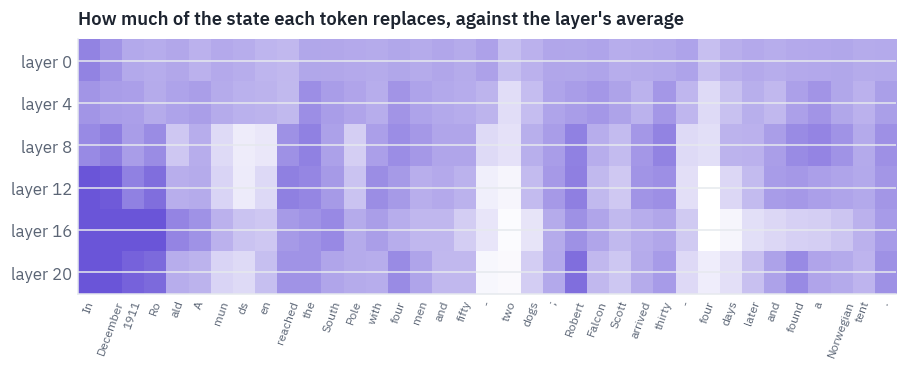

<pre class="tfs-printed" markdown="0"><code>replace most:  In · December · the · Robert · Ro · thirty · a · four
replace least: days · en · mun · - · ds · - · four · two</code></pre>

Each layer is divided by its own average, because the early layers rewrite much more of their state than the late ones, and that difference would drown everything else. What remains is a pattern you can read.

The tokens that *start* something replace the most: the first word of the sentence, the first piece of a name, "Robert", the month. The tokens that *finish* something replace the least: the remaining pieces of "Amundsen", which the tokenizer cut into four, and the second half of "fifty-two" and "thirty-four".

Once the state holds "Ro" and "ald", the rest of the name is predictable and there is little new to write. Nobody told the model any of this; the steps were learned from predicting the next word.

The same steps give each channel a *memory horizon*: the number of tokens after which a channel keeps less than a
third, $$e^{-1}$$, of what it held. For a channel with entry $$a$$ and a typical step $$\Delta$$ that is
$$1 / (\Delta \lvert a\rvert)$$ tokens. Across all channels and state numbers of the whole model, over a page of
text:

```python
page = tok(
    "The expedition left the Bay of Whales on 20 October with four sledges. The weather "
    "was clear, the dogs were strong, and by the end of the first week they had covered "
    "more ground than Scott's party would in a month. Amundsen had planned the depots "
    "with care: every one was marked with flags across the line of march, so that a "
    "party returning in poor light could not miss it.",
    return_tensors="pt",
).input_ids
for layer in mamba.layers:
    layer.mixer.keep = True
with torch.no_grad():
    mamba(page)
horizons = []
for layer in mamba.layers:
    m = layer.mixer
    a = torch.exp(m.A_log.detach().float())  # |a|, (E, N)
    typical_step = m.steps[0].median(dim=-1).values  # (E,)
    horizons.append((1 / (typical_step[:, None] * a)).flatten())
    m.keep = False
horizons = torch.cat(horizons).clamp(max=1e6).numpy()

fig, ax = plt.subplots(figsize=(7.2, 3.2))
bins = np.logspace(-2, 6, 50)
ax.hist(horizons, bins=bins, color=COLORS["att"])
ax.set_xscale("log")
ax.set_xlabel("memory horizon, tokens")
ax.set_ylabel("channel × state pairs")
ax.set_title("How long the channels of mamba-130m remember")
plt.show()
for q in [0.1, 0.5, 0.9, 0.99]:
    print(f"{q:.0%} of horizons are under {np.quantile(horizons, q):,.2g} tokens")
```

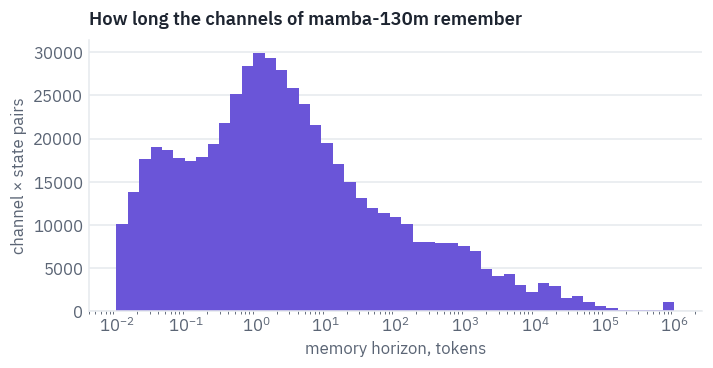

<pre class="tfs-printed" markdown="0"><code>10% of horizons are under 0.03 tokens
50% of horizons are under 1.7 tokens
90% of horizons are under 4.2e+02 tokens
99% of horizons are under 2.7e+04 tokens</code></pre>

Most channels forget within a few tokens: they handle the local business of syntax. A long tail keeps its content for hundreds or thousands of tokens, and those are the ones that carry a topic or a name across a page.

The section 2 question has an answer too: for the short-memory channels $$\Delta \lvert a \rvert$$ is large and the Euler step overstates the input, but those channels forget it in a token or two anyway; for the long-memory ones the product is small and the shortcut is exact for practical purposes.

## 6. The scan

The loop of section 4 is correct and slow: $$L$$ steps, one after the other. A Transformer processes all positions
of a sequence at once, and that is half of why it won. Mamba recovers the parallelism through a property of the
recurrence $$h_t = \bar a_t h_{t-1} + w_t$$: it is linear, so two consecutive steps compose into one step of the
same form,

$$(\bar a_2, w_2) \circ (\bar a_1, w_1) = (\bar a_2 \bar a_1,\; \bar a_2 w_1 + w_2),$$

and this composition is associative. Associative operations can be accumulated over a sequence in $$\log_2 L$$ rounds instead of $$L$$ steps: in round $$k$$, every position combines itself with the position $$2^k$$ to its left.

After the last round every position holds the composition of everything before it. This is the Hillis–Steele scan from the parallel algorithms of the 1980s, and it needs only elementwise multiplications and additions.

```python
def scan_parallel(decay, write, c):
    a, h = decay, write
    shift = 1
    while shift < a.shape[2]:
        a_left = F.pad(
            a[:, :, :-shift], (0, 0, shift, 0), value=1.0
        )  # identity beyond the start
        h_left = F.pad(h[:, :, :-shift], (0, 0, shift, 0), value=0.0)
        h = a * h_left + h
        a = a * a_left
        shift *= 2
    return (h * c[:, None]).sum(-1)


torch.manual_seed(SEED)
decay = torch.rand(1, 3, 37, 4)
write = torch.randn(1, 3, 37, 4)
c = torch.randn(1, 37, 4)
gap = (scan_parallel(decay, write, c) - scan_loop(decay, write, c)).abs().max()
print("parallel against loop:", f"{gap:.1e}")
```

<pre class="tfs-printed" markdown="0"><code>parallel against loop: 9.5e-07</code></pre>

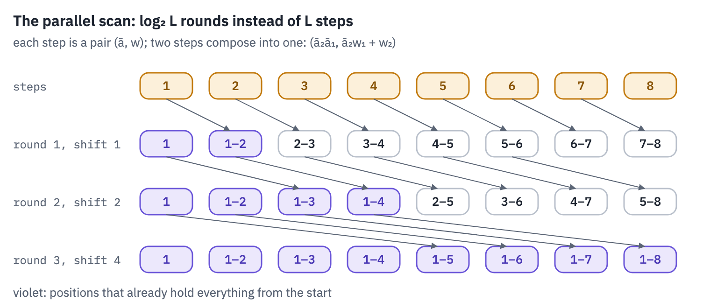
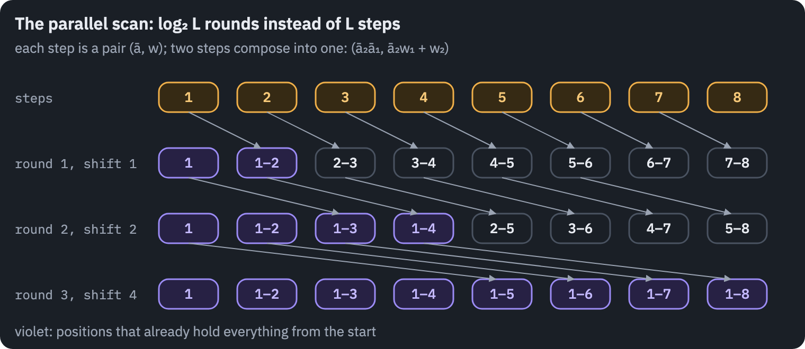

The parallel scan does more work than the loop, $$L \log_2 L$$ combinations instead of $$L$$, and keeps a tensor of shape (batch, channels, $$L$$, $$N$$) in memory, $$N$$ times the size of the layer's activations.

Written in plain PyTorch on a T4, the two come out about even: every step of the loop already runs over all 1,536 channels and 16 state numbers at once, so it is parallel across channels, and the scan's extra work and memory traffic eat what it gains across time.

The scan pays off when it never leaves the chip, which is what Mamba's own kernel does.

```python
sizes = [256, 512] if SMOKE else [256, 1024, 4096]
timing = []
for L in sizes:
    torch.manual_seed(SEED)
    decay = torch.rand(1, 1536, L, 16, device=device)
    write = torch.randn(1, 1536, L, 16, device=device)
    c = torch.randn(1, L, 16, device=device)
    for name, scan in [("loop", scan_loop), ("parallel", scan_parallel)]:
        scan(decay, write, c)
        if device == "cuda":
            torch.cuda.synchronize()
        start = time.time()
        scan(decay, write, c)
        if device == "cuda":
            torch.cuda.synchronize()
        timing.append({"tokens": L, "scan": name, "ms": (time.time() - start) * 1000})
ms = pd.DataFrame(timing).pivot(index="tokens", columns="scan", values="ms")
table(ms.reset_index(), digits=1)
```

<div class="tfs-table-wrap"><table class="tfs-table" style="border-collapse:collapse;font-family:'IBM Plex Sans', -apple-system, 'Segoe UI', Roboto, Helvetica, Arial, sans-serif;font-size:13.5px;line-height:1.45;margin:4px 0 8px;"><thead><tr><th style="padding:7px 14px;border-bottom:2px solid #B9C0CB;font-weight:600;color:#5B6575;font-size:12px;letter-spacing:0.02em;text-align:right;">tokens</th><th style="padding:7px 14px;border-bottom:2px solid #B9C0CB;font-weight:600;color:#5B6575;font-size:12px;letter-spacing:0.02em;text-align:right;">loop</th><th style="padding:7px 14px;border-bottom:2px solid #B9C0CB;font-weight:600;color:#5B6575;font-size:12px;letter-spacing:0.02em;text-align:right;">parallel</th></tr></thead><tbody><tr><td style="padding:7px 14px;border-bottom:1px solid #E6E9EE;vertical-align:top;text-align:right;font-variant-numeric:tabular-nums;max-width:460px;white-space:normal;">256</td><td style="padding:7px 14px;border-bottom:1px solid #E6E9EE;vertical-align:top;text-align:right;font-variant-numeric:tabular-nums;max-width:460px;white-space:normal;">16.0</td><td style="padding:7px 14px;border-bottom:1px solid #E6E9EE;vertical-align:top;text-align:right;font-variant-numeric:tabular-nums;max-width:460px;white-space:normal;">13.1</td></tr><tr><td style="padding:7px 14px;border-bottom:1px solid #E6E9EE;vertical-align:top;text-align:right;font-variant-numeric:tabular-nums;max-width:460px;white-space:normal;">1,024</td><td style="padding:7px 14px;border-bottom:1px solid #E6E9EE;vertical-align:top;text-align:right;font-variant-numeric:tabular-nums;max-width:460px;white-space:normal;">63.4</td><td style="padding:7px 14px;border-bottom:1px solid #E6E9EE;vertical-align:top;text-align:right;font-variant-numeric:tabular-nums;max-width:460px;white-space:normal;">62.8</td></tr><tr><td style="padding:7px 14px;border-bottom:1px solid #E6E9EE;vertical-align:top;text-align:right;font-variant-numeric:tabular-nums;max-width:460px;white-space:normal;">4,096</td><td style="padding:7px 14px;border-bottom:1px solid #E6E9EE;vertical-align:top;text-align:right;font-variant-numeric:tabular-nums;max-width:460px;white-space:normal;">256.8</td><td style="padding:7px 14px;border-bottom:1px solid #E6E9EE;vertical-align:top;text-align:right;font-variant-numeric:tabular-nums;max-width:460px;white-space:normal;">303.8</td></tr></tbody></table></div>

Mamba's own kernel goes further, and its design is FlashAttention's lesson applied to a recurrence. The tensor of
all states, (batch, channels, $$L$$, $$N$$), is never written to the GPU's main memory: the kernel loads $$\Delta$$,
$$A$$, $$B$$, $$C$$ and $$x$$ into the fast on-chip memory, runs the scan there and writes back only the outputs
$$y$$. For training it recomputes the states in the backward pass instead of storing them. With that kernel, the
paper reports, the scan runs 20 to 40 times faster than a standard scan in PyTorch.

## 7. Generation with a state of fixed size

To generate, a Transformer keeps its KV cache; Mamba keeps, per layer, the state $$h$$, $$E \times N$$ numbers, and
the last three inputs of the convolution. One step of generation reads the new token, updates both, and forgets
the token. The step is the recurrence of section 3 for one position:

```python
def mixer_step(m, x, state):
    window, h = (
        state  # the convolution's last inputs (batch, E, k), the state (batch, E, N)
    )
    u, gate = m.in_proj(x).chunk(2, dim=-1)  # (batch, E) each
    window = torch.cat([window[:, :, 1:], u[:, :, None]], dim=-1)
    u = F.silu((window * m.conv1d.weight[:, 0]).sum(-1) + m.conv1d.bias)
    seed, b, c = m.x_proj(u).split([m.rank, m.n, m.n], dim=-1)
    step = F.softplus(m.dt_proj(seed))  # (batch, E)
    a = -torch.exp(m.A_log.float())
    h = torch.exp(step[..., None] * a) * h + step[..., None] * b[:, None] * u[..., None]
    y = (h * c[:, None]).sum(-1) + u * m.D
    return m.out_proj(y * F.silu(gate)), (window, h)


def model_step(model, token, states):
    x = model.embeddings(token)
    new_states = []
    for layer, state in zip(model.layers, states):
        out, state = mixer_step(layer.mixer, layer.norm(x), state)
        x = x + out
        new_states.append(state)
    return model.lm_head(model.norm_f(x)).float(), new_states


def empty_states(model, batch=1):
    states = []
    for layer in model.layers:
        m = layer.mixer
        e, k = m.D.shape[0], m.conv1d.weight.shape[-1]
        dev = m.D.device
        states.append(
            (torch.zeros(batch, e, k, device=dev), torch.zeros(batch, e, m.n, device=dev))
        )
    return states


with torch.no_grad():
    full = mamba(ids)
    states = empty_states(mamba)
    stepped = []
    for t in range(ids.shape[1]):
        logits, states = model_step(mamba, ids[:, t], states)
        stepped.append(logits)
stepped = torch.stack(stepped, dim=1)
state_bytes = sum(w.numel() + h.numel() for w, h in states) * 2  # in 16-bit floats
print("step by step against the whole sequence:", f"{(stepped - full).abs().max():.1e}")
print(f"the whole state of the model: {state_bytes / 1e6:.2f} MB, at any length")
```

<pre class="tfs-printed" markdown="0"><code>step by step against the whole sequence: 3.9e-04
the whole state of the model: 1.47 MB, at any length</code></pre>

Lesson 8 measured what a token costs in a Transformer's cache. The same count for Pythia-160m, the Transformer that
EleutherAI trained on the same 300 billion tokens of the Pile as mamba-130m, with the same tokenizer:

```python
pythia_config = json.load(open(hf_hub_download("EleutherAI/pythia-160m", "config.json")))
per_token = (
    2 * pythia_config["num_hidden_layers"] * pythia_config["hidden_size"] * 2
)  # K and V, fp16
memory = []
for n in [2048, 32768, 131072, 1_000_000]:
    memory.append(
        {
            "tokens read": n,
            "Pythia-160m cache, MB": per_token * n / 1e6,
            "mamba-130m state, MB": state_bytes / 1e6,
        }
    )
table(pd.DataFrame(memory), digits=2)
```

<div class="tfs-table-wrap"><table class="tfs-table" style="border-collapse:collapse;font-family:'IBM Plex Sans', -apple-system, 'Segoe UI', Roboto, Helvetica, Arial, sans-serif;font-size:13.5px;line-height:1.45;margin:4px 0 8px;"><thead><tr><th style="padding:7px 14px;border-bottom:2px solid #B9C0CB;font-weight:600;color:#5B6575;font-size:12px;letter-spacing:0.02em;text-align:right;">tokens read</th><th style="padding:7px 14px;border-bottom:2px solid #B9C0CB;font-weight:600;color:#5B6575;font-size:12px;letter-spacing:0.02em;text-align:right;">Pythia-160m cache, MB</th><th style="padding:7px 14px;border-bottom:2px solid #B9C0CB;font-weight:600;color:#5B6575;font-size:12px;letter-spacing:0.02em;text-align:right;">mamba-130m state, MB</th></tr></thead><tbody><tr><td style="padding:7px 14px;border-bottom:1px solid #E6E9EE;vertical-align:top;text-align:right;font-variant-numeric:tabular-nums;max-width:460px;white-space:normal;">2,048</td><td style="padding:7px 14px;border-bottom:1px solid #E6E9EE;vertical-align:top;text-align:right;font-variant-numeric:tabular-nums;max-width:460px;white-space:normal;">75.50</td><td style="padding:7px 14px;border-bottom:1px solid #E6E9EE;vertical-align:top;text-align:right;font-variant-numeric:tabular-nums;max-width:460px;white-space:normal;">1.47</td></tr><tr><td style="padding:7px 14px;border-bottom:1px solid #E6E9EE;vertical-align:top;text-align:right;font-variant-numeric:tabular-nums;max-width:460px;white-space:normal;">32,768</td><td style="padding:7px 14px;border-bottom:1px solid #E6E9EE;vertical-align:top;text-align:right;font-variant-numeric:tabular-nums;max-width:460px;white-space:normal;">1,207.96</td><td style="padding:7px 14px;border-bottom:1px solid #E6E9EE;vertical-align:top;text-align:right;font-variant-numeric:tabular-nums;max-width:460px;white-space:normal;">1.47</td></tr><tr><td style="padding:7px 14px;border-bottom:1px solid #E6E9EE;vertical-align:top;text-align:right;font-variant-numeric:tabular-nums;max-width:460px;white-space:normal;">131,072</td><td style="padding:7px 14px;border-bottom:1px solid #E6E9EE;vertical-align:top;text-align:right;font-variant-numeric:tabular-nums;max-width:460px;white-space:normal;">4,831.84</td><td style="padding:7px 14px;border-bottom:1px solid #E6E9EE;vertical-align:top;text-align:right;font-variant-numeric:tabular-nums;max-width:460px;white-space:normal;">1.47</td></tr><tr><td style="padding:7px 14px;border-bottom:1px solid #E6E9EE;vertical-align:top;text-align:right;font-variant-numeric:tabular-nums;max-width:460px;white-space:normal;">1,000,000</td><td style="padding:7px 14px;border-bottom:1px solid #E6E9EE;vertical-align:top;text-align:right;font-variant-numeric:tabular-nums;max-width:460px;white-space:normal;">36,864.00</td><td style="padding:7px 14px;border-bottom:1px solid #E6E9EE;vertical-align:top;text-align:right;font-variant-numeric:tabular-nums;max-width:460px;white-space:normal;">1.47</td></tr></tbody></table></div>

The state is about as big as Pythia's cache after a few dozen tokens, and it stays that size. This is the whole
promise of the architecture, and it comes with a question that the next sections answer: what doesn't fit into a
state that never grows?

## 8. Mamba-2: the same model as attention

Six months after Mamba, Dao and Gu published Mamba-2 with a title that sounds like a provocation: *Transformers are SSMs*. The change to the model is small.

$$A$$ becomes one number per head instead of one per channel and state number, the channels are grouped into heads of 64 like attention heads, $$B$$ and $$C$$ are computed in parallel with the input instead of after it, and the state grows from 16 numbers to 128.

The consequence is large. Unroll the recurrence with a scalar $$a$$ per head and the output at position $$t$$ is a weighted sum over all earlier positions:

$$y_t = \sum_{s \le t} \underbrace{c_t^{\top} b_s}_{\text{like } q_t^{\top} k_s}\;
\underbrace{e^{\,a(\Delta_{s+1} + \dots + \Delta_t)}}_{\text{the mask}}\; \Delta_s\, x_s.$$

That is attention. $$c_t$$ plays the query, $$b_s$$ the key, $$\Delta_s x_s$$ the value, and instead of a softmax the scores are multiplied by a mask that decays with distance at a rate the tokens choose.

The paper calls the equivalence *state space duality*: the same layer can be computed as a recurrence, cheap per token, or as a masked attention matrix, which is all matrix multiplication and therefore fast on a GPU.

The practical algorithm mixes the two: attention inside chunks of 64 to 256 tokens, the recurrence between chunks. Four steps, all of them `einsum`.

```python
def segment_sums(a):
    # a (..., T) -> (..., T, T): out[t, s] = a[s+1] + ... + a[t] for s <= t,
    # and -inf above the diagonal
    T = a.shape[-1]
    below = torch.ones(T, T, dtype=torch.bool, device=a.device).tril(-1)
    x = a[..., None].expand(*a.shape, T).masked_fill(~below, 0)
    x = torch.cumsum(x, dim=-2)
    on_or_below = torch.ones(T, T, dtype=torch.bool, device=a.device).tril()
    return x.masked_fill(~on_or_below, float("-inf"))


def ssd(x, a, b, c, chunk=64):
    # x (batch, L, heads, P), already times Δ; a (batch, L, heads) = Δ·A;
    # b and c (batch, L, heads, N)
    batch, L, heads, p = x.shape
    pad = (chunk - L % chunk) % chunk
    x, b, c = [F.pad(t, (0, 0, 0, 0, 0, pad)) for t in (x, b, c)]
    a = F.pad(a, (0, 0, 0, pad))
    n = x.shape[1] // chunk
    x, b, c = [t.reshape(batch, n, chunk, heads, -1) for t in (x, b, c)]
    a = a.reshape(batch, n, chunk, heads).permute(
        0, 3, 1, 2
    )  # (batch, heads, chunks, chunk)
    a_cum = torch.cumsum(a, dim=-1)
    # 1. inside each chunk: attention with the decay as its mask
    mask = torch.exp(segment_sums(a))
    y_inside = torch.einsum("bclhn,bcshn,bhcls,bcshp->bclhp", c, b, mask, x)
    # 2. the state each chunk leaves behind
    to_end = torch.exp(a_cum[..., -1:] - a_cum)
    states = torch.einsum("bclhn,bhcl,bclhp->bchpn", b, to_end, x)
    # 3. the recurrence between chunks
    states = torch.cat([torch.zeros_like(states[:, :1]), states], dim=1)
    between = torch.exp(segment_sums(F.pad(a_cum[..., -1], (1, 0))))
    states = torch.einsum("bhzc,bchpn->bzhpn", between, states)[:, :-1]
    # 4. what each position reads from the state that entered its chunk
    y_entering = torch.einsum("bclhn,bchpn,bhcl->bclhp", c, states, torch.exp(a_cum))
    return (y_inside + y_entering).reshape(batch, n * chunk, heads, p)[:, :L]


def ssd_loop(x, a, b, c):
    h = torch.zeros(x.shape[0], x.shape[2], x.shape[3], b.shape[-1], device=x.device)
    ys = []
    for t in range(x.shape[1]):
        h = (
            torch.exp(a[:, t])[..., None, None] * h
            + x[:, t, :, :, None] * b[:, t, :, None, :]
        )
        ys.append((h * c[:, t, :, None, :]).sum(-1))
    return torch.stack(ys, dim=1)


torch.manual_seed(SEED)
x = torch.randn(1, 150, 3, 8)
a = -torch.rand(1, 150, 3) * 0.3
b = torch.randn(1, 150, 3, 16)
c = torch.randn(1, 150, 3, 16)
print(
    "chunks of 32 against the step-by-step loop:",
    f"{(ssd(x, a, b, c, 32) - ssd_loop(x, a, b, c)).abs().max():.1e}",
)
```

<pre class="tfs-printed" markdown="0"><code>chunks of 32 against the step-by-step loop: 6.7e-06</code></pre>

The Mamba-2 block keeps the shape of section 4 with the changes above: one projection makes the gate, the stream,
$$B$$, $$C$$ and the steps at once; the convolution runs over the stream together with $$B$$ and $$C$$; and the
gate is applied inside an RMSNorm at the end. The checkpoint is the 130-million-parameter Mamba-2 released by the
authors, in the Hugging Face format of a community conversion, `AntonV/mamba2-130m-hf`.

```python
class GatedRMSNorm(nn.Module):
    def __init__(self, size, eps):
        super().__init__()
        self.weight = nn.Parameter(torch.ones(size))
        self.eps = eps

    def forward(self, x, gate):
        x32 = x.float() * F.silu(gate.float())
        x32 = x32 * torch.rsqrt(x32.pow(2).mean(-1, keepdim=True) + self.eps)
        return self.weight * x32.to(x.dtype)


class Mixer2(nn.Module):
    def __init__(self, c):
        super().__init__()
        d = c["hidden_size"]
        self.heads, self.p, self.n = c["num_heads"], c["head_dim"], c["state_size"]
        self.groups = c["n_groups"]
        self.e = self.heads * self.p
        conv = self.e + 2 * self.groups * self.n
        k = c["conv_kernel"]
        self.in_proj = nn.Linear(
            d, self.e + conv + self.heads, bias=c.get("use_bias", False)
        )
        self.conv1d = nn.Conv1d(conv, conv, k, groups=conv, padding=k - 1, bias=True)
        self.dt_bias = nn.Parameter(torch.zeros(self.heads))
        self.A_log = nn.Parameter(torch.zeros(self.heads))
        self.D = nn.Parameter(torch.ones(self.heads))
        self.norm = GatedRMSNorm(self.e, c["layer_norm_epsilon"])
        self.out_proj = nn.Linear(self.e, d, bias=c.get("use_bias", False))
        self.chunk = c.get("chunk_size", 64)
        self.keep = False  # the next cell reads the matrix of one head
        self.parts = None

    def select(self, dt, b, c):
        # the step, B and C of every token: what makes the layer selective (section 11)
        return F.softplus((dt + self.dt_bias).float()), b, c  # the step in 32 bits

    def forward(self, x):
        batch, L, _ = x.shape
        sizes = [self.e, self.e + 2 * self.groups * self.n, self.heads]
        gate, xbc, dt = self.in_proj(x).split(sizes, dim=-1)
        xbc = F.silu(self.conv1d(xbc.transpose(1, 2))[..., :L].transpose(1, 2))
        u, b, c = xbc.split([self.e, self.groups * self.n, self.groups * self.n], dim=-1)
        step, b, c = self.select(dt, b, c)
        a = -torch.exp(self.A_log.float())  # one number per head
        u = u.reshape(batch, L, self.heads, self.p)
        share = self.heads // self.groups
        b = b.reshape(batch, L, self.groups, self.n).repeat_interleave(share, dim=2)
        c = c.reshape(batch, L, self.groups, self.n).repeat_interleave(share, dim=2)
        if self.keep:
            self.parts = (u.detach(), step.detach(), a.detach(), b.detach(), c.detach())
        y = ssd(u.float() * step[..., None], step * a, b.float(), c.float(), self.chunk)
        y = y + u * self.D[:, None]
        y = self.norm(y.reshape(batch, L, self.e).to(x.dtype), gate)
        return self.out_proj(y)


class Mamba2(nn.Module):
    def __init__(self, c, mixer=Mixer2):
        super().__init__()
        self.embeddings = nn.Embedding(c["vocab_size"], c["hidden_size"])
        self.layers = nn.ModuleList()
        for _ in range(c["num_hidden_layers"]):
            block = nn.Module()
            block.norm = RMSNorm(c["hidden_size"], c["layer_norm_epsilon"])
            block.mixer = mixer(c)
            self.layers.append(block)
        self.norm_f = RMSNorm(c["hidden_size"], c["layer_norm_epsilon"])
        self.lm_head = nn.Linear(c["hidden_size"], c["vocab_size"], bias=False)

    def hidden(self, ids):
        x = self.embeddings(ids)
        for block in self.layers:
            x = x + block.mixer(block.norm(x))
        return self.norm_f(x)

    def forward(self, ids):
        return self.lm_head(self.hidden(ids)).float()
```

```python
from transformers import Mamba2Config, Mamba2ForCausalLM

REPO2 = "AntonV/mamba2-130m-hf"
if SMOKE:
    small2 = Mamba2Config(
        vocab_size=50288,
        hidden_size=64,
        num_heads=4,
        head_dim=32,
        state_size=16,
        n_groups=1,
        num_hidden_layers=2,
        chunk_size=16,
    )
    torch.manual_seed(0)
    reference2 = Mamba2ForCausalLM(small2).eval()
    mamba2_config = small2.to_dict()
    state = {k.removeprefix("backbone."): v for k, v in reference2.state_dict().items()}
else:
    reference2 = Mamba2ForCausalLM.from_pretrained(REPO2, dtype=torch.float32).eval()
    mamba2_config = json.load(open(hf_hub_download(REPO2, "config.json")))
    state = load_file(hf_hub_download(REPO2, "model.safetensors"))
    state = {k.removeprefix("backbone."): v for k, v in state.items()}
state.setdefault("lm_head.weight", state["embeddings.weight"])
mamba2 = Mamba2(mamba2_config)
mamba2.load_state_dict(state, strict=True)
mamba2.eval()
with torch.no_grad():
    gap = (mamba2(ids) - reference2(ids).logits).abs().max()
print("Mamba-2, max difference from Hugging Face:", f"{gap:.1e}")
for key in ["num_heads", "head_dim", "state_size", "chunk_size"]:
    print(f"{key:12} {mamba2_config[key]}")
del reference2
```

<pre class="tfs-printed" markdown="0"><code>Mamba-2, max difference from Hugging Face: 3.1e-04
num_heads    24
head_dim     64
state_size   128
chunk_size   256</code></pre>

Now the attention matrix that Mamba-2 never writes down. For one head of a middle layer, on the Amundsen sentence,
the matrix $$M_{ts} = c_t^{\top} b_s\, e^{a(\Delta_{s+1} + \dots + \Delta_t)}\, \Delta_s$$; next to it, the
attention of a head of Pythia-160m on the same tokens. The check under the picture multiplies the matrix by the
head's values and compares with the scan.

```python
layer2 = len(mamba2.layers) // 2
mixer2 = mamba2.layers[layer2].mixer
mixer2.keep = True
with torch.no_grad():
    mamba2(ids)
mixer2.keep = False
u, step, a, b, c = mixer2.parts
head = 0
L = ids.shape[1]
decay = torch.exp(segment_sums(step[0, :, head] * a[head]))  # (L, L)
M = (c[0, :, head] @ b[0, :, head].T) * decay * step[0, None, :, head]
y_matrix = M @ u[0, :, head]
y_scan = ssd(u * step[..., None], step * a, b, c, mixer2.chunk)[0, :, head]
print("matrix form against the chunked scan:", f"{(y_matrix - y_scan).abs().max():.1e}")
```

<pre class="tfs-printed" markdown="0"><code>matrix form against the chunked scan: 7.6e-06</code></pre>

```python
from transformers import AutoModelForCausalLM

PYTHIA = (
    "EleutherAI/pythia-14m" if SMOKE else "EleutherAI/pythia-160m"
)  # 14m: same tokenizer, tiny
pythia = AutoModelForCausalLM.from_pretrained(
    PYTHIA, dtype=torch.float32, attn_implementation="eager"
).eval()
with torch.no_grad():
    attention = pythia(
        ids, output_attentions=True
    ).attentions  # one (1, heads, L, L) per layer
pythia_head = attention[len(attention) // 2][0, 0].numpy()

labels = [s.strip() or "␣" for s in tokens_of(ids)]
fig, axes = plt.subplots(1, 2, figsize=(10.4, 5.0))
weights = M.abs().numpy()
weights = weights / weights.sum(
    axis=1, keepdims=True
)  # each row as a share, like attention
for ax, matrix, title in [
    (axes[0], weights, f"Mamba-2, layer {layer2}, head {head}: |M|, rows as shares"),
    (axes[1], pythia_head, f"Pythia-160m, layer {len(attention) // 2}, head 0: softmax"),
]:
    ax.imshow(np.sqrt(matrix), cmap=shades, vmin=0)
    ax.set_xticks(range(L), labels, rotation=90, fontsize=6)
    ax.set_yticks(range(L), labels, fontsize=6)
    ax.set_title(title, fontsize=9)
plt.show()
```

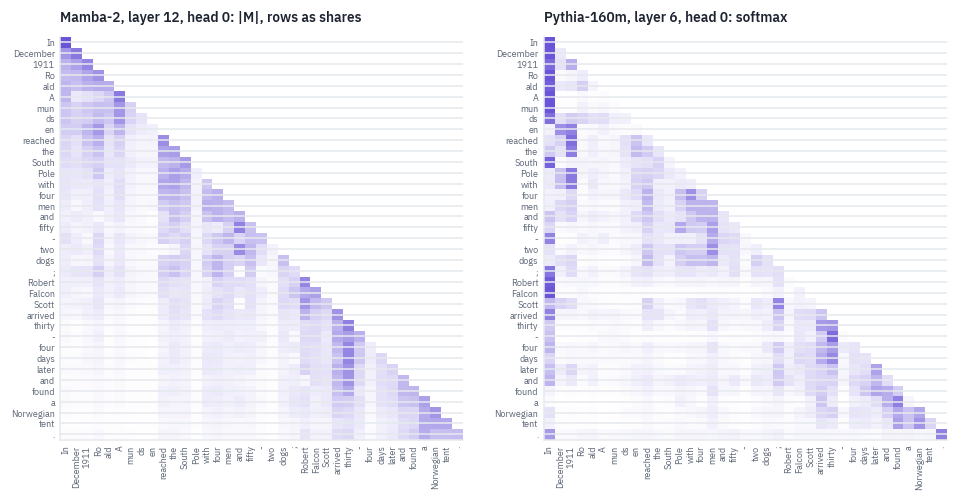

Both matrices are lower-triangular: neither model looks ahead. The softmax head spends its attention on a few chosen tokens, often the first one, the attention sink of lesson 6.

Mamba-2's matrix is a different texture: every row is a smooth decay into the past, interrupted where the steps $$\Delta$$ are large, because a large step erases what came before. One is a lookup, the other a fading memory, and the next section measures what that difference means in practice.

## 9. Same data, different machinery

Pythia-160m and mamba-130m are as close to a controlled experiment as two public models get: the same 300 billion
tokens of the Pile, the same tokenizer, the same training context of 2,048 tokens, and a similar number of
parameters outside the embeddings. Only the layer differs. Two tests.

**Reading past the training length.** Lesson 9 watched a model with rotary positions fall off a cliff past its training length.

Pythia rotates a quarter of each head's dimensions; Mamba has no positions at all, only the order in which the recurrence runs. Loss by position on the same PG-19 books as lesson 9:

```python
import pandas as pd

pg19 = pd.read_parquet(
    "hf://datasets/emozilla/pg19-test/data/test-00000-of-00001-29a571947c0b5ccc.parquet"
)
LENGTH = 512 if SMOKE else 8192
N_BOOKS = 2 if SMOKE else 6
book_ids = []
for text in pg19.text:
    t = tok(text[:120_000], return_tensors="pt").input_ids
    if t.shape[1] > LENGTH:
        book_ids.append(t[:, : LENGTH + 1])
    if len(book_ids) == N_BOOKS:
        break

for layer in mamba.layers:
    layer.mixer.scan = scan_parallel
mamba.to(device)
pythia.to(device)


@torch.no_grad()
def position_losses(model_logits, ids):
    logits = model_logits(ids[:, :-1].to(device))
    return F.cross_entropy(logits[0], ids[0, 1:].to(device), reduction="none").cpu()


curves = {"mamba-130m": torch.zeros(LENGTH), "Pythia-160m": torch.zeros(LENGTH)}
for ids_book in book_ids:
    curves["mamba-130m"] += position_losses(mamba, ids_book) / len(book_ids)
    curves["Pythia-160m"] += position_losses(
        lambda x: pythia(x).logits.float(), ids_book
    ) / len(book_ids)

fig, ax = plt.subplots(figsize=(7.4, 3.4))
width = max(4, LENGTH // 64)
for name, color in [("Pythia-160m", COLORS["muted"]), ("mamba-130m", COLORS["att"])]:
    smooth = np.convolve(curves[name].numpy(), np.ones(width) / width, mode="valid")
    ax.plot(smooth, color=color, linewidth=2, label=name)
ax.axvline(2048, color=COLORS["line"], linestyle="--", linewidth=1)
ax.set_xlabel("position in the book")
ax.set_ylabel("loss, nats per token")
ax.set_title(f"{len(book_ids)} PG-19 books, both trained on 2,048 tokens")
ax.legend(frameon=False)
plt.show()
for name in curves:
    inside = curves[name][1024:2048].mean().item()
    beyond = curves[name][-2048:].mean().item()
    print(f"{name:12} loss at 1–2k: {inside:.2f}, at the last 2k: {beyond:.2f}")
```

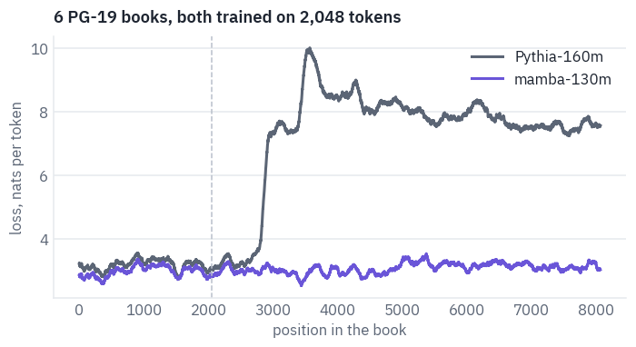

<pre class="tfs-printed" markdown="0"><code>mamba-130m   loss at 1–2k: 3.05, at the last 2k: 3.16
Pythia-160m  loss at 1–2k: 3.22, at the last 2k: 7.65</code></pre>

Mamba reads eight times past its training length with its loss barely moving: there is no position for it to get
wrong, only a state that keeps being updated. Pythia climbs the same wall as TinyLlama in lesson 9, from the same
cause, rotary pairs asked for angles they never showed. On this test the fixed state wins outright.

**Copying.** The second test asks for exactly what a fixed state can't promise: repeat a list of random words. A Transformer can look back at every word it was shown; Mamba has to have squeezed all of them into its state.

Jelassi and colleagues found in 2024 that even a 410-million-parameter Pythia beats a 2.8-billion-parameter Mamba at looking up a number in a long phone book, and the same gap shows on this simplest of tasks. Each prompt has one worked example and then a list of a given length; an answer counts when every word comes back in order.

```python
import random

rng = random.Random(SEED)
words = sorted(
    {w.lower() for w in pg19.text.iloc[0].split() if w.isalpha() and 3 <= len(w) <= 7}
)


def copy_prompt(n_words):
    example = " ".join(rng.sample(words, 6))
    target = " ".join(rng.sample(words, n_words))
    text = f"Repeat the words exactly.\nWords: {example}\nRepeat: {example}\n\n"
    text += f"Words: {target}\nRepeat:"
    return text, target


@torch.no_grad()
def mamba_continue(model, ids, steps):
    states = empty_states(model)
    for t in range(ids.shape[1]):
        logits, states = model_step(model, ids[:, t].to(device), states)
    out = []
    for _ in range(steps):
        token = logits.argmax(-1)
        out.append(token.item())
        logits, states = model_step(model, token, states)
    return out


@torch.no_grad()
def pythia_continue(ids, steps):
    out = pythia.generate(
        ids.to(device), max_new_tokens=steps, do_sample=False, pad_token_id=tok.eos_token_id
    )
    return out[0, ids.shape[1] :].tolist()


copy_lengths = [5, 10] if SMOKE else [10, 25, 50, 100, 200]
COPY_TRIALS = 2 if SMOKE else 10
copied = {"mamba-130m": [], "Pythia-160m": []}
for n in copy_lengths:
    hits = {"mamba-130m": 0, "Pythia-160m": 0}
    for _ in range(COPY_TRIALS):
        text, target = copy_prompt(n)
        prompt = tok(text, return_tensors="pt").input_ids
        steps = len(tok(" " + target).input_ids) + 2
        said = {
            "mamba-130m": tok.decode(mamba_continue(mamba, prompt, steps)),
            "Pythia-160m": tok.decode(pythia_continue(prompt, steps)),
        }
        for name in hits:
            hits[name] += said[name].strip().startswith(target)
    for name in hits:
        copied[name].append(hits[name] / COPY_TRIALS)

fig, ax = plt.subplots(figsize=(7.2, 3.2))
for name, color in [("Pythia-160m", COLORS["muted"]), ("mamba-130m", COLORS["att"])]:
    ax.plot(copy_lengths, copied[name], color=color, marker="o", linewidth=2, label=name)
ax.set_xscale("log")
ax.set_xticks(copy_lengths, [str(n) for n in copy_lengths])
ax.set_ylim(-0.05, 1.05)
ax.set_xlabel("words to repeat")
ax.set_ylabel("lists repeated exactly")
ax.set_title(f"Repeating a list of random words, {COPY_TRIALS} lists per length")
ax.legend(frameon=False)
plt.show()
```

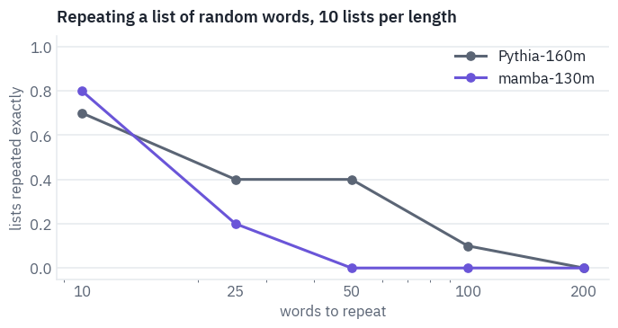

On the shortest lists the two are close. From there Mamba falls behind fast and soon copies no list at all, while Pythia still gets some of the longer lists right, because every word it needs is still in its cache, one lookup away; Mamba's state has to hold the whole list at once in a fixed number of numbers, and the longer the list, the less of each word survives.

Neither model is a good copyist at this size, and at the longest lists both fail, but the gap points the way Jelassi and colleagues found at scale. This is the trade at the heart of the architecture: a state that doesn't grow is a state that can't hold everything.

For most of language that is fine, because most of what we read doesn't have to be recalled word for word. For the parts that do, a little attention goes a long way, which is the idea of the next section.

## 10. Hybrids

The answer the industry settled on is not "Mamba or attention" but a mixture: mostly recurrent layers for cheap long reading, and a few attention layers that can look anything up.

The Mamba-2 paper measured the ratio itself, on a 350-million-parameter model: replacing about one layer in ten with attention gave the best perplexity, better than either pure design. Here are the layouts of seven recent models, read from their configs. Each config describes its layout in its own way, so each needs a line of its own.

```python
def layout(repo):
    c = read_hybrid_config(repo)
    n = c.get("num_hidden_layers") or c.get("n_layer")
    if "hybrid_override_pattern" in c:  # Nemotron-H: M Mamba, * attention, - an MLP layer
        names = {"M": "ssm", "*": "attention", "-": "mlp"}
        return [names[ch] for ch in c["hybrid_override_pattern"]]
    if "layer_types" in c:  # Granite 4.0
        return ["attention" if "attention" in t else "ssm" for t in c["layer_types"]]
    if "layers_block_type" in c:  # Zamba2: "hybrid" layers add a shared attention block
        return ["attention" if t == "hybrid" else "ssm" for t in c["layers_block_type"]]
    if "attn_layer_period" in c:  # Jamba
        period, offset = c["attn_layer_period"], c["attn_layer_offset"]
        return ["attention" if i % period == offset else "ssm" for i in range(n)]
    if "full_attention_interval" in c:  # Qwen3-Next: Gated DeltaNet, then attention
        k = c["full_attention_interval"]
        return ["attention" if (i + 1) % k == 0 else "linear" for i in range(n)]
    if "linear_attn_config" in c:  # Kimi Linear: its attention layers are counted from 1
        full = c["linear_attn_config"]["full_attn_layers"]
        return ["attention" if i + 1 in full else "linear" for i in range(n)]
    if "attn_layer_idx" in c:  # Mamba-2 with attention, from the Mamba-2 paper
        return ["attention" if i in c["attn_layer_idx"] else "ssm" for i in range(n)]
    return ["ssm"] * n


def read_hybrid_config(repo):
    with open(hf_hub_download(repo, "config.json")) as f:
        c = json.load(f)
    return c.get("text_config", c)


HYBRIDS = [
    ("state-spaces/mamba2attn-2.7b", "Mamba-2 + attention, 2024"),
    ("ai21labs/Jamba-v0.1", "Jamba, AI21, 2024"),
    ("Zyphra/Zamba2-1.2B", "Zamba2, Zyphra, 2024"),
    ("nvidia/Nemotron-H-8B-Base-8K", "Nemotron-H, NVIDIA, 2025"),
    ("ibm-granite/granite-4.0-h-tiny", "Granite 4.0 H, IBM, 2025"),
    ("Qwen/Qwen3-Next-80B-A3B-Instruct", "Qwen3-Next, 2025"),
    ("moonshotai/Kimi-Linear-48B-A3B-Instruct", "Kimi Linear, 2025"),
]
layouts = {name: layout(repo) for repo, name in HYBRIDS}
colors = {
    "attention": COLORS["dec"],
    "ssm": COLORS["att"],
    "linear": COLORS["enc"],
    "mlp": COLORS["line"],
}
fig, ax = plt.subplots(figsize=(10.4, 3.6))
for row, kinds in enumerate(layouts.values()):
    for col, kind in enumerate(kinds):
        ax.add_patch(plt.Rectangle((col, -row - 0.4), 0.9, 0.8, color=colors[kind]))
ax.set_xlim(0, max(len(k) for k in layouts.values()))
ax.set_ylim(-len(layouts) + 0.4, 0.6)
ax.set_yticks([-i for i in range(len(layouts))], list(layouts))
ax.set_xlabel("layer")
for kind, label in [
    ("attention", "attention"),
    ("ssm", "Mamba"),
    ("linear", "linear attention"),
    ("mlp", "MLP only"),
]:
    ax.plot([], [], color=colors[kind], linewidth=8, label=label)
ax.legend(frameon=False, ncol=4, loc="upper center", bbox_to_anchor=(0.5, 1.18))
plt.show()

rows = []
for name, kinds in layouts.items():
    mixing = [k for k in kinds if k != "mlp"]
    rows.append(
        {
            "model": name,
            "layers that mix tokens": len(mixing),
            "attention": mixing.count("attention"),
            "share of attention": mixing.count("attention") / len(mixing),
        }
    )
table(pd.DataFrame(rows), digits=2)
```

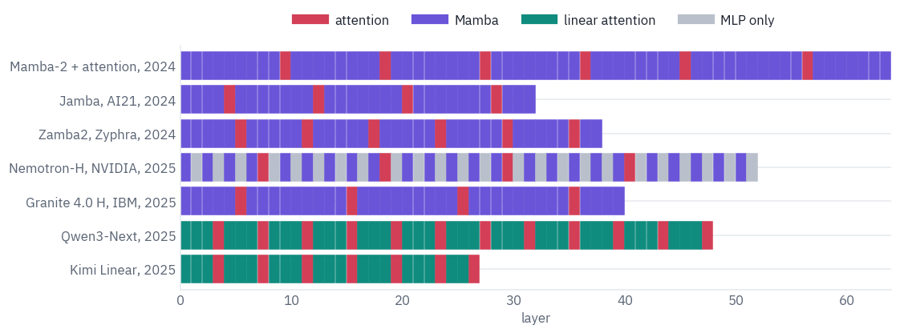

<div class="tfs-table-wrap"><table class="tfs-table" style="border-collapse:collapse;font-family:'IBM Plex Sans', -apple-system, 'Segoe UI', Roboto, Helvetica, Arial, sans-serif;font-size:13.5px;line-height:1.45;margin:4px 0 8px;"><thead><tr><th style="padding:7px 14px;border-bottom:2px solid #B9C0CB;font-weight:600;color:#5B6575;font-size:12px;letter-spacing:0.02em;text-align:left;">model</th><th style="padding:7px 14px;border-bottom:2px solid #B9C0CB;font-weight:600;color:#5B6575;font-size:12px;letter-spacing:0.02em;text-align:right;">layers that mix tokens</th><th style="padding:7px 14px;border-bottom:2px solid #B9C0CB;font-weight:600;color:#5B6575;font-size:12px;letter-spacing:0.02em;text-align:right;">attention</th><th style="padding:7px 14px;border-bottom:2px solid #B9C0CB;font-weight:600;color:#5B6575;font-size:12px;letter-spacing:0.02em;text-align:right;">share of attention</th></tr></thead><tbody><tr><td style="padding:7px 14px;border-bottom:1px solid #E6E9EE;vertical-align:top;text-align:left;max-width:460px;white-space:normal;">Mamba-2 + attention, 2024</td><td style="padding:7px 14px;border-bottom:1px solid #E6E9EE;vertical-align:top;text-align:right;font-variant-numeric:tabular-nums;max-width:460px;white-space:normal;">64</td><td style="padding:7px 14px;border-bottom:1px solid #E6E9EE;vertical-align:top;text-align:right;font-variant-numeric:tabular-nums;max-width:460px;white-space:normal;">6</td><td style="padding:7px 14px;border-bottom:1px solid #E6E9EE;vertical-align:top;text-align:right;font-variant-numeric:tabular-nums;max-width:460px;white-space:normal;">0.09</td></tr><tr><td style="padding:7px 14px;border-bottom:1px solid #E6E9EE;vertical-align:top;text-align:left;max-width:460px;white-space:normal;">Jamba, AI21, 2024</td><td style="padding:7px 14px;border-bottom:1px solid #E6E9EE;vertical-align:top;text-align:right;font-variant-numeric:tabular-nums;max-width:460px;white-space:normal;">32</td><td style="padding:7px 14px;border-bottom:1px solid #E6E9EE;vertical-align:top;text-align:right;font-variant-numeric:tabular-nums;max-width:460px;white-space:normal;">4</td><td style="padding:7px 14px;border-bottom:1px solid #E6E9EE;vertical-align:top;text-align:right;font-variant-numeric:tabular-nums;max-width:460px;white-space:normal;">0.12</td></tr><tr><td style="padding:7px 14px;border-bottom:1px solid #E6E9EE;vertical-align:top;text-align:left;max-width:460px;white-space:normal;">Zamba2, Zyphra, 2024</td><td style="padding:7px 14px;border-bottom:1px solid #E6E9EE;vertical-align:top;text-align:right;font-variant-numeric:tabular-nums;max-width:460px;white-space:normal;">38</td><td style="padding:7px 14px;border-bottom:1px solid #E6E9EE;vertical-align:top;text-align:right;font-variant-numeric:tabular-nums;max-width:460px;white-space:normal;">6</td><td style="padding:7px 14px;border-bottom:1px solid #E6E9EE;vertical-align:top;text-align:right;font-variant-numeric:tabular-nums;max-width:460px;white-space:normal;">0.16</td></tr><tr><td style="padding:7px 14px;border-bottom:1px solid #E6E9EE;vertical-align:top;text-align:left;max-width:460px;white-space:normal;">Nemotron-H, NVIDIA, 2025</td><td style="padding:7px 14px;border-bottom:1px solid #E6E9EE;vertical-align:top;text-align:right;font-variant-numeric:tabular-nums;max-width:460px;white-space:normal;">28</td><td style="padding:7px 14px;border-bottom:1px solid #E6E9EE;vertical-align:top;text-align:right;font-variant-numeric:tabular-nums;max-width:460px;white-space:normal;">4</td><td style="padding:7px 14px;border-bottom:1px solid #E6E9EE;vertical-align:top;text-align:right;font-variant-numeric:tabular-nums;max-width:460px;white-space:normal;">0.14</td></tr><tr><td style="padding:7px 14px;border-bottom:1px solid #E6E9EE;vertical-align:top;text-align:left;max-width:460px;white-space:normal;">Granite 4.0 H, IBM, 2025</td><td style="padding:7px 14px;border-bottom:1px solid #E6E9EE;vertical-align:top;text-align:right;font-variant-numeric:tabular-nums;max-width:460px;white-space:normal;">40</td><td style="padding:7px 14px;border-bottom:1px solid #E6E9EE;vertical-align:top;text-align:right;font-variant-numeric:tabular-nums;max-width:460px;white-space:normal;">4</td><td style="padding:7px 14px;border-bottom:1px solid #E6E9EE;vertical-align:top;text-align:right;font-variant-numeric:tabular-nums;max-width:460px;white-space:normal;">0.10</td></tr><tr><td style="padding:7px 14px;border-bottom:1px solid #E6E9EE;vertical-align:top;text-align:left;max-width:460px;white-space:normal;">Qwen3-Next, 2025</td><td style="padding:7px 14px;border-bottom:1px solid #E6E9EE;vertical-align:top;text-align:right;font-variant-numeric:tabular-nums;max-width:460px;white-space:normal;">48</td><td style="padding:7px 14px;border-bottom:1px solid #E6E9EE;vertical-align:top;text-align:right;font-variant-numeric:tabular-nums;max-width:460px;white-space:normal;">12</td><td style="padding:7px 14px;border-bottom:1px solid #E6E9EE;vertical-align:top;text-align:right;font-variant-numeric:tabular-nums;max-width:460px;white-space:normal;">0.25</td></tr><tr><td style="padding:7px 14px;border-bottom:1px solid #E6E9EE;vertical-align:top;text-align:left;max-width:460px;white-space:normal;">Kimi Linear, 2025</td><td style="padding:7px 14px;border-bottom:1px solid #E6E9EE;vertical-align:top;text-align:right;font-variant-numeric:tabular-nums;max-width:460px;white-space:normal;">27</td><td style="padding:7px 14px;border-bottom:1px solid #E6E9EE;vertical-align:top;text-align:right;font-variant-numeric:tabular-nums;max-width:460px;white-space:normal;">7</td><td style="padding:7px 14px;border-bottom:1px solid #E6E9EE;vertical-align:top;text-align:right;font-variant-numeric:tabular-nums;max-width:460px;white-space:normal;">0.26</td></tr></tbody></table></div>

The shares cluster where the Mamba-2 paper found its optimum: one attention layer in four to one in ten, spread evenly through the depth. Two other designs exist.

Falcon-H1 from TII runs attention and Mamba-2 heads *in parallel* inside every layer instead of alternating them, and Qwen3-Next and Kimi Linear replace Mamba with a different recurrence, the gated delta rule, which writes into its state more selectively; that family is the subject of [a separate post on hybrid attention](https://xmarva.github.io/blog/2026/hybrid-attention/).

Not everyone stayed: MiniMax used linear attention in most layers of MiniMax-01 and went back to full attention in every layer for MiniMax-M2.

## 11. What selectivity buys

Section 3 claimed that a layer whose step, $$B$$ and $$C$$ depend on the token can do something a time-invariant one can't: pick a few tokens out of a stream of noise and keep only those. Time to check, with *selective copying*, the toy task from the Mamba paper.

A sequence of 256 tokens is mostly noise; sixteen of its positions, chosen at random, hold coloured tokens, one of sixteen colours each; then come sixteen markers, and at the markers the model must say the coloured tokens back, in order. Guessing gets one in sixteen right.

Two models are trained from scratch, two Mamba-2 layers of width 64 each, identical except for one thing. In the first, the step, $$B$$ and $$C$$ come from each token, as in Mamba.

In the second, they are learned constants, the same for every token, which makes the state space part linear and time-invariant, the kind of layer S4 was. `Mixer2` asks its `select` method for the three; the second model only replaces that method.

```python
COLOURS, TO_COPY = 16, 16
MARKER = COLOURS + 1  # 0 is noise, 1 to 16 are the colours


def copying_batch(n, length):
    # TO_COPY coloured tokens at random places among `length` noise tokens, then markers
    where = torch.rand(n, length).argsort(dim=1)[:, :TO_COPY].sort(dim=1).values
    colours = torch.randint(1, COLOURS + 1, (n, TO_COPY))
    ids = torch.zeros(n, length + TO_COPY, dtype=torch.long)
    ids.scatter_(1, where, colours)
    ids[:, length:] = MARKER
    return ids, colours


class FixedMixer2(Mixer2):
    """The same layer with one step, B and C learned for all tokens, as in S4."""

    def __init__(self, c):
        super().__init__(c)
        self.b_fixed = nn.Parameter(torch.randn(self.groups * self.n) / self.n**0.5)
        self.c_fixed = nn.Parameter(torch.randn(self.groups * self.n) / self.n**0.5)

    def select(self, dt, b, c):
        step = F.softplus(self.dt_bias.float()).expand(dt.shape)
        return step, self.b_fixed.expand(b.shape), self.c_fixed.expand(c.shape)


def copier(mixer):
    c = dict(
        vocab_size=COLOURS + 2,
        hidden_size=64,
        num_heads=4,
        head_dim=32,
        state_size=32,
        n_groups=1,
        conv_kernel=4,
        num_hidden_layers=2,
        layer_norm_epsilon=1e-5,
        chunk_size=64,
    )
    torch.manual_seed(SEED)
    model = Mamba2(c, mixer)
    with torch.no_grad():  # Mamba's initialisation: several time scales, small steps
        for block in model.layers:
            m = block.mixer
            m.A_log.copy_(torch.log(torch.linspace(1, 16, m.heads)))
            step = torch.logspace(-3, -1, m.heads)
            m.dt_bias.copy_(step + torch.log(-torch.expm1(-step)))  # softplus inverse
    return model.to(device)


ids, colours = copying_batch(1, 64)
glyph = {0: "·", MARKER: "?"}
shown = " ".join(glyph.get(t, str(t)) for t in ids[0].tolist())
print("one sequence, 64 noise tokens shown as dots:")
print(shown[:94])
print(shown[94:])
print("the answer:", " ".join(map(str, colours[0].tolist())))
```

<pre class="tfs-printed" markdown="0"><code>one sequence, 64 noise tokens shown as dots:
13 · · · · 1 · 10 14 · 1 · · · · · 10 · · 2 · · · · · 7 · · · · · · · · · · 16 10 · 11 13 9 · 
· 2 · · · · · · · · · 2 · · · · · · · 16 · ? ? ? ? ? ? ? ? ? ? ? ? ? ? ? ?
the answer: 13 1 10 14 1 10 2 7 16 10 11 13 9 2 2 16</code></pre>

The model answers the way a language model does, one position ahead: its output at the last noise token names the
first colour, and its output at each marker the next one. Both models get the same budget: 6,000 steps of 64
sequences, a few minutes each on a T4.

```python
COPY_LENGTH = 64 if SMOKE else 256
COPY_STEPS = 40 if SMOKE else 6000


def copying_accuracy(model, length, n=512):
    ids, colours = copying_batch(n, length)
    with torch.no_grad():
        guess = model(ids.to(device))[:, length - 1 : length + TO_COPY - 1].argmax(-1)
    return (guess.cpu() == colours).float().mean().item()


def train_copier(mixer):
    model = copier(mixer)
    opt = torch.optim.AdamW(model.parameters(), lr=3e-3, weight_decay=0.0)
    schedule = torch.optim.lr_scheduler.OneCycleLR(
        opt, max_lr=3e-3, total_steps=COPY_STEPS, pct_start=0.1
    )
    curve = []
    for step in range(1, COPY_STEPS + 1):
        ids, colours = copying_batch(64, COPY_LENGTH)
        logits = model(ids.to(device))[:, COPY_LENGTH - 1 : COPY_LENGTH + TO_COPY - 1]
        target = colours.to(device).reshape(-1)
        loss = F.cross_entropy(logits.reshape(-1, COLOURS + 2), target)
        opt.zero_grad()
        loss.backward()
        nn.utils.clip_grad_norm_(model.parameters(), 1.0)
        opt.step()
        schedule.step()
        if step % max(1, COPY_STEPS // 24) == 0:
            curve.append((step, copying_accuracy(model, COPY_LENGTH)))
    return model, curve


copiers, curves = {}, {}
for name, mixer in [("selective", Mixer2), ("fixed step, B and C", FixedMixer2)]:
    start = time.time()
    copiers[name], curves[name] = train_copier(mixer)
    print(f"{name:20} accuracy {curves[name][-1][1]:.3f}  in {time.time() - start:.0f} s")

fig, ax = plt.subplots(figsize=(6.4, 3.4))
for name, color in [("selective", COLORS["att"]), ("fixed step, B and C", COLORS["muted"])]:
    steps, accuracy = zip(*curves[name])
    ax.plot(steps, accuracy, color=color, marker="o", markersize=3, label=name)
ax.axhline(1 / COLOURS, color=COLORS["line"], linestyle=":", linewidth=1)
guess_y = 1 / COLOURS + 0.03
ax.text(COPY_STEPS, guess_y, "guessing", color=COLORS["muted"], ha="right", fontsize=9)
ax.set_ylim(0, 1.02)
ax.set_xlabel("training step")
ax.set_ylabel("coloured tokens copied")
ax.set_title(f"Selective copying, {COPY_LENGTH} tokens, two Mamba-2 layers")
ax.legend(frameon=False)
plt.show()
```

<pre class="tfs-printed" markdown="0"><code>selective            accuracy 0.997  in 235 s
fixed step, B and C  accuracy 0.065  in 231 s</code></pre>

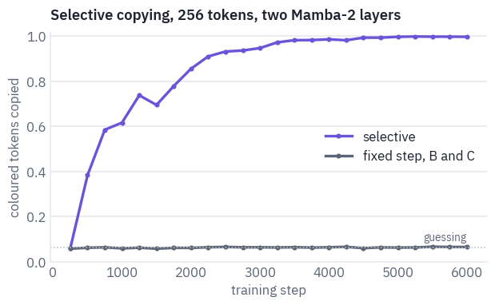

The selective model learns the task within the budget, almost to the last token; the fixed one never leaves the
guessing line. The paper trained a layer of this fixed kind far longer and it reached about half, but not more:
whatever it does, it has to write every token into its state the same way, noise included.

Why does one work and the other not? The selective model's own steps answer it. Here is one sequence, and for each
position the step $$\Delta$$ that the second layer chose, averaged over its four heads: a large step writes the
token into the state and lets the old contents fade, a step near zero lets the token pass as if it weren't there.

```python
model = copiers["selective"]
mixer = model.layers[1].mixer
mixer.keep = True
ids, colours = copying_batch(1, COPY_LENGTH)
with torch.no_grad():
    model(ids.to(device))
mixer.keep = False
chosen = mixer.parts[1][0].mean(-1).cpu().numpy()  # (positions,), the step of every token
kind = ids[0].numpy()

fig, ax = plt.subplots(figsize=(11, 2.8))
for which, color, label in [
    (kind == 0, COLORS["line"], "noise"),
    ((kind > 0) & (kind <= COLOURS), COLORS["dec"], "coloured"),
    (kind == MARKER, COLORS["data"], "marker"),
]:
    where = np.flatnonzero(which)
    ax.bar(where, chosen[where], width=1.0, color=color, label=label)
fixed = copiers["fixed step, B and C"].layers[1].mixer
fixed_step = F.softplus(fixed.dt_bias).mean().item()
ax.axhline(fixed_step, color=COLORS["muted"], linestyle="--", linewidth=1)
note = "the fixed model's step, the same for every token"
ax.text(2, fixed_step * 1.15, note, color=COLORS["muted"], fontsize=9)
ax.set_xlabel("position in the sequence")
ax.set_ylabel("step Δ, layer 2")
ax.set_title("What the selective model writes down: only the coloured tokens")
ax.legend(frameon=False, ncol=3, loc="upper left")
plt.show()
for name, which in [("coloured", (kind > 0) & (kind <= COLOURS)), ("noise", kind == 0)]:
    print(f"mean step on {name} tokens: {chosen[which].mean():.4f}")
```

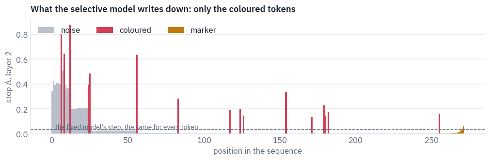

<pre class="tfs-printed" markdown="0"><code>mean step on coloured tokens: 0.3641
mean step on noise tokens: 0.0297</code></pre>

Nobody told the model which tokens matter. It learned to give the coloured tokens large steps and the noise steps close to zero, so that the noise passes through without touching the state.

The exception is the very start, where noise gets large steps too: the state holds nothing yet, writing over it costs nothing, and training never had a reason to push those steps down.

The fixed model has one step for everything and writes the noise in as eagerly as the colours, and sixteen colours drown in hundreds of noise tokens.

A state that only opens for what matters doesn't care how much noise surrounds it. The test below keeps the
sixteen coloured tokens and grows the noise to two, four and eight times the length the models were trained on.

```python
rows = []
for factor in [1, 2, 4, 8]:
    length = COPY_LENGTH * factor
    row = {"noise tokens": length}
    for name, model in copiers.items():
        row[name] = copying_accuracy(model, length, n=128)
    rows.append(row)
table(pd.DataFrame(rows), digits=3)
```

<div class="tfs-table-wrap"><table class="tfs-table" style="border-collapse:collapse;font-family:'IBM Plex Sans', -apple-system, 'Segoe UI', Roboto, Helvetica, Arial, sans-serif;font-size:13.5px;line-height:1.45;margin:4px 0 8px;"><thead><tr><th style="padding:7px 14px;border-bottom:2px solid #B9C0CB;font-weight:600;color:#5B6575;font-size:12px;letter-spacing:0.02em;text-align:right;">noise tokens</th><th style="padding:7px 14px;border-bottom:2px solid #B9C0CB;font-weight:600;color:#5B6575;font-size:12px;letter-spacing:0.02em;text-align:right;">selective</th><th style="padding:7px 14px;border-bottom:2px solid #B9C0CB;font-weight:600;color:#5B6575;font-size:12px;letter-spacing:0.02em;text-align:right;">fixed step, B and C</th></tr></thead><tbody><tr><td style="padding:7px 14px;border-bottom:1px solid #E6E9EE;vertical-align:top;text-align:right;font-variant-numeric:tabular-nums;max-width:460px;white-space:normal;">256</td><td style="padding:7px 14px;border-bottom:1px solid #E6E9EE;vertical-align:top;text-align:right;font-variant-numeric:tabular-nums;max-width:460px;white-space:normal;">0.997</td><td style="padding:7px 14px;border-bottom:1px solid #E6E9EE;vertical-align:top;text-align:right;font-variant-numeric:tabular-nums;max-width:460px;white-space:normal;">0.068</td></tr><tr><td style="padding:7px 14px;border-bottom:1px solid #E6E9EE;vertical-align:top;text-align:right;font-variant-numeric:tabular-nums;max-width:460px;white-space:normal;">512</td><td style="padding:7px 14px;border-bottom:1px solid #E6E9EE;vertical-align:top;text-align:right;font-variant-numeric:tabular-nums;max-width:460px;white-space:normal;">0.999</td><td style="padding:7px 14px;border-bottom:1px solid #E6E9EE;vertical-align:top;text-align:right;font-variant-numeric:tabular-nums;max-width:460px;white-space:normal;">0.060</td></tr><tr><td style="padding:7px 14px;border-bottom:1px solid #E6E9EE;vertical-align:top;text-align:right;font-variant-numeric:tabular-nums;max-width:460px;white-space:normal;">1,024</td><td style="padding:7px 14px;border-bottom:1px solid #E6E9EE;vertical-align:top;text-align:right;font-variant-numeric:tabular-nums;max-width:460px;white-space:normal;">0.992</td><td style="padding:7px 14px;border-bottom:1px solid #E6E9EE;vertical-align:top;text-align:right;font-variant-numeric:tabular-nums;max-width:460px;white-space:normal;">0.061</td></tr><tr><td style="padding:7px 14px;border-bottom:1px solid #E6E9EE;vertical-align:top;text-align:right;font-variant-numeric:tabular-nums;max-width:460px;white-space:normal;">2,048</td><td style="padding:7px 14px;border-bottom:1px solid #E6E9EE;vertical-align:top;text-align:right;font-variant-numeric:tabular-nums;max-width:460px;white-space:normal;">0.841</td><td style="padding:7px 14px;border-bottom:1px solid #E6E9EE;vertical-align:top;text-align:right;font-variant-numeric:tabular-nums;max-width:460px;white-space:normal;">0.068</td></tr></tbody></table></div>

Trained on 256 tokens, the selective model copies almost every colour at four times that length and most of them at eight: the noise it ignores costs it next to nothing. This is selectivity at its best, a few things worth keeping in a long stream.

Section 9 showed its limit: when every word of a long list has to be kept, a state of fixed size runs out, and that is the job the hybrids of section 10 hand to attention.

## 12. Where state space models are today

**Pure Mamba at scale.** Mistral released Codestral Mamba 7B in July 2024 and TII released Falcon Mamba 7B a month
later, the first pure state space models of that size to compete with Transformers on standard benchmarks. Gu and
Dao's group went on to Mamba-3 in 2026, with a state that updates more expressively and decodes faster.

**Hybrids as the default.** Where long context and cheap serving matter, the shipped answer is a mixture: Jamba, Zamba2, Nemotron-H, Granite 4.0 H and Falcon-H1 keep a few attention layers for recall and use Mamba for the rest.

AI21 tried Mamba-2 for Jamba 1.5 and kept Mamba-1, which worked better next to attention; the newest version is not always the best partner.

**Beyond text.** Long sequences with simple alphabets are the natural home: DNA, audio and time series.

Mamba's passport, the model that made state space models a language technology, and the family tree:


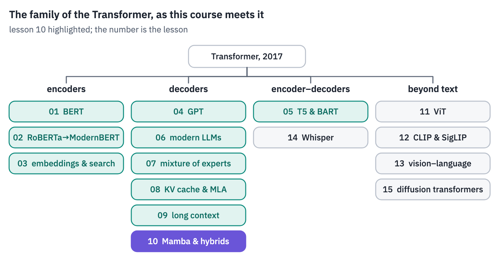
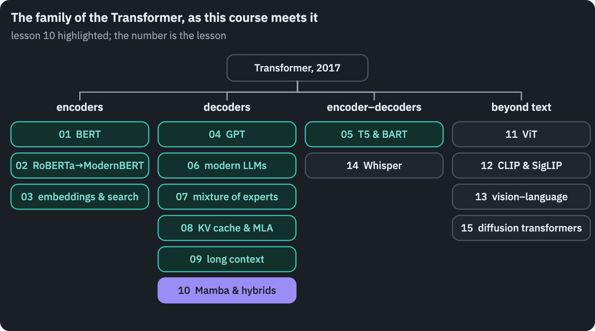

## References

1. {:#ref-1} Kalman, R. E. (1960). [A new approach to linear filtering and prediction problems](https://doi.org/10.1115/1.3662552). *Journal of Basic Engineering*, 82(1), 35–45.
2. {:#ref-2} Gu, A., Goel, K., & Ré, C. (2022). [Efficiently modeling long sequences with structured state spaces](https://arxiv.org/abs/2111.00396). *ICLR 2022*.
3. {:#ref-3} Gu, A., & Dao, T. (2023). [Mamba: linear-time sequence modeling with selective state spaces](https://arxiv.org/abs/2312.00752). arXiv:2312.00752.
4. {:#ref-4} Dao, T., & Gu, A. (2024). [Transformers are SSMs: generalized models and efficient algorithms through structured state space duality](https://arxiv.org/abs/2405.21060). *ICML 2024*.
5. {:#ref-5} Biderman, S., Schoelkopf, H., Anthony, Q., et al. (2023). [Pythia: a suite for analyzing large language models across training and scaling](https://arxiv.org/abs/2304.01373). *ICML 2023*.
6. {:#ref-6} Jelassi, S., Brandfonbrener, D., Kakade, S. M., & Malach, E. (2024). [Repeat after me: Transformers are better than state space models at copying](https://arxiv.org/abs/2402.01032). arXiv:2402.01032.
7. {:#ref-7} Arora, S., Eyuboglu, S., Timalsina, A., et al. (2023). [Zoology: measuring and improving recall in efficient language models](https://arxiv.org/abs/2312.04927). arXiv:2312.04927.
8. {:#ref-8} Lieber, O., Lenz, B., Bata, H., et al. (2024). [Jamba: a hybrid Transformer–Mamba language model](https://arxiv.org/abs/2403.19887). arXiv:2403.19887.
9. {:#ref-9} Hillis, W. D., & Steele, G. L. (1986). [Data parallel algorithms](https://doi.org/10.1145/7902.7903). *Communications of the ACM*, 29(12), 1170–1183.
{: .tfs-refs}



