

<p class="tfs-links"><strong>Transformer architectures: from BERT to diffusion</strong> · lesson 11 of 15 · <a href="/teaching/">all lessons</a> · <a href="https://www.kaggle.com/code/qmarva/transformer-architectures-11-vision-transformer">run on Kaggle</a> · <a href="https://colab.research.google.com/github/xmarva/transformers-from-scratch/blob/main/notebooks/colab/a11_vit.ipynb">open in Colab</a> · <a href="https://github.com/xmarva/transformers-from-scratch">code on GitHub</a></p>

For eight years, from AlexNet in 2012 to 2020, every serious image classifier was a convolutional network. A
convolution has two beliefs about images built into it: that nearby pixels belong together, and that a pattern means
the same thing wherever it appears. Those beliefs are true, and they are why a CNN learns from a few thousand
photos.

In October 2020 a team at Google Brain dropped both. They took the Transformer encoder of lesson 1, BERT's encoder almost unchanged, cut an image into a grid of 16×16-pixel squares, and fed the squares to it as if they were words.

The paper's title was the whole idea: *An image is worth 16x16 words*. It worked, with a condition: the model needed to see far more images than a CNN, 303 million of them in Google's internal JFT-300M collection, before it caught up and then overtook.

Today that same encoder, the *Vision Transformer* or ViT, is the eye of every model that reads images, from DINOv2 to the vision-language models of lesson 13.

One thing to settle before we start, because the phrase "images as words" invites it: the ViT doesn't turn an image into *text*. It turns an image into a *sequence of vectors*, the same kind of object an embedding layer makes from text, and the Transformer reads that sequence with exactly the machinery it uses for words.

A vision-language model (lesson 13) goes one step further and places these vectors next to the vectors of text tokens in a language model's input. Generating images from text is the opposite direction and has its own architecture, lesson 15's diffusion Transformer.

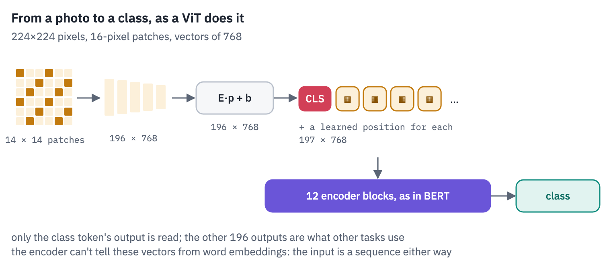
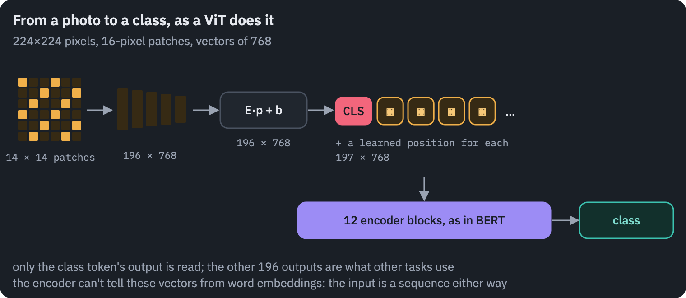

**What you'll do**

1. Walk one photo from pixels to the sequence of 197 vectors the encoder reads, one step at a time, with every
   tensor's shape printed and every step drawn.
2. Write the ViT in PyTorch, load Google's ViT-B/16 into it and match Hugging Face.
3. Open the trained model: what its first layer looks for in a patch, what its positions learned, how far its heads
   look at each depth, which parts of a photo decide the answer.
4. Run it at a higher resolution by stretching its position embeddings, lesson 9's trick in two dimensions.
5. Watch DINO, a ViT trained without a single label, find the objects in photos with its attention.
6. On satellite images of Europe, race a pretrained ViT, a ViT and a CNN trained from scratch, and a probe on
   DINOv2's features, from a hundred labelled images to sixteen thousand.

**What you need**: a GPU for the last section. On Kaggle, *Settings → Accelerator → GPU*; on Colab, *Runtime →
Change runtime type → T4 GPU*. The notebook downloads ViT-B/16 (346 MB) twice, in two versions, two small
self-supervised ViTs (90 MB each), five public-domain photos and the EuroSAT dataset (90 MB).

## Setup

One small helper package, `tfs`, draws the course's plots and token chips and knows where the notebook runs
(Kaggle, Colab or your own machine). Everything the lesson teaches is written out in the notebook itself.

```python
import importlib.util
import subprocess
import sys

TFS = "git+https://github.com/xmarva/transformers-from-scratch@main"
if importlib.util.find_spec("tfs") is None:
    subprocess.check_call([sys.executable, "-m", "pip", "install", "-q", TFS])

from tfs import env
from tfs.viz import table, token_chips, use_course_style

env.quiet()  # no progress bars or environment warnings in the outputs
SEED = 42
env.seed_everything(SEED)
COLORS = use_course_style()
WORK_DIR = env.work_dir()
```

```python
import io
import json
import math
import random
import time
import urllib.request

import matplotlib.pyplot as plt
from matplotlib.colors import LinearSegmentedColormap, to_rgb
import numpy as np
import pandas as pd
import torch
import torch.nn as nn
import torch.nn.functional as F
from huggingface_hub import hf_hub_download
from PIL import Image
from safetensors.torch import load_file

SMOKE = env.smoke()  # CI runs the lesson on a small slice; you run it in full
device = "cuda" if torch.cuda.is_available() else "cpu"
if device == "cuda":
    print("GPU:", torch.cuda.get_device_name(0))
```

<pre class="tfs-printed" markdown="0"><code>GPU: Tesla T4</code></pre>

## 1. Five photographs

Five photographs from the collections of the US National Park Service, NASA, the US Geological Survey, NOAA and the US Fish and Wildlife Service: works of the US federal government, in the public domain.

A brown bear catching a salmon at Brooks Falls in Alaska, the space shuttle Discovery lifting off, a fountain of lava on Kīlauea, an orca breaching off the coast of Washington, a rufous hummingbird in Wyoming.

```python
PHOTOS = ["bear", "shuttle", "lava", "orca", "hummingbird"]
# 960-pixel copies of the Wikimedia Commons files listed in the References, kept in
# the course's repository because Commons limits how often one address may download
BASE = (
    "https://raw.githubusercontent.com/"
    "xmarva/transformers-from-scratch/main/assets/photos/a11"
)


def fetch_photo(name):
    data = urllib.request.urlopen(f"{BASE}/{name}.jpg").read()
    return Image.open(io.BytesIO(data)).convert("RGB")


photos = {}
for name in PHOTOS:
    photos[name] = fetch_photo(name)

fig, axes = plt.subplots(1, len(photos), figsize=(12, 2.8))
for ax, (key, photo) in zip(axes, photos.items()):
    ax.imshow(photo)
    ax.set_title(f"{key}, {photo.width}×{photo.height}", fontsize=10)
    ax.axis("off")
plt.show()
```

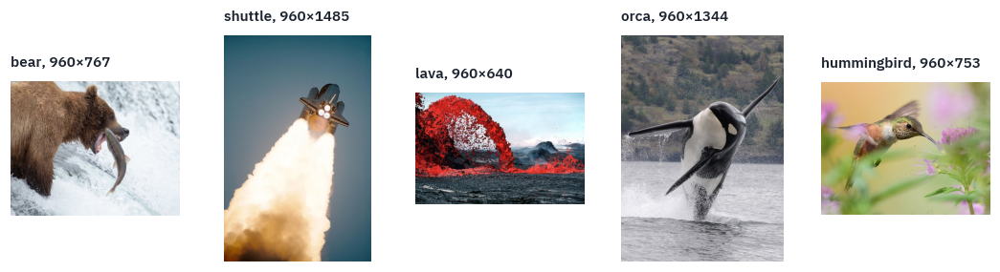

## 2. From pixels to a sequence, step by step

This is the section the rest of the lesson stands on. We take the bear and follow it to the exact tensor the
encoder reads, printing the shape at every step. The numbers come from the model we load in section 3, Google's
ViT-B/16: patches of 16 pixels, vectors of 768 numbers.

**Step 1: a fixed size and a fixed scale.** The model was trained on 224×224 images, so every photo is resized to that, aspect ratio or not.

Each pixel's three channels, red, green and blue, arrive as integers from 0 to 255; they are divided by 255 and then *normalised*, shifted and scaled so that each channel sits roughly between −1 and 1. This checkpoint uses a mean of 0.5 and a standard deviation of 0.5 for every channel:

$$x_{c,i,j} = \frac{\text{pixel}_{c,i,j} / 255 - 0.5}{0.5}.$$

```python
SIZE, PATCH, MEAN, STD = 224, 16, 0.5, 0.5


def to_tensor(photo, size=SIZE, mean=MEAN, std=STD):
    small = photo.resize((size, size), Image.BILINEAR)
    pixels = torch.tensor(np.asarray(small), dtype=torch.float32)  # (height, width, 3)
    pixels = (
        pixels.permute(2, 0, 1) / 255
    )  # channels first: (3, height, width), from 0 to 1
    mean = torch.tensor(mean).reshape(-1, 1, 1)
    std = torch.tensor(std).reshape(-1, 1, 1)
    return (pixels - mean) / std


x = to_tensor(photos["bear"])
print("one photo as a tensor:", tuple(x.shape))
print(f"values from {x.min():.2f} to {x.max():.2f}")

fig, axes = plt.subplots(1, 3, figsize=(11, 3.2), gridspec_kw={"width_ratios": [1, 1, 1.4]})
axes[0].imshow(photos["bear"])
axes[0].set_title(f"original, {photos['bear'].width}×{photos['bear'].height}", fontsize=10)
axes[1].imshow((x.permute(1, 2, 0) * STD + MEAN).clamp(0, 1))
axes[1].set_title("resized to 224×224", fontsize=10)
for channel, color in zip(range(3), [COLORS["dec"], COLORS["enc"], COLORS["att"]]):
    axes[2].hist(
        x[channel].flatten(), bins=60, color=color, alpha=0.6, label="RGB"[channel]
    )
axes[2].set_title("the 3 × 224 × 224 numbers after normalising", fontsize=10)
axes[2].legend(frameon=False)
axes[0].axis("off")
axes[1].axis("off")
plt.show()
```

<pre class="tfs-printed" markdown="0"><code>one photo as a tensor: (3, 224, 224)
values from -0.96 to 1.00</code></pre>

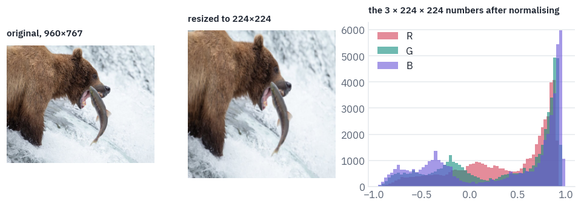

The bear became a little wider, because the photo wasn't square; the model was trained on such squashed squares
and doesn't mind. The histogram shows what the model actually receives: 150,528 numbers, mostly in the bright end,
because the photo is mostly white water.

**Step 2: cut into patches.** A 224×224 image holds 14 × 14 = 196 squares of 16×16 pixels. Cutting is pure
reindexing, no arithmetic: split the height into 14 rows of 16 and the width into 14 columns of 16, move the row and
column indices to the front, and flatten each square.

```python
def patchify(x, p=PATCH):
    channels, height, width = x.shape
    x = x.reshape(channels, height // p, p, width // p, p)  # (3, 14, 16, 14, 16)
    x = x.permute(
        1, 3, 0, 2, 4
    )  # (14, 14, 3, 16, 16): grid row, grid column, then the patch
    return x.reshape((height // p) * (width // p), channels * p * p)  # (196, 768)


patches = patchify(x)
print("patches:", tuple(patches.shape))
print("numbers in one patch: 3 × 16 × 16 =", 3 * PATCH * PATCH)
```

<pre class="tfs-printed" markdown="0"><code>patches: (196, 768)
numbers in one patch: 3 × 16 × 16 = 768</code></pre>

The order of the squares is the order of reading a page: left to right along the top row, then the next row. Here
is the grid on the photo, and the first two rows of squares laid out as the sequence the model will see:

```python
grid = SIZE // PATCH
shown = (x.permute(1, 2, 0) * STD + MEAN).clamp(0, 1)
fig = plt.figure(figsize=(12, 4.2))
ax = fig.add_axes([0.0, 0.0, 0.32, 1.0])
ax.imshow(shown)
for k in range(1, grid):
    ax.axhline(k * PATCH - 0.5, color="white", linewidth=0.6)
    ax.axvline(k * PATCH - 0.5, color="white", linewidth=0.6)
red = COLORS["dec"]
first_rows = plt.Rectangle((-0.5, -0.5), SIZE, 2 * PATCH, fill=False, color=red, lw=2)
ax.add_patch(first_rows)
ax.set_title("a 14 × 14 grid of 16-pixel squares; the first two rows in red", fontsize=10)
ax.axis("off")
for k in range(2 * grid):
    row, col = divmod(k, grid)
    tile = shown[row * PATCH : (row + 1) * PATCH, col * PATCH : (col + 1) * PATCH]
    tile_ax = fig.add_axes(
        [0.35 + (k % grid) * 0.046, 0.62 - (k // grid) * 0.3, 0.042, 0.25]
    )
    tile_ax.imshow(tile)
    tile_ax.set_xticks([])
    tile_ax.set_yticks([])
    tile_ax.set_title(str(k), fontsize=7)
caption = "patches 0 to 27 of 196, in reading order; the sequence goes on row by row"
fig.text(0.35, 0.05, caption, fontsize=10, color=COLORS["muted"])
plt.show()
```

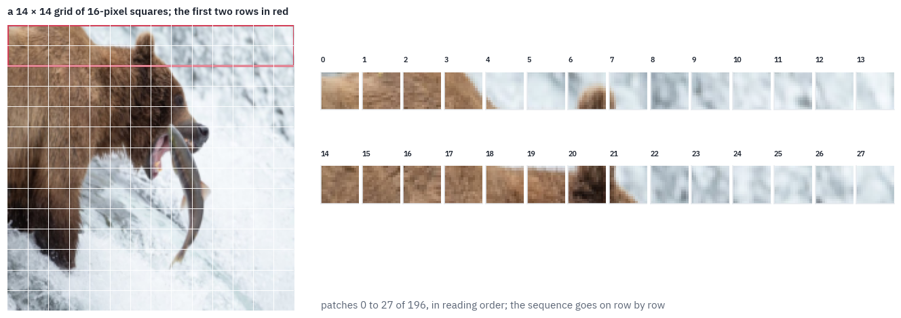

PyTorch has the same cut built in as `unfold`, which slides a window over an image and stacks what it sees. With
a stride equal to the window, the windows don't overlap and it returns our patches, in our order:

```python
unfolded = F.unfold(x[None], kernel_size=PATCH, stride=PATCH)[0].T  # (196, 768)
print("unfold against reshape, max difference:", (unfolded - patches).abs().max().item())
```

<pre class="tfs-printed" markdown="0"><code>unfold against reshape, max difference: 0.0</code></pre>

**Step 3: one patch is 768 numbers.** A patch is a small picture, 16×16 pixels in three channels, and the model sees it as one long vector: the 256 red values, then the 256 green, then the 256 blue.

Here is patch 50, the one with the bear's eye, and its vector drawn as a strip, every number one thin bar.

```python
k = 50  # row 3, column 8: the bear's eye
row, col = divmod(k, grid)
tile = shown[row * PATCH : (row + 1) * PATCH, col * PATCH : (col + 1) * PATCH]
fig = plt.figure(figsize=(12, 2.6))
ax = fig.add_axes([0.0, 0.05, 0.16, 0.85])
ax.imshow(tile, interpolation="nearest")
ax.set_title(f"patch {k}: row {row}, column {col}", fontsize=10)
ax.axis("off")
ax = fig.add_axes([0.2, 0.25, 0.79, 0.5])
greys = LinearSegmentedColormap.from_list("greys", [COLORS["ink"], COLORS["card"]])
ax.imshow(patches[k][None], aspect="auto", cmap=greys, interpolation="nearest")
for edge in [256, 512]:
    ax.axvline(edge - 0.5, color=COLORS["dec"], linewidth=1.5)
ax.set_yticks([])
ax.set_xticks([128, 384, 640], ["256 red values", "256 green values", "256 blue values"])
ax.set_title("the same patch as the 768-number vector the model reads", fontsize=10)
plt.show()
```

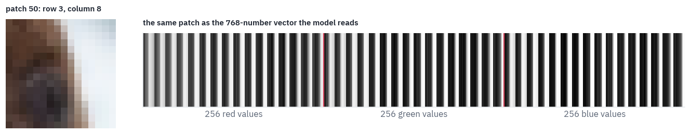

**Step 4: the patch embedding.** Text enters a Transformer through an embedding table: token number 1,723 picks row 1,723 of a matrix.

A patch has no number; it *is* a vector of 768 pixels. So the ViT multiplies it by a learned matrix $$E$$ and adds a bias:

$$z_i = E\,p_i + b, \qquad E \in \mathbb{R}^{D \times 768}.$$

The two are closer than they look. Looking up row $$t$$ of a table is multiplying the table by a one-hot vector, a
vector of zeros with a single 1 in place $$t$$; the ViT multiplies the same kind of matrix by a vector of pixels
instead of a one-hot one.


In the released code the matrix is stored as a convolution with 768 filters of size 16×16 and a stride of 16:
sliding a 16×16 filter in steps of 16 is the same as multiplying each patch by the filter, flattened. We check it
with the real weights.

```python
from transformers import ViTConfig, ViTForImageClassification

REPO = "google/vit-base-patch16-224"
if SMOKE:  # a small model with random weights stands in for Google's
    small = ViTConfig(hidden_size=64, num_hidden_layers=2, num_attention_heads=4)
    small.intermediate_size, small.num_labels = 128, 1000
    torch.manual_seed(0)
    reference = ViTForImageClassification(small).eval()
    vit_config = small.to_dict()
    reference.save_pretrained(WORK_DIR / "vit-small")  # saved under the checkpoints' names
    hf_weights = load_file(str(WORK_DIR / "vit-small" / "model.safetensors"))
else:
    reference = ViTForImageClassification.from_pretrained(REPO).eval()
    vit_config = json.load(open(hf_hub_download(REPO, "config.json")))
    hf_weights = load_file(hf_hub_download(REPO, "model.safetensors"))
conv_weight = hf_weights[
    "vit.embeddings.patch_embeddings.projection.weight"
]  # (768, 3, 16, 16)
conv_bias = hf_weights["vit.embeddings.patch_embeddings.projection.bias"]
print("the convolution's weight:", tuple(conv_weight.shape))

E = conv_weight.reshape(
    conv_weight.shape[0], -1
)  # (768, 768): one flattened filter per row
as_matrix = patches @ E.T + conv_bias  # (196, 768)
as_conv = F.conv2d(x[None], conv_weight, conv_bias, stride=PATCH)  # (1, 768, 14, 14)
as_conv = as_conv.flatten(2)[0].T  # (196, 768)
print("patch vectors:", tuple(as_matrix.shape))
print(
    "matrix against convolution, max difference:",
    f"{(as_matrix - as_conv).abs().max():.1e}",
)
```

<pre class="tfs-printed" markdown="0"><code>the convolution&#x27;s weight: (768, 3, 16, 16)
patch vectors: (196, 768)
matrix against convolution, max difference: 9.5e-06</code></pre>

The convolution is only a fast way to write the matrix product: the ViT has no convolutional layers in the sense
of a CNN, because the filters never overlap and never slide past what they've already seen.

**Step 5: the class token and the positions.** Two learned additions turn the 196 vectors into the sequence the encoder reads.

In front goes a *class token*, one vector the model learned, the same for every image: it carries no pixels and gathers the whole image through attention, layer by layer, like BERT's [CLS] in lesson 1.

Its output is what the classifier reads. Then, to every one of the 197 vectors, a learned *position embedding* is added, one per place in the grid, because attention by itself has no idea of order.

```python
cls_token = hf_weights["vit.embeddings.cls_token"]  # (1, 1, 768)
positions = hf_weights["vit.embeddings.position_embeddings"]  # (1, 197, 768)
sequence = torch.cat([cls_token[0], as_matrix], dim=0)  # (197, 768)
sequence = sequence + positions[0]
print("class token:", tuple(cls_token.shape), " positions:", tuple(positions.shape))
print("the sequence the encoder reads:", tuple(sequence.shape))

# negative numbers in teal, positive in rose, zero white
ends = [COLORS["enc"], COLORS["card"], COLORS["dec"]]
signed = LinearSegmentedColormap.from_list("signed", ends)
fig, ax = plt.subplots(figsize=(11, 2.6))
ax.imshow(
    sequence.T[:96], aspect="auto", cmap=signed, vmin=-3, vmax=3, interpolation="nearest"
)
ax.set_xlabel("position in the sequence: 0 is the class token, 1 to 196 the patches")
ax.set_ylabel("first 96 of 768")
ax.set_title("The bear, as the encoder sees it: 197 columns of 768 numbers", fontsize=10)
plt.show()
```

<pre class="tfs-printed" markdown="0"><code>class token: (1, 1, 768)  positions: (1, 197, 768)
the sequence the encoder reads: (197, 768)</code></pre>

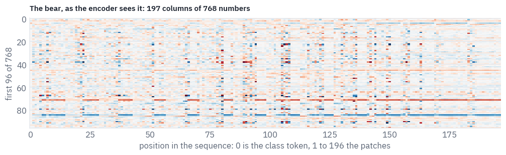

That is the whole conversion. From here on, a ViT is a Transformer encoder, the one from lesson 1: twelve blocks of
attention and an MLP, then a final layer norm, and a linear layer on the class token's output vector.

Are the positions really needed? Attention compares every vector with every other one and sums the results, so without positions the encoder can't tell a patch in the corner from the same patch in the centre.

A test makes it concrete: shuffle the 196 patches, as if the photo were cut up and the pieces thrown in a bag. We do it twice, with the positions the model learned and with the positions removed. The `encode` function used here is the encoder of the next section.

## 3. The ViT in PyTorch

The encoder block puts the layer norm *before* attention and before the MLP, as GPT-2 and every model since do, not
after them as BERT did; the MLP widens to 3,072 with a GELU, as in BERT. The attention keeps its weights on demand,
for the pictures of section 4.

```python
class Attention(nn.Module):
    def __init__(self, d, heads):
        super().__init__()
        self.heads, self.head_dim = heads, d // heads
        self.query = nn.Linear(d, d)
        self.key = nn.Linear(d, d)
        self.value = nn.Linear(d, d)
        self.out = nn.Linear(d, d)
        self.keep = False
        self.weights = None

    def forward(self, x):
        b, n, d = x.shape
        q = self.query(x).view(b, n, self.heads, self.head_dim).transpose(1, 2)
        k = self.key(x).view(b, n, self.heads, self.head_dim).transpose(1, 2)
        v = self.value(x).view(b, n, self.heads, self.head_dim).transpose(1, 2)
        if self.keep:  # the slow way, to see the weights
            weights = (q @ k.transpose(-1, -2) / math.sqrt(self.head_dim)).softmax(-1)
            self.weights = weights.detach()
            out = weights @ v
        else:
            out = F.scaled_dot_product_attention(q, k, v)
        return self.out(out.transpose(1, 2).reshape(b, n, d))


class Block(nn.Module):
    def __init__(self, d, heads, hidden, eps):
        super().__init__()
        self.norm1 = nn.LayerNorm(d, eps=eps)
        self.attn = Attention(d, heads)
        self.norm2 = nn.LayerNorm(d, eps=eps)
        self.fc1 = nn.Linear(d, hidden)
        self.fc2 = nn.Linear(hidden, d)

    def forward(self, x):
        x = x + self.attn(self.norm1(x))
        return x + self.fc2(F.gelu(self.fc1(self.norm2(x))))
```

The model is the five steps of section 2 followed by the blocks. `tokens` builds the sequence; `encode` runs the
blocks on any sequence, which is what the shuffling test needs.

```python
class ViT(nn.Module):
    def __init__(self, c, classes, image_size=None):
        super().__init__()
        d, p = c["hidden_size"], c["patch_size"]
        grid = (image_size or c["image_size"]) // p
        eps = c.get("layer_norm_eps", 1e-6)
        self.patch_embed = nn.Conv2d(3, d, kernel_size=p, stride=p)
        self.cls = nn.Parameter(torch.zeros(1, 1, d))
        self.pos = nn.Parameter(torch.zeros(1, grid * grid + 1, d))
        heads, hidden = c["num_attention_heads"], c["intermediate_size"]
        self.blocks = nn.ModuleList(
            [Block(d, heads, hidden, eps) for _ in range(c["num_hidden_layers"])]
        )
        self.norm = nn.LayerNorm(d, eps=eps)
        self.head = nn.Linear(d, classes)

    def tokens(self, pixels):
        x = self.patch_embed(pixels).flatten(2).transpose(1, 2)  # (batch, 196, d)
        x = torch.cat([self.cls.expand(x.shape[0], -1, -1), x], dim=1)  # (batch, 197, d)
        return x + self.pos

    def encode(self, x):
        for block in self.blocks:
            x = block(x)
        return self.norm(x)

    def forward(self, pixels):
        return self.head(self.encode(self.tokens(pixels))[:, 0])
```

Google's names differ from ours; one function renames them. The same function serves every ViT checkpoint in this
lesson.

```python
def rename(state):
    short = {
        "embeddings.patch_embeddings.projection": "patch_embed",
        "embeddings.cls_token": "cls",
        "embeddings.position_embeddings": "pos",
        "layernorm": "norm",
        "classifier": "head",
    }
    inside = {
        "attention.attention.": "attn.",
        "attention.output.dense": "attn.out",
        "layernorm_before": "norm1",
        "layernorm_after": "norm2",
        "intermediate.dense": "fc1",
        "output.dense": "fc2",
    }
    out = {}
    for key, value in state.items():
        key = key.removeprefix("vit.")
        if key.startswith("pooler."):
            continue  # a layer this checkpoint's classifier never used
        if key.startswith("encoder.layer."):
            number, rest = key.removeprefix("encoder.layer.").split(".", 1)
            for theirs, ours in inside.items():
                rest = rest.replace(theirs, ours)
            out[f"blocks.{number}.{rest}"] = value
            continue
        for theirs, ours in short.items():
            if key.startswith(theirs):
                key = ours + key[len(theirs) :]
        out[key] = value
    return out
```

The check against Hugging Face, whose model was loaded in section 2, on all five photos at once.

```python
labels = {int(k): v.split(",")[0] for k, v in vit_config["id2label"].items()}
vit = ViT(vit_config, len(labels))
vit.load_state_dict(rename(hf_weights), strict=True)
vit.eval()

batch = torch.stack([to_tensor(photo) for photo in photos.values()])
with torch.no_grad():
    ours = vit(batch)
    theirs = reference(pixel_values=batch).logits
print("batch:", tuple(batch.shape), " logits:", tuple(ours.shape))
print("max difference from Hugging Face:", f"{(ours - theirs).abs().max().item():.1e}")
```

<pre class="tfs-printed" markdown="0"><code>batch: (5, 3, 224, 224)  logits: (5, 1000)
max difference from Hugging Face: 0.0e+00</code></pre>

Exact to the last bit: same operations, same order. Now the shuffling test from section 2, on the five photos.

```python
torch.manual_seed(SEED)
order = torch.randperm(grid * grid)


def predict(with_positions, shuffled):
    x = vit.patch_embed(batch).flatten(2).transpose(1, 2)
    if shuffled:
        x = x[:, order]
    x = torch.cat([vit.cls.expand(len(batch), -1, -1), x], dim=1)
    if with_positions:
        x = x + vit.pos
    with torch.no_grad():
        probs = vit.head(vit.encode(x)[:, 0]).softmax(-1)
    return probs


rows = []
for with_positions in [True, False]:
    for shuffled in [False, True]:
        probs = predict(with_positions, shuffled)
        row = {"positions": "learned" if with_positions else "removed"}
        row["patches"] = "shuffled" if shuffled else "in order"
        for name, p in zip(photos, probs):
            row[name] = f"{labels[p.argmax().item()]} {p.max().item():.0%}"
        rows.append(row)
table(pd.DataFrame(rows))
```

<div class="tfs-table-wrap"><table class="tfs-table" style="border-collapse:collapse;font-family:'IBM Plex Sans', -apple-system, 'Segoe UI', Roboto, Helvetica, Arial, sans-serif;font-size:13.5px;line-height:1.45;margin:4px 0 8px;"><thead><tr><th style="padding:7px 14px;border-bottom:2px solid #B9C0CB;font-weight:600;color:#5B6575;font-size:12px;letter-spacing:0.02em;text-align:left;">positions</th><th style="padding:7px 14px;border-bottom:2px solid #B9C0CB;font-weight:600;color:#5B6575;font-size:12px;letter-spacing:0.02em;text-align:left;">patches</th><th style="padding:7px 14px;border-bottom:2px solid #B9C0CB;font-weight:600;color:#5B6575;font-size:12px;letter-spacing:0.02em;text-align:left;">bear</th><th style="padding:7px 14px;border-bottom:2px solid #B9C0CB;font-weight:600;color:#5B6575;font-size:12px;letter-spacing:0.02em;text-align:left;">shuttle</th><th style="padding:7px 14px;border-bottom:2px solid #B9C0CB;font-weight:600;color:#5B6575;font-size:12px;letter-spacing:0.02em;text-align:left;">lava</th><th style="padding:7px 14px;border-bottom:2px solid #B9C0CB;font-weight:600;color:#5B6575;font-size:12px;letter-spacing:0.02em;text-align:left;">orca</th><th style="padding:7px 14px;border-bottom:2px solid #B9C0CB;font-weight:600;color:#5B6575;font-size:12px;letter-spacing:0.02em;text-align:left;">hummingbird</th></tr></thead><tbody><tr><td style="padding:7px 14px;border-bottom:1px solid #E6E9EE;vertical-align:top;text-align:left;max-width:460px;white-space:normal;">learned</td><td style="padding:7px 14px;border-bottom:1px solid #E6E9EE;vertical-align:top;text-align:left;max-width:460px;white-space:normal;">in order</td><td style="padding:7px 14px;border-bottom:1px solid #E6E9EE;vertical-align:top;text-align:left;max-width:460px;white-space:normal;">brown bear 100%</td><td style="padding:7px 14px;border-bottom:1px solid #E6E9EE;vertical-align:top;text-align:left;max-width:460px;white-space:normal;">space shuttle 100%</td><td style="padding:7px 14px;border-bottom:1px solid #E6E9EE;vertical-align:top;text-align:left;max-width:460px;white-space:normal;">volcano 100%</td><td style="padding:7px 14px;border-bottom:1px solid #E6E9EE;vertical-align:top;text-align:left;max-width:460px;white-space:normal;">killer whale 100%</td><td style="padding:7px 14px;border-bottom:1px solid #E6E9EE;vertical-align:top;text-align:left;max-width:460px;white-space:normal;">hummingbird 100%</td></tr><tr><td style="padding:7px 14px;border-bottom:1px solid #E6E9EE;vertical-align:top;text-align:left;max-width:460px;white-space:normal;">learned</td><td style="padding:7px 14px;border-bottom:1px solid #E6E9EE;vertical-align:top;text-align:left;max-width:460px;white-space:normal;">shuffled</td><td style="padding:7px 14px;border-bottom:1px solid #E6E9EE;vertical-align:top;text-align:left;max-width:460px;white-space:normal;">brown bear 83%</td><td style="padding:7px 14px;border-bottom:1px solid #E6E9EE;vertical-align:top;text-align:left;max-width:460px;white-space:normal;">projectile 58%</td><td style="padding:7px 14px;border-bottom:1px solid #E6E9EE;vertical-align:top;text-align:left;max-width:460px;white-space:normal;">volcano 100%</td><td style="padding:7px 14px;border-bottom:1px solid #E6E9EE;vertical-align:top;text-align:left;max-width:460px;white-space:normal;">kite 26%</td><td style="padding:7px 14px;border-bottom:1px solid #E6E9EE;vertical-align:top;text-align:left;max-width:460px;white-space:normal;">hummingbird 28%</td></tr><tr><td style="padding:7px 14px;border-bottom:1px solid #E6E9EE;vertical-align:top;text-align:left;max-width:460px;white-space:normal;">removed</td><td style="padding:7px 14px;border-bottom:1px solid #E6E9EE;vertical-align:top;text-align:left;max-width:460px;white-space:normal;">in order</td><td style="padding:7px 14px;border-bottom:1px solid #E6E9EE;vertical-align:top;text-align:left;max-width:460px;white-space:normal;">golden retriever 50%</td><td style="padding:7px 14px;border-bottom:1px solid #E6E9EE;vertical-align:top;text-align:left;max-width:460px;white-space:normal;">honeycomb 65%</td><td style="padding:7px 14px;border-bottom:1px solid #E6E9EE;vertical-align:top;text-align:left;max-width:460px;white-space:normal;">volcano 43%</td><td style="padding:7px 14px;border-bottom:1px solid #E6E9EE;vertical-align:top;text-align:left;max-width:460px;white-space:normal;">black stork 14%</td><td style="padding:7px 14px;border-bottom:1px solid #E6E9EE;vertical-align:top;text-align:left;max-width:460px;white-space:normal;">bulbul 18%</td></tr><tr><td style="padding:7px 14px;border-bottom:1px solid #E6E9EE;vertical-align:top;text-align:left;max-width:460px;white-space:normal;">removed</td><td style="padding:7px 14px;border-bottom:1px solid #E6E9EE;vertical-align:top;text-align:left;max-width:460px;white-space:normal;">shuffled</td><td style="padding:7px 14px;border-bottom:1px solid #E6E9EE;vertical-align:top;text-align:left;max-width:460px;white-space:normal;">golden retriever 50%</td><td style="padding:7px 14px;border-bottom:1px solid #E6E9EE;vertical-align:top;text-align:left;max-width:460px;white-space:normal;">honeycomb 65%</td><td style="padding:7px 14px;border-bottom:1px solid #E6E9EE;vertical-align:top;text-align:left;max-width:460px;white-space:normal;">volcano 43%</td><td style="padding:7px 14px;border-bottom:1px solid #E6E9EE;vertical-align:top;text-align:left;max-width:460px;white-space:normal;">black stork 14%</td><td style="padding:7px 14px;border-bottom:1px solid #E6E9EE;vertical-align:top;text-align:left;max-width:460px;white-space:normal;">bulbul 18%</td></tr></tbody></table></div>

Two things to read. Without positions, shuffled and ordered patches give *identical* answers, to the last digit: with nothing to say where a patch sits, the encoder treats the image as a bag of squares, and a bag has no order. That model also gets most photos wrong, because it was trained to rely on positions it no longer has.

With positions, shuffling hurts some photos and not others: the bear's fur and the lava's red are recognisable in any order, while a shuttle cut into pieces looks like any projectile, and a shuffled orca becomes a kite, the bird of prey.

ViTs are surprisingly robust to such shuffling, a finding Naseer and colleagues reported in 2021, and the reason is in the table: much of what identifies an object lives inside the patches themselves.

The model's own answers on the five photos, top five each:

```python
probs = ours.softmax(-1)
fig, axes = plt.subplots(
    2, len(photos), figsize=(13, 4.8), gridspec_kw={"height_ratios": [1.2, 1]}
)
for k, photo in enumerate(photos.values()):
    axes[0, k].imshow(photo.resize((SIZE, SIZE)))
    axes[0, k].axis("off")
    top = probs[k].topk(5)
    names = [labels[i.item()][:18] for i in top.indices][::-1]
    axes[1, k].barh(names, top.values.flip(0).numpy(), color=COLORS["att"])
    axes[1, k].set_xlim(0, 1)
    axes[1, k].tick_params(labelsize=8)
plt.tight_layout()
plt.show()
```

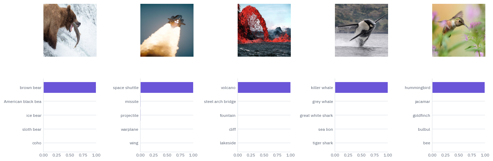

## 4. What the model learned

**The first layer.** The patch embedding's 768 filters are 768 small pictures, each a pattern the model compares a patch against.

Their principal components, the directions along which the filters vary most, show what kind of patterns those are. The ViT paper drew the same picture for its large model.

```python
filters = vit.patch_embed.weight.detach().reshape(vit.patch_embed.weight.shape[0], -1)
centered = filters - filters.mean(dim=0)
_, _, directions = torch.linalg.svd(centered, full_matrices=False)
n_show = min(28, directions.shape[0])
fig, axes = plt.subplots(4, 7, figsize=(8.4, 4.8))
for k, ax in enumerate(axes.flat):
    ax.axis("off")
    if k >= n_show:
        continue
    picture = directions[k].reshape(3, PATCH, PATCH).permute(1, 2, 0)
    picture = (picture - picture.min()) / (picture.max() - picture.min())
    ax.imshow(picture, interpolation="nearest")
fig.suptitle("The 28 main directions of ViT-B/16's patch filters", fontsize=11)
plt.show()
```

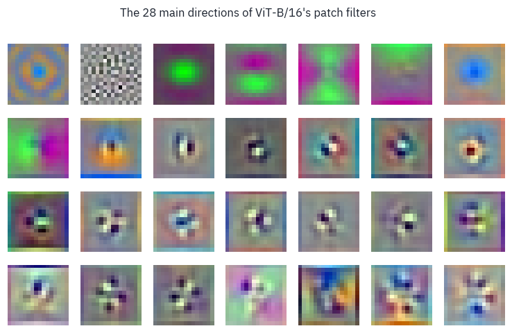

Blobs of colour, colour-opponent pairs, then edges and spots at every orientation, then finer and finer textures:
much the same basis as the first layer of a CNN, which also learns edge and colour detectors. Nobody built them in;
they are what is useful for describing a 16×16 square of a natural image.

**The positions.** Each of the 196 position embeddings is a vector of 768 numbers that the model learned with no
hint that the patches form a grid. Compare each position with every other one by cosine similarity, and draw the
result for each place in the grid as a small map:

```python
pos = vit.pos[0, 1:].detach()
similarity = F.cosine_similarity(pos[:, None], pos[None], dim=-1)
similarity = similarity.reshape(grid, grid, grid, grid)
step = 2  # every second row and column, so that the maps stay readable
picked = list(range(0, grid, step))
fig, axes = plt.subplots(len(picked), len(picked), figsize=(7.6, 7.6))
for a, i in enumerate(picked):
    for b, j in enumerate(picked):
        axes[a, b].imshow(
            similarity[i, j], cmap=signed, vmin=-1, vmax=1, interpolation="nearest"
        )
        axes[a, b].set_xticks([])
        axes[a, b].set_yticks([])
fig.suptitle(
    "Each map: one grid position against all 196, by cosine similarity", fontsize=11
)
plt.show()
```

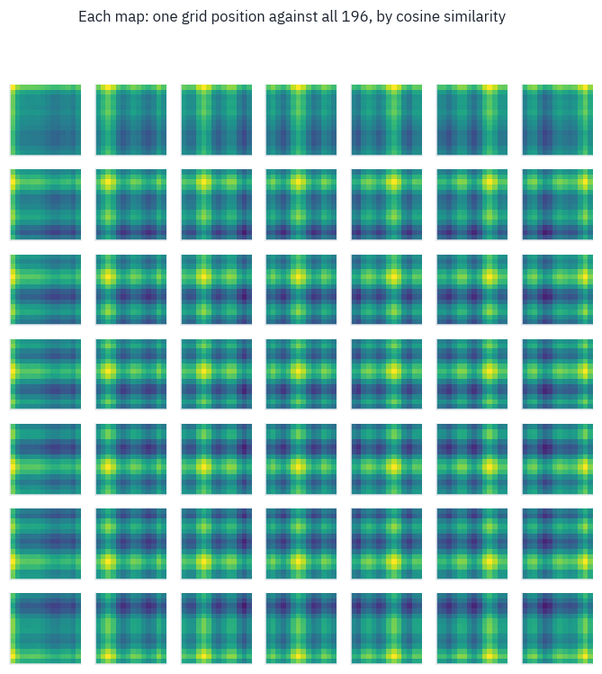

Every map is strongest exactly where its position is, with a halo around it and bands of rose along its own row and column.

The model rediscovered the two-dimensional grid from a one-dimensional list of 196 slots, simply because knowing which patches are neighbours, and which share a row or a column, helps it classify. The ViT paper tried position embeddings designed for two dimensions and found no gain; this picture is why.

**How far the heads look.** For each head, the *mean attention distance* is the distance in pixels between a patch
and the patches it attends to, averaged with the attention weights. A head that looks at its neighbours has a small
distance, one that looks across the whole image a large one.

```python
for block in vit.blocks:
    block.attn.keep = True
with torch.no_grad():
    vit(batch)
centres = (
    torch.stack(
        torch.meshgrid(torch.arange(grid), torch.arange(grid), indexing="ij"), dim=-1
    )
    .reshape(-1, 2)
    .float()
    * PATCH
)
pixels_apart = torch.cdist(centres, centres)  # (196, 196)
distance = []
for block in vit.blocks:
    w = block.attn.weights[:, :, 1:, 1:]  # patches to patches, without the class token
    w = w / w.sum(-1, keepdim=True)
    distance.append((w * pixels_apart).sum(-1).mean(dim=(0, 2)))  # one number per head
distance = torch.stack(distance)  # (layers, heads)

fig, ax = plt.subplots(figsize=(7, 3.6))
for layer in range(distance.shape[0]):
    ax.scatter(
        [layer] * distance.shape[1], distance[layer], s=18, color=COLORS["att"], alpha=0.8
    )
ax.set_xlabel("layer")
ax.set_ylabel("mean attention distance, pixels")
ax.set_title("Every dot is one head, averaged over the five photos")
plt.show()
```

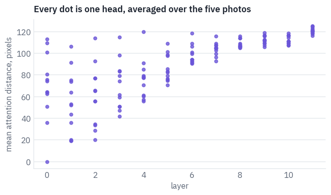

In the first layers the heads split: some look mostly at their neighbourhood, a patch or two away, like a convolution; others already look across the whole image, something a CNN can only do after many layers.

By the last layers every head looks far. The ViT paper reported the same spread; it is the clearest sign that the model learned a locality that a CNN has built in, and learned to drop it where it doesn't help.

**What decides the answer.** The class token's attention to the patches shows what it gathered, but a single layer tells little, because the token mixes with everything at every layer.

*Attention rollout* (Abnar and Zuidema, 2020) multiplies the attention matrices of all layers, each averaged over heads and mixed half and half with the identity for the residual connection, and reads the class token's row of the product.

```python
n = batch.shape[0]
rollout = torch.eye(grid * grid + 1).repeat(n, 1, 1)
for block in vit.blocks:
    a = block.attn.weights.mean(dim=1)  # (photos, 197, 197), averaged over heads
    a = 0.5 * a + 0.5 * torch.eye(grid * grid + 1)  # the residual path
    a = a / a.sum(-1, keepdim=True)
    rollout = a @ rollout
    block.attn.keep = False
maps = rollout[:, 0, 1:].reshape(n, grid, grid)

violet = to_rgb(COLORS["att"])
# from clear to violet, laid over the photo
glow = LinearSegmentedColormap.from_list("glow", [(*violet, 0.0), (*violet, 0.9)])
fig, axes = plt.subplots(1, n, figsize=(13, 2.9))
for k, photo in enumerate(photos.values()):
    heat = (maps[k] / maps[k].max()).numpy()
    axes[k].imshow(photo.resize((SIZE, SIZE)).convert("L"), cmap=greys, alpha=0.75)
    axes[k].imshow(
        heat, cmap=glow, extent=(0, SIZE, SIZE, 0), interpolation="bilinear"
    )
    axes[k].set_title(labels[ours[k].argmax().item()], fontsize=10)
    axes[k].axis("off")
plt.show()
```

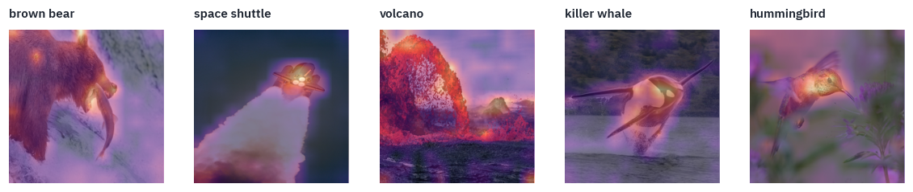

The violet regions are the bear's head and the fish, the shuttle's nose rather than its plume, the orca's body, the hummingbird. The model was never told where the objects are; its answer simply rests on them.

Rollout is a rough tool, a product of averages that ignores the MLPs, but it is cheap and often right about where to look.

## 5. A bigger image, and stretched positions

More pixels per object help, and the ViT paper fine-tuned its models at 384×384. With the same 16-pixel patches the grid becomes 24 × 24 and the sequence 577 tokens long.

The patch embedding and the encoder don't care, they work on any number of tokens; only the position embeddings, learned for a 14 × 14 grid, have to change.

The paper's answer is lesson 9's answer in two dimensions: *interpolate* them, treating the 196 vectors as a 14 × 14 image with 768 channels and resizing it.

```python
def stretch_positions(pos, new_grid):
    cls_pos, grid_pos = pos[:, :1], pos[:, 1:]
    old_grid = int(grid_pos.shape[1] ** 0.5)
    d = grid_pos.shape[-1]
    grid_pos = grid_pos.reshape(1, old_grid, old_grid, d).permute(
        0, 3, 1, 2
    )  # (1, d, 14, 14)
    grid_pos = F.interpolate(
        grid_pos, size=(new_grid, new_grid), mode="bicubic", align_corners=False
    )
    grid_pos = grid_pos.permute(0, 2, 3, 1).reshape(1, new_grid * new_grid, d)
    return torch.cat([cls_pos, grid_pos], dim=1)


BIG = 384
big = ViT(vit_config, len(labels), image_size=BIG)
weights = rename(hf_weights)
weights["pos"] = stretch_positions(weights["pos"], BIG // PATCH)
big.load_state_dict(weights, strict=True)
big.eval()
big_batch = torch.stack([to_tensor(photo, size=BIG) for photo in photos.values()])
with torch.no_grad():
    big_probs = big(big_batch).softmax(-1)
print("tokens at 224:", grid * grid + 1, " at 384:", (BIG // PATCH) ** 2 + 1)
for k, name in enumerate(photos):
    small_answer = f"{labels[probs[k].argmax().item()]} {probs[k].max():.0%}"
    big_answer = f"{labels[big_probs[k].argmax().item()]} {big_probs[k].max():.0%}"
    print(f"{name:12} 224: {small_answer:28} 384: {big_answer}")
```

<pre class="tfs-printed" markdown="0"><code>tokens at 224: 197  at 384: 577
bear         224: brown bear 100%              384: brown bear 100%
shuttle      224: space shuttle 100%           384: space shuttle 100%
lava         224: volcano 100%                 384: volcano 100%
orca         224: killer whale 100%            384: killer whale 100%
hummingbird  224: hummingbird 100%             384: hummingbird 100%</code></pre>

Without a single step of training, the model reads three times as many patches and still names every photo, as sure of itself as before.

These photos are easy; on harder images the stretched positions, close to but not the same as anything the model saw, are worth a short fine-tuning at the new size, which is what the ViT paper did.

The price of resolution is the length of the sequence, and attention's cost grows with its square. The patch size
sets the trade-off:

```python
cost = []
d, layers = vit_config["hidden_size"], vit_config["num_hidden_layers"]
for size in [224, 384, 512]:
    for p in [32, 16, 14, 8]:
        n_tokens = (size // p) ** 2 + 1
        linear = (
            layers * n_tokens * 12 * d * d * 2
        )  # projections and the MLP, two flops a weight
        attention = layers * 2 * n_tokens * n_tokens * d * 2  # scores and the weighted sum
        cost.append(
            {
                "image": size,
                "patch": p,
                "tokens": n_tokens,
                "GFLOPs": (linear + attention) / 1e9,
                "attention's share": attention / (linear + attention),
            }
        )
table(pd.DataFrame(cost), digits=2)
```

<div class="tfs-table-wrap"><table class="tfs-table" style="border-collapse:collapse;font-family:'IBM Plex Sans', -apple-system, 'Segoe UI', Roboto, Helvetica, Arial, sans-serif;font-size:13.5px;line-height:1.45;margin:4px 0 8px;"><thead><tr><th style="padding:7px 14px;border-bottom:2px solid #B9C0CB;font-weight:600;color:#5B6575;font-size:12px;letter-spacing:0.02em;text-align:right;">image</th><th style="padding:7px 14px;border-bottom:2px solid #B9C0CB;font-weight:600;color:#5B6575;font-size:12px;letter-spacing:0.02em;text-align:right;">patch</th><th style="padding:7px 14px;border-bottom:2px solid #B9C0CB;font-weight:600;color:#5B6575;font-size:12px;letter-spacing:0.02em;text-align:right;">tokens</th><th style="padding:7px 14px;border-bottom:2px solid #B9C0CB;font-weight:600;color:#5B6575;font-size:12px;letter-spacing:0.02em;text-align:right;">GFLOPs</th><th style="padding:7px 14px;border-bottom:2px solid #B9C0CB;font-weight:600;color:#5B6575;font-size:12px;letter-spacing:0.02em;text-align:right;">attention&#x27;s share</th></tr></thead><tbody><tr><td style="padding:7px 14px;border-bottom:1px solid #E6E9EE;vertical-align:top;text-align:right;font-variant-numeric:tabular-nums;max-width:460px;white-space:normal;">224</td><td style="padding:7px 14px;border-bottom:1px solid #E6E9EE;vertical-align:top;text-align:right;font-variant-numeric:tabular-nums;max-width:460px;white-space:normal;">32</td><td style="padding:7px 14px;border-bottom:1px solid #E6E9EE;vertical-align:top;text-align:right;font-variant-numeric:tabular-nums;max-width:460px;white-space:normal;">50</td><td style="padding:7px 14px;border-bottom:1px solid #E6E9EE;vertical-align:top;text-align:right;font-variant-numeric:tabular-nums;max-width:460px;white-space:normal;">8.59</td><td style="padding:7px 14px;border-bottom:1px solid #E6E9EE;vertical-align:top;text-align:right;font-variant-numeric:tabular-nums;max-width:460px;white-space:normal;">0.01</td></tr><tr><td style="padding:7px 14px;border-bottom:1px solid #E6E9EE;vertical-align:top;text-align:right;font-variant-numeric:tabular-nums;max-width:460px;white-space:normal;">224</td><td style="padding:7px 14px;border-bottom:1px solid #E6E9EE;vertical-align:top;text-align:right;font-variant-numeric:tabular-nums;max-width:460px;white-space:normal;">16</td><td style="padding:7px 14px;border-bottom:1px solid #E6E9EE;vertical-align:top;text-align:right;font-variant-numeric:tabular-nums;max-width:460px;white-space:normal;">197</td><td style="padding:7px 14px;border-bottom:1px solid #E6E9EE;vertical-align:top;text-align:right;font-variant-numeric:tabular-nums;max-width:460px;white-space:normal;">34.89</td><td style="padding:7px 14px;border-bottom:1px solid #E6E9EE;vertical-align:top;text-align:right;font-variant-numeric:tabular-nums;max-width:460px;white-space:normal;">0.04</td></tr><tr><td style="padding:7px 14px;border-bottom:1px solid #E6E9EE;vertical-align:top;text-align:right;font-variant-numeric:tabular-nums;max-width:460px;white-space:normal;">224</td><td style="padding:7px 14px;border-bottom:1px solid #E6E9EE;vertical-align:top;text-align:right;font-variant-numeric:tabular-nums;max-width:460px;white-space:normal;">14</td><td style="padding:7px 14px;border-bottom:1px solid #E6E9EE;vertical-align:top;text-align:right;font-variant-numeric:tabular-nums;max-width:460px;white-space:normal;">257</td><td style="padding:7px 14px;border-bottom:1px solid #E6E9EE;vertical-align:top;text-align:right;font-variant-numeric:tabular-nums;max-width:460px;white-space:normal;">46.09</td><td style="padding:7px 14px;border-bottom:1px solid #E6E9EE;vertical-align:top;text-align:right;font-variant-numeric:tabular-nums;max-width:460px;white-space:normal;">0.05</td></tr><tr><td style="padding:7px 14px;border-bottom:1px solid #E6E9EE;vertical-align:top;text-align:right;font-variant-numeric:tabular-nums;max-width:460px;white-space:normal;">224</td><td style="padding:7px 14px;border-bottom:1px solid #E6E9EE;vertical-align:top;text-align:right;font-variant-numeric:tabular-nums;max-width:460px;white-space:normal;">8</td><td style="padding:7px 14px;border-bottom:1px solid #E6E9EE;vertical-align:top;text-align:right;font-variant-numeric:tabular-nums;max-width:460px;white-space:normal;">785</td><td style="padding:7px 14px;border-bottom:1px solid #E6E9EE;vertical-align:top;text-align:right;font-variant-numeric:tabular-nums;max-width:460px;white-space:normal;">156.06</td><td style="padding:7px 14px;border-bottom:1px solid #E6E9EE;vertical-align:top;text-align:right;font-variant-numeric:tabular-nums;max-width:460px;white-space:normal;">0.15</td></tr><tr><td style="padding:7px 14px;border-bottom:1px solid #E6E9EE;vertical-align:top;text-align:right;font-variant-numeric:tabular-nums;max-width:460px;white-space:normal;">384</td><td style="padding:7px 14px;border-bottom:1px solid #E6E9EE;vertical-align:top;text-align:right;font-variant-numeric:tabular-nums;max-width:460px;white-space:normal;">32</td><td style="padding:7px 14px;border-bottom:1px solid #E6E9EE;vertical-align:top;text-align:right;font-variant-numeric:tabular-nums;max-width:460px;white-space:normal;">145</td><td style="padding:7px 14px;border-bottom:1px solid #E6E9EE;vertical-align:top;text-align:right;font-variant-numeric:tabular-nums;max-width:460px;white-space:normal;">25.41</td><td style="padding:7px 14px;border-bottom:1px solid #E6E9EE;vertical-align:top;text-align:right;font-variant-numeric:tabular-nums;max-width:460px;white-space:normal;">0.03</td></tr><tr><td style="padding:7px 14px;border-bottom:1px solid #E6E9EE;vertical-align:top;text-align:right;font-variant-numeric:tabular-nums;max-width:460px;white-space:normal;">384</td><td style="padding:7px 14px;border-bottom:1px solid #E6E9EE;vertical-align:top;text-align:right;font-variant-numeric:tabular-nums;max-width:460px;white-space:normal;">16</td><td style="padding:7px 14px;border-bottom:1px solid #E6E9EE;vertical-align:top;text-align:right;font-variant-numeric:tabular-nums;max-width:460px;white-space:normal;">577</td><td style="padding:7px 14px;border-bottom:1px solid #E6E9EE;vertical-align:top;text-align:right;font-variant-numeric:tabular-nums;max-width:460px;white-space:normal;">110.29</td><td style="padding:7px 14px;border-bottom:1px solid #E6E9EE;vertical-align:top;text-align:right;font-variant-numeric:tabular-nums;max-width:460px;white-space:normal;">0.11</td></tr><tr><td style="padding:7px 14px;border-bottom:1px solid #E6E9EE;vertical-align:top;text-align:right;font-variant-numeric:tabular-nums;max-width:460px;white-space:normal;">384</td><td style="padding:7px 14px;border-bottom:1px solid #E6E9EE;vertical-align:top;text-align:right;font-variant-numeric:tabular-nums;max-width:460px;white-space:normal;">14</td><td style="padding:7px 14px;border-bottom:1px solid #E6E9EE;vertical-align:top;text-align:right;font-variant-numeric:tabular-nums;max-width:460px;white-space:normal;">730</td><td style="padding:7px 14px;border-bottom:1px solid #E6E9EE;vertical-align:top;text-align:right;font-variant-numeric:tabular-nums;max-width:460px;white-space:normal;">143.65</td><td style="padding:7px 14px;border-bottom:1px solid #E6E9EE;vertical-align:top;text-align:right;font-variant-numeric:tabular-nums;max-width:460px;white-space:normal;">0.14</td></tr><tr><td style="padding:7px 14px;border-bottom:1px solid #E6E9EE;vertical-align:top;text-align:right;font-variant-numeric:tabular-nums;max-width:460px;white-space:normal;">384</td><td style="padding:7px 14px;border-bottom:1px solid #E6E9EE;vertical-align:top;text-align:right;font-variant-numeric:tabular-nums;max-width:460px;white-space:normal;">8</td><td style="padding:7px 14px;border-bottom:1px solid #E6E9EE;vertical-align:top;text-align:right;font-variant-numeric:tabular-nums;max-width:460px;white-space:normal;">2,305</td><td style="padding:7px 14px;border-bottom:1px solid #E6E9EE;vertical-align:top;text-align:right;font-variant-numeric:tabular-nums;max-width:460px;white-space:normal;">587.41</td><td style="padding:7px 14px;border-bottom:1px solid #E6E9EE;vertical-align:top;text-align:right;font-variant-numeric:tabular-nums;max-width:460px;white-space:normal;">0.33</td></tr><tr><td style="padding:7px 14px;border-bottom:1px solid #E6E9EE;vertical-align:top;text-align:right;font-variant-numeric:tabular-nums;max-width:460px;white-space:normal;">512</td><td style="padding:7px 14px;border-bottom:1px solid #E6E9EE;vertical-align:top;text-align:right;font-variant-numeric:tabular-nums;max-width:460px;white-space:normal;">32</td><td style="padding:7px 14px;border-bottom:1px solid #E6E9EE;vertical-align:top;text-align:right;font-variant-numeric:tabular-nums;max-width:460px;white-space:normal;">257</td><td style="padding:7px 14px;border-bottom:1px solid #E6E9EE;vertical-align:top;text-align:right;font-variant-numeric:tabular-nums;max-width:460px;white-space:normal;">46.09</td><td style="padding:7px 14px;border-bottom:1px solid #E6E9EE;vertical-align:top;text-align:right;font-variant-numeric:tabular-nums;max-width:460px;white-space:normal;">0.05</td></tr><tr><td style="padding:7px 14px;border-bottom:1px solid #E6E9EE;vertical-align:top;text-align:right;font-variant-numeric:tabular-nums;max-width:460px;white-space:normal;">512</td><td style="padding:7px 14px;border-bottom:1px solid #E6E9EE;vertical-align:top;text-align:right;font-variant-numeric:tabular-nums;max-width:460px;white-space:normal;">16</td><td style="padding:7px 14px;border-bottom:1px solid #E6E9EE;vertical-align:top;text-align:right;font-variant-numeric:tabular-nums;max-width:460px;white-space:normal;">1,025</td><td style="padding:7px 14px;border-bottom:1px solid #E6E9EE;vertical-align:top;text-align:right;font-variant-numeric:tabular-nums;max-width:460px;white-space:normal;">212.85</td><td style="padding:7px 14px;border-bottom:1px solid #E6E9EE;vertical-align:top;text-align:right;font-variant-numeric:tabular-nums;max-width:460px;white-space:normal;">0.18</td></tr><tr><td style="padding:7px 14px;border-bottom:1px solid #E6E9EE;vertical-align:top;text-align:right;font-variant-numeric:tabular-nums;max-width:460px;white-space:normal;">512</td><td style="padding:7px 14px;border-bottom:1px solid #E6E9EE;vertical-align:top;text-align:right;font-variant-numeric:tabular-nums;max-width:460px;white-space:normal;">14</td><td style="padding:7px 14px;border-bottom:1px solid #E6E9EE;vertical-align:top;text-align:right;font-variant-numeric:tabular-nums;max-width:460px;white-space:normal;">1,297</td><td style="padding:7px 14px;border-bottom:1px solid #E6E9EE;vertical-align:top;text-align:right;font-variant-numeric:tabular-nums;max-width:460px;white-space:normal;">282.33</td><td style="padding:7px 14px;border-bottom:1px solid #E6E9EE;vertical-align:top;text-align:right;font-variant-numeric:tabular-nums;max-width:460px;white-space:normal;">0.22</td></tr><tr><td style="padding:7px 14px;border-bottom:1px solid #E6E9EE;vertical-align:top;text-align:right;font-variant-numeric:tabular-nums;max-width:460px;white-space:normal;">512</td><td style="padding:7px 14px;border-bottom:1px solid #E6E9EE;vertical-align:top;text-align:right;font-variant-numeric:tabular-nums;max-width:460px;white-space:normal;">8</td><td style="padding:7px 14px;border-bottom:1px solid #E6E9EE;vertical-align:top;text-align:right;font-variant-numeric:tabular-nums;max-width:460px;white-space:normal;">4,097</td><td style="padding:7px 14px;border-bottom:1px solid #E6E9EE;vertical-align:top;text-align:right;font-variant-numeric:tabular-nums;max-width:460px;white-space:normal;">1,314.73</td><td style="padding:7px 14px;border-bottom:1px solid #E6E9EE;vertical-align:top;text-align:right;font-variant-numeric:tabular-nums;max-width:460px;white-space:normal;">0.47</td></tr></tbody></table></div>

At 224 pixels with 16-pixel patches attention is a small part of the work; at 512 pixels with 8-pixel patches it approaches half of it, and the share keeps growing with every step up.

This is why the vision encoders of today's chat models cut images into tiles and why their patch sizes are 14 or 16 and not smaller: every halving of the patch quadruples the sequence.

## 6. Attention that finds objects without labels

Everything so far was learned from labels, a thousand ImageNet classes. In 2021 Mathilde Caron and colleagues at Facebook AI trained ViTs with *no* labels at all, by self-distillation: a student network learns to give the same output for a small crop of a photo that a slowly updated copy of itself, the teacher, gives for a large crop.

They called the method DINO, and noticed something nobody had asked for: the attention of the class token in the last layer outlined the objects in a photo, a segmentation learned from no segmentation at all.

DINO's small ViT with 8-pixel patches is the same architecture as ours with other numbers, so it loads into our
class. It was trained with the usual ImageNet normalisation, a different mean and deviation per channel.

```python
DINO = "facebook/dino-vits8"
IMAGENET_MEAN, IMAGENET_STD = [0.485, 0.456, 0.406], [0.229, 0.224, 0.225]
if SMOKE:
    dino_config = {**vit_config, "patch_size": 8, "num_attention_heads": 4}
    dino = ViT(dino_config, 1)
else:
    dino_config = json.load(open(hf_hub_download(DINO, "config.json")))
    dino = ViT(dino_config, 1)
    dino_state = rename(load_file(hf_hub_download(DINO, "model.safetensors")))
    missing = dino.load_state_dict(dino_state, strict=False)
    print("only the classifier is missing:", missing.missing_keys)
dino.eval()

dino_batch = []
for photo in photos.values():
    dino_batch.append(to_tensor(photo, mean=IMAGENET_MEAN, std=IMAGENET_STD))
dino_batch = torch.stack(dino_batch)
last = dino.blocks[-1].attn
last.keep = True
with torch.no_grad():
    dino.encode(dino.tokens(dino_batch))
last.keep = False
side = SIZE // dino_config["patch_size"]
heads = last.weights[:, :, 0, 1:].reshape(
    len(photos), -1, side, side
)  # (photos, heads, 28, 28)
print("one map per head:", tuple(heads.shape))
```

<pre class="tfs-printed" markdown="0"><code>only the classifier is missing: [&#x27;head.weight&#x27;, &#x27;head.bias&#x27;]
one map per head: (5, 6, 28, 28)</code></pre>

```python
shades = LinearSegmentedColormap.from_list("shades", [COLORS["card"], COLORS["att"]])
show = ["bear", "shuttle", "orca", "hummingbird"]
fig, axes = plt.subplots(len(show), heads.shape[1] + 1, figsize=(13, 2.1 * len(show)))
for r, name in enumerate(show):
    k = list(photos).index(name)
    axes[r, 0].imshow(photos[name].resize((SIZE, SIZE)))
    for h in range(heads.shape[1]):
        axes[r, h + 1].imshow(heads[k, h], cmap=shades, interpolation="nearest")
        if r == 0:
            axes[r, h + 1].set_title(f"head {h}", fontsize=10)
    for ax in axes[r]:
        ax.axis("off")
plt.show()
```

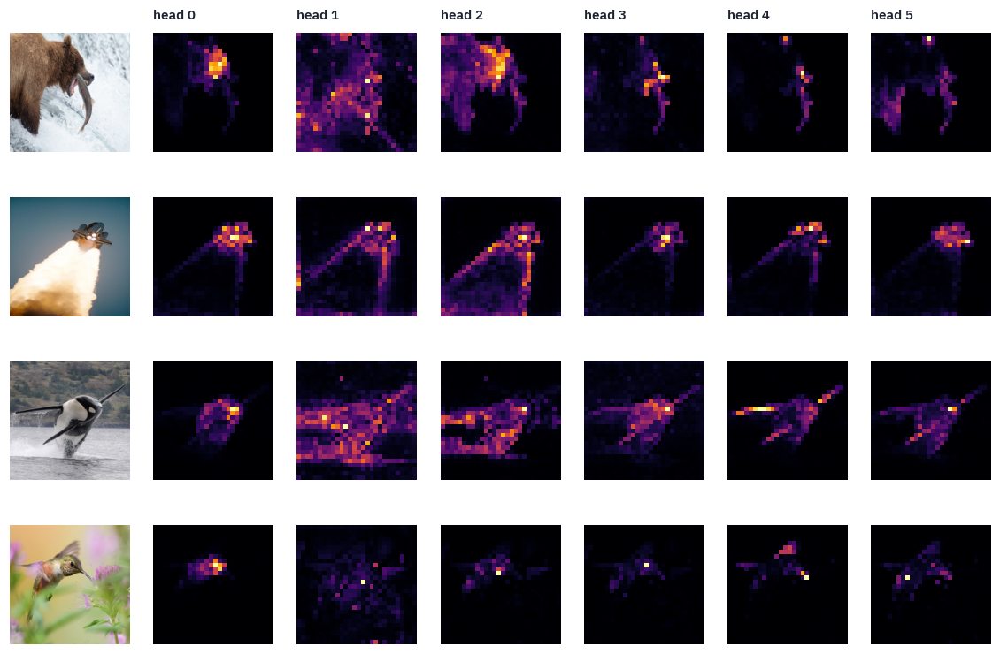

Most heads of the last layer have found an object and outlined it on a grid of 8-pixel cells: the orca's body and fins against the sea, the shuttle and the edge of its plume, the bear's head and the fish.

Different heads take different parts, and one or two look at the background instead. The model was never shown a label, a box or a mask; separating a thing from its background turned out to be useful for matching crops of the same photo, and the attention learned to do it.

DINOv2, which Meta trained on 142 million curated images in 2023, is the same idea at scale, and its features are what many vision systems now start from. The last section puts them to work.

## 7. Land use from orbit, with few labels

EuroSAT is 27,000 images from the Sentinel-2 satellites of the European Space Agency's Copernicus programme, 64×64 pixels, each 640 metres across, in ten classes of land use: crops, forest, pasture, highway, industry, housing, rivers, lakes and two more.

Helber and colleagues released it in 2019 under the MIT license. It is a good test of the ViT's weak spot: images that look nothing like ImageNet, and a budget of labels we can shrink at will.

```python
EUROSAT = "hf://datasets/timm/eurosat-rgb/data/{}-00000-of-00001.parquet"


def load_split(split, limit=None):
    frame = pd.read_parquet(EUROSAT.format(split))
    if limit:
        frame = frame.groupby("label").head(limit)
    images = []
    for record in frame["image"]:
        images.append(np.asarray(Image.open(io.BytesIO(record["bytes"])).convert("RGB")))
    images = torch.tensor(np.stack(images)).permute(0, 3, 1, 2)  # (n, 3, 64, 64), uint8
    names = [i.split("_")[0] for i in frame["image_id"]]
    return images, torch.tensor(frame["label"].values), names


train_images, train_labels, train_names = load_split("train", 30 if SMOKE else None)
test_images, test_labels, _ = load_split("test", 10 if SMOKE else None)
classes = {}
for label, name in zip(train_labels.tolist(), train_names):
    classes[label] = name
classes = [classes[k] for k in sorted(classes)]
print("train:", tuple(train_images.shape), " test:", tuple(test_images.shape))
print("classes:", ", ".join(classes))

fig, axes = plt.subplots(2, 10, figsize=(13, 3))
for c in range(10):
    picks = (train_labels == c).nonzero()[:2, 0]
    for r, i in enumerate(picks.tolist()):
        axes[r, c].imshow(train_images[i].permute(1, 2, 0))
        axes[r, c].axis("off")
    axes[0, c].set_title(classes[c], fontsize=8)
plt.show()
```

<pre class="tfs-printed" markdown="0"><code>train: (16200, 3, 64, 64)  test: (5400, 3, 64, 64)
classes: AnnualCrop, Forest, HerbaceousVegetation, Highway, Industrial, Pasture, PermanentCrop, Residential, River, SeaLake</code></pre>

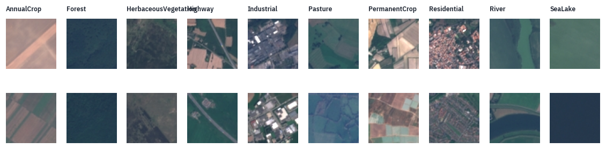

Four learners, each trained on 10, 100 and all 1,620 labelled images per class:

1. **ViT-B/16 pretrained** on ImageNet-21k's 14 million images, the checkpoint *before* it learned ImageNet's 1,000
   classes, fine-tuned whole. The 64-pixel tiles are enlarged to 224.
2. **A small ViT from scratch**: six blocks of width 192, 8-pixel patches on the 64-pixel tiles, so 64 patches.
3. **A small CNN from scratch** with about as many parameters, four blocks of convolutions: the inductive bias the
   ViT gave up.
4. **A linear probe on DINOv2**: the small DINOv2, frozen, turns each tile into a vector, and only a linear
   classifier on top is trained. No pixel-level training at all.

All four see the same augmentation: random flips and quarter turns, which change nothing about what a satellite
tile shows.

```python
def augment(images):
    flip = torch.rand(len(images), device=images.device) < 0.5
    images = torch.where(flip[:, None, None, None], images.flip(-1), images)
    turns = random.randint(0, 3)
    return torch.rot90(images, turns, dims=(-2, -1))


def normalise(images, size, mean, std):
    x = images.float() / 255
    if size != x.shape[-1]:
        x = F.interpolate(x, size=(size, size), mode="bilinear", align_corners=False)
    mean = torch.tensor(mean, device=x.device).reshape(1, -1, 1, 1)
    std = torch.tensor(std, device=x.device).reshape(1, -1, 1, 1)
    return (x - mean) / std


class SmallCNN(nn.Module):
    def __init__(self, classes, width=64):
        super().__init__()
        layers = []
        channels = 3
        for k in range(4):
            out = width * 2 ** min(k, 2)
            layers += [
                nn.Conv2d(channels, out, 3, padding=1),
                nn.BatchNorm2d(out),
                nn.GELU(),
            ]
            layers += [nn.Conv2d(out, out, 3, padding=1), nn.BatchNorm2d(out), nn.GELU()]
            layers += [nn.MaxPool2d(2)]
            channels = out
        self.features = nn.Sequential(*layers)
        self.head = nn.Linear(channels, classes)

    def forward(self, x):
        return self.head(self.features(x).mean(dim=(-2, -1)))


SMALL_VIT = {
    "hidden_size": 192,
    "num_hidden_layers": 6,
    "num_attention_heads": 3,
    "intermediate_size": 768,
    "patch_size": 8,
    "image_size": 64,
}
for name, net in [("small ViT", ViT(SMALL_VIT, 10)), ("small CNN", SmallCNN(10))]:
    print(f"{name}: {sum(p.numel() for p in net.parameters()) / 1e6:.1f}M parameters")
```

<pre class="tfs-printed" markdown="0"><code>small ViT: 2.7M parameters
small CNN: 2.3M parameters</code></pre>

One training loop serves the first three learners. It counts steps rather than epochs, so that the smallest
dataset is seen many times and the largest a few, and uses 16-bit floats with a loss scaler on the GPU.

```python
def train(model, images, labels, size, mean, std, steps, lr, batch_size=64):
    model = model.to(device).train()
    optimizer = torch.optim.AdamW(model.parameters(), lr=lr, weight_decay=0.05)
    schedule = torch.optim.lr_scheduler.OneCycleLR(
        optimizer, lr, total_steps=steps, pct_start=0.1
    )
    scaler = torch.amp.GradScaler(device, enabled=device == "cuda")
    images, labels = images.to(device), labels.to(device)
    for _ in range(steps):
        pick = torch.randint(0, len(images), (batch_size,), device=device)
        x = normalise(augment(images[pick]), size, mean, std)
        with torch.autocast(device, dtype=torch.float16, enabled=device == "cuda"):
            loss = F.cross_entropy(model(x), labels[pick])
        optimizer.zero_grad()
        scaler.scale(loss).backward()
        scaler.step(optimizer)
        scaler.update()
        schedule.step()
    return model


@torch.no_grad()
def predict_all(model, images, size, mean, std, batch_size=256):
    model.eval()
    out = []
    for a in range(0, len(images), batch_size):
        x = normalise(images[a : a + batch_size].to(device), size, mean, std)
        with torch.autocast(device, dtype=torch.float16, enabled=device == "cuda"):
            out.append(model(x).float().argmax(-1).cpu())
    return torch.cat(out)


def subset(per_class):
    keep = []
    for c in range(10):
        keep += (train_labels == c).nonzero()[:per_class, 0].tolist()
    return train_images[keep], train_labels[keep]
```

DINOv2 comes from the transformers library: it adds a few details to the ViT recipe, such as layer scale and
14-pixel patches, and here it only serves as a frozen feature extractor. Its class token plus the average of its
patch tokens is the image's vector, and a linear layer on top is trained with plain gradient descent.

```python
from transformers import AutoModel, Dinov2Config, Dinov2Model

if SMOKE:
    dinov2 = Dinov2Model(
        Dinov2Config(
            hidden_size=32,
            num_hidden_layers=1,
            num_attention_heads=2,
            intermediate_size=64,
            patch_size=14,
            image_size=56,
        )
    )
    dinov2_size = 56
else:
    dinov2 = AutoModel.from_pretrained("facebook/dinov2-small")
    dinov2_size = 224
dinov2 = dinov2.to(device).eval()


@torch.no_grad()
def dinov2_features(images, batch_size=256):
    out = []
    for a in range(0, len(images), batch_size):
        x = normalise(
            images[a : a + batch_size].to(device), dinov2_size, IMAGENET_MEAN, IMAGENET_STD
        )
        with torch.autocast(device, dtype=torch.float16, enabled=device == "cuda"):
            hidden = dinov2(pixel_values=x).last_hidden_state.float()
        out.append(torch.cat([hidden[:, 0], hidden[:, 1:].mean(1)], dim=-1).cpu())
    return torch.cat(out)


train_features = dinov2_features(train_images)
test_features = dinov2_features(test_images)
print("one tile as a DINOv2 vector:", tuple(train_features.shape[1:]))


def linear_probe(features, labels, steps=500):
    mean, std = features.mean(0), features.std(0) + 1e-6
    probe = nn.Linear(features.shape[1], 10)
    optimizer = torch.optim.AdamW(probe.parameters(), lr=1e-2, weight_decay=1e-3)
    x = (features - mean) / std
    for _ in range(steps):
        loss = F.cross_entropy(probe(x), labels)
        optimizer.zero_grad()
        loss.backward()
        optimizer.step()
    with torch.no_grad():
        return probe((test_features - mean) / std).argmax(-1)
```

<pre class="tfs-printed" markdown="0"><code>one tile as a DINOv2 vector: (768,)</code></pre>

The race. Every learner gets the same subsets of labelled tiles and is scored on the same 5,400 test tiles.

```python
IN21K = "google/vit-base-patch16-224-in21k"
budgets = [3, 10] if SMOKE else [10, 100, 1620]
results = []
predictions = {}
for per_class in budgets:
    images, labels_ = subset(per_class)
    start = time.time()
    chosen = torch.cat([(train_labels == c).nonzero()[:per_class, 0] for c in range(10)])
    guess = linear_probe(train_features[chosen], train_labels[chosen])
    results.append(
        {
            "labels per class": per_class,
            "learner": "DINOv2 + linear probe",
            "accuracy": (guess == test_labels).float().mean().item(),
            "seconds": time.time() - start,
        }
    )
    predictions[("DINOv2 + linear probe", per_class)] = guess

    learners = [
        ("small CNN", lambda: SmallCNN(10), 64, IMAGENET_MEAN, IMAGENET_STD, 3e-3),
        ("small ViT", lambda: ViT(SMALL_VIT, 10), 64, IMAGENET_MEAN, IMAGENET_STD, 1e-3),
        ("ViT-B/16 pretrained", None, 224, [MEAN] * 3, [STD] * 3, 5e-5),
    ]
    for name, make, size, mean, std, lr in learners:
        start = time.time()
        if name == "ViT-B/16 pretrained":
            model = ViT(vit_config, 10)
            if not SMOKE:
                pretrained = rename(load_file(hf_hub_download(IN21K, "model.safetensors")))
                model.load_state_dict(pretrained, strict=False)  # a new head for 10 classes
            steps = 30 if SMOKE else max(300, 3 * len(images) // 32)
            model = train(model, images, labels_, size, mean, std, steps, lr, batch_size=32)
        else:
            steps = 30 if SMOKE else max(1500, 30 * len(images) // 64)
            model = train(make(), images, labels_, size, mean, std, steps, lr)
        guess = predict_all(model, test_images, size, mean, std)
        results.append(
            {
                "labels per class": per_class,
                "learner": name,
                "accuracy": (guess == test_labels).float().mean().item(),
                "seconds": time.time() - start,
            }
        )
        predictions[(name, per_class)] = guess
        del model
        if device == "cuda":
            torch.cuda.empty_cache()
results = pd.DataFrame(results)
order = ["ViT-B/16 pretrained", "small ViT", "small CNN", "DINOv2 + linear probe"]
accuracy = results.pivot(index="learner", columns="labels per class", values="accuracy")
accuracy = accuracy.loc[order]
accuracy.columns = [f"{n:,} labels per class" for n in accuracy.columns]
table(accuracy.reset_index(), digits=3)
```

<div class="tfs-table-wrap"><table class="tfs-table" style="border-collapse:collapse;font-family:'IBM Plex Sans', -apple-system, 'Segoe UI', Roboto, Helvetica, Arial, sans-serif;font-size:13.5px;line-height:1.45;margin:4px 0 8px;"><thead><tr><th style="padding:7px 14px;border-bottom:2px solid #B9C0CB;font-weight:600;color:#5B6575;font-size:12px;letter-spacing:0.02em;text-align:left;">learner</th><th style="padding:7px 14px;border-bottom:2px solid #B9C0CB;font-weight:600;color:#5B6575;font-size:12px;letter-spacing:0.02em;text-align:right;">10 labels per class</th><th style="padding:7px 14px;border-bottom:2px solid #B9C0CB;font-weight:600;color:#5B6575;font-size:12px;letter-spacing:0.02em;text-align:right;">100 labels per class</th><th style="padding:7px 14px;border-bottom:2px solid #B9C0CB;font-weight:600;color:#5B6575;font-size:12px;letter-spacing:0.02em;text-align:right;">1,620 labels per class</th></tr></thead><tbody><tr><td style="padding:7px 14px;border-bottom:1px solid #E6E9EE;vertical-align:top;text-align:left;max-width:460px;white-space:normal;">ViT-B/16 pretrained</td><td style="padding:7px 14px;border-bottom:1px solid #E6E9EE;vertical-align:top;text-align:right;font-variant-numeric:tabular-nums;max-width:460px;white-space:normal;">0.916</td><td style="padding:7px 14px;border-bottom:1px solid #E6E9EE;vertical-align:top;text-align:right;font-variant-numeric:tabular-nums;max-width:460px;white-space:normal;">0.970</td><td style="padding:7px 14px;border-bottom:1px solid #E6E9EE;vertical-align:top;text-align:right;font-variant-numeric:tabular-nums;max-width:460px;white-space:normal;">0.988</td></tr><tr><td style="padding:7px 14px;border-bottom:1px solid #E6E9EE;vertical-align:top;text-align:left;max-width:460px;white-space:normal;">small ViT</td><td style="padding:7px 14px;border-bottom:1px solid #E6E9EE;vertical-align:top;text-align:right;font-variant-numeric:tabular-nums;max-width:460px;white-space:normal;">0.586</td><td style="padding:7px 14px;border-bottom:1px solid #E6E9EE;vertical-align:top;text-align:right;font-variant-numeric:tabular-nums;max-width:460px;white-space:normal;">0.815</td><td style="padding:7px 14px;border-bottom:1px solid #E6E9EE;vertical-align:top;text-align:right;font-variant-numeric:tabular-nums;max-width:460px;white-space:normal;">0.932</td></tr><tr><td style="padding:7px 14px;border-bottom:1px solid #E6E9EE;vertical-align:top;text-align:left;max-width:460px;white-space:normal;">small CNN</td><td style="padding:7px 14px;border-bottom:1px solid #E6E9EE;vertical-align:top;text-align:right;font-variant-numeric:tabular-nums;max-width:460px;white-space:normal;">0.740</td><td style="padding:7px 14px;border-bottom:1px solid #E6E9EE;vertical-align:top;text-align:right;font-variant-numeric:tabular-nums;max-width:460px;white-space:normal;">0.920</td><td style="padding:7px 14px;border-bottom:1px solid #E6E9EE;vertical-align:top;text-align:right;font-variant-numeric:tabular-nums;max-width:460px;white-space:normal;">0.979</td></tr><tr><td style="padding:7px 14px;border-bottom:1px solid #E6E9EE;vertical-align:top;text-align:left;max-width:460px;white-space:normal;">DINOv2 + linear probe</td><td style="padding:7px 14px;border-bottom:1px solid #E6E9EE;vertical-align:top;text-align:right;font-variant-numeric:tabular-nums;max-width:460px;white-space:normal;">0.845</td><td style="padding:7px 14px;border-bottom:1px solid #E6E9EE;vertical-align:top;text-align:right;font-variant-numeric:tabular-nums;max-width:460px;white-space:normal;">0.926</td><td style="padding:7px 14px;border-bottom:1px solid #E6E9EE;vertical-align:top;text-align:right;font-variant-numeric:tabular-nums;max-width:460px;white-space:normal;">0.966</td></tr></tbody></table></div>

```python
fig, ax = plt.subplots(figsize=(7.2, 3.8))
for name, color in [
    ("ViT-B/16 pretrained", COLORS["att"]),
    ("DINOv2 + linear probe", COLORS["enc"]),
    ("small CNN", COLORS["data"]),
    ("small ViT", COLORS["dec"]),
]:
    part = results[results.learner == name]
    ax.plot(
        part["labels per class"] * 10,
        part.accuracy,
        marker="o",
        color=color,
        label=name,
        linewidth=2,
    )
ax.set_xscale("log")
ax.set_xlabel("labelled training tiles")
ax.set_ylabel("test accuracy")
ax.set_title("EuroSAT, ten classes: accuracy against the number of labels")
ax.legend(frameon=False, fontsize=9)
plt.show()
```

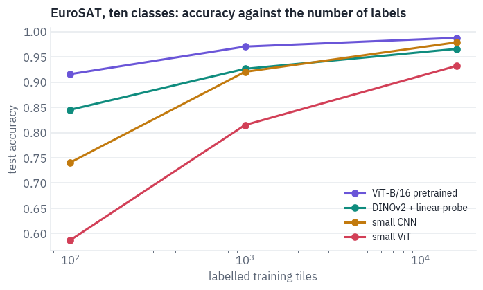

The two from-scratch lines tell the story of 2020. With few labels the CNN is far ahead of the ViT of the same size: its built-in belief in local, repeated patterns is worth thousands of examples.

As labels grow, the ViT closes much of the gap, but on 16 thousand tiles it doesn't pass the CNN; that took hundreds of millions of images.

The two pretrained learners show the way out the field took: do the data-hungry learning once, on a huge collection, and reuse it. A ViT that has seen ImageNet-21k, or a frozen DINOv2 with only a linear layer trained on top, is good with ten labels per class.

With all the labels, though, the CNN trained from scratch passes the frozen DINOv2: features that were never adapted to satellite colours have a ceiling, and the fine-tuned ViT, which adapts everything, stays on top.

Where the best model still goes wrong:

```python
best = predictions[("ViT-B/16 pretrained", budgets[-1])]
confusion = torch.zeros(10, 10)
for t, p in zip(test_labels.tolist(), best.tolist()):
    confusion[t, p] += 1
confusion = confusion / confusion.sum(1, keepdim=True)
fig, ax = plt.subplots(figsize=(6.2, 5.4))
ax.imshow(confusion, cmap=shades, vmin=0, vmax=1)
ax.set_xticks(range(10), classes, rotation=60, fontsize=8)
ax.set_yticks(range(10), classes, fontsize=8)
ax.set_xlabel("predicted")
ax.set_ylabel("true")
for i in range(10):
    for j in range(10):
        if confusion[i, j] > 0.01:
            ink = "white" if confusion[i, j] > 0.5 else "black"
            ax.text(
                j,
                i,
                f"{confusion[i, j]:.2f}",
                ha="center",
                va="center",
                fontsize=7,
                color=ink,
            )
plt.show()

short = {  # titles that fit under a tile
    "AnnualCrop": "annual crop",
    "HerbaceousVegetation": "herbaceous",
    "PermanentCrop": "permanent crop",
    "SeaLake": "sea or lake",
}
wrong = (best != test_labels).nonzero()[:, 0][:12]
fig, axes = plt.subplots(2, 6, figsize=(12, 4.6))
for ax, i in zip(axes.flat, wrong.tolist()):
    ax.imshow(test_images[i].permute(1, 2, 0))
    truth = short.get(classes[test_labels[i]], classes[test_labels[i]].lower())
    guess = short.get(classes[best[i]], classes[best[i]].lower())
    ax.set_title(f"{truth}\n→ {guess}", fontsize=8)
    ax.axis("off")
for ax in axes.flat[len(wrong) :]:
    ax.axis("off")
plt.show()
```

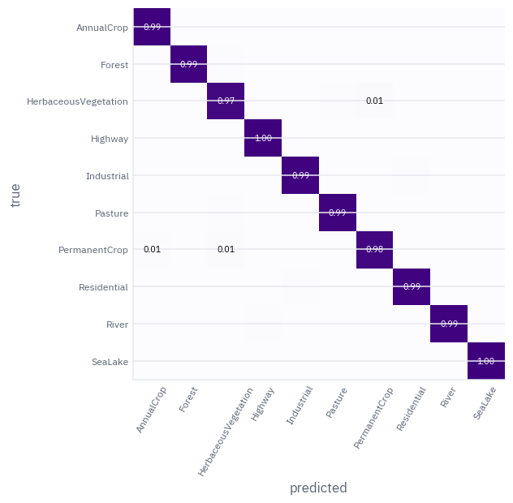

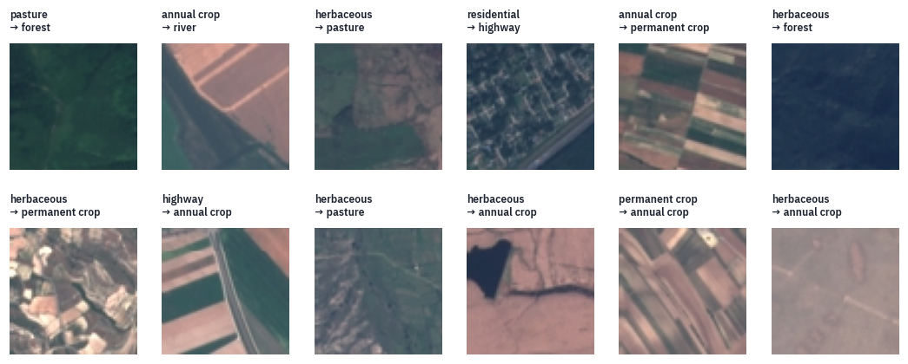

The mistakes are few, and many of them involve herbaceous vegetation, taken for pasture, for crops or for forest: scrub, meadow and young trees are the same green-brown texture at this scale.

Annual and permanent crops are taken for each other too, and now and then a tile with a road across it is called a highway. Look at the tiles and you will hesitate too; at 10 metres a pixel, an orchard and a field of wheat can look the same.

## 8. Where the ViT is today

**DeiT** (Touvron and colleagues, Facebook AI, 2020) showed that with strong augmentation and regularisation a ViT
trains on ImageNet alone, in under three days on one machine, and matches CNNs; the dependence on JFT was a matter
of recipe as much as of architecture.

**Self-supervised ViTs**, DINO and DINOv2, learn from images without labels, and their features are what vision
systems start from when labels are few, as section 7 showed.

**Contrastive ViTs**, CLIP and SigLIP, learn from images paired with captions; they are lesson 12.

**The eyes of language models.** A vision-language model takes a ViT's output vectors, one per patch, projects them
into the language model's embedding space and puts them in the prompt next to the text tokens: lesson 13.

ViT-B/16's passport, and the family tree with this lesson's branch:


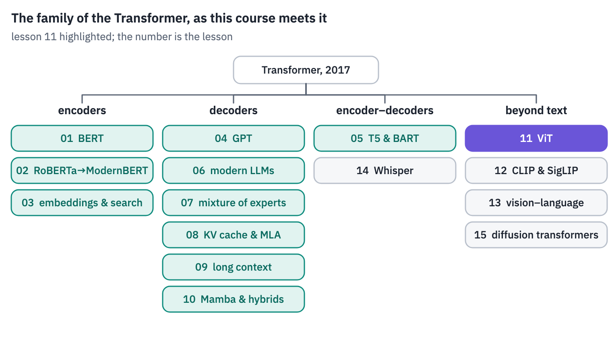
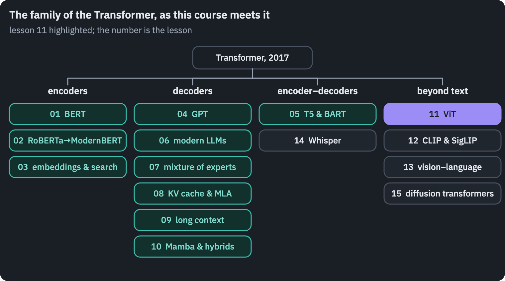

## References

1. {:#ref-1} Dosovitskiy, A., Beyer, L., Kolesnikov, A., et al. (2021). [An image is worth 16x16 words: Transformers for image recognition at scale](https://arxiv.org/abs/2010.11929). *ICLR 2021*.
2. {:#ref-2} Touvron, H., Cord, M., Douze, M., et al. (2021). [Training data-efficient image transformers & distillation through attention](https://arxiv.org/abs/2012.12877). *ICML 2021*.
3. {:#ref-3} Caron, M., Touvron, H., Misra, I., et al. (2021). [Emerging properties in self-supervised vision transformers](https://arxiv.org/abs/2104.14294). *ICCV 2021*.
4. {:#ref-4} Oquab, M., Darcet, T., Moutakanni, T., et al. (2024). [DINOv2: learning robust visual features without supervision](https://arxiv.org/abs/2304.07193). *Transactions on Machine Learning Research*.
5. {:#ref-5} Abnar, S., & Zuidema, W. (2020). [Quantifying attention flow in transformers](https://arxiv.org/abs/2005.00928). *ACL 2020*.
6. {:#ref-6} Naseer, M., Ranasinghe, K., Khan, S., et al. (2021). [Intriguing properties of vision transformers](https://arxiv.org/abs/2105.10497). *NeurIPS 2021*.
7. {:#ref-7} Helber, P., Bischke, B., Dengel, A., & Borth, D. (2019). [EuroSAT: a novel dataset and deep learning benchmark for land use and land cover classification](https://arxiv.org/abs/1709.00029). *IEEE Journal of Selected Topics in Applied Earth Observations and Remote Sensing*.
8. {:#ref-8} Krizhevsky, A., Sutskever, I., & Hinton, G. E. (2012). [ImageNet classification with deep convolutional neural networks](https://papers.nips.cc/paper/2012/hash/c399862d3b9d6b76c8436e924a68c45b-Abstract.html). *NeurIPS 2012*.
9. {:#ref-9} Photographs, all public domain: Peter Pearsall, U.S. Fish and Wildlife Service, [brown bear at Brooks Falls](https://commons.wikimedia.org/wiki/File:A_brown_bear_at_Brooks_Falls_captures_a_salmon_in_its_jaws.jpg); NASA, [Space Shuttle Discovery lifts off](https://commons.wikimedia.org/wiki/File:Space_Shuttle_Discovery_Lifts_Off_(2).jpg); J. D. Griggs, USGS, [pāhoehoe fountain](https://commons.wikimedia.org/wiki/File:Pahoeoe_fountain_edit2.jpg); NOAA Olympic Coast National Marine Sanctuary, [orca breaching](https://commons.wikimedia.org/wiki/File:OCNMS_Orca_breaching_(50040737978).jpg); U.S. Fish and Wildlife Service, [rufous hummingbird at Seedskadee](https://commons.wikimedia.org/wiki/File:Rufous_hummingbird_at_Seedskadee_National_Wildlife_Refuge_(51349613347).jpg).
{: .tfs-refs}



