

<p class="tfs-links"><strong>Transformer architectures: from BERT to diffusion</strong> · lesson 12 of 15 · <a href="/teaching/">all lessons</a> · <a href="https://www.kaggle.com/code/qmarva/transformer-architectures-12-clip-and-siglip">run on Kaggle</a> · <a href="https://colab.research.google.com/github/xmarva/transformers-from-scratch/blob/main/notebooks/colab/a12_clip.ipynb">open in Colab</a> · <a href="https://github.com/xmarva/transformers-from-scratch">code on GitHub</a></p>

Type "a fox in the snow" into the search box of the photo app on your phone, and it finds your foxes, although nobody ever labelled a single picture in your library. When Stable Diffusion draws from a prompt, the prompt is read by a text encoder taken from a model called CLIP.

When LLaVA describes a photo, it looks at it through CLIP's image encoder; Google's PaliGemma and Gemma 3 look through its successor, SigLIP. These two models are the bridge between pictures and words in much of what you use today.

CLIP came out of OpenAI in January 2021, and its idea fits in a sentence. Take two encoders, one for images and one for text, and train them so that a photo and its caption end up as nearby vectors, and a photo and somebody else's caption end up far apart.

The training set was 400 million images with the text that accompanied them on the web, alt texts, titles, captions, collected without anybody labelling anything.

Its largest version classified ImageNet as well as a ResNet-50 trained on ImageNet's 1.28 million labelled images, without seeing one of them: the class names were simply turned into captions, and each photo went to the caption it was closest to.

It also learned to read. Two months after the release, OpenAI's interpretability team stuck a paper note with the
word "iPod" on a Granny Smith apple, and CLIP declared it an iPod. You'll repeat that experiment in section 8, with
the name of a country written on holiday photos, and see why it isn't a bug that can be patched.

SigLIP, from Google in 2023, changed the part that matters most, the loss. CLIP asks every photo to pick its caption out of the whole batch, a softmax over thousands of candidates.

SigLIP asks every pair a separate yes-or-no question, a sigmoid, and that small change lets it train well on less hardware and with smaller batches. Its image tower has since become the eye of many open vision-language models.

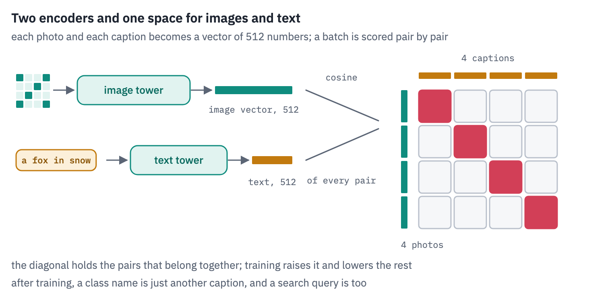
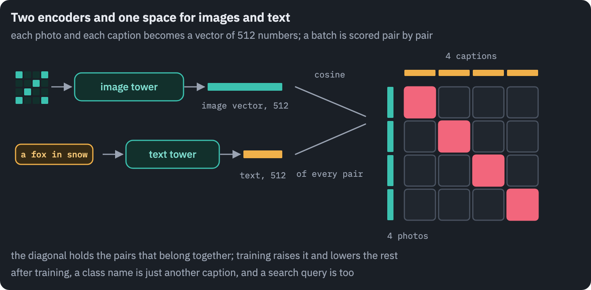

**What you'll do**

1. Take two test sets from CLIP's own paper: 21,100 photos from 211 countries, and 5,000 photos that people
   described in five sentences each.
2. Follow one photo and one caption through CLIP's two towers, step by step, with every tensor's shape printed.
3. Write CLIP in PyTorch, load OpenAI's weights into it and match Hugging Face.
4. Compute CLIP's loss by hand on a real batch, and see what its temperature does.
5. Make CLIP guess, without a single labelled example, in which of 211 countries a photo was taken, check the score
   against the paper's, and search 5,000 photos by description.
6. Measure the gap between the image half and the text half of the "one" space, and fool the model with a word
   written on a photo.
7. Meet SigLIP's sigmoid loss and its attention-pooling head, and train both losses side by side on the same data,
   from batches of 16 to 1,024.

**What you need**: a GPU. On Kaggle, *Settings → Accelerator → GPU*; on Colab, *Runtime → Change runtime type → T4 GPU*.

The notebook downloads CLIP ViT-B/32 (605 MB), SigLIP (813 MB) and two small encoders from lessons 3 and 11 (90 MB each), and streams about 6.7 GB of photos from the Hugging Face Hub without saving them: it keeps small copies in memory, about 1 GB.

## Setup

One small helper package, `tfs`, draws the course's plots and token chips and knows where the notebook runs
(Kaggle, Colab or your own machine). Everything the lesson teaches is written out in the notebook itself.

```python
import importlib.util
import subprocess
import sys

TFS = "git+https://github.com/xmarva/transformers-from-scratch@main"
if importlib.util.find_spec("tfs") is None:
    subprocess.check_call([sys.executable, "-m", "pip", "install", "-q", TFS])

from tfs import env
from tfs.viz import table, token_chips, use_course_style

env.quiet()  # no progress bars or environment warnings in the outputs
SEED = 42
env.seed_everything(SEED)
COLORS = use_course_style()
WORK_DIR = env.work_dir()
```

```python
import io
import math
import tarfile
import textwrap
import time
import urllib.request
from collections import Counter
from concurrent.futures import ThreadPoolExecutor

import matplotlib.pyplot as plt
from matplotlib.colors import LinearSegmentedColormap
from matplotlib.offsetbox import AnnotationBbox, OffsetImage
from matplotlib import font_manager
import numpy as np
import pandas as pd
import torch
import torch.nn as nn
import torch.nn.functional as F
from IPython.display import display
from PIL import Image, ImageDraw, ImageFont
from transformers import AutoImageProcessor, AutoModel, AutoProcessor, AutoTokenizer
from transformers import CLIPImageProcessor, CLIPModel, CLIPTokenizer

SMOKE = env.smoke()  # CI runs the lesson on a small slice; you run it in full
device = "cuda" if torch.cuda.is_available() else "cpu"
if device == "cuda":
    print("GPU:", torch.cuda.get_device_name(0))

# images are teal, captions amber, the pairs that belong together rose, as in the figures
heat = LinearSegmentedColormap.from_list("heat", ["#FFFFFF", COLORS["dec"]])
diverging = LinearSegmentedColormap.from_list(
    "diverging", [COLORS["enc"], "#FFFFFF", COLORS["dec"]]
)
```

<pre class="tfs-printed" markdown="0"><code>GPU: Tesla T4</code></pre>

## 1. Two test sets from CLIP's paper

CLIP's paper measured the model on 27 datasets, and two of them make this lesson. *Country211* was built by OpenAI for the paper to test geolocation: photos from YFCC100M, a public collection of a hundred million Flickr photos under Creative Commons licences, with the GPS position where each was taken; for each of 211 countries, 100 photos to test on.

*COCO*, from Microsoft, is a set of everyday scenes, each photo described by five people who were asked to write one sentence each; 5,000 of its photos are the standard test of searching photos by text.

Both live on the Hugging Face Hub in the format of CLIP's evaluation code, WebDataset: a tar archive in which the files of one example share a name, `s0000123.jpg` with `s0000123.cls`, the country's number, or with `s0000123.txt`, the five captions.

A tar archive is a plain sequence of files, one after another, so it can be read as it arrives from the network, without saving it. We keep each photo as a small JPEG, 256 pixels on its shorter side, a little more than either model will look at.

```python
HUB = "https://huggingface.co/datasets/clip-benchmark/"


def examples(url, limit=None):
    """Yield (name, {extension: bytes}) for each example of a shard, as the bytes arrive."""
    count = 0
    with urllib.request.urlopen(url, timeout=120) as response:
        archive = tarfile.open(fileobj=response, mode="r|")  # "|": a stream, read once
        name, files = None, {}
        for member in archive:
            stem, extension = member.name.rsplit(".", 1)
            if stem != name and files:
                yield name, files
                count += 1
                if limit and count >= limit:
                    return
                files = {}
            name = stem
            files[extension] = archive.extractfile(member).read()
        if files:
            yield name, files


def thumbnail(data, side=256):
    photo = Image.open(io.BytesIO(data)).convert("RGB")
    scale = side / min(photo.size)
    if scale < 1:
        new_size = (round(photo.width * scale), round(photo.height * scale))
        photo = photo.resize(new_size, Image.BICUBIC)
    buffer = io.BytesIO()
    photo.save(buffer, "JPEG", quality=90)
    return buffer.getvalue()


def read_shards(urls, limit, label):
    """Stream the shards; make thumbnails in a pool of threads while the bytes arrive."""
    pending = []
    with ThreadPoolExecutor(8) as pool:
        for url in urls:
            for _, files in examples(url, limit):
                pending.append((pool.submit(thumbnail, files["jpg"]), label(files)))
        return [(job.result(), value) for job, value in pending]


def load(thumb):
    return Image.open(io.BytesIO(thumb)).convert("RGB")
```

Country211 first: the list of countries, the five sentences the paper used for them (they'll matter in section 5),
and the 21,100 test photos in four shards of about a gigabyte each, a minute or two of streaming.

```python
def text_file(path):
    return urllib.request.urlopen(HUB + path).read().decode().strip().split("\n")


COUNTRIES = text_file("wds_country211/resolve/main/classnames.txt")
PAPER_TEMPLATES = text_file(
    "wds_country211/resolve/main/zeroshot_classification_templates.txt"
)
start = time.time()
geo = read_shards(
    [HUB + f"wds_country211/resolve/main/test/{k}.tar" for k in range(4)],
    limit=30 if SMOKE else None,  # the shards are sorted by country
    label=lambda files: int(files["cls"]),
)
geo_thumbs = [thumb for thumb, _ in geo]
geo_truth = torch.tensor([country for _, country in geo])
print(len(COUNTRIES), "countries:", ", ".join(COUNTRIES[:6]), "...")
print(f"{len(geo_thumbs)} photos in {time.time() - start:.0f} s")
print("the paper's sentences:", PAPER_TEMPLATES)
```

<pre class="tfs-printed" markdown="0"><code>211 countries: Andorra, United Arab Emirates, Afghanistan, Antigua and Barbuda, Anguilla, Albania ...
21100 photos in 73 s
the paper&#x27;s sentences: [&#x27;a photo i took in {c}.&#x27;, &#x27;a photo i took while visiting {c}.&#x27;, &#x27;a photo from my home country of {c}.&#x27;, &#x27;a photo from my visit to {c}.&#x27;, &#x27;a photo showing the country of {c}.&#x27;]</code></pre>

Then COCO's 5,000 test photos with their captions. Ten of the photos have six captions instead of five; we keep them
all, and remember for each caption whose it is.

```python
start = time.time()
coco = read_shards(
    [HUB + f"wds_mscoco_captions/resolve/main/test/{k}.tar" for k in range(5)],
    limit=64 if SMOKE else None,
    label=lambda files: [line.strip() for line in files["txt"].decode().split("\n")],
)
coco_thumbs = [thumb for thumb, _ in coco]
coco_captions = [[c for c in captions if c] for _, captions in coco]
captions = [c for photo_captions in coco_captions for c in photo_captions]
owner = torch.tensor(
    [i for i, cs in enumerate(coco_captions) for _ in cs]
)  # caption -> photo
first = torch.tensor([0] + np.cumsum([len(cs) for cs in coco_captions])[:-1].tolist())
BATCH = [26, 51, 27, 37, 50, 10, 23, 1]  # the eight photos the lesson comes back to
print(
    f"{len(coco_thumbs)} photos, {len(captions)} captions, in {time.time() - start:.0f} s"
)
size = sum(map(len, geo_thumbs + coco_thumbs)) / 1e6
print(f"all the thumbnails take {size:.0f} MB of memory")
```

<pre class="tfs-printed" markdown="0"><code>5000 photos, 25010 captions, in 23 s
all the thumbnails take 804 MB of memory</code></pre>

```python
fig, axes = plt.subplots(2, 4, figsize=(12, 7))
SHOW = [
    (0, 0),
    (53, 24),
    (106, 18),
    (159, 7),
]  # (country, its k-th photo): places, no faces
for ax, (country, k) in zip(axes[0], SHOW):
    i = (geo_truth == country).nonzero()[k].item()
    ax.imshow(load(geo_thumbs[i]))
    ax.set_title(COUNTRIES[country], fontsize=10)
    ax.axis("off")
for ax, i in zip(axes[1], BATCH[:4]):
    ax.imshow(load(coco_thumbs[i]))
    ax.set_title(textwrap.fill(coco_captions[i][0], 34), fontsize=8, loc="left")
    ax.axis("off")
plt.tight_layout()
plt.show()
```

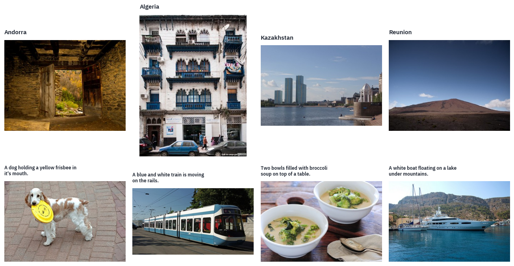

*Photos: top row, Country211 (OpenAI, from YFCC100M, Creative Commons licences); bottom row, COCO (images from Flickr
under their own licences, captions CC BY 4.0), with the first of each photo's captions.*

The two sets ask different things of the model. A COCO caption names what is in the photo, the kind of sentence CLIP saw millions of times.

A Country211 photo is a holiday snapshot, a street, a field, a meal, and usually nothing in it names the place; the model has to infer the country from the light, the plants, the architecture, the cars.

## 2. A photo and a caption, step by step

CLIP has two towers that never look at each other. The image tower is a Vision Transformer, the model of lesson 11; the text tower is a Transformer encoder that reads like GPT, left to right.

Each ends with a linear projection into a common space of 512 numbers, and that space is the whole point. We'll load OpenAI's smallest public CLIP, ViT-B/32, and follow one COCO photo and its first caption through both towers, printing every shape.

```python
CLIP = "openai/clip-vit-base-patch32"
clip_hf = CLIPModel.from_pretrained(CLIP).eval()
tokenizer = CLIPTokenizer.from_pretrained(CLIP)
processor = CLIPImageProcessor.from_pretrained(CLIP)
weights = clip_hf.state_dict()
vision_config = clip_hf.config.vision_config
text_config = clip_hf.config.text_config
print(
    "image tower:",
    vision_config.num_hidden_layers,
    "blocks of",
    vision_config.hidden_size,
)
print(
    "text tower:", text_config.num_hidden_layers, "blocks of", text_config.hidden_size
)
print("common space:", clip_hf.config.projection_dim, "numbers")

EXAMPLE = BATCH[0]
photo = load(coco_thumbs[EXAMPLE])
caption = coco_captions[EXAMPLE][0]
print("the caption:", caption)
```

<pre class="tfs-printed" markdown="0"><code>image tower: 12 blocks of 768
text tower: 12 blocks of 512
common space: 512 numbers
the caption: A dog holding a yellow frisbee in it&#x27;s mouth.</code></pre>

### The photo

**Step 1: a square of 224 pixels.** CLIP resizes the photo so that its *shorter* side is 224 pixels, keeping the proportions, and cuts the central 224×224 square out of it; lesson 11's ViT squashed the whole photo into a square instead.

Then each channel is shifted and scaled by a mean and a standard deviation that OpenAI measured on its own training images:

$$x_{c,i,j} = \frac{\text{pixel}_{c,i,j} / 255 - \mu_c}{\sigma_c}.$$

```python
SIZE = vision_config.image_size
MEAN = torch.tensor(processor.image_mean).reshape(3, 1, 1)
STD = torch.tensor(processor.image_std).reshape(3, 1, 1)
print("mean:", processor.image_mean)
print("std:", processor.image_std)


def clip_pixels(photo, size=SIZE):
    width, height = photo.size
    scale = size / min(width, height)
    new_size = (max(size, int(width * scale)), max(size, int(height * scale)))
    photo = photo.resize(new_size, Image.BICUBIC)
    left = (photo.width - size) // 2
    top = (photo.height - size) // 2
    photo = photo.crop((left, top, left + size, top + size))
    pixels = torch.tensor(np.asarray(photo), dtype=torch.float32).permute(2, 0, 1) / 255
    return (pixels - MEAN) / STD


x = clip_pixels(photo)
reference = processor(images=photo, return_tensors="pt")["pixel_values"][0]
print("our tensor:", tuple(x.shape))
levels = ((x - reference).abs() * STD * 255).max().item()  # back to 0..255 brightness
print(
    "largest difference from Hugging Face's processor:",
    round(levels, 2),
    "of 255 levels",
)
```

<pre class="tfs-printed" markdown="0"><code>mean: (0.48145466, 0.4578275, 0.40821073)
std: (0.26862954, 0.26130258, 0.27577711)
our tensor: (3, 224, 224)
largest difference from Hugging Face&#x27;s processor: 2.0 of 255 levels</code></pre>

Our square and the processor's differ by at most two brightness levels out of 255, a rounding difference between
two pipelines that resize with the same bicubic filter. Nothing downstream can tell.

**Step 2: patches of 32.** ViT-B/32 cuts the square into a 7×7 grid of 32-pixel patches, 49 in all, each flattened into 3 × 32 × 32 = 3,072 numbers.

Lesson 11's model had patches of 16 and 196 of them; four times fewer patches make this tower about four times cheaper, at the price of detail.

The projection to the tower's width, 768, is a convolution with a 32×32 kernel and stride 32, which is the same as a matrix multiplication applied to each flattened patch. CLIP's convolution has no bias.

```python
PATCH = vision_config.patch_size
grid = SIZE // PATCH
patches = (
    x.reshape(3, grid, PATCH, grid, PATCH)
    .permute(1, 3, 0, 2, 4)
    .reshape(grid * grid, -1)
)
print("patches:", tuple(patches.shape))

kernel = weights["vision_model.embeddings.patch_embedding.weight"]  # (768, 3, 32, 32)
by_matrix = patches @ kernel.reshape(kernel.shape[0], -1).T
by_conv = F.conv2d(x[None], kernel, stride=PATCH)[0].flatten(1).T
print("projected patches:", tuple(by_matrix.shape))
print(
    "matrix against convolution, largest difference:",
    (by_matrix - by_conv).abs().max().item(),
)
```

<pre class="tfs-printed" markdown="0"><code>patches: (49, 3072)
projected patches: (49, 768)
matrix against convolution, largest difference: 1.9550323486328125e-05</code></pre>

**Step 3: a class token, positions and one more layer norm.** As in lesson 11, a learned *class* vector goes in front of the 49 patches, and a learned position vector is added to each of the 50.

Then comes a detail lesson 11's ViT didn't have: CLIP normalises the whole sequence once more, with a layer norm called `pre_layrnorm` (the typo is in the checkpoint), before the first block.

```python
class_vector = weights["vision_model.embeddings.class_embedding"]
positions = weights["vision_model.embeddings.position_embedding.weight"]
sequence = torch.cat([class_vector[None], by_matrix]) + positions
print("class token + 49 patches, with positions:", tuple(sequence.shape))
sequence = F.layer_norm(
    sequence,
    (sequence.shape[-1],),
    weights["vision_model.pre_layrnorm.weight"],
    weights["vision_model.pre_layrnorm.bias"],
)
```

<pre class="tfs-printed" markdown="0"><code>class token + 49 patches, with positions: (50, 768)</code></pre>

**Step 4: twelve blocks, and the class token's output.** The blocks are the ViT's, except for the activation in the MLP: OpenAI used `quick_gelu`, $$x \cdot \sigma(1.702\,x)$$, a cheap approximation of GELU.

Here we check our sequence against the model's and let the model run its blocks; section 3 writes our own. Only the output at the class token is kept; it goes through a final layer norm and a projection from 768 to the common 512.

```python
with torch.no_grad():
    theirs = clip_hf.vision_model.embeddings(x[None])
    theirs = clip_hf.vision_model.pre_layrnorm(theirs)
    tower = clip_hf.vision_model(pixel_values=x[None])
    image_vector = clip_hf.visual_projection(tower.pooler_output)[0]
print(
    "our sequence against the model's, largest difference:",
    (sequence - theirs[0]).abs().max().item(),
)
print("after the blocks:", tuple(tower.last_hidden_state.shape))
print("the class token's output, normalised:", tuple(tower.pooler_output.shape))
print("the image's vector:", tuple(image_vector.shape))
```

<pre class="tfs-printed" markdown="0"><code>our sequence against the model&#x27;s, largest difference: 3.1366944313049316e-06
after the blocks: (1, 50, 768)
the class token&#x27;s output, normalised: (1, 768)
the image&#x27;s vector: (512,)</code></pre>

### The caption

**Step 1: tokens.** The tokenizer lower-cases the text, cuts it into byte-pair pieces (lesson 1 of the first course
built one), marks the end of each word with `</w>`, and puts a start and an end token around the caption. The
vocabulary holds 49,408 pieces; a caption may be 77 tokens long, markers included, and anything longer is cut.

```python
encoded = tokenizer([caption], truncation=True, return_tensors="pt")
ids = encoded["input_ids"][0]
pieces = tokenizer.convert_ids_to_tokens(ids)
token_chips(
    [pieces],
    ids=[ids.tolist()],
    strong=lambda row, col, token: token == "<|endoftext|>",
    mark_spaces=False,
    max_width=700,
)
print(len(ids), "tokens, the start and end markers included")
```

<pre class="tfs-printed" markdown="0"><code>13 tokens, the start and end markers included</code></pre>

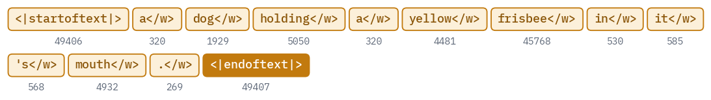

Every word of this caption is a single piece except *it's*, which splits into *it* and *'s*, the apostrophe staying with the *s*.

*Frisbee* is one piece too, although its id is close to the end of the vocabulary: the pieces were added in order of frequency, and *frisbee* was one of the last words common enough in web text to earn a piece of its own. The capital *A* became *a*.

**Step 2: embeddings and positions.** Each id picks a row of a 49,408 × 512 table, and a learned position vector is
added, as in GPT-2.

```python
token_table = weights["text_model.embeddings.token_embedding.weight"]
text_positions = weights["text_model.embeddings.position_embedding.weight"]
n = len(ids)
text_sequence = token_table[ids] + text_positions[:n]
print("token table:", tuple(token_table.shape))
print("the caption as a sequence:", tuple(text_sequence.shape))
```

<pre class="tfs-printed" markdown="0"><code>token table: (49408, 512)
the caption as a sequence: (13, 512)</code></pre>

**Step 3: twelve blocks with a causal mask.** This is the surprising part. CLIP's text tower is an *encoder*, it never generates anything, and yet each token attends only to itself and the tokens before it, as in GPT.

The paper gives the reason: the mask kept open the option of starting the text tower from a pre-trained language model, or of training it to predict text as well, an exploration it left for future work.

The mask adds minus infinity above the diagonal of every attention score matrix, so those weights become zero after the softmax:

```python
causal = torch.full((n, n), float("-inf")).triu(1)
fig, ax = plt.subplots(figsize=(4.2, 4.2))
ax.imshow(
    torch.isfinite(causal),
    cmap=LinearSegmentedColormap.from_list("m", ["#FFFFFF", COLORS["att"]]),
)
ax.set_xticks(range(n), pieces, rotation=90, fontsize=8)
ax.set_yticks(range(n), pieces, fontsize=8)
ax.set_xlabel("may look at")
ax.set_title("which tokens each token may see")
ax.grid(False)
plt.show()
```

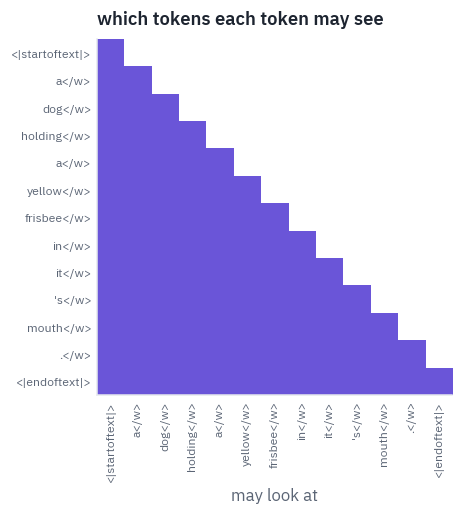

**Step 4: the end token's output.** With a causal mask, only the last token has seen the whole caption, so its output is taken as the caption's summary, the way BERT takes its `[CLS]`.

Finding it is a small trick: the end token has the largest id in the vocabulary, 49,407, so its position is the `argmax` of the ids. A final layer norm and a projection from 512 to 512 finish the tower.

```python
with torch.no_grad():
    theirs = clip_hf.text_model.embeddings(input_ids=ids[None])
    tower = clip_hf.text_model(input_ids=ids[None])
    end = ids.argmax()
    at_end = tower.last_hidden_state[0, end]
    text_vector = clip_hf.text_projection(tower.pooler_output)[0]
print(
    "our sequence against the model's, largest difference:",
    (text_sequence - theirs[0]).abs().max().item(),
)
print("the end token sits at position", end.item(), "of", n)
print(
    "the model's summary is the output at that position:",
    torch.equal(at_end, tower.pooler_output[0]),
)
print("the caption's vector:", tuple(text_vector.shape))
```

<pre class="tfs-printed" markdown="0"><code>our sequence against the model&#x27;s, largest difference: 0.0
the end token sits at position 12 of 13
the model&#x27;s summary is the output at that position: True
the caption&#x27;s vector: (512,)</code></pre>

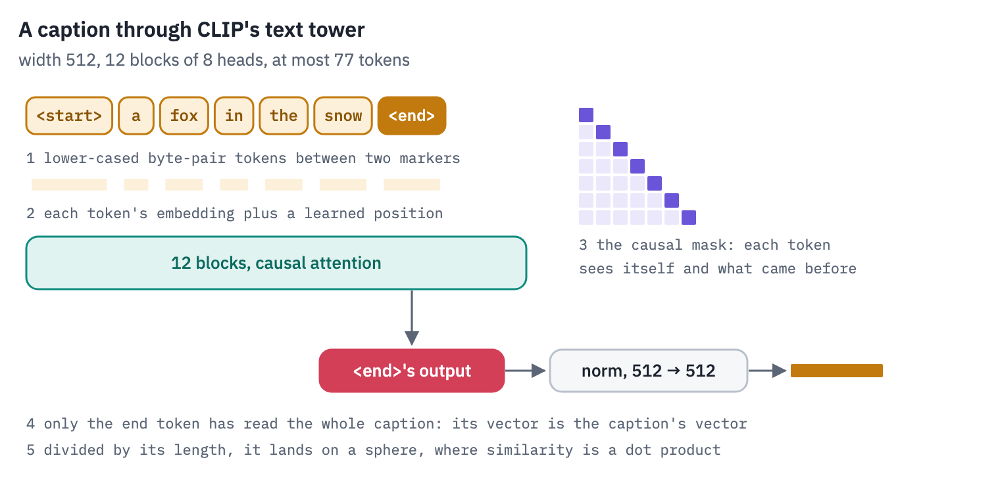
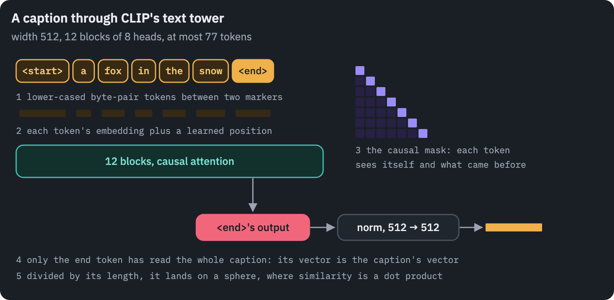

### Where the two meet

Both vectors are divided by their length, which puts them on a sphere of radius one in 512 dimensions; their dot product is then the cosine of the angle between them.

Here is the photo against its own caption and against the first captions of seven other COCO photos, the batch of eight we'll use again in sections 3 and 4:

```python
others = [coco_captions[i][0] for i in BATCH]
with torch.no_grad():
    batch = tokenizer(others, padding=True, truncation=True, return_tensors="pt")
    other_vectors = clip_hf.text_projection(clip_hf.text_model(**batch).pooler_output)
image_unit = F.normalize(image_vector, dim=-1)
text_units = F.normalize(other_vectors, dim=-1)
cosines = text_units @ image_unit
rows = []
for text, value in zip(others, cosines.tolist()):
    rows.append({"caption": text[:70], "cosine with the photo": value})
table(pd.DataFrame(rows), digits=3)
```

<div class="tfs-table-wrap"><table class="tfs-table" style="border-collapse:collapse;font-family:'IBM Plex Sans', -apple-system, 'Segoe UI', Roboto, Helvetica, Arial, sans-serif;font-size:13.5px;line-height:1.45;margin:4px 0 8px;"><thead><tr><th style="padding:7px 14px;border-bottom:2px solid #B9C0CB;font-weight:600;color:#5B6575;font-size:12px;letter-spacing:0.02em;text-align:left;">caption</th><th style="padding:7px 14px;border-bottom:2px solid #B9C0CB;font-weight:600;color:#5B6575;font-size:12px;letter-spacing:0.02em;text-align:right;">cosine with the photo</th></tr></thead><tbody><tr><td style="padding:7px 14px;border-bottom:1px solid #E6E9EE;vertical-align:top;text-align:left;max-width:460px;white-space:normal;">A dog holding a yellow frisbee in it&#x27;s mouth.</td><td style="padding:7px 14px;border-bottom:1px solid #E6E9EE;vertical-align:top;text-align:right;font-variant-numeric:tabular-nums;max-width:460px;white-space:normal;">0.355</td></tr><tr><td style="padding:7px 14px;border-bottom:1px solid #E6E9EE;vertical-align:top;text-align:left;max-width:460px;white-space:normal;">A blue and white train is moving on the rails.</td><td style="padding:7px 14px;border-bottom:1px solid #E6E9EE;vertical-align:top;text-align:right;font-variant-numeric:tabular-nums;max-width:460px;white-space:normal;">0.168</td></tr><tr><td style="padding:7px 14px;border-bottom:1px solid #E6E9EE;vertical-align:top;text-align:left;max-width:460px;white-space:normal;">Two bowls filled with broccoli soup on top of a table.</td><td style="padding:7px 14px;border-bottom:1px solid #E6E9EE;vertical-align:top;text-align:right;font-variant-numeric:tabular-nums;max-width:460px;white-space:normal;">0.143</td></tr><tr><td style="padding:7px 14px;border-bottom:1px solid #E6E9EE;vertical-align:top;text-align:left;max-width:460px;white-space:normal;">A white boat floating on a lake under mountains.</td><td style="padding:7px 14px;border-bottom:1px solid #E6E9EE;vertical-align:top;text-align:right;font-variant-numeric:tabular-nums;max-width:460px;white-space:normal;">0.085</td></tr><tr><td style="padding:7px 14px;border-bottom:1px solid #E6E9EE;vertical-align:top;text-align:left;max-width:460px;white-space:normal;">A IMAGE OF A TOWER CLOCK WITH THE CLOCK ON IT</td><td style="padding:7px 14px;border-bottom:1px solid #E6E9EE;vertical-align:top;text-align:right;font-variant-numeric:tabular-nums;max-width:460px;white-space:normal;">0.188</td></tr><tr><td style="padding:7px 14px;border-bottom:1px solid #E6E9EE;vertical-align:top;text-align:left;max-width:460px;white-space:normal;">A green vase filed with red roses sitting on top of table.</td><td style="padding:7px 14px;border-bottom:1px solid #E6E9EE;vertical-align:top;text-align:right;font-variant-numeric:tabular-nums;max-width:460px;white-space:normal;">0.089</td></tr><tr><td style="padding:7px 14px;border-bottom:1px solid #E6E9EE;vertical-align:top;text-align:left;max-width:460px;white-space:normal;">A cat peering into a wooden bowl which is sitting on a table.</td><td style="padding:7px 14px;border-bottom:1px solid #E6E9EE;vertical-align:top;text-align:right;font-variant-numeric:tabular-nums;max-width:460px;white-space:normal;">0.158</td></tr><tr><td style="padding:7px 14px;border-bottom:1px solid #E6E9EE;vertical-align:top;text-align:left;max-width:460px;white-space:normal;">A traffic light over a street surrounded by tall buildings.</td><td style="padding:7px 14px;border-bottom:1px solid #E6E9EE;vertical-align:top;text-align:right;font-variant-numeric:tabular-nums;max-width:460px;white-space:normal;">0.122</td></tr></tbody></table></div>

The photo's own caption comes out on top, well clear of the other seven. Yet its cosine is nowhere near 1, and the
captions of unrelated photos are not near 0 or below it either: cosines in CLIP's space live in a narrow band of small
positive numbers, a fact that will matter in section 7.

## 3. CLIP in PyTorch

Both towers use the same block: layer norm before attention and before the MLP, as in GPT-2, and `quick_gelu` in
the MLP. The attention takes an optional mask, which the image tower never passes.

```python
def quick_gelu(x):
    return x * torch.sigmoid(1.702 * x)


class Attention(nn.Module):
    def __init__(self, d, heads):
        super().__init__()
        self.heads = heads
        self.head_dim = d // heads
        self.query = nn.Linear(d, d)
        self.key = nn.Linear(d, d)
        self.value = nn.Linear(d, d)
        self.out = nn.Linear(d, d)

    def forward(self, x, mask=None):
        b, n, d = x.shape
        q = self.query(x).view(b, n, self.heads, self.head_dim).transpose(1, 2)
        k = self.key(x).view(b, n, self.heads, self.head_dim).transpose(1, 2)
        v = self.value(x).view(b, n, self.heads, self.head_dim).transpose(1, 2)
        out = F.scaled_dot_product_attention(q, k, v, attn_mask=mask)
        return self.out(out.transpose(1, 2).reshape(b, n, d))


class Block(nn.Module):
    def __init__(self, d, heads, hidden):
        super().__init__()
        self.norm1 = nn.LayerNorm(d)
        self.attn = Attention(d, heads)
        self.norm2 = nn.LayerNorm(d)
        self.fc1 = nn.Linear(d, hidden)
        self.fc2 = nn.Linear(hidden, d)

    def forward(self, x, mask=None):
        x = x + self.attn(self.norm1(x), mask)
        return x + self.fc2(quick_gelu(self.fc1(self.norm2(x))))
```

The two towers are the steps of section 2 with these blocks inside. The text tower builds its mask from two parts:
the causal triangle, and minus infinity at the padding of short captions when several of different lengths share a
batch.

```python
class ImageTower(nn.Module):
    def __init__(self, c, out):
        super().__init__()
        d, p = c.hidden_size, c.patch_size
        self.patch_embed = nn.Conv2d(3, d, kernel_size=p, stride=p, bias=False)
        self.cls = nn.Parameter(torch.zeros(d))
        self.pos = nn.Parameter(torch.zeros((c.image_size // p) ** 2 + 1, d))
        self.norm_pre = nn.LayerNorm(d)
        blocks = [
            Block(d, c.num_attention_heads, c.intermediate_size)
            for _ in range(c.num_hidden_layers)
        ]
        self.blocks = nn.ModuleList(blocks)
        self.norm_post = nn.LayerNorm(d)
        self.proj = nn.Linear(d, out, bias=False)

    def forward(self, pixels):
        x = self.patch_embed(pixels).flatten(2).transpose(1, 2)
        x = torch.cat([self.cls.expand(x.shape[0], 1, -1), x], dim=1) + self.pos
        x = self.norm_pre(x)
        for block in self.blocks:
            x = block(x)
        return self.proj(self.norm_post(x[:, 0]))


class TextTower(nn.Module):
    def __init__(self, c, out):
        super().__init__()
        d = c.hidden_size
        self.tok = nn.Embedding(c.vocab_size, d)
        self.pos = nn.Parameter(torch.zeros(c.max_position_embeddings, d))
        blocks = [
            Block(d, c.num_attention_heads, c.intermediate_size)
            for _ in range(c.num_hidden_layers)
        ]
        self.blocks = nn.ModuleList(blocks)
        self.norm = nn.LayerNorm(d)
        self.proj = nn.Linear(d, out, bias=False)

    def forward(self, ids, attention_mask):
        n = ids.shape[1]
        x = self.tok(ids) + self.pos[:n]
        causal = torch.full((n, n), float("-inf"), device=ids.device).triu(1)
        padding = torch.zeros(attention_mask.shape, device=ids.device)
        padding = padding.masked_fill(attention_mask == 0, float("-inf"))
        mask = causal[None, None] + padding[:, None, None, :]
        for block in self.blocks:
            x = block(x, mask)
        x = self.norm(x)
        end = ids.argmax(dim=-1)  # the end token has the largest id
        return self.proj(x[torch.arange(len(ids)), end])


class CLIP(nn.Module):
    def __init__(self, config):
        super().__init__()
        self.image = ImageTower(config.vision_config, config.projection_dim)
        self.text = TextTower(config.text_config, config.projection_dim)
        self.logit_scale = nn.Parameter(torch.zeros(()))
```

OpenAI's names differ from ours; one function renames them.

```python
def rename(state):
    top = {
        "vision_model.embeddings.patch_embedding": "image.patch_embed",
        "vision_model.embeddings.class_embedding": "image.cls",
        "vision_model.embeddings.position_embedding.weight": "image.pos",
        "vision_model.pre_layrnorm": "image.norm_pre",
        "vision_model.post_layernorm": "image.norm_post",
        "visual_projection": "image.proj",
        "text_model.embeddings.token_embedding": "text.tok",
        "text_model.embeddings.position_embedding.weight": "text.pos",
        "text_model.final_layer_norm": "text.norm",
        "text_projection": "text.proj",
        "logit_scale": "logit_scale",
    }
    inside = {
        "self_attn.q_proj": "attn.query",
        "self_attn.k_proj": "attn.key",
        "self_attn.v_proj": "attn.value",
        "self_attn.out_proj": "attn.out",
        "layer_norm1": "norm1",
        "layer_norm2": "norm2",
        "mlp.fc1": "fc1",
        "mlp.fc2": "fc2",
    }
    out = {}
    for key, value in state.items():
        if "position_ids" in key:
            continue  # a buffer of 0, 1, 2, ..., not a weight
        for tower, ours in [
            ("vision_model.encoder.layers.", "image"),
            ("text_model.encoder.layers.", "text"),
        ]:
            if key.startswith(tower):
                number, rest = key.removeprefix(tower).split(".", 1)
                for theirs, mine in inside.items():
                    rest = rest.replace(theirs, mine)
                key = f"{ours}.blocks.{number}.{rest}"
        for theirs, mine in top.items():
            if key.startswith(theirs):
                key = mine + key[len(theirs) :]
        out[key] = value
    return out


clip = CLIP(clip_hf.config)
clip.load_state_dict(rename(weights), strict=True)
clip = clip.to(device).eval()
clip_hf = clip_hf.to(device)
```

```python
check = [load(coco_thumbs[i]) for i in BATCH]
with torch.no_grad():
    pixels = torch.stack([clip_pixels(photo) for photo in check]).to(device)
    batch = tokenizer(others, padding=True, truncation=True, return_tensors="pt").to(
        device
    )
    ours_image = clip.image(pixels)
    ours_text = clip.text(batch["input_ids"], batch["attention_mask"])
    theirs_image = clip_hf.visual_projection(
        clip_hf.vision_model(pixel_values=pixels).pooler_output
    )
    theirs_text = clip_hf.text_projection(clip_hf.text_model(**batch).pooler_output)
print(
    "image vectors, largest difference:", (ours_image - theirs_image).abs().max().item()
)
print("text vectors, largest difference:", (ours_text - theirs_text).abs().max().item())
print("logit scale:", clip.logit_scale.item(), "->", clip.logit_scale.exp().item())
```

<pre class="tfs-printed" markdown="0"><code>image vectors, largest difference: 0.0
text vectors, largest difference: 1.430511474609375e-06
logit scale: 4.605170249938965 -&gt; 100.0</code></pre>

Our model and Hugging Face's agree to the rounding of float32. The last line is the temperature, the one parameter
that belongs to neither tower; it is the subject of the next section.

## 4. The loss, by hand, on a real batch

Training sees a batch of $$N$$ pairs, photos $$x_1, \dots, x_N$$ and their captions $$t_1, \dots, t_N$$. The towers give
unit vectors $$u_i$$ for the photos and $$v_j$$ for the captions, and every photo is compared with every caption:

$$s_{ij} = \frac{u_i \cdot v_j}{\tau},$$

an $$N \times N$$ table of cosines divided by a *temperature* $$\tau$$. Row $$i$$ of the table is a classification problem
with $$N$$ classes, the captions, of which one, $$t_i$$, is right; column $$j$$ is the same problem the other way round,
with the photos as classes. CLIP's loss is the cross-entropy of both, averaged:

$$\mathcal{L} = \frac{1}{2N} \sum_{i=1}^{N} \left( -\log \frac{e^{s_{ii}}}{\sum_{j} e^{s_{ij}}} -
  \log \frac{e^{s_{ii}}}{\sum_{j} e^{s_{ji}}} \right).$$

The first term inside the brackets is *photo $$i$$, find your caption among all $$N$$*; the second is *caption $$i$$, find your photo*.

Each is the softmax cross-entropy of lesson 3 of the first course, with the right class on the diagonal. This family of losses is called *contrastive*, and this particular one *InfoNCE*: the other pairs of the batch serve as negative examples for free.

Here are the same eight photos with their first captions, the table CLIP computes for them, and the loss:

```python
batch_ids = BATCH
batch_photos = [load(coco_thumbs[i]) for i in batch_ids]
batch_texts = [coco_captions[i][0] for i in batch_ids]
with torch.no_grad():
    pixels = torch.stack([clip_pixels(photo) for photo in batch_photos]).to(device)
    tokens = tokenizer(
        batch_texts, padding=True, truncation=True, return_tensors="pt"
    ).to(device)
    u = F.normalize(clip.image(pixels), dim=-1).cpu()
    v = F.normalize(
        clip.text(tokens["input_ids"], tokens["attention_mask"]), dim=-1
    ).cpu()
cosine = u @ v.T
scale = clip.logit_scale.exp().item()
logits = scale * cosine
labels = torch.arange(len(batch_ids))
loss_photos = F.cross_entropy(logits, labels)
loss_captions = F.cross_entropy(logits.T, labels)
print("1 / temperature:", round(scale, 1))
print("photos find their captions:", round(loss_photos.item(), 3))
print("captions find their photos:", round(loss_captions.item(), 3))
print("CLIP's loss:", round((loss_photos.item() + loss_captions.item()) / 2, 3))
```

<pre class="tfs-printed" markdown="0"><code>1 / temperature: 100.0
photos find their captions: 0.032
captions find their photos: 0.001
CLIP&#x27;s loss: 0.016</code></pre>

```python
fig, ax = plt.subplots(figsize=(9.5, 8.4))
ax.imshow(cosine, cmap=heat, vmin=cosine.min(), vmax=cosine.max())
for i in range(len(batch_ids)):
    for j in range(len(batch_ids)):
        strong = cosine[i, j] > cosine.min() + 0.7 * (cosine.max() - cosine.min())
        ink = "white" if strong else COLORS["ink"]
        ax.text(
            j, i, f"{cosine[i, j]:.2f}", ha="center", va="center", fontsize=9, color=ink
        )
short = [textwrap.shorten(t, 28, placeholder="…") for t in batch_texts]
ax.set_xticks(range(len(short)), short, rotation=40, ha="right", fontsize=8)
ax.set_yticks([])
ax.grid(False)
for i, row_photo in enumerate(batch_photos):  # each photo as the label of its row
    small = row_photo.resize((round(80 * row_photo.width / row_photo.height), 80))
    picture = OffsetImage(np.asarray(small), zoom=0.55)
    label = AnnotationBbox(
        picture, (-0.6, i), box_alignment=(1, 0.5), frameon=False, annotation_clip=False
    )
    ax.add_artist(label)
ax.set_title(
    "cosine of every photo with every caption; the diagonal holds the true pairs",
    loc="left",
)
plt.show()
```

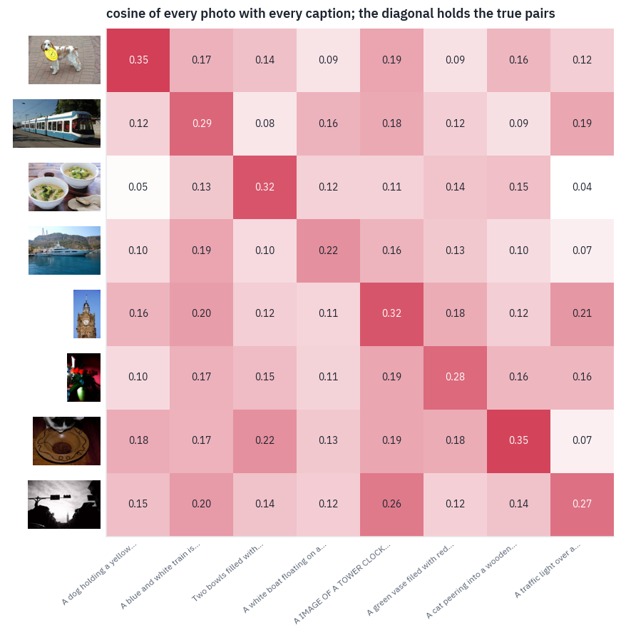

Read it row by row: in every row the diagonal cell is the largest, and in every column too, in most of them by a tenth or more.

The closest call is the last row, where the traffic light photo gives the clock tower's caption nearly as high a cosine as its own: two dark shapes against a pale sky.

All 64 cosines sit in the same narrow band of small positive numbers, and that is why the temperature exists: dividing by $$\tau$$ stretches the differences before the softmax.

### What the temperature does

CLIP doesn't fix $$\tau$$; it learns it, as $$\tau = e^{-t}$$ with $$t$$ a trainable number, starting from $$\tau = 0.07$$
and clipped so that $$1/\tau$$ never exceeds 100. Training pushed it all the way to that limit: the released
checkpoint's temperature is exactly 1/100. Here is one row of our table, turned into probabilities at three
temperatures:

```python
row = 1
fig, axes = plt.subplots(1, 3, figsize=(12, 3.2), sharey=True)
for ax, tau in zip(axes, [1.0, 0.07, 1 / scale]):
    p = (cosine[row] / tau).softmax(-1)
    colors = [COLORS["dec"] if j == row else COLORS["line"] for j in range(len(p))]
    ax.bar(range(len(p)), p, color=colors)
    ax.set_title(f"τ = {tau:.3g}", fontsize=11)
    ax.set_xticks(range(len(p)), [f"t{j + 1}" for j in range(len(p))], fontsize=8)
axes[0].set_ylabel("probability of each caption")
plt.show()
```

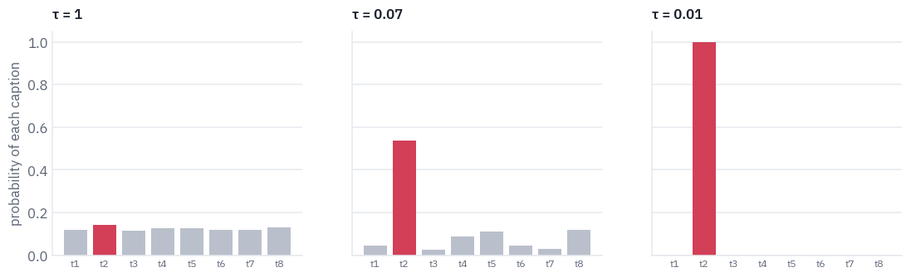

At $$\tau = 1$$ the softmax barely notices differences of a tenth or two between cosines; every caption gets about an eighth. At CLIP's final temperature the same cosines become a confident choice.

A learned temperature lets the model decide how sharp its judgements should be instead of us guessing; a fixed one that is too warm leaves the loss stuck near $$\log N$$ however good the vectors get.

Our batch also shows why the loss needs many examples at once. Its eight photos have little in common, a dog, a tram, a bowl of soup, a yacht, so almost every wrong caption is easy to reject, and the loss printed above is close to zero: a batch like this teaches the model almost nothing.

Its one hard case, the clock tower's caption under the traffic light, is the kind of example the model learns from.

OpenAI trained with batches of 32,768 pairs, so every photo met 32,767 wrong captions, and among so many some are nearly right, another dog with another toy. Those hard negatives are where the learning happens, which makes the batch size part of the loss's design, a point SigLIP will return to.

## 5. Where was this photo taken?

A classifier needs a weight vector per class. CLIP's text tower can make one from a sentence: write a caption for each class, encode it, and the matrix of these vectors *is* the classifier.

A photo's scores are its dot products with the rows, and the highest wins. No labelled photo is involved, which is what *zero-shot* means.

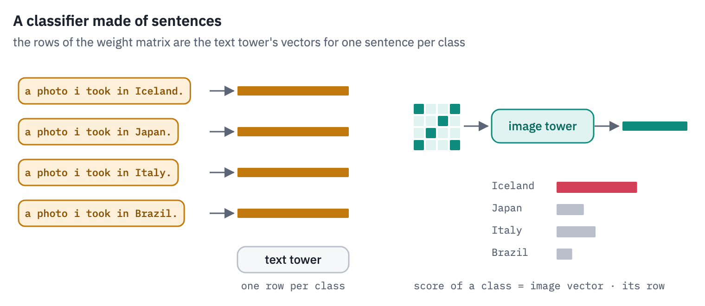
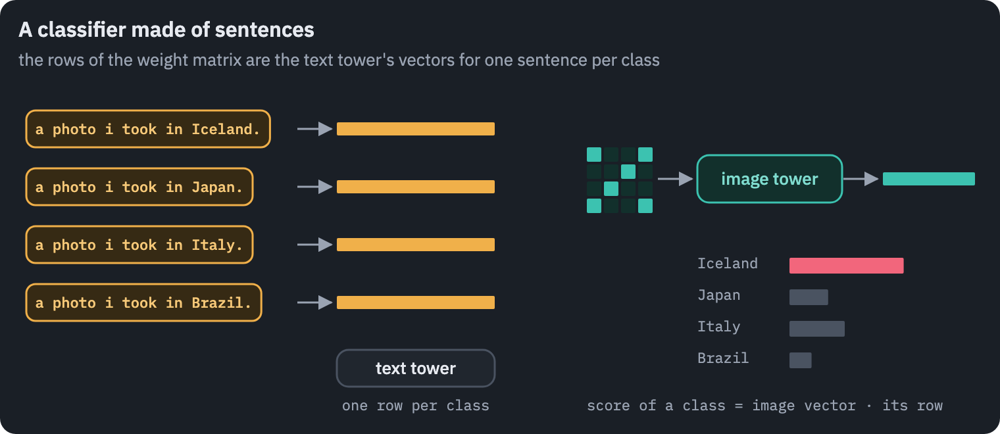

Our classes are the 211 countries of Country211. ImageNet was the headline test of CLIP's paper; a country is harder
and more interesting, because no single object gives it away. A guess at random is right once in 211 times, and the
paper reports 17.8% for this very model, ViT-B/32, which gives us something to check our code against.

First, every photo of both sets through the image tower, once; the vectors serve the rest of the lesson.

```python
@torch.no_grad()
def embed_photos(thumbs, pixels_of, image_tower, batch_size=256):
    vectors = []
    with ThreadPoolExecutor(8) as pool:  # decode and resize in parallel
        for start in range(0, len(thumbs), batch_size):
            chunk = thumbs[start : start + batch_size]
            pixels = torch.stack(list(pool.map(lambda t: pixels_of(load(t)), chunk)))
            with torch.autocast(device, dtype=torch.float16, enabled=device == "cuda"):
                out = image_tower(pixels.to(device))
            vectors.append(F.normalize(out.float(), dim=-1).cpu())
    return torch.cat(vectors)


@torch.no_grad()
def clip_texts(texts, batch_size=512):
    vectors = []
    for start in range(0, len(texts), batch_size):
        chunk = list(texts[start : start + batch_size])
        tokens = tokenizer(chunk, padding=True, truncation=True, return_tensors="pt")
        tokens = tokens.to(device)
        with torch.autocast(device, dtype=torch.float16, enabled=device == "cuda"):
            out = clip.text(tokens["input_ids"], tokens["attention_mask"])
        vectors.append(F.normalize(out.float(), dim=-1).cpu())
    return torch.cat(vectors)


start = time.time()
clip_geo_photos = embed_photos(geo_thumbs, clip_pixels, clip.image)
clip_coco_photos = embed_photos(coco_thumbs, clip_pixels, clip.image)
print(
    "Country211:", tuple(clip_geo_photos.shape), "COCO:", tuple(clip_coco_photos.shape)
)
print(f"in {time.time() - start:.0f} s")
```

<pre class="tfs-printed" markdown="0"><code>Country211: (21100, 512) COCO: (5000, 512)
in 73 s</code></pre>

```python
def country_classifier(templates, encode=clip_texts):
    rows = []
    for country in COUNTRIES:
        sentences = [template.format(c=country) for template in templates]
        mean = encode(sentences).mean(dim=0)  # several sentences per class: average
        rows.append(F.normalize(mean, dim=-1))
    return torch.stack(rows)


def accuracy(scores, truth):
    top5 = scores.topk(5, dim=-1).indices
    top1 = (top5[:, 0] == truth).float().mean().item()
    within5 = (top5 == truth[:, None]).any(dim=-1).float().mean().item()
    return top1, within5
```

How the sentence is worded matters. A bare country name is a short, odd caption; *a photo i took in Italy.* is what people write under a holiday photo, the kind of text CLIP saw next to pictures.

The paper went further and averaged the vectors of several differently worded sentences per class; for Country211 it used the five we loaded at the start. We try a bare name, two single sentences, and the five averaged.

```python
TEMPLATES = {
    "Italy": ["{c}"],
    "a photo of Italy.": ["a photo of {c}."],
    "a photo i took in Italy.": ["a photo i took in {c}."],
    "the paper's five sentences, averaged": PAPER_TEMPLATES,
}
rows = []
for name, templates in TEMPLATES.items():
    scores = clip_geo_photos @ country_classifier(templates).T
    top1, within5 = accuracy(scores, geo_truth)
    rows.append({"classes written as": name, "top-1": top1, "in the top 5": within5})
print("chance:", round(1 / len(COUNTRIES), 4))
table(pd.DataFrame(rows), digits=3)
```

<pre class="tfs-printed" markdown="0"><code>chance: 0.0047</code></pre>

<div class="tfs-table-wrap"><table class="tfs-table" style="border-collapse:collapse;font-family:'IBM Plex Sans', -apple-system, 'Segoe UI', Roboto, Helvetica, Arial, sans-serif;font-size:13.5px;line-height:1.45;margin:4px 0 8px;"><thead><tr><th style="padding:7px 14px;border-bottom:2px solid #B9C0CB;font-weight:600;color:#5B6575;font-size:12px;letter-spacing:0.02em;text-align:left;">classes written as</th><th style="padding:7px 14px;border-bottom:2px solid #B9C0CB;font-weight:600;color:#5B6575;font-size:12px;letter-spacing:0.02em;text-align:right;">top-1</th><th style="padding:7px 14px;border-bottom:2px solid #B9C0CB;font-weight:600;color:#5B6575;font-size:12px;letter-spacing:0.02em;text-align:right;">in the top 5</th></tr></thead><tbody><tr><td style="padding:7px 14px;border-bottom:1px solid #E6E9EE;vertical-align:top;text-align:left;max-width:460px;white-space:normal;">Italy</td><td style="padding:7px 14px;border-bottom:1px solid #E6E9EE;vertical-align:top;text-align:right;font-variant-numeric:tabular-nums;max-width:460px;white-space:normal;">0.140</td><td style="padding:7px 14px;border-bottom:1px solid #E6E9EE;vertical-align:top;text-align:right;font-variant-numeric:tabular-nums;max-width:460px;white-space:normal;">0.341</td></tr><tr><td style="padding:7px 14px;border-bottom:1px solid #E6E9EE;vertical-align:top;text-align:left;max-width:460px;white-space:normal;">a photo of Italy.</td><td style="padding:7px 14px;border-bottom:1px solid #E6E9EE;vertical-align:top;text-align:right;font-variant-numeric:tabular-nums;max-width:460px;white-space:normal;">0.149</td><td style="padding:7px 14px;border-bottom:1px solid #E6E9EE;vertical-align:top;text-align:right;font-variant-numeric:tabular-nums;max-width:460px;white-space:normal;">0.356</td></tr><tr><td style="padding:7px 14px;border-bottom:1px solid #E6E9EE;vertical-align:top;text-align:left;max-width:460px;white-space:normal;">a photo i took in Italy.</td><td style="padding:7px 14px;border-bottom:1px solid #E6E9EE;vertical-align:top;text-align:right;font-variant-numeric:tabular-nums;max-width:460px;white-space:normal;">0.155</td><td style="padding:7px 14px;border-bottom:1px solid #E6E9EE;vertical-align:top;text-align:right;font-variant-numeric:tabular-nums;max-width:460px;white-space:normal;">0.379</td></tr><tr><td style="padding:7px 14px;border-bottom:1px solid #E6E9EE;vertical-align:top;text-align:left;max-width:460px;white-space:normal;">the paper&#x27;s five sentences, averaged</td><td style="padding:7px 14px;border-bottom:1px solid #E6E9EE;vertical-align:top;text-align:right;font-variant-numeric:tabular-nums;max-width:460px;white-space:normal;">0.172</td><td style="padding:7px 14px;border-bottom:1px solid #E6E9EE;vertical-align:top;text-align:right;font-variant-numeric:tabular-nums;max-width:460px;white-space:normal;">0.402</td></tr></tbody></table></div>

Every step towards a natural caption helps. A bare country name is the weakest classifier, *a photo of Italy.* is a little better, the holiday sentence better still, and the average of five phrasings beats any single one of them.

The last row is the paper's recipe, and it lands where it should: [OpenCLIP's benchmark](https://github.com/mlfoundations/open_clip/blob/main/docs/openclip_classification_results.csv) measured 17.2% for this checkpoint with the same five sentences, and the paper reports 17.8% (Table 11).

About one photo in six goes to the right country out of 211, where a random guess would be right once in 211 tries,
and the right country is among the model's first five guesses for about two photos in five. Nobody showed CLIP a
labelled photo of any of these countries.

Which countries does it know? The twenty it places best, with the paper's five sentences:

```python
clip_geo = country_classifier(PAPER_TEMPLATES)
predicted = (clip_geo_photos @ clip_geo.T).argmax(dim=-1)
present = sorted(set(geo_truth.tolist()))
per_country = {
    k: (predicted[geo_truth == k] == k).float().mean().item() for k in present
}
top = sorted(present, key=lambda k: per_country[k])[-20:]
fig, ax = plt.subplots(figsize=(8, 6.4))
ax.barh([COUNTRIES[k] for k in top], [per_country[k] for k in top], color=COLORS["enc"])
ax.axvline(1 / len(COUNTRIES), color=COLORS["muted"], linestyle="--", linewidth=1)
ax.set_xlabel("share of the country's photos placed correctly")
ax.set_title("the twenty countries CLIP ViT-B/32 places best")
ax.grid(axis="x")
ax.grid(axis="y", visible=False)
plt.show()
never = sum(per_country[k] == 0 for k in present)
print(f"countries where not one photo is placed correctly: {never} of {len(present)}")
```

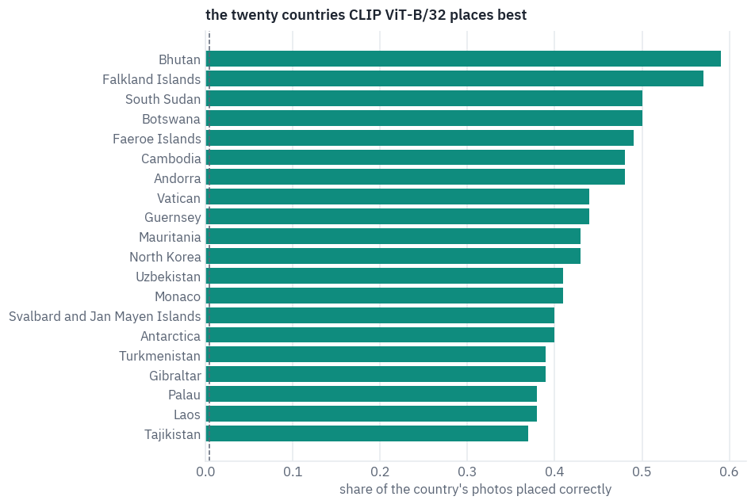

<pre class="tfs-printed" markdown="0"><code>countries where not one photo is placed correctly: 2 of 211</code></pre>

The top of the list is not the countries with the most tourists. Bhutan, the Falkland Islands, the Faroe Islands, the Vatican, Svalbard, Antarctica: places with a look of their own, a style of building, a landscape, a climate that are found nowhere else.

CLIP places more than half of Bhutan's photos correctly. At the other end only two countries get no photo right at all; most sit somewhere in between.

The mistakes are as telling. The most frequent ones, and the countries the model names most often; every country has
100 photos, so a country named far more than 100 times is a favourite answer, not a well-known place:

```python
mistakes = Counter()
for truth, guess in zip(geo_truth.tolist(), predicted.tolist()):
    if truth != guess:
        mistakes[(COUNTRIES[truth], COUNTRIES[guess])] += 1
rows = []
for (truth, guess), k in mistakes.most_common(10):
    rows.append({"taken in": truth, "placed in": guess, "photos": k})
display(table(pd.DataFrame(rows), digits=0))
named = Counter(COUNTRIES[guess] for guess in predicted.tolist())
rows = [{"country": c, "photos placed there": k} for c, k in named.most_common(8)]
table(pd.DataFrame(rows), digits=0)
```

<div class="tfs-table-wrap"><table class="tfs-table" style="border-collapse:collapse;font-family:'IBM Plex Sans', -apple-system, 'Segoe UI', Roboto, Helvetica, Arial, sans-serif;font-size:13.5px;line-height:1.45;margin:4px 0 8px;"><thead><tr><th style="padding:7px 14px;border-bottom:2px solid #B9C0CB;font-weight:600;color:#5B6575;font-size:12px;letter-spacing:0.02em;text-align:left;">taken in</th><th style="padding:7px 14px;border-bottom:2px solid #B9C0CB;font-weight:600;color:#5B6575;font-size:12px;letter-spacing:0.02em;text-align:left;">placed in</th><th style="padding:7px 14px;border-bottom:2px solid #B9C0CB;font-weight:600;color:#5B6575;font-size:12px;letter-spacing:0.02em;text-align:right;">photos</th></tr></thead><tbody><tr><td style="padding:7px 14px;border-bottom:1px solid #E6E9EE;vertical-align:top;text-align:left;max-width:460px;white-space:normal;">Panama</td><td style="padding:7px 14px;border-bottom:1px solid #E6E9EE;vertical-align:top;text-align:left;max-width:460px;white-space:normal;">Gabon</td><td style="padding:7px 14px;border-bottom:1px solid #E6E9EE;vertical-align:top;text-align:right;font-variant-numeric:tabular-nums;max-width:460px;white-space:normal;">38</td></tr><tr><td style="padding:7px 14px;border-bottom:1px solid #E6E9EE;vertical-align:top;text-align:left;max-width:460px;white-space:normal;">Jersey</td><td style="padding:7px 14px;border-bottom:1px solid #E6E9EE;vertical-align:top;text-align:left;max-width:460px;white-space:normal;">Guernsey</td><td style="padding:7px 14px;border-bottom:1px solid #E6E9EE;vertical-align:top;text-align:right;font-variant-numeric:tabular-nums;max-width:460px;white-space:normal;">37</td></tr><tr><td style="padding:7px 14px;border-bottom:1px solid #E6E9EE;vertical-align:top;text-align:left;max-width:460px;white-space:normal;">Tonga</td><td style="padding:7px 14px;border-bottom:1px solid #E6E9EE;vertical-align:top;text-align:left;max-width:460px;white-space:normal;">Palau</td><td style="padding:7px 14px;border-bottom:1px solid #E6E9EE;vertical-align:top;text-align:right;font-variant-numeric:tabular-nums;max-width:460px;white-space:normal;">34</td></tr><tr><td style="padding:7px 14px;border-bottom:1px solid #E6E9EE;vertical-align:top;text-align:left;max-width:460px;white-space:normal;">South Georgia and South Sandwich Is.</td><td style="padding:7px 14px;border-bottom:1px solid #E6E9EE;vertical-align:top;text-align:left;max-width:460px;white-space:normal;">Falkland Islands</td><td style="padding:7px 14px;border-bottom:1px solid #E6E9EE;vertical-align:top;text-align:right;font-variant-numeric:tabular-nums;max-width:460px;white-space:normal;">28</td></tr><tr><td style="padding:7px 14px;border-bottom:1px solid #E6E9EE;vertical-align:top;text-align:left;max-width:460px;white-space:normal;">Saudi Arabia</td><td style="padding:7px 14px;border-bottom:1px solid #E6E9EE;vertical-align:top;text-align:left;max-width:460px;white-space:normal;">Namibia</td><td style="padding:7px 14px;border-bottom:1px solid #E6E9EE;vertical-align:top;text-align:right;font-variant-numeric:tabular-nums;max-width:460px;white-space:normal;">23</td></tr><tr><td style="padding:7px 14px;border-bottom:1px solid #E6E9EE;vertical-align:top;text-align:left;max-width:460px;white-space:normal;">Benin</td><td style="padding:7px 14px;border-bottom:1px solid #E6E9EE;vertical-align:top;text-align:left;max-width:460px;white-space:normal;">Central African Republic</td><td style="padding:7px 14px;border-bottom:1px solid #E6E9EE;vertical-align:top;text-align:right;font-variant-numeric:tabular-nums;max-width:460px;white-space:normal;">22</td></tr><tr><td style="padding:7px 14px;border-bottom:1px solid #E6E9EE;vertical-align:top;text-align:left;max-width:460px;white-space:normal;">South Georgia and South Sandwich Is.</td><td style="padding:7px 14px;border-bottom:1px solid #E6E9EE;vertical-align:top;text-align:left;max-width:460px;white-space:normal;">Antarctica</td><td style="padding:7px 14px;border-bottom:1px solid #E6E9EE;vertical-align:top;text-align:right;font-variant-numeric:tabular-nums;max-width:460px;white-space:normal;">22</td></tr><tr><td style="padding:7px 14px;border-bottom:1px solid #E6E9EE;vertical-align:top;text-align:left;max-width:460px;white-space:normal;">Namibia</td><td style="padding:7px 14px;border-bottom:1px solid #E6E9EE;vertical-align:top;text-align:left;max-width:460px;white-space:normal;">Botswana</td><td style="padding:7px 14px;border-bottom:1px solid #E6E9EE;vertical-align:top;text-align:right;font-variant-numeric:tabular-nums;max-width:460px;white-space:normal;">21</td></tr><tr><td style="padding:7px 14px;border-bottom:1px solid #E6E9EE;vertical-align:top;text-align:left;max-width:460px;white-space:normal;">Sudan</td><td style="padding:7px 14px;border-bottom:1px solid #E6E9EE;vertical-align:top;text-align:left;max-width:460px;white-space:normal;">South Sudan</td><td style="padding:7px 14px;border-bottom:1px solid #E6E9EE;vertical-align:top;text-align:right;font-variant-numeric:tabular-nums;max-width:460px;white-space:normal;">21</td></tr><tr><td style="padding:7px 14px;border-bottom:1px solid #E6E9EE;vertical-align:top;text-align:left;max-width:460px;white-space:normal;">Myanmar</td><td style="padding:7px 14px;border-bottom:1px solid #E6E9EE;vertical-align:top;text-align:left;max-width:460px;white-space:normal;">Laos</td><td style="padding:7px 14px;border-bottom:1px solid #E6E9EE;vertical-align:top;text-align:right;font-variant-numeric:tabular-nums;max-width:460px;white-space:normal;">20</td></tr></tbody></table></div>

<div class="tfs-table-wrap"><table class="tfs-table" style="border-collapse:collapse;font-family:'IBM Plex Sans', -apple-system, 'Segoe UI', Roboto, Helvetica, Arial, sans-serif;font-size:13.5px;line-height:1.45;margin:4px 0 8px;"><thead><tr><th style="padding:7px 14px;border-bottom:2px solid #B9C0CB;font-weight:600;color:#5B6575;font-size:12px;letter-spacing:0.02em;text-align:left;">country</th><th style="padding:7px 14px;border-bottom:2px solid #B9C0CB;font-weight:600;color:#5B6575;font-size:12px;letter-spacing:0.02em;text-align:right;">photos placed there</th></tr></thead><tbody><tr><td style="padding:7px 14px;border-bottom:1px solid #E6E9EE;vertical-align:top;text-align:left;max-width:460px;white-space:normal;">Palau</td><td style="padding:7px 14px;border-bottom:1px solid #E6E9EE;vertical-align:top;text-align:right;font-variant-numeric:tabular-nums;max-width:460px;white-space:normal;">381</td></tr><tr><td style="padding:7px 14px;border-bottom:1px solid #E6E9EE;vertical-align:top;text-align:left;max-width:460px;white-space:normal;">Angola</td><td style="padding:7px 14px;border-bottom:1px solid #E6E9EE;vertical-align:top;text-align:right;font-variant-numeric:tabular-nums;max-width:460px;white-space:normal;">364</td></tr><tr><td style="padding:7px 14px;border-bottom:1px solid #E6E9EE;vertical-align:top;text-align:left;max-width:460px;white-space:normal;">Cayman Islands</td><td style="padding:7px 14px;border-bottom:1px solid #E6E9EE;vertical-align:top;text-align:right;font-variant-numeric:tabular-nums;max-width:460px;white-space:normal;">318</td></tr><tr><td style="padding:7px 14px;border-bottom:1px solid #E6E9EE;vertical-align:top;text-align:left;max-width:460px;white-space:normal;">Mauritania</td><td style="padding:7px 14px;border-bottom:1px solid #E6E9EE;vertical-align:top;text-align:right;font-variant-numeric:tabular-nums;max-width:460px;white-space:normal;">307</td></tr><tr><td style="padding:7px 14px;border-bottom:1px solid #E6E9EE;vertical-align:top;text-align:left;max-width:460px;white-space:normal;">Cabo Verde</td><td style="padding:7px 14px;border-bottom:1px solid #E6E9EE;vertical-align:top;text-align:right;font-variant-numeric:tabular-nums;max-width:460px;white-space:normal;">293</td></tr><tr><td style="padding:7px 14px;border-bottom:1px solid #E6E9EE;vertical-align:top;text-align:left;max-width:460px;white-space:normal;">French Guiana</td><td style="padding:7px 14px;border-bottom:1px solid #E6E9EE;vertical-align:top;text-align:right;font-variant-numeric:tabular-nums;max-width:460px;white-space:normal;">275</td></tr><tr><td style="padding:7px 14px;border-bottom:1px solid #E6E9EE;vertical-align:top;text-align:left;max-width:460px;white-space:normal;">Aland Islands</td><td style="padding:7px 14px;border-bottom:1px solid #E6E9EE;vertical-align:top;text-align:right;font-variant-numeric:tabular-nums;max-width:460px;white-space:normal;">271</td></tr><tr><td style="padding:7px 14px;border-bottom:1px solid #E6E9EE;vertical-align:top;text-align:left;max-width:460px;white-space:normal;">Falkland Islands</td><td style="padding:7px 14px;border-bottom:1px solid #E6E9EE;vertical-align:top;text-align:right;font-variant-numeric:tabular-nums;max-width:460px;white-space:normal;">258</td></tr></tbody></table></div>

Most of the frequent mistakes are the ones a person would make. Jersey and Guernsey are neighbouring Channel Islands;
South Georgia looks like the Falklands or like Antarctica; Namibia passes for Botswana, Sudan for South Sudan, Myanmar
for Laos. A few are harder to explain, Panama for Gabon above all.

The favourite answers are a different matter. Palau, Angola, the Cayman Islands and Mauritania each receive three to four times as many photos as they have.

When nothing in a photo points to one country, the classifier doesn't spread its guesses evenly; it falls back on a handful of names, a bias of the model rather than knowledge of the place.

## 6. Search by description

A search engine is the same computation turned around: one sentence against all the photos. The photo vectors were
computed once, in section 5; a query costs one pass of the text tower and a matrix product over the 5,000 COCO
photos. Four queries, the last of them about counting:

```python
QUERIES = [
    "a cat sleeping on a laptop",
    "a giraffe eating leaves from a tree",
    "an elephant drinking water",
    "three zebras and one giraffe",
]
query_vectors = clip_texts(QUERIES)
best = (query_vectors @ clip_coco_photos.T).topk(5, dim=-1)
fig, axes = plt.subplots(len(QUERIES), 5, figsize=(12, 2.6 * len(QUERIES)))
for row_axes, query, scores, found in zip(axes, QUERIES, best.values, best.indices):
    for ax, score, i in zip(row_axes, scores.tolist(), found.tolist()):
        ax.imshow(load(coco_thumbs[i]))
        ax.set_title(f"{score:.3f}", fontsize=8)
        ax.axis("off")
    row_axes[0].text(
        -0.08,
        0.5,
        query,
        transform=row_axes[0].transAxes,
        rotation=90,
        ha="right",
        va="center",
        fontsize=9,
    )
plt.tight_layout()
plt.show()
```

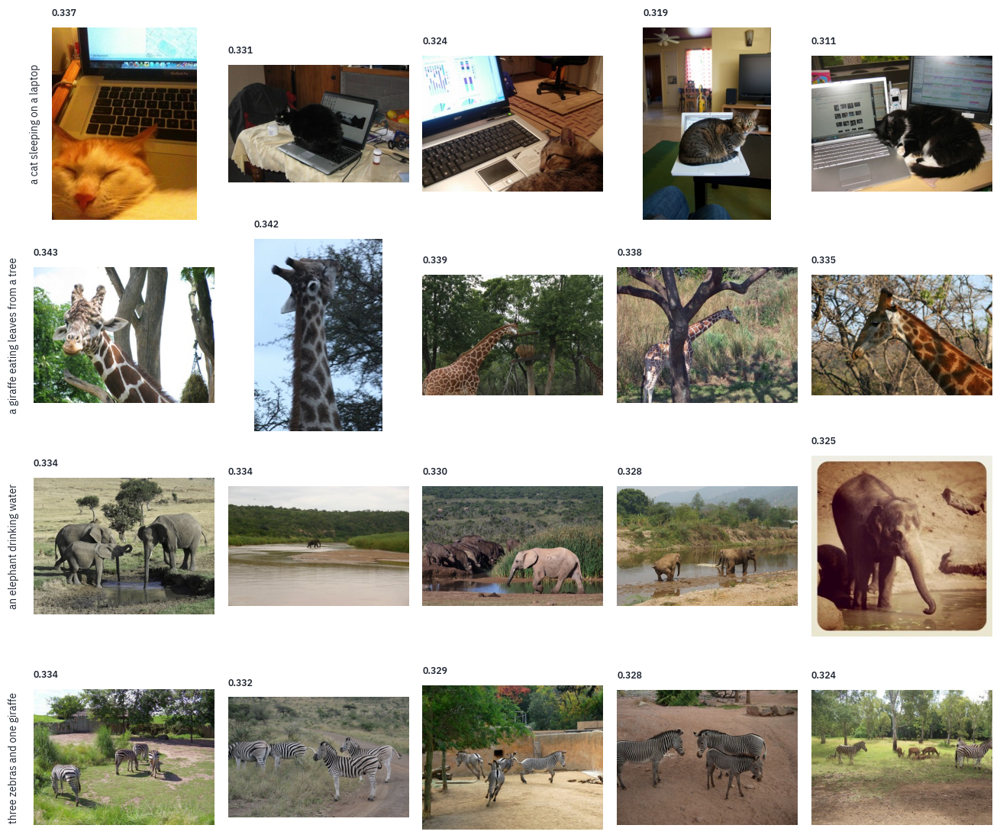

*Photos: COCO, images from Flickr under their own licences.*

The first three queries find what they ask for: cats with laptops, giraffes among trees, elephants in or by the water.
The scores are close to each other, all around 0.3, the narrow band again; a search engine needs only their order.

The last query fails, and in an instructive way. It asks for two kinds of animals in given numbers, and the results have one kind in whatever number: zebras, and not a single giraffe.

CLIP matched the strongest word and lost the rest. Its paper lists counting the objects in an image among the tasks it does worst.

For a number rather than an impression, use COCO's own captions as queries. Each of the 25,010 captions has exactly one right photo among the 5,000, its own, and *recall at k* is the share of captions whose photo comes within the first k results.

The other direction gives each photo 25,010 captions to rank, and counts it as found when any of its own five is within the first k.

```python
def summary(ranks):
    result = {f"recall@{k}": (ranks < k).float().mean().item() for k in (1, 5, 10)}
    result["median rank"] = ranks.float().median().item() + 1
    return result


def text_to_image(caption_vectors, photo_vectors, owner, chunk=4096):
    ranks = []
    for start in range(0, len(caption_vectors), chunk):
        scores = caption_vectors[start : start + chunk] @ photo_vectors.T
        right = scores[torch.arange(len(scores)), owner[start : start + chunk]]
        ranks.append(
            (scores > right[:, None]).sum(dim=-1)
        )  # photos above the right one
    return torch.cat(ranks)


def image_to_text(photo_vectors, caption_vectors, owner, chunk=1024):
    ranks = []
    for start in range(0, len(photo_vectors), chunk):
        scores = photo_vectors[start : start + chunk] @ caption_vectors.T
        mine = owner[None, :] == torch.arange(start, start + len(scores))[:, None]
        best_own = scores.masked_fill(~mine, float("-inf")).max(dim=-1).values
        ranks.append((scores > best_own[:, None]).sum(dim=-1))
    return torch.cat(ranks)


clip_captions = clip_texts(captions)
clip_t2i = summary(text_to_image(clip_captions, clip_coco_photos, owner))
clip_i2t = summary(image_to_text(clip_coco_photos, clip_captions, owner))
search_rows = [
    {"model": "CLIP ViT-B/32", "search": "caption → photo", **clip_t2i},
    {"model": "CLIP ViT-B/32", "search": "photo → caption", **clip_i2t},
]
print(len(captions), "captions,", len(coco_thumbs), "photos")
table(pd.DataFrame(search_rows), digits=3)
```

<pre class="tfs-printed" markdown="0"><code>25010 captions, 5000 photos</code></pre>

<div class="tfs-table-wrap"><table class="tfs-table" style="border-collapse:collapse;font-family:'IBM Plex Sans', -apple-system, 'Segoe UI', Roboto, Helvetica, Arial, sans-serif;font-size:13.5px;line-height:1.45;margin:4px 0 8px;"><thead><tr><th style="padding:7px 14px;border-bottom:2px solid #B9C0CB;font-weight:600;color:#5B6575;font-size:12px;letter-spacing:0.02em;text-align:left;">model</th><th style="padding:7px 14px;border-bottom:2px solid #B9C0CB;font-weight:600;color:#5B6575;font-size:12px;letter-spacing:0.02em;text-align:left;">search</th><th style="padding:7px 14px;border-bottom:2px solid #B9C0CB;font-weight:600;color:#5B6575;font-size:12px;letter-spacing:0.02em;text-align:right;">recall@1</th><th style="padding:7px 14px;border-bottom:2px solid #B9C0CB;font-weight:600;color:#5B6575;font-size:12px;letter-spacing:0.02em;text-align:right;">recall@5</th><th style="padding:7px 14px;border-bottom:2px solid #B9C0CB;font-weight:600;color:#5B6575;font-size:12px;letter-spacing:0.02em;text-align:right;">recall@10</th><th style="padding:7px 14px;border-bottom:2px solid #B9C0CB;font-weight:600;color:#5B6575;font-size:12px;letter-spacing:0.02em;text-align:right;">median rank</th></tr></thead><tbody><tr><td style="padding:7px 14px;border-bottom:1px solid #E6E9EE;vertical-align:top;text-align:left;max-width:460px;white-space:normal;">CLIP ViT-B/32</td><td style="padding:7px 14px;border-bottom:1px solid #E6E9EE;vertical-align:top;text-align:left;max-width:460px;white-space:normal;">caption → photo</td><td style="padding:7px 14px;border-bottom:1px solid #E6E9EE;vertical-align:top;text-align:right;font-variant-numeric:tabular-nums;max-width:460px;white-space:normal;">0.312</td><td style="padding:7px 14px;border-bottom:1px solid #E6E9EE;vertical-align:top;text-align:right;font-variant-numeric:tabular-nums;max-width:460px;white-space:normal;">0.565</td><td style="padding:7px 14px;border-bottom:1px solid #E6E9EE;vertical-align:top;text-align:right;font-variant-numeric:tabular-nums;max-width:460px;white-space:normal;">0.674</td><td style="padding:7px 14px;border-bottom:1px solid #E6E9EE;vertical-align:top;text-align:right;font-variant-numeric:tabular-nums;max-width:460px;white-space:normal;">4.000</td></tr><tr><td style="padding:7px 14px;border-bottom:1px solid #E6E9EE;vertical-align:top;text-align:left;max-width:460px;white-space:normal;">CLIP ViT-B/32</td><td style="padding:7px 14px;border-bottom:1px solid #E6E9EE;vertical-align:top;text-align:left;max-width:460px;white-space:normal;">photo → caption</td><td style="padding:7px 14px;border-bottom:1px solid #E6E9EE;vertical-align:top;text-align:right;font-variant-numeric:tabular-nums;max-width:460px;white-space:normal;">0.500</td><td style="padding:7px 14px;border-bottom:1px solid #E6E9EE;vertical-align:top;text-align:right;font-variant-numeric:tabular-nums;max-width:460px;white-space:normal;">0.750</td><td style="padding:7px 14px;border-bottom:1px solid #E6E9EE;vertical-align:top;text-align:right;font-variant-numeric:tabular-nums;max-width:460px;white-space:normal;">0.833</td><td style="padding:7px 14px;border-bottom:1px solid #E6E9EE;vertical-align:top;text-align:right;font-variant-numeric:tabular-nums;max-width:460px;white-space:normal;">1.000</td></tr></tbody></table></div>

[OpenCLIP's benchmark](https://github.com/mlfoundations/open_clip/blob/main/docs/openclip_retrieval_results.csv)
ran the same checkpoint on the same 5,000 photos and reports a recall of 30.4%, 55.9% and 66.9% at 1, 5 and 10 for
caption → photo, and 50.1%, 75.0% and 83.5% for photo → caption. Ours agree to within a point, which says that the
towers, the preprocessing and the evaluation are all right.

Read the numbers as a user of the search would. For a caption, the right photo out of 5,000 is the very first result
almost a third of the time, and among the first ten about two times in three. The other direction scores higher
because a photo has five chances: any of its five captions counts.

## 7. One space, two halves

"One space for images and text" is how CLIP is usually described, and it is not quite true. Compare a few averages
over the COCO photos: the cosine of a photo with its own first caption, with a random caption, of two random photos,
of two random captions.

```python
pair_photos = clip_coco_photos
pair_texts = clip_captions[first]
mixed = torch.randperm(len(pair_texts), generator=torch.Generator().manual_seed(SEED))
rows = [
    {
        "pair": "a photo and its caption",
        "mean cosine": (pair_photos * pair_texts).sum(-1).mean().item(),
    },
    {
        "pair": "a photo and a random caption",
        "mean cosine": (pair_photos * pair_texts[mixed]).sum(-1).mean().item(),
    },
    {
        "pair": "two random photos",
        "mean cosine": (pair_photos @ pair_photos.T).mean().item(),
    },
    {
        "pair": "two random captions",
        "mean cosine": (pair_texts @ pair_texts.T).mean().item(),
    },
]
table(pd.DataFrame(rows), digits=3)
```

<div class="tfs-table-wrap"><table class="tfs-table" style="border-collapse:collapse;font-family:'IBM Plex Sans', -apple-system, 'Segoe UI', Roboto, Helvetica, Arial, sans-serif;font-size:13.5px;line-height:1.45;margin:4px 0 8px;"><thead><tr><th style="padding:7px 14px;border-bottom:2px solid #B9C0CB;font-weight:600;color:#5B6575;font-size:12px;letter-spacing:0.02em;text-align:left;">pair</th><th style="padding:7px 14px;border-bottom:2px solid #B9C0CB;font-weight:600;color:#5B6575;font-size:12px;letter-spacing:0.02em;text-align:right;">mean cosine</th></tr></thead><tbody><tr><td style="padding:7px 14px;border-bottom:1px solid #E6E9EE;vertical-align:top;text-align:left;max-width:460px;white-space:normal;">a photo and its caption</td><td style="padding:7px 14px;border-bottom:1px solid #E6E9EE;vertical-align:top;text-align:right;font-variant-numeric:tabular-nums;max-width:460px;white-space:normal;">0.306</td></tr><tr><td style="padding:7px 14px;border-bottom:1px solid #E6E9EE;vertical-align:top;text-align:left;max-width:460px;white-space:normal;">a photo and a random caption</td><td style="padding:7px 14px;border-bottom:1px solid #E6E9EE;vertical-align:top;text-align:right;font-variant-numeric:tabular-nums;max-width:460px;white-space:normal;">0.152</td></tr><tr><td style="padding:7px 14px;border-bottom:1px solid #E6E9EE;vertical-align:top;text-align:left;max-width:460px;white-space:normal;">two random photos</td><td style="padding:7px 14px;border-bottom:1px solid #E6E9EE;vertical-align:top;text-align:right;font-variant-numeric:tabular-nums;max-width:460px;white-space:normal;">0.473</td></tr><tr><td style="padding:7px 14px;border-bottom:1px solid #E6E9EE;vertical-align:top;text-align:left;max-width:460px;white-space:normal;">two random captions</td><td style="padding:7px 14px;border-bottom:1px solid #E6E9EE;vertical-align:top;text-align:right;font-variant-numeric:tabular-nums;max-width:460px;white-space:normal;">0.508</td></tr></tbody></table></div>

Two random photos are closer to each other than a photo is to its own caption, and so are two random captions. The
vectors of each modality fill a narrow cone of their own, and the two cones point in different directions. A
projection of 1,000 photos and their 1,000 captions onto the two directions of largest spread shows it:

```python
both = torch.cat([pair_photos[:1000], pair_texts[:1000]])
centered = both - both.mean(dim=0)
_, _, directions = torch.linalg.svd(centered, full_matrices=False)
flat = centered @ directions[:2].T
k = len(flat) // 2
fig, ax = plt.subplots(figsize=(6.4, 5))
ax.scatter(
    flat[:k, 0], flat[:k, 1], s=6, color=COLORS["enc"], alpha=0.6, label="photos"
)
ax.scatter(
    flat[k:, 0], flat[k:, 1], s=6, color=COLORS["data"], alpha=0.6, label="captions"
)
for i in range(0, k, 100):
    ax.plot(
        [flat[i, 0], flat[k + i, 0]],
        [flat[i, 1], flat[k + i, 1]],
        color=COLORS["line"],
        linewidth=0.6,
    )
ax.set_xlabel("first principal direction")
ax.set_ylabel("second")
ax.set_title("photos and their captions in CLIP's space, projected to 2D")
ax.legend(frameon=False)
ax.grid(False)
plt.show()
```

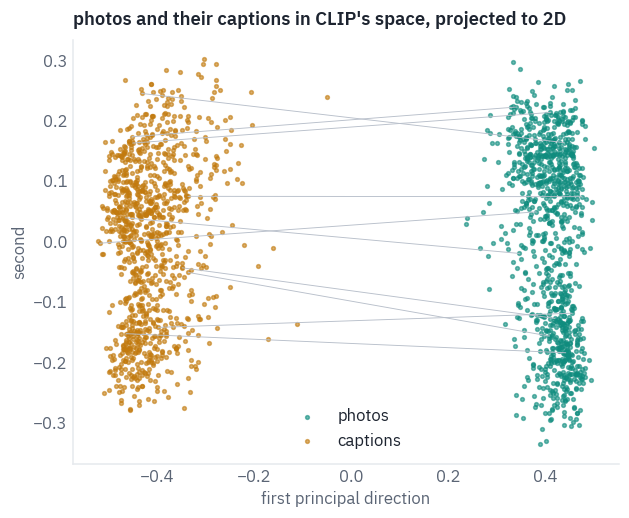

The two clouds don't overlap; the grey lines join ten photos to their captions, and every one of them crosses the gap. Liang and colleagues named this the *modality gap* in 2022 and traced it to three causes.

A freshly initialised network already maps all its inputs into a narrow cone; two towers with different random weights start in two different cones; and the contrastive loss then preserves the distance between the cones instead of closing it.

They measured the gap as the distance between the centres of the two clouds, 0.82 for CLIP on COCO, and found that at CLIP's temperature of 1/100 this very distance gives the lowest loss: shifting the clouds towards each other raises it.

So the gap is part of what the model learned, not empty space between two halves. Let's check: move every caption by
the difference between the two centres, so that the clouds sit on top of each other, and search again.

```python
offset = pair_photos.mean(dim=0) - pair_texts.mean(dim=0)
print("distance between the two centres:", round(offset.norm().item(), 3))
moved = F.normalize(clip_captions + offset, dim=-1)
search_rows.append(
    {
        "model": "CLIP, captions moved across the gap",
        "search": "caption → photo",
        **summary(text_to_image(moved, clip_coco_photos, owner)),
    }
)
table(pd.DataFrame(search_rows), digits=3)
```

<pre class="tfs-printed" markdown="0"><code>distance between the two centres: 0.822</code></pre>

<div class="tfs-table-wrap"><table class="tfs-table" style="border-collapse:collapse;font-family:'IBM Plex Sans', -apple-system, 'Segoe UI', Roboto, Helvetica, Arial, sans-serif;font-size:13.5px;line-height:1.45;margin:4px 0 8px;"><thead><tr><th style="padding:7px 14px;border-bottom:2px solid #B9C0CB;font-weight:600;color:#5B6575;font-size:12px;letter-spacing:0.02em;text-align:left;">model</th><th style="padding:7px 14px;border-bottom:2px solid #B9C0CB;font-weight:600;color:#5B6575;font-size:12px;letter-spacing:0.02em;text-align:left;">search</th><th style="padding:7px 14px;border-bottom:2px solid #B9C0CB;font-weight:600;color:#5B6575;font-size:12px;letter-spacing:0.02em;text-align:right;">recall@1</th><th style="padding:7px 14px;border-bottom:2px solid #B9C0CB;font-weight:600;color:#5B6575;font-size:12px;letter-spacing:0.02em;text-align:right;">recall@5</th><th style="padding:7px 14px;border-bottom:2px solid #B9C0CB;font-weight:600;color:#5B6575;font-size:12px;letter-spacing:0.02em;text-align:right;">recall@10</th><th style="padding:7px 14px;border-bottom:2px solid #B9C0CB;font-weight:600;color:#5B6575;font-size:12px;letter-spacing:0.02em;text-align:right;">median rank</th></tr></thead><tbody><tr><td style="padding:7px 14px;border-bottom:1px solid #E6E9EE;vertical-align:top;text-align:left;max-width:460px;white-space:normal;">CLIP ViT-B/32</td><td style="padding:7px 14px;border-bottom:1px solid #E6E9EE;vertical-align:top;text-align:left;max-width:460px;white-space:normal;">caption → photo</td><td style="padding:7px 14px;border-bottom:1px solid #E6E9EE;vertical-align:top;text-align:right;font-variant-numeric:tabular-nums;max-width:460px;white-space:normal;">0.312</td><td style="padding:7px 14px;border-bottom:1px solid #E6E9EE;vertical-align:top;text-align:right;font-variant-numeric:tabular-nums;max-width:460px;white-space:normal;">0.565</td><td style="padding:7px 14px;border-bottom:1px solid #E6E9EE;vertical-align:top;text-align:right;font-variant-numeric:tabular-nums;max-width:460px;white-space:normal;">0.674</td><td style="padding:7px 14px;border-bottom:1px solid #E6E9EE;vertical-align:top;text-align:right;font-variant-numeric:tabular-nums;max-width:460px;white-space:normal;">4.000</td></tr><tr><td style="padding:7px 14px;border-bottom:1px solid #E6E9EE;vertical-align:top;text-align:left;max-width:460px;white-space:normal;">CLIP ViT-B/32</td><td style="padding:7px 14px;border-bottom:1px solid #E6E9EE;vertical-align:top;text-align:left;max-width:460px;white-space:normal;">photo → caption</td><td style="padding:7px 14px;border-bottom:1px solid #E6E9EE;vertical-align:top;text-align:right;font-variant-numeric:tabular-nums;max-width:460px;white-space:normal;">0.500</td><td style="padding:7px 14px;border-bottom:1px solid #E6E9EE;vertical-align:top;text-align:right;font-variant-numeric:tabular-nums;max-width:460px;white-space:normal;">0.750</td><td style="padding:7px 14px;border-bottom:1px solid #E6E9EE;vertical-align:top;text-align:right;font-variant-numeric:tabular-nums;max-width:460px;white-space:normal;">0.833</td><td style="padding:7px 14px;border-bottom:1px solid #E6E9EE;vertical-align:top;text-align:right;font-variant-numeric:tabular-nums;max-width:460px;white-space:normal;">1.000</td></tr><tr><td style="padding:7px 14px;border-bottom:1px solid #E6E9EE;vertical-align:top;text-align:left;max-width:460px;white-space:normal;">CLIP, captions moved across the gap</td><td style="padding:7px 14px;border-bottom:1px solid #E6E9EE;vertical-align:top;text-align:left;max-width:460px;white-space:normal;">caption → photo</td><td style="padding:7px 14px;border-bottom:1px solid #E6E9EE;vertical-align:top;text-align:right;font-variant-numeric:tabular-nums;max-width:460px;white-space:normal;">0.186</td><td style="padding:7px 14px;border-bottom:1px solid #E6E9EE;vertical-align:top;text-align:right;font-variant-numeric:tabular-nums;max-width:460px;white-space:normal;">0.382</td><td style="padding:7px 14px;border-bottom:1px solid #E6E9EE;vertical-align:top;text-align:right;font-variant-numeric:tabular-nums;max-width:460px;white-space:normal;">0.483</td><td style="padding:7px 14px;border-bottom:1px solid #E6E9EE;vertical-align:top;text-align:right;font-variant-numeric:tabular-nums;max-width:460px;white-space:normal;">12.000</td></tr></tbody></table></div>

Our distance between the centres matches the paper's 0.82, measured on other COCO photos. And closing the gap makes
search
worse, not better: the right photo comes first for far fewer captions, and its median rank falls several places.

The arithmetic says why. Adding the same vector $$c$$ to every caption adds $$u \cdot c$$ to the score of every photo $$u$$,
and that term isn't the same for all photos: the photos that lean towards the centre of their own cloud gain on the
others, whatever the caption says. The rankings were learned with the gap in place, and they depend on it.

## 8. A word on the photo

CLIP learned from the internet, where the words in a picture often say what it is: a sign over a shop, a title on a poster, a product name on a box. It learned to read them, and to trust them.

In section 5 it placed Country211 photos by their look; let's write a country on the photos it placed correctly and see whom it believes. As a control, the same white label carries a word that names no place, PHOTO.

```python
FONT = font_manager.findfont(
    font_manager.FontProperties(family="DejaVu Sans", weight="bold")
)


def write_on(photo, word, height):
    photo = photo.copy()
    draw = ImageDraw.Draw(photo)
    font = ImageFont.truetype(FONT, max(8, int(photo.height * height)))
    left, top, right, bottom = draw.textbbox((0, 0), word, font=font)
    x = (photo.width - (right - left)) // 2
    y = photo.height - (bottom - top) - int(photo.height * 0.08)
    draw.rectangle(
        (x - 6, y + top - 6, x + right - left + 6, y + bottom + 6), fill="white"
    )
    draw.text((x, y), word, fill="black", font=font)
    return photo


japan = COUNTRIES.index("Japan")


def placed_right(guesses):
    # the photos are sorted by country: shuffle, so that the 200 come from many countries
    order = torch.randperm(
        len(geo_thumbs), generator=torch.Generator().manual_seed(SEED)
    )
    right = []
    for position in order.tolist():
        if guesses[position] == geo_truth[position] != japan:
            right.append(position)
    return right[:200]


right_ones = placed_right(predicted)
print(len(right_ones), "photos that CLIP placed correctly, none of them taken in Japan")
```

<pre class="tfs-printed" markdown="0"><code>200 photos that CLIP placed correctly, none of them taken in Japan</code></pre>

```python
SIZES = [0.04, 0.07, 0.10, 0.15]


def after_writing(word, height, pixels_of, image_tower, classifier, chosen):
    stamped = [write_on(load(geo_thumbs[p]), word, height) for p in chosen]
    with torch.no_grad():
        pixels = torch.stack([pixels_of(photo) for photo in stamped]).to(device)
        vectors = F.normalize(image_tower(pixels).float(), dim=-1).cpu()
    guesses = (vectors @ classifier.T).argmax(dim=-1)
    return {
        "now placed in Japan": (guesses == japan).float().mean().item(),
        "still placed correctly": (guesses == geo_truth[chosen]).float().mean().item(),
    }


def attack(pixels_of, image_tower, classifier, chosen):
    rows = []
    for word, heights in [("JAPAN", SIZES), ("PHOTO", [0.10])]:
        for height in heights:
            moved = after_writing(
                word, height, pixels_of, image_tower, classifier, chosen
            )
            rows.append({"word": word, "text height": height, **moved})
    return pd.DataFrame(rows)


table(attack(clip_pixels, clip.image, clip_geo, right_ones), digits=3)
```

<div class="tfs-table-wrap"><table class="tfs-table" style="border-collapse:collapse;font-family:'IBM Plex Sans', -apple-system, 'Segoe UI', Roboto, Helvetica, Arial, sans-serif;font-size:13.5px;line-height:1.45;margin:4px 0 8px;"><thead><tr><th style="padding:7px 14px;border-bottom:2px solid #B9C0CB;font-weight:600;color:#5B6575;font-size:12px;letter-spacing:0.02em;text-align:left;">word</th><th style="padding:7px 14px;border-bottom:2px solid #B9C0CB;font-weight:600;color:#5B6575;font-size:12px;letter-spacing:0.02em;text-align:right;">text height</th><th style="padding:7px 14px;border-bottom:2px solid #B9C0CB;font-weight:600;color:#5B6575;font-size:12px;letter-spacing:0.02em;text-align:right;">now placed in Japan</th><th style="padding:7px 14px;border-bottom:2px solid #B9C0CB;font-weight:600;color:#5B6575;font-size:12px;letter-spacing:0.02em;text-align:right;">still placed correctly</th></tr></thead><tbody><tr><td style="padding:7px 14px;border-bottom:1px solid #E6E9EE;vertical-align:top;text-align:left;max-width:460px;white-space:normal;">JAPAN</td><td style="padding:7px 14px;border-bottom:1px solid #E6E9EE;vertical-align:top;text-align:right;font-variant-numeric:tabular-nums;max-width:460px;white-space:normal;">0.040</td><td style="padding:7px 14px;border-bottom:1px solid #E6E9EE;vertical-align:top;text-align:right;font-variant-numeric:tabular-nums;max-width:460px;white-space:normal;">0.205</td><td style="padding:7px 14px;border-bottom:1px solid #E6E9EE;vertical-align:top;text-align:right;font-variant-numeric:tabular-nums;max-width:460px;white-space:normal;">0.620</td></tr><tr><td style="padding:7px 14px;border-bottom:1px solid #E6E9EE;vertical-align:top;text-align:left;max-width:460px;white-space:normal;">JAPAN</td><td style="padding:7px 14px;border-bottom:1px solid #E6E9EE;vertical-align:top;text-align:right;font-variant-numeric:tabular-nums;max-width:460px;white-space:normal;">0.070</td><td style="padding:7px 14px;border-bottom:1px solid #E6E9EE;vertical-align:top;text-align:right;font-variant-numeric:tabular-nums;max-width:460px;white-space:normal;">0.390</td><td style="padding:7px 14px;border-bottom:1px solid #E6E9EE;vertical-align:top;text-align:right;font-variant-numeric:tabular-nums;max-width:460px;white-space:normal;">0.450</td></tr><tr><td style="padding:7px 14px;border-bottom:1px solid #E6E9EE;vertical-align:top;text-align:left;max-width:460px;white-space:normal;">JAPAN</td><td style="padding:7px 14px;border-bottom:1px solid #E6E9EE;vertical-align:top;text-align:right;font-variant-numeric:tabular-nums;max-width:460px;white-space:normal;">0.100</td><td style="padding:7px 14px;border-bottom:1px solid #E6E9EE;vertical-align:top;text-align:right;font-variant-numeric:tabular-nums;max-width:460px;white-space:normal;">0.455</td><td style="padding:7px 14px;border-bottom:1px solid #E6E9EE;vertical-align:top;text-align:right;font-variant-numeric:tabular-nums;max-width:460px;white-space:normal;">0.370</td></tr><tr><td style="padding:7px 14px;border-bottom:1px solid #E6E9EE;vertical-align:top;text-align:left;max-width:460px;white-space:normal;">JAPAN</td><td style="padding:7px 14px;border-bottom:1px solid #E6E9EE;vertical-align:top;text-align:right;font-variant-numeric:tabular-nums;max-width:460px;white-space:normal;">0.150</td><td style="padding:7px 14px;border-bottom:1px solid #E6E9EE;vertical-align:top;text-align:right;font-variant-numeric:tabular-nums;max-width:460px;white-space:normal;">0.595</td><td style="padding:7px 14px;border-bottom:1px solid #E6E9EE;vertical-align:top;text-align:right;font-variant-numeric:tabular-nums;max-width:460px;white-space:normal;">0.230</td></tr><tr><td style="padding:7px 14px;border-bottom:1px solid #E6E9EE;vertical-align:top;text-align:left;max-width:460px;white-space:normal;">PHOTO</td><td style="padding:7px 14px;border-bottom:1px solid #E6E9EE;vertical-align:top;text-align:right;font-variant-numeric:tabular-nums;max-width:460px;white-space:normal;">0.100</td><td style="padding:7px 14px;border-bottom:1px solid #E6E9EE;vertical-align:top;text-align:right;font-variant-numeric:tabular-nums;max-width:460px;white-space:normal;">0.000</td><td style="padding:7px 14px;border-bottom:1px solid #E6E9EE;vertical-align:top;text-align:right;font-variant-numeric:tabular-nums;max-width:460px;white-space:normal;">0.770</td></tr></tbody></table></div>

```python
fig, axes = plt.subplots(2, 4, figsize=(12, 6.2))
for column, position in enumerate(right_ones[:4]):
    original = load(geo_thumbs[position])
    for row, image in enumerate([original, write_on(original, "JAPAN", 0.10)]):
        with torch.no_grad():
            vector = F.normalize(
                clip.image(clip_pixels(image)[None].to(device)).float(), dim=-1
            ).cpu()
        probabilities = (scale * vector @ clip_geo.T).softmax(dim=-1)[0]
        guess = probabilities.argmax().item()
        axes[row, column].imshow(image)
        axes[row, column].set_title(
            f"{COUNTRIES[guess]}, {probabilities[guess]:.0%}", fontsize=9
        )
        axes[row, column].axis("off")
plt.tight_layout()
plt.show()
```

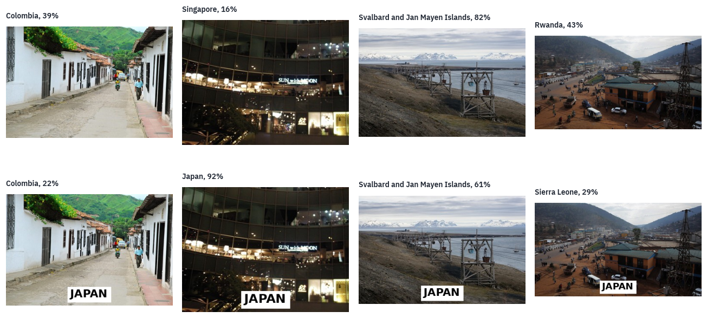

*Photos: Country211 (OpenAI, from YFCC100M, Creative Commons licences).*

A word a twenty-fifth of the photo's height moves about one photo in five to Japan; a word a seventh of its height moves more than half of them. The control shows what the attack is not.

PHOTO in the same white box also costs some correct answers, because the box hides part of the scene, but it sends none of them to Japan. It is the meaning of the word that does the work.

The four examples show the range: the night-time building goes to Japan with high confidence, the Colombian street and Svalbard keep their country with less certainty than before, and the Rwandan town goes to Sierra Leone, unsettled by the box without being convinced by the word.

This is what the introduction meant by a bug that can't be patched. On the internet the words in a picture are very often the best clue to what it shows, and a model trained to match pictures with their captions learns to read them and to trust them, because trusting them lowers its loss.

Goh and colleagues found single neurons in CLIP that respond to a concept whether it appears as a picture or as written text. Reading is one of CLIP's skills, and the attack is that skill turned against it.

## 9. SigLIP asks every pair for a yes or a no

CLIP's loss has a property that matters at scale: a row of the table can't be normalised until every caption of the batch has been compared with that photo.

With a batch of 32,768 spread over hundreds of accelerators, every device has to collect every other device's vectors before computing anything, and the batch size, which the loss depends on, is bounded by the memory for that $$N \times N$$ table.

In 2023 Zhai, Mustafa, Kolesnikov and Beyer at Google replaced the softmax with a sigmoid. Each cell of the table
becomes its own binary question, *do this photo and this caption belong together?*, with the answer $$z_{ij} = 1$$ on
the diagonal and $$z_{ij} = -1$$ elsewhere:

$$\mathcal{L} = -\frac{1}{N} \sum_{i=1}^{N} \sum_{j=1}^{N} \log \sigma\!\left( z_{ij} \,(t \, u_i \cdot v_j + b)\right),$$

where $$\sigma(x) = 1/(1+e^{-x})$$, $$t$$ is a learned scale (the inverse temperature) and $$b$$ a learned bias. For a true
pair, the term is small when $$t\,u_i \cdot v_i + b$$ is large and positive; for a wrong pair, when it is large and
negative. No cell needs any other.


**Why a bias, and why it starts at −10.** In a batch of $$N$$ pairs there are $$N$$ right cells and $$N^2 - N$$ wrong
ones. At the start of training all cosines are similar, and with $$b = 0$$ every cell would say "yes" with probability
about one half: the $$N^2 - N$$ wrong cells would flood the loss and the first steps would be spent learning that most
pairs don't match. The paper starts with $$b = -10$$, so that every cell starts at "no" with probability
$$\sigma(10) \approx 0.99995$$, and $$t = 10$$. Here is the loss on our batch of eight, from CLIP's cosines, at SigLIP's
starting values:

```python
def sigmoid_loss(cosine, t, b):
    n = len(cosine)
    answers = 2 * torch.eye(n) - 1  # +1 on the diagonal, -1 elsewhere
    return -F.logsigmoid(answers * (t * cosine + b)).sum() / n


print(
    "sigmoid loss at t = 10, b = -10:",
    round(sigmoid_loss(cosine, 10.0, -10.0).item(), 3),
)
print("the same with b = 0:", round(sigmoid_loss(cosine, 10.0, 0.0).item(), 3))
```

<pre class="tfs-printed" markdown="0"><code>sigmoid loss at t = 10, b = -10: 6.997
the same with b = 0: 11.531</code></pre>

At $$b = -10$$ almost all of the loss comes from the eight right pairs. Every cell starts at "no", so the 56 wrong cells cost next to nothing, and the gradient points at what there is to learn, saying yes to the pairs that match.

At $$b = 0$$ the loss is larger, and most of it comes from the 56 wrong cells: with CLIP's small positive cosines every one of them leans towards "yes". In a batch of thousands the wrong cells would outnumber the right ones by thousands to one.

Because the cells are independent, the table can be computed in blocks: each device keeps its photos, the captions
move from device to device, and each block's loss is added as soon as it exists. The paper calls this the *chunked*
implementation; no device ever holds the full table.

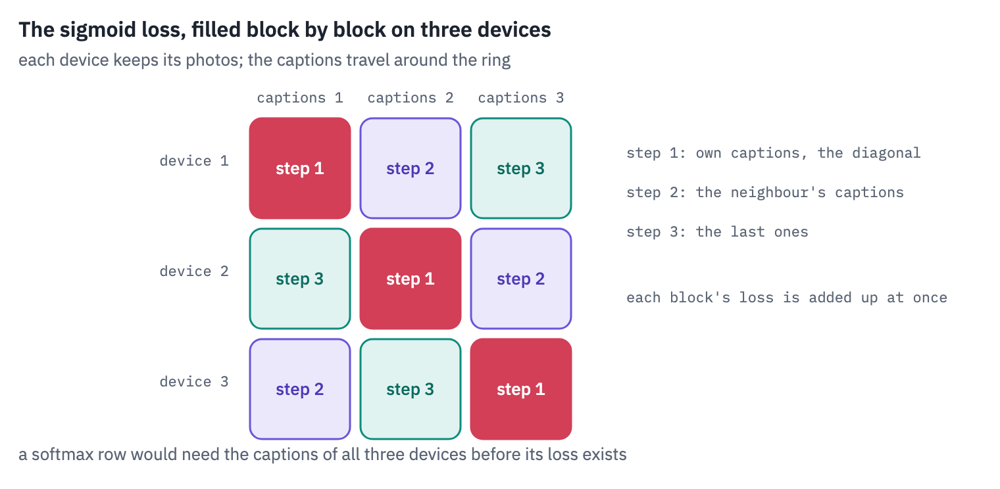
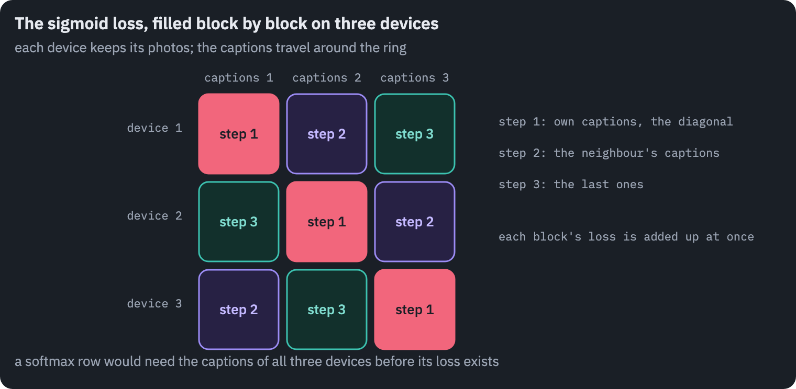

### The SigLIP model

Google's SigLIP checkpoints differ from CLIP in more than the loss. We load the base model, with patches of 16 and
196 of them, and look at its two parameters of the loss and its towers.

```python
SIGLIP = "google/siglip-base-patch16-224"
siglip = AutoModel.from_pretrained(SIGLIP).to(device).eval()
siglip_processor = AutoProcessor.from_pretrained(SIGLIP)
print("t =", round(siglip.logit_scale.exp().item(), 2))
print("b =", round(siglip.logit_bias.item(), 2))
threshold = -siglip.logit_bias.item() / siglip.logit_scale.exp().item()
print("a pair says yes above a cosine of", round(threshold, 3))
print(
    "text tower:",
    siglip.config.text_config.num_hidden_layers,
    "blocks of",
    siglip.config.text_config.hidden_size,
)
print(
    "image tower:",
    siglip.config.vision_config.num_hidden_layers,
    "blocks of",
    siglip.config.vision_config.hidden_size,
)
```

<pre class="tfs-printed" markdown="0"><code>t = 117.33
b = -12.93
a pair says yes above a cosine of 0.11
text tower: 12 blocks of 768
image tower: 12 blocks of 768</code></pre>

Training moved both a long way from their starting values, the scale from 10 to more than a hundred, the bias further below −10.

What decides the answer is their ratio: a pair says yes when $$t\, u \cdot v + b > 0$$, that is above the cosine printed last. It is a low bar, and it fits what we saw in CLIP: in these spaces even the right pairs have small cosines.

**No class token.** SigLIP's image tower doesn't prepend a class token. After the blocks, one learned vector, the *probe*, attends to all 196 patch outputs as a single query; the result goes through a layer norm and an MLP with a residual connection.

Google's Vision Transformer papers call it *multihead attention pooling*, MAP. It is attention with a sequence of queries of length one, and we can compute it by hand from the checkpoint's weights:

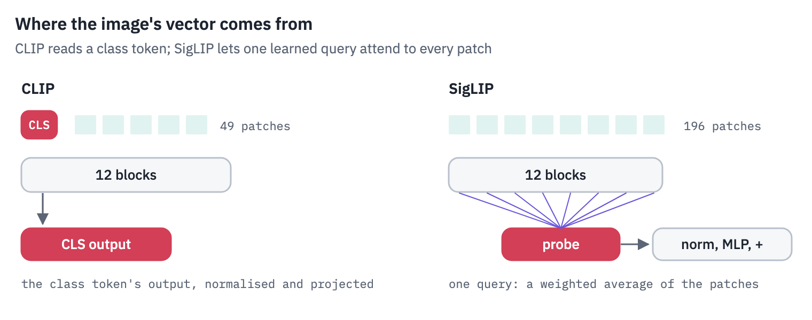
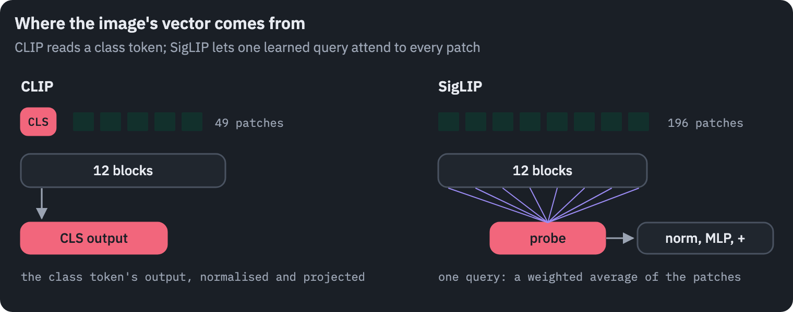

```python
image_processor = siglip_processor.image_processor
SIG_MEAN = torch.tensor(image_processor.image_mean).reshape(3, 1, 1)
SIG_STD = torch.tensor(image_processor.image_std).reshape(3, 1, 1)
SIG_SIZE = image_processor.size["height"]


def siglip_pixels(photo, size=SIG_SIZE):
    photo = photo.resize(
        (size, size), Image.BICUBIC
    )  # SigLIP squashes, as lesson 11's ViT did
    pixels = torch.tensor(np.asarray(photo), dtype=torch.float32).permute(2, 0, 1) / 255
    return (pixels - SIG_MEAN) / SIG_STD


head = siglip.vision_model.head
with torch.no_grad():
    pixels = siglip_pixels(photo)[None].to(device)
    out = siglip.vision_model(pixel_values=pixels)
    patches_out = out.last_hidden_state  # (1, 196, 768): no class token
    d = patches_out.shape[-1]
    heads = head.attention.num_heads
    w_query, w_key, w_value = head.attention.in_proj_weight.split(d)
    b_query, b_key, b_value = head.attention.in_proj_bias.split(d)
    q = (head.probe @ w_query.T + b_query).view(1, 1, heads, d // heads).transpose(1, 2)
    k = (patches_out @ w_key.T + b_key).view(1, -1, heads, d // heads).transpose(1, 2)
    v = (
        (patches_out @ w_value.T + b_value)
        .view(1, -1, heads, d // heads)
        .transpose(1, 2)
    )
    attention = (q @ k.transpose(-1, -2) / math.sqrt(d // heads)).softmax(dim=-1)
    pooled = head.attention.out_proj((attention @ v).transpose(1, 2).reshape(1, 1, d))
    pooled = pooled + head.mlp(head.layernorm(pooled))
print("patch outputs:", tuple(patches_out.shape))
print(
    "the probe's attention:",
    tuple(attention.shape),
    "(batch, heads, one query, 196 patches)",
)
print(
    "our pooling against the model's, largest difference:",
    (pooled[0, 0] - out.pooler_output[0]).abs().max().item(),
)
```

<pre class="tfs-printed" markdown="0"><code>patch outputs: (1, 196, 768)
the probe&#x27;s attention: (1, 12, 1, 196) (batch, heads, one query, 196 patches)
our pooling against the model&#x27;s, largest difference: 3.5762786865234375e-07</code></pre>

```python
side = int(math.sqrt(attention.shape[-1]))
fig, axes = plt.subplots(1, 5, figsize=(12, 3))
axes[0].imshow(photo.resize((SIG_SIZE, SIG_SIZE)))
axes[0].set_title("the photo", fontsize=10)
for ax, h in zip(axes[1:], [0, 3, 6, 9]):
    ax.imshow(attention[0, h, 0].reshape(side, side).cpu(), cmap=heat)
    ax.set_title(f"head {h}", fontsize=10)
for ax in axes:
    ax.axis("off")
fig.suptitle("where the probe looks, four of its twelve heads", x=0.56, fontsize=11)
plt.show()
```

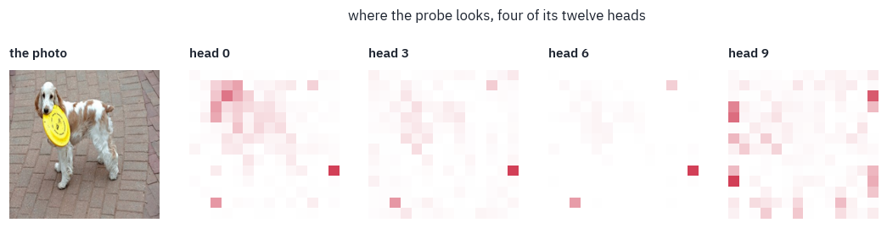

The probe doesn't look where a person would. Head 0 spreads over the dog's head and the frisbee, but heads 3 and 6 put their largest weight on one and the same patch of bricks at the right edge of the photo, far from the dog, and head 9 scatters its weight along the edges of the frame.

As in lesson 11, a single layer of attention tells little: after twelve blocks every patch's vector has mixed with all the others, so a patch of bricks at the top of the tower no longer holds only bricks. The pooled vector is what the twelve heads assemble together.

**The text tower and its padding.** SigLIP's text tower also takes the output at the last position, but it was trained on captions always padded to 64 tokens, so "the last position" is a padding token, and the model learned to put its summary there.

Padding a batch only to its longest caption, as one does for CLIP, moves the last position and quietly changes the vectors. We search the 5,000 COCO photos with the first caption of each, padded both ways:

```python
@torch.no_grad()
def siglip_texts(texts, padding="max_length", batch_size=512):
    vectors = []
    for start in range(0, len(texts), batch_size):
        chunk = list(texts[start : start + batch_size])
        tokens = siglip_processor.tokenizer(
            chunk, padding=padding, truncation=True, max_length=64, return_tensors="pt"
        ).to(device)
        with torch.autocast(device, dtype=torch.float16, enabled=device == "cuda"):
            out = siglip.text_model(input_ids=tokens["input_ids"]).pooler_output
        vectors.append(F.normalize(out.float(), dim=-1).cpu())
    return torch.cat(vectors)


def siglip_image(pixels):
    return siglip.vision_model(pixel_values=pixels).pooler_output


start = time.time()
siglip_geo_photos = embed_photos(geo_thumbs, siglip_pixels, siglip_image, 128)
siglip_coco_photos = embed_photos(coco_thumbs, siglip_pixels, siglip_image, 128)
print(f"SigLIP photo vectors in {time.time() - start:.0f} s")
first_captions = [captions[i] for i in first.tolist()]
padded = siglip_texts(first_captions, padding="max_length")
unpadded = siglip_texts(first_captions, padding="longest")
print(
    "cosine between the two versions of the same caption:",
    round((padded * unpadded).sum(-1).mean().item(), 3),
)
answers = torch.arange(len(first_captions))
rows = [
    {
        "captions padded to": "64 tokens, as in training",
        **summary(text_to_image(padded, siglip_coco_photos, answers)),
    },
    {
        "captions padded to": "the longest in the batch",
        **summary(text_to_image(unpadded, siglip_coco_photos, answers)),
    },
]
table(pd.DataFrame(rows), digits=3)
```

<pre class="tfs-printed" markdown="0"><code>SigLIP photo vectors in 130 s
cosine between the two versions of the same caption: 0.522</code></pre>

<div class="tfs-table-wrap"><table class="tfs-table" style="border-collapse:collapse;font-family:'IBM Plex Sans', -apple-system, 'Segoe UI', Roboto, Helvetica, Arial, sans-serif;font-size:13.5px;line-height:1.45;margin:4px 0 8px;"><thead><tr><th style="padding:7px 14px;border-bottom:2px solid #B9C0CB;font-weight:600;color:#5B6575;font-size:12px;letter-spacing:0.02em;text-align:left;">captions padded to</th><th style="padding:7px 14px;border-bottom:2px solid #B9C0CB;font-weight:600;color:#5B6575;font-size:12px;letter-spacing:0.02em;text-align:right;">recall@1</th><th style="padding:7px 14px;border-bottom:2px solid #B9C0CB;font-weight:600;color:#5B6575;font-size:12px;letter-spacing:0.02em;text-align:right;">recall@5</th><th style="padding:7px 14px;border-bottom:2px solid #B9C0CB;font-weight:600;color:#5B6575;font-size:12px;letter-spacing:0.02em;text-align:right;">recall@10</th><th style="padding:7px 14px;border-bottom:2px solid #B9C0CB;font-weight:600;color:#5B6575;font-size:12px;letter-spacing:0.02em;text-align:right;">median rank</th></tr></thead><tbody><tr><td style="padding:7px 14px;border-bottom:1px solid #E6E9EE;vertical-align:top;text-align:left;max-width:460px;white-space:normal;">64 tokens, as in training</td><td style="padding:7px 14px;border-bottom:1px solid #E6E9EE;vertical-align:top;text-align:right;font-variant-numeric:tabular-nums;max-width:460px;white-space:normal;">0.456</td><td style="padding:7px 14px;border-bottom:1px solid #E6E9EE;vertical-align:top;text-align:right;font-variant-numeric:tabular-nums;max-width:460px;white-space:normal;">0.705</td><td style="padding:7px 14px;border-bottom:1px solid #E6E9EE;vertical-align:top;text-align:right;font-variant-numeric:tabular-nums;max-width:460px;white-space:normal;">0.794</td><td style="padding:7px 14px;border-bottom:1px solid #E6E9EE;vertical-align:top;text-align:right;font-variant-numeric:tabular-nums;max-width:460px;white-space:normal;">2.000</td></tr><tr><td style="padding:7px 14px;border-bottom:1px solid #E6E9EE;vertical-align:top;text-align:left;max-width:460px;white-space:normal;">the longest in the batch</td><td style="padding:7px 14px;border-bottom:1px solid #E6E9EE;vertical-align:top;text-align:right;font-variant-numeric:tabular-nums;max-width:460px;white-space:normal;">0.079</td><td style="padding:7px 14px;border-bottom:1px solid #E6E9EE;vertical-align:top;text-align:right;font-variant-numeric:tabular-nums;max-width:460px;white-space:normal;">0.187</td><td style="padding:7px 14px;border-bottom:1px solid #E6E9EE;vertical-align:top;text-align:right;font-variant-numeric:tabular-nums;max-width:460px;white-space:normal;">0.250</td><td style="padding:7px 14px;border-bottom:1px solid #E6E9EE;vertical-align:top;text-align:right;font-variant-numeric:tabular-nums;max-width:460px;white-space:normal;">68.000</td></tr></tbody></table></div>

The same caption padded two ways gives two vectors whose cosine is about one half, as if they were two different sentences.

Search with the shorter padding collapses: the right photo comes first for a small fraction of the captions instead of nearly half, and its median rank drops from the top two to several dozen places down.

Nothing raises an error; the model simply reads its summary from the wrong position. When a SigLIP checkpoint seems to work badly, the padding is the first thing to check.

### CLIP and SigLIP on the same tasks

The two models aren't a controlled comparison: SigLIP's image tower uses patches of 16 instead of 32, so it sees four
times as many patches, and it was trained on Google's WebLI dataset, not on OpenAI's. With that caveat, here they
are on geolocation, with the paper's five sentences, and on both directions of search:

```python
siglip_geo = country_classifier(PAPER_TEMPLATES, encode=siglip_texts)
rows = []
for name, geo_vectors, classifier in [
    ("CLIP ViT-B/32", clip_geo_photos, clip_geo),
    ("SigLIP B/16", siglip_geo_photos, siglip_geo),
]:
    top1, within5 = accuracy(geo_vectors @ classifier.T, geo_truth)
    rows.append({"model": name, "geolocation top-1": top1, "in the top 5": within5})
siglip_captions = siglip_texts(captions)
search_rows += [
    {
        "model": "SigLIP B/16",
        "search": "caption → photo",
        **summary(text_to_image(siglip_captions, siglip_coco_photos, owner)),
    },
    {
        "model": "SigLIP B/16",
        "search": "photo → caption",
        **summary(image_to_text(siglip_coco_photos, siglip_captions, owner)),
    },
]
display(table(pd.DataFrame(rows), digits=3))
table(pd.DataFrame(search_rows), digits=3)
```

<div class="tfs-table-wrap"><table class="tfs-table" style="border-collapse:collapse;font-family:'IBM Plex Sans', -apple-system, 'Segoe UI', Roboto, Helvetica, Arial, sans-serif;font-size:13.5px;line-height:1.45;margin:4px 0 8px;"><thead><tr><th style="padding:7px 14px;border-bottom:2px solid #B9C0CB;font-weight:600;color:#5B6575;font-size:12px;letter-spacing:0.02em;text-align:left;">model</th><th style="padding:7px 14px;border-bottom:2px solid #B9C0CB;font-weight:600;color:#5B6575;font-size:12px;letter-spacing:0.02em;text-align:right;">geolocation top-1</th><th style="padding:7px 14px;border-bottom:2px solid #B9C0CB;font-weight:600;color:#5B6575;font-size:12px;letter-spacing:0.02em;text-align:right;">in the top 5</th></tr></thead><tbody><tr><td style="padding:7px 14px;border-bottom:1px solid #E6E9EE;vertical-align:top;text-align:left;max-width:460px;white-space:normal;">CLIP ViT-B/32</td><td style="padding:7px 14px;border-bottom:1px solid #E6E9EE;vertical-align:top;text-align:right;font-variant-numeric:tabular-nums;max-width:460px;white-space:normal;">0.172</td><td style="padding:7px 14px;border-bottom:1px solid #E6E9EE;vertical-align:top;text-align:right;font-variant-numeric:tabular-nums;max-width:460px;white-space:normal;">0.402</td></tr><tr><td style="padding:7px 14px;border-bottom:1px solid #E6E9EE;vertical-align:top;text-align:left;max-width:460px;white-space:normal;">SigLIP B/16</td><td style="padding:7px 14px;border-bottom:1px solid #E6E9EE;vertical-align:top;text-align:right;font-variant-numeric:tabular-nums;max-width:460px;white-space:normal;">0.159</td><td style="padding:7px 14px;border-bottom:1px solid #E6E9EE;vertical-align:top;text-align:right;font-variant-numeric:tabular-nums;max-width:460px;white-space:normal;">0.361</td></tr></tbody></table></div>

<div class="tfs-table-wrap"><table class="tfs-table" style="border-collapse:collapse;font-family:'IBM Plex Sans', -apple-system, 'Segoe UI', Roboto, Helvetica, Arial, sans-serif;font-size:13.5px;line-height:1.45;margin:4px 0 8px;"><thead><tr><th style="padding:7px 14px;border-bottom:2px solid #B9C0CB;font-weight:600;color:#5B6575;font-size:12px;letter-spacing:0.02em;text-align:left;">model</th><th style="padding:7px 14px;border-bottom:2px solid #B9C0CB;font-weight:600;color:#5B6575;font-size:12px;letter-spacing:0.02em;text-align:left;">search</th><th style="padding:7px 14px;border-bottom:2px solid #B9C0CB;font-weight:600;color:#5B6575;font-size:12px;letter-spacing:0.02em;text-align:right;">recall@1</th><th style="padding:7px 14px;border-bottom:2px solid #B9C0CB;font-weight:600;color:#5B6575;font-size:12px;letter-spacing:0.02em;text-align:right;">recall@5</th><th style="padding:7px 14px;border-bottom:2px solid #B9C0CB;font-weight:600;color:#5B6575;font-size:12px;letter-spacing:0.02em;text-align:right;">recall@10</th><th style="padding:7px 14px;border-bottom:2px solid #B9C0CB;font-weight:600;color:#5B6575;font-size:12px;letter-spacing:0.02em;text-align:right;">median rank</th></tr></thead><tbody><tr><td style="padding:7px 14px;border-bottom:1px solid #E6E9EE;vertical-align:top;text-align:left;max-width:460px;white-space:normal;">CLIP ViT-B/32</td><td style="padding:7px 14px;border-bottom:1px solid #E6E9EE;vertical-align:top;text-align:left;max-width:460px;white-space:normal;">caption → photo</td><td style="padding:7px 14px;border-bottom:1px solid #E6E9EE;vertical-align:top;text-align:right;font-variant-numeric:tabular-nums;max-width:460px;white-space:normal;">0.312</td><td style="padding:7px 14px;border-bottom:1px solid #E6E9EE;vertical-align:top;text-align:right;font-variant-numeric:tabular-nums;max-width:460px;white-space:normal;">0.565</td><td style="padding:7px 14px;border-bottom:1px solid #E6E9EE;vertical-align:top;text-align:right;font-variant-numeric:tabular-nums;max-width:460px;white-space:normal;">0.674</td><td style="padding:7px 14px;border-bottom:1px solid #E6E9EE;vertical-align:top;text-align:right;font-variant-numeric:tabular-nums;max-width:460px;white-space:normal;">4.000</td></tr><tr><td style="padding:7px 14px;border-bottom:1px solid #E6E9EE;vertical-align:top;text-align:left;max-width:460px;white-space:normal;">CLIP ViT-B/32</td><td style="padding:7px 14px;border-bottom:1px solid #E6E9EE;vertical-align:top;text-align:left;max-width:460px;white-space:normal;">photo → caption</td><td style="padding:7px 14px;border-bottom:1px solid #E6E9EE;vertical-align:top;text-align:right;font-variant-numeric:tabular-nums;max-width:460px;white-space:normal;">0.500</td><td style="padding:7px 14px;border-bottom:1px solid #E6E9EE;vertical-align:top;text-align:right;font-variant-numeric:tabular-nums;max-width:460px;white-space:normal;">0.750</td><td style="padding:7px 14px;border-bottom:1px solid #E6E9EE;vertical-align:top;text-align:right;font-variant-numeric:tabular-nums;max-width:460px;white-space:normal;">0.833</td><td style="padding:7px 14px;border-bottom:1px solid #E6E9EE;vertical-align:top;text-align:right;font-variant-numeric:tabular-nums;max-width:460px;white-space:normal;">1.000</td></tr><tr><td style="padding:7px 14px;border-bottom:1px solid #E6E9EE;vertical-align:top;text-align:left;max-width:460px;white-space:normal;">CLIP, captions moved across the gap</td><td style="padding:7px 14px;border-bottom:1px solid #E6E9EE;vertical-align:top;text-align:left;max-width:460px;white-space:normal;">caption → photo</td><td style="padding:7px 14px;border-bottom:1px solid #E6E9EE;vertical-align:top;text-align:right;font-variant-numeric:tabular-nums;max-width:460px;white-space:normal;">0.186</td><td style="padding:7px 14px;border-bottom:1px solid #E6E9EE;vertical-align:top;text-align:right;font-variant-numeric:tabular-nums;max-width:460px;white-space:normal;">0.382</td><td style="padding:7px 14px;border-bottom:1px solid #E6E9EE;vertical-align:top;text-align:right;font-variant-numeric:tabular-nums;max-width:460px;white-space:normal;">0.483</td><td style="padding:7px 14px;border-bottom:1px solid #E6E9EE;vertical-align:top;text-align:right;font-variant-numeric:tabular-nums;max-width:460px;white-space:normal;">12.000</td></tr><tr><td style="padding:7px 14px;border-bottom:1px solid #E6E9EE;vertical-align:top;text-align:left;max-width:460px;white-space:normal;">SigLIP B/16</td><td style="padding:7px 14px;border-bottom:1px solid #E6E9EE;vertical-align:top;text-align:left;max-width:460px;white-space:normal;">caption → photo</td><td style="padding:7px 14px;border-bottom:1px solid #E6E9EE;vertical-align:top;text-align:right;font-variant-numeric:tabular-nums;max-width:460px;white-space:normal;">0.477</td><td style="padding:7px 14px;border-bottom:1px solid #E6E9EE;vertical-align:top;text-align:right;font-variant-numeric:tabular-nums;max-width:460px;white-space:normal;">0.721</td><td style="padding:7px 14px;border-bottom:1px solid #E6E9EE;vertical-align:top;text-align:right;font-variant-numeric:tabular-nums;max-width:460px;white-space:normal;">0.807</td><td style="padding:7px 14px;border-bottom:1px solid #E6E9EE;vertical-align:top;text-align:right;font-variant-numeric:tabular-nums;max-width:460px;white-space:normal;">2.000</td></tr><tr><td style="padding:7px 14px;border-bottom:1px solid #E6E9EE;vertical-align:top;text-align:left;max-width:460px;white-space:normal;">SigLIP B/16</td><td style="padding:7px 14px;border-bottom:1px solid #E6E9EE;vertical-align:top;text-align:left;max-width:460px;white-space:normal;">photo → caption</td><td style="padding:7px 14px;border-bottom:1px solid #E6E9EE;vertical-align:top;text-align:right;font-variant-numeric:tabular-nums;max-width:460px;white-space:normal;">0.657</td><td style="padding:7px 14px;border-bottom:1px solid #E6E9EE;vertical-align:top;text-align:right;font-variant-numeric:tabular-nums;max-width:460px;white-space:normal;">0.862</td><td style="padding:7px 14px;border-bottom:1px solid #E6E9EE;vertical-align:top;text-align:right;font-variant-numeric:tabular-nums;max-width:460px;white-space:normal;">0.918</td><td style="padding:7px 14px;border-bottom:1px solid #E6E9EE;vertical-align:top;text-align:right;font-variant-numeric:tabular-nums;max-width:460px;white-space:normal;">1.000</td></tr></tbody></table></div>

OpenCLIP's benchmark of this SigLIP checkpoint reports 15.9% on Country211, and a recall of 47.8%, 72.4% and 81.0%
for caption → photo on COCO, 65.7%, 85.4% and 91.3% for photo → caption. Ours agree with these to within a point
again.

The two tasks rank the models differently. In search SigLIP is far ahead: for nearly half of the captions the right photo comes first, against almost a third for CLIP. In geolocation CLIP is slightly ahead, and not because it had seen the photos.

Country211 was built from YFCC100M, part of which is in OpenAI's training data, and the paper checked: 21.5% of Country211's test photos turned up among the training images, yet they raised the score by only 0.2 points, because the text next to them rarely said where they were taken.

The rest of the difference most likely lies in the two training sets, OpenAI's collection and Google's WebLI, neither of which has been published.

**A score for a single pair.** A softmax score only says which caption wins within a batch; SigLIP's sigmoid scores
each pair on its own, so $$\sigma(t\, u \cdot v + b)$$ can be read as the model's answer to *do these two belong
together?* Here it is for every COCO photo with its own first caption and with someone else's:

```python
t = siglip.logit_scale.exp().item()
b = siglip.logit_bias.item()
own = torch.sigmoid(t * (siglip_coco_photos * padded).sum(-1) + b)
other = torch.sigmoid(t * (siglip_coco_photos * padded[mixed]).sum(-1) + b)
rows = [
    {
        "pair": "a photo and its caption",
        "mean yes": own.mean().item(),
        "share above one half": (own > 0.5).float().mean().item(),
    },
    {
        "pair": "a photo and a random caption",
        "mean yes": other.mean().item(),
        "share above one half": (other > 0.5).float().mean().item(),
    },
]
table(pd.DataFrame(rows), digits=3)
```

<div class="tfs-table-wrap"><table class="tfs-table" style="border-collapse:collapse;font-family:'IBM Plex Sans', -apple-system, 'Segoe UI', Roboto, Helvetica, Arial, sans-serif;font-size:13.5px;line-height:1.45;margin:4px 0 8px;"><thead><tr><th style="padding:7px 14px;border-bottom:2px solid #B9C0CB;font-weight:600;color:#5B6575;font-size:12px;letter-spacing:0.02em;text-align:left;">pair</th><th style="padding:7px 14px;border-bottom:2px solid #B9C0CB;font-weight:600;color:#5B6575;font-size:12px;letter-spacing:0.02em;text-align:right;">mean yes</th><th style="padding:7px 14px;border-bottom:2px solid #B9C0CB;font-weight:600;color:#5B6575;font-size:12px;letter-spacing:0.02em;text-align:right;">share above one half</th></tr></thead><tbody><tr><td style="padding:7px 14px;border-bottom:1px solid #E6E9EE;vertical-align:top;text-align:left;max-width:460px;white-space:normal;">a photo and its caption</td><td style="padding:7px 14px;border-bottom:1px solid #E6E9EE;vertical-align:top;text-align:right;font-variant-numeric:tabular-nums;max-width:460px;white-space:normal;">0.542</td><td style="padding:7px 14px;border-bottom:1px solid #E6E9EE;vertical-align:top;text-align:right;font-variant-numeric:tabular-nums;max-width:460px;white-space:normal;">0.545</td></tr><tr><td style="padding:7px 14px;border-bottom:1px solid #E6E9EE;vertical-align:top;text-align:left;max-width:460px;white-space:normal;">a photo and a random caption</td><td style="padding:7px 14px;border-bottom:1px solid #E6E9EE;vertical-align:top;text-align:right;font-variant-numeric:tabular-nums;max-width:460px;white-space:normal;">0.001</td><td style="padding:7px 14px;border-bottom:1px solid #E6E9EE;vertical-align:top;text-align:right;font-variant-numeric:tabular-nums;max-width:460px;white-space:normal;">0.000</td></tr></tbody></table></div>

For a random caption the answer is no, almost without exception. For the photo's own caption it is yes only about half of the time: the threshold printed earlier sits in the middle of where the true pairs fall.

The model was trained to tell matching pairs from the rest, not to be sure of each one, so many true pairs end up just below the line.

The score is still useful on its own, which a softmax over a batch is not: random pairs almost never get a yes, so a yes means something even with nothing to compare it to.

And the word on the photo, for SigLIP:

```python
siglip_predicted = (siglip_geo_photos @ siglip_geo.T).argmax(dim=-1)
table(
    attack(siglip_pixels, siglip_image, siglip_geo, placed_right(siglip_predicted)),
    digits=3,
)
```

<div class="tfs-table-wrap"><table class="tfs-table" style="border-collapse:collapse;font-family:'IBM Plex Sans', -apple-system, 'Segoe UI', Roboto, Helvetica, Arial, sans-serif;font-size:13.5px;line-height:1.45;margin:4px 0 8px;"><thead><tr><th style="padding:7px 14px;border-bottom:2px solid #B9C0CB;font-weight:600;color:#5B6575;font-size:12px;letter-spacing:0.02em;text-align:left;">word</th><th style="padding:7px 14px;border-bottom:2px solid #B9C0CB;font-weight:600;color:#5B6575;font-size:12px;letter-spacing:0.02em;text-align:right;">text height</th><th style="padding:7px 14px;border-bottom:2px solid #B9C0CB;font-weight:600;color:#5B6575;font-size:12px;letter-spacing:0.02em;text-align:right;">now placed in Japan</th><th style="padding:7px 14px;border-bottom:2px solid #B9C0CB;font-weight:600;color:#5B6575;font-size:12px;letter-spacing:0.02em;text-align:right;">still placed correctly</th></tr></thead><tbody><tr><td style="padding:7px 14px;border-bottom:1px solid #E6E9EE;vertical-align:top;text-align:left;max-width:460px;white-space:normal;">JAPAN</td><td style="padding:7px 14px;border-bottom:1px solid #E6E9EE;vertical-align:top;text-align:right;font-variant-numeric:tabular-nums;max-width:460px;white-space:normal;">0.040</td><td style="padding:7px 14px;border-bottom:1px solid #E6E9EE;vertical-align:top;text-align:right;font-variant-numeric:tabular-nums;max-width:460px;white-space:normal;">0.520</td><td style="padding:7px 14px;border-bottom:1px solid #E6E9EE;vertical-align:top;text-align:right;font-variant-numeric:tabular-nums;max-width:460px;white-space:normal;">0.385</td></tr><tr><td style="padding:7px 14px;border-bottom:1px solid #E6E9EE;vertical-align:top;text-align:left;max-width:460px;white-space:normal;">JAPAN</td><td style="padding:7px 14px;border-bottom:1px solid #E6E9EE;vertical-align:top;text-align:right;font-variant-numeric:tabular-nums;max-width:460px;white-space:normal;">0.070</td><td style="padding:7px 14px;border-bottom:1px solid #E6E9EE;vertical-align:top;text-align:right;font-variant-numeric:tabular-nums;max-width:460px;white-space:normal;">0.635</td><td style="padding:7px 14px;border-bottom:1px solid #E6E9EE;vertical-align:top;text-align:right;font-variant-numeric:tabular-nums;max-width:460px;white-space:normal;">0.310</td></tr><tr><td style="padding:7px 14px;border-bottom:1px solid #E6E9EE;vertical-align:top;text-align:left;max-width:460px;white-space:normal;">JAPAN</td><td style="padding:7px 14px;border-bottom:1px solid #E6E9EE;vertical-align:top;text-align:right;font-variant-numeric:tabular-nums;max-width:460px;white-space:normal;">0.100</td><td style="padding:7px 14px;border-bottom:1px solid #E6E9EE;vertical-align:top;text-align:right;font-variant-numeric:tabular-nums;max-width:460px;white-space:normal;">0.735</td><td style="padding:7px 14px;border-bottom:1px solid #E6E9EE;vertical-align:top;text-align:right;font-variant-numeric:tabular-nums;max-width:460px;white-space:normal;">0.215</td></tr><tr><td style="padding:7px 14px;border-bottom:1px solid #E6E9EE;vertical-align:top;text-align:left;max-width:460px;white-space:normal;">JAPAN</td><td style="padding:7px 14px;border-bottom:1px solid #E6E9EE;vertical-align:top;text-align:right;font-variant-numeric:tabular-nums;max-width:460px;white-space:normal;">0.150</td><td style="padding:7px 14px;border-bottom:1px solid #E6E9EE;vertical-align:top;text-align:right;font-variant-numeric:tabular-nums;max-width:460px;white-space:normal;">0.865</td><td style="padding:7px 14px;border-bottom:1px solid #E6E9EE;vertical-align:top;text-align:right;font-variant-numeric:tabular-nums;max-width:460px;white-space:normal;">0.100</td></tr><tr><td style="padding:7px 14px;border-bottom:1px solid #E6E9EE;vertical-align:top;text-align:left;max-width:460px;white-space:normal;">PHOTO</td><td style="padding:7px 14px;border-bottom:1px solid #E6E9EE;vertical-align:top;text-align:right;font-variant-numeric:tabular-nums;max-width:460px;white-space:normal;">0.100</td><td style="padding:7px 14px;border-bottom:1px solid #E6E9EE;vertical-align:top;text-align:right;font-variant-numeric:tabular-nums;max-width:460px;white-space:normal;">0.000</td><td style="padding:7px 14px;border-bottom:1px solid #E6E9EE;vertical-align:top;text-align:right;font-variant-numeric:tabular-nums;max-width:460px;white-space:normal;">0.860</td></tr></tbody></table></div>

SigLIP reads even more willingly than CLIP. The smallest word moves about half of its correct answers to Japan, where CLIP lost one in five, and the largest moves most of them; PHOTO, again, moves none.

Its finer grid of patches probably sees small letters better, which helps it read signs and labels in ordinary photos, and the same skill makes it easier to fool.

## 10. The two losses, trained side by side

The SigLIP paper's central claim is about batch size: the sigmoid loss is better than the softmax at small batches and as good at large ones.

Training a CLIP from scratch takes far more than a notebook has, but the claim can be tested in miniature, in the spirit of Google's *LiT*, which keeps a pretrained image tower frozen. We go further and freeze both towers, training only what joins them.

Our towers come from earlier lessons: DINOv2-small, the self-supervised ViT of lesson 11, for the photos, and all-MiniLM-L6-v2, the sentence encoder of lesson 3, for the captions. Neither has ever seen the other's kind of input.

The training pairs come from two of the fourteen shards of COCO's training set, none of whose photos is among the 5,000 we test on; the photos go from the stream straight into DINOv2, and only their vectors are kept.

Then we train two linear projections into a common space of 256 numbers, with either loss, on batches from 16 to 1,024 pairs, three seeds each. The test is the search of section 6: 25,010 captions, each looking for its photo among the 5,000.

```python
dino = AutoModel.from_pretrained("facebook/dinov2-small").to(device).eval()
dino_processor = AutoImageProcessor.from_pretrained("facebook/dinov2-small")
DINO_MEAN = torch.tensor(dino_processor.image_mean).reshape(3, 1, 1)
DINO_STD = torch.tensor(dino_processor.image_std).reshape(3, 1, 1)


def dino_pixels(photo, size=224):
    width, height = photo.size
    scale = 256 / min(width, height)
    photo = photo.resize(
        (max(256, int(width * scale)), max(256, int(height * scale))), Image.BICUBIC
    )
    left, top = (photo.width - size) // 2, (photo.height - size) // 2
    photo = photo.crop((left, top, left + size, top + size))
    pixels = torch.tensor(np.asarray(photo), dtype=torch.float32).permute(2, 0, 1) / 255
    return (pixels - DINO_MEAN) / DINO_STD


def dino_image(pixels):
    return dino(pixel_values=pixels).pooler_output


minilm_tokenizer = AutoTokenizer.from_pretrained(
    "sentence-transformers/all-MiniLM-L6-v2"
)
minilm = (
    AutoModel.from_pretrained("sentence-transformers/all-MiniLM-L6-v2")
    .to(device)
    .eval()
)


@torch.no_grad()
def minilm_texts(texts, batch_size=512):
    vectors = []
    for start in range(0, len(texts), batch_size):
        chunk = list(texts[start : start + batch_size])
        tokens = minilm_tokenizer(
            chunk, padding=True, truncation=True, max_length=64, return_tensors="pt"
        ).to(device)
        hidden = minilm(**tokens).last_hidden_state
        mask = tokens["attention_mask"][..., None].float()
        vectors.append(F.normalize((hidden * mask).sum(1) / mask.sum(1), dim=-1).cpu())
    return torch.cat(vectors)
```

```python
start = time.time()
train_data = read_shards(
    [HUB + f"wds_mscoco_captions/resolve/main/train/{k}.tar" for k in range(2)],
    limit=100 if SMOKE else None,
    label=lambda files: [line.strip() for line in files["txt"].decode().split("\n")],
)
train_photos = embed_photos(
    [thumb for thumb, _ in train_data], dino_pixels, dino_image, 128
)
train_captions = [[c for c in cs if c] for _, cs in train_data]
del train_data  # only the vectors are needed from here on
train_texts = minilm_texts([c for cs in train_captions for c in cs])
caption_count = torch.tensor([len(cs) for cs in train_captions])
caption_start = torch.cat(
    [torch.zeros(1, dtype=torch.long), caption_count.cumsum(0)[:-1]]
)
test_photos = embed_photos(coco_thumbs, dino_pixels, dino_image, 128)
test_texts = minilm_texts(captions)
print(f"training set: {len(train_photos)} photos and {len(train_texts)} captions")
print(
    "photo features:",
    tuple(train_photos.shape),
    "caption features:",
    tuple(train_texts.shape),
)
print(f"in {time.time() - start:.0f} s")
```

<pre class="tfs-printed" markdown="0"><code>training set: 12229 photos and 61180 captions
photo features: (12229, 384) caption features: (61180, 384)
in 126 s</code></pre>

The training loop is the whole method: two linear layers, a learned temperature, and for the sigmoid a learned bias; both losses start from their papers' values, $$1/\tau = 1/0.07$$ for the softmax, $$t = 10, b = -10$$ for the sigmoid.

Each run sees every training photo 30 times, each time with one of its captions picked at random, so a larger batch means fewer, bigger steps.

```python
def train_heads(loss_name, batch_size, seed, epochs=30, width=256, lr=1e-3):
    torch.manual_seed(seed)
    to_space_image = nn.Linear(train_photos.shape[1], width).to(device)
    to_space_text = nn.Linear(train_texts.shape[1], width).to(device)
    if loss_name == "softmax":
        log_scale = nn.Parameter(torch.tensor(math.log(1 / 0.07), device=device))
        bias = torch.tensor(0.0, device=device)
        parameters = [log_scale]
    else:
        log_scale = nn.Parameter(torch.tensor(math.log(10.0), device=device))
        bias = nn.Parameter(torch.tensor(-10.0, device=device))
        parameters = [log_scale, bias]
    parameters += list(to_space_image.parameters()) + list(to_space_text.parameters())
    optimizer = torch.optim.AdamW(parameters, lr=lr, weight_decay=1e-4)
    photos = train_photos.to(device)
    texts = train_texts.to(device)
    starts = caption_start.to(device)
    generator = torch.Generator().manual_seed(seed)
    for _ in range(epochs):
        shuffle = torch.randperm(len(photos), generator=generator).to(device)
        pick = (torch.rand(len(photos), generator=generator) * caption_count).long()
        pick = pick.to(device)  # one caption per photo, a new one every epoch
        for begin in range(0, len(photos) - batch_size + 1, batch_size):
            chunk = shuffle[begin : begin + batch_size]
            u = F.normalize(to_space_image(photos[chunk]), dim=-1)
            v = F.normalize(to_space_text(texts[starts[chunk] + pick[chunk]]), dim=-1)
            cosine = u @ v.T
            if loss_name == "softmax":
                logits = log_scale.exp() * cosine
                labels = torch.arange(len(chunk), device=device)
                loss = (
                    F.cross_entropy(logits, labels) + F.cross_entropy(logits.T, labels)
                ) / 2
            else:
                answers = 2 * torch.eye(len(chunk), device=device) - 1
                loss = -F.logsigmoid(
                    answers * (log_scale.exp() * cosine + bias)
                ).sum() / len(chunk)
            optimizer.zero_grad()
            loss.backward()
            optimizer.step()
            with torch.no_grad():
                log_scale.clamp_(max=math.log(100))
    with torch.no_grad():
        u = F.normalize(to_space_image(test_photos.to(device)), dim=-1).cpu()
        v = F.normalize(to_space_text(test_texts.to(device)), dim=-1).cpu()
    return summary(text_to_image(v, u, owner))
```

```python
BATCHES = [16, 64, 256, 1024] if not SMOKE else [16, 64]
SEEDS = [0, 1, 2] if not SMOKE else [0]
results = []
start = time.time()
for batch_size in BATCHES:
    for loss_name in ["softmax", "sigmoid"]:
        for seed in SEEDS:
            scores = train_heads(loss_name, batch_size, seed)
            results.append(
                {"loss": loss_name, "batch": batch_size, "seed": seed, **scores}
            )
results = pd.DataFrame(results)
print(f"{len(results)} runs in {time.time() - start:.0f} s")
means = (
    results.groupby(["batch", "loss"])[["recall@1", "recall@5"]].mean().reset_index()
)
table(means, digits=3)
```

<pre class="tfs-printed" markdown="0"><code>24 runs in 448 s</code></pre>

<div class="tfs-table-wrap"><table class="tfs-table" style="border-collapse:collapse;font-family:'IBM Plex Sans', -apple-system, 'Segoe UI', Roboto, Helvetica, Arial, sans-serif;font-size:13.5px;line-height:1.45;margin:4px 0 8px;"><thead><tr><th style="padding:7px 14px;border-bottom:2px solid #B9C0CB;font-weight:600;color:#5B6575;font-size:12px;letter-spacing:0.02em;text-align:right;">batch</th><th style="padding:7px 14px;border-bottom:2px solid #B9C0CB;font-weight:600;color:#5B6575;font-size:12px;letter-spacing:0.02em;text-align:left;">loss</th><th style="padding:7px 14px;border-bottom:2px solid #B9C0CB;font-weight:600;color:#5B6575;font-size:12px;letter-spacing:0.02em;text-align:right;">recall@1</th><th style="padding:7px 14px;border-bottom:2px solid #B9C0CB;font-weight:600;color:#5B6575;font-size:12px;letter-spacing:0.02em;text-align:right;">recall@5</th></tr></thead><tbody><tr><td style="padding:7px 14px;border-bottom:1px solid #E6E9EE;vertical-align:top;text-align:right;font-variant-numeric:tabular-nums;max-width:460px;white-space:normal;">16</td><td style="padding:7px 14px;border-bottom:1px solid #E6E9EE;vertical-align:top;text-align:left;max-width:460px;white-space:normal;">sigmoid</td><td style="padding:7px 14px;border-bottom:1px solid #E6E9EE;vertical-align:top;text-align:right;font-variant-numeric:tabular-nums;max-width:460px;white-space:normal;">0.134</td><td style="padding:7px 14px;border-bottom:1px solid #E6E9EE;vertical-align:top;text-align:right;font-variant-numeric:tabular-nums;max-width:460px;white-space:normal;">0.354</td></tr><tr><td style="padding:7px 14px;border-bottom:1px solid #E6E9EE;vertical-align:top;text-align:right;font-variant-numeric:tabular-nums;max-width:460px;white-space:normal;">16</td><td style="padding:7px 14px;border-bottom:1px solid #E6E9EE;vertical-align:top;text-align:left;max-width:460px;white-space:normal;">softmax</td><td style="padding:7px 14px;border-bottom:1px solid #E6E9EE;vertical-align:top;text-align:right;font-variant-numeric:tabular-nums;max-width:460px;white-space:normal;">0.121</td><td style="padding:7px 14px;border-bottom:1px solid #E6E9EE;vertical-align:top;text-align:right;font-variant-numeric:tabular-nums;max-width:460px;white-space:normal;">0.326</td></tr><tr><td style="padding:7px 14px;border-bottom:1px solid #E6E9EE;vertical-align:top;text-align:right;font-variant-numeric:tabular-nums;max-width:460px;white-space:normal;">64</td><td style="padding:7px 14px;border-bottom:1px solid #E6E9EE;vertical-align:top;text-align:left;max-width:460px;white-space:normal;">sigmoid</td><td style="padding:7px 14px;border-bottom:1px solid #E6E9EE;vertical-align:top;text-align:right;font-variant-numeric:tabular-nums;max-width:460px;white-space:normal;">0.150</td><td style="padding:7px 14px;border-bottom:1px solid #E6E9EE;vertical-align:top;text-align:right;font-variant-numeric:tabular-nums;max-width:460px;white-space:normal;">0.381</td></tr><tr><td style="padding:7px 14px;border-bottom:1px solid #E6E9EE;vertical-align:top;text-align:right;font-variant-numeric:tabular-nums;max-width:460px;white-space:normal;">64</td><td style="padding:7px 14px;border-bottom:1px solid #E6E9EE;vertical-align:top;text-align:left;max-width:460px;white-space:normal;">softmax</td><td style="padding:7px 14px;border-bottom:1px solid #E6E9EE;vertical-align:top;text-align:right;font-variant-numeric:tabular-nums;max-width:460px;white-space:normal;">0.137</td><td style="padding:7px 14px;border-bottom:1px solid #E6E9EE;vertical-align:top;text-align:right;font-variant-numeric:tabular-nums;max-width:460px;white-space:normal;">0.360</td></tr><tr><td style="padding:7px 14px;border-bottom:1px solid #E6E9EE;vertical-align:top;text-align:right;font-variant-numeric:tabular-nums;max-width:460px;white-space:normal;">256</td><td style="padding:7px 14px;border-bottom:1px solid #E6E9EE;vertical-align:top;text-align:left;max-width:460px;white-space:normal;">sigmoid</td><td style="padding:7px 14px;border-bottom:1px solid #E6E9EE;vertical-align:top;text-align:right;font-variant-numeric:tabular-nums;max-width:460px;white-space:normal;">0.162</td><td style="padding:7px 14px;border-bottom:1px solid #E6E9EE;vertical-align:top;text-align:right;font-variant-numeric:tabular-nums;max-width:460px;white-space:normal;">0.403</td></tr><tr><td style="padding:7px 14px;border-bottom:1px solid #E6E9EE;vertical-align:top;text-align:right;font-variant-numeric:tabular-nums;max-width:460px;white-space:normal;">256</td><td style="padding:7px 14px;border-bottom:1px solid #E6E9EE;vertical-align:top;text-align:left;max-width:460px;white-space:normal;">softmax</td><td style="padding:7px 14px;border-bottom:1px solid #E6E9EE;vertical-align:top;text-align:right;font-variant-numeric:tabular-nums;max-width:460px;white-space:normal;">0.148</td><td style="padding:7px 14px;border-bottom:1px solid #E6E9EE;vertical-align:top;text-align:right;font-variant-numeric:tabular-nums;max-width:460px;white-space:normal;">0.381</td></tr><tr><td style="padding:7px 14px;border-bottom:1px solid #E6E9EE;vertical-align:top;text-align:right;font-variant-numeric:tabular-nums;max-width:460px;white-space:normal;">1,024</td><td style="padding:7px 14px;border-bottom:1px solid #E6E9EE;vertical-align:top;text-align:left;max-width:460px;white-space:normal;">sigmoid</td><td style="padding:7px 14px;border-bottom:1px solid #E6E9EE;vertical-align:top;text-align:right;font-variant-numeric:tabular-nums;max-width:460px;white-space:normal;">0.165</td><td style="padding:7px 14px;border-bottom:1px solid #E6E9EE;vertical-align:top;text-align:right;font-variant-numeric:tabular-nums;max-width:460px;white-space:normal;">0.408</td></tr><tr><td style="padding:7px 14px;border-bottom:1px solid #E6E9EE;vertical-align:top;text-align:right;font-variant-numeric:tabular-nums;max-width:460px;white-space:normal;">1,024</td><td style="padding:7px 14px;border-bottom:1px solid #E6E9EE;vertical-align:top;text-align:left;max-width:460px;white-space:normal;">softmax</td><td style="padding:7px 14px;border-bottom:1px solid #E6E9EE;vertical-align:top;text-align:right;font-variant-numeric:tabular-nums;max-width:460px;white-space:normal;">0.169</td><td style="padding:7px 14px;border-bottom:1px solid #E6E9EE;vertical-align:top;text-align:right;font-variant-numeric:tabular-nums;max-width:460px;white-space:normal;">0.414</td></tr></tbody></table></div>

```python
fig, ax = plt.subplots(figsize=(7, 4))
for loss_name, color in [("softmax", COLORS["enc"]), ("sigmoid", COLORS["dec"])]:
    mine = results[results["loss"] == loss_name]
    by_batch = mine.groupby("batch")["recall@5"].mean()
    ax.plot(by_batch.index, by_batch.values, marker="o", color=color, label=loss_name)
    ax.scatter(mine["batch"], mine["recall@5"], color=color, s=12, alpha=0.4)
ax.axhline(clip_t2i["recall@5"], color=COLORS["muted"], linestyle="--", linewidth=1)
ax.annotate(
    "CLIP ViT-B/32 on the same test",
    (BATCHES[0], clip_t2i["recall@5"]),
    xytext=(0, -6),
    textcoords="offset points",
    va="top",
    fontsize=9,
    color=COLORS["muted"],
)
ax.set_xscale("log", base=2)
ax.set_xticks(BATCHES, [str(n) for n in BATCHES])
ax.set_xlabel("pairs per batch")
ax.set_ylabel("recall@5, caption → photo")
ax.set_title("frozen DINOv2 and MiniLM, joined by two linear layers")
ax.legend(frameon=False)
plt.show()
```

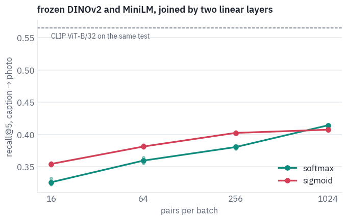

The sigmoid wins at every batch size up to 256, by two to three points of recall, far more than the spread between
seeds; at 1,024 the two meet, with the softmax a hair ahead. That is the SigLIP paper's claim in miniature: the
sigmoid is better when the batch is small, and the advantage fades as the batch grows.

Both losses gain from larger batches, although a larger batch means fewer steps: more negatives per step make each step more informative, the lesson of section 4. And neither comes near CLIP's line.

Two linear layers on top of encoders that never met can't do what two towers trained together on 400 million pairs do; they only show which loss uses a small batch better.

## 11. Where CLIP and SigLIP are today

**Inside image generators.** Stable Diffusion 1 conditions its denoiser on the outputs of CLIP ViT-L/14's text
tower, frozen; later versions use larger CLIP models and add other text encoders next to them. A prompt is read by
a model that learned language from alt texts, which is probably part of why prompts work best as a list of visual
descriptions.

**Inside vision-language models.** LLaVA 1.5 sees through CLIP ViT-L/14 at 336 pixels; PaliGemma and Gemma 3 see
through SigLIP's So400m tower. These models keep the patch vectors, not just the pooled one, and pass them to a
language model, which is lesson 13.

**SigLIP 2.** In February 2025 Google released a second generation: multilingual, trained with extra objectives
(captioning, self-distillation, masked prediction) on top of the sigmoid loss, and with a variant that keeps a
photo's aspect ratio. Its checkpoints have become a common eye for new open models.

**Open replications and data.** OpenCLIP retrained CLIP on LAION's open datasets, and later work found that
how the image–text pairs are chosen matters as much as the loss or the architecture: MetaCLIP rebuilt CLIP's data
recipe from the paper's description, and DataComp turned dataset curation into a benchmark of its own.

CLIP ViT-B/32's passport, and the family tree with this lesson's branch:


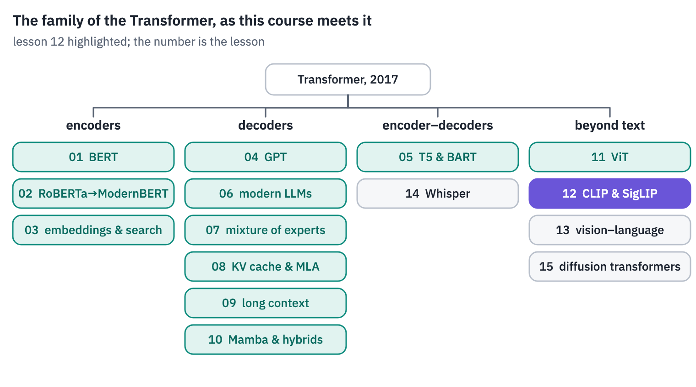
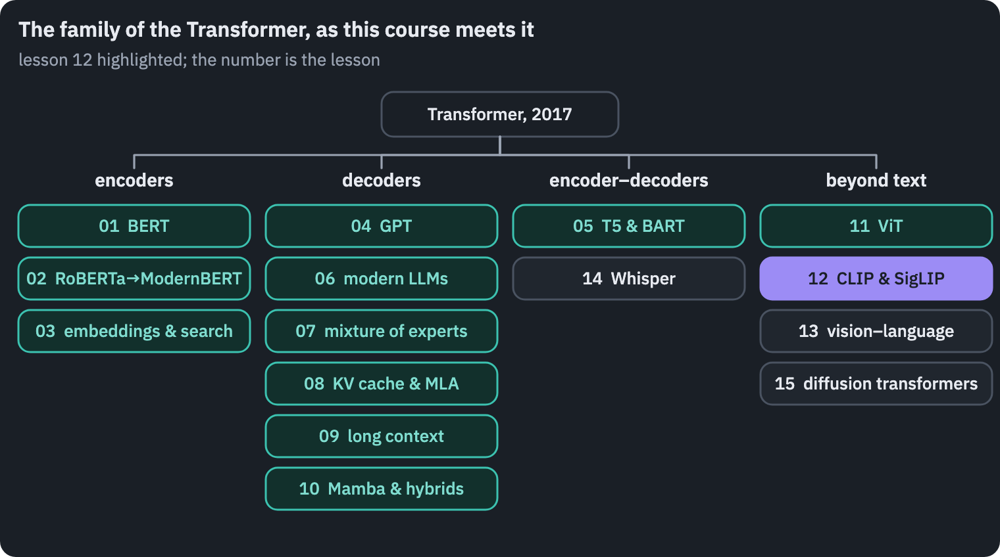

## References

1. {:#ref-1} Radford, A., Kim, J. W., Hallacy, C., et al. (2021). [Learning transferable visual models from natural language supervision](https://arxiv.org/abs/2103.00020). *ICML 2021*.
2. {:#ref-2} Zhai, X., Mustafa, B., Kolesnikov, A., & Beyer, L. (2023). [Sigmoid loss for language image pre-training](https://arxiv.org/abs/2303.15343). *ICCV 2023*.
3. {:#ref-3} Tschannen, M., Gritsenko, A., Wang, X., et al. (2025). [SigLIP 2: multilingual vision-language encoders with improved semantic understanding, localization, and dense features](https://arxiv.org/abs/2502.14786). *arXiv*.
4. {:#ref-4} Goh, G., Cammarata, N., Voss, C., et al. (2021). [Multimodal neurons in artificial neural networks](https://distill.pub/2021/multimodal-neurons/). *Distill*.
5. {:#ref-5} Liang, W., Zhang, Y., Kwon, Y., Yeung, S., & Zou, J. (2022). [Mind the gap: understanding the modality gap in multi-modal contrastive representation learning](https://arxiv.org/abs/2203.02053). *NeurIPS 2022*.
6. {:#ref-6} van den Oord, A., Li, Y., & Vinyals, O. (2018). [Representation learning with contrastive predictive coding](https://arxiv.org/abs/1807.03748). *arXiv*.
7. {:#ref-7} Zhai, X., Wang, X., Mustafa, B., et al. (2022). [LiT: zero-shot transfer with locked-image text tuning](https://arxiv.org/abs/2111.07991). *CVPR 2022*.
8. {:#ref-8} Rombach, R., Blattmann, A., Lorenz, D., Esser, P., & Ommer, B. (2022). [High-resolution image synthesis with latent diffusion models](https://arxiv.org/abs/2112.10752). *CVPR 2022*.
9. {:#ref-9} Liu, H., Li, C., Li, Y., & Lee, Y. J. (2024). [Improved baselines with visual instruction tuning](https://arxiv.org/abs/2310.03744). *CVPR 2024*.
10. {:#ref-10} Beyer, L., Steiner, A., Pinto, A. S., et al. (2024). [PaliGemma: a versatile 3B VLM for transfer](https://arxiv.org/abs/2407.07726). *arXiv*.
11. {:#ref-11} Gemma Team (2025). [Gemma 3 technical report](https://arxiv.org/abs/2503.19786). *arXiv*.
12. {:#ref-12} Cherti, M., Beaumont, R., Wightman, R., et al. (2023). [Reproducible scaling laws for contrastive language-image learning](https://arxiv.org/abs/2212.07143). *CVPR 2023*.
13. {:#ref-13} Xu, H., Xie, S., Tan, X. E., et al. (2024). [Demystifying CLIP data](https://arxiv.org/abs/2309.16671). *ICLR 2024*.
14. {:#ref-14} Gadre, S. Y., Ilharco, G., Fang, A., et al. (2023). [DataComp: in search of the next generation of multimodal datasets](https://arxiv.org/abs/2304.14108). *NeurIPS 2023*.
15. {:#ref-15} Oquab, M., Darcet, T., Moutakanni, T., et al. (2024). [DINOv2: learning robust visual features without supervision](https://arxiv.org/abs/2304.07193). *Transactions on Machine Learning Research*.
16. {:#ref-16} Lin, T.-Y., Maire, M., Belongie, S., et al. (2014). [Microsoft COCO: common objects in context](https://arxiv.org/abs/1405.0312). *ECCV 2014*. Annotations under CC BY 4.0; images from Flickr under their own licences.
17. {:#ref-17} Karpathy, A., & Fei-Fei, L. (2015). [Deep visual-semantic alignments for generating image descriptions](https://arxiv.org/abs/1412.2306). *CVPR 2015*. The 5,000-photo test split of COCO used in section 6.
18. {:#ref-18} Thomee, B., Shamma, D. A., Friedland, G., et al. (2016). [YFCC100M: the new data in multimedia research](https://arxiv.org/abs/1503.01817). *Communications of the ACM*, 59(2). The source of Country211's photos.
19. {:#ref-19} Ilharco, G., Wortsman, M., Wightman, R., et al. (2021). [OpenCLIP](https://github.com/mlfoundations/open_clip). *Zenodo*, doi:10.5281/zenodo.5143773. Benchmark results quoted in sections 5, 6 and 9.
20. {:#ref-20} LAION (2022). [CLIP_benchmark](https://github.com/LAION-AI/CLIP_benchmark). The WebDataset copies of Country211 and COCO on the Hugging Face Hub.
{: .tfs-refs}



