

<p class="tfs-links"><strong>Transformer architectures: from BERT to diffusion</strong> · lesson 13 of 15 · <a href="/teaching/">all lessons</a> · <a href="https://www.kaggle.com/code/qmarva/transformer-architectures-13-vision-language">run on Kaggle</a> · <a href="https://colab.research.google.com/github/xmarva/transformers-from-scratch/blob/main/notebooks/colab/a13_vlm.ipynb">open in Colab</a> · <a href="https://github.com/xmarva/transformers-from-scratch">code on GitHub</a></p>

Photograph a receipt, ask a chat assistant how much you spent, and it answers with the number at the bottom. The language model that answers learned everything it knows from text.

It never saw a pixel during its training, and it still reads the receipt. Something turned the photo into a form it could read, and that something is the subject of this lesson.

Until 2023 the strong vision-language models were big projects: new layers grown inside a language model and trained on tens of millions of web pages and hundreds of millions of pictures.

In April 2023 a paper from Wisconsin and Microsoft turned the job into a recipe a university lab could repeat in a day: a vision encoder that already exists, a language model that already exists, and between them a small network that turns image features into vectors the language model accepts as if they were words<sup class="cite">[<a href="#ref-1" id="cite-1" data-ref="1" aria-label="Reference 1: Liu, H., Li, C., Wu, Q., &amp; Lee, Y. J. (2023). Visual instruction tuning. NeurIPS 2023.">1</a>]</sup>.

The model was LLaVA, and most open vision-language models since are variations on its recipe, Qwen2-VL, InternVL, Gemma 3 and SmolVLM among them.

The variations are almost all about one number. A picture becomes hundreds or thousands of tokens, and every token costs the language model the same compute and memory as a word.

A receipt read at full detail can cost more tokens than this whole introduction. Everything you will see today, tiles, merged patches, positions in three dimensions, tokens dropped inside the model, is a way of spending that budget well.

<aside class="tldr" markdown="1">
<p class="tldr-label">In short</p>

A vision-language model turns an image into vectors that the language model reads as tokens. LLaVA's recipe needs only
a projector between a pretrained encoder and a pretrained LLM; the rest of the engineering decides how many tokens an
image may cost and which of them to keep.

<div class="stats">
<div class="stat"><span class="stat-value">576</span><span class="stat-label">tokens per image in LLaVA-1.5, whatever its size</span></div>
<div class="stat"><span class="stat-value">8,721</span><span class="stat-label">tokens LLaVA-OneVision spends on one receipt photo of the most common size</span></div>
<div class="stat"><span class="stat-value">28 px</span><span class="stat-label">the side of the square one token covers in Qwen2-VL</span></div>
</div>
</aside>

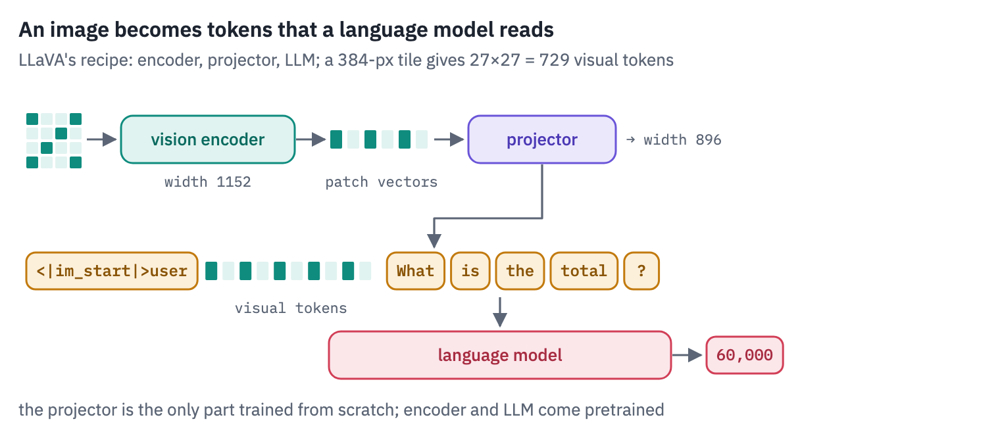
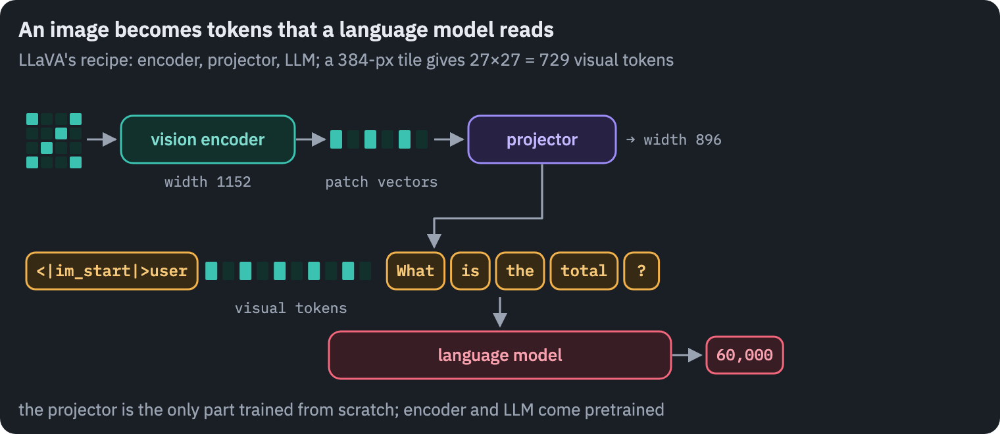

**What you'll do**

1. Take 95 real receipts from the CORD dataset and 100 bar charts drawn here with known values.
2. Follow one receipt through LLaVA-OneVision step by step: the choice of tiles, the encoder, the projector, the
   newline tokens and the splice into the prompt, written from scratch and matched against the model's own logits.
3. Look at the image tokens from the language model's side: what they resemble, and what they turn into layer by
   layer.
4. Price a picture: how many tokens six models spend on the same image at four sizes, what that costs, and what a
   model with a fixed price sees of a receipt.
5. Rebuild Qwen2-VL's two ideas, an image that keeps its shape and positions in three dimensions, and check them
   against the model.
6. Read receipts and charts with Qwen2-VL under budgets from 64 to 2,048 tokens.
7. Drop image tokens inside the model, as FastV does, test whether the ones it keeps are better than a random choice,
   and compare pruning a large image with simply sending a smaller one.

**What you need**: a GPU. On Kaggle, *Settings → Accelerator → GPU*; on Colab, *Runtime → Change runtime type → T4
GPU*. The notebook downloads LLaVA-OneVision 0.5B (1.8 GB), Qwen2-VL 2B (4.4 GB) and the CORD test set (234 MB).

## Setup

One small helper package, `tfs`, draws the course's plots and token chips and knows where the notebook runs
(Kaggle, Colab or your own machine). Everything the lesson teaches is written out in the notebook itself.

```python
import importlib.util
import subprocess
import sys

TFS = "git+https://github.com/xmarva/transformers-from-scratch@main"
if importlib.util.find_spec("tfs") is None:
    subprocess.check_call([sys.executable, "-m", "pip", "install", "-q", TFS])

from tfs import env
from tfs.viz import table, token_chips, use_course_style

env.quiet()  # no progress bars or environment warnings in the outputs
SEED = 42
env.seed_everything(SEED)
COLORS = use_course_style()
WORK_DIR = env.work_dir()
```

```python
import io
import json
import math
import random
import re
import time
from collections import Counter

import matplotlib.pyplot as plt
import numpy as np
import pandas as pd
import torch
import torch.nn.functional as F
from huggingface_hub import hf_hub_download
from IPython.display import display
from matplotlib.colors import LinearSegmentedColormap
from PIL import Image
from transformers import AutoProcessor, DynamicCache
from transformers import (
    LlavaOnevisionForConditionalGeneration,
    Qwen2VLForConditionalGeneration,
)

SMOKE = env.smoke()  # CI runs the lesson on a small slice; you run it in full
device = "cuda" if torch.cuda.is_available() else "cpu"
if device == "cuda":
    print("GPU:", torch.cuda.get_device_name(0))

# images teal, text amber, the language model rose, the projector violet, as in the figures
heat = LinearSegmentedColormap.from_list("heat", ["#FFFFFF", COLORS["enc"]])
```

<pre class="tfs-printed" markdown="0"><code>GPU: Tesla T4</code></pre>

## 1. Receipts and charts

Two kinds of image test whether a model can *read*, which is harder than recognising what a photo shows. The first is real: [CORD](https://huggingface.co/datasets/naver-clova-ix/cord-v2), a set of about a thousand receipts photographed in Indonesian shops and restaurants, released by Naver Clova with every word boxed and labelled<sup class="cite">[<a href="#ref-2" id="cite-2" data-ref="2" aria-label="Reference 2: Park, S., Shin, S., Lee, B., et al. (2019). CORD: a consolidated receipt dataset for post-OCR parsing. Document Intelligence Workshop at NeurIPS 2019. Data: naver-clova-ix/cord-v2, CC BY 4.0.">2</a>]</sup>.

Its test split has 100 receipts, 95 of them with a labelled total, and it is published under [CC BY 4.0](https://creativecommons.org/licenses/by/4.0/), which lets us show them here.

The receipts are the honest test: crumpled paper, small print, photos taken at an angle, sizes from a phone's
thumbnail to four thousand pixels tall. The question is always the same, the total to pay, and the answer is a number
we can check exactly.

```python
CORD = hf_hub_download(
    "naver-clova-ix/cord-v2",
    "data/test-00000-of-00001-9c204eb3f4e11791.parquet",
    repo_type="dataset",
)
receipts = []
for index, row in pd.read_parquet(CORD).iterrows():
    truth = json.loads(row["ground_truth"])
    total = (truth["gt_parse"].get("total") or {}).get("total_price")
    if isinstance(total, list):
        total = total[0]
    if not total:
        continue  # five receipts have no labelled total
    words = [w["text"] for line in truth["valid_line"] for w in line["words"]]
    image = Image.open(io.BytesIO(row["image"]["bytes"])).convert("RGB")
    labelled = truth["meta"]["image_size"]  # the boxes are in these pixels
    sx, sy = image.width / labelled["width"], image.height / labelled["height"]
    corners = [  # every corner of every word on the line with the total
        (w["quad"][f"x{k}"] * sx, w["quad"][f"y{k}"] * sy)
        for line in truth["valid_line"]
        if line["category"] == "total.total_price"
        for w in line["words"]
        for k in range(1, 5)
    ]
    box = None
    if corners:
        xs, ys = zip(*corners)
        box = (min(xs), min(ys), max(xs), max(ys))
    receipts.append(dict(id=index, image=image, total=total, words=words, box=box))
if SMOKE:
    receipts = receipts[:6]
sizes = [r["image"].size for r in receipts]
print(len(receipts), "receipts with a total")
print("width from", min(w for w, h in sizes), "to", max(w for w, h in sizes), "pixels")
print("height from", min(h for w, h in sizes), "to", max(h for w, h in sizes), "pixels")
common, how_many = Counter(sizes).most_common(1)[0]
typical = next(r for r in receipts if r["image"].size == common)  # our running example
print(f"the most common size: {common[0]}×{common[1]}, {how_many} receipts")
```

<pre class="tfs-printed" markdown="0"><code>95 receipts with a total
width from 228 to 3024 pixels
height from 336 to 4096 pixels
the most common size: 864×1296, 39 receipts</code></pre>

The second kind we make ourselves: bar charts with between five and ten bars, each bar's value written above it in a
small font, and a question about one of them. Drawing the charts here means we know every answer, we can draw as many
as we like, and no model has seen them in training.

```python
CITIES = [
    "Lisbon",
    "Oslo",
    "Quito",
    "Hanoi",
    "Accra",
    "Lima",
    "Tbilisi",
    "Bergen",
    "Porto",
    "Kyoto",
    "Cusco",
    "Dakar",
]


def make_chart(seed):
    rng = random.Random(seed)
    labels = rng.sample(CITIES, rng.randint(5, 10))
    values = [rng.randint(12, 980) for _ in labels]
    with plt.style.context("default"):  # an ordinary chart, not the course's style
        fig, ax = plt.subplots(figsize=(8, 5), dpi=100)
        bars = ax.bar(labels, values, color="#4c72b0")
        for bar, value in zip(bars, values):
            x = bar.get_x() + bar.get_width() / 2
            ax.text(
                x,
                value,
                str(value),
                ha="center",
                va="bottom",
                fontsize=rng.choice([7, 8, 9, 10]),
            )
        ax.set_title(f"Visitors per day, thousands (sample {seed})", fontsize=11)
        ax.tick_params(axis="x", labelsize=8, rotation=30)
        fig.tight_layout()
        buffer = io.BytesIO()
        fig.savefig(buffer, format="png")
        plt.close(fig)
    target = rng.randrange(len(labels))
    image = Image.open(buffer).convert("RGB")
    return dict(image=image, label=labels[target], value=str(values[target]))


charts = [make_chart(seed) for seed in range(6 if SMOKE else 100)]
print(len(charts), "charts of", charts[0]["image"].size, "pixels")
```

<pre class="tfs-printed" markdown="0"><code>100 charts of (800, 500) pixels</code></pre>

```python
fig, axes = plt.subplots(
    1, 4, figsize=(13, 4.6), gridspec_kw={"width_ratios": [1, 1, 1, 2]}
)
for ax, rec in zip(axes[:3], receipts[:3]):
    ax.imshow(rec["image"])
    ax.set_title(f"total {rec['total']}", fontsize=10)
    ax.axis("off")
axes[3].imshow(charts[0]["image"])
axes[3].set_title(
    f"the value for {charts[0]['label']}: {charts[0]['value']}", fontsize=10
)
axes[3].axis("off")
plt.tight_layout()
plt.show()
```

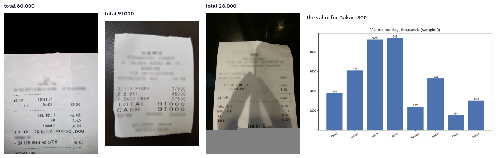

*Receipts: CORD (Naver Clova), CC BY 4.0. Chart: drawn in this notebook.*

## 2. Three ways to give a language model an image

Any vision-language model has a vision encoder and a language model, and the question is where they meet. Three
answers were tried, in this order.


**Cross-attention.** DeepMind's Flamingo kept a 70-billion-parameter language model frozen and inserted new layers between its blocks that attend to the image features, the way a translation model's decoder attends to its encoder <sup class="cite">[<a href="#ref-3" id="cite-3" data-ref="3" aria-label="Reference 3: Alayrac, J.-B., Donahue, J., Luc, P., et al. (2022). Flamingo: a visual language model for few-shot learning. NeurIPS 2022.">3</a>]</sup>.

The image never enters the sequence, so it costs no tokens, but every new layer is new weights, trained on a large mixture of web pages and image–text pairs. Meta's Llama 3.2 Vision still works this way<sup class="cite">[<a href="#ref-4" id="cite-4" data-ref="4" aria-label="Reference 4: Llama Team, AI @ Meta (2024). The Llama 3 herd of models. arXiv.">4</a>]</sup>.

**A resampler.** Salesforce's BLIP-2 put a small Transformer, the Q-Former, between a frozen encoder and a frozen language model: 32 learned query vectors attend to the image and come out as 32 tokens for the language model<sup class="cite">[<a href="#ref-5" id="cite-5" data-ref="5" aria-label="Reference 5: Li, J., Li, D., Savarese, S., &amp; Hoi, S. (2023). BLIP-2: bootstrapping language-image pre-training with frozen image encoders and large language models. ICML 2023.">5</a>]</sup>.

The first Qwen-VL used one cross-attention layer with 256 queries in the same role<sup class="cite">[<a href="#ref-6" id="cite-6" data-ref="6" aria-label="Reference 6: Bai, J., Bai, S., Yang, S., et al. (2023). Qwen-VL: a versatile vision-language model for understanding, localization, text reading, and beyond. arXiv.">6</a>]</sup>. The price of a picture is fixed and small, and so is the detail that survives the squeeze.

**A projector.** LLaVA did the simplest thing: every patch vector from the encoder goes through a linear map to the language model's width and enters the sequence as a token<sup class="cite">[<a href="#ref-1" id="cite-7" data-ref="1" aria-label="Reference 1: Liu, H., Li, C., Wu, Q., &amp; Lee, Y. J. (2023). Visual instruction tuning. NeurIPS 2023.">1</a>]</sup>. The idea itself was not new.

Frozen had trained an image encoder to feed a language model that stayed frozen <sup class="cite">[<a href="#ref-7" id="cite-8" data-ref="7" aria-label="Reference 7: Tsimpoukelli, M., Menick, J., Cabi, S., Eslami, S. M. A., Vinyals, O., &amp; Hill, F. (2021). Multimodal few-shot learning with frozen language models. NeurIPS 2021.">7</a>]</sup>, and the autumn before LLaVA, Merullo and colleagues showed that one linear map is enough to pass what an image encoder sees to a frozen language model<sup class="cite">[<a href="#ref-8" id="cite-9" data-ref="8" aria-label="Reference 8: Merullo, J., Castricato, L., Eickhoff, C., &amp; Pavlick, E. (2022). Linearly mapping from image to text space. ICLR 2023.">8</a>]</sup>.

LLaVA's contribution was what to train the map on. First only the projector learned, on 595 thousand captioned images filtered from the CC3M dataset, to put image features where the language model expects words.

Then projector and language model learned together on 158 thousand conversations about COCO photos that GPT-4 had written from their captions and object boxes, without seeing the images <sup class="cite">[<a href="#ref-9" id="cite-10" data-ref="9" aria-label="Reference 9: Datasets of the LLaVA line: LLaVA-Pretrain, LLaVA-Instruct-150K, LLaVA-OneVision-Data. PixMo: allenai/pixmo-cap, ODC-BY 1.0.">9</a>]</sup>. Captions teach a model to name what it sees; the conversations taught it to answer questions about it, and that made it an assistant.

Six months later LLaVA-1.5 replaced the linear map with a two-layer MLP, fed the encoder images of 336 pixels, and trained on 558 thousand captioned images<sup class="cite">[<a href="#ref-9" id="cite-11" data-ref="9" aria-label="Reference 9: Datasets of the LLaVA line: LLaVA-Pretrain, LLaVA-Instruct-150K, LLaVA-OneVision-Data. PixMo: allenai/pixmo-cap, ODC-BY 1.0.">9</a>]</sup> and then on a mix of 665 thousand examples: the conversations, academic tasks such as visual question answering and reading text in photos, and about 40 thousand text-only conversations so that the language model would not forget how to talk.

The whole training took about a day on one machine with eight A100s<sup class="cite">[<a href="#ref-10" id="cite-12" data-ref="10" aria-label="Reference 10: Liu, H., Li, C., Li, Y., &amp; Lee, Y. J. (2024). Improved baselines with visual instruction tuning. CVPR 2024.">10</a>]</sup>. It matched or beat models trained on far more data, and the projector won.

<div class="callout callout-key" markdown="1">
<p class="callout-label">Key point</p>

The projector is cheap to train because the hard parts already exist. The encoder knows what is in
the image, the language model knows how to talk about it, and the projector only has to translate between two
spaces that were each trained without the other.
</div>

The rest of the lesson follows the projector design through its two main lines: LLaVA's, which cuts a large image into
tiles of the size its encoder was trained on, and Qwen's, which changed the encoder so that it takes images of any
shape.

## 3. A receipt through LLaVA-OneVision, step by step

LLaVA-OneVision is the LLaVA line's model of August 2024<sup class="cite">[<a href="#ref-11" id="cite-13" data-ref="11" aria-label="Reference 11: Li, B., Zhang, Y., Guo, D., et al. (2024). LLaVA-OneVision: easy visual task transfer. arXiv.">11</a>]</sup>. Its
smallest version joins SigLIP's So400m encoder, the larger sibling of the model in lesson 12, to Qwen2's 0.5-billion
language model with a two-layer projector, about 0.9 billion parameters in all. We'll follow one receipt through it
and write each step ourselves.

```python
OV = "llava-hf/llava-onevision-qwen2-0.5b-ov-hf"
ov_processor = AutoProcessor.from_pretrained(OV)
ov = LlavaOnevisionForConditionalGeneration.from_pretrained(OV, dtype=torch.float32)
ov = ov.to(device).eval()
ov_config = ov.config
vision_config, text_config = ov_config.vision_config, ov_config.text_config
side, patch = vision_config.image_size, vision_config.patch_size
grid = side // patch
print(
    "vision encoder:",
    vision_config.num_hidden_layers,
    "blocks of",
    vision_config.hidden_size,
)
print(
    f"one tile: {side}×{side} pixels in {grid}×{grid} = {grid * grid} patches of {patch}"
)
print(
    "language model:",
    text_config.num_hidden_layers,
    "blocks of",
    text_config.hidden_size,
)
print("candidate grids of tiles:", len(ov_config.image_grid_pinpoints))

rec = receipts[0]
question = (
    "What is the total amount to pay on this receipt? Answer with the number only."
)
conversation = [
    {"role": "user", "content": [{"type": "image"}, {"type": "text", "text": question}]}
]
ov_prompt = ov_processor.apply_chat_template(conversation, add_generation_prompt=True)
print("the receipt:", rec["image"].size, "pixels, total", rec["total"])
```

<pre class="tfs-printed" markdown="0"><code>vision encoder: 26 blocks of 1152
one tile: 384×384 pixels in 27×27 = 729 patches of 14
language model: 24 blocks of 896
candidate grids of tiles: 36
the receipt: (432, 648) pixels, total 60.000</code></pre>

**Step 1: the grid of tiles.** SigLIP was trained on squares of 384 pixels, and a receipt is a tall rectangle many times that size.

LLaVA's answer since LLaVA-NeXT is *AnyRes*: pick, from a list of grids made of 384-pixel tiles, the one that keeps the most of the image after resizing it to fit, and among equals the one that wastes the least space on padding<sup class="cite">[<a href="#ref-12" id="cite-14" data-ref="12" aria-label="Reference 12: Liu, H., Li, C., Li, Y., et al. (2024). LLaVA-NeXT: improved reasoning, OCR, and world knowledge. Blog post.">12</a>]</sup>. The choice is a few lines.

```python
def best_grid(height, width, pinpoints):
    best, best_kept, best_waste = None, 0, float("inf")
    for h, w in pinpoints:
        scale = min(w / width, h / height)
        kept = min(int(width * scale) * int(height * scale), width * height)
        waste = w * h - kept
        if kept > best_kept or (kept == best_kept and waste < best_waste):
            best, best_kept, best_waste = (h, w), kept, waste
    return best


best = best_grid(
    rec["image"].height, rec["image"].width, ov_config.image_grid_pinpoints
)
rows, cols = best[0] // side, best[1] // side
print(f"chosen canvas: {best[1]}×{best[0]} pixels, {cols} tiles wide and {rows} high")

ov_inputs = ov_processor(images=rec["image"], text=ov_prompt, return_tensors="pt").to(
    device
)
print(
    "pixel_values:",
    tuple(ov_inputs["pixel_values"].shape),
    "(image, tiles, channels, height, width)",
)
print("tiles: 1 thumbnail of the whole receipt +", rows * cols, "pieces of the grid")
```

<pre class="tfs-printed" markdown="0"><code>chosen canvas: 768×768 pixels, 2 tiles wide and 2 high
pixel_values: (1, 5, 3, 384, 384) (image, tiles, channels, height, width)
tiles: 1 thumbnail of the whole receipt + 4 pieces of the grid</code></pre>

The processor made one tile more than the grid has: the first is a thumbnail, the whole receipt squeezed into one
384-pixel square, so that the model also sees the layout at a glance. Here is what the model gets.

```python
tiles = ov_inputs["pixel_values"][0][: 1 + rows * cols].float().cpu()
tiles = (tiles * 0.5 + 0.5).clamp(0, 1)  # undo the normalisation to (x - 0.5) / 0.5
fig = plt.figure(figsize=(1.6 * (rows + cols) + 0.4, 1.6 * rows + 0.5))
layout = fig.add_gridspec(rows, rows + cols, wspace=0.05, hspace=0.05)
ax = fig.add_subplot(layout[:, :rows])
ax.imshow(tiles[0].permute(1, 2, 0))
ax.set_title("thumbnail", fontsize=10)
ax.axis("off")
for k in range(rows * cols):
    r, c = divmod(k, cols)
    ax = fig.add_subplot(layout[r, rows + c])
    ax.imshow(tiles[1 + k].permute(1, 2, 0))
    ax.axis("off")
fig.suptitle(
    f"what SigLIP sees: a thumbnail and {rows * cols} tiles of {side} px", fontsize=11
)
plt.show()
```

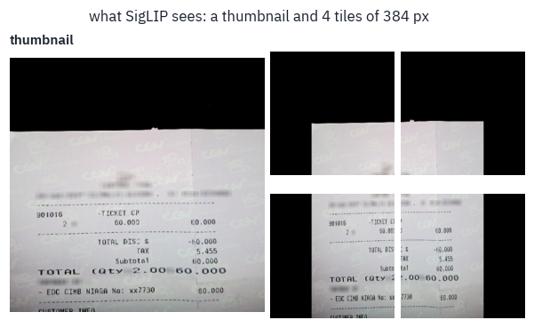

**Step 2: the encoder.** Each tile goes through SigLIP on its own, as in lesson 12, and comes out as a grid of patch vectors. LLaVA-OneVision takes the output of the last block, all of it: SigLIP has no class token to drop.

The last block here is the 26th, although SigLIP So400m has 27. LLaVA's code deletes the final one, whose features are shaped for the contrastive loss of lesson 12 more than for describing patches, much as LLaVA-1.5 read CLIP's second-to-last layer.

```python
with torch.no_grad():
    hidden = ov.model.vision_tower(
        ov_inputs["pixel_values"][0][: 1 + rows * cols], output_hidden_states=True
    )
    features = hidden.hidden_states[ov_config.vision_feature_layer]
print("encoder output:", tuple(features.shape), "(tiles, patches, width)")
```

<pre class="tfs-printed" markdown="0"><code>encoder output: (5, 729, 1152) (tiles, patches, width)</code></pre>

**Step 3: the projector.** Two linear layers with a GELU between them take each patch vector from SigLIP's width to
the language model's. This is all the "translation" there is.

```python
projector = ov.model.multi_modal_projector
with torch.no_grad():
    projected = F.linear(
        F.gelu(F.linear(features, projector.linear_1.weight, projector.linear_1.bias)),
        projector.linear_2.weight,
        projector.linear_2.bias,
    )
    reference = projector(features)
print("projected:", tuple(projected.shape), "(tiles, patches, the LLM's width)")
print(
    "largest difference from the model's projector:",
    (projected - reference).abs().max().item(),
)
```

<pre class="tfs-printed" markdown="0"><code>projected: (5, 729, 896) (tiles, patches, the LLM&#x27;s width)
largest difference from the model&#x27;s projector: 0.0</code></pre>

**Step 4: one map, without the padding, with a newline per row.** The grid tiles are laid back side by side into one map of patch vectors. Then three things happen that the model learned to expect.

The rows or columns that only cover the padding are cut away. If the map still holds more than nine tiles' worth of vectors, it is shrunk by bilinear interpolation; this is what `anyres_max_9` in the config means.

And a learned vector, the *newline*, is appended at the end of every row, so that the language model, which reads a flat sequence, can tell where one row of the image ends and the next begins.

```python
H, W = rec["image"].height, rec["image"].width
with torch.no_grad():
    thumbnail, pieces = projected[0], projected[1:]
    mapped = pieces.view(rows, cols, grid, grid, -1).permute(4, 0, 2, 1, 3)
    mapped = mapped.flatten(1, 2).flatten(2, 3)  # (width, rows * grid, cols * grid)
    print("joined map:", tuple(mapped.shape[1:]), "patch positions")
    mh, mw = mapped.shape[1:]
    if W / H > mw / mh:  # the receipt is wider than the canvas: padding above and below
        pad = (mh - int(round(H * mw / W, 7))) // 2
        mapped = mapped[:, pad : mh - pad, :]
    else:  # taller: padding left and right
        pad = (mw - int(round(W * mh / H, 7))) // 2
        mapped = mapped[:, :, pad : mw - pad]
    print("without the padding:", tuple(mapped.shape[1:]))
    ratio = math.sqrt(mapped.shape[1] * mapped.shape[2] / (9 * grid * grid))
    if ratio > 1.1:
        size = [int(mapped.shape[1] // ratio), int(mapped.shape[2] // ratio)]
        mapped = F.interpolate(mapped[None], size, mode="bilinear")[0]
        print("shrunk to nine tiles' worth:", tuple(mapped.shape[1:]))
    newline = ov.model.image_newline[:, None, None].expand(
        mapped.shape[0], mapped.shape[1], 1
    )
    mapped = torch.cat([mapped, newline], dim=-1)
    image_tokens = torch.cat([thumbnail, mapped.flatten(1, 2).T], dim=0)
print(
    "image tokens:",
    image_tokens.shape[0],
    "=",
    grid * grid,
    "thumbnail +",
    mapped.shape[1],
    "rows ×",
    mapped.shape[2],
    "(with the newline)",
)
```

<pre class="tfs-printed" markdown="0"><code>joined map: (54, 54) patch positions
without the padding: (54, 36)
image tokens: 2727 = 729 thumbnail + 54 rows × 37 (with the newline)</code></pre>


**Step 5: the splice.** The processor already wrote a placeholder token in the prompt for every image token the model will need, and the count must match ours exactly.

The prompt's tokens are embedded as usual, the placeholders are replaced by our image vectors, and the language model reads the result. If every step above is right, its logits are the model's own.

```python
ids = ov_inputs["input_ids"]
image_token = getattr(ov_config, "image_token_id", None) or ov_config.image_token_index
print(
    "placeholders in the prompt:",
    int((ids == image_token).sum()),
    "| our image tokens:",
    image_tokens.shape[0],
)
print("text tokens around them:", int((ids != image_token).sum()))
with torch.no_grad():
    embedded = ov.get_input_embeddings()(ids).clone()
    embedded[ids == image_token] = image_tokens.to(embedded.dtype)
    out = ov.model.language_model(
        inputs_embeds=embedded, attention_mask=ov_inputs["attention_mask"]
    )
    ours = ov.lm_head(out.last_hidden_state)
    theirs = ov(**ov_inputs).logits
print(
    "largest difference from LLaVA-OneVision's logits:",
    (ours - theirs).abs().max().item(),
)
with torch.no_grad():
    generated = ov.generate(**ov_inputs, max_new_tokens=20, do_sample=False)
print(
    "answer:",
    ov_processor.decode(generated[0, ids.shape[1] :], skip_special_tokens=True),
)
print("truth: ", rec["total"])
```

<pre class="tfs-printed" markdown="0"><code>placeholders in the prompt: 2727 | our image tokens: 2727
text tokens around them: 25
largest difference from LLaVA-OneVision&#x27;s logits: 0.0
answer: 60.00
truth:  60.000</code></pre>

Both differences are zero. The projector is two matrix products, and the image tokens we assembled by hand, tile by
tile, row by row, newline by newline, are exactly the ones the model makes for itself: there is nothing else between
the encoder and the language model.

The answer deserves a second look. The receipt says *60.000*, which in Indonesia means sixty thousand rupiah, with a dot between the thousands.

The model answered *60.00*. It read the digits and wrote them back as a price with cents, the format that dominates the text it learned from, and lost a factor of a thousand on the way.

Later we'll compare answers digit by digit, which forgives the separator, *60,000* or *60.000*, but not a lost zero. Reading a number and knowing the convention it's written in are two different skills.

<p class="takeaway" markdown="1">Of the tokens the language model reads here, all but a couple of dozen are the image. The question is a footnote
to the picture, and every one of those image tokens is paid for in every layer.</p>

## 4. What an image token looks like to the language model

The projector was trained to put image features where the language model can use them. A natural guess is that it turned them into something like words: that a patch showing the word *TOTAL* lands next to the embedding of "total".

We can check. The language model's input embeddings are a table of 152 thousand vectors, one per token of its vocabulary; compare the image tokens with them.

```python
with torch.no_grad():
    vocab = ov.get_input_embeddings().weight.float()
    text_ids = ids[0][ids[0] != image_token]
    words_in_prompt = vocab[text_ids]
    vocab_unit = F.normalize(vocab, dim=-1)
    image_nearest = (
        (F.normalize(image_tokens.float(), dim=-1) @ vocab_unit.T).max(-1).values
    )
    text_nearest = (
        (F.normalize(words_in_prompt, dim=-1) @ vocab_unit.T)
        .topk(2, dim=-1)
        .values[:, 1]
    )
rows_space = [
    {
        "vectors": "image tokens",
        "average length": image_tokens.float().norm(dim=-1).mean().item(),
        "cosine with the nearest vocabulary token": image_nearest.mean().item(),
    },
    {
        "vectors": "the prompt's word tokens",
        "average length": words_in_prompt.norm(dim=-1).mean().item(),
        "cosine with the nearest vocabulary token": text_nearest.mean().item(),
    },
]
table(pd.DataFrame(rows_space), digits=2)
```

<div class="tfs-table-wrap"><table class="tfs-table" style="border-collapse:collapse;font-family:'IBM Plex Sans', -apple-system, 'Segoe UI', Roboto, Helvetica, Arial, sans-serif;font-size:13.5px;line-height:1.45;margin:4px 0 8px;"><thead><tr><th style="padding:7px 14px;border-bottom:2px solid #B9C0CB;font-weight:600;color:#5B6575;font-size:12px;letter-spacing:0.02em;text-align:left;">vectors</th><th style="padding:7px 14px;border-bottom:2px solid #B9C0CB;font-weight:600;color:#5B6575;font-size:12px;letter-spacing:0.02em;text-align:right;">average length</th><th style="padding:7px 14px;border-bottom:2px solid #B9C0CB;font-weight:600;color:#5B6575;font-size:12px;letter-spacing:0.02em;text-align:right;">cosine with the nearest vocabulary token</th></tr></thead><tbody><tr><td style="padding:7px 14px;border-bottom:1px solid #E6E9EE;vertical-align:top;text-align:left;max-width:460px;white-space:normal;">image tokens</td><td style="padding:7px 14px;border-bottom:1px solid #E6E9EE;vertical-align:top;text-align:right;font-variant-numeric:tabular-nums;max-width:460px;white-space:normal;">31.34</td><td style="padding:7px 14px;border-bottom:1px solid #E6E9EE;vertical-align:top;text-align:right;font-variant-numeric:tabular-nums;max-width:460px;white-space:normal;">0.17</td></tr><tr><td style="padding:7px 14px;border-bottom:1px solid #E6E9EE;vertical-align:top;text-align:left;max-width:460px;white-space:normal;">the prompt&#x27;s word tokens</td><td style="padding:7px 14px;border-bottom:1px solid #E6E9EE;vertical-align:top;text-align:right;font-variant-numeric:tabular-nums;max-width:460px;white-space:normal;">0.46</td><td style="padding:7px 14px;border-bottom:1px solid #E6E9EE;vertical-align:top;text-align:right;font-variant-numeric:tabular-nums;max-width:460px;white-space:normal;">0.69</td></tr></tbody></table></div>

Both columns say the same thing. An image token is about seventy times longer than a word's embedding, and the nearest of 152 thousand words is barely related to it, a cosine of 0.17, where a word from the prompt finds a close neighbour at 0.69.

Image tokens don't sit among the words. They occupy their own region of the space, far from the origin, much as images and captions kept to two separate clouds in lesson 12's modality gap.

Schwettmann and colleagues ran the same test on a projector into GPT-J and found the nearest words of projected images no more meaningful than those of random vectors<sup class="cite">[<a href="#ref-13" id="cite-15" data-ref="13" aria-label="Reference 13: Schwettmann, S., Chowdhury, N., Klein, S., Bau, D., &amp; Torralba, A. (2023). Multimodal neurons in pretrained text-only transformers. ICCV 2023 Workshops.">13</a>]</sup>, and Shukor and Cord found image and text tokens in different narrow cones inside several multimodal models<sup class="cite">[<a href="#ref-14" id="cite-16" data-ref="14" aria-label="Reference 14: Shukor, M., &amp; Cord, M. (2024). Implicit multimodal alignment: on the generalization of frozen LLMs to multimodal inputs. NeurIPS 2024.">14</a>]</sup>.

That doesn't mean the language model can't read them; it means it doesn't read them as *input* words. A sharper question is what each image token becomes as it rises through the language model.

The *logit lens* answers it: take the hidden state at any layer, push it through the final norm and the output head as if it were the last layer, and see which word it would predict<sup class="cite">[<a href="#ref-15" id="cite-17" data-ref="15" aria-label="Reference 15: nostalgebraist (2020). Interpreting GPT: the logit lens. LessWrong.">15</a>]</sup>.

Neo and colleagues did this for LLaVA and found object names appearing at image positions in the later layers<sup class="cite">[<a href="#ref-16" id="cite-18" data-ref="16" aria-label="Reference 16: Neo, C., Ong, L., Torr, P., Geva, M., Krueger, D., &amp; Barez, F. (2024). Towards interpreting visual information processing in vision-language models. arXiv.">16</a>]</sup>. On receipts, the question becomes: do the words printed on the receipt show up at its image tokens?

We count, layer by layer, the share of image tokens whose logit-lens word is one of the receipt's own words of three letters or more (CORD gives every word). The chance level is the share of the whole vocabulary made of those words.

To keep the sequences within a T4's memory, each receipt is scaled down to fit in 864 pixels, which still leaves a receipt of the common size about five thousand image tokens.

```python
ov = ov.half()  # long sequences of hidden states: half precision is plenty for a lens
vocab_text = [
    ov_processor.tokenizer.decode([t]).strip().lower()
    for t in range(len(ov_processor.tokenizer))
]
lens_rows = []
for rec_lens in receipts[: 2 if SMOKE else 10]:
    small = rec_lens["image"].copy()
    small.thumbnail((864, 864))  # keeps the shape, fits both sides in 864 pixels
    inputs = ov_processor(images=small, text=ov_prompt, return_tensors="pt").to(device)
    inputs["pixel_values"] = inputs["pixel_values"].half()
    words = {w.lower().strip(".,:;()") for w in rec_lens["words"]}
    words = {
        w
        for w in words
        if len(w) >= 3 and not w.replace(".", "").replace(",", "").isdigit()
    }
    chance = sum(1 for v in vocab_text if len(v) >= 3 and v in words) / len(vocab_text)
    with torch.no_grad():
        out = ov.model(**inputs, output_hidden_states=True)
        states = (*out.hidden_states[:-1], out.last_hidden_state)  # the last one normed
        where = (inputs["input_ids"][0] == image_token).nonzero().flatten()
        for layer, state in enumerate(states):
            x = state[0, where]
            if (
                layer < len(states) - 1
            ):  # the lens: the final norm, then the output head
                x = ov.model.language_model.norm(x)
            top = [  # in chunks: 152 thousand logits per token add up
                t for c in x.split(1024) for t in ov.lm_head(c).argmax(-1).tolist()
            ]
            found = [
                vocab_text[t]
                for t in top
                if t < len(vocab_text) and vocab_text[t] in words
            ]
            lens_rows.append(
                dict(
                    receipt=rec_lens["id"],
                    layer=layer,
                    share=len(found) / len(top),
                    chance=chance,
                    found=sorted(set(found)),
                )
            )
    del out, states
    torch.cuda.empty_cache()
lens = pd.DataFrame(lens_rows)
by_layer = lens.groupby("layer")[["share", "chance"]].mean().reset_index()

fig, ax = plt.subplots(figsize=(8, 3.6))
ax.plot(
    by_layer["layer"],
    100 * by_layer["share"],
    color=COLORS["enc"],
    marker="o",
    ms=3,
    label="image tokens whose lens word is on the receipt",
)
ax.plot(
    by_layer["layer"],
    100 * by_layer["chance"],
    color=COLORS["muted"],
    ls="--",
    label="chance",
)
ax.set_xlabel("layer of the language model (0: the input)")
ax.set_ylabel("% of image tokens")
ax.set_title("The logit lens at a receipt's image tokens, layer by layer")
ax.legend(frameon=False, fontsize=9)
plt.show()
peak = by_layer.loc[by_layer["share"].idxmax()]
print(
    f"peak at layer {int(peak['layer'])}: {100 * peak['share']:.2f}% of image tokens, "
    f"{peak['share'] / max(peak['chance'], 1e-9):.0f} times the chance level"
)
print(
    "words found at the peak, first receipt:",
    lens[lens.layer == int(peak["layer"])]["found"].iloc[0][:15],
)
```

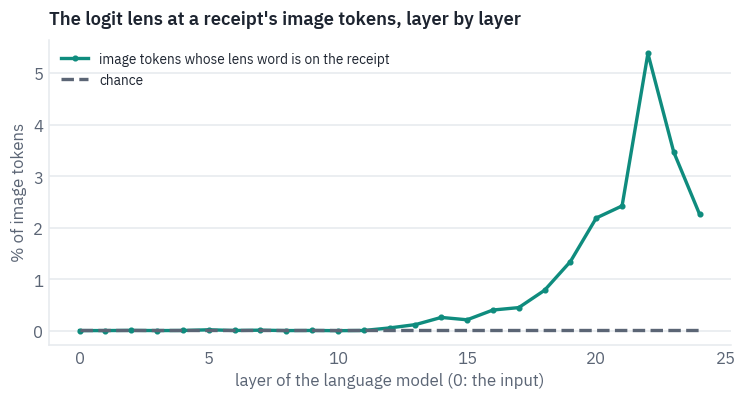

<pre class="tfs-printed" markdown="0"><code>peak at layer 22: 5.39% of image tokens, 320 times the chance level
words found at the peak, first receipt: [&#x27;tax&#x27;, &#x27;total&#x27;]</code></pre>

For the first half of the model, nothing: the words the lens finds at image positions are the receipt's own no more often than chance.

From layer 12 the share climbs, and at layer 22 of 24 about one image token in twenty decodes to a word printed on its own receipt, hundreds of times the chance level.

In the last two layers it falls again, as the hidden states turn to the next token of the answer. On the first receipt the words at the peak are *tax* and *total*, the labels of the very lines the question is about.

Five per cent sounds small, but the count is strict: a token counts only if its single most likely word is exactly a word from the receipt, and most image tokens cover margins, shadows and the table under the paper, where there is no word to find.

Neo and colleagues, counting object names on COCO photos, found 23.7% for LLaVA-1.5 and 6.5% for Qwen2-VL 2B; our half-billion model reading Indonesian receipts lands near the second.

<div class="callout callout-key" markdown="1">
<p class="callout-label">Key point</p>

The projector does not translate pixels into words. It hands the language model vectors from a region
of its space where no word lives, and the model's own layers turn them, deep inside, into something its output head
reads as the words on the page.
</div>

## 5. The price of a picture

Every image token costs what a word costs: a row in every attention matrix, a slot in every layer's KV cache, its share of the compute in every block. So the first question to ask of any vision-language model is how many tokens it spends on an image.

The processors know; we only need to ask them, with blank images of four sizes: a small square photo, a screenshot, a large photo, and a receipt of the most common size in CORD.

```python
PROCESSORS = {
    "LLaVA-1.5": "llava-hf/llava-1.5-7b-hf",
    "LLaVA-NeXT": "llava-hf/llava-v1.6-mistral-7b-hf",
    "LLaVA-OneVision": OV,
    "Qwen2-VL": "Qwen/Qwen2-VL-2B-Instruct",
    "Qwen2.5-VL": "Qwen/Qwen2.5-VL-3B-Instruct",
    "SmolVLM": "HuggingFaceTB/SmolVLM-256M-Instruct",
}
SIZES = [(448, 448), (768, 1024), (1536, 2048), common[::-1]]  # (height, width)
counts = []
for name, repo in PROCESSORS.items():
    processor = ov_processor if repo == OV else AutoProcessor.from_pretrained(repo)
    talk = [
        {"role": "user", "content": [{"type": "image"}, {"type": "text", "text": "Hi"}]}
    ]
    prompt = processor.apply_chat_template(talk, add_generation_prompt=True)
    token = getattr(processor, "image_token_id", None)
    if token is None:
        token = processor.tokenizer.convert_tokens_to_ids(processor.image_token)
    row = {"model": name}
    for h, w in SIZES:
        blank = Image.new("RGB", (w, h), (200, 200, 200))
        row[f"{w}×{h}"] = int(
            (
                processor(images=blank, text=prompt, return_tensors="pt")["input_ids"]
                == token
            ).sum()
        )
    counts.append(row)
counts = pd.DataFrame(counts)
display(table(counts, digits=0))

fig, ax = plt.subplots(figsize=(9, 3.8))
x = np.arange(len(counts))
for k, (h, w) in enumerate(SIZES):
    ax.bar(
        x + (k - 1.5) * 0.21,
        counts[f"{w}×{h}"],
        width=0.19,
        color=heat(0.3 + 0.7 * k / (len(SIZES) - 1)),
        label=f"{w}×{h} px" + (" (a receipt)" if (h, w) == common[::-1] else ""),
    )
ax.set_xticks(x, counts["model"], fontsize=9)
ax.set_ylabel("image tokens")
ax.set_title("The same image costs a different number of tokens in each model")
ax.legend(frameon=False, fontsize=9)
plt.show()
```

<div class="tfs-table-wrap"><table class="tfs-table" style="border-collapse:collapse;font-family:'IBM Plex Sans', -apple-system, 'Segoe UI', Roboto, Helvetica, Arial, sans-serif;font-size:13.5px;line-height:1.45;margin:4px 0 8px;"><thead><tr><th style="padding:7px 14px;border-bottom:2px solid #B9C0CB;font-weight:600;color:#5B6575;font-size:12px;letter-spacing:0.02em;text-align:left;">model</th><th style="padding:7px 14px;border-bottom:2px solid #B9C0CB;font-weight:600;color:#5B6575;font-size:12px;letter-spacing:0.02em;text-align:right;">448×448</th><th style="padding:7px 14px;border-bottom:2px solid #B9C0CB;font-weight:600;color:#5B6575;font-size:12px;letter-spacing:0.02em;text-align:right;">1024×768</th><th style="padding:7px 14px;border-bottom:2px solid #B9C0CB;font-weight:600;color:#5B6575;font-size:12px;letter-spacing:0.02em;text-align:right;">2048×1536</th><th style="padding:7px 14px;border-bottom:2px solid #B9C0CB;font-weight:600;color:#5B6575;font-size:12px;letter-spacing:0.02em;text-align:right;">864×1296</th></tr></thead><tbody><tr><td style="padding:7px 14px;border-bottom:1px solid #E6E9EE;vertical-align:top;text-align:left;max-width:460px;white-space:normal;">LLaVA-1.5</td><td style="padding:7px 14px;border-bottom:1px solid #E6E9EE;vertical-align:top;text-align:right;font-variant-numeric:tabular-nums;max-width:460px;white-space:normal;">576</td><td style="padding:7px 14px;border-bottom:1px solid #E6E9EE;vertical-align:top;text-align:right;font-variant-numeric:tabular-nums;max-width:460px;white-space:normal;">576</td><td style="padding:7px 14px;border-bottom:1px solid #E6E9EE;vertical-align:top;text-align:right;font-variant-numeric:tabular-nums;max-width:460px;white-space:normal;">576</td><td style="padding:7px 14px;border-bottom:1px solid #E6E9EE;vertical-align:top;text-align:right;font-variant-numeric:tabular-nums;max-width:460px;white-space:normal;">576</td></tr><tr><td style="padding:7px 14px;border-bottom:1px solid #E6E9EE;vertical-align:top;text-align:left;max-width:460px;white-space:normal;">LLaVA-NeXT</td><td style="padding:7px 14px;border-bottom:1px solid #E6E9EE;vertical-align:top;text-align:right;font-variant-numeric:tabular-nums;max-width:460px;white-space:normal;">2,928</td><td style="padding:7px 14px;border-bottom:1px solid #E6E9EE;vertical-align:top;text-align:right;font-variant-numeric:tabular-nums;max-width:460px;white-space:normal;">2,340</td><td style="padding:7px 14px;border-bottom:1px solid #E6E9EE;vertical-align:top;text-align:right;font-variant-numeric:tabular-nums;max-width:460px;white-space:normal;">2,340</td><td style="padding:7px 14px;border-bottom:1px solid #E6E9EE;vertical-align:top;text-align:right;font-variant-numeric:tabular-nums;max-width:460px;white-space:normal;">2,160</td></tr><tr><td style="padding:7px 14px;border-bottom:1px solid #E6E9EE;vertical-align:top;text-align:left;max-width:460px;white-space:normal;">LLaVA-OneVision</td><td style="padding:7px 14px;border-bottom:1px solid #E6E9EE;vertical-align:top;text-align:right;font-variant-numeric:tabular-nums;max-width:460px;white-space:normal;">3,699</td><td style="padding:7px 14px;border-bottom:1px solid #E6E9EE;vertical-align:top;text-align:right;font-variant-numeric:tabular-nums;max-width:460px;white-space:normal;">4,725</td><td style="padding:7px 14px;border-bottom:1px solid #E6E9EE;vertical-align:top;text-align:right;font-variant-numeric:tabular-nums;max-width:460px;white-space:normal;">7,309</td><td style="padding:7px 14px;border-bottom:1px solid #E6E9EE;vertical-align:top;text-align:right;font-variant-numeric:tabular-nums;max-width:460px;white-space:normal;">8,721</td></tr><tr><td style="padding:7px 14px;border-bottom:1px solid #E6E9EE;vertical-align:top;text-align:left;max-width:460px;white-space:normal;">Qwen2-VL</td><td style="padding:7px 14px;border-bottom:1px solid #E6E9EE;vertical-align:top;text-align:right;font-variant-numeric:tabular-nums;max-width:460px;white-space:normal;">256</td><td style="padding:7px 14px;border-bottom:1px solid #E6E9EE;vertical-align:top;text-align:right;font-variant-numeric:tabular-nums;max-width:460px;white-space:normal;">999</td><td style="padding:7px 14px;border-bottom:1px solid #E6E9EE;vertical-align:top;text-align:right;font-variant-numeric:tabular-nums;max-width:460px;white-space:normal;">4,015</td><td style="padding:7px 14px;border-bottom:1px solid #E6E9EE;vertical-align:top;text-align:right;font-variant-numeric:tabular-nums;max-width:460px;white-space:normal;">1,426</td></tr><tr><td style="padding:7px 14px;border-bottom:1px solid #E6E9EE;vertical-align:top;text-align:left;max-width:460px;white-space:normal;">Qwen2.5-VL</td><td style="padding:7px 14px;border-bottom:1px solid #E6E9EE;vertical-align:top;text-align:right;font-variant-numeric:tabular-nums;max-width:460px;white-space:normal;">256</td><td style="padding:7px 14px;border-bottom:1px solid #E6E9EE;vertical-align:top;text-align:right;font-variant-numeric:tabular-nums;max-width:460px;white-space:normal;">999</td><td style="padding:7px 14px;border-bottom:1px solid #E6E9EE;vertical-align:top;text-align:right;font-variant-numeric:tabular-nums;max-width:460px;white-space:normal;">4,015</td><td style="padding:7px 14px;border-bottom:1px solid #E6E9EE;vertical-align:top;text-align:right;font-variant-numeric:tabular-nums;max-width:460px;white-space:normal;">1,426</td></tr><tr><td style="padding:7px 14px;border-bottom:1px solid #E6E9EE;vertical-align:top;text-align:left;max-width:460px;white-space:normal;">SmolVLM</td><td style="padding:7px 14px;border-bottom:1px solid #E6E9EE;vertical-align:top;text-align:right;font-variant-numeric:tabular-nums;max-width:460px;white-space:normal;">1,088</td><td style="padding:7px 14px;border-bottom:1px solid #E6E9EE;vertical-align:top;text-align:right;font-variant-numeric:tabular-nums;max-width:460px;white-space:normal;">832</td><td style="padding:7px 14px;border-bottom:1px solid #E6E9EE;vertical-align:top;text-align:right;font-variant-numeric:tabular-nums;max-width:460px;white-space:normal;">832</td><td style="padding:7px 14px;border-bottom:1px solid #E6E9EE;vertical-align:top;text-align:right;font-variant-numeric:tabular-nums;max-width:460px;white-space:normal;">832</td></tr></tbody></table></div>

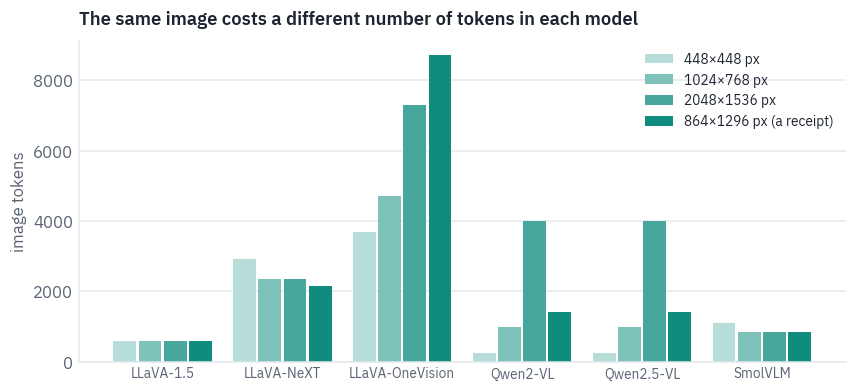

Four ways to price a picture. LLaVA-1.5 charges a flat 576 tokens for a thumbnail or a poster.

LLaVA-NeXT and LLaVA-OneVision cut the image into tiles, and OneVision is the most expensive at every size: even the small square costs 3,699 tokens, because the processor blows it up to fill a grid of two by two tiles. Its most expensive image is not the largest but the receipt.

A tall receipt fits a grid four tiles high and three wide and stays just under the point at which OneVision shrinks the map, while the large photo goes over it and is shrunk to nine tiles' worth.

Qwen2-VL and Qwen2.5-VL charge by area: 256 tokens for the small square, about four thousand for the large photo. SmolVLM is the odd one. It resizes every image so that its long side is 2,048 pixels and cuts 512-pixel tiles, so the small square, blown up to 2,048 by 2,048, costs more than the large photo.

A fixed price has its own cost. LLaVA-1.5's processor, as the Hugging Face port configures it, scales the image so that its short side is 336 pixels and cuts out the square in the middle: of a photo of any shape, the model sees only the central square.

CORD tells us where each receipt's total is printed, so we can count how often it falls outside.

```python
def crop_square(image):
    """The middle square that a short-side resize and a centre crop keep: x, y, side."""
    w, h = image.size
    side = min(w, h)
    return (w - side) / 2, (h - side) / 2, side


def total_seen(rec):
    left, top, side = crop_square(rec["image"])
    x0, y0, x1, y1 = rec["box"]
    return left <= x0 and x1 <= left + side and top <= y0 and y1 <= top + side


boxed = [r for r in receipts if r["box"]]
lost = [r for r in boxed if not total_seen(r)]
print(
    f"totals wholly or partly outside the square: {len(lost)} of {len(boxed)} receipts"
)


def overshoot(rec):  # how far the total sticks out of the square, in pixels
    left, top, side = crop_square(rec["image"])
    x0, y0, x1, y1 = rec["box"]
    return max(left - x0, top - y0, x1 - left - side, y1 - top - side)


shown = max(lost, key=overshoot) if lost else typical
llava15 = AutoProcessor.from_pretrained(PROCESSORS["LLaVA-1.5"]).image_processor
seen = llava15(shown["image"], return_tensors="pt")["pixel_values"][0]
mean = torch.tensor(llava15.image_mean)[:, None, None]
std = torch.tensor(llava15.image_std)[:, None, None]
seen = (seen * std + mean).clamp(0, 1).permute(1, 2, 0)
w, h = shown["image"].size
left, top, side = crop_square(shown["image"])
x0, y0, x1, y1 = shown["box"]
fig, axes = plt.subplots(
    1, 2, figsize=(8, 4.6), gridspec_kw={"width_ratios": [w / h, 1]}
)
axes[0].imshow(shown["image"])
axes[0].add_patch(
    plt.Rectangle((left, top), side, side, fill=False, ec=COLORS["dec"], lw=2)
)
axes[0].add_patch(
    plt.Rectangle((x0, y0), x1 - x0, y1 - y0, fill=False, ec=COLORS["enc"], lw=2)
)
axes[0].set_title(f"the receipt, {w}×{h} px, total {shown['total']}", fontsize=10)
axes[1].imshow(seen)
axes[1].set_title(
    f"what LLaVA-1.5 gets: {seen.shape[1]}×{seen.shape[0]} px", fontsize=10
)
for ax in axes:
    ax.axis("off")
plt.tight_layout()
plt.show()
```

<pre class="tfs-printed" markdown="0"><code>totals wholly or partly outside the square: 14 of 95 receipts</code></pre>

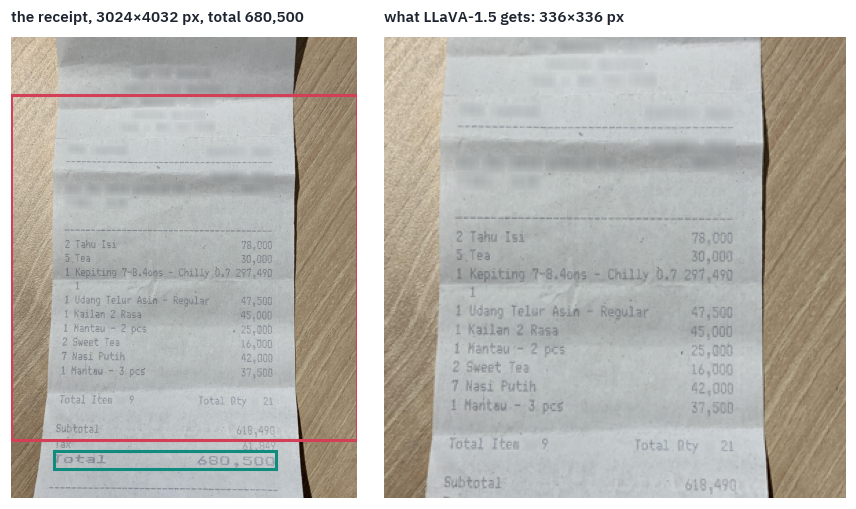

*Receipt: CORD (Naver Clova), CC BY 4.0.*

On this receipt the square ends just above the line that matters: the model gets every item and the subtotal, and not the total (the teal box). It is one of 14 receipts out of 95 whose total falls wholly or partly outside the square, about one in seven, lost before the model has read a single token.

The original LLaVA-1.5 was trained on images padded to a square, which keeps the whole receipt and shrinks it instead; the port's processor crops. A fixed price leaves those two choices, and on a long receipt each costs something: the crop loses lines, the padding loses resolution.

What does a token cost? In memory, the KV cache of lesson 8: every token keeps a key and a value in every layer. For
Qwen2-VL 2B's language model that is:

```python
QV = "Qwen/Qwen2-VL-2B-Instruct"
qv_config = json.load(open(hf_hub_download(QV, "config.json")))
q_text = qv_config.get("text_config", qv_config)
head_dim = q_text["hidden_size"] // q_text["num_attention_heads"]
per_token = (
    2 * q_text["num_hidden_layers"] * q_text["num_key_value_heads"] * head_dim * 2
)  # K and V, fp16
layers, kv_heads = q_text["num_hidden_layers"], q_text["num_key_value_heads"]
print(
    f"KV cache per token: 2 × {layers} layers × {kv_heads} KV heads × {head_dim} × 2 bytes"
    f" = {per_token / 1024:.0f} KB"
)
for h, w in SIZES:
    n = int(counts.loc[counts.model == "Qwen2-VL", f"{w}×{h}"].iloc[0])
    print(f"  a {w}×{h} image: {n} tokens, {n * per_token / 2**20:.1f} MB of cache")
```

<pre class="tfs-printed" markdown="0"><code>KV cache per token: 2 × 28 layers × 2 KV heads × 128 × 2 bytes = 28 KB
  a 448×448 image: 256 tokens, 7.0 MB of cache
  a 1024×768 image: 999 tokens, 27.3 MB of cache
  a 2048×1536 image: 4015 tokens, 109.8 MB of cache
  a 864×1296 image: 1426 tokens, 39.0 MB of cache</code></pre>

For one picture this is small: the receipt costs 39 MB of cache on a card with 16 GB. It stops being small when pictures pile up.

A chat with twenty photos, a PDF of fifty scanned pages, a minute of video at two frames a second: at a thousand tokens an image, fifty pages are fifty thousand tokens, about 1.4 GB of cache for this 2-billion model and many times that for a large one, and the attention that reads them grows with the square of their number.

Every design in this lesson is an argument about which tokens an image deserves, not only how many.

## 6. Qwen2-VL: an image that keeps its shape

Qwen2-VL took the other road<sup class="cite">[<a href="#ref-17" id="cite-19" data-ref="17" aria-label="Reference 17: Wang, P., Bai, S., Tan, S., et al. (2024). Qwen2-VL: enhancing vision-language model&#x27;s perception of the world at any resolution. arXiv.">17</a>]</sup>. Instead of cutting an image
into tiles for an encoder that only knows squares, it trained a Vision Transformer of 675 million parameters to take an
image of any shape as it is. Two ideas make that work, and we'll rebuild both.

**The image keeps its shape.** The processor rounds each side to a multiple of 28 pixels, then scales the whole image so that its area stays between two limits, `min_pixels` and `max_pixels`.

The encoder cuts it into patches of 14 pixels, and after its last block a *merger* joins every 2×2 block of neighbouring patches into one vector, so that one token covers 28×28 pixels. The number of tokens is the area divided by 28², and the area is something we choose.

In recent versions of Transformers the two limits live in the processor's `size` as `shortest_edge` and `longest_edge`, and despite the names both are areas in pixels, which is how `qwen_inputs` below sets them.

```python
del ov  # LLaVA-OneVision's part is over: free the GPU for Qwen2-VL
torch.cuda.empty_cache()
qv_processor = AutoProcessor.from_pretrained(QV)
qv = Qwen2VLForConditionalGeneration.from_pretrained(
    QV, dtype=torch.float16, attn_implementation="sdpa"
)
qv = qv.to(device).eval()
limits = qv_processor.image_processor  # the defaults, before qwen_inputs changes them
default_min = getattr(limits, "min_pixels", None) or limits.size["shortest_edge"]
default_max = getattr(limits, "max_pixels", None) or limits.size["longest_edge"]
eos = qv.generation_config.eos_token_id
stop_ids = set(eos if isinstance(eos, list) else [eos])
stop_ids.add(qv_processor.tokenizer.convert_tokens_to_ids("<|im_end|>"))


def smart_resize(height, width, max_pixels, min_pixels=56 * 56, factor=28):
    h, w = (
        max(factor, round(height / factor) * factor),
        max(factor, round(width / factor) * factor),
    )
    if h * w > max_pixels:
        beta = math.sqrt(height * width / max_pixels)
        h, w = (
            math.floor(height / beta / factor) * factor,
            math.floor(width / beta / factor) * factor,
        )
    elif h * w < min_pixels:
        beta = math.sqrt(min_pixels / (height * width))
        h, w = (
            math.ceil(height * beta / factor) * factor,
            math.ceil(width * beta / factor) * factor,
        )
    return h, w


def qwen_inputs(image, text, budget):
    """Inputs for one image and a question, at most `budget` image tokens."""
    images = qv_processor.image_processor
    images.size = {
        "shortest_edge": min(budget, 16) * 28 * 28,
        "longest_edge": budget * 28 * 28,
    }
    talk = [
        {"role": "user", "content": [{"type": "image"}, {"type": "text", "text": text}]}
    ]
    prompt = qv_processor.apply_chat_template(talk, add_generation_prompt=True)
    return qv_processor(images=image, text=prompt, return_tensors="pt").to(device)


budget = 1024
q_inputs = qwen_inputs(typical["image"], question, budget)
t, gh, gw = q_inputs["image_grid_thw"][0].tolist()
ours_h, ours_w = smart_resize(
    typical["image"].height,
    typical["image"].width,
    budget * 28 * 28,
    min(budget, 16) * 28 * 28,
)
print(
    "the receipt:",
    typical["image"].size,
    "→ ours:",
    (ours_w, ours_h),
    "| processor:",
    (gw * 14, gh * 14),
)
print(
    "patches of 14:",
    gh,
    "×",
    gw,
    "| after the 2×2 merger:",
    gh // 2,
    "×",
    gw // 2,
    "=",
    gh * gw // 4,
    "tokens",
)
print(
    "pixel_values:",
    tuple(q_inputs["pixel_values"].shape),
    "(patches, 3 channels × 2 frames × 14 × 14)",
)
cost = sorted(
    (h // 28) * (w // 28)
    for h, w in (
        smart_resize(r["image"].height, r["image"].width, default_max, default_min)
        for r in receipts
    )
)
print(
    f"with the default limits, {default_min:,} to {default_max:,} pixels, the receipts"
)
print(
    f"would cost {cost[0]:,} to {cost[-1]:,} tokens each, {cost[len(cost) // 2]:,} median"
)
```

<pre class="tfs-printed" markdown="0"><code>the receipt: (864, 1296) → ours: (728, 1092) | processor: (728, 1092)
patches of 14: 78 × 52 | after the 2×2 merger: 39 × 26 = 1014 tokens
pixel_values: (4056, 1176) (patches, 3 channels × 2 frames × 14 × 14)
with the default limits, 3,136 to 12,845,056 pixels, the receipts
would cost 96 to 15,552 tokens each, 1,426 median</code></pre>

The patches arrive as a flat list, each flattened to 1,176 numbers: three channels, 14×14 pixels and two frames,
because the same encoder also reads video, where two consecutive frames share a patch, and a still image is simply
repeated.

The limits matter more than they look. With the defaults that ship with the model, from 3,136 to 12.8 million pixels, our receipts would cost from 96 to 15,552 tokens each, 1,426 for the median one.

The most expensive is the 3,024 by 4,032 photo from section 5: at its full resolution, one receipt is fifteen thousand tokens. The budget is the first thing to set when you use a model of this kind, and the rest of the lesson always sets it.

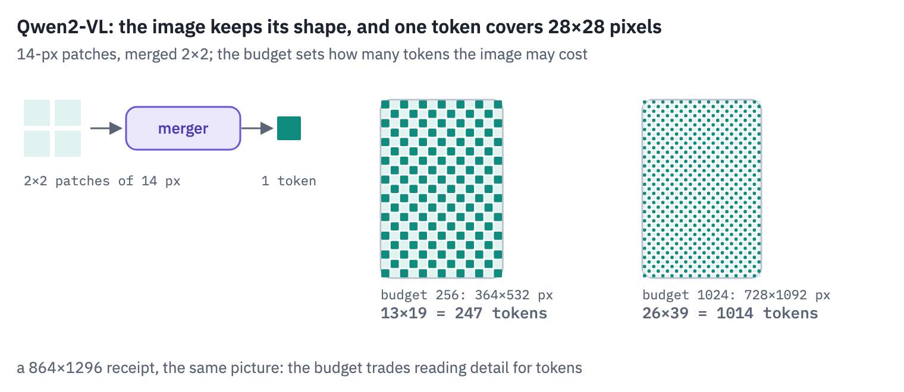
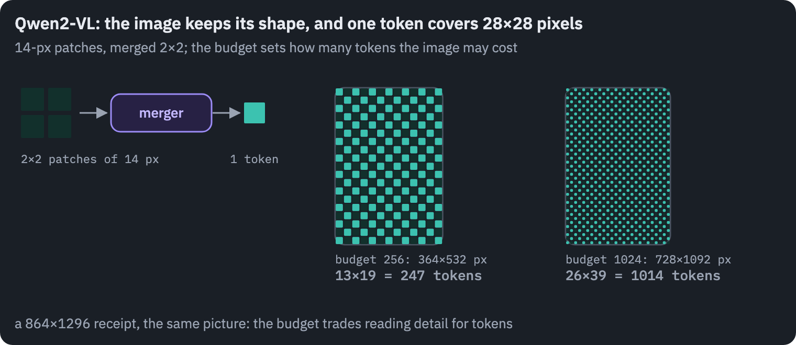

**Positions in three dimensions.** A Transformer with rotary positions (lesson 6) knows where a token is from a single number. For an image that is a poor fit: two tokens that touch, one above the other, would be a whole row of tokens apart.

Qwen2-VL's *M-RoPE* gives every token three positions, a time, a row and a column, and splits the rotary dimensions of each attention head into three groups that rotate with one of them each. Text tokens get the same number in all three, so for text nothing changes. The rule is short enough to write.

```python
def mrope_positions(input_ids, image_token, grid_h, grid_w):
    """Three positions per token, (time, row, column), for one image of grid_h × grid_w."""
    n = len(input_ids)
    start = int((input_ids == image_token).nonzero()[0])
    positions = torch.zeros(3, n, dtype=torch.long)
    positions[:, :start] = torch.arange(
        start
    )  # text before the image: the same number three times
    image = torch.arange(grid_h * grid_w)
    positions[0, start : start + grid_h * grid_w] = start  # one frame: one time step
    positions[1, start : start + grid_h * grid_w] = start + image // grid_w  # rows
    positions[2, start : start + grid_h * grid_w] = start + image % grid_w  # columns
    resume = start + max(grid_h, grid_w)
    after = n - (start + grid_h * grid_w)
    positions[:, start + grid_h * grid_w :] = resume + torch.arange(after)
    return positions


q_ids = q_inputs["input_ids"][0].cpu()
ours_pos = mrope_positions(q_ids, qv.config.image_token_id, gh // 2, gw // 2)


def rope_index(inputs):
    """Qwen2-VL's own positions, through either of its two signatures across versions."""
    extra = {k: inputs[k] for k in ("mm_token_type_ids",) if k in inputs}
    try:
        return qv.model.get_rope_index(
            inputs["input_ids"],
            image_grid_thw=inputs["image_grid_thw"],
            attention_mask=inputs["attention_mask"],
            **extra,
        )[0]
    except TypeError:
        return qv.model.get_rope_index(
            inputs["input_ids"],
            inputs.get("mm_token_type_ids"),
            inputs["image_grid_thw"],
            None,
            inputs["attention_mask"],
        )[0]


theirs_pos = rope_index(q_inputs)
print("positions equal to Qwen2-VL's:", torch.equal(ours_pos, theirs_pos[:, 0].cpu()))
print("tokens in the sequence:", len(q_ids), "| largest position:", int(ours_pos.max()))
```

<pre class="tfs-printed" markdown="0"><code>positions equal to Qwen2-VL&#x27;s: True
tokens in the sequence: 1052 | largest position: 76</code></pre>

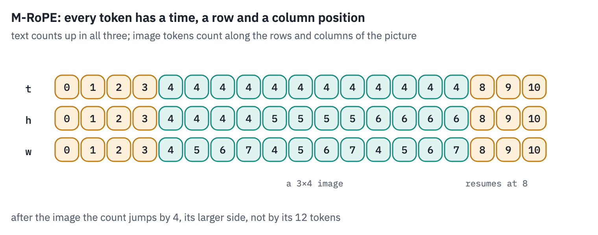
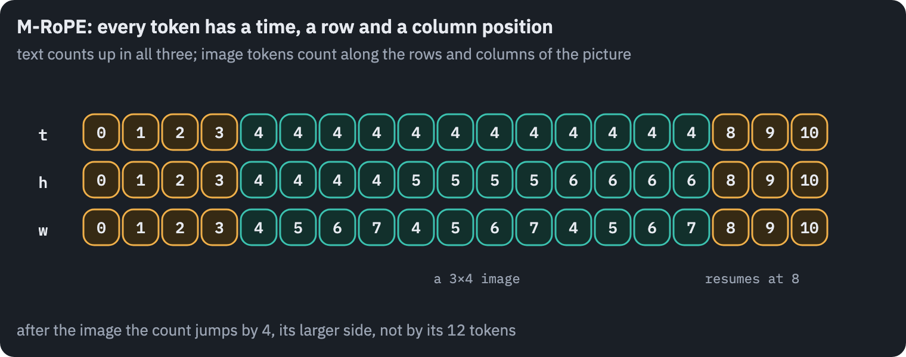

Our three positions are Qwen2-VL's, token for token. The last line is the interesting one: the sequence has 1,052 tokens, and its largest position is 76.

The receipt's 1,014 image tokens moved the position counter on by 39, the number of rows in their grid, because the text after an image resumes at the image's start plus its larger side.

A picture costs the language model a thousand slots of attention and memory but only a few dozen steps of position, so a long document full of images doesn't push its text out to positions the model rarely saw in training.

## 7. Reading under a budget

Now the experiment the lesson has been building towards. With Qwen2-VL we choose how many tokens an image may cost, so we can ask the receipts and the charts the same questions at budgets from 64 tokens to 2,048 and watch what each extra token buys.

A receipt at 64 tokens is a thumbnail of a few hundred pixels; at 2,048 the small print is legible.

The answers are compared digit by digit with the truth: "60,000", "60.000" and "Rp 60.000" all count as 60000.

```python
def digits(text):
    return re.sub(r"\D", "", text or "")


def answer(inputs, max_new_tokens=14):
    with torch.no_grad():
        out = qv.generate(**inputs, max_new_tokens=max_new_tokens, do_sample=False)
    return qv_processor.decode(
        out[0, inputs["input_ids"].shape[1] :], skip_special_tokens=True
    )


def chart_question(chart):
    return f"What is the value shown for {chart['label']}? Answer with the number only."


BUDGETS = [64, 256] if SMOKE else [64, 128, 256, 512, 1024, 2048]
budget_rows, examples = [], []
for budget in BUDGETS:
    for kind, items in (("receipts", receipts), ("charts", charts)):
        right, tokens, seconds = 0, [], []
        for item in items:
            text = question if kind == "receipts" else chart_question(item)
            truth = item["total"] if kind == "receipts" else item["value"]
            inputs = qwen_inputs(item["image"], text, budget)
            start = time.time()
            said = answer(inputs)
            seconds.append(time.time() - start)
            right += digits(said) == digits(truth)
            tokens.append(int((inputs["input_ids"] == qv.config.image_token_id).sum()))
            if item is typical:
                examples.append((budget, said))
        budget_rows.append(
            dict(
                kind=kind,
                budget=budget,
                tokens=np.mean(tokens),
                accuracy=right / len(items),
                seconds=np.mean(seconds),
            )
        )
budgets = pd.DataFrame(budget_rows)
display(table(budgets, digits=2))

fig, ax = plt.subplots(figsize=(8, 3.8))
for kind, color in (("receipts", COLORS["enc"]), ("charts", COLORS["data"])):
    part = budgets[budgets.kind == kind]
    ax.plot(part["tokens"], 100 * part["accuracy"], marker="o", color=color, label=kind)
ax.set_xscale("log", base=2)
ax.set_xticks(BUDGETS[:-1], [f"{b:,}" for b in BUDGETS[:-1]], minor=False)
ax.minorticks_off()
ax.set_xlabel("image tokens actually used (log scale)")
ax.set_ylabel("% answered exactly")
ax.set_title("Qwen2-VL 2B reading receipts and charts under a token budget")
ax.legend(frameon=False)
plt.show()
print("our receipt, answer by budget:", examples, "| truth:", typical["total"])
```

<div class="tfs-table-wrap"><table class="tfs-table" style="border-collapse:collapse;font-family:'IBM Plex Sans', -apple-system, 'Segoe UI', Roboto, Helvetica, Arial, sans-serif;font-size:13.5px;line-height:1.45;margin:4px 0 8px;"><thead><tr><th style="padding:7px 14px;border-bottom:2px solid #B9C0CB;font-weight:600;color:#5B6575;font-size:12px;letter-spacing:0.02em;text-align:left;">kind</th><th style="padding:7px 14px;border-bottom:2px solid #B9C0CB;font-weight:600;color:#5B6575;font-size:12px;letter-spacing:0.02em;text-align:right;">budget</th><th style="padding:7px 14px;border-bottom:2px solid #B9C0CB;font-weight:600;color:#5B6575;font-size:12px;letter-spacing:0.02em;text-align:right;">tokens</th><th style="padding:7px 14px;border-bottom:2px solid #B9C0CB;font-weight:600;color:#5B6575;font-size:12px;letter-spacing:0.02em;text-align:right;">accuracy</th><th style="padding:7px 14px;border-bottom:2px solid #B9C0CB;font-weight:600;color:#5B6575;font-size:12px;letter-spacing:0.02em;text-align:right;">seconds</th></tr></thead><tbody><tr><td style="padding:7px 14px;border-bottom:1px solid #E6E9EE;vertical-align:top;text-align:left;max-width:460px;white-space:normal;">receipts</td><td style="padding:7px 14px;border-bottom:1px solid #E6E9EE;vertical-align:top;text-align:right;font-variant-numeric:tabular-nums;max-width:460px;white-space:normal;">64</td><td style="padding:7px 14px;border-bottom:1px solid #E6E9EE;vertical-align:top;text-align:right;font-variant-numeric:tabular-nums;max-width:460px;white-space:normal;">55.48</td><td style="padding:7px 14px;border-bottom:1px solid #E6E9EE;vertical-align:top;text-align:right;font-variant-numeric:tabular-nums;max-width:460px;white-space:normal;">0.38</td><td style="padding:7px 14px;border-bottom:1px solid #E6E9EE;vertical-align:top;text-align:right;font-variant-numeric:tabular-nums;max-width:460px;white-space:normal;">0.36</td></tr><tr><td style="padding:7px 14px;border-bottom:1px solid #E6E9EE;vertical-align:top;text-align:left;max-width:460px;white-space:normal;">charts</td><td style="padding:7px 14px;border-bottom:1px solid #E6E9EE;vertical-align:top;text-align:right;font-variant-numeric:tabular-nums;max-width:460px;white-space:normal;">64</td><td style="padding:7px 14px;border-bottom:1px solid #E6E9EE;vertical-align:top;text-align:right;font-variant-numeric:tabular-nums;max-width:460px;white-space:normal;">60.00</td><td style="padding:7px 14px;border-bottom:1px solid #E6E9EE;vertical-align:top;text-align:right;font-variant-numeric:tabular-nums;max-width:460px;white-space:normal;">0.19</td><td style="padding:7px 14px;border-bottom:1px solid #E6E9EE;vertical-align:top;text-align:right;font-variant-numeric:tabular-nums;max-width:460px;white-space:normal;">0.21</td></tr><tr><td style="padding:7px 14px;border-bottom:1px solid #E6E9EE;vertical-align:top;text-align:left;max-width:460px;white-space:normal;">receipts</td><td style="padding:7px 14px;border-bottom:1px solid #E6E9EE;vertical-align:top;text-align:right;font-variant-numeric:tabular-nums;max-width:460px;white-space:normal;">128</td><td style="padding:7px 14px;border-bottom:1px solid #E6E9EE;vertical-align:top;text-align:right;font-variant-numeric:tabular-nums;max-width:460px;white-space:normal;">117.25</td><td style="padding:7px 14px;border-bottom:1px solid #E6E9EE;vertical-align:top;text-align:right;font-variant-numeric:tabular-nums;max-width:460px;white-space:normal;">0.74</td><td style="padding:7px 14px;border-bottom:1px solid #E6E9EE;vertical-align:top;text-align:right;font-variant-numeric:tabular-nums;max-width:460px;white-space:normal;">0.36</td></tr><tr><td style="padding:7px 14px;border-bottom:1px solid #E6E9EE;vertical-align:top;text-align:left;max-width:460px;white-space:normal;">charts</td><td style="padding:7px 14px;border-bottom:1px solid #E6E9EE;vertical-align:top;text-align:right;font-variant-numeric:tabular-nums;max-width:460px;white-space:normal;">128</td><td style="padding:7px 14px;border-bottom:1px solid #E6E9EE;vertical-align:top;text-align:right;font-variant-numeric:tabular-nums;max-width:460px;white-space:normal;">112.00</td><td style="padding:7px 14px;border-bottom:1px solid #E6E9EE;vertical-align:top;text-align:right;font-variant-numeric:tabular-nums;max-width:460px;white-space:normal;">0.67</td><td style="padding:7px 14px;border-bottom:1px solid #E6E9EE;vertical-align:top;text-align:right;font-variant-numeric:tabular-nums;max-width:460px;white-space:normal;">0.23</td></tr><tr><td style="padding:7px 14px;border-bottom:1px solid #E6E9EE;vertical-align:top;text-align:left;max-width:460px;white-space:normal;">receipts</td><td style="padding:7px 14px;border-bottom:1px solid #E6E9EE;vertical-align:top;text-align:right;font-variant-numeric:tabular-nums;max-width:460px;white-space:normal;">256</td><td style="padding:7px 14px;border-bottom:1px solid #E6E9EE;vertical-align:top;text-align:right;font-variant-numeric:tabular-nums;max-width:460px;white-space:normal;">245.54</td><td style="padding:7px 14px;border-bottom:1px solid #E6E9EE;vertical-align:top;text-align:right;font-variant-numeric:tabular-nums;max-width:460px;white-space:normal;">0.82</td><td style="padding:7px 14px;border-bottom:1px solid #E6E9EE;vertical-align:top;text-align:right;font-variant-numeric:tabular-nums;max-width:460px;white-space:normal;">0.44</td></tr><tr><td style="padding:7px 14px;border-bottom:1px solid #E6E9EE;vertical-align:top;text-align:left;max-width:460px;white-space:normal;">charts</td><td style="padding:7px 14px;border-bottom:1px solid #E6E9EE;vertical-align:top;text-align:right;font-variant-numeric:tabular-nums;max-width:460px;white-space:normal;">256</td><td style="padding:7px 14px;border-bottom:1px solid #E6E9EE;vertical-align:top;text-align:right;font-variant-numeric:tabular-nums;max-width:460px;white-space:normal;">240.00</td><td style="padding:7px 14px;border-bottom:1px solid #E6E9EE;vertical-align:top;text-align:right;font-variant-numeric:tabular-nums;max-width:460px;white-space:normal;">1.00</td><td style="padding:7px 14px;border-bottom:1px solid #E6E9EE;vertical-align:top;text-align:right;font-variant-numeric:tabular-nums;max-width:460px;white-space:normal;">0.30</td></tr><tr><td style="padding:7px 14px;border-bottom:1px solid #E6E9EE;vertical-align:top;text-align:left;max-width:460px;white-space:normal;">receipts</td><td style="padding:7px 14px;border-bottom:1px solid #E6E9EE;vertical-align:top;text-align:right;font-variant-numeric:tabular-nums;max-width:460px;white-space:normal;">512</td><td style="padding:7px 14px;border-bottom:1px solid #E6E9EE;vertical-align:top;text-align:right;font-variant-numeric:tabular-nums;max-width:460px;white-space:normal;">470.35</td><td style="padding:7px 14px;border-bottom:1px solid #E6E9EE;vertical-align:top;text-align:right;font-variant-numeric:tabular-nums;max-width:460px;white-space:normal;">0.86</td><td style="padding:7px 14px;border-bottom:1px solid #E6E9EE;vertical-align:top;text-align:right;font-variant-numeric:tabular-nums;max-width:460px;white-space:normal;">0.63</td></tr><tr><td style="padding:7px 14px;border-bottom:1px solid #E6E9EE;vertical-align:top;text-align:left;max-width:460px;white-space:normal;">charts</td><td style="padding:7px 14px;border-bottom:1px solid #E6E9EE;vertical-align:top;text-align:right;font-variant-numeric:tabular-nums;max-width:460px;white-space:normal;">512</td><td style="padding:7px 14px;border-bottom:1px solid #E6E9EE;vertical-align:top;text-align:right;font-variant-numeric:tabular-nums;max-width:460px;white-space:normal;">476.00</td><td style="padding:7px 14px;border-bottom:1px solid #E6E9EE;vertical-align:top;text-align:right;font-variant-numeric:tabular-nums;max-width:460px;white-space:normal;">1.00</td><td style="padding:7px 14px;border-bottom:1px solid #E6E9EE;vertical-align:top;text-align:right;font-variant-numeric:tabular-nums;max-width:460px;white-space:normal;">0.48</td></tr><tr><td style="padding:7px 14px;border-bottom:1px solid #E6E9EE;vertical-align:top;text-align:left;max-width:460px;white-space:normal;">receipts</td><td style="padding:7px 14px;border-bottom:1px solid #E6E9EE;vertical-align:top;text-align:right;font-variant-numeric:tabular-nums;max-width:460px;white-space:normal;">1,024</td><td style="padding:7px 14px;border-bottom:1px solid #E6E9EE;vertical-align:top;text-align:right;font-variant-numeric:tabular-nums;max-width:460px;white-space:normal;">888.16</td><td style="padding:7px 14px;border-bottom:1px solid #E6E9EE;vertical-align:top;text-align:right;font-variant-numeric:tabular-nums;max-width:460px;white-space:normal;">0.88</td><td style="padding:7px 14px;border-bottom:1px solid #E6E9EE;vertical-align:top;text-align:right;font-variant-numeric:tabular-nums;max-width:460px;white-space:normal;">1.09</td></tr><tr><td style="padding:7px 14px;border-bottom:1px solid #E6E9EE;vertical-align:top;text-align:left;max-width:460px;white-space:normal;">charts</td><td style="padding:7px 14px;border-bottom:1px solid #E6E9EE;vertical-align:top;text-align:right;font-variant-numeric:tabular-nums;max-width:460px;white-space:normal;">1,024</td><td style="padding:7px 14px;border-bottom:1px solid #E6E9EE;vertical-align:top;text-align:right;font-variant-numeric:tabular-nums;max-width:460px;white-space:normal;">522.00</td><td style="padding:7px 14px;border-bottom:1px solid #E6E9EE;vertical-align:top;text-align:right;font-variant-numeric:tabular-nums;max-width:460px;white-space:normal;">1.00</td><td style="padding:7px 14px;border-bottom:1px solid #E6E9EE;vertical-align:top;text-align:right;font-variant-numeric:tabular-nums;max-width:460px;white-space:normal;">0.55</td></tr><tr><td style="padding:7px 14px;border-bottom:1px solid #E6E9EE;vertical-align:top;text-align:left;max-width:460px;white-space:normal;">receipts</td><td style="padding:7px 14px;border-bottom:1px solid #E6E9EE;vertical-align:top;text-align:right;font-variant-numeric:tabular-nums;max-width:460px;white-space:normal;">2,048</td><td style="padding:7px 14px;border-bottom:1px solid #E6E9EE;vertical-align:top;text-align:right;font-variant-numeric:tabular-nums;max-width:460px;white-space:normal;">1,324.11</td><td style="padding:7px 14px;border-bottom:1px solid #E6E9EE;vertical-align:top;text-align:right;font-variant-numeric:tabular-nums;max-width:460px;white-space:normal;">0.88</td><td style="padding:7px 14px;border-bottom:1px solid #E6E9EE;vertical-align:top;text-align:right;font-variant-numeric:tabular-nums;max-width:460px;white-space:normal;">1.83</td></tr><tr><td style="padding:7px 14px;border-bottom:1px solid #E6E9EE;vertical-align:top;text-align:left;max-width:460px;white-space:normal;">charts</td><td style="padding:7px 14px;border-bottom:1px solid #E6E9EE;vertical-align:top;text-align:right;font-variant-numeric:tabular-nums;max-width:460px;white-space:normal;">2,048</td><td style="padding:7px 14px;border-bottom:1px solid #E6E9EE;vertical-align:top;text-align:right;font-variant-numeric:tabular-nums;max-width:460px;white-space:normal;">522.00</td><td style="padding:7px 14px;border-bottom:1px solid #E6E9EE;vertical-align:top;text-align:right;font-variant-numeric:tabular-nums;max-width:460px;white-space:normal;">1.00</td><td style="padding:7px 14px;border-bottom:1px solid #E6E9EE;vertical-align:top;text-align:right;font-variant-numeric:tabular-nums;max-width:460px;white-space:normal;">0.55</td></tr></tbody></table></div>

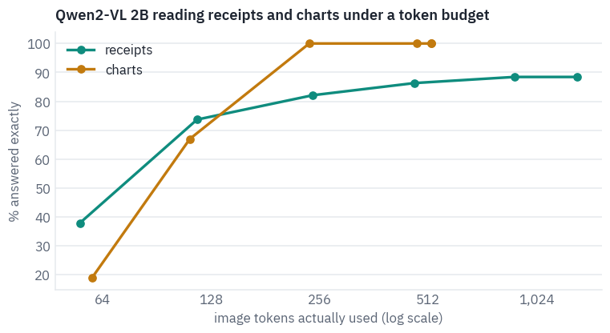

<pre class="tfs-printed" markdown="0"><code>our receipt, answer by budget: [(64, &#x27;100&#x27;), (128, &#x27;20000&#x27;), (256, &#x27;100,000&#x27;), (512, &#x27;100,000&#x27;), (1024, &#x27;72,000&#x27;), (2048, &#x27;100,000&#x27;)] | truth: 28,000</code></pre>

The two curves tell different stories. The charts go from guessing to perfect between 64 and 256 tokens and stay there: their numbers are printed in a fixed font on an 800-pixel image, and once each token covers a few characters' worth of pixels, every label is legible.

They also stop at 522 tokens, the chart's own size, because the processor never enlarges an image to fill a budget.

The receipts climb steeply to 256 tokens and then flatten: 82% at about 250 tokens, 88% at about 900, and not one answer more at 2,048, where the average receipt uses only 1,324 tokens because many are smaller than the budget.

The last points are the expensive ones: an answer takes about a third of a second at the smallest budget and nearly two seconds at the largest.

<p class="takeaway" markdown="1">For Qwen2-VL 2B, receipts stop improving at around a thousand image tokens and charts at around 250. Past the point
where the print is legible, a bigger budget buys time, not accuracy.</p>

```python
W, H = typical["image"].size
x0, y0, x1, y1 = typical["box"]
line = y1 - y0  # one printed line, from CORD's box of the total
region = (0, max(0, round(y0 - 3.2 * line)), W, min(H, round(y1 + 4.6 * line)))
fig, axes = plt.subplots(3, 1, figsize=(9, 7.4))
for ax, b in zip(axes, [64, 256, 1024]):
    h, w = smart_resize(H, W, b * 28 * 28, min(b, 16) * 28 * 28)
    seen = typical["image"].resize((w, h), Image.BICUBIC).resize((W, H), Image.NEAREST)
    ax.imshow(seen.crop(region))
    tokens = (h // 28) * (w // 28)
    ax.set_title(f"budget {b}: the receipt at {w}×{h} px, {tokens} tokens", loc="left")
    ax.axis("off")
plt.suptitle("The lines around the total, as the encoder sees them", fontsize=11)
plt.tight_layout()
plt.show()
```

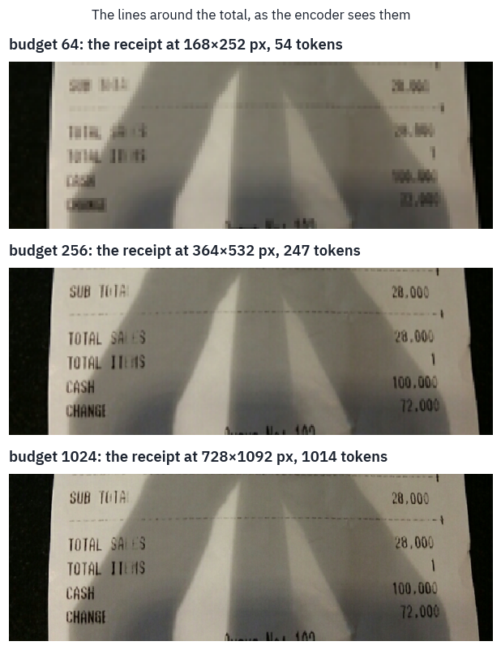

*Receipt: CORD (Naver Clova), CC BY 4.0, the lines around its total at the resolution each budget allows.*

At 64 tokens the receipt is 168 by 252 pixels and its digits are smudges. At 256 every line reads, *TOTAL SALES 28,000* included, and yet this is a receipt the model gets wrong at every budget.

From 256 tokens on it answers 100,000, the cash handed over, except at 1,024, where it answers 72,000, the change. It reads the numbers and picks the wrong line. More pixels fix reading; they don't teach a model which number a receipt calls the total.

## 8. Dropping image tokens inside the model

If an image costs a thousand tokens, perhaps the model doesn't need all of them once it has looked.

Chen and colleagues measured where LLaVA-1.5's attention goes and found that after the second layer image tokens receive very little of it; their method, FastV, ranks the image tokens at layer 2 by the attention they receive, drops the bottom half, and runs the remaining layers on what is left<sup class="cite">[<a href="#ref-18" id="cite-20" data-ref="18" aria-label="Reference 18: Chen, L., Zhao, H., Liu, T., et al. (2024). An image is worth 1/2 tokens after layer 2: plug-and-play inference acceleration for large vision-language models. ECCV 2024.">18</a>]</sup>.

On LLaVA-1.5 13B they report 45% fewer FLOPs without a loss on their benchmarks.


Their benchmarks were mostly about what a photo shows. Reading is different: the one patch with the total on it may not look important at layer 2. To test it we need our own loop over Qwen2-VL's layers, because the pruning happens in the middle of the forward pass.

It runs the first layers on the whole sequence, ranks and drops image tokens at layer 2, runs the remaining layers on the shorter sequence, and then generates the answer token by token with a cache in which the early layers remember every token and the later ones only the kept ones.

We compare three rules for which tokens to keep: FastV's own, the attention each image token receives on average from
the tokens that can see it; a simpler variant, the attention from the prompt's last token only; and a random choice of
the same size, as the control any such method must beat.

```python
from transformers.models.qwen2_vl.modeling_qwen2_vl import apply_rotary_pos_emb


def attention_at(layer, hidden, positions, rotary):
    """The attention weights of one layer, averaged over heads: (queries, keys)."""
    attn = layer.self_attn
    x = layer.input_layernorm(hidden)
    n = x.shape[1]
    cos, sin = rotary(x, positions)
    q = attn.q_proj(x).view(1, n, -1, attn.head_dim).transpose(1, 2)
    k = attn.k_proj(x).view(1, n, -1, attn.head_dim).transpose(1, 2)
    q, k = apply_rotary_pos_emb(q, k, cos, sin)
    k = k.repeat_interleave(
        q.shape[1] // k.shape[1], dim=1
    )  # grouped-query attention, lesson 6
    scores = (q @ k.transpose(-1, -2)).float() * attn.scaling
    scores = scores + torch.full((n, n), float("-inf"), device=scores.device).triu(1)
    return torch.softmax(scores, -1)[0].mean(0)


def embed(inputs):
    """Prompt embeddings with the image spliced in, the 3D positions, the image mask."""
    ids = inputs["input_ids"]
    hidden = qv.get_input_embeddings()(ids).clone()
    image = qv.model.get_image_features(
        inputs["pixel_values"], inputs["image_grid_thw"]
    ).pooler_output
    is_image = ids[0] == qv.config.image_token_id
    hidden[0, is_image] = torch.cat(list(image), 0).to(hidden.dtype)
    return hidden, rope_index(inputs), is_image


def choose(rule, n_keep, where, layer, hidden, positions, seed=0):
    """The image tokens a rule keeps at this layer, as positions in the sequence."""
    if rule == "random":
        order = torch.randperm(
            len(where), generator=torch.Generator().manual_seed(seed)
        )
        return where[order[:n_keep].to(where.device)]
    att = attention_at(layer, hidden, positions, qv.model.language_model.rotary_emb)
    if rule == "fastv":  # received from all the tokens that can see it, on average
        received = att.sum(0) / torch.arange(att.shape[0], 0, -1, device=att.device)
    else:  # "last": received from the prompt's last token only
        received = att[-1]
    return where[received[where].topk(n_keep).indices]


def generate_pruned(
    inputs, keep=1.0, rule="fastv", layer_k=2, max_new_tokens=14, seed=0
):
    lm = qv.model.language_model
    with torch.no_grad():
        hidden, positions, is_image = embed(inputs)
        cache = (
            DynamicCache(config=lm.config)
            if "config" in DynamicCache.__init__.__code__.co_varnames
            else DynamicCache()
        )
        for index, layer in enumerate(lm.layers):
            if index == layer_k and keep < 1.0:
                where = is_image.nonzero().flatten()
                n_keep = max(1, round(len(where) * keep))
                chosen = choose(rule, n_keep, where, layer, hidden, positions, seed)
                kept = ~is_image.clone()
                kept[chosen] = True
                hidden, positions = hidden[:, kept], positions[:, :, kept]
            cos, sin = lm.rotary_emb(hidden, positions)
            hidden = layer(
                hidden,
                position_ids=positions,
                past_key_values=cache,
                use_cache=True,
                position_embeddings=(cos, sin),
            )
        logits = qv.lm_head(lm.norm(hidden[:, -1:]))
        out, nxt = [], int(positions.max()) + 1
        for step in range(max_new_tokens):
            token = int(logits[0, -1].argmax())
            if token in stop_ids:
                break
            out.append(token)
            x = qv.get_input_embeddings()(torch.tensor([[token]], device=device))
            p = torch.full((3, 1, 1), nxt + step, device=device, dtype=torch.long)
            cos, sin = lm.rotary_emb(x, p)
            for layer in lm.layers:
                x = layer(
                    x,
                    position_ids=p,
                    past_key_values=cache,
                    use_cache=True,
                    position_embeddings=(cos, sin),
                )
            logits = qv.lm_head(lm.norm(x))
    return qv_processor.tokenizer.decode(out, skip_special_tokens=True)


check = qwen_inputs(typical["image"], question, 1024)
print("our loop:          ", generate_pruned(check))
print("Qwen2-VL's generate:", answer(check))
```

<pre class="tfs-printed" markdown="0"><code>our loop:           72,000
Qwen2-VL&#x27;s generate: 72,000</code></pre>

With nothing pruned, our loop and the library's `generate` give the same answer, so the loop is right. Now the
experiment, at a budget of 1,024 tokens, keeping a half, a quarter and a tenth of the image tokens.

```python
KEEPS = [1.0, 0.25] if SMOKE else [1.0, 0.5, 0.25, 0.1]
prune_rows = []
for kind, items in (("receipts", receipts), ("charts", charts)):
    for rule in ("fastv", "last", "random"):
        for keep in KEEPS:
            if keep == 1.0 and rule != "fastv":
                continue  # nothing dropped: the same for every rule
            right, seconds, tokens = 0, [], []
            for j, item in enumerate(items):
                text = question if kind == "receipts" else chart_question(item)
                truth = item["total"] if kind == "receipts" else item["value"]
                inputs = qwen_inputs(item["image"], text, 1024)
                n_image = int((inputs["input_ids"] == qv.config.image_token_id).sum())
                tokens.append(max(1, round(n_image * keep)))
                start = time.time()
                said = generate_pruned(inputs, keep=keep, rule=rule, seed=j)
                seconds.append(time.time() - start)
                right += digits(said) == digits(truth)
            prune_rows.append(
                dict(
                    kind=kind,
                    rule="all kept" if keep == 1.0 else rule,
                    keep=keep,
                    tokens=np.mean(tokens),
                    accuracy=right / len(items),
                    seconds=np.mean(seconds),
                )
            )
pruned = pd.DataFrame(prune_rows)
display(table(pruned, digits=2))

fig, axes = plt.subplots(1, 2, figsize=(11, 3.8), sharey=True)
for ax, kind in zip(axes, ("receipts", "charts")):
    part = pruned[pruned.kind == kind]
    full = part[part.keep == 1.0]["accuracy"].iloc[0]
    for rule, color, label in (
        ("fastv", COLORS["att"], "FastV (average received)"),
        ("last", COLORS["dec"], "attention from the last token"),
        ("random", COLORS["muted"], "random"),
    ):
        r = part[part.rule == rule].sort_values("keep")
        ax.plot(
            [*r["keep"], 1.0],
            [*(100 * r["accuracy"]), 100 * full],
            marker="o",
            color=color,
            label=label,
        )
    ax.set_xscale("log", base=2)
    ax.set_xticks(KEEPS, [f"{k:.0%}" for k in KEEPS])
    ax.minorticks_off()
    ax.set_xlabel("share of image tokens kept after layer 2")
    ax.set_title(kind)
axes[0].set_ylabel("% answered exactly")
axes[1].legend(frameon=False, fontsize=9)
plt.suptitle("Which image tokens can a reading model lose?", fontsize=12)
plt.tight_layout()
plt.show()
```

<div class="tfs-table-wrap"><table class="tfs-table" style="border-collapse:collapse;font-family:'IBM Plex Sans', -apple-system, 'Segoe UI', Roboto, Helvetica, Arial, sans-serif;font-size:13.5px;line-height:1.45;margin:4px 0 8px;"><thead><tr><th style="padding:7px 14px;border-bottom:2px solid #B9C0CB;font-weight:600;color:#5B6575;font-size:12px;letter-spacing:0.02em;text-align:left;">kind</th><th style="padding:7px 14px;border-bottom:2px solid #B9C0CB;font-weight:600;color:#5B6575;font-size:12px;letter-spacing:0.02em;text-align:left;">rule</th><th style="padding:7px 14px;border-bottom:2px solid #B9C0CB;font-weight:600;color:#5B6575;font-size:12px;letter-spacing:0.02em;text-align:right;">keep</th><th style="padding:7px 14px;border-bottom:2px solid #B9C0CB;font-weight:600;color:#5B6575;font-size:12px;letter-spacing:0.02em;text-align:right;">tokens</th><th style="padding:7px 14px;border-bottom:2px solid #B9C0CB;font-weight:600;color:#5B6575;font-size:12px;letter-spacing:0.02em;text-align:right;">accuracy</th><th style="padding:7px 14px;border-bottom:2px solid #B9C0CB;font-weight:600;color:#5B6575;font-size:12px;letter-spacing:0.02em;text-align:right;">seconds</th></tr></thead><tbody><tr><td style="padding:7px 14px;border-bottom:1px solid #E6E9EE;vertical-align:top;text-align:left;max-width:460px;white-space:normal;">receipts</td><td style="padding:7px 14px;border-bottom:1px solid #E6E9EE;vertical-align:top;text-align:left;max-width:460px;white-space:normal;">all kept</td><td style="padding:7px 14px;border-bottom:1px solid #E6E9EE;vertical-align:top;text-align:right;font-variant-numeric:tabular-nums;max-width:460px;white-space:normal;">1.00</td><td style="padding:7px 14px;border-bottom:1px solid #E6E9EE;vertical-align:top;text-align:right;font-variant-numeric:tabular-nums;max-width:460px;white-space:normal;">888.16</td><td style="padding:7px 14px;border-bottom:1px solid #E6E9EE;vertical-align:top;text-align:right;font-variant-numeric:tabular-nums;max-width:460px;white-space:normal;">0.88</td><td style="padding:7px 14px;border-bottom:1px solid #E6E9EE;vertical-align:top;text-align:right;font-variant-numeric:tabular-nums;max-width:460px;white-space:normal;">1.08</td></tr><tr><td style="padding:7px 14px;border-bottom:1px solid #E6E9EE;vertical-align:top;text-align:left;max-width:460px;white-space:normal;">receipts</td><td style="padding:7px 14px;border-bottom:1px solid #E6E9EE;vertical-align:top;text-align:left;max-width:460px;white-space:normal;">fastv</td><td style="padding:7px 14px;border-bottom:1px solid #E6E9EE;vertical-align:top;text-align:right;font-variant-numeric:tabular-nums;max-width:460px;white-space:normal;">0.50</td><td style="padding:7px 14px;border-bottom:1px solid #E6E9EE;vertical-align:top;text-align:right;font-variant-numeric:tabular-nums;max-width:460px;white-space:normal;">444.15</td><td style="padding:7px 14px;border-bottom:1px solid #E6E9EE;vertical-align:top;text-align:right;font-variant-numeric:tabular-nums;max-width:460px;white-space:normal;">0.74</td><td style="padding:7px 14px;border-bottom:1px solid #E6E9EE;vertical-align:top;text-align:right;font-variant-numeric:tabular-nums;max-width:460px;white-space:normal;">0.95</td></tr><tr><td style="padding:7px 14px;border-bottom:1px solid #E6E9EE;vertical-align:top;text-align:left;max-width:460px;white-space:normal;">receipts</td><td style="padding:7px 14px;border-bottom:1px solid #E6E9EE;vertical-align:top;text-align:left;max-width:460px;white-space:normal;">fastv</td><td style="padding:7px 14px;border-bottom:1px solid #E6E9EE;vertical-align:top;text-align:right;font-variant-numeric:tabular-nums;max-width:460px;white-space:normal;">0.25</td><td style="padding:7px 14px;border-bottom:1px solid #E6E9EE;vertical-align:top;text-align:right;font-variant-numeric:tabular-nums;max-width:460px;white-space:normal;">222.29</td><td style="padding:7px 14px;border-bottom:1px solid #E6E9EE;vertical-align:top;text-align:right;font-variant-numeric:tabular-nums;max-width:460px;white-space:normal;">0.49</td><td style="padding:7px 14px;border-bottom:1px solid #E6E9EE;vertical-align:top;text-align:right;font-variant-numeric:tabular-nums;max-width:460px;white-space:normal;">0.88</td></tr><tr><td style="padding:7px 14px;border-bottom:1px solid #E6E9EE;vertical-align:top;text-align:left;max-width:460px;white-space:normal;">receipts</td><td style="padding:7px 14px;border-bottom:1px solid #E6E9EE;vertical-align:top;text-align:left;max-width:460px;white-space:normal;">fastv</td><td style="padding:7px 14px;border-bottom:1px solid #E6E9EE;vertical-align:top;text-align:right;font-variant-numeric:tabular-nums;max-width:460px;white-space:normal;">0.10</td><td style="padding:7px 14px;border-bottom:1px solid #E6E9EE;vertical-align:top;text-align:right;font-variant-numeric:tabular-nums;max-width:460px;white-space:normal;">88.61</td><td style="padding:7px 14px;border-bottom:1px solid #E6E9EE;vertical-align:top;text-align:right;font-variant-numeric:tabular-nums;max-width:460px;white-space:normal;">0.23</td><td style="padding:7px 14px;border-bottom:1px solid #E6E9EE;vertical-align:top;text-align:right;font-variant-numeric:tabular-nums;max-width:460px;white-space:normal;">0.83</td></tr><tr><td style="padding:7px 14px;border-bottom:1px solid #E6E9EE;vertical-align:top;text-align:left;max-width:460px;white-space:normal;">receipts</td><td style="padding:7px 14px;border-bottom:1px solid #E6E9EE;vertical-align:top;text-align:left;max-width:460px;white-space:normal;">last</td><td style="padding:7px 14px;border-bottom:1px solid #E6E9EE;vertical-align:top;text-align:right;font-variant-numeric:tabular-nums;max-width:460px;white-space:normal;">0.50</td><td style="padding:7px 14px;border-bottom:1px solid #E6E9EE;vertical-align:top;text-align:right;font-variant-numeric:tabular-nums;max-width:460px;white-space:normal;">444.15</td><td style="padding:7px 14px;border-bottom:1px solid #E6E9EE;vertical-align:top;text-align:right;font-variant-numeric:tabular-nums;max-width:460px;white-space:normal;">0.47</td><td style="padding:7px 14px;border-bottom:1px solid #E6E9EE;vertical-align:top;text-align:right;font-variant-numeric:tabular-nums;max-width:460px;white-space:normal;">0.92</td></tr><tr><td style="padding:7px 14px;border-bottom:1px solid #E6E9EE;vertical-align:top;text-align:left;max-width:460px;white-space:normal;">receipts</td><td style="padding:7px 14px;border-bottom:1px solid #E6E9EE;vertical-align:top;text-align:left;max-width:460px;white-space:normal;">last</td><td style="padding:7px 14px;border-bottom:1px solid #E6E9EE;vertical-align:top;text-align:right;font-variant-numeric:tabular-nums;max-width:460px;white-space:normal;">0.25</td><td style="padding:7px 14px;border-bottom:1px solid #E6E9EE;vertical-align:top;text-align:right;font-variant-numeric:tabular-nums;max-width:460px;white-space:normal;">222.29</td><td style="padding:7px 14px;border-bottom:1px solid #E6E9EE;vertical-align:top;text-align:right;font-variant-numeric:tabular-nums;max-width:460px;white-space:normal;">0.12</td><td style="padding:7px 14px;border-bottom:1px solid #E6E9EE;vertical-align:top;text-align:right;font-variant-numeric:tabular-nums;max-width:460px;white-space:normal;">0.81</td></tr><tr><td style="padding:7px 14px;border-bottom:1px solid #E6E9EE;vertical-align:top;text-align:left;max-width:460px;white-space:normal;">receipts</td><td style="padding:7px 14px;border-bottom:1px solid #E6E9EE;vertical-align:top;text-align:left;max-width:460px;white-space:normal;">last</td><td style="padding:7px 14px;border-bottom:1px solid #E6E9EE;vertical-align:top;text-align:right;font-variant-numeric:tabular-nums;max-width:460px;white-space:normal;">0.10</td><td style="padding:7px 14px;border-bottom:1px solid #E6E9EE;vertical-align:top;text-align:right;font-variant-numeric:tabular-nums;max-width:460px;white-space:normal;">88.61</td><td style="padding:7px 14px;border-bottom:1px solid #E6E9EE;vertical-align:top;text-align:right;font-variant-numeric:tabular-nums;max-width:460px;white-space:normal;">0.00</td><td style="padding:7px 14px;border-bottom:1px solid #E6E9EE;vertical-align:top;text-align:right;font-variant-numeric:tabular-nums;max-width:460px;white-space:normal;">0.75</td></tr><tr><td style="padding:7px 14px;border-bottom:1px solid #E6E9EE;vertical-align:top;text-align:left;max-width:460px;white-space:normal;">receipts</td><td style="padding:7px 14px;border-bottom:1px solid #E6E9EE;vertical-align:top;text-align:left;max-width:460px;white-space:normal;">random</td><td style="padding:7px 14px;border-bottom:1px solid #E6E9EE;vertical-align:top;text-align:right;font-variant-numeric:tabular-nums;max-width:460px;white-space:normal;">0.50</td><td style="padding:7px 14px;border-bottom:1px solid #E6E9EE;vertical-align:top;text-align:right;font-variant-numeric:tabular-nums;max-width:460px;white-space:normal;">444.15</td><td style="padding:7px 14px;border-bottom:1px solid #E6E9EE;vertical-align:top;text-align:right;font-variant-numeric:tabular-nums;max-width:460px;white-space:normal;">0.66</td><td style="padding:7px 14px;border-bottom:1px solid #E6E9EE;vertical-align:top;text-align:right;font-variant-numeric:tabular-nums;max-width:460px;white-space:normal;">0.95</td></tr><tr><td style="padding:7px 14px;border-bottom:1px solid #E6E9EE;vertical-align:top;text-align:left;max-width:460px;white-space:normal;">receipts</td><td style="padding:7px 14px;border-bottom:1px solid #E6E9EE;vertical-align:top;text-align:left;max-width:460px;white-space:normal;">random</td><td style="padding:7px 14px;border-bottom:1px solid #E6E9EE;vertical-align:top;text-align:right;font-variant-numeric:tabular-nums;max-width:460px;white-space:normal;">0.25</td><td style="padding:7px 14px;border-bottom:1px solid #E6E9EE;vertical-align:top;text-align:right;font-variant-numeric:tabular-nums;max-width:460px;white-space:normal;">222.29</td><td style="padding:7px 14px;border-bottom:1px solid #E6E9EE;vertical-align:top;text-align:right;font-variant-numeric:tabular-nums;max-width:460px;white-space:normal;">0.43</td><td style="padding:7px 14px;border-bottom:1px solid #E6E9EE;vertical-align:top;text-align:right;font-variant-numeric:tabular-nums;max-width:460px;white-space:normal;">0.88</td></tr><tr><td style="padding:7px 14px;border-bottom:1px solid #E6E9EE;vertical-align:top;text-align:left;max-width:460px;white-space:normal;">receipts</td><td style="padding:7px 14px;border-bottom:1px solid #E6E9EE;vertical-align:top;text-align:left;max-width:460px;white-space:normal;">random</td><td style="padding:7px 14px;border-bottom:1px solid #E6E9EE;vertical-align:top;text-align:right;font-variant-numeric:tabular-nums;max-width:460px;white-space:normal;">0.10</td><td style="padding:7px 14px;border-bottom:1px solid #E6E9EE;vertical-align:top;text-align:right;font-variant-numeric:tabular-nums;max-width:460px;white-space:normal;">88.61</td><td style="padding:7px 14px;border-bottom:1px solid #E6E9EE;vertical-align:top;text-align:right;font-variant-numeric:tabular-nums;max-width:460px;white-space:normal;">0.18</td><td style="padding:7px 14px;border-bottom:1px solid #E6E9EE;vertical-align:top;text-align:right;font-variant-numeric:tabular-nums;max-width:460px;white-space:normal;">0.83</td></tr><tr><td style="padding:7px 14px;border-bottom:1px solid #E6E9EE;vertical-align:top;text-align:left;max-width:460px;white-space:normal;">charts</td><td style="padding:7px 14px;border-bottom:1px solid #E6E9EE;vertical-align:top;text-align:left;max-width:460px;white-space:normal;">all kept</td><td style="padding:7px 14px;border-bottom:1px solid #E6E9EE;vertical-align:top;text-align:right;font-variant-numeric:tabular-nums;max-width:460px;white-space:normal;">1.00</td><td style="padding:7px 14px;border-bottom:1px solid #E6E9EE;vertical-align:top;text-align:right;font-variant-numeric:tabular-nums;max-width:460px;white-space:normal;">522.00</td><td style="padding:7px 14px;border-bottom:1px solid #E6E9EE;vertical-align:top;text-align:right;font-variant-numeric:tabular-nums;max-width:460px;white-space:normal;">1.00</td><td style="padding:7px 14px;border-bottom:1px solid #E6E9EE;vertical-align:top;text-align:right;font-variant-numeric:tabular-nums;max-width:460px;white-space:normal;">0.55</td></tr><tr><td style="padding:7px 14px;border-bottom:1px solid #E6E9EE;vertical-align:top;text-align:left;max-width:460px;white-space:normal;">charts</td><td style="padding:7px 14px;border-bottom:1px solid #E6E9EE;vertical-align:top;text-align:left;max-width:460px;white-space:normal;">fastv</td><td style="padding:7px 14px;border-bottom:1px solid #E6E9EE;vertical-align:top;text-align:right;font-variant-numeric:tabular-nums;max-width:460px;white-space:normal;">0.50</td><td style="padding:7px 14px;border-bottom:1px solid #E6E9EE;vertical-align:top;text-align:right;font-variant-numeric:tabular-nums;max-width:460px;white-space:normal;">261.00</td><td style="padding:7px 14px;border-bottom:1px solid #E6E9EE;vertical-align:top;text-align:right;font-variant-numeric:tabular-nums;max-width:460px;white-space:normal;">0.90</td><td style="padding:7px 14px;border-bottom:1px solid #E6E9EE;vertical-align:top;text-align:right;font-variant-numeric:tabular-nums;max-width:460px;white-space:normal;">0.49</td></tr><tr><td style="padding:7px 14px;border-bottom:1px solid #E6E9EE;vertical-align:top;text-align:left;max-width:460px;white-space:normal;">charts</td><td style="padding:7px 14px;border-bottom:1px solid #E6E9EE;vertical-align:top;text-align:left;max-width:460px;white-space:normal;">fastv</td><td style="padding:7px 14px;border-bottom:1px solid #E6E9EE;vertical-align:top;text-align:right;font-variant-numeric:tabular-nums;max-width:460px;white-space:normal;">0.25</td><td style="padding:7px 14px;border-bottom:1px solid #E6E9EE;vertical-align:top;text-align:right;font-variant-numeric:tabular-nums;max-width:460px;white-space:normal;">130.00</td><td style="padding:7px 14px;border-bottom:1px solid #E6E9EE;vertical-align:top;text-align:right;font-variant-numeric:tabular-nums;max-width:460px;white-space:normal;">0.41</td><td style="padding:7px 14px;border-bottom:1px solid #E6E9EE;vertical-align:top;text-align:right;font-variant-numeric:tabular-nums;max-width:460px;white-space:normal;">0.46</td></tr><tr><td style="padding:7px 14px;border-bottom:1px solid #E6E9EE;vertical-align:top;text-align:left;max-width:460px;white-space:normal;">charts</td><td style="padding:7px 14px;border-bottom:1px solid #E6E9EE;vertical-align:top;text-align:left;max-width:460px;white-space:normal;">fastv</td><td style="padding:7px 14px;border-bottom:1px solid #E6E9EE;vertical-align:top;text-align:right;font-variant-numeric:tabular-nums;max-width:460px;white-space:normal;">0.10</td><td style="padding:7px 14px;border-bottom:1px solid #E6E9EE;vertical-align:top;text-align:right;font-variant-numeric:tabular-nums;max-width:460px;white-space:normal;">52.00</td><td style="padding:7px 14px;border-bottom:1px solid #E6E9EE;vertical-align:top;text-align:right;font-variant-numeric:tabular-nums;max-width:460px;white-space:normal;">0.02</td><td style="padding:7px 14px;border-bottom:1px solid #E6E9EE;vertical-align:top;text-align:right;font-variant-numeric:tabular-nums;max-width:460px;white-space:normal;">0.41</td></tr><tr><td style="padding:7px 14px;border-bottom:1px solid #E6E9EE;vertical-align:top;text-align:left;max-width:460px;white-space:normal;">charts</td><td style="padding:7px 14px;border-bottom:1px solid #E6E9EE;vertical-align:top;text-align:left;max-width:460px;white-space:normal;">last</td><td style="padding:7px 14px;border-bottom:1px solid #E6E9EE;vertical-align:top;text-align:right;font-variant-numeric:tabular-nums;max-width:460px;white-space:normal;">0.50</td><td style="padding:7px 14px;border-bottom:1px solid #E6E9EE;vertical-align:top;text-align:right;font-variant-numeric:tabular-nums;max-width:460px;white-space:normal;">261.00</td><td style="padding:7px 14px;border-bottom:1px solid #E6E9EE;vertical-align:top;text-align:right;font-variant-numeric:tabular-nums;max-width:460px;white-space:normal;">0.70</td><td style="padding:7px 14px;border-bottom:1px solid #E6E9EE;vertical-align:top;text-align:right;font-variant-numeric:tabular-nums;max-width:460px;white-space:normal;">0.49</td></tr><tr><td style="padding:7px 14px;border-bottom:1px solid #E6E9EE;vertical-align:top;text-align:left;max-width:460px;white-space:normal;">charts</td><td style="padding:7px 14px;border-bottom:1px solid #E6E9EE;vertical-align:top;text-align:left;max-width:460px;white-space:normal;">last</td><td style="padding:7px 14px;border-bottom:1px solid #E6E9EE;vertical-align:top;text-align:right;font-variant-numeric:tabular-nums;max-width:460px;white-space:normal;">0.25</td><td style="padding:7px 14px;border-bottom:1px solid #E6E9EE;vertical-align:top;text-align:right;font-variant-numeric:tabular-nums;max-width:460px;white-space:normal;">130.00</td><td style="padding:7px 14px;border-bottom:1px solid #E6E9EE;vertical-align:top;text-align:right;font-variant-numeric:tabular-nums;max-width:460px;white-space:normal;">0.29</td><td style="padding:7px 14px;border-bottom:1px solid #E6E9EE;vertical-align:top;text-align:right;font-variant-numeric:tabular-nums;max-width:460px;white-space:normal;">0.45</td></tr><tr><td style="padding:7px 14px;border-bottom:1px solid #E6E9EE;vertical-align:top;text-align:left;max-width:460px;white-space:normal;">charts</td><td style="padding:7px 14px;border-bottom:1px solid #E6E9EE;vertical-align:top;text-align:left;max-width:460px;white-space:normal;">last</td><td style="padding:7px 14px;border-bottom:1px solid #E6E9EE;vertical-align:top;text-align:right;font-variant-numeric:tabular-nums;max-width:460px;white-space:normal;">0.10</td><td style="padding:7px 14px;border-bottom:1px solid #E6E9EE;vertical-align:top;text-align:right;font-variant-numeric:tabular-nums;max-width:460px;white-space:normal;">52.00</td><td style="padding:7px 14px;border-bottom:1px solid #E6E9EE;vertical-align:top;text-align:right;font-variant-numeric:tabular-nums;max-width:460px;white-space:normal;">0.00</td><td style="padding:7px 14px;border-bottom:1px solid #E6E9EE;vertical-align:top;text-align:right;font-variant-numeric:tabular-nums;max-width:460px;white-space:normal;">0.42</td></tr><tr><td style="padding:7px 14px;border-bottom:1px solid #E6E9EE;vertical-align:top;text-align:left;max-width:460px;white-space:normal;">charts</td><td style="padding:7px 14px;border-bottom:1px solid #E6E9EE;vertical-align:top;text-align:left;max-width:460px;white-space:normal;">random</td><td style="padding:7px 14px;border-bottom:1px solid #E6E9EE;vertical-align:top;text-align:right;font-variant-numeric:tabular-nums;max-width:460px;white-space:normal;">0.50</td><td style="padding:7px 14px;border-bottom:1px solid #E6E9EE;vertical-align:top;text-align:right;font-variant-numeric:tabular-nums;max-width:460px;white-space:normal;">261.00</td><td style="padding:7px 14px;border-bottom:1px solid #E6E9EE;vertical-align:top;text-align:right;font-variant-numeric:tabular-nums;max-width:460px;white-space:normal;">0.75</td><td style="padding:7px 14px;border-bottom:1px solid #E6E9EE;vertical-align:top;text-align:right;font-variant-numeric:tabular-nums;max-width:460px;white-space:normal;">0.48</td></tr><tr><td style="padding:7px 14px;border-bottom:1px solid #E6E9EE;vertical-align:top;text-align:left;max-width:460px;white-space:normal;">charts</td><td style="padding:7px 14px;border-bottom:1px solid #E6E9EE;vertical-align:top;text-align:left;max-width:460px;white-space:normal;">random</td><td style="padding:7px 14px;border-bottom:1px solid #E6E9EE;vertical-align:top;text-align:right;font-variant-numeric:tabular-nums;max-width:460px;white-space:normal;">0.25</td><td style="padding:7px 14px;border-bottom:1px solid #E6E9EE;vertical-align:top;text-align:right;font-variant-numeric:tabular-nums;max-width:460px;white-space:normal;">130.00</td><td style="padding:7px 14px;border-bottom:1px solid #E6E9EE;vertical-align:top;text-align:right;font-variant-numeric:tabular-nums;max-width:460px;white-space:normal;">0.49</td><td style="padding:7px 14px;border-bottom:1px solid #E6E9EE;vertical-align:top;text-align:right;font-variant-numeric:tabular-nums;max-width:460px;white-space:normal;">0.46</td></tr><tr><td style="padding:7px 14px;border-bottom:1px solid #E6E9EE;vertical-align:top;text-align:left;max-width:460px;white-space:normal;">charts</td><td style="padding:7px 14px;border-bottom:1px solid #E6E9EE;vertical-align:top;text-align:left;max-width:460px;white-space:normal;">random</td><td style="padding:7px 14px;border-bottom:1px solid #E6E9EE;vertical-align:top;text-align:right;font-variant-numeric:tabular-nums;max-width:460px;white-space:normal;">0.10</td><td style="padding:7px 14px;border-bottom:1px solid #E6E9EE;vertical-align:top;text-align:right;font-variant-numeric:tabular-nums;max-width:460px;white-space:normal;">52.00</td><td style="padding:7px 14px;border-bottom:1px solid #E6E9EE;vertical-align:top;text-align:right;font-variant-numeric:tabular-nums;max-width:460px;white-space:normal;">0.14</td><td style="padding:7px 14px;border-bottom:1px solid #E6E9EE;vertical-align:top;text-align:right;font-variant-numeric:tabular-nums;max-width:460px;white-space:normal;">0.45</td></tr></tbody></table></div>

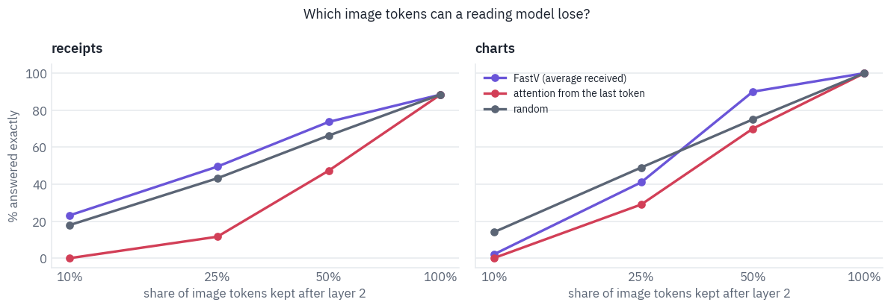

Three things stand out. Attention from the last token is the worst rule everywhere, worse than throwing tokens away at random; at a tenth of the tokens it gets nothing right.

FastV's average does what its authors found when it keeps half: 74% of the receipts against random's 66%, 90% of the charts against 75%. But the harder it cuts, the less its ranking is worth, and on the charts it falls below random at a quarter and collapses at a tenth, 2% against 14%.

No rule keeps the full model's accuracy, even at half. FastV's result, no loss at half the tokens, was measured on questions about what a photo shows, where many patches tell the same story; a total printed once on a receipt has no backup.

The time saved is modest here, about an eighth with half the tokens: in a 2-billion model answering in a few tokens,
much of the time goes to the vision encoder, which runs in full before anything is pruned, and to the token-by-token
loop.

To see why the rules differ, look at which tokens each one keeps. Here are a chart and our receipt with a quarter of
their image tokens kept; the dropped ones are faded.

```python
def kept_grid(inputs, rule, keep, layer_k=2):
    """Which image tokens a rule keeps, as a grid of the image's shape."""
    lm = qv.model.language_model
    with torch.no_grad():
        hidden, positions, is_image = embed(inputs)
        for layer in lm.layers[:layer_k]:
            cos, sin = lm.rotary_emb(hidden, positions)
            hidden = layer(
                hidden, position_ids=positions, position_embeddings=(cos, sin)
            )
        where = is_image.nonzero().flatten()
        n_keep = max(1, round(len(where) * keep))
        chosen = choose(rule, n_keep, where, lm.layers[layer_k], hidden, positions)
    mask = torch.zeros_like(is_image)
    mask[chosen] = True
    _, gh, gw = inputs["image_grid_thw"][0].tolist()
    return mask[where].view(gh // 2, gw // 2).cpu().numpy()


RULES = [("fastv", "FastV"), ("last", "the last token"), ("random", "random")]
shown = [
    (charts[0], qwen_inputs(charts[0]["image"], chart_question(charts[0]), 1024)),
    (typical, qwen_inputs(typical["image"], question, 1024)),
]
shapes = [inputs["image_grid_thw"][0].tolist() for _, inputs in shown]
fig, axes = plt.subplots(
    2,
    3,
    figsize=(11, 8.4),
    gridspec_kw={"height_ratios": [h / w for _, h, w in shapes]},
)
for row, (item, inputs) in enumerate(shown):
    _, gh, gw = inputs["image_grid_thw"][0].tolist()
    picture = item["image"].resize((gw * 14, gh * 14), Image.BICUBIC)
    for ax, (rule, name) in zip(axes[row], RULES):
        mask = kept_grid(inputs, rule, 0.25)
        veil = np.zeros((*mask.shape, 4))
        veil[~mask] = [1, 1, 1, 0.8]  # dropped tokens: faded
        ax.imshow(picture)
        ax.imshow(veil, extent=(0, gw * 14, gh * 14, 0), interpolation="nearest")
        ax.set_title(f"{name} keeps {int(mask.sum())} of {mask.size}", fontsize=10)
        ax.axis("off")
plt.suptitle(
    "A quarter of the image tokens, chosen at layer 2 by each rule", fontsize=12
)
plt.tight_layout()
plt.show()
```

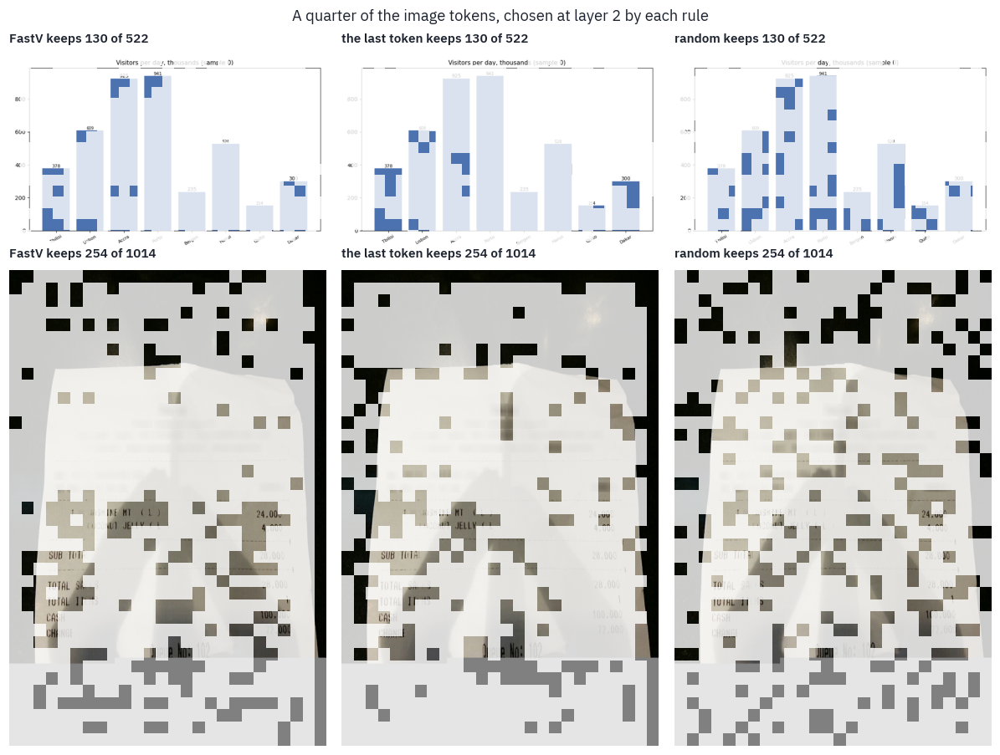

*Receipt: CORD (Naver Clova), CC BY 4.0. Chart: drawn in this notebook.*

The pictures explain the curves. The last token's attention at layer 2 goes to blocks of nothing: on the receipt, the black edges of the photo and the flat grey strip at its bottom; on the chart, the solid insides of the bars.

FastV spreads its quarter better, picking up the tops of the tall bars with their labels and some of the receipt's text, but it too spends a good part of it on the dark border and the grey strip.

Random keeps a sparse but even sample of everything, and an even sample of a receipt holds a piece of every line.

Flat, empty regions that collect attention are a known habit of Transformers. Vision Transformers park global
information in a few background patches with unusually large norms<sup class="cite">[<a href="#ref-19" id="cite-21" data-ref="19" aria-label="Reference 19: Darcet, T., Oquab, M., Mairal, J., &amp; Bojanowski, P. (2024). Vision Transformers need registers. ICLR 2024.">19</a>]</sup>, and language models pile attention onto a few tokens that carry little
meaning, the *attention sinks*<sup class="cite">[<a href="#ref-20" id="cite-22" data-ref="20" aria-label="Reference 20: Xiao, G., Tian, Y., Chen, B., Han, S., &amp; Lewis, M. (2024). Efficient streaming language models with attention sinks. ICLR 2024.">20</a>]</sup>. A rule that ranks tokens by
the attention they receive finds those first.

There is a simpler way to spend fewer tokens on an image, and we already measured it: send a smaller image. The
table puts each pruned run next to the budget run from section 7 that used the nearest number of image tokens.

```python
pairs = []
for kind in ("receipts", "charts"):
    sized = budgets[budgets.kind == kind]
    for _, run in pruned[(pruned.kind == kind) & (pruned.rule == "fastv")].iterrows():
        if run["keep"] == 1.0:
            continue
        near = sized.iloc[(sized["tokens"] - run["tokens"]).abs().argmin()]
        pairs.append(
            {
                "images": kind,
                "FastV: tokens kept": run["tokens"],
                "FastV: accuracy": run["accuracy"],
                "smaller image: tokens": near["tokens"],
                "smaller image: accuracy": near["accuracy"],
            }
        )
display(table(pd.DataFrame(pairs), digits=2))
```

<div class="tfs-table-wrap"><table class="tfs-table" style="border-collapse:collapse;font-family:'IBM Plex Sans', -apple-system, 'Segoe UI', Roboto, Helvetica, Arial, sans-serif;font-size:13.5px;line-height:1.45;margin:4px 0 8px;"><thead><tr><th style="padding:7px 14px;border-bottom:2px solid #B9C0CB;font-weight:600;color:#5B6575;font-size:12px;letter-spacing:0.02em;text-align:left;">images</th><th style="padding:7px 14px;border-bottom:2px solid #B9C0CB;font-weight:600;color:#5B6575;font-size:12px;letter-spacing:0.02em;text-align:right;">FastV: tokens kept</th><th style="padding:7px 14px;border-bottom:2px solid #B9C0CB;font-weight:600;color:#5B6575;font-size:12px;letter-spacing:0.02em;text-align:right;">FastV: accuracy</th><th style="padding:7px 14px;border-bottom:2px solid #B9C0CB;font-weight:600;color:#5B6575;font-size:12px;letter-spacing:0.02em;text-align:right;">smaller image: tokens</th><th style="padding:7px 14px;border-bottom:2px solid #B9C0CB;font-weight:600;color:#5B6575;font-size:12px;letter-spacing:0.02em;text-align:right;">smaller image: accuracy</th></tr></thead><tbody><tr><td style="padding:7px 14px;border-bottom:1px solid #E6E9EE;vertical-align:top;text-align:left;max-width:460px;white-space:normal;">receipts</td><td style="padding:7px 14px;border-bottom:1px solid #E6E9EE;vertical-align:top;text-align:right;font-variant-numeric:tabular-nums;max-width:460px;white-space:normal;">444.15</td><td style="padding:7px 14px;border-bottom:1px solid #E6E9EE;vertical-align:top;text-align:right;font-variant-numeric:tabular-nums;max-width:460px;white-space:normal;">0.74</td><td style="padding:7px 14px;border-bottom:1px solid #E6E9EE;vertical-align:top;text-align:right;font-variant-numeric:tabular-nums;max-width:460px;white-space:normal;">470.35</td><td style="padding:7px 14px;border-bottom:1px solid #E6E9EE;vertical-align:top;text-align:right;font-variant-numeric:tabular-nums;max-width:460px;white-space:normal;">0.86</td></tr><tr><td style="padding:7px 14px;border-bottom:1px solid #E6E9EE;vertical-align:top;text-align:left;max-width:460px;white-space:normal;">receipts</td><td style="padding:7px 14px;border-bottom:1px solid #E6E9EE;vertical-align:top;text-align:right;font-variant-numeric:tabular-nums;max-width:460px;white-space:normal;">222.29</td><td style="padding:7px 14px;border-bottom:1px solid #E6E9EE;vertical-align:top;text-align:right;font-variant-numeric:tabular-nums;max-width:460px;white-space:normal;">0.49</td><td style="padding:7px 14px;border-bottom:1px solid #E6E9EE;vertical-align:top;text-align:right;font-variant-numeric:tabular-nums;max-width:460px;white-space:normal;">245.54</td><td style="padding:7px 14px;border-bottom:1px solid #E6E9EE;vertical-align:top;text-align:right;font-variant-numeric:tabular-nums;max-width:460px;white-space:normal;">0.82</td></tr><tr><td style="padding:7px 14px;border-bottom:1px solid #E6E9EE;vertical-align:top;text-align:left;max-width:460px;white-space:normal;">receipts</td><td style="padding:7px 14px;border-bottom:1px solid #E6E9EE;vertical-align:top;text-align:right;font-variant-numeric:tabular-nums;max-width:460px;white-space:normal;">88.61</td><td style="padding:7px 14px;border-bottom:1px solid #E6E9EE;vertical-align:top;text-align:right;font-variant-numeric:tabular-nums;max-width:460px;white-space:normal;">0.23</td><td style="padding:7px 14px;border-bottom:1px solid #E6E9EE;vertical-align:top;text-align:right;font-variant-numeric:tabular-nums;max-width:460px;white-space:normal;">117.25</td><td style="padding:7px 14px;border-bottom:1px solid #E6E9EE;vertical-align:top;text-align:right;font-variant-numeric:tabular-nums;max-width:460px;white-space:normal;">0.74</td></tr><tr><td style="padding:7px 14px;border-bottom:1px solid #E6E9EE;vertical-align:top;text-align:left;max-width:460px;white-space:normal;">charts</td><td style="padding:7px 14px;border-bottom:1px solid #E6E9EE;vertical-align:top;text-align:right;font-variant-numeric:tabular-nums;max-width:460px;white-space:normal;">261.00</td><td style="padding:7px 14px;border-bottom:1px solid #E6E9EE;vertical-align:top;text-align:right;font-variant-numeric:tabular-nums;max-width:460px;white-space:normal;">0.90</td><td style="padding:7px 14px;border-bottom:1px solid #E6E9EE;vertical-align:top;text-align:right;font-variant-numeric:tabular-nums;max-width:460px;white-space:normal;">240.00</td><td style="padding:7px 14px;border-bottom:1px solid #E6E9EE;vertical-align:top;text-align:right;font-variant-numeric:tabular-nums;max-width:460px;white-space:normal;">1.00</td></tr><tr><td style="padding:7px 14px;border-bottom:1px solid #E6E9EE;vertical-align:top;text-align:left;max-width:460px;white-space:normal;">charts</td><td style="padding:7px 14px;border-bottom:1px solid #E6E9EE;vertical-align:top;text-align:right;font-variant-numeric:tabular-nums;max-width:460px;white-space:normal;">130.00</td><td style="padding:7px 14px;border-bottom:1px solid #E6E9EE;vertical-align:top;text-align:right;font-variant-numeric:tabular-nums;max-width:460px;white-space:normal;">0.41</td><td style="padding:7px 14px;border-bottom:1px solid #E6E9EE;vertical-align:top;text-align:right;font-variant-numeric:tabular-nums;max-width:460px;white-space:normal;">112.00</td><td style="padding:7px 14px;border-bottom:1px solid #E6E9EE;vertical-align:top;text-align:right;font-variant-numeric:tabular-nums;max-width:460px;white-space:normal;">0.67</td></tr><tr><td style="padding:7px 14px;border-bottom:1px solid #E6E9EE;vertical-align:top;text-align:left;max-width:460px;white-space:normal;">charts</td><td style="padding:7px 14px;border-bottom:1px solid #E6E9EE;vertical-align:top;text-align:right;font-variant-numeric:tabular-nums;max-width:460px;white-space:normal;">52.00</td><td style="padding:7px 14px;border-bottom:1px solid #E6E9EE;vertical-align:top;text-align:right;font-variant-numeric:tabular-nums;max-width:460px;white-space:normal;">0.02</td><td style="padding:7px 14px;border-bottom:1px solid #E6E9EE;vertical-align:top;text-align:right;font-variant-numeric:tabular-nums;max-width:460px;white-space:normal;">60.00</td><td style="padding:7px 14px;border-bottom:1px solid #E6E9EE;vertical-align:top;text-align:right;font-variant-numeric:tabular-nums;max-width:460px;white-space:normal;">0.19</td></tr></tbody></table></div>

The smaller image wins every pair, and by most where it matters: with about a hundred image tokens, a receipt shrunk to fit is read right 74% of the time, and a full-size receipt pruned to the same count 23%.

The budget runs used a few more tokens in most pairs, but section 7's curve is nearly flat above 250 tokens, so that can't explain a gap of this size.

Shrinking an image loses detail everywhere and keeps every line, and the encoder, which saw the whole picture, packs what it can into each token.

Pruning keeps full detail in the tokens it keeps and nothing elsewhere, and the line it drops may be the only one that matters. The smaller image is also cheaper, since it saves the encoder's work too.

<div class="callout callout-warn" markdown="1">
<p class="callout-label">Trap</p>

A method that drops tokens has to beat two baselines, not one: a random choice of the same size, and the
same model given a smaller image. FastV beat the first by a few points on receipts and on charts only while it kept
half the tokens. It never beat the second.
</div>

## 9. Where vision-language models are today

**Qwen's line.** Qwen2.5-VL kept the dynamic resolution and made it cheaper: all but four of the encoder's 32 blocks attend only within windows of 112×112 pixels, and the time positions of video frames follow the clock rather than the frame count<sup class="cite">[<a href="#ref-21" id="cite-23" data-ref="21" aria-label="Reference 21: Bai, S., Chen, K., Liu, X., et al. (2025). Qwen2.5-VL technical report. arXiv.">21</a>]</sup>.

Qwen3-VL, in the autumn of 2025, moved to patches of 16 pixels, so that one token covers 32×32; interleaved the three groups of M-RoPE across the rotary frequencies, so that time, rows and columns each get fast and slow ones instead of a block each; and fed features from three depths of the encoder into the first layers of the language model, which its authors call DeepStack<sup class="cite">[<a href="#ref-22" id="cite-24" data-ref="22" aria-label="Reference 22: Qwen Team (2025). Qwen3-VL technical report. arXiv.">22</a>]</sup>.

Then the separate line ended. Since Qwen3.5, released in February 2026, Qwen's main models are trained on images and text together from the start, and there is no Qwen3.5-VL to download <sup class="cite">[<a href="#ref-23" id="cite-25" data-ref="23" aria-label="Reference 23: Qwen Team (2026). Qwen3.5 model card. Hugging Face.">23</a>]</sup>.

**Other open families.** InternVL tiles like LLaVA, with tiles of 448 pixels, but folds every 2×2 block of neighbouring vectors into one by *pixel shuffle*, so that a tile costs 256 tokens instead of 1,024<sup class="cite">[<a href="#ref-24" id="cite-26" data-ref="24" aria-label="Reference 24: Chen, Z., Wang, W., Tian, H., et al. (2024). How far are we to GPT-4V? Closing the gap to commercial multimodal models with open-source suites. arXiv.">24</a>]</sup>.

SmolVLM folds 4×4 blocks, 64 tokens for a 512-pixel tile, and its smallest model, 256 million parameters, runs in under a gigabyte of memory<sup class="cite">[<a href="#ref-25" id="cite-27" data-ref="25" aria-label="Reference 25: Marafioti, A., Zohar, O., Farré, M., et al. (2025). SmolVLM: redefining small and efficient multimodal models. arXiv.">25</a>]</sup>.

Gemma 3 went back to a fixed price: every image is resized to 896×896 and pooled to 256 tokens, and an option called Pan & Scan cuts a large or elongated image into crops when the detail matters<sup class="cite">[<a href="#ref-26" id="cite-28" data-ref="26" aria-label="Reference 26: Gemma Team (2025). Gemma 3 technical report. arXiv.">26</a>]</sup>.

**Where the data comes from.** LLaVA's conversations were written by GPT-4 from text descriptions of COCO photos. ShareGPT4V had GPT-4V describe 100 thousand images in detail and trained a captioner on those descriptions to write 1.2 million more<sup class="cite">[<a href="#ref-27" id="cite-29" data-ref="27" aria-label="Reference 27: Chen, L., Li, J., Dong, X., et al. (2023). ShareGPT4V: improving large multi-modal models with better captions. arXiv. Data: Lin-Chen/ShareGPT4V, CC BY-NC 4.0.">27</a>]</sup>.

Later mixtures are collections of collections: The Cauldron gathers 50 vision-language datasets for Hugging Face's Idefics2<sup class="cite">[<a href="#ref-28" id="cite-30" data-ref="28" aria-label="Reference 28: Laurençon, H., Tronchon, L., Cord, M., &amp; Sanh, V. (2024). What matters when building vision-language models? arXiv. Data: HuggingFaceM4/thecauldron.">28</a>]</sup>, and LLaVA-OneVision's training mixture is public as [LLaVA-OneVision-Data](https://huggingface.co/datasets/lmms-lab/LLaVA-OneVision-Data). Much of what open models learned was written by closed ones.

Allen AI's Molmo was built to avoid that: for its PixMo data, people described images aloud for a minute or so, a language-only model turned the transcripts into captions, and no vision-language model wrote any of it<sup class="cite">[<a href="#ref-29" id="cite-31" data-ref="29" aria-label="Reference 29: Deitke, M., Clark, C., Lee, S., et al. (2024). Molmo and PixMo: open weights and open data for state-of-the-art vision-language models. arXiv.">29</a>, <a href="#ref-9" id="cite-32" data-ref="9" aria-label="Reference 9: Datasets of the LLaVA line: LLaVA-Pretrain, LLaVA-Instruct-150K, LLaVA-OneVision-Data. PixMo: allenai/pixmo-cap, ODC-BY 1.0.">9</a>]</sup>.

**What they are measured on.** Reading benchmarks ask the kind of question this lesson asked. [ChartQA](https://huggingface.co/datasets/HuggingFaceM4/ChartQA) has 20,882 charts from Statista, Pew, Our World in Data and the OECD with 9,608 questions written by people and 23,111 generated from chart summaries<sup class="cite">[<a href="#ref-30" id="cite-33" data-ref="30" aria-label="Reference 30: Masry, A., Long, D. X., Tan, J. Q., Joty, S., &amp; Hoque, E. (2022). ChartQA: a benchmark for question answering about charts with visual and logical reasoning. Findings of ACL 2022.">30</a>]</sup>.

[DocVQA](https://www.docvqa.org/datasets/docvqa) has 50,000 questions on 12,767 scanned documents from the UCSF Industry Documents Library<sup class="cite">[<a href="#ref-31" id="cite-34" data-ref="31" aria-label="Reference 31: Mathew, M., Karatzas, D., &amp; Jawahar, C. V. (2021). DocVQA: a dataset for VQA on document images. WACV 2021.">31</a>]</sup>. [TextVQA](https://huggingface.co/datasets/facebook/textvqa) asks about the text in 28 thousand photos from Open Images<sup class="cite">[<a href="#ref-32" id="cite-35" data-ref="32" aria-label="Reference 32: Singh, A., Natarajan, V., Shah, M., et al. (2019). Towards VQA models that can read. CVPR 2019. Data: facebook/textvqa.">32</a>]</sup>.

[POPE](https://github.com/RUCAIBox/POPE) asks a model whether an object is in a COCO photo, and found that early models said yes to objects that were not there, the *hallucination* problem of vision-language models<sup class="cite">[<a href="#ref-33" id="cite-36" data-ref="33" aria-label="Reference 33: Li, Y., Du, Y., Zhou, K., et al. (2023). Evaluating object hallucination in large vision-language models. EMNLP 2023.">33</a>]</sup>.

**Licences.** Check them before you build on a model. Qwen2-VL 2B, Qwen3-VL 2B, the Hugging Face port of LLaVA-OneVision and SmolVLM are under Apache 2.0. Qwen2.5-VL 3B is under Qwen's research licence, for non-commercial use only.

The licence of Llama 3.2 does not grant the rights to its multimodal models to people and companies based in the European Union. The training sets carry their own terms: each subset of a mixture keeps its licence, LLaVA-OneVision-Data is for research and education only, and ShareGPT4V's captions are non-commercial.

LLaVA-OneVision 0.5B's passport, and the family tree with this lesson's branch:


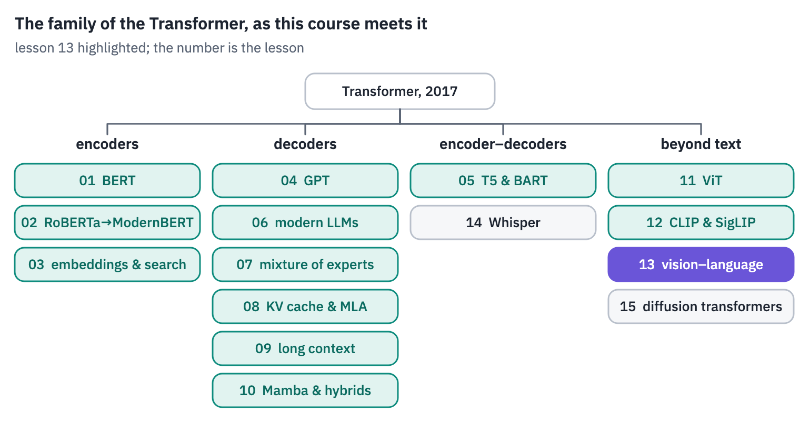
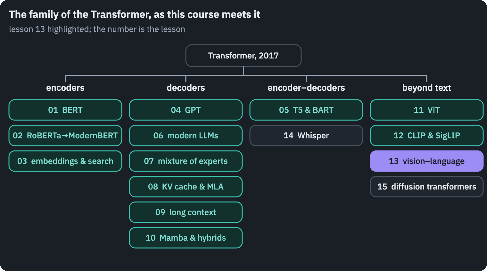

## References

1. {:#ref-1} Liu, H., Li, C., Wu, Q., & Lee, Y. J. (2023). [Visual instruction tuning](https://arxiv.org/abs/2304.08485). *NeurIPS 2023*. <a class="ref-back" href="#cite-1" aria-label="Back to the text">&#8617;</a>
2. {:#ref-2} Park, S., Shin, S., Lee, B., et al. (2019). [CORD: a consolidated receipt dataset for post-OCR parsing](https://openreview.net/forum?id=SJl3z659UH). *Document Intelligence Workshop at NeurIPS 2019*. Data: [naver-clova-ix/cord-v2](https://huggingface.co/datasets/naver-clova-ix/cord-v2), CC BY 4.0. <a class="ref-back" href="#cite-2" aria-label="Back to the text">&#8617;</a>
3. {:#ref-3} Alayrac, J.-B., Donahue, J., Luc, P., et al. (2022). [Flamingo: a visual language model for few-shot learning](https://arxiv.org/abs/2204.14198). *NeurIPS 2022*. <a class="ref-back" href="#cite-3" aria-label="Back to the text">&#8617;</a>
4. {:#ref-4} Llama Team, AI @ Meta (2024). [The Llama 3 herd of models](https://arxiv.org/abs/2407.21783). *arXiv*. <a class="ref-back" href="#cite-4" aria-label="Back to the text">&#8617;</a>
5. {:#ref-5} Li, J., Li, D., Savarese, S., & Hoi, S. (2023). [BLIP-2: bootstrapping language-image pre-training with frozen image encoders and large language models](https://arxiv.org/abs/2301.12597). *ICML 2023*. <a class="ref-back" href="#cite-5" aria-label="Back to the text">&#8617;</a>
6. {:#ref-6} Bai, J., Bai, S., Yang, S., et al. (2023). [Qwen-VL: a versatile vision-language model for understanding, localization, text reading, and beyond](https://arxiv.org/abs/2308.12966). *arXiv*. <a class="ref-back" href="#cite-6" aria-label="Back to the text">&#8617;</a>
7. {:#ref-7} Tsimpoukelli, M., Menick, J., Cabi, S., Eslami, S. M. A., Vinyals, O., & Hill, F. (2021). [Multimodal few-shot learning with frozen language models](https://arxiv.org/abs/2106.13884). *NeurIPS 2021*. <a class="ref-back" href="#cite-8" aria-label="Back to the text">&#8617;</a>
8. {:#ref-8} Merullo, J., Castricato, L., Eickhoff, C., & Pavlick, E. (2022). [Linearly mapping from image to text space](https://arxiv.org/abs/2209.15162). *ICLR 2023*. <a class="ref-back" href="#cite-9" aria-label="Back to the text">&#8617;</a>
9. {:#ref-9} Datasets of the LLaVA line: [LLaVA-Pretrain](https://huggingface.co/datasets/liuhaotian/LLaVA-Pretrain), [LLaVA-Instruct-150K](https://huggingface.co/datasets/liuhaotian/LLaVA-Instruct-150K), [LLaVA-OneVision-Data](https://huggingface.co/datasets/lmms-lab/LLaVA-OneVision-Data). PixMo: [allenai/pixmo-cap](https://huggingface.co/datasets/allenai/pixmo-cap), ODC-BY 1.0. <a class="ref-back" href="#cite-10" aria-label="Back to the text">&#8617;</a>
10. {:#ref-10} Liu, H., Li, C., Li, Y., & Lee, Y. J. (2024). [Improved baselines with visual instruction tuning](https://arxiv.org/abs/2310.03744). *CVPR 2024*. <a class="ref-back" href="#cite-12" aria-label="Back to the text">&#8617;</a>
11. {:#ref-11} Li, B., Zhang, Y., Guo, D., et al. (2024). [LLaVA-OneVision: easy visual task transfer](https://arxiv.org/abs/2408.03326). *arXiv*. <a class="ref-back" href="#cite-13" aria-label="Back to the text">&#8617;</a>
12. {:#ref-12} Liu, H., Li, C., Li, Y., et al. (2024). [LLaVA-NeXT: improved reasoning, OCR, and world knowledge](https://llava-vl.github.io/blog/2024-01-30-llava-next/). Blog post. <a class="ref-back" href="#cite-14" aria-label="Back to the text">&#8617;</a>
13. {:#ref-13} Schwettmann, S., Chowdhury, N., Klein, S., Bau, D., & Torralba, A. (2023). [Multimodal neurons in pretrained text-only transformers](https://arxiv.org/abs/2308.01544). *ICCV 2023 Workshops*. <a class="ref-back" href="#cite-15" aria-label="Back to the text">&#8617;</a>
14. {:#ref-14} Shukor, M., & Cord, M. (2024). [Implicit multimodal alignment: on the generalization of frozen LLMs to multimodal inputs](https://arxiv.org/abs/2405.16700). *NeurIPS 2024*. <a class="ref-back" href="#cite-16" aria-label="Back to the text">&#8617;</a>
15. {:#ref-15} nostalgebraist (2020). [Interpreting GPT: the logit lens](https://www.lesswrong.com/posts/AcKRB8wDpdaN6v6ru/interpreting-gpt-the-logit-lens). *LessWrong*. <a class="ref-back" href="#cite-17" aria-label="Back to the text">&#8617;</a>
16. {:#ref-16} Neo, C., Ong, L., Torr, P., Geva, M., Krueger, D., & Barez, F. (2024). [Towards interpreting visual information processing in vision-language models](https://arxiv.org/abs/2410.07149). *arXiv*. <a class="ref-back" href="#cite-18" aria-label="Back to the text">&#8617;</a>
17. {:#ref-17} Wang, P., Bai, S., Tan, S., et al. (2024). [Qwen2-VL: enhancing vision-language model's perception of the world at any resolution](https://arxiv.org/abs/2409.12191). *arXiv*. <a class="ref-back" href="#cite-19" aria-label="Back to the text">&#8617;</a>
18. {:#ref-18} Chen, L., Zhao, H., Liu, T., et al. (2024). [An image is worth 1/2 tokens after layer 2: plug-and-play inference acceleration for large vision-language models](https://arxiv.org/abs/2403.06764). *ECCV 2024*. <a class="ref-back" href="#cite-20" aria-label="Back to the text">&#8617;</a>
19. {:#ref-19} Darcet, T., Oquab, M., Mairal, J., & Bojanowski, P. (2024). [Vision Transformers need registers](https://arxiv.org/abs/2309.16588). *ICLR 2024*. <a class="ref-back" href="#cite-21" aria-label="Back to the text">&#8617;</a>
20. {:#ref-20} Xiao, G., Tian, Y., Chen, B., Han, S., & Lewis, M. (2024). [Efficient streaming language models with attention sinks](https://arxiv.org/abs/2309.17453). *ICLR 2024*. <a class="ref-back" href="#cite-22" aria-label="Back to the text">&#8617;</a>
21. {:#ref-21} Bai, S., Chen, K., Liu, X., et al. (2025). [Qwen2.5-VL technical report](https://arxiv.org/abs/2502.13923). *arXiv*. <a class="ref-back" href="#cite-23" aria-label="Back to the text">&#8617;</a>
22. {:#ref-22} Qwen Team (2025). [Qwen3-VL technical report](https://arxiv.org/abs/2511.21631). *arXiv*. <a class="ref-back" href="#cite-24" aria-label="Back to the text">&#8617;</a>
23. {:#ref-23} Qwen Team (2026). [Qwen3.5 model card](https://huggingface.co/Qwen/Qwen3.5-0.8B). *Hugging Face*. <a class="ref-back" href="#cite-25" aria-label="Back to the text">&#8617;</a>
24. {:#ref-24} Chen, Z., Wang, W., Tian, H., et al. (2024). [How far are we to GPT-4V? Closing the gap to commercial multimodal models with open-source suites](https://arxiv.org/abs/2404.16821). *arXiv*. <a class="ref-back" href="#cite-26" aria-label="Back to the text">&#8617;</a>
25. {:#ref-25} Marafioti, A., Zohar, O., Farré, M., et al. (2025). [SmolVLM: redefining small and efficient multimodal models](https://arxiv.org/abs/2504.05299). *arXiv*. <a class="ref-back" href="#cite-27" aria-label="Back to the text">&#8617;</a>
26. {:#ref-26} Gemma Team (2025). [Gemma 3 technical report](https://arxiv.org/abs/2503.19786). *arXiv*. <a class="ref-back" href="#cite-28" aria-label="Back to the text">&#8617;</a>
27. {:#ref-27} Chen, L., Li, J., Dong, X., et al. (2023). [ShareGPT4V: improving large multi-modal models with better captions](https://arxiv.org/abs/2311.12793). *arXiv*. Data: [Lin-Chen/ShareGPT4V](https://huggingface.co/datasets/Lin-Chen/ShareGPT4V), CC BY-NC 4.0. <a class="ref-back" href="#cite-29" aria-label="Back to the text">&#8617;</a>
28. {:#ref-28} Laurençon, H., Tronchon, L., Cord, M., & Sanh, V. (2024). [What matters when building vision-language models?](https://arxiv.org/abs/2405.02246) *arXiv*. Data: [HuggingFaceM4/the_cauldron](https://huggingface.co/datasets/HuggingFaceM4/the_cauldron). <a class="ref-back" href="#cite-30" aria-label="Back to the text">&#8617;</a>
29. {:#ref-29} Deitke, M., Clark, C., Lee, S., et al. (2024). [Molmo and PixMo: open weights and open data for state-of-the-art vision-language models](https://arxiv.org/abs/2409.17146). *arXiv*. <a class="ref-back" href="#cite-31" aria-label="Back to the text">&#8617;</a>
30. {:#ref-30} Masry, A., Long, D. X., Tan, J. Q., Joty, S., & Hoque, E. (2022). [ChartQA: a benchmark for question answering about charts with visual and logical reasoning](https://arxiv.org/abs/2203.10244). *Findings of ACL 2022*. <a class="ref-back" href="#cite-33" aria-label="Back to the text">&#8617;</a>
31. {:#ref-31} Mathew, M., Karatzas, D., & Jawahar, C. V. (2021). [DocVQA: a dataset for VQA on document images](https://arxiv.org/abs/2007.00398). *WACV 2021*. <a class="ref-back" href="#cite-34" aria-label="Back to the text">&#8617;</a>
32. {:#ref-32} Singh, A., Natarajan, V., Shah, M., et al. (2019). [Towards VQA models that can read](https://arxiv.org/abs/1904.08920). *CVPR 2019*. Data: [facebook/textvqa](https://huggingface.co/datasets/facebook/textvqa). <a class="ref-back" href="#cite-35" aria-label="Back to the text">&#8617;</a>
33. {:#ref-33} Li, Y., Du, Y., Zhou, K., et al. (2023). [Evaluating object hallucination in large vision-language models](https://arxiv.org/abs/2305.10355). *EMNLP 2023*. <a class="ref-back" href="#cite-36" aria-label="Back to the text">&#8617;</a>
{: .tfs-refs}



