

<p class="tfs-links"><strong>Transformer architectures: from BERT to diffusion</strong> · lesson 14 of 15 · <a href="/teaching/">all lessons</a> · <a href="https://www.kaggle.com/code/qmarva/transformer-architectures-14-whisper">run on Kaggle</a> · <a href="https://colab.research.google.com/github/mlsamurai/transformer-architectures/blob/main/notebooks/colab/a14_whisper.ipynb">open in Colab</a> · <a href="https://github.com/mlsamurai/transformer-architectures">code on GitHub</a></p>

Give Whisper thirty seconds of digital silence, tell it the speech is in Russian, ask for timestamps, and its smallest model writes «Редактор субтитров А.Синецкая Корректор А.Сухиашвили»: a subtitle editor and a proofreader, with initials.

Nobody said a word. The same model transcribes an audiobook almost without errors, recognises 99 languages, translates them into English and places each word in time to a fiftieth of a second. All of that comes from one network that was never told how speech works.

OpenAI released Whisper in September 2022, and it was a bet against cleverness. The strongest recognisers of the time learned the sound of speech from tens of thousands of hours of unlabelled audio and were then fine-tuned on the 960 hours of transcribed audiobooks in LibriSpeech<sup class="cite">[<a href="#ref-1" id="cite-1" data-ref="1" aria-label="Reference 1: Baevski, A., Zhou, H., Mohamed, A., &amp; Auli, M. (2020). wav2vec 2.0: a framework for self-supervised learning of speech representations. NeurIPS 2020.">1</a>]</sup>.

They scored superbly on audiobooks and much worse on a phone call or a lecture. Whisper took the encoder–decoder Transformer of 2017, the architecture of lesson 5, almost unchanged, and trained it on 680,000 hours of audio paired with transcripts found on the internet, of uneven quality and only roughly cleaned.

The largest model matched the LibriSpeech score of a wav2vec 2.0 model fine-tuned on it, 2.7% of words wrong for both, and averaged over twelve other test sets it made 55% fewer errors<sup class="cite">[<a href="#ref-2" id="cite-2" data-ref="2" aria-label="Reference 2: Radford, A., Kim, J. W., Xu, T., Brockman, G., McLeavey, C., &amp; Sutskever, I. (2022). Robust speech recognition via large-scale weak supervision. ICML 2023. Code and weights: openai/whisper, MIT.">2</a>]</sup>.

That makes Whisper a good place to see how a Transformer deals with sound. The middle of it is the encoder–decoder of lesson 5.

What is new sits at the two ends: how a waveform becomes a sequence of vectors at the input, and how a decoder that writes text is told which job to do at the output.

The decoder also brings the habits of a language model, and the silence above shows what those habits do when the audio carries no speech.

<aside class="tldr" markdown="1">
<p class="tldr-label">In short</p>

Whisper is a plain encoder–decoder Transformer. The encoder reads 30 seconds of sound as a log-mel spectrogram; the
decoder writes the text, steered by a few special tokens that choose the language, the task and the timestamps. Its
robustness comes from 680,000 hours of loosely labelled web audio, and so does its habit of writing text where nobody
spoke.

<div class="stats">
<div class="stat"><span class="stat-value">680,000 h</span><span class="stat-label">of audio with web transcripts in the training set</span></div>
<div class="stat"><span class="stat-value">1,500</span><span class="stat-label">vectors the encoder makes from every 30 seconds, one per 20 ms</span></div>
<div class="stat"><span class="stat-value">53%</span><span class="stat-label">of whisper-tiny's weights are its table of token vectors</span></div>
</div>
</aside>

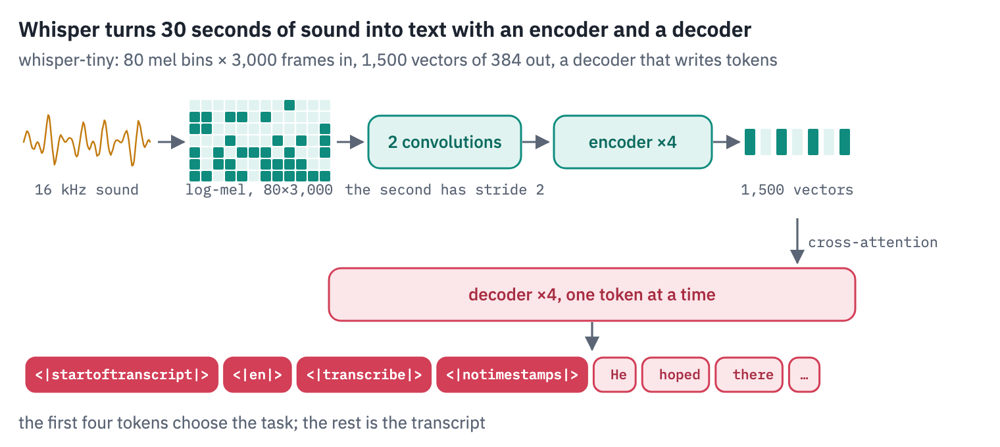
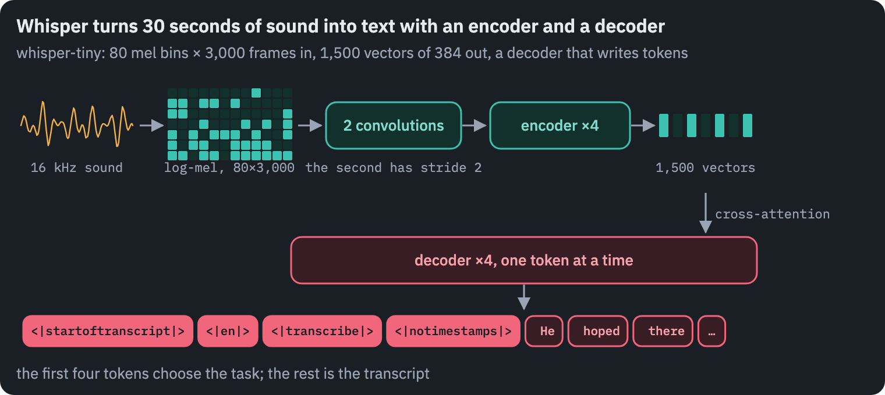

**What you'll do**

1. Listen to read English from LibriSpeech and read Russian from FLEURS, and see each clip as a spectrogram with a
   cursor that follows the sound.
2. Write Whisper's front end from scratch, from the waveform to the log-mel spectrogram, and match the library's
   features.
3. Write the encoder and the decoder of whisper-tiny from scratch on its weights and match the model's logits.
4. Steer the decoder with its special tokens: identify the language, transcribe, translate, ask for timestamps; then
   decode greedily by hand.
5. Measure word error rates in English and Russian for four sizes of Whisper, with a WER written from scratch.
6. Transcribe two-minute recordings by cutting them blindly and the way Whisper does, and see what blind cuts lose.
7. Give it silence and noise, see what it writes, and test the rule that is supposed to catch that.
8. Find when each word was said from cross-attention, with dynamic time warping written from scratch.

**What you need**: a GPU. On Kaggle, *Settings → Accelerator → GPU*; on Colab, *Runtime → Change runtime type → T4
GPU*. The notebook downloads Whisper tiny (151 MB), base (290 MB), small (967 MB) and large-v3-turbo (1.6 GB), the
LibriSpeech test-clean set (350 MB) and the Russian test set of FLEURS (565 MB).

## Setup

One small helper package, `tfs`, draws the course's plots and token chips and knows where the notebook runs
(Kaggle, Colab or your own machine). Everything the lesson teaches is written out in the notebook itself.

```python
import importlib.util
import subprocess
import sys

TFS = "git+https://github.com/mlsamurai/transformers-from-scratch@main"
if importlib.util.find_spec("tfs") is None:
    subprocess.check_call([sys.executable, "-m", "pip", "install", "-q", TFS])

from tfs import env
from tfs.viz import table, token_chips, use_course_style

env.quiet()  # no progress bars or environment warnings in the outputs
SEED = 42
env.seed_everything(SEED)
COLORS = use_course_style()
WORK_DIR = env.work_dir()
```

```python
import io
import math
import time
import zlib
from collections import Counter

import matplotlib.pyplot as plt
import numpy as np
import pandas as pd
import soundfile as sf
import torch
import torch.nn.functional as F
from huggingface_hub import hf_hub_download
from IPython.display import Audio, display
from scipy.ndimage import median_filter
from tfs.viz import audio_spectrogram
from transformers import WhisperForConditionalGeneration, WhisperProcessor

SMOKE = env.smoke()  # CI runs the lesson on a small slice; you run it in full
device = "cuda" if torch.cuda.is_available() else "cpu"
if device == "cuda":
    print("GPU:", torch.cuda.get_device_name(0))
torch.set_grad_enabled(False)  # the lesson runs models and never trains them
SR = 16_000  # Whisper hears 16,000 samples per second
```

<pre class="tfs-printed" markdown="0"><code>GPU: Tesla T4</code></pre>

## 1. Speech as a list of numbers

A microphone measures air pressure, and digital audio stores the measurements as numbers, here 16,000 of them per second, the rate Whisper works at. A sampled signal can hold frequencies up to half its sampling rate, so 16 kHz keeps everything below 8 kHz.

That is enough for speech: the vowels carry most of their energy below 4 kHz, the hiss of *s* and *sh* sits above that, and a telephone line, which stops near 3.4 kHz, is still easy to understand. Thirty seconds, the length of Whisper's window, are 480,000 numbers.

Two test sets give us speech with exact transcripts. [LibriSpeech](https://www.openslr.org/12/) is about a thousand hours of English read from public-domain audiobooks of the LibriVox project<sup class="cite">[<a href="#ref-3" id="cite-3" data-ref="3" aria-label="Reference 3: Panayotov, V., Chen, G., Povey, D., &amp; Khudanpur, S. (2015). LibriSpeech: an ASR corpus based on public domain audio books. ICASSP 2015. Data: openslr/librispeechasr, CC BY 4.0.">3</a>]</sup>; its *test-clean* part has 2,620 utterances by 40 speakers, five and a half hours, and every paper on English recognition reports a number on it.

[FLEURS](https://huggingface.co/datasets/google/fleurs) is the same two thousand or so sentences of the FLoRes-101 translation benchmark read aloud in 102 languages, about 12 hours per language<sup class="cite">[<a href="#ref-4" id="cite-4" data-ref="4" aria-label="Reference 4: Conneau, A., Ma, M., Khanuja, S., et al. (2022). FLEURS: few-shot learning evaluation of universal representations of speech. IEEE SLT 2022. Data: google/fleurs, CC BY 4.0.">4</a>]</sup>; its Russian test part has 775 recordings.

Both are published under [CC BY 4.0](https://creativecommons.org/licenses/by/4.0/), which lets us play them here. We take 200 utterances of each for the measurements and keep one LibriSpeech sentence as the running example.

```python
def read_audio(blob):
    audio, rate = sf.read(io.BytesIO(blob), dtype="float32")
    assert rate == SR, rate  # both sets are recorded at 16 kHz
    return audio


LIBRI = hf_hub_download(
    "openslr/librispeech_asr", "clean/test/0000.parquet", repo_type="dataset"
)
libri = pd.read_parquet(LIBRI)
FLEURS = hf_hub_download(
    "google/fleurs",
    "parquet-data/ru_ru/test-00000-of-00001.parquet",
    repo_type="dataset",
)
fleurs = pd.read_parquet(FLEURS)
n = 8 if SMOKE else 200
english = [
    dict(id=r.id, audio=read_audio(r.audio["bytes"]), text=r.text)
    for r in libri.sample(n=n, random_state=0).itertuples()
]
russian = [
    dict(id=str(r.id), audio=read_audio(r.audio["bytes"]), text=r.transcription)
    for r in fleurs.sample(n=n, random_state=0).itertuples()
]
row = libri[libri.id == "1089-134686-0000"].iloc[0]
example = dict(id=row.id, audio=read_audio(row.audio["bytes"]), text=row.text)
for name, items in (("LibriSpeech", english), ("FLEURS ru", russian)):
    seconds = sum(len(x["audio"]) for x in items) / SR
    print(f"{name}: {len(items)} utterances, {seconds / 60:.1f} minutes")
print(f"example: {len(example['audio']) / SR:.2f} s, {len(example['audio']):,} numbers")
print(example["text"])
```

<pre class="tfs-printed" markdown="0"><code>LibriSpeech: 200 utterances, 24.0 minutes
FLEURS ru: 200 utterances, 37.8 minutes
example: 10.44 s, 166,960 numbers
HE HOPED THERE WOULD BE STEW FOR DINNER TURNIPS AND CARROTS AND BRUISED POTATOES AND FAT MUTTON PIECES TO BE LADLED OUT IN THICK PEPPERED FLOUR FATTENED SAUCE</code></pre>

```python
display(Audio(example["audio"], rate=SR))
```

<audio class="tfs-audio" controls preload="none" src="/assets/posts/arch/14/output-01.mp3"></audio>

*LibriSpeech, utterance 1089-134686-0000, CC BY 4.0.*

Here are those numbers drawn at three zoom levels: the whole sentence, its first words, and thirty milliseconds from
the loudest part of them.

```python
audio = example["audio"]
t = np.arange(len(audio)) / SR
frame = int(0.03 * SR)  # 30 ms
head = audio[: int(1.2 * SR)]
energy = [
    np.sqrt(np.mean(head[i : i + frame] ** 2)) for i in range(0, len(head) - frame, 80)
]
start = 80 * int(np.argmax(energy))  # the loudest 30 ms: the middle of a vowel
piece = audio[start : start + frame]
# periods of 2.5 to 16.7 ms: a voice from 60 to 400 Hz
lags = np.arange(SR // 400, SR // 60)
corr = [np.dot(piece[:-lag], piece[lag:]) for lag in lags]
pitch = SR / lags[int(np.argmax(corr))]

fig, axes = plt.subplots(1, 3, figsize=(13, 3), gridspec_kw={"width_ratios": [3, 2, 2]})
axes[0].plot(t, audio, color=COLORS["data"], lw=0.4)
axes[0].axvspan(0, 1.2, color=COLORS["dec"], alpha=0.12)
axes[0].set_title("the whole sentence")
axes[1].plot(t[: len(head)], head, color=COLORS["data"], lw=0.5)
axes[1].axvspan(start / SR, (start + frame) / SR, color=COLORS["dec"], alpha=0.2)
axes[1].set_title("its first 1.2 seconds")
axes[2].plot(1000 * np.arange(frame) / SR, piece, color=COLORS["data"], lw=1.2)
axes[2].set_title(f"30 ms of a vowel: a pitch of {pitch:.0f} Hz")
axes[0].set_xlabel("seconds")
axes[1].set_xlabel("seconds")
axes[2].set_xlabel("milliseconds")
plt.tight_layout()
plt.show()
```

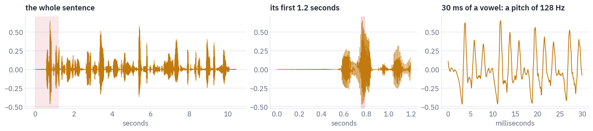

The repeating shape in the third panel is the voice itself: each repeat is one puff of air through the vibrating vocal folds, and the autocorrelation finds about 128 of them per second, an ordinary pitch for a man's voice.

The shape inside each repeat, the smaller ripples, depends on how the tongue and lips shape the mouth, and that is what makes this vowel this vowel. Nothing in the raw numbers says *he* or *hoped*; a model has to find it.

The Russian clips sound like this, a man or a woman reading a sentence of an encyclopedic text:

```python
display(Audio(russian[0]["audio"], rate=SR))
print(russian[0]["text"])
```

<audio class="tfs-audio" controls preload="none" src="/assets/posts/arch/14/output-03.mp3"></audio>

<pre class="tfs-printed" markdown="0"><code>исследователи университета сообщили что эти два соединения вступают друг с другом в реакцию образуя кристаллы которые могут блокировать работу почек</code></pre>

*FLEURS, Russian test set, CC BY 4.0.*

## 2. From sound to a picture

A model could read the 480,000 numbers directly, and some do, but the raw waveform is a wasteful description of speech. The same word said twice gives two waveforms that differ everywhere: the phase of every component shifts, the pitch moves, the room adds echoes.

What stays the same is how the energy is spread over frequencies within a few tens of milliseconds, and how that spread changes over time. The ear also works on logarithmic scales, for pitch and for loudness.

Speech recognition has used that description for decades, and Whisper keeps it, as the paper puts it, an "80-channel log-magnitude Mel spectrogram ... computed on 25-millisecond windows with a stride of 10 milliseconds".

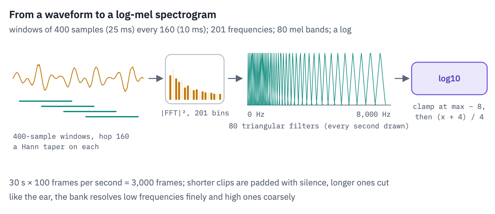
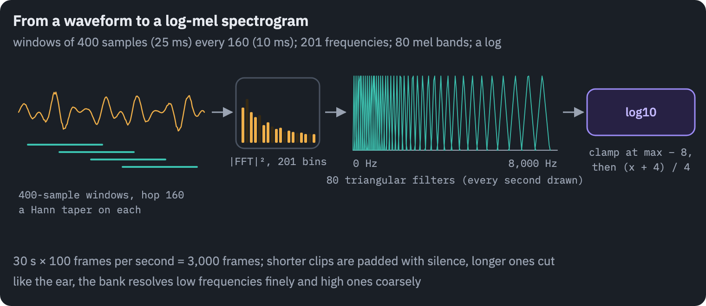

There are four steps. The signal is cut into windows of 400 samples, 25 ms, every 160 samples, 10 ms, so that 30 seconds give 3,000 frames; each window is tapered at the edges by a Hann window so that the cut does not add false frequencies.

A Fourier transform turns each window into 201 frequency bins from 0 to 8,000 Hz, 40 Hz apart, and the squared magnitude of each bin is the power at that frequency. The paper says *magnitude*, but the code squares it.

Then 80 triangular filters sum the power into 80 bands spaced on the *mel* scale, a scale of perceived pitch measured in the 1930s by asking listeners to set one tone to sound half as high as another<sup class="cite">[<a href="#ref-5" id="cite-5" data-ref="5" aria-label="Reference 5: Stevens, S. S., Volkmann, J., &amp; Newman, E. B. (1937). A scale for the measurement of the psychological magnitude pitch. Journal of the Acoustical Society of America, 8(3), 185–190.">5</a>]</sup>.

Whisper uses Malcolm Slaney's version of it, the default of the librosa library: linear below 1 kHz, logarithmic above, so the lowest bands span about 75 Hz and the top ones about 600. Each triangle is scaled so that all of them have the same area.

Finally the powers go to a log scale, everything more than 8 orders of magnitude, 80 dB, below the loudest point of the clip is raised to that floor, and the values are shifted and scaled by $$(x + 4)/4$$ so that they land roughly between −1 and 1.

Here are the filters, written from the formulas:

```python
def hz_to_mel(f):  # Slaney: linear below 1 kHz, logarithmic above
    f = np.asarray(f, dtype=np.float64)
    log = 15 + 27 * np.log(np.maximum(f, 1e-9) / 1000) / np.log(6.4)
    return np.where(f < 1000, 3 * f / 200, log)


def mel_to_hz(m):
    m = np.asarray(m, dtype=np.float64)
    return np.where(m < 15, 200 * m / 3, 1000 * np.exp(np.log(6.4) * (m - 15) / 27))


def mel_filters(n_mels=80, n_fft=400):
    freqs = np.linspace(0, SR / 2, n_fft // 2 + 1)  # 201 bins, 40 Hz apart
    mels = np.linspace(hz_to_mel(0), hz_to_mel(SR / 2), n_mels + 2)
    edges = mel_to_hz(mels)  # equally spaced in mel, not in Hz
    lower, centre, upper = edges[:-2, None], edges[1:-1, None], edges[2:, None]
    rise = (freqs - lower) / (centre - lower)
    fall = (upper - freqs) / (upper - centre)
    triangles = np.maximum(0, np.minimum(rise, fall))
    return (triangles * 2 / (upper - lower)).astype(np.float32)  # equal areas


FILTERS = mel_filters()
widths = mel_to_hz(np.linspace(hz_to_mel(0), hz_to_mel(SR / 2), 82))
print("filters:", FILTERS.shape)
print(f"band width: {widths[2] - widths[0]:.0f} Hz at the bottom,")
print(f"            {widths[-1] - widths[-3]:.0f} Hz at the top")
```

<pre class="tfs-printed" markdown="0"><code>filters: (80, 201)
band width: 74 Hz at the bottom,
            591 Hz at the top</code></pre>

And the whole front end, in eleven lines:

```python
def log_mel(audio, filters=FILTERS):
    x = torch.as_tensor(audio, dtype=torch.float32)
    x = F.pad(x, (0, max(0, 30 * SR - len(x))))[: 30 * SR]  # always 30 seconds
    window = torch.hann_window(400)
    spec = torch.stft(x, 400, 160, window=window, return_complex=True)
    # 201 bins × 3,000 frames; the last frame is dropped
    power = spec[:, :-1].abs() ** 2
    mel = torch.from_numpy(filters) @ power  # 80 bands × 3,000 frames
    logm = torch.clamp(mel, min=1e-10).log10()
    # an 80 dB range below the loudest point
    logm = torch.maximum(logm, logm.max() - 8.0)
    return (logm + 4.0) / 4.0


TINY = "openai/whisper-tiny"
processor = WhisperProcessor.from_pretrained(TINY)
ours = log_mel(example["audio"])
theirs = processor.feature_extractor(
    example["audio"], sampling_rate=SR, return_tensors="pt"
).input_features[0]
library_filters = processor.feature_extractor.mel_filters.T
print("features:", tuple(ours.shape))
print(
    "largest difference from the library's features:",
    float((ours - theirs).abs().max()),
)
print(
    "largest difference in the filters:", float(np.abs(FILTERS - library_filters).max())
)
```

<pre class="tfs-printed" markdown="0"><code>features: (80, 3000)
largest difference from the library&#x27;s features: 0.0
largest difference in the filters: 9.183393247236271e-10</code></pre>

The features agree exactly and the filters to the ninth decimal. Here is what each step does to the example, from the
raw power to what the model receives:

```python
x = torch.as_tensor(example["audio"])
spec = torch.stft(x, 400, 160, window=torch.hann_window(400), return_complex=True)
power = (spec[:, :-1].abs() ** 2).numpy()
seconds = len(example["audio"]) / SR
frames = power.shape[1]
log_power = np.log10(np.maximum(power, 1e-10))
panels = [  # values, title, axis, top of the axis, darkest value
    (power, "power by frequency, linear scale", "Hz", 8000, 0),
    (log_power, "power by frequency, log scale", "Hz", 8000, log_power.max() - 8),
    (
        ours[:, :frames].numpy(),
        "80 mel bands, log, scaled: what Whisper reads",
        "band",
        80,
        None,
    ),
]
fig, axes = plt.subplots(3, 1, figsize=(11, 7.5), sharex=True)
for ax, (values, title, unit, top, vmin) in zip(axes, panels):
    ax.imshow(
        values,
        origin="lower",
        aspect="auto",
        cmap="magma",
        vmin=vmin,
        extent=(0, seconds, 0, top),
        interpolation="nearest",
    )
    ax.set_title(title)
    ax.set_ylabel(unit)
    ax.grid(False)
axes[-1].set_xlabel("seconds")
plt.tight_layout()
plt.show()
```

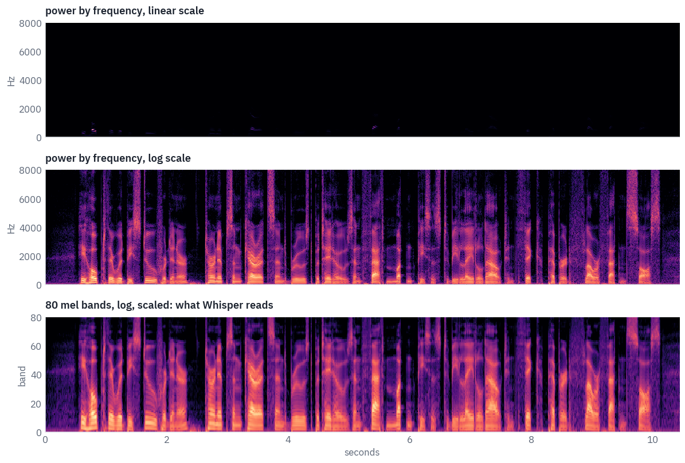

On the linear scale almost everything is black: a few loud vowels hold most of the power, and the consonants, which carry much of the information, are a thousand times weaker. The log scale brings them out.

The vowels show as stacks of horizontal stripes, the harmonics of the voice's pitch, and the dark bands between them are what the mouth filters out; the *s* and *sh* sounds are diffuse clouds high up. The mel bands then give the low frequencies, where vowels differ, more rows than the high ones.

Press play: the cursor follows the sound over the spectrogram, and a click on the picture jumps to that moment.

```python
def listen(item, title):
    frames = len(item["audio"]) // 160
    values = log_mel(item["audio"])[:, :frames].numpy()
    return audio_spectrogram(
        item["audio"],
        SR,
        values,
        title=title,
        vmin=values.min(),
        vmax=values.max(),
        alt=f"Log-mel spectrogram of a recording with its sound: {item['text']}",
    )


display(
    listen(example, "“He hoped there would be stew for dinner…”, as Whisper sees it")
)
display(listen(russian[0], "A Russian sentence from FLEURS"))
```

<figure class="tfs-audio-spec" markdown="0" data-x0="0.07" data-x1="0.985" data-duration="10.435"><div class="tfs-spec" style="position:relative;display:inline-block;max-width:100%;">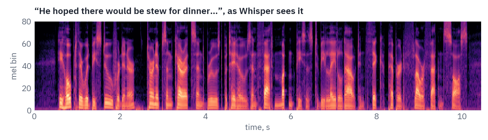<div class="tfs-playhead" style="position:absolute;top:15.4%;height:63.5%;width:2px;margin-left:-1px;background:#e8433a;opacity:0;pointer-events:none;"></div></div><audio controls preload="none" style="width:100%" src="/assets/posts/arch/14/output-05.mp3"></audio></figure>

<figure class="tfs-audio-spec" markdown="0" data-x0="0.07" data-x1="0.985" data-duration="10.800"><div class="tfs-spec" style="position:relative;display:inline-block;max-width:100%;">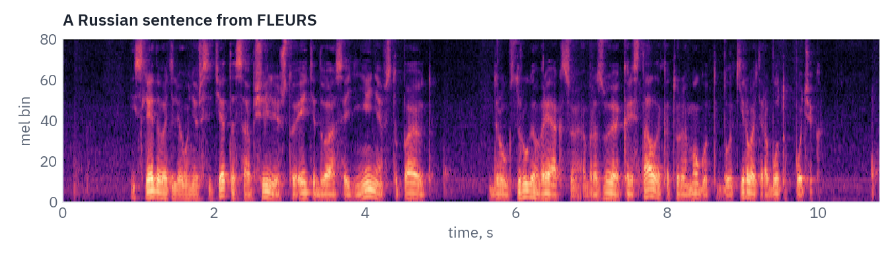<div class="tfs-playhead" style="position:absolute;top:15.4%;height:63.5%;width:2px;margin-left:-1px;background:#e8433a;opacity:0;pointer-events:none;"></div></div><audio controls preload="none" style="width:100%" src="/assets/posts/arch/14/output-06.mp3"></audio></figure>

Two numbers from the formula matter later. Every clip is padded to 30 seconds and normalised by its own loudest point,
so its values span at most 2 units: from the maximum $$M$$ down to the floor $$M - 2$$. And digital silence, all zeros,
becomes a constant: $$\log_{10} 10^{-10} = -10$$, and $$(-10 + 4)/4 = -1.5$$.

```python
silence = log_mel(np.zeros(30 * SR, dtype=np.float32))
tail = ours[:, int(seconds * 100) + 5 :]  # the padding after the speech
print(f"example: from {float(ours.min()):.3f} to {float(ours.max()):.3f}")
print(f"its padded tail: {float(tail.min()):.3f} to {float(tail.max()):.3f}")
print(f"30 s of silence: {float(silence.min()):.3f} to {float(silence.max()):.3f}")
```

<pre class="tfs-printed" markdown="0"><code>example: from -0.699 to 1.301
its padded tail: -0.699 to -0.699
30 s of silence: -1.500 to -1.500</code></pre>

The example spans exactly 2 units, from −0.699 to 1.301, and the 20 seconds of padding after the sentence are not
silence in the model's terms: they sit at this clip's floor, −0.699, which a model trained on padded windows has
learned to read as *nothing more here*. Hold on to the −1.5; section 8 feeds it to the model.

## 3. Whisper in one picture

Everything after the front end is a Transformer from this course.

**The stem.** Two one-dimensional convolutions with kernels of width 3 run along time, each followed by GELU. The first turns the 80 mel bands of every frame into a vector of the model's width, 384 in whisper-tiny.

The second has stride 2, so 3,000 frames become 1,500 vectors, one per 20 ms. A convolution mixes neighbouring frames, so each vector knows a little of its surroundings before attention starts, and the stride halves the sequence, which divides the cost of attention by four.

**The encoder.** Fixed sinusoidal positions are added, the same kind as in the original Transformer, with the sines and cosines in two halves rather than interleaved.

They can be fixed because the input never changes length: it is always 1,500 positions, and shorter audio is padded. Then come pre-norm blocks, as in GPT-2: LayerNorm, attention, a residual connection; LayerNorm, an MLP with GELU, a residual connection; and a final LayerNorm.

**The decoder.** Token embeddings plus 448 learned positions, then blocks with three parts each: causal self-attention over the text written so far, cross-attention to the encoder's 1,500 vectors, and the MLP.

The output layer is the token embedding matrix itself, transposed, so the same table turns tokens into vectors and vectors into token scores. Encoder and decoder have the same width and the same number of blocks.

One detail shows how closely the code was trimmed: the *key* projections have no bias, only the queries, values and outputs do.

A bias $$b$$ on every key adds $$q \cdot b$$ to all the scores of a query, the same number for every key, and softmax does not change when all of its inputs move by the same amount. The bias would cost weights and change nothing.

```python
tiny = WhisperForConditionalGeneration.from_pretrained(TINY, dtype=torch.float32)
tiny = tiny.to(device).eval()
cfg = tiny.config
print(f"width {cfg.d_model}, {cfg.encoder_layers} + {cfg.decoder_layers} blocks,")
print(
    f"{cfg.encoder_attention_heads} heads, MLP {cfg.encoder_ffn_dim},",
    f"{cfg.vocab_size:,} tokens",
)
print(
    f"{cfg.max_source_positions:,} audio positions,",
    f"{cfg.max_target_positions} text positions",
)
shared = (
    tiny.proj_out.weight.data_ptr() == tiny.model.decoder.embed_tokens.weight.data_ptr()
)
print("output layer shares the token embeddings:", shared)

PARTS = [
    ("encoder.conv", "convolutional stem"),
    ("encoder.embed_positions", "encoder positions, fixed sinusoids"),
    ("encoder.layer", "encoder blocks and final norm"),
    ("decoder.embed_tokens", "token embeddings, shared with the output"),
    ("decoder.embed_positions", "decoder positions, learned"),
    ("decoder.layer", "decoder blocks and final norm"),
]
counts = dict.fromkeys([label for _, label in PARTS], 0)
for name, p in tiny.named_parameters():  # a shared tensor is listed once
    label = next(label for key, label in PARTS if key in name)
    counts[label] += p.numel()
total = sum(counts.values())
display(
    table(
        pd.DataFrame(
            [
                {"part": k, "parameters": v, "share, %": 100 * v / total}
                for k, v in counts.items()
            ]
            + [{"part": "total", "parameters": total, "share, %": 100.0}]
        ),
        digits=1,
    )
)
```

<pre class="tfs-printed" markdown="0"><code>width 384, 4 + 4 blocks,
6 heads, MLP 1536, 51,865 tokens
1,500 audio positions, 448 text positions
output layer shares the token embeddings: True</code></pre>

<div class="tfs-table-wrap"><table class="tfs-table" style="border-collapse:collapse;font-family:'IBM Plex Sans', -apple-system, 'Segoe UI', Roboto, Helvetica, Arial, sans-serif;font-size:13.5px;line-height:1.45;margin:4px 0 8px;"><thead><tr><th style="padding:7px 14px;border-bottom:2px solid #B9C0CB;font-weight:600;color:#5B6575;font-size:12px;letter-spacing:0.02em;text-align:left;">part</th><th style="padding:7px 14px;border-bottom:2px solid #B9C0CB;font-weight:600;color:#5B6575;font-size:12px;letter-spacing:0.02em;text-align:right;">parameters</th><th style="padding:7px 14px;border-bottom:2px solid #B9C0CB;font-weight:600;color:#5B6575;font-size:12px;letter-spacing:0.02em;text-align:right;">share, %</th></tr></thead><tbody><tr><td style="padding:7px 14px;border-bottom:1px solid #E6E9EE;vertical-align:top;text-align:left;max-width:460px;white-space:normal;">convolutional stem</td><td style="padding:7px 14px;border-bottom:1px solid #E6E9EE;vertical-align:top;text-align:right;font-variant-numeric:tabular-nums;max-width:460px;white-space:normal;">535,296</td><td style="padding:7px 14px;border-bottom:1px solid #E6E9EE;vertical-align:top;text-align:right;font-variant-numeric:tabular-nums;max-width:460px;white-space:normal;">1.4</td></tr><tr><td style="padding:7px 14px;border-bottom:1px solid #E6E9EE;vertical-align:top;text-align:left;max-width:460px;white-space:normal;">encoder positions, fixed sinusoids</td><td style="padding:7px 14px;border-bottom:1px solid #E6E9EE;vertical-align:top;text-align:right;font-variant-numeric:tabular-nums;max-width:460px;white-space:normal;">576,000</td><td style="padding:7px 14px;border-bottom:1px solid #E6E9EE;vertical-align:top;text-align:right;font-variant-numeric:tabular-nums;max-width:460px;white-space:normal;">1.5</td></tr><tr><td style="padding:7px 14px;border-bottom:1px solid #E6E9EE;vertical-align:top;text-align:left;max-width:460px;white-space:normal;">encoder blocks and final norm</td><td style="padding:7px 14px;border-bottom:1px solid #E6E9EE;vertical-align:top;text-align:right;font-variant-numeric:tabular-nums;max-width:460px;white-space:normal;">7,097,088</td><td style="padding:7px 14px;border-bottom:1px solid #E6E9EE;vertical-align:top;text-align:right;font-variant-numeric:tabular-nums;max-width:460px;white-space:normal;">18.8</td></tr><tr><td style="padding:7px 14px;border-bottom:1px solid #E6E9EE;vertical-align:top;text-align:left;max-width:460px;white-space:normal;">token embeddings, shared with the output</td><td style="padding:7px 14px;border-bottom:1px solid #E6E9EE;vertical-align:top;text-align:right;font-variant-numeric:tabular-nums;max-width:460px;white-space:normal;">19,916,160</td><td style="padding:7px 14px;border-bottom:1px solid #E6E9EE;vertical-align:top;text-align:right;font-variant-numeric:tabular-nums;max-width:460px;white-space:normal;">52.7</td></tr><tr><td style="padding:7px 14px;border-bottom:1px solid #E6E9EE;vertical-align:top;text-align:left;max-width:460px;white-space:normal;">decoder positions, learned</td><td style="padding:7px 14px;border-bottom:1px solid #E6E9EE;vertical-align:top;text-align:right;font-variant-numeric:tabular-nums;max-width:460px;white-space:normal;">172,032</td><td style="padding:7px 14px;border-bottom:1px solid #E6E9EE;vertical-align:top;text-align:right;font-variant-numeric:tabular-nums;max-width:460px;white-space:normal;">0.5</td></tr><tr><td style="padding:7px 14px;border-bottom:1px solid #E6E9EE;vertical-align:top;text-align:left;max-width:460px;white-space:normal;">decoder blocks and final norm</td><td style="padding:7px 14px;border-bottom:1px solid #E6E9EE;vertical-align:top;text-align:right;font-variant-numeric:tabular-nums;max-width:460px;white-space:normal;">9,464,064</td><td style="padding:7px 14px;border-bottom:1px solid #E6E9EE;vertical-align:top;text-align:right;font-variant-numeric:tabular-nums;max-width:460px;white-space:normal;">25.1</td></tr><tr><td style="padding:7px 14px;border-bottom:1px solid #E6E9EE;vertical-align:top;text-align:left;max-width:460px;white-space:normal;">total</td><td style="padding:7px 14px;border-bottom:1px solid #E6E9EE;vertical-align:top;text-align:right;font-variant-numeric:tabular-nums;max-width:460px;white-space:normal;">37,760,640</td><td style="padding:7px 14px;border-bottom:1px solid #E6E9EE;vertical-align:top;text-align:right;font-variant-numeric:tabular-nums;max-width:460px;white-space:normal;">100.0</td></tr></tbody></table></div>

Whisper-tiny has 37.8 million parameters, a little fewer than the 39 million the paper rounds to, and more than half of them are the table of 51,865 token vectors.

The part that listens, the stem and the four encoder blocks, is 7.6 million. A small model that writes 99 languages spends most of its weights on the table it spells them with.

## 4. The encoder and the decoder from scratch

Now the whole model, written out on whisper-tiny's weights with nothing from the library but the tensors. The weights
go into a dictionary, and every layer is a few lines of plain PyTorch.

```python
W = {name: w.float() for name, w in tiny.state_dict().items()}


def linear(x, name):
    return F.linear(x, W[f"{name}.weight"], W.get(f"{name}.bias"))  # keys have no bias


def norm(x, name):
    return F.layer_norm(
        x, x.shape[-1:], W[f"{name}.weight"], W[f"{name}.bias"], eps=1e-5
    )


def split(t, heads):
    return t.unflatten(-1, (heads, -1)).transpose(-3, -2)  # [batch, head, n, 64]


def attention(x, source, name, heads, causal=False):
    """Queries from x, keys and values from source: self-attention if they're the same."""
    q = split(linear(x, f"{name}.q_proj"), heads)
    k = split(linear(source, f"{name}.k_proj"), heads)
    v = split(linear(source, f"{name}.v_proj"), heads)
    scores = q @ k.transpose(-1, -2) / math.sqrt(q.shape[-1])
    if causal:  # a text token sees only the tokens before it
        n = scores.shape[-1]
        scores = scores + torch.full((n, n), -math.inf, device=x.device).triu(1)
    out = torch.softmax(scores, -1) @ v
    return linear(out.transpose(-3, -2).flatten(-2), f"{name}.out_proj")


def mlp(x, prefix):
    return linear(F.gelu(linear(x, f"{prefix}.fc1")), f"{prefix}.fc2")


def encode(mel):
    """[batch, 80, 3000] log-mel -> [batch, 1500, 384]: one vector per 20 ms."""
    x = F.conv1d(
        mel, W["model.encoder.conv1.weight"], W["model.encoder.conv1.bias"], padding=1
    )
    x = F.gelu(x)
    x = F.conv1d(
        x,
        W["model.encoder.conv2.weight"],
        W["model.encoder.conv2.bias"],
        stride=2,
        padding=1,
    )
    x = F.gelu(x).transpose(-1, -2) + W["model.encoder.embed_positions.weight"]
    for i in range(cfg.encoder_layers):
        p = f"model.encoder.layers.{i}"
        h = norm(x, f"{p}.self_attn_layer_norm")
        x = x + attention(h, h, f"{p}.self_attn", cfg.encoder_attention_heads)
        x = x + mlp(norm(x, f"{p}.final_layer_norm"), p)
    return norm(x, "model.encoder.layer_norm")


def decode(tokens, audio):
    """Token ids [batch, n] and the encoder output -> scores for each next token."""
    vocab = W["model.decoder.embed_tokens.weight"]
    y = vocab[tokens] + W["model.decoder.embed_positions.weight"][: tokens.shape[-1]]
    for i in range(cfg.decoder_layers):
        p = f"model.decoder.layers.{i}"
        h = norm(y, f"{p}.self_attn_layer_norm")
        y = y + attention(
            h, h, f"{p}.self_attn", cfg.decoder_attention_heads, causal=True
        )
        h = norm(y, f"{p}.encoder_attn_layer_norm")
        y = y + attention(h, audio, f"{p}.encoder_attn", cfg.decoder_attention_heads)
        y = y + mlp(norm(y, f"{p}.final_layer_norm"), p)
    return norm(y, "model.decoder.layer_norm") @ vocab.T  # the same table, transposed
```

The decoder needs a start, and Whisper's is four special tokens that section 5 takes apart: *start of transcript*,
*English*, *transcribe*, *no timestamps*. We give the model those and the first words of the true transcript, and
compare its scores for every next token with ours.

```python
tok = processor.tokenizer
token_id = tok.convert_tokens_to_ids
SOT, EOT = token_id("<|startoftranscript|>"), tok.eos_token_id
TRANSCRIBE, TRANSLATE = token_id("<|transcribe|>"), token_id("<|translate|>")
NO_TIMESTAMPS = token_id("<|notimestamps|>")
EN, RU = token_id("<|en|>"), token_id("<|ru|>")
PROMPT = [SOT, EN, TRANSCRIBE, NO_TIMESTAMPS]

mel = log_mel(example["audio"])[None].to(device)
words = tok(
    " he hoped there would be stew for dinner", add_special_tokens=False
).input_ids
ids = torch.tensor([PROMPT + words], device=device)
mine, lib = encode(mel), tiny.model.encoder(mel).last_hidden_state
print("encoder output:", tuple(mine.shape))
print(
    f"encoder, largest difference: {float((mine - lib).abs().max()):.1e}"
    f" on values up to {float(lib.abs().max()):.1f}"
)
logits = tiny(input_features=mel, decoder_input_ids=ids).logits
print(
    f"logits, largest difference: {float((decode(ids, mine) - logits).abs().max()):.1e}"
)

W32, W = W, {name: w.double() for name, w in W.items()}  # the same check in float64
tiny64 = WhisperForConditionalGeneration.from_pretrained(TINY, dtype=torch.float64).to(
    device
)
diff = encode(mel.double()) - tiny64.model.encoder(mel.double()).last_hidden_state
print(f"encoder in float64, largest difference: {float(diff.abs().max()):.1e}")
W = W32
del tiny64
```

<pre class="tfs-printed" markdown="0"><code>encoder output: (1, 1500, 384)
encoder, largest difference: 9.4e-04 on values up to 17.4
logits, largest difference: 7.1e-05
encoder in float64, largest difference: 0.0e+00</code></pre>

On a GPU the two agree to the last bit in float64 (on a CPU, to the twelfth decimal), so the code above is the model.

In float32 the encoder's outputs differ by less than 0.001 on values as large as 17, because the library adds the same numbers in a different order, and the scores for the next token by less than 0.0001.

The shapes say where the work goes. The encoder runs once per 30-second window, over 1,500 positions, so each of its attention layers fills a 1,500 × 1,500 table per head, and it does that whether the window holds thirty seconds of speech or one word and silence.

The decoder runs once per token, at most 224 times per window, and each run is small: one new position attends to the tokens before it and to the 1,500 audio vectors, whose keys and values are computed once per window and kept, the cache of lesson 8.

In arithmetic the encoder's one pass is the bigger job at every size. In time the decoder usually costs more, because its passes run one after another and each of them reads all of the decoder's weights from memory to produce a single token.

That is why OpenAI's fast *turbo* model keeps all 32 encoder blocks of the large model and only 4 of its 32 decoder blocks. Section 6 times both.

<div class="callout callout-key" markdown="1">
<p class="callout-label">Key point</p>

Nothing in this architecture is specific to speech except the front end and the stem. The decoder
is a small language model that can read the audio through cross-attention, and what makes Whisper good is what it
was trained on, not a new kind of layer.
</div>

## 5. One decoder, several jobs

Whisper's decoder is told what to do by the first tokens of its output. Every training example started with *start of transcript*, then a token for the language spoken, then *transcribe* or *translate* (into English), then either *no timestamps* or a time token before each piece of text.

Each time token marks a moment in the window, from 0.00 to 30.00 seconds in steps of 0.02, and the text between two of them was said in between.

The model learned to predict all of these tokens too, which means it can be asked as well as told: give it only *start of transcript* and its next token is its guess of the language.

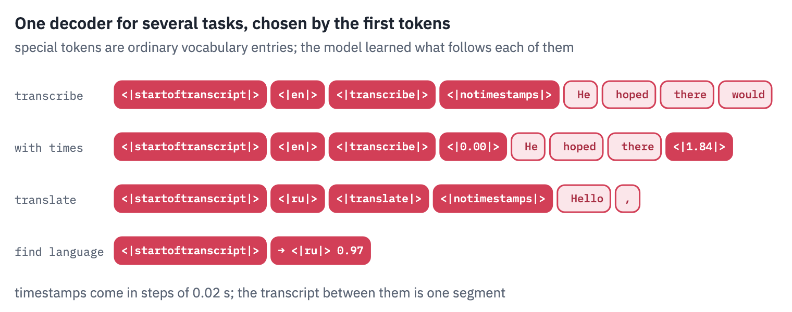
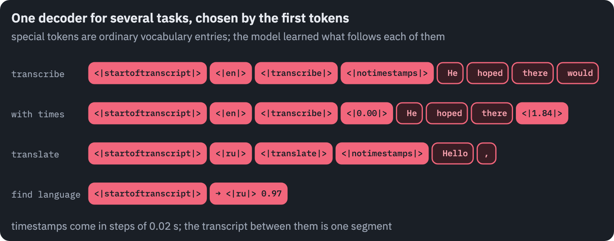

All of these live at the end of the vocabulary, after the 50,257 tokens of the byte-level BPE, the tokenizer of GPT-2
refitted on multilingual text:

```python
gen = tiny.generation_config
LANGS = gen.lang_to_id  # {"<|af|>": 50327, ..., "<|zh|>": 50260}
NO_SPEECH = token_id("<|nocaptions|>")  # OpenAI's code calls it <|nospeech|>
TIME0 = token_id("<|0.00|>")
rows = [
    ("<|endoftext|>", EOT),
    ("<|startoftranscript|>", SOT),
    (
        "<|en|>, <|ru|> and 97 more languages",
        f"{min(LANGS.values())}–{max(LANGS.values())}",
    ),
    ("<|translate|>, <|transcribe|>", f"{TRANSLATE}, {TRANSCRIBE}"),
    ("<|nocaptions|>, <|notimestamps|>", f"{NO_SPEECH}, {NO_TIMESTAMPS}"),
    ("<|0.00|> … <|30.00|>", f"{TIME0}–{token_id('<|30.00|>')}"),
]
display(table(pd.DataFrame(rows, columns=["special tokens", "ids"])))
print(
    f"{len(LANGS)} languages;",
    f"{cfg.vocab_size - EOT:,} special tokens after {EOT:,} text tokens",
)
```

<div class="tfs-table-wrap"><table class="tfs-table" style="border-collapse:collapse;font-family:'IBM Plex Sans', -apple-system, 'Segoe UI', Roboto, Helvetica, Arial, sans-serif;font-size:13.5px;line-height:1.45;margin:4px 0 8px;"><thead><tr><th style="padding:7px 14px;border-bottom:2px solid #B9C0CB;font-weight:600;color:#5B6575;font-size:12px;letter-spacing:0.02em;text-align:left;">special tokens</th><th style="padding:7px 14px;border-bottom:2px solid #B9C0CB;font-weight:600;color:#5B6575;font-size:12px;letter-spacing:0.02em;text-align:left;">ids</th></tr></thead><tbody><tr><td style="padding:7px 14px;border-bottom:1px solid #E6E9EE;vertical-align:top;text-align:left;max-width:460px;white-space:normal;">&lt;|endoftext|&gt;</td><td style="padding:7px 14px;border-bottom:1px solid #E6E9EE;vertical-align:top;text-align:right;font-variant-numeric:tabular-nums;max-width:460px;white-space:normal;">50,257</td></tr><tr><td style="padding:7px 14px;border-bottom:1px solid #E6E9EE;vertical-align:top;text-align:left;max-width:460px;white-space:normal;">&lt;|startoftranscript|&gt;</td><td style="padding:7px 14px;border-bottom:1px solid #E6E9EE;vertical-align:top;text-align:right;font-variant-numeric:tabular-nums;max-width:460px;white-space:normal;">50,258</td></tr><tr><td style="padding:7px 14px;border-bottom:1px solid #E6E9EE;vertical-align:top;text-align:left;max-width:460px;white-space:normal;">&lt;|en|&gt;, &lt;|ru|&gt; and 97 more languages</td><td style="padding:7px 14px;border-bottom:1px solid #E6E9EE;vertical-align:top;text-align:left;max-width:460px;white-space:normal;">50259–50357</td></tr><tr><td style="padding:7px 14px;border-bottom:1px solid #E6E9EE;vertical-align:top;text-align:left;max-width:460px;white-space:normal;">&lt;|translate|&gt;, &lt;|transcribe|&gt;</td><td style="padding:7px 14px;border-bottom:1px solid #E6E9EE;vertical-align:top;text-align:left;max-width:460px;white-space:normal;">50358, 50359</td></tr><tr><td style="padding:7px 14px;border-bottom:1px solid #E6E9EE;vertical-align:top;text-align:left;max-width:460px;white-space:normal;">&lt;|nocaptions|&gt;, &lt;|notimestamps|&gt;</td><td style="padding:7px 14px;border-bottom:1px solid #E6E9EE;vertical-align:top;text-align:left;max-width:460px;white-space:normal;">50362, 50363</td></tr><tr><td style="padding:7px 14px;border-bottom:1px solid #E6E9EE;vertical-align:top;text-align:left;max-width:460px;white-space:normal;">&lt;|0.00|&gt; … &lt;|30.00|&gt;</td><td style="padding:7px 14px;border-bottom:1px solid #E6E9EE;vertical-align:top;text-align:left;max-width:460px;white-space:normal;">50364–51864</td></tr></tbody></table></div>

<pre class="tfs-printed" markdown="0"><code>99 languages; 1,608 special tokens after 50,257 text tokens</code></pre>

Language identification is then one step of the decoder. We run it on twenty English and twenty Russian clips and
keep the probabilities of the 99 language tokens only.

```python
def features_of(items, proc=processor, dtype=torch.float32):
    audio = [x["audio"] for x in items]
    out = proc.feature_extractor(audio, sampling_rate=SR, return_tensors="pt")
    return out.input_features.to(device, dtype)


def first_step(model, features):
    """The decoder's scores right after <|startoftranscript|>."""
    start = torch.full((features.shape[0], 1), SOT, device=device)
    return model(input_features=features, decoder_input_ids=start).logits[:, -1].float()


names = [name[2:-2] for name in LANGS]
lang_ids = torch.tensor(list(LANGS.values()), device=device)
results = []
for truth, items in (("en", english[:20]), ("ru", russian[:20])):
    probs = first_step(tiny, features_of(items))[:, lang_ids].softmax(-1)
    best = probs.argmax(-1).tolist()
    results.append(
        {
            "spoken": truth,
            "clips": len(items),
            "named correctly": sum(names[b] == truth for b in best),
            "mean probability of the right language": float(
                probs[:, names.index(truth)].mean()
            ),
            "wrong guesses": ", ".join(sorted({names[b] for b in best} - {truth}))
            or "—",
        }
    )
display(table(pd.DataFrame(results), digits=3))
```

<div class="tfs-table-wrap"><table class="tfs-table" style="border-collapse:collapse;font-family:'IBM Plex Sans', -apple-system, 'Segoe UI', Roboto, Helvetica, Arial, sans-serif;font-size:13.5px;line-height:1.45;margin:4px 0 8px;"><thead><tr><th style="padding:7px 14px;border-bottom:2px solid #B9C0CB;font-weight:600;color:#5B6575;font-size:12px;letter-spacing:0.02em;text-align:left;">spoken</th><th style="padding:7px 14px;border-bottom:2px solid #B9C0CB;font-weight:600;color:#5B6575;font-size:12px;letter-spacing:0.02em;text-align:right;">clips</th><th style="padding:7px 14px;border-bottom:2px solid #B9C0CB;font-weight:600;color:#5B6575;font-size:12px;letter-spacing:0.02em;text-align:right;">named correctly</th><th style="padding:7px 14px;border-bottom:2px solid #B9C0CB;font-weight:600;color:#5B6575;font-size:12px;letter-spacing:0.02em;text-align:right;">mean probability of the right language</th><th style="padding:7px 14px;border-bottom:2px solid #B9C0CB;font-weight:600;color:#5B6575;font-size:12px;letter-spacing:0.02em;text-align:left;">wrong guesses</th></tr></thead><tbody><tr><td style="padding:7px 14px;border-bottom:1px solid #E6E9EE;vertical-align:top;text-align:left;max-width:460px;white-space:normal;">en</td><td style="padding:7px 14px;border-bottom:1px solid #E6E9EE;vertical-align:top;text-align:right;font-variant-numeric:tabular-nums;max-width:460px;white-space:normal;">20</td><td style="padding:7px 14px;border-bottom:1px solid #E6E9EE;vertical-align:top;text-align:right;font-variant-numeric:tabular-nums;max-width:460px;white-space:normal;">20</td><td style="padding:7px 14px;border-bottom:1px solid #E6E9EE;vertical-align:top;text-align:right;font-variant-numeric:tabular-nums;max-width:460px;white-space:normal;">0.989</td><td style="padding:7px 14px;border-bottom:1px solid #E6E9EE;vertical-align:top;text-align:left;max-width:460px;white-space:normal;">—</td></tr><tr><td style="padding:7px 14px;border-bottom:1px solid #E6E9EE;vertical-align:top;text-align:left;max-width:460px;white-space:normal;">ru</td><td style="padding:7px 14px;border-bottom:1px solid #E6E9EE;vertical-align:top;text-align:right;font-variant-numeric:tabular-nums;max-width:460px;white-space:normal;">20</td><td style="padding:7px 14px;border-bottom:1px solid #E6E9EE;vertical-align:top;text-align:right;font-variant-numeric:tabular-nums;max-width:460px;white-space:normal;">19</td><td style="padding:7px 14px;border-bottom:1px solid #E6E9EE;vertical-align:top;text-align:right;font-variant-numeric:tabular-nums;max-width:460px;white-space:normal;">0.936</td><td style="padding:7px 14px;border-bottom:1px solid #E6E9EE;vertical-align:top;text-align:left;max-width:460px;white-space:normal;">uk</td></tr></tbody></table></div>

```python
fig, axes = plt.subplots(1, 2, figsize=(11, 2.8))
for ax, item, title in (
    (axes[0], english[0], "an English clip"),
    (axes[1], russian[0], "a Russian clip"),
):
    p = first_step(tiny, features_of([item]))[0, lang_ids].softmax(-1).cpu()
    top = p.topk(6)
    ax.bar([names[i] for i in top.indices], top.values, color=COLORS["att"])
    for k, v in enumerate(top.values.tolist()):
        ax.text(
            k, v * 1.4, f"{v:.0e}" if v < 0.01 else f"{v:.3f}", ha="center", fontsize=9
        )
    ax.set_yscale("log")  # the runners-up are thousands of times less likely
    ax.set_ylim(1e-6, 5)
    ax.set_title(f"whisper-tiny's guess for {title}, log scale")
plt.tight_layout()
plt.show()
```

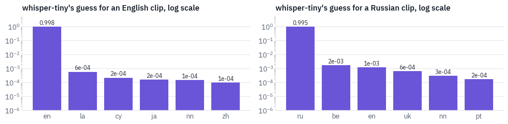

Tiny names the language of all twenty English clips and of nineteen of the twenty Russian ones; the clip it gets wrong it takes for Ukrainian. When it is right it is sure: the right language gets 0.99 of the probability on average for English and 0.94 for Russian.

On a log scale the runners-up make sense for the Russian clip, Belarusian and, after English, Ukrainian, the languages closest to Russian. For the English clip they are Latin, Welsh and Japanese at a few in ten thousand, too small to mean anything.

The same step gives a second number. When a training window held no speech, the model was taught to write
`<|nocaptions|>` right after *start of transcript*, where the language would go. Its probability at that step is the
*no-speech probability*, and section 8 shows how much it can be trusted.

The task token changes the job. Here is one Russian clip transcribed, translated into English, and transcribed with
timestamps, by tiny and by small, a model six times its size:

```python
HALF = torch.float16 if device == "cuda" else torch.float32
SMALL = "openai/whisper-small"
small_processor = WhisperProcessor.from_pretrained(SMALL)
small = (
    WhisperForConditionalGeneration.from_pretrained(SMALL, dtype=HALF).to(device).eval()
)

clip = russian[0]
rows = []
for name, model, proc in (("tiny", tiny, processor), ("small", small, small_processor)):
    features = features_of([clip], proc, model.dtype)
    for task, stamps in (
        ("transcribe", False),
        ("translate", False),
        ("transcribe", True),
    ):
        out = model.generate(
            features, language="ru", task=task, return_timestamps=stamps
        )
        text = proc.tokenizer.decode(
            out[0], skip_special_tokens=not stamps, decode_with_timestamps=stamps
        )
        for junk in (
            "<|startoftranscript|>",
            "<|ru|>",
            "<|transcribe|>",
            "<|endoftext|>",
        ):
            text = text.replace(junk, "")
        label = task + (", with timestamps" if stamps else "")
        rows.append({"model": name, "asked to": label, "output": text.strip()})
display(table(pd.DataFrame(rows)))
print("reference:", clip["text"])
```

<div class="tfs-table-wrap"><table class="tfs-table" style="border-collapse:collapse;font-family:'IBM Plex Sans', -apple-system, 'Segoe UI', Roboto, Helvetica, Arial, sans-serif;font-size:13.5px;line-height:1.45;margin:4px 0 8px;"><thead><tr><th style="padding:7px 14px;border-bottom:2px solid #B9C0CB;font-weight:600;color:#5B6575;font-size:12px;letter-spacing:0.02em;text-align:left;">model</th><th style="padding:7px 14px;border-bottom:2px solid #B9C0CB;font-weight:600;color:#5B6575;font-size:12px;letter-spacing:0.02em;text-align:left;">asked to</th><th style="padding:7px 14px;border-bottom:2px solid #B9C0CB;font-weight:600;color:#5B6575;font-size:12px;letter-spacing:0.02em;text-align:left;">output</th></tr></thead><tbody><tr><td style="padding:7px 14px;border-bottom:1px solid #E6E9EE;vertical-align:top;text-align:left;max-width:460px;white-space:normal;">tiny</td><td style="padding:7px 14px;border-bottom:1px solid #E6E9EE;vertical-align:top;text-align:left;max-width:460px;white-space:normal;">transcribe</td><td style="padding:7px 14px;border-bottom:1px solid #E6E9EE;vertical-align:top;text-align:left;max-width:460px;white-space:normal;">И следователи университета сообщили, что эти два садения вступают друг с другом реакцию образуя кресталы, которые могут блокировать работу почек.</td></tr><tr><td style="padding:7px 14px;border-bottom:1px solid #E6E9EE;vertical-align:top;text-align:left;max-width:460px;white-space:normal;">tiny</td><td style="padding:7px 14px;border-bottom:1px solid #E6E9EE;vertical-align:top;text-align:left;max-width:460px;white-space:normal;">translate</td><td style="padding:7px 14px;border-bottom:1px solid #E6E9EE;vertical-align:top;text-align:left;max-width:460px;white-space:normal;">If you are interested in this, you can find a way to make a new reaction.</td></tr><tr><td style="padding:7px 14px;border-bottom:1px solid #E6E9EE;vertical-align:top;text-align:left;max-width:460px;white-space:normal;">tiny</td><td style="padding:7px 14px;border-bottom:1px solid #E6E9EE;vertical-align:top;text-align:left;max-width:460px;white-space:normal;">transcribe, with timestamps</td><td style="padding:7px 14px;border-bottom:1px solid #E6E9EE;vertical-align:top;text-align:left;max-width:460px;white-space:normal;">&lt;|0.00|&gt; исследовать для университета сообщили, что эти два садения вступают друг с другом реакцию,&lt;|6.94|&gt;&lt;|6.94|&gt; образуя кресталы, которые могут блокировать работу почек.&lt;|10.06|&gt;</td></tr><tr><td style="padding:7px 14px;border-bottom:1px solid #E6E9EE;vertical-align:top;text-align:left;max-width:460px;white-space:normal;">small</td><td style="padding:7px 14px;border-bottom:1px solid #E6E9EE;vertical-align:top;text-align:left;max-width:460px;white-space:normal;">transcribe</td><td style="padding:7px 14px;border-bottom:1px solid #E6E9EE;vertical-align:top;text-align:left;max-width:460px;white-space:normal;">Исследователи университета сообщили, что эти два соединения вступают друг с другом в реакцию, образуя кристаллы, которые могут блокировать работу почек.</td></tr><tr><td style="padding:7px 14px;border-bottom:1px solid #E6E9EE;vertical-align:top;text-align:left;max-width:460px;white-space:normal;">small</td><td style="padding:7px 14px;border-bottom:1px solid #E6E9EE;vertical-align:top;text-align:left;max-width:460px;white-space:normal;">translate</td><td style="padding:7px 14px;border-bottom:1px solid #E6E9EE;vertical-align:top;text-align:left;max-width:460px;white-space:normal;">Researchers at the university reported that these two connections are coming into contact with each other by forming crystals that can block the work of the buds.</td></tr><tr><td style="padding:7px 14px;border-bottom:1px solid #E6E9EE;vertical-align:top;text-align:left;max-width:460px;white-space:normal;">small</td><td style="padding:7px 14px;border-bottom:1px solid #E6E9EE;vertical-align:top;text-align:left;max-width:460px;white-space:normal;">transcribe, with timestamps</td><td style="padding:7px 14px;border-bottom:1px solid #E6E9EE;vertical-align:top;text-align:left;max-width:460px;white-space:normal;">&lt;|0.00|&gt; Исследователи университета сообщили, что эти два соединения вступают друг с другом в реакцию,&lt;|6.76|&gt;&lt;|6.76|&gt; образуя кристаллы, которые могут блокировать работу почек.&lt;|9.96|&gt;</td></tr></tbody></table></div>

<pre class="tfs-printed" markdown="0"><code>reference: исследователи университета сообщили что эти два соединения вступают друг с другом в реакцию образуя кристаллы которые могут блокировать работу почек</code></pre>

Tiny's transcript has the shape of the sentence and the wrong letters: *И следователи*, and the investigators, for *Исследователи*, researchers, and *садения* for *соединения*.

Asked for timestamps, the same model on the same audio starts differently and worse, *исследовать для университета*: the task tokens are part of the context, and a weak model's guesses move with it. Asked to translate, tiny writes a fluent English sentence that has nothing to do with the clip.

Small transcribes the sentence without an error and translates it well, except for two Russian words with two meanings each: *соединения*, compounds, became *connections*, and *почек*, of the kidneys, became *of the buds*.

The paper scores Russian-to-English translation on FLEURS at 3.1 BLEU for tiny and 19.7 for small. The timestamped lines show the format: each segment opens and closes with a time token, and both models split this sentence in two, tiny at 6.94 seconds and small at 6.76.

What the library's `generate` does with these tokens is a loop you can write yourself. Greedy decoding takes the most likely next token, appends it and runs the decoder again, until *end of text*. Two details make it match the library exactly.

A list of 88 tokens is never allowed, mostly symbols such as brackets and music notes and the control tokens themselves; and the first token may be neither a bare space nor *end of text*, so that the model cannot answer with nothing.

```python
SUPPRESS = torch.tensor(gen.suppress_tokens, device=device)
# a bare space and <|endoftext|>, banned as the first token
AT_START = torch.tensor(gen.begin_suppress_tokens, device=device)


def greedy(features, prompt, limit=224):
    audio = encode(features)  # once per window
    tokens, logprobs = list(prompt), []
    for step in range(limit):
        scores = decode(torch.tensor([tokens], device=device), audio)[0, -1]
        scores[SUPPRESS] = -math.inf
        if step == 0:
            scores[AT_START] = -math.inf
        logp = torch.log_softmax(scores, -1)
        nxt = int(logp.argmax())
        logprobs.append(float(logp[nxt]))
        if nxt == EOT:
            break
        tokens.append(nxt)
    return tokens[len(prompt) :], logprobs


same = 0
for item in english[:20]:
    features = features_of([item])
    ours, logprobs = greedy(features, PROMPT)
    theirs = tiny.generate(features, language="en", task="transcribe")[0].tolist()
    same += ours == [t for t in theirs if t < EOT]  # without the special tokens
print(
    f"our loop and generate() wrote the same tokens for {same} of {len(english[:20])} clips"
)
ours, logprobs = greedy(features_of([example]), PROMPT)
print(tok.decode(ours))
print(f"mean log-probability per token: {np.mean(logprobs):.3f}")
```

<pre class="tfs-printed" markdown="0"><code>our loop and generate() wrote the same tokens for 20 of 20 clips
 He hoped there would be stew for dinner, turnips and carrots and bruised potatoes and fat mutton pieces to be ladled out in thick, peppered flour-fat and sauce.
mean log-probability per token: -0.174</code></pre>

Our loop writes the same tokens as `generate()` on all twenty clips. It recomputes the whole decoder for every new token, which is fine for a lesson and wasteful in practice; the library keeps the keys and values of past tokens and of the audio, and runs only the new position.

The mean log-probability of the chosen tokens, −0.17 here, a probability of 0.84 per token on a geometric average, is the model's own measure of how sure it was, and section 7 shows Whisper using it to decide whether to trust a transcript.

## 6. Counting the mistakes

A recogniser is scored by its *word error rate*. Line the transcript up with the reference so that as few words as
possible have to change, count the words substituted $$S$$, deleted $$D$$ and inserted $$I$$, and divide by the number of
words in the reference $$N$$:

$$\mathrm{WER} = \frac{S + D + I}{N}.$$

The lining up is an edit distance over words, the same dynamic programme that compares two strings letter by letter,
and the score has no upper limit: a model that writes text where there is none collects insertions without end.

```python
def align(ref, hyp):
    """The fewest word edits that turn ref into hyp, as (kind, ref word, hyp word)."""
    r, h = ref.split(), hyp.split()
    # cost[i][j]: edits needed to turn the first i words of r into the first j of h
    cost = [
        [i + j if i * j == 0 else 0 for j in range(len(h) + 1)]
        for i in range(len(r) + 1)
    ]
    for i in range(1, len(r) + 1):
        for j in range(1, len(h) + 1):
            cost[i][j] = min(
                cost[i - 1][j - 1] + (r[i - 1] != h[j - 1]),
                cost[i - 1][j] + 1,
                cost[i][j - 1] + 1,
            )
    ops, i, j = [], len(r), len(h)
    while i or j:  # walk back along one cheapest path
        if i and j and cost[i][j] == cost[i - 1][j - 1] + (r[i - 1] != h[j - 1]):
            ops.append(("=" if r[i - 1] == h[j - 1] else "S", r[i - 1], h[j - 1]))
            i, j = i - 1, j - 1
        elif i and cost[i][j] == cost[i - 1][j] + 1:
            ops.append(("D", r[i - 1], ""))
            i -= 1
        else:
            ops.append(("I", "", h[j - 1]))
            j -= 1
    return ops[::-1]


def wer(refs, hyps):
    kinds = Counter(op[0] for r, h in zip(refs, hyps) for op in align(r, h))
    return (kinds["S"] + kinds["D"] + kinds["I"]) / (
        kinds["="] + kinds["S"] + kinds["D"]
    )


hyp = tok.decode(greedy(features_of([example]), PROMPT)[0]).strip()
print("reference: ", example["text"])
print("whisper:   ", hyp)
print(f"WER as written: {100 * wer([example['text']], [hyp]):.0f}%")
```

<pre class="tfs-printed" markdown="0"><code>reference:  HE HOPED THERE WOULD BE STEW FOR DINNER TURNIPS AND CARROTS AND BRUISED POTATOES AND FAT MUTTON PIECES TO BE LADLED OUT IN THICK PEPPERED FLOUR FATTENED SAUCE
whisper:    He hoped there would be stew for dinner, turnips and carrots and bruised potatoes and fat mutton pieces to be ladled out in thick, peppered flour-fat and sauce.
WER as written: 100%</code></pre>

By that count tiny got every word wrong, and it didn't. LibriSpeech's references are in capitals without punctuation, and Whisper writes ordinary text, so *He* against *HE* and *dinner,* against *DINNER* are errors.

Whisper learned from transcripts in every style the web has, so its output can't be expected to follow one dataset's conventions, and its authors score it after normalising both sides: lower case, no punctuation, *Mr.* as *mister*, *won't* as *will not*, British spellings as American, numbers as digits.

The rules ship with the tokenizer. For other languages a basic version lowercases and removes punctuation and symbols; for Russian we also write *ё* as *е* on both sides, since texts use the two letters for the same sound.

```python
def normalize_en(text):
    return tok.normalize(text)  # Whisper's English normaliser


def normalize_ru(text):
    return tok.basic_normalize(text).replace("ё", "е")


NORMALIZE = {"en": normalize_en, "ru": normalize_ru}
ref, hyp = normalize_en(example["text"]), normalize_en(hyp)
print("reference: ", ref)
print("whisper:   ", hyp)
print(f"WER normalised: {100 * wer([ref], [hyp]):.1f}%")
for kind, r, h in align(ref, hyp):
    if kind != "=":
        print(f"  {kind}: {r or '—'} → {h or '—'}")
```

<pre class="tfs-printed" markdown="0"><code>reference:  he hoped there would be stew for dinner turnips and carrots and bruised potatoes and fat mutton pieces to be ladled out in thick peppered flour fattened sauce
whisper:    he hoped there would be stew for dinner turnips and carrots and bruised potatoes and fat mutton pieces to be ladled out in thick peppered flour fat and sauce
WER normalised: 7.1%
  I: — → fat
  S: fattened → and</code></pre>

Two errors are left, and both are real: tiny heard *flour fattened sauce* as *flour fat and sauce*, one substitution
and one insertion, 2 errors against 28 words of reference, 7.1%.

<div class="callout callout-warn" markdown="1">
<p class="callout-label">Trap</p>

A word error rate means nothing without its normalisation. The same transcript scores 100% or
7.1% depending on whether capitals and commas count, and papers that normalise differently can't be
compared. Whisper's paper found differences of up to half the WER on some datasets from such details alone.
</div>

Now four sizes of Whisper on our 200 English and 200 Russian clips: tiny, base and small from the original 2022 release, and large-v3-turbo from 2024, the large model with its decoder cut from 32 blocks to 4.

Tiny stays in float32; the others run in float16, as OpenAI's code runs them on a GPU. Decoding is greedy, the default of the library and of OpenAI's `transcribe()`. For each model we also time one encoder pass and one decoder step on the example clip, alone, as a single request would run.

```python
MODELS = {
    "tiny": TINY,
    "base": "openai/whisper-base",
    "small": SMALL,
    "large-v3-turbo": "openai/whisper-large-v3-turbo",
}
PAPER = {
    "tiny": (7.6, 31.1),
    "base": (5.0, 20.5),
    "small": (3.4, 11.4),
}  # greedy, en / ru
SETS = {"en": english, "ru": russian}


def load(repo):
    proc = WhisperProcessor.from_pretrained(repo)
    model = WhisperForConditionalGeneration.from_pretrained(repo, dtype=HALF)
    return model.to(device).eval(), proc


def transcribe(model, proc, items, language, batch=16, **options):
    texts = []
    for i in range(0, len(items), batch):
        features = features_of(items[i : i + batch], proc, model.dtype)
        out = model.generate(features, language=language, task="transcribe", **options)
        texts += proc.tokenizer.batch_decode(out, skip_special_tokens=True)
    return texts


def now():
    if device == "cuda":
        torch.cuda.synchronize()  # wait for the GPU to finish before reading the clock
    return time.perf_counter()


def latency(model, proc):
    """Milliseconds for one encoder pass and for one decoder step, batch of one."""
    features = features_of([example], proc, model.dtype)
    model.generate(features, language="en", task="transcribe")  # warm-up
    start = now()
    model.model.encoder(features)
    encoder = now() - start
    start = now()
    out = model.generate(features, language="en", task="transcribe")
    total = now() - start
    return 1000 * encoder, 1000 * (total - encoder) / out.shape[-1]


accuracy, speed, outputs = [], [], {}
for name in ["tiny", "base"] if SMOKE else list(MODELS):
    if name == "tiny":
        model, proc = tiny, processor
    elif name == "small":
        model, proc = small, small_processor
    else:
        model, proc = load(MODELS[name])
    size = sum(p.numel() for p in model.parameters()) / 1e6
    row = {"model": name, "parameters, M": size}
    clock = {"model": name}
    for lang, items in SETS.items():
        start = now()
        hyps = outputs[name, lang] = transcribe(model, proc, items, lang)
        seconds = now() - start
        refs = [NORMALIZE[lang](x["text"]) for x in items]
        row[f"WER {lang}, %"] = 100 * wer(refs, [NORMALIZE[lang](h) for h in hyps])
        row[f"paper {lang}, %"] = PAPER.get(name, (math.nan, math.nan))[lang == "ru"]
        clock[f"{lang}: seconds for {len(items)} clips"] = seconds
    clock["encoder pass, ms"], clock["decoder step, ms"] = latency(model, proc)
    accuracy.append(row)
    speed.append(clock)
    if name not in ("tiny", "small"):
        del model
        torch.cuda.empty_cache()
accuracy, speed = pd.DataFrame(accuracy), pd.DataFrame(speed)
display(table(accuracy, digits=1))
display(table(speed, digits=1))
```

<div class="tfs-table-wrap"><table class="tfs-table" style="border-collapse:collapse;font-family:'IBM Plex Sans', -apple-system, 'Segoe UI', Roboto, Helvetica, Arial, sans-serif;font-size:13.5px;line-height:1.45;margin:4px 0 8px;"><thead><tr><th style="padding:7px 14px;border-bottom:2px solid #B9C0CB;font-weight:600;color:#5B6575;font-size:12px;letter-spacing:0.02em;text-align:left;">model</th><th style="padding:7px 14px;border-bottom:2px solid #B9C0CB;font-weight:600;color:#5B6575;font-size:12px;letter-spacing:0.02em;text-align:right;">parameters, M</th><th style="padding:7px 14px;border-bottom:2px solid #B9C0CB;font-weight:600;color:#5B6575;font-size:12px;letter-spacing:0.02em;text-align:right;">WER en, %</th><th style="padding:7px 14px;border-bottom:2px solid #B9C0CB;font-weight:600;color:#5B6575;font-size:12px;letter-spacing:0.02em;text-align:right;">paper en, %</th><th style="padding:7px 14px;border-bottom:2px solid #B9C0CB;font-weight:600;color:#5B6575;font-size:12px;letter-spacing:0.02em;text-align:right;">WER ru, %</th><th style="padding:7px 14px;border-bottom:2px solid #B9C0CB;font-weight:600;color:#5B6575;font-size:12px;letter-spacing:0.02em;text-align:right;">paper ru, %</th></tr></thead><tbody><tr><td style="padding:7px 14px;border-bottom:1px solid #E6E9EE;vertical-align:top;text-align:left;max-width:460px;white-space:normal;">tiny</td><td style="padding:7px 14px;border-bottom:1px solid #E6E9EE;vertical-align:top;text-align:right;font-variant-numeric:tabular-nums;max-width:460px;white-space:normal;">37.8</td><td style="padding:7px 14px;border-bottom:1px solid #E6E9EE;vertical-align:top;text-align:right;font-variant-numeric:tabular-nums;max-width:460px;white-space:normal;">6.7</td><td style="padding:7px 14px;border-bottom:1px solid #E6E9EE;vertical-align:top;text-align:right;font-variant-numeric:tabular-nums;max-width:460px;white-space:normal;">7.6</td><td style="padding:7px 14px;border-bottom:1px solid #E6E9EE;vertical-align:top;text-align:right;font-variant-numeric:tabular-nums;max-width:460px;white-space:normal;">35.3</td><td style="padding:7px 14px;border-bottom:1px solid #E6E9EE;vertical-align:top;text-align:right;font-variant-numeric:tabular-nums;max-width:460px;white-space:normal;">31.1</td></tr><tr><td style="padding:7px 14px;border-bottom:1px solid #E6E9EE;vertical-align:top;text-align:left;max-width:460px;white-space:normal;">base</td><td style="padding:7px 14px;border-bottom:1px solid #E6E9EE;vertical-align:top;text-align:right;font-variant-numeric:tabular-nums;max-width:460px;white-space:normal;">72.6</td><td style="padding:7px 14px;border-bottom:1px solid #E6E9EE;vertical-align:top;text-align:right;font-variant-numeric:tabular-nums;max-width:460px;white-space:normal;">4.6</td><td style="padding:7px 14px;border-bottom:1px solid #E6E9EE;vertical-align:top;text-align:right;font-variant-numeric:tabular-nums;max-width:460px;white-space:normal;">5.0</td><td style="padding:7px 14px;border-bottom:1px solid #E6E9EE;vertical-align:top;text-align:right;font-variant-numeric:tabular-nums;max-width:460px;white-space:normal;">22.2</td><td style="padding:7px 14px;border-bottom:1px solid #E6E9EE;vertical-align:top;text-align:right;font-variant-numeric:tabular-nums;max-width:460px;white-space:normal;">20.5</td></tr><tr><td style="padding:7px 14px;border-bottom:1px solid #E6E9EE;vertical-align:top;text-align:left;max-width:460px;white-space:normal;">small</td><td style="padding:7px 14px;border-bottom:1px solid #E6E9EE;vertical-align:top;text-align:right;font-variant-numeric:tabular-nums;max-width:460px;white-space:normal;">241.7</td><td style="padding:7px 14px;border-bottom:1px solid #E6E9EE;vertical-align:top;text-align:right;font-variant-numeric:tabular-nums;max-width:460px;white-space:normal;">4.2</td><td style="padding:7px 14px;border-bottom:1px solid #E6E9EE;vertical-align:top;text-align:right;font-variant-numeric:tabular-nums;max-width:460px;white-space:normal;">3.4</td><td style="padding:7px 14px;border-bottom:1px solid #E6E9EE;vertical-align:top;text-align:right;font-variant-numeric:tabular-nums;max-width:460px;white-space:normal;">11.2</td><td style="padding:7px 14px;border-bottom:1px solid #E6E9EE;vertical-align:top;text-align:right;font-variant-numeric:tabular-nums;max-width:460px;white-space:normal;">11.4</td></tr><tr><td style="padding:7px 14px;border-bottom:1px solid #E6E9EE;vertical-align:top;text-align:left;max-width:460px;white-space:normal;">large-v3-turbo</td><td style="padding:7px 14px;border-bottom:1px solid #E6E9EE;vertical-align:top;text-align:right;font-variant-numeric:tabular-nums;max-width:460px;white-space:normal;">808.9</td><td style="padding:7px 14px;border-bottom:1px solid #E6E9EE;vertical-align:top;text-align:right;font-variant-numeric:tabular-nums;max-width:460px;white-space:normal;">2.0</td><td style="padding:7px 14px;border-bottom:1px solid #E6E9EE;vertical-align:top;text-align:right;font-variant-numeric:tabular-nums;max-width:460px;white-space:normal;">—</td><td style="padding:7px 14px;border-bottom:1px solid #E6E9EE;vertical-align:top;text-align:right;font-variant-numeric:tabular-nums;max-width:460px;white-space:normal;">3.8</td><td style="padding:7px 14px;border-bottom:1px solid #E6E9EE;vertical-align:top;text-align:right;font-variant-numeric:tabular-nums;max-width:460px;white-space:normal;">—</td></tr></tbody></table></div>

<div class="tfs-table-wrap"><table class="tfs-table" style="border-collapse:collapse;font-family:'IBM Plex Sans', -apple-system, 'Segoe UI', Roboto, Helvetica, Arial, sans-serif;font-size:13.5px;line-height:1.45;margin:4px 0 8px;"><thead><tr><th style="padding:7px 14px;border-bottom:2px solid #B9C0CB;font-weight:600;color:#5B6575;font-size:12px;letter-spacing:0.02em;text-align:left;">model</th><th style="padding:7px 14px;border-bottom:2px solid #B9C0CB;font-weight:600;color:#5B6575;font-size:12px;letter-spacing:0.02em;text-align:right;">en: seconds for 200 clips</th><th style="padding:7px 14px;border-bottom:2px solid #B9C0CB;font-weight:600;color:#5B6575;font-size:12px;letter-spacing:0.02em;text-align:right;">ru: seconds for 200 clips</th><th style="padding:7px 14px;border-bottom:2px solid #B9C0CB;font-weight:600;color:#5B6575;font-size:12px;letter-spacing:0.02em;text-align:right;">encoder pass, ms</th><th style="padding:7px 14px;border-bottom:2px solid #B9C0CB;font-weight:600;color:#5B6575;font-size:12px;letter-spacing:0.02em;text-align:right;">decoder step, ms</th></tr></thead><tbody><tr><td style="padding:7px 14px;border-bottom:1px solid #E6E9EE;vertical-align:top;text-align:left;max-width:460px;white-space:normal;">tiny</td><td style="padding:7px 14px;border-bottom:1px solid #E6E9EE;vertical-align:top;text-align:right;font-variant-numeric:tabular-nums;max-width:460px;white-space:normal;">12.1</td><td style="padding:7px 14px;border-bottom:1px solid #E6E9EE;vertical-align:top;text-align:right;font-variant-numeric:tabular-nums;max-width:460px;white-space:normal;">16.6</td><td style="padding:7px 14px;border-bottom:1px solid #E6E9EE;vertical-align:top;text-align:right;font-variant-numeric:tabular-nums;max-width:460px;white-space:normal;">10.0</td><td style="padding:7px 14px;border-bottom:1px solid #E6E9EE;vertical-align:top;text-align:right;font-variant-numeric:tabular-nums;max-width:460px;white-space:normal;">5.5</td></tr><tr><td style="padding:7px 14px;border-bottom:1px solid #E6E9EE;vertical-align:top;text-align:left;max-width:460px;white-space:normal;">base</td><td style="padding:7px 14px;border-bottom:1px solid #E6E9EE;vertical-align:top;text-align:right;font-variant-numeric:tabular-nums;max-width:460px;white-space:normal;">11.3</td><td style="padding:7px 14px;border-bottom:1px solid #E6E9EE;vertical-align:top;text-align:right;font-variant-numeric:tabular-nums;max-width:460px;white-space:normal;">12.8</td><td style="padding:7px 14px;border-bottom:1px solid #E6E9EE;vertical-align:top;text-align:right;font-variant-numeric:tabular-nums;max-width:460px;white-space:normal;">6.6</td><td style="padding:7px 14px;border-bottom:1px solid #E6E9EE;vertical-align:top;text-align:right;font-variant-numeric:tabular-nums;max-width:460px;white-space:normal;">8.0</td></tr><tr><td style="padding:7px 14px;border-bottom:1px solid #E6E9EE;vertical-align:top;text-align:left;max-width:460px;white-space:normal;">small</td><td style="padding:7px 14px;border-bottom:1px solid #E6E9EE;vertical-align:top;text-align:right;font-variant-numeric:tabular-nums;max-width:460px;white-space:normal;">20.6</td><td style="padding:7px 14px;border-bottom:1px solid #E6E9EE;vertical-align:top;text-align:right;font-variant-numeric:tabular-nums;max-width:460px;white-space:normal;">23.7</td><td style="padding:7px 14px;border-bottom:1px solid #E6E9EE;vertical-align:top;text-align:right;font-variant-numeric:tabular-nums;max-width:460px;white-space:normal;">19.3</td><td style="padding:7px 14px;border-bottom:1px solid #E6E9EE;vertical-align:top;text-align:right;font-variant-numeric:tabular-nums;max-width:460px;white-space:normal;">12.3</td></tr><tr><td style="padding:7px 14px;border-bottom:1px solid #E6E9EE;vertical-align:top;text-align:left;max-width:460px;white-space:normal;">large-v3-turbo</td><td style="padding:7px 14px;border-bottom:1px solid #E6E9EE;vertical-align:top;text-align:right;font-variant-numeric:tabular-nums;max-width:460px;white-space:normal;">49.2</td><td style="padding:7px 14px;border-bottom:1px solid #E6E9EE;vertical-align:top;text-align:right;font-variant-numeric:tabular-nums;max-width:460px;white-space:normal;">49.6</td><td style="padding:7px 14px;border-bottom:1px solid #E6E9EE;vertical-align:top;text-align:right;font-variant-numeric:tabular-nums;max-width:460px;white-space:normal;">173.0</td><td style="padding:7px 14px;border-bottom:1px solid #E6E9EE;vertical-align:top;text-align:right;font-variant-numeric:tabular-nums;max-width:460px;white-space:normal;">6.7</td></tr></tbody></table></div>

```python
fig, ax = plt.subplots(figsize=(7, 3.6))
for lang, color, label in (
    ("en", COLORS["enc"], "English, LibriSpeech"),
    ("ru", COLORS["dec"], "Russian, FLEURS"),
):
    ax.plot(
        accuracy["parameters, M"],
        accuracy[f"WER {lang}, %"],
        "o-",
        color=color,
        lw=2,
        ms=7,
        label=label,
    )
for _, r in accuracy.iterrows():  # model names once, above the upper line
    ax.annotate(
        r["model"],
        (r["parameters, M"], r["WER ru, %"]),
        textcoords="offset points",
        xytext=(0, 9),
        ha="center",
        fontsize=9,
        color=COLORS["muted"],
    )
ax.set_xscale("log")
ax.margins(x=0.12)  # room for the last name
ax.set_xticks(
    accuracy["parameters, M"], [f"{v:,.0f}" for v in accuracy["parameters, M"]]
)
ax.minorticks_off()
ax.set_xlabel("parameters, millions (log scale)")
ax.set_ylabel("word error rate, %")
ax.set_ylim(0, None)
ax.legend(frameon=False)
ax.set_title("Word error rate by model size, greedy decoding")
plt.tight_layout()
plt.show()
```

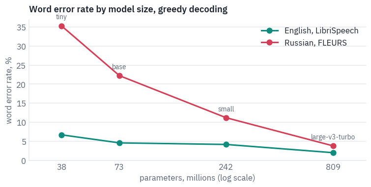

On English the three original models land within a point of the paper's numbers, which were measured on all 2,620 utterances of test-clean; two hundred utterances move a word error rate by about that much.

Russian is harder for every model, and the gap narrows with size: tiny gets more than a third of the words wrong, each step up removes a third to a half of what is left, and turbo gets 3.8%.

Tiny's Russian is four points worse than the paper's. The paper doesn't say how it decoded its multilingual tables, but their FLEURS English column equals its beam-search table, and beam search helps a weak model most.

The timing table shows what turbo bought. Its encoder, 32 blocks of width 1,280, takes 173 ms per window, nine times small's.

Its decoder step takes 6.7 ms, about half of small's and close to tiny's: for one token at a time a GPU waits on the number of blocks run one after another more than on their width, and turbo has four.

A 30-second window of English takes about a hundred decoder steps, so turbo spends about 0.7 s decoding it after a 0.17 s encoder pass; with the 32 decoder blocks of large-v3, every one of those steps would run eight times as many blocks.

Tiny's encoder is slower than base's only because tiny runs in float32 here, which the T4's tensor cores don't speed up.

The gap between the languages follows the training data. Of Whisper's 680,000 hours, 438,218 are English speech with
English transcripts and 9,761 are Russian, the fourth-largest language after Chinese, German and Spanish. The paper
found that across languages the error rate halves for every sixteenfold increase in training data, and a small model
feels the shortage most.

The remaining errors of the best model show what a word error rate counts. Here are the Russian clips where it made
the most:

```python
best = accuracy.iloc[-1]["model"]
worst = []
for item, hyp in zip(russian, outputs[best, "ru"]):
    ops = align(normalize_ru(item["text"]), normalize_ru(hyp))
    errors = sum(kind != "=" for kind, _, _ in ops)
    worst.append(
        {
            "errors": errors,
            "reference": normalize_ru(item["text"]),
            best: normalize_ru(hyp),
        }
    )
display(table(pd.DataFrame(worst).sort_values("errors", ascending=False).head(6)))
```

<div class="tfs-table-wrap"><table class="tfs-table" style="border-collapse:collapse;font-family:'IBM Plex Sans', -apple-system, 'Segoe UI', Roboto, Helvetica, Arial, sans-serif;font-size:13.5px;line-height:1.45;margin:4px 0 8px;"><thead><tr><th style="padding:7px 14px;border-bottom:2px solid #B9C0CB;font-weight:600;color:#5B6575;font-size:12px;letter-spacing:0.02em;text-align:right;">errors</th><th style="padding:7px 14px;border-bottom:2px solid #B9C0CB;font-weight:600;color:#5B6575;font-size:12px;letter-spacing:0.02em;text-align:left;">reference</th><th style="padding:7px 14px;border-bottom:2px solid #B9C0CB;font-weight:600;color:#5B6575;font-size:12px;letter-spacing:0.02em;text-align:left;">large-v3-turbo</th></tr></thead><tbody><tr><td style="padding:7px 14px;border-bottom:1px solid #E6E9EE;vertical-align:top;text-align:right;font-variant-numeric:tabular-nums;max-width:460px;white-space:normal;">10</td><td style="padding:7px 14px;border-bottom:1px solid #E6E9EE;vertical-align:top;text-align:left;max-width:460px;white-space:normal;">доктора малар баласубраманиан 29 лет нашли в блю эше штат огайо пригороде примерно в 15 милях к северу от цинциннати он лежал на земле рядом с дорогой в футболке и нижнем белье и по видимому в состоянии сильного наркотического опьянения</td><td style="padding:7px 14px;border-bottom:1px solid #E6E9EE;vertical-align:top;text-align:left;max-width:460px;white-space:normal;"> доктора малар баласу браманиан 29 лет нашли в блюэше штат огайо пригороде примерно в 15 милях к северу от сан ценнати он лежал на земле рядом с дорогой футболкой и нижним белье и по видимому в состоянии сильного наркотического объединения </td></tr><tr><td style="padding:7px 14px;border-bottom:1px solid #E6E9EE;vertical-align:top;text-align:right;font-variant-numeric:tabular-nums;max-width:460px;white-space:normal;">5</td><td style="padding:7px 14px;border-bottom:1px solid #E6E9EE;vertical-align:top;text-align:left;max-width:460px;white-space:normal;">сундарбан это крупнейший пояс прибрежных мангровых зарослей простирающийся от берега на 80 км 50 миль вглубь континента в бангладеше и индии</td><td style="padding:7px 14px;border-bottom:1px solid #E6E9EE;vertical-align:top;text-align:left;max-width:460px;white-space:normal;"> сундарбан это крупнейший пояс прибрежных мангровых зарослей простирающийся от берега на 80 км вглубь континентов бангладеша и индии </td></tr><tr><td style="padding:7px 14px;border-bottom:1px solid #E6E9EE;vertical-align:top;text-align:right;font-variant-numeric:tabular-nums;max-width:460px;white-space:normal;">4</td><td style="padding:7px 14px;border-bottom:1px solid #E6E9EE;vertical-align:top;text-align:left;max-width:460px;white-space:normal;">хотя никто не знает наверняка кто его написал известно что в начале своего существования этот большой пергаментный документ размером 293 4 на 241 2 дюйма был свернут для более удобного хранения</td><td style="padding:7px 14px;border-bottom:1px solid #E6E9EE;vertical-align:top;text-align:left;max-width:460px;white-space:normal;"> хотя никто не знает наверняка кто его написал известно что в начале своего существования этот большой пергаментный документ размером 29 75 на 24 1 дюйма был свернут для более удобного хранения </td></tr><tr><td style="padding:7px 14px;border-bottom:1px solid #E6E9EE;vertical-align:top;text-align:right;font-variant-numeric:tabular-nums;max-width:460px;white-space:normal;">4</td><td style="padding:7px 14px;border-bottom:1px solid #E6E9EE;vertical-align:top;text-align:left;max-width:460px;white-space:normal;">вы можете по гома на бода бода мототакси обычная местная цена 500 конголезских франков за короткую поездку</td><td style="padding:7px 14px;border-bottom:1px solid #E6E9EE;vertical-align:top;text-align:left;max-width:460px;white-space:normal;"> вы можете по гомо на бодобода мототакси обычная местная цена 500 конголесских франков за короткую поездку </td></tr><tr><td style="padding:7px 14px;border-bottom:1px solid #E6E9EE;vertical-align:top;text-align:right;font-variant-numeric:tabular-nums;max-width:460px;white-space:normal;">4</td><td style="padding:7px 14px;border-bottom:1px solid #E6E9EE;vertical-align:top;text-align:left;max-width:460px;white-space:normal;">чтобыу видеть самые живописные места гонконга следует покинуть остров и направиться на побережье полуострова цзюлун что находится напротив</td><td style="padding:7px 14px;border-bottom:1px solid #E6E9EE;vertical-align:top;text-align:left;max-width:460px;white-space:normal;"> чтобы увидеть самые живописные места гонконга следует покинуть остров и направиться на побережье полуострова тсю лун что находится напротив </td></tr><tr><td style="padding:7px 14px;border-bottom:1px solid #E6E9EE;vertical-align:top;text-align:right;font-variant-numeric:tabular-nums;max-width:460px;white-space:normal;">4</td><td style="padding:7px 14px;border-bottom:1px solid #E6E9EE;vertical-align:top;text-align:left;max-width:460px;white-space:normal;">в 1990 году он был добавлен в список всемирного наследия находящегося под угрозой из за опасности со стороны песков пустыни</td><td style="padding:7px 14px;border-bottom:1px solid #E6E9EE;vertical-align:top;text-align:left;max-width:460px;white-space:normal;"> в 1990 году он был добавлен в список всемирного наследия находящегося под угрозой из за опасностей со стороны песка в пустыне </td></tr></tbody></table></div>

Turbo's worst clip has ten errors, and they are a fair sample of what is left at this level: a name split in two, *Баласубраманиан* as *баласу браманиан*; *Цинциннати* heard as *сан ценнати*; *Блю-Эш* written as one word; and one real howler, *наркотического опьянения*, narcotic intoxication, written as *наркотического объединения*, a narcotic association.

Further down the errors are hardly errors. The reference keeps *50 миль*, which the original text gave in parentheses and turbo left out; the normaliser turned the reference's *29¾ на 24½* into *293 4 на 241 2*; the reference itself has a typo, *чтобыу*; *Цзюлун* and *тсю лун* are two transliterations of Kowloon.

At a few percent, a word error rate measures the references and the normaliser almost as much as the model.

One more number from these runs: how many tokens the decoder writes per second of speech.

```python
for lang, items in SETS.items():
    tokens = sum(
        len(tok(h, add_special_tokens=False).input_ids) for h in outputs["tiny", lang]
    )
    seconds = sum(len(x["audio"]) for x in items) / SR
    words = sum(len(h.split()) for h in outputs["tiny", lang])
    print(
        f"{lang}: {tokens / seconds:.1f} tokens per second of speech,",
        f"{tokens / words:.2f} per word",
    )
```

<pre class="tfs-printed" markdown="0"><code>en: 3.3 tokens per second of speech, 1.24 per word
ru: 4.1 tokens per second of speech, 2.41 per word</code></pre>

English costs 3.3 tokens per second of speech and 1.24 per word; Russian 4.1 per second and 2.41 per word. The vocabulary has the same size as GPT-2's and serves 99 languages, so a Russian word comes out in about twice as many pieces as an English one.

The decoder, which runs once per token, does a quarter more work per second of Russian speech, and has more pieces to get right for every word.

## 7. Recordings longer than 30 seconds

Whisper hears 30 seconds at a time, and a lecture lasts an hour, so long audio has to be cut. The obvious way is to cut it every 30 seconds and transcribe the pieces independently.

A cut then falls inside a word now and then, each half is heard by a different window, and each window starts with no idea of what came before.

Whisper's own `transcribe()` goes through the recording *sequentially*. It decodes a window with timestamps. If the last piece of text has no closing timestamp, the speech ran past the end of the window, so the next window starts at the last timestamp, and the unfinished words are heard again whole.

The text of the previous window goes into the prompt after a `<|startofprev|>` token, up to 223 tokens of it, so that names and spelling carry over. And each window is checked: if its text is too repetitive or too improbable, it is decoded again at a higher temperature.


*Too repetitive* is measured by compression. A decoder that gets stuck writes the same phrase again and again, and such text compresses very well; OpenAI's code compresses the UTF-8 text with zlib and calls the window a failure if it shrinks more than 2.4 times.

*Too improbable* is a mean log-probability per token below −1. The temperatures tried are 0, 0.2, 0.4 and so on up to 1, and above 0.5 the previous text is left out of the prompt.

A window whose no-speech probability is above 0.6 and whose text is improbable is skipped as silence. In the paper's long-form tests, averaged over seven sets, beam search and these rules together took the error rate from 11.0% with plain greedy decoding to 10.0%.

```python
def compression_ratio(text):
    data = text.encode("utf-8")
    return len(data) / len(zlib.compress(data))


normal = " ".join(outputs["tiny", "en"][:3])
stuck = "and the stew was hot, " * 12
print(f"three ordinary transcripts: {compression_ratio(normal):.2f}")
print(f"a decoder stuck in a loop:  {compression_ratio(stuck):.2f}")
```

<pre class="tfs-printed" markdown="0"><code>three ordinary transcripts: 1.58
a decoder stuck in a loop:  8.00</code></pre>

Three ordinary transcripts compress 1.58 times, a decoder stuck in a loop 8 times. The library implements the same
recipe in its `generate`, with one difference to know about: it compresses the token ids rather than the text, two
bytes per token, so its threshold is 1.35 rather than 2.4.

To test the recipe we need long recordings with exact transcripts. LibriSpeech's utterances are consecutive pieces of audiobook chapters, so joining the first utterances of a chapter until they last about two minutes gives a long recording whose transcript we know.

We transcribe each four ways: cut blindly every 30 seconds, without and with timestamps; sequentially, with windows that move to the last timestamp; and sequentially with the previous text in the prompt and the fallback on. Besides the error rate we count the words dropped and the words added.

```python
libri["chapter"] = libri.id.str.rsplit("-", n=1).str[0]
recordings = []
for _, group in libri.sort_values("id").groupby("chapter"):
    pieces, texts = [], []
    for r in group.itertuples():
        pieces.append(read_audio(r.audio["bytes"]))
        texts.append(r.text)
        if sum(map(len, pieces)) >= 120 * SR:
            break
    if sum(map(len, pieces)) >= 90 * SR:
        recordings.append(dict(audio=np.concatenate(pieces), text=" ".join(texts)))
    if len(recordings) == (1 if SMOKE else 12):
        break
minutes = [len(r["audio"]) / SR / 60 for r in recordings]
print(
    f"{len(recordings)} recordings of {min(minutes):.1f} to {max(minutes):.1f} minutes"
)


def cut_blindly(model, proc, audio, stamps=False):
    pieces = [dict(audio=audio[i : i + 30 * SR]) for i in range(0, len(audio), 30 * SR)]
    return " ".join(transcribe(model, proc, pieces, "en", return_timestamps=stamps))


def sequential(model, proc, audio, recipe=False):
    inputs = proc.feature_extractor(
        audio,
        sampling_rate=SR,
        return_tensors="pt",
        truncation=False,
        padding="longest",
        return_attention_mask=True,
    )
    extra = (
        dict(
            condition_on_prev_tokens=True,
            temperature=(0.0, 0.2, 0.4, 0.6, 0.8, 1.0),
            compression_ratio_threshold=1.35,
            logprob_threshold=-1.0,
            no_speech_threshold=0.6,
        )
        if recipe
        else {}
    )
    out = model.generate(
        inputs.input_features.to(device, model.dtype),
        attention_mask=inputs.attention_mask.to(device),
        language="en",
        task="transcribe",
        return_timestamps=True,
        **extra,
    )
    return proc.tokenizer.batch_decode(out, skip_special_tokens=True)[0]


METHODS = {
    "cut every 30 s": cut_blindly,
    "cut every 30 s, timestamps": lambda m, p, a: cut_blindly(m, p, a, stamps=True),
    "sequential windows": sequential,
    "sequential + prompt + fallback": lambda m, p, a: sequential(m, p, a, recipe=True),
}
rows, long_outputs = [], {}
refs = [normalize_en(r["text"]) for r in recordings]
for name, model, proc in (("tiny", tiny, processor), ("small", small, small_processor)):
    for method, run in METHODS.items():
        torch.manual_seed(SEED)  # the fallback samples
        start = now()
        hyps = [normalize_en(run(model, proc, r["audio"])) for r in recordings]
        seconds = now() - start
        long_outputs[name, method] = hyps
        kinds = Counter(op[0] for r, h in zip(refs, hyps) for op in align(r, h))
        rows.append(
            {
                "model": name,
                "method": method,
                "WER, %": 100 * wer(refs, hyps),
                "words dropped": kinds["D"],
                "words added": kinds["I"],
                "seconds": seconds,
            }
        )
display(table(pd.DataFrame(rows), digits=2))
```

<pre class="tfs-printed" markdown="0"><code>12 recordings of 1.6 to 2.2 minutes</code></pre>

<div class="tfs-table-wrap"><table class="tfs-table" style="border-collapse:collapse;font-family:'IBM Plex Sans', -apple-system, 'Segoe UI', Roboto, Helvetica, Arial, sans-serif;font-size:13.5px;line-height:1.45;margin:4px 0 8px;"><thead><tr><th style="padding:7px 14px;border-bottom:2px solid #B9C0CB;font-weight:600;color:#5B6575;font-size:12px;letter-spacing:0.02em;text-align:left;">model</th><th style="padding:7px 14px;border-bottom:2px solid #B9C0CB;font-weight:600;color:#5B6575;font-size:12px;letter-spacing:0.02em;text-align:left;">method</th><th style="padding:7px 14px;border-bottom:2px solid #B9C0CB;font-weight:600;color:#5B6575;font-size:12px;letter-spacing:0.02em;text-align:right;">WER, %</th><th style="padding:7px 14px;border-bottom:2px solid #B9C0CB;font-weight:600;color:#5B6575;font-size:12px;letter-spacing:0.02em;text-align:right;">words dropped</th><th style="padding:7px 14px;border-bottom:2px solid #B9C0CB;font-weight:600;color:#5B6575;font-size:12px;letter-spacing:0.02em;text-align:right;">words added</th><th style="padding:7px 14px;border-bottom:2px solid #B9C0CB;font-weight:600;color:#5B6575;font-size:12px;letter-spacing:0.02em;text-align:right;">seconds</th></tr></thead><tbody><tr><td style="padding:7px 14px;border-bottom:1px solid #E6E9EE;vertical-align:top;text-align:left;max-width:460px;white-space:normal;">tiny</td><td style="padding:7px 14px;border-bottom:1px solid #E6E9EE;vertical-align:top;text-align:left;max-width:460px;white-space:normal;">cut every 30 s</td><td style="padding:7px 14px;border-bottom:1px solid #E6E9EE;vertical-align:top;text-align:right;font-variant-numeric:tabular-nums;max-width:460px;white-space:normal;">23.49</td><td style="padding:7px 14px;border-bottom:1px solid #E6E9EE;vertical-align:top;text-align:right;font-variant-numeric:tabular-nums;max-width:460px;white-space:normal;">354</td><td style="padding:7px 14px;border-bottom:1px solid #E6E9EE;vertical-align:top;text-align:right;font-variant-numeric:tabular-nums;max-width:460px;white-space:normal;">392</td><td style="padding:7px 14px;border-bottom:1px solid #E6E9EE;vertical-align:top;text-align:right;font-variant-numeric:tabular-nums;max-width:460px;white-space:normal;">10.78</td></tr><tr><td style="padding:7px 14px;border-bottom:1px solid #E6E9EE;vertical-align:top;text-align:left;max-width:460px;white-space:normal;">tiny</td><td style="padding:7px 14px;border-bottom:1px solid #E6E9EE;vertical-align:top;text-align:left;max-width:460px;white-space:normal;">cut every 30 s, timestamps</td><td style="padding:7px 14px;border-bottom:1px solid #E6E9EE;vertical-align:top;text-align:right;font-variant-numeric:tabular-nums;max-width:460px;white-space:normal;">6.83</td><td style="padding:7px 14px;border-bottom:1px solid #E6E9EE;vertical-align:top;text-align:right;font-variant-numeric:tabular-nums;max-width:460px;white-space:normal;">32</td><td style="padding:7px 14px;border-bottom:1px solid #E6E9EE;vertical-align:top;text-align:right;font-variant-numeric:tabular-nums;max-width:460px;white-space:normal;">45</td><td style="padding:7px 14px;border-bottom:1px solid #E6E9EE;vertical-align:top;text-align:right;font-variant-numeric:tabular-nums;max-width:460px;white-space:normal;">12.28</td></tr><tr><td style="padding:7px 14px;border-bottom:1px solid #E6E9EE;vertical-align:top;text-align:left;max-width:460px;white-space:normal;">tiny</td><td style="padding:7px 14px;border-bottom:1px solid #E6E9EE;vertical-align:top;text-align:left;max-width:460px;white-space:normal;">sequential windows</td><td style="padding:7px 14px;border-bottom:1px solid #E6E9EE;vertical-align:top;text-align:right;font-variant-numeric:tabular-nums;max-width:460px;white-space:normal;">5.76</td><td style="padding:7px 14px;border-bottom:1px solid #E6E9EE;vertical-align:top;text-align:right;font-variant-numeric:tabular-nums;max-width:460px;white-space:normal;">30</td><td style="padding:7px 14px;border-bottom:1px solid #E6E9EE;vertical-align:top;text-align:right;font-variant-numeric:tabular-nums;max-width:460px;white-space:normal;">33</td><td style="padding:7px 14px;border-bottom:1px solid #E6E9EE;vertical-align:top;text-align:right;font-variant-numeric:tabular-nums;max-width:460px;white-space:normal;">34.39</td></tr><tr><td style="padding:7px 14px;border-bottom:1px solid #E6E9EE;vertical-align:top;text-align:left;max-width:460px;white-space:normal;">tiny</td><td style="padding:7px 14px;border-bottom:1px solid #E6E9EE;vertical-align:top;text-align:left;max-width:460px;white-space:normal;">sequential + prompt + fallback</td><td style="padding:7px 14px;border-bottom:1px solid #E6E9EE;vertical-align:top;text-align:right;font-variant-numeric:tabular-nums;max-width:460px;white-space:normal;">5.76</td><td style="padding:7px 14px;border-bottom:1px solid #E6E9EE;vertical-align:top;text-align:right;font-variant-numeric:tabular-nums;max-width:460px;white-space:normal;">26</td><td style="padding:7px 14px;border-bottom:1px solid #E6E9EE;vertical-align:top;text-align:right;font-variant-numeric:tabular-nums;max-width:460px;white-space:normal;">26</td><td style="padding:7px 14px;border-bottom:1px solid #E6E9EE;vertical-align:top;text-align:right;font-variant-numeric:tabular-nums;max-width:460px;white-space:normal;">38.60</td></tr><tr><td style="padding:7px 14px;border-bottom:1px solid #E6E9EE;vertical-align:top;text-align:left;max-width:460px;white-space:normal;">small</td><td style="padding:7px 14px;border-bottom:1px solid #E6E9EE;vertical-align:top;text-align:left;max-width:460px;white-space:normal;">cut every 30 s</td><td style="padding:7px 14px;border-bottom:1px solid #E6E9EE;vertical-align:top;text-align:right;font-variant-numeric:tabular-nums;max-width:460px;white-space:normal;">17.49</td><td style="padding:7px 14px;border-bottom:1px solid #E6E9EE;vertical-align:top;text-align:right;font-variant-numeric:tabular-nums;max-width:460px;white-space:normal;">655</td><td style="padding:7px 14px;border-bottom:1px solid #E6E9EE;vertical-align:top;text-align:right;font-variant-numeric:tabular-nums;max-width:460px;white-space:normal;">15</td><td style="padding:7px 14px;border-bottom:1px solid #E6E9EE;vertical-align:top;text-align:right;font-variant-numeric:tabular-nums;max-width:460px;white-space:normal;">18.57</td></tr><tr><td style="padding:7px 14px;border-bottom:1px solid #E6E9EE;vertical-align:top;text-align:left;max-width:460px;white-space:normal;">small</td><td style="padding:7px 14px;border-bottom:1px solid #E6E9EE;vertical-align:top;text-align:left;max-width:460px;white-space:normal;">cut every 30 s, timestamps</td><td style="padding:7px 14px;border-bottom:1px solid #E6E9EE;vertical-align:top;text-align:right;font-variant-numeric:tabular-nums;max-width:460px;white-space:normal;">2.93</td><td style="padding:7px 14px;border-bottom:1px solid #E6E9EE;vertical-align:top;text-align:right;font-variant-numeric:tabular-nums;max-width:460px;white-space:normal;">20</td><td style="padding:7px 14px;border-bottom:1px solid #E6E9EE;vertical-align:top;text-align:right;font-variant-numeric:tabular-nums;max-width:460px;white-space:normal;">32</td><td style="padding:7px 14px;border-bottom:1px solid #E6E9EE;vertical-align:top;text-align:right;font-variant-numeric:tabular-nums;max-width:460px;white-space:normal;">30.92</td></tr><tr><td style="padding:7px 14px;border-bottom:1px solid #E6E9EE;vertical-align:top;text-align:left;max-width:460px;white-space:normal;">small</td><td style="padding:7px 14px;border-bottom:1px solid #E6E9EE;vertical-align:top;text-align:left;max-width:460px;white-space:normal;">sequential windows</td><td style="padding:7px 14px;border-bottom:1px solid #E6E9EE;vertical-align:top;text-align:right;font-variant-numeric:tabular-nums;max-width:460px;white-space:normal;">1.84</td><td style="padding:7px 14px;border-bottom:1px solid #E6E9EE;vertical-align:top;text-align:right;font-variant-numeric:tabular-nums;max-width:460px;white-space:normal;">14</td><td style="padding:7px 14px;border-bottom:1px solid #E6E9EE;vertical-align:top;text-align:right;font-variant-numeric:tabular-nums;max-width:460px;white-space:normal;">6</td><td style="padding:7px 14px;border-bottom:1px solid #E6E9EE;vertical-align:top;text-align:right;font-variant-numeric:tabular-nums;max-width:460px;white-space:normal;">74.53</td></tr><tr><td style="padding:7px 14px;border-bottom:1px solid #E6E9EE;vertical-align:top;text-align:left;max-width:460px;white-space:normal;">small</td><td style="padding:7px 14px;border-bottom:1px solid #E6E9EE;vertical-align:top;text-align:left;max-width:460px;white-space:normal;">sequential + prompt + fallback</td><td style="padding:7px 14px;border-bottom:1px solid #E6E9EE;vertical-align:top;text-align:right;font-variant-numeric:tabular-nums;max-width:460px;white-space:normal;">1.70</td><td style="padding:7px 14px;border-bottom:1px solid #E6E9EE;vertical-align:top;text-align:right;font-variant-numeric:tabular-nums;max-width:460px;white-space:normal;">11</td><td style="padding:7px 14px;border-bottom:1px solid #E6E9EE;vertical-align:top;text-align:right;font-variant-numeric:tabular-nums;max-width:460px;white-space:normal;">5</td><td style="padding:7px 14px;border-bottom:1px solid #E6E9EE;vertical-align:top;text-align:right;font-variant-numeric:tabular-nums;max-width:460px;white-space:normal;">81.21</td></tr></tbody></table></div>

The first line of each model is the surprise. Cut blindly and decoded without timestamps, small makes 17.5% errors on recordings it otherwise transcribes at 2 to 3%, and almost all of them are words it left out, 655 of them; tiny both drops and invents, 354 words lost and 392 added. The same pieces decoded with timestamps give 2.9% and 6.8%.

The words cut in half at the borders cost far less: moving the windows to the last timestamp takes small from 2.9% to 1.8% and tiny from 6.8% to 5.8%, and on clean audiobooks the prompt and the fallback add little, 1.8% to 1.7% for small and nothing for tiny.

Here are the longest stretches of the reference that small dropped when it read blind 30-second pieces without
timestamps:

```python
def dropped_runs(ref, hyp, shortest=6):
    """Stretches of at least `shortest` reference words that the transcript left out."""
    runs, current = [], []
    for kind, word, _ in align(ref, hyp) + [("=", "", "")]:
        if kind == "D":
            current.append(word)
        elif kind != "I":  # an inserted word doesn't end a run of deletions
            if len(current) >= shortest:
                runs.append(" ".join(current))
            current = []
    return runs


runs = [
    run
    for r, h in zip(refs, long_outputs["small", "cut every 30 s"])
    for run in dropped_runs(r, h)
]
for run in sorted(runs, key=len, reverse=True)[:5]:
    print(f"{len(run.split())} words: {run}")
print(f"{len(runs)} stretches of six words or more in {len(recordings)} recordings")
```

<pre class="tfs-printed" markdown="0"><code>74 words: impelled hester at this time to seek an interview with a personage of so much power and activity in the affairs of the settlement at that epoch of pristine simplicity however matters of even slighter public interest and of far less intrinsic weight than the welfare of hester and her child were strangely mixed up with the deliberations of legislators and acts of state the period was hardly if at all earlier than that
84 words: come come returned hawkeye uncasing his honest countenance the better to assure the wavering confidence of his companion you may see a skin which if it be not as white as one of the gentle ones has no tinge of red to it that the winds of the heaven and the sun have not bestowed now let us to business the young man is in bondage and much i fear his death is decreed i greatly mourn that one so well disposed should die
84 words: we are traveling replied ojo and we stopped at your house just to rest and refresh ourselves the woman seemed thoughtful at one end stood a great fireplace in which a blue log was blazing with a blue flame and over the fire hung 4 kettles in a row all bubbling and steaming at a great rate it takes me several years to make this magic powder but at this moment i am pleased to say it is nearly done you see i am
74 words: well that may be true agreed margolotte but on the contrary a servant with too much brains is sure to become independent and high and mighty and feel above her work she poured into the dish a quantity from each of these bottles i think that will do she continued for the other qualities are not needed in a servant she ran to her husband is side at once and helped him lift the
62 words: well now ennis i declare you have a head and so has my stick on saturday mornings when the sodality met in the chapel to recite the little office his place was a cushioned kneeling desk at the right of the altar from which he led his wing of boys through the responses her eyes seemed to regard him with mild pity
15 stretches of six words or more in 12 recordings</code></pre>

Whole sentences are missing, up to 84 words in a row, and nothing in the output says so: the transcript reads on from a later point. Without timestamps the model writes one block of text for the whole window, and on a full window of speech it sometimes ends that block early.

With timestamps it writes short segments, each tied to a time, and goes on to the end of the window. This is why OpenAI's `transcribe()` always decodes with timestamps, and why the library refuses audio longer than 30 seconds unless `return_timestamps=True`.

The sequential method is three to four times slower here, because its windows depend on each other and are decoded one after another, while blind pieces go in one batch.

## 8. When nobody speaks

Now the experiment from the first paragraph. Four recordings of 30 seconds with no voice in them: digital silence, a faint hiss at −60 dB, as in a quiet room recorded with the gain turned up, a loud hiss at −20 dB, and a few musical chords switching on and off.

Each goes to three models, told that the speech is English, told that it is Russian, and left to detect the language itself, and is decoded the way `transcribe()` decodes, with timestamps.

```python
rng = np.random.default_rng(SEED)
t = np.arange(30 * SR) / SR
hiss = rng.standard_normal(30 * SR).astype(np.float32)
chords = sum(
    0.08 * np.sin(2 * np.pi * f * t) * (np.sin(2 * np.pi * 0.2 * t + k) > 0)
    for k, f in enumerate([262, 330, 392, 523])
).astype(np.float32)
CLIPS = {
    "digital silence": np.zeros(30 * SR, dtype=np.float32),
    "faint hiss, −60 dB": 10 ** (-60 / 20) * hiss,  # root mean square 0.001
    "loud hiss, −20 dB": 10 ** (-20 / 20) * hiss,
    "chords": chords,
}
for name in ("loud hiss, −20 dB", "chords"):
    values = log_mel(CLIPS[name]).numpy()
    display(
        audio_spectrogram(
            CLIPS[name],
            SR,
            values,
            title=name,
            vmin=values.min(),
            vmax=values.max(),
            alt=f"Log-mel spectrogram and sound of {name}",
        )
    )
```

<figure class="tfs-audio-spec" markdown="0" data-x0="0.07" data-x1="0.985" data-duration="30.000"><div class="tfs-spec" style="position:relative;display:inline-block;max-width:100%;">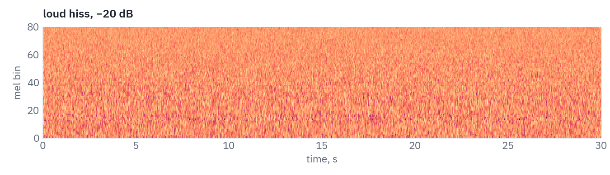<div class="tfs-playhead" style="position:absolute;top:15.4%;height:63.5%;width:2px;margin-left:-1px;background:#e8433a;opacity:0;pointer-events:none;"></div></div><audio controls preload="none" style="width:100%" src="/assets/posts/arch/14/output-09.mp3"></audio></figure>

<figure class="tfs-audio-spec" markdown="0" data-x0="0.07" data-x1="0.985" data-duration="30.000"><div class="tfs-spec" style="position:relative;display:inline-block;max-width:100%;">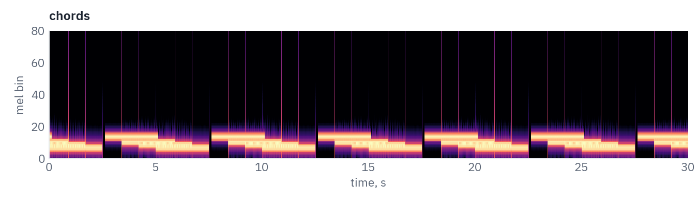<div class="tfs-playhead" style="position:absolute;top:15.4%;height:63.5%;width:2px;margin-left:-1px;background:#e8433a;opacity:0;pointer-events:none;"></div></div><audio controls preload="none" style="width:100%" src="/assets/posts/arch/14/output-10.mp3"></audio></figure>

For every output we also compute the two numbers that `transcribe()` uses to decide whether a window held speech:
the probability of `<|nocaptions|>` right after *start of transcript*, and the mean log-probability of the tokens the
model wrote, the end token included. OpenAI's rule skips a window only when the first is above 0.6 *and* the second
is below −1.

```python
def special(proc, *names):
    vocab = proc.tokenizer.get_vocab()
    return next(vocab[n] for n in names if n in vocab)


def detect_language(model, features):
    """The language token the model finds most likely right after <|startoftranscript|>."""
    langs = model.generation_config.lang_to_id
    ids = torch.tensor(list(langs.values()), device=device)
    return list(langs)[int(first_step(model, features)[0, ids].argmax())][2:-2]


def listen_for_speech(model, proc, audio, language=None):
    """Decode as transcribe() does: language, text, no-speech probability, mean log-prob."""
    features = features_of([dict(audio=audio)], proc, model.dtype)
    language = language or detect_language(model, features)
    out = model.generate(  # at most 224 new tokens, as transcribe() allows
        features,
        language=language,
        task="transcribe",
        return_timestamps=True,
        max_new_tokens=224,
    )
    prompt = [SOT, special(proc, f"<|{language}|>"), special(proc, "<|transcribe|>")]
    tokens = [x for x in out[0].tolist() if x not in prompt and x != EOT]
    tokens = tokens[: model.config.max_target_positions - len(prompt) - 1]
    ids = torch.tensor([prompt + tokens + [EOT]], device=device)
    logits = model(input_features=features, decoder_input_ids=ids).logits[0].float()
    no_speech = logits[0].softmax(-1)[special(proc, "<|nocaptions|>", "<|nospeech|>")]
    # the scores at each place predict the next token
    logp = logits.log_softmax(-1)[len(prompt) - 1 : -1]
    chosen = logp.gather(1, ids[0, len(prompt) :, None])
    text = proc.tokenizer.decode(tokens, skip_special_tokens=True).strip()
    return language, text, float(no_speech), float(chosen.mean())


LISTENERS = {"tiny": (tiny, processor), "small": (small, small_processor)}
if not SMOKE:
    LISTENERS["large-v3-turbo"] = load(MODELS["large-v3-turbo"])
heard, outputs_table = [], []
for clip, audio in CLIPS.items():
    for language in ("en", "ru", None):
        row = {"recording": clip, "language": language or "detected"}
        for name, (model, proc) in LISTENERS.items():
            used, text, no_speech, logprob = listen_for_speech(
                model, proc, audio, language
            )
            skipped = no_speech > 0.6 and logprob < -1
            heard.append(
                dict(
                    model=name,
                    clip=clip,
                    language=used,
                    text=text,
                    no_speech=no_speech,
                    logprob=logprob,
                    skipped=skipped,
                )
            )
            shown = f"[{used}] " if language is None else ""
            short = text if len(text) <= 140 else text[:140] + "…"  # loops run on
            row[name] = ("(skipped) " if skipped else "") + shown + (short or "—")
        outputs_table.append(row)
display(table(pd.DataFrame(outputs_table)))
```

<div class="tfs-table-wrap"><table class="tfs-table" style="border-collapse:collapse;font-family:'IBM Plex Sans', -apple-system, 'Segoe UI', Roboto, Helvetica, Arial, sans-serif;font-size:13.5px;line-height:1.45;margin:4px 0 8px;"><thead><tr><th style="padding:7px 14px;border-bottom:2px solid #B9C0CB;font-weight:600;color:#5B6575;font-size:12px;letter-spacing:0.02em;text-align:left;">recording</th><th style="padding:7px 14px;border-bottom:2px solid #B9C0CB;font-weight:600;color:#5B6575;font-size:12px;letter-spacing:0.02em;text-align:left;">language</th><th style="padding:7px 14px;border-bottom:2px solid #B9C0CB;font-weight:600;color:#5B6575;font-size:12px;letter-spacing:0.02em;text-align:left;">tiny</th><th style="padding:7px 14px;border-bottom:2px solid #B9C0CB;font-weight:600;color:#5B6575;font-size:12px;letter-spacing:0.02em;text-align:left;">small</th><th style="padding:7px 14px;border-bottom:2px solid #B9C0CB;font-weight:600;color:#5B6575;font-size:12px;letter-spacing:0.02em;text-align:left;">large-v3-turbo</th></tr></thead><tbody><tr><td style="padding:7px 14px;border-bottom:1px solid #E6E9EE;vertical-align:top;text-align:left;max-width:460px;white-space:normal;">digital silence</td><td style="padding:7px 14px;border-bottom:1px solid #E6E9EE;vertical-align:top;text-align:left;max-width:460px;white-space:normal;">en</td><td style="padding:7px 14px;border-bottom:1px solid #E6E9EE;vertical-align:top;text-align:left;max-width:460px;white-space:normal;">(skipped) you</td><td style="padding:7px 14px;border-bottom:1px solid #E6E9EE;vertical-align:top;text-align:left;max-width:460px;white-space:normal;">you</td><td style="padding:7px 14px;border-bottom:1px solid #E6E9EE;vertical-align:top;text-align:left;max-width:460px;white-space:normal;">Thank you.</td></tr><tr><td style="padding:7px 14px;border-bottom:1px solid #E6E9EE;vertical-align:top;text-align:left;max-width:460px;white-space:normal;">digital silence</td><td style="padding:7px 14px;border-bottom:1px solid #E6E9EE;vertical-align:top;text-align:left;max-width:460px;white-space:normal;">ru</td><td style="padding:7px 14px;border-bottom:1px solid #E6E9EE;vertical-align:top;text-align:left;max-width:460px;white-space:normal;">Редактор субтитров А.Синецкая Корректор А.Сухиашвили</td><td style="padding:7px 14px;border-bottom:1px solid #E6E9EE;vertical-align:top;text-align:left;max-width:460px;white-space:normal;">Редактор субтитров А.Семкин Корректор А.Егорова</td><td style="padding:7px 14px;border-bottom:1px solid #E6E9EE;vertical-align:top;text-align:left;max-width:460px;white-space:normal;">Продолжение следует...</td></tr><tr><td style="padding:7px 14px;border-bottom:1px solid #E6E9EE;vertical-align:top;text-align:left;max-width:460px;white-space:normal;">digital silence</td><td style="padding:7px 14px;border-bottom:1px solid #E6E9EE;vertical-align:top;text-align:left;max-width:460px;white-space:normal;">detected</td><td style="padding:7px 14px;border-bottom:1px solid #E6E9EE;vertical-align:top;text-align:left;max-width:460px;white-space:normal;">(skipped) [en] you</td><td style="padding:7px 14px;border-bottom:1px solid #E6E9EE;vertical-align:top;text-align:left;max-width:460px;white-space:normal;">[en] you</td><td style="padding:7px 14px;border-bottom:1px solid #E6E9EE;vertical-align:top;text-align:left;max-width:460px;white-space:normal;">[en] Thank you.</td></tr><tr><td style="padding:7px 14px;border-bottom:1px solid #E6E9EE;vertical-align:top;text-align:left;max-width:460px;white-space:normal;">faint hiss, −60 dB</td><td style="padding:7px 14px;border-bottom:1px solid #E6E9EE;vertical-align:top;text-align:left;max-width:460px;white-space:normal;">en</td><td style="padding:7px 14px;border-bottom:1px solid #E6E9EE;vertical-align:top;text-align:left;max-width:460px;white-space:normal;">(skipped) you</td><td style="padding:7px 14px;border-bottom:1px solid #E6E9EE;vertical-align:top;text-align:left;max-width:460px;white-space:normal;">(skipped) .</td><td style="padding:7px 14px;border-bottom:1px solid #E6E9EE;vertical-align:top;text-align:left;max-width:460px;white-space:normal;">Thank you.</td></tr><tr><td style="padding:7px 14px;border-bottom:1px solid #E6E9EE;vertical-align:top;text-align:left;max-width:460px;white-space:normal;">faint hiss, −60 dB</td><td style="padding:7px 14px;border-bottom:1px solid #E6E9EE;vertical-align:top;text-align:left;max-width:460px;white-space:normal;">ru</td><td style="padding:7px 14px;border-bottom:1px solid #E6E9EE;vertical-align:top;text-align:left;max-width:460px;white-space:normal;">(skipped) Слышь, что я не знаю, что я не знаю. Я не знаю, что я не знаю. Я не знаю, что я не знаю. Я не знаю, что я не знаю. Я не знаю, что я не знаю.…</td><td style="padding:7px 14px;border-bottom:1px solid #E6E9EE;vertical-align:top;text-align:left;max-width:460px;white-space:normal;">(skipped) Смешно.</td><td style="padding:7px 14px;border-bottom:1px solid #E6E9EE;vertical-align:top;text-align:left;max-width:460px;white-space:normal;">Продолжение следует...</td></tr><tr><td style="padding:7px 14px;border-bottom:1px solid #E6E9EE;vertical-align:top;text-align:left;max-width:460px;white-space:normal;">faint hiss, −60 dB</td><td style="padding:7px 14px;border-bottom:1px solid #E6E9EE;vertical-align:top;text-align:left;max-width:460px;white-space:normal;">detected</td><td style="padding:7px 14px;border-bottom:1px solid #E6E9EE;vertical-align:top;text-align:left;max-width:460px;white-space:normal;">[nn] I&#x27;m going to do a little bit of a little bit of a little bit of a little bit of a little bit of a little bit of a little bit of a little bit…</td><td style="padding:7px 14px;border-bottom:1px solid #E6E9EE;vertical-align:top;text-align:left;max-width:460px;white-space:normal;">[cy] Yn ymwneud yw&#x27;r llwyddiad, yw&#x27;r llwyddiad yn ymwneud yw&#x27;r llwyddiad. Yn ymwneud yw&#x27;r llwyddiad, yw&#x27;r llwyddiad yn ymwneud yw&#x27;r llwyddiad. Yn…</td><td style="padding:7px 14px;border-bottom:1px solid #E6E9EE;vertical-align:top;text-align:left;max-width:460px;white-space:normal;">[en] Thank you.</td></tr><tr><td style="padding:7px 14px;border-bottom:1px solid #E6E9EE;vertical-align:top;text-align:left;max-width:460px;white-space:normal;">loud hiss, −20 dB</td><td style="padding:7px 14px;border-bottom:1px solid #E6E9EE;vertical-align:top;text-align:left;max-width:460px;white-space:normal;">en</td><td style="padding:7px 14px;border-bottom:1px solid #E6E9EE;vertical-align:top;text-align:left;max-width:460px;white-space:normal;">(skipped) you</td><td style="padding:7px 14px;border-bottom:1px solid #E6E9EE;vertical-align:top;text-align:left;max-width:460px;white-space:normal;">(skipped) .</td><td style="padding:7px 14px;border-bottom:1px solid #E6E9EE;vertical-align:top;text-align:left;max-width:460px;white-space:normal;">so</td></tr><tr><td style="padding:7px 14px;border-bottom:1px solid #E6E9EE;vertical-align:top;text-align:left;max-width:460px;white-space:normal;">loud hiss, −20 dB</td><td style="padding:7px 14px;border-bottom:1px solid #E6E9EE;vertical-align:top;text-align:left;max-width:460px;white-space:normal;">ru</td><td style="padding:7px 14px;border-bottom:1px solid #E6E9EE;vertical-align:top;text-align:left;max-width:460px;white-space:normal;">ДИНАМИЧНАЯ МУЗЫКА</td><td style="padding:7px 14px;border-bottom:1px solid #E6E9EE;vertical-align:top;text-align:left;max-width:460px;white-space:normal;">(skipped) Смешка.</td><td style="padding:7px 14px;border-bottom:1px solid #E6E9EE;vertical-align:top;text-align:left;max-width:460px;white-space:normal;">Субтитры сделал DimaTorzok</td></tr><tr><td style="padding:7px 14px;border-bottom:1px solid #E6E9EE;vertical-align:top;text-align:left;max-width:460px;white-space:normal;">loud hiss, −20 dB</td><td style="padding:7px 14px;border-bottom:1px solid #E6E9EE;vertical-align:top;text-align:left;max-width:460px;white-space:normal;">detected</td><td style="padding:7px 14px;border-bottom:1px solid #E6E9EE;vertical-align:top;text-align:left;max-width:460px;white-space:normal;">(skipped) [nn] 1.5mm diapot</td><td style="padding:7px 14px;border-bottom:1px solid #E6E9EE;vertical-align:top;text-align:left;max-width:460px;white-space:normal;">[nn] වවවවවවවවවවවවවවවවවවවවවවවවවවවවවවවවවවවවවවවවවවවවවවවවවවවවවවවවවවවවවවවවවවවවවවවවවවවවවවවවවවවවවවවවවවවවවවවවවවවවවවවවවවවවවවව</td><td style="padding:7px 14px;border-bottom:1px solid #E6E9EE;vertical-align:top;text-align:left;max-width:460px;white-space:normal;">[en] so</td></tr><tr><td style="padding:7px 14px;border-bottom:1px solid #E6E9EE;vertical-align:top;text-align:left;max-width:460px;white-space:normal;">chords</td><td style="padding:7px 14px;border-bottom:1px solid #E6E9EE;vertical-align:top;text-align:left;max-width:460px;white-space:normal;">en</td><td style="padding:7px 14px;border-bottom:1px solid #E6E9EE;vertical-align:top;text-align:left;max-width:460px;white-space:normal;">(skipped) .</td><td style="padding:7px 14px;border-bottom:1px solid #E6E9EE;vertical-align:top;text-align:left;max-width:460px;white-space:normal;">(skipped) I&#x27;m not sure what I&#x27;m doing here.</td><td style="padding:7px 14px;border-bottom:1px solid #E6E9EE;vertical-align:top;text-align:left;max-width:460px;white-space:normal;">Thank you.</td></tr><tr><td style="padding:7px 14px;border-bottom:1px solid #E6E9EE;vertical-align:top;text-align:left;max-width:460px;white-space:normal;">chords</td><td style="padding:7px 14px;border-bottom:1px solid #E6E9EE;vertical-align:top;text-align:left;max-width:460px;white-space:normal;">ru</td><td style="padding:7px 14px;border-bottom:1px solid #E6E9EE;vertical-align:top;text-align:left;max-width:460px;white-space:normal;">(skipped) ДИНАМИЧНАЯ МУЗЫКА</td><td style="padding:7px 14px;border-bottom:1px solid #E6E9EE;vertical-align:top;text-align:left;max-width:460px;white-space:normal;">Попадаем в панели. Попадаем в панели. Попадаем в панели. Попадаем в панели. Попадаем в панели. Попадаем в панели. Попадаем в панели. Попадае…</td><td style="padding:7px 14px;border-bottom:1px solid #E6E9EE;vertical-align:top;text-align:left;max-width:460px;white-space:normal;">Продолжение следует...</td></tr><tr><td style="padding:7px 14px;border-bottom:1px solid #E6E9EE;vertical-align:top;text-align:left;max-width:460px;white-space:normal;">chords</td><td style="padding:7px 14px;border-bottom:1px solid #E6E9EE;vertical-align:top;text-align:left;max-width:460px;white-space:normal;">detected</td><td style="padding:7px 14px;border-bottom:1px solid #E6E9EE;vertical-align:top;text-align:left;max-width:460px;white-space:normal;">(skipped) [en] .</td><td style="padding:7px 14px;border-bottom:1px solid #E6E9EE;vertical-align:top;text-align:left;max-width:460px;white-space:normal;">[jw] වවවවවවවවවවවවවවවවවවවවවවවවවවවවවවවවවවවවවවවවවවවවවවවවවවවවවවවවවවවවවවවවවවවවවවවවවවවවවවවවවවවවවවවවවවවවවවවවවවවවවවවවවවවවවවව</td><td style="padding:7px 14px;border-bottom:1px solid #E6E9EE;vertical-align:top;text-align:left;max-width:460px;white-space:normal;">[en] Thank you.</td></tr></tbody></table></div>

Every one of the 36 runs wrote something, on recordings with no voice in them. In English the outputs are short and look harmless: *you*, a full stop, *Thank you.*, *so*.

Told that the speech is Russian, tiny and small write the credits of a subtitle editor and a proofreader with invented names, the same template with different initials, and turbo writes *Продолжение следует...*, to be continued, and on the loud hiss *Субтитры сделал DimaTorzok*, subtitles by DimaTorzok.

Left to detect the language, tiny and small hear Norwegian Nynorsk, Welsh and Javanese in the noise and fill the window with a loop, while turbo settles on English and thanks us.

The phrases are not random, and turbo's two are well known. People who run Whisper on long recordings have collected them for years: *Thank you for
watching*, *Subtitles by the Amara.org community* in a dozen languages, *Untertitel im Auftrag des ZDF* in German,
and in Russian *Продолжение следует...*, *Субтитры сделал DimaTorzok* and *Редактор субтитров … Корректор …* with
different names<sup class="cite">[<a href="#ref-6" id="cite-6" data-ref="6" aria-label="Reference 6: OpenAI (2022–2024). Release notes of large-v2, large-v3 and large-v3-turbo: #661, #1762, #2363. Hallucination reports: #928, #1873, #2372.">6</a>]</sup>.

These are the credits and sign-offs of subtitles and videos, the text that sits over the quiet end of a film or a clip.

OpenAI never said where its audio came from beyond "audio that is paired with transcripts on the Internet", so this explanation is the community's, but it fits: the model learned that a stretch with no voice in it often comes with exactly this text.

OpenAI's model card gives a more general reason, that the decoder's knowledge of language makes it predict likely text along with transcribing the audio. When the audio gives it nothing, likely text is all that is left.

Here are the two numbers for every output above, with real speech from twenty LibriSpeech clips for comparison:

```python
speech = []
for name, (model, proc) in LISTENERS.items():
    for item in english[:20]:
        _, _, no_speech, logprob = listen_for_speech(model, proc, item["audio"], "en")
        speech.append(dict(model=name, no_speech=no_speech, logprob=logprob))
heard, speech = pd.DataFrame(heard), pd.DataFrame(speech)

fig, axes = plt.subplots(
    1, len(LISTENERS), figsize=(4.2 * len(LISTENERS), 3.6), sharey=True
)
low = min(-2.5, heard.logprob.min() - 0.2)
for ax, name in zip(np.atleast_1d(axes), LISTENERS):
    # transcribe() skips a window only in the lower right: no speech expected, text unsure
    ax.fill_between([0.6, 1], low, -1, color=COLORS["dec"], alpha=0.08, lw=0)
    ax.axvline(0.6, color=COLORS["dec"], lw=1, ls="--")
    ax.axhline(-1, color=COLORS["dec"], lw=1, ls="--")
    s = speech[speech.model == name]
    ax.scatter(s.no_speech, s.logprob, s=22, color=COLORS["enc"], label="speech")
    h = heard[heard.model == name]
    ax.scatter(
        h.no_speech,
        h.logprob,
        s=40,
        marker="D",
        color=COLORS["dec"],
        label="no speech",
        edgecolor="white",
        linewidth=0.8,
    )
    ax.set_xlim(0, 1)
    ax.set_title(name)
    ax.set_xlabel("no-speech probability")
ax.set_ylim(low, 0.05)
np.atleast_1d(axes)[0].set_ylabel("mean log-probability of the text")
np.atleast_1d(axes)[0].legend(frameon=False, loc="lower left")
plt.tight_layout()
plt.show()
counts = heard.groupby("model").agg(
    outputs=("text", lambda s: (s != "").sum()),
    skipped=("skipped", "sum"),
    recordings=("text", "size"),
)
display(table(counts.reset_index()))
```

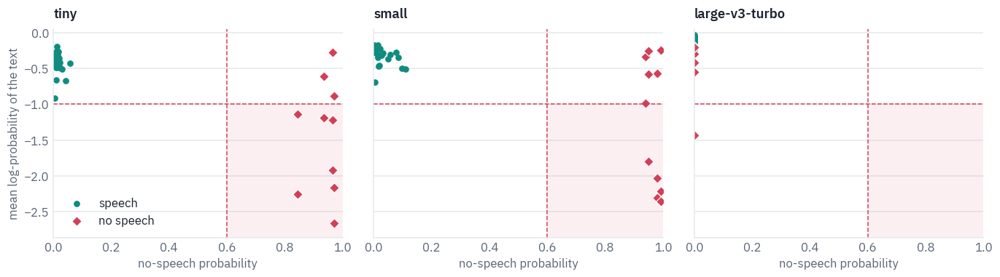

<div class="tfs-table-wrap"><table class="tfs-table" style="border-collapse:collapse;font-family:'IBM Plex Sans', -apple-system, 'Segoe UI', Roboto, Helvetica, Arial, sans-serif;font-size:13.5px;line-height:1.45;margin:4px 0 8px;"><thead><tr><th style="padding:7px 14px;border-bottom:2px solid #B9C0CB;font-weight:600;color:#5B6575;font-size:12px;letter-spacing:0.02em;text-align:left;">model</th><th style="padding:7px 14px;border-bottom:2px solid #B9C0CB;font-weight:600;color:#5B6575;font-size:12px;letter-spacing:0.02em;text-align:right;">outputs</th><th style="padding:7px 14px;border-bottom:2px solid #B9C0CB;font-weight:600;color:#5B6575;font-size:12px;letter-spacing:0.02em;text-align:right;">skipped</th><th style="padding:7px 14px;border-bottom:2px solid #B9C0CB;font-weight:600;color:#5B6575;font-size:12px;letter-spacing:0.02em;text-align:right;">recordings</th></tr></thead><tbody><tr><td style="padding:7px 14px;border-bottom:1px solid #E6E9EE;vertical-align:top;text-align:left;max-width:460px;white-space:normal;">large-v3-turbo</td><td style="padding:7px 14px;border-bottom:1px solid #E6E9EE;vertical-align:top;text-align:right;font-variant-numeric:tabular-nums;max-width:460px;white-space:normal;">12</td><td style="padding:7px 14px;border-bottom:1px solid #E6E9EE;vertical-align:top;text-align:right;font-variant-numeric:tabular-nums;max-width:460px;white-space:normal;">0</td><td style="padding:7px 14px;border-bottom:1px solid #E6E9EE;vertical-align:top;text-align:right;font-variant-numeric:tabular-nums;max-width:460px;white-space:normal;">12</td></tr><tr><td style="padding:7px 14px;border-bottom:1px solid #E6E9EE;vertical-align:top;text-align:left;max-width:460px;white-space:normal;">small</td><td style="padding:7px 14px;border-bottom:1px solid #E6E9EE;vertical-align:top;text-align:right;font-variant-numeric:tabular-nums;max-width:460px;white-space:normal;">12</td><td style="padding:7px 14px;border-bottom:1px solid #E6E9EE;vertical-align:top;text-align:right;font-variant-numeric:tabular-nums;max-width:460px;white-space:normal;">5</td><td style="padding:7px 14px;border-bottom:1px solid #E6E9EE;vertical-align:top;text-align:right;font-variant-numeric:tabular-nums;max-width:460px;white-space:normal;">12</td></tr><tr><td style="padding:7px 14px;border-bottom:1px solid #E6E9EE;vertical-align:top;text-align:left;max-width:460px;white-space:normal;">tiny</td><td style="padding:7px 14px;border-bottom:1px solid #E6E9EE;vertical-align:top;text-align:right;font-variant-numeric:tabular-nums;max-width:460px;white-space:normal;">12</td><td style="padding:7px 14px;border-bottom:1px solid #E6E9EE;vertical-align:top;text-align:right;font-variant-numeric:tabular-nums;max-width:460px;white-space:normal;">9</td><td style="padding:7px 14px;border-bottom:1px solid #E6E9EE;vertical-align:top;text-align:right;font-variant-numeric:tabular-nums;max-width:460px;white-space:normal;">12</td></tr></tbody></table></div>

For tiny and small the two numbers separate speech from noise well: real speech sits at the top left, and every recording without speech has a no-speech probability above 0.8. But the rule also needs the text to be improbable, and the fluent hallucinations are probable: the subtitle credits, *you* and the loops sit above −1, a loop being very likely once it has started, so the rule keeps them.

It skips 9 of tiny's 12 outputs and 5 of small's. Turbo is another case: its no-speech probability is close to zero for everything, speech or not, so the rule never fires and all twelve of its outputs go through.

Its release notes say only that it was fine-tuned on transcription data; whatever the reason, the number tells nothing for this model, and neither does the rule built on it.

<div class="callout callout-warn" markdown="1">
<p class="callout-label">Trap</p>

The no-speech probability is not a voice detector. `transcribe()` drops a window only when that
probability is high *and* the text is improbable, so a hallucination the model is sure of goes straight into the
transcript. Put a voice activity detector before Whisper, or check what it wrote over stretches without speech.
</div>

The literature measured the same thing at scale. Barański and colleagues ran large-v3 on 301,317 recordings without speech, from AudioSet, MUSAN, UrbanSound8K, FSD50K and synthetic noise, and got text for 40.3% of them; a quarter of those outputs were *thank you*, and a wider beam made it worse<sup class="cite">[<a href="#ref-7" id="cite-7" data-ref="7" aria-label="Reference 7: Barański, M., Jasiński, J., Bartolewska, J., Kacprzak, S., Witkowski, M., &amp; Kowalczyk, K. (2025). Investigation of Whisper ASR hallucinations induced by non-speech audio. ICASSP 2025.">7</a>]</sup>.

On UrbanSound8K's street sounds, large-v3 wrote something for 99.97% of the clips, and the authors traced most of it to three of the decoder's twenty self-attention heads; fine-tuning only those heads on non-speech cut the hallucinations by more than 80% while barely changing LibriSpeech's word error rate <sup class="cite">[<a href="#ref-8" id="cite-8" data-ref="8" aria-label="Reference 8: Wang, Y., Alhmoud, A., Alsahly, S., Alqurishi, M., &amp; Ravanelli, M. (2025). Calm-Whisper: reduce Whisper hallucination on non-speech by calming crazy heads down. Interspeech 2025.">8</a>]</sup>.

On real speech it matters most: through OpenAI's API, about 1.4% of transcripts of short recordings of people with and without aphasia contained invented sentences, and 38% of those did harm: invented violence, false associations, or a false voice of authority such as a made-up thanks or link<sup class="cite">[<a href="#ref-9" id="cite-9" data-ref="9" aria-label="Reference 9: Koenecke, A., Choi, A. S. G., Mei, K. X., Schellmann, H., &amp; Sloane, M. (2024). Careless Whisper: speech-to-text hallucination harms. FAccT 2024.">9</a>]</sup>.

The practical remedies are outside the model. WhisperX cuts the audio with a voice activity detector and feeds Whisper
only the parts with speech<sup class="cite">[<a href="#ref-10" id="cite-10" data-ref="10" aria-label="Reference 10: Bain, M., Huh, J., Han, T., &amp; Zisserman, A. (2023). WhisperX: time-accurate speech transcription of long-form audio. Interspeech 2023.">10</a>]</sup>; faster-whisper has the Silero
detector built in; OpenAI's `transcribe()` gained an option, `hallucination_silence_threshold`, that skips silent
stretches around words that look like hallucinations, though only when word timestamps are on.

## 9. When each word was said

The timestamp tokens place pieces of text in time to 20 ms, but a piece is usually a sentence or a clause.

For the time of every word Whisper's code reuses something the model already computes: cross-attention. When the decoder predicts a word, some of its heads look at the stretch of audio where that word was said.

Not all heads do; OpenAI picked, for each model, a few heads whose attention follows the speech, and ships their list as *alignment heads*. For whisper-tiny there are six, one in the third decoder block and five in the fourth.

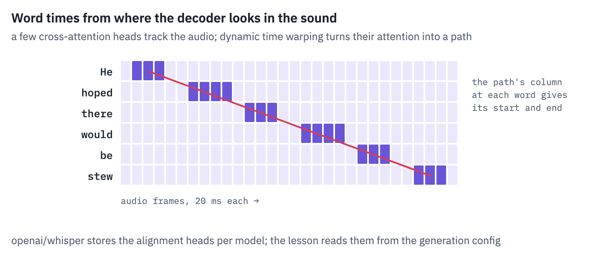
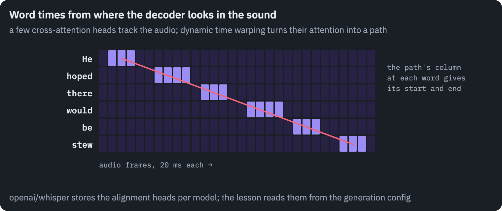

We run the decoder once over the example's transcript and keep the cross-attention of all 24 heads. The row of each
position is the attention of the query that *predicts the next token*, so the rows that matter start at
`<|notimestamps|>`, which predicts the first word.

```python
heads = [tuple(h) for h in gen.alignment_heads]
print("alignment heads (block, head):", heads)
eager = WhisperForConditionalGeneration.from_pretrained(
    TINY, attn_implementation="eager"
)
eager = eager.to(
    device
).eval()  # the default attention kernel doesn't return its weights
features = features_of([example])
text_tokens = greedy(features, PROMPT)[0]
sequence = torch.tensor([PROMPT + text_tokens + [EOT]], device=device)
out = eager(input_features=features, decoder_input_ids=sequence, output_attentions=True)
frames = len(example["audio"]) // 320  # positions that hold the clip, 20 ms each
cross = torch.stack(out.cross_attentions)[:, 0, :, 3:-1, :frames].float().cpu()
print(
    "cross-attention:",
    tuple(cross.shape),
    "(block, head, predicted token, audio position)",
)

fig, axes = plt.subplots(
    cfg.decoder_layers,
    cfg.decoder_attention_heads,
    figsize=(13, 6.5),
    sharex=True,
    sharey=True,
)
for layer in range(cfg.decoder_layers):
    for head in range(cfg.decoder_attention_heads):
        ax = axes[layer, head]
        ax.imshow(
            cross[layer, head], aspect="auto", cmap="magma", interpolation="nearest"
        )
        ax.set_xticks([])
        ax.set_yticks([])
        ax.grid(False)
        if (layer, head) in heads:
            for side in ax.spines.values():
                side.set_visible(True)
                side.set_color(COLORS["dec"])
                side.set_linewidth(3)
        if head == 0:
            ax.set_ylabel(f"block {layer + 1}")
        if layer == 0:
            ax.set_title(f"head {head + 1}", fontsize=10)
fig.suptitle(
    "Cross-attention of whisper-tiny's 24 decoder heads: tokens down, time across; "
    "alignment heads framed",
    x=0.01,
    ha="left",
    fontsize=11,
)
plt.tight_layout()
plt.show()
```

<pre class="tfs-printed" markdown="0"><code>alignment heads (block, head): [(2, 2), (3, 0), (3, 2), (3, 3), (3, 4), (3, 5)]
cross-attention: (4, 6, 39, 521) (block, head, predicted token, audio position)</code></pre>

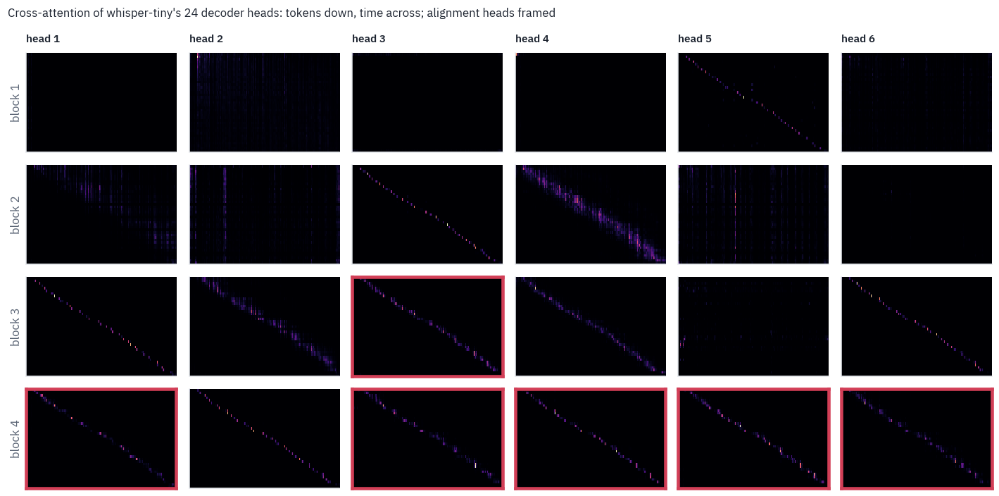

The six framed heads draw a clean diagonal: each text token attends to a short stretch of the sound, and later tokens to later sound. They are not the only ones.

Some unframed heads draw diagonals as clean, one of them already in the first block, while others, such as heads 2 and 5 of the second block, attend to the same few frames for every token. OpenAI's list is one good choice, not the only heads that align.

To turn the attention into times, OpenAI's code does four things, and we copy them. Each head's weights are standardised along the tokens, so that a frame counts when it stands out for one token rather than for all; a median filter seven frames wide removes single-frame spikes; the six heads are averaged.

Then dynamic time warping finds the path from the top-left corner to the bottom-right one that collects the most attention while only moving right, down or diagonally, which means words come in order and time never runs backwards. A word starts where the path first enters the row of its first token.

```python
def dtw(cost):
    """The cheapest monotonic path through a [tokens, frames] cost matrix."""
    n, m = cost.shape
    total = np.full((n + 1, m + 1), np.inf)
    total[0, 0] = 0
    step = np.zeros((n + 1, m + 1), dtype=np.int8)
    for i in range(1, n + 1):
        for j in range(1, m + 1):
            options = (total[i - 1, j - 1], total[i - 1, j], total[i, j - 1])
            step[i, j] = int(np.argmin(options))
            total[i, j] = cost[i - 1, j - 1] + options[step[i, j]]
    i, j, path = n, m, []
    while i > 0 and j > 0:
        path.append((i - 1, j - 1))
        di, dj = [(1, 1), (1, 0), (0, 1)][step[i, j]]
        i, j = i - di, j - dj
    return np.array(path[::-1])


weights = torch.stack([cross[layer, head] for layer, head in heads])
std, mean = torch.std_mean(weights, dim=-2, keepdim=True, unbiased=False)
weights = median_filter(((weights - mean) / std).numpy(), size=(1, 1, 7))
matrix = weights.mean(0)  # [predicted token, audio position]
path = dtw(-matrix.astype(np.float64))
enters = np.r_[True, np.diff(path[:, 0]) > 0]  # where the path enters each row
starts = path[enters, 1] / 50  # 50 encoder positions per second

pieces = [tok.decode([t]) for t in text_tokens]
first = [k for k, p in enumerate(pieces) if k == 0 or p.startswith(" ")] + [len(pieces)]
timing = pd.DataFrame(
    [
        {
            "word": "".join(pieces[a:b]).strip(),
            "start, s": starts[a],
            "end, s": starts[b],
        }
        for a, b in zip(first[:-1], first[1:])
    ]
)
display(table(timing.head(16), digits=2))
```

<div class="tfs-table-wrap"><table class="tfs-table" style="border-collapse:collapse;font-family:'IBM Plex Sans', -apple-system, 'Segoe UI', Roboto, Helvetica, Arial, sans-serif;font-size:13.5px;line-height:1.45;margin:4px 0 8px;"><thead><tr><th style="padding:7px 14px;border-bottom:2px solid #B9C0CB;font-weight:600;color:#5B6575;font-size:12px;letter-spacing:0.02em;text-align:left;">word</th><th style="padding:7px 14px;border-bottom:2px solid #B9C0CB;font-weight:600;color:#5B6575;font-size:12px;letter-spacing:0.02em;text-align:right;">start, s</th><th style="padding:7px 14px;border-bottom:2px solid #B9C0CB;font-weight:600;color:#5B6575;font-size:12px;letter-spacing:0.02em;text-align:right;">end, s</th></tr></thead><tbody><tr><td style="padding:7px 14px;border-bottom:1px solid #E6E9EE;vertical-align:top;text-align:left;max-width:460px;white-space:normal;">He</td><td style="padding:7px 14px;border-bottom:1px solid #E6E9EE;vertical-align:top;text-align:right;font-variant-numeric:tabular-nums;max-width:460px;white-space:normal;">0.00</td><td style="padding:7px 14px;border-bottom:1px solid #E6E9EE;vertical-align:top;text-align:right;font-variant-numeric:tabular-nums;max-width:460px;white-space:normal;">0.74</td></tr><tr><td style="padding:7px 14px;border-bottom:1px solid #E6E9EE;vertical-align:top;text-align:left;max-width:460px;white-space:normal;">hoped</td><td style="padding:7px 14px;border-bottom:1px solid #E6E9EE;vertical-align:top;text-align:right;font-variant-numeric:tabular-nums;max-width:460px;white-space:normal;">0.74</td><td style="padding:7px 14px;border-bottom:1px solid #E6E9EE;vertical-align:top;text-align:right;font-variant-numeric:tabular-nums;max-width:460px;white-space:normal;">1.02</td></tr><tr><td style="padding:7px 14px;border-bottom:1px solid #E6E9EE;vertical-align:top;text-align:left;max-width:460px;white-space:normal;">there</td><td style="padding:7px 14px;border-bottom:1px solid #E6E9EE;vertical-align:top;text-align:right;font-variant-numeric:tabular-nums;max-width:460px;white-space:normal;">1.02</td><td style="padding:7px 14px;border-bottom:1px solid #E6E9EE;vertical-align:top;text-align:right;font-variant-numeric:tabular-nums;max-width:460px;white-space:normal;">1.24</td></tr><tr><td style="padding:7px 14px;border-bottom:1px solid #E6E9EE;vertical-align:top;text-align:left;max-width:460px;white-space:normal;">would</td><td style="padding:7px 14px;border-bottom:1px solid #E6E9EE;vertical-align:top;text-align:right;font-variant-numeric:tabular-nums;max-width:460px;white-space:normal;">1.24</td><td style="padding:7px 14px;border-bottom:1px solid #E6E9EE;vertical-align:top;text-align:right;font-variant-numeric:tabular-nums;max-width:460px;white-space:normal;">1.38</td></tr><tr><td style="padding:7px 14px;border-bottom:1px solid #E6E9EE;vertical-align:top;text-align:left;max-width:460px;white-space:normal;">be</td><td style="padding:7px 14px;border-bottom:1px solid #E6E9EE;vertical-align:top;text-align:right;font-variant-numeric:tabular-nums;max-width:460px;white-space:normal;">1.38</td><td style="padding:7px 14px;border-bottom:1px solid #E6E9EE;vertical-align:top;text-align:right;font-variant-numeric:tabular-nums;max-width:460px;white-space:normal;">1.64</td></tr><tr><td style="padding:7px 14px;border-bottom:1px solid #E6E9EE;vertical-align:top;text-align:left;max-width:460px;white-space:normal;">stew</td><td style="padding:7px 14px;border-bottom:1px solid #E6E9EE;vertical-align:top;text-align:right;font-variant-numeric:tabular-nums;max-width:460px;white-space:normal;">1.64</td><td style="padding:7px 14px;border-bottom:1px solid #E6E9EE;vertical-align:top;text-align:right;font-variant-numeric:tabular-nums;max-width:460px;white-space:normal;">1.90</td></tr><tr><td style="padding:7px 14px;border-bottom:1px solid #E6E9EE;vertical-align:top;text-align:left;max-width:460px;white-space:normal;">for</td><td style="padding:7px 14px;border-bottom:1px solid #E6E9EE;vertical-align:top;text-align:right;font-variant-numeric:tabular-nums;max-width:460px;white-space:normal;">1.90</td><td style="padding:7px 14px;border-bottom:1px solid #E6E9EE;vertical-align:top;text-align:right;font-variant-numeric:tabular-nums;max-width:460px;white-space:normal;">2.08</td></tr><tr><td style="padding:7px 14px;border-bottom:1px solid #E6E9EE;vertical-align:top;text-align:left;max-width:460px;white-space:normal;">dinner,</td><td style="padding:7px 14px;border-bottom:1px solid #E6E9EE;vertical-align:top;text-align:right;font-variant-numeric:tabular-nums;max-width:460px;white-space:normal;">2.08</td><td style="padding:7px 14px;border-bottom:1px solid #E6E9EE;vertical-align:top;text-align:right;font-variant-numeric:tabular-nums;max-width:460px;white-space:normal;">2.82</td></tr><tr><td style="padding:7px 14px;border-bottom:1px solid #E6E9EE;vertical-align:top;text-align:left;max-width:460px;white-space:normal;">turnips</td><td style="padding:7px 14px;border-bottom:1px solid #E6E9EE;vertical-align:top;text-align:right;font-variant-numeric:tabular-nums;max-width:460px;white-space:normal;">2.82</td><td style="padding:7px 14px;border-bottom:1px solid #E6E9EE;vertical-align:top;text-align:right;font-variant-numeric:tabular-nums;max-width:460px;white-space:normal;">3.10</td></tr><tr><td style="padding:7px 14px;border-bottom:1px solid #E6E9EE;vertical-align:top;text-align:left;max-width:460px;white-space:normal;">and</td><td style="padding:7px 14px;border-bottom:1px solid #E6E9EE;vertical-align:top;text-align:right;font-variant-numeric:tabular-nums;max-width:460px;white-space:normal;">3.10</td><td style="padding:7px 14px;border-bottom:1px solid #E6E9EE;vertical-align:top;text-align:right;font-variant-numeric:tabular-nums;max-width:460px;white-space:normal;">3.36</td></tr><tr><td style="padding:7px 14px;border-bottom:1px solid #E6E9EE;vertical-align:top;text-align:left;max-width:460px;white-space:normal;">carrots</td><td style="padding:7px 14px;border-bottom:1px solid #E6E9EE;vertical-align:top;text-align:right;font-variant-numeric:tabular-nums;max-width:460px;white-space:normal;">3.36</td><td style="padding:7px 14px;border-bottom:1px solid #E6E9EE;vertical-align:top;text-align:right;font-variant-numeric:tabular-nums;max-width:460px;white-space:normal;">3.70</td></tr><tr><td style="padding:7px 14px;border-bottom:1px solid #E6E9EE;vertical-align:top;text-align:left;max-width:460px;white-space:normal;">and</td><td style="padding:7px 14px;border-bottom:1px solid #E6E9EE;vertical-align:top;text-align:right;font-variant-numeric:tabular-nums;max-width:460px;white-space:normal;">3.70</td><td style="padding:7px 14px;border-bottom:1px solid #E6E9EE;vertical-align:top;text-align:right;font-variant-numeric:tabular-nums;max-width:460px;white-space:normal;">4.10</td></tr><tr><td style="padding:7px 14px;border-bottom:1px solid #E6E9EE;vertical-align:top;text-align:left;max-width:460px;white-space:normal;">bruised</td><td style="padding:7px 14px;border-bottom:1px solid #E6E9EE;vertical-align:top;text-align:right;font-variant-numeric:tabular-nums;max-width:460px;white-space:normal;">4.10</td><td style="padding:7px 14px;border-bottom:1px solid #E6E9EE;vertical-align:top;text-align:right;font-variant-numeric:tabular-nums;max-width:460px;white-space:normal;">4.44</td></tr><tr><td style="padding:7px 14px;border-bottom:1px solid #E6E9EE;vertical-align:top;text-align:left;max-width:460px;white-space:normal;">potatoes</td><td style="padding:7px 14px;border-bottom:1px solid #E6E9EE;vertical-align:top;text-align:right;font-variant-numeric:tabular-nums;max-width:460px;white-space:normal;">4.44</td><td style="padding:7px 14px;border-bottom:1px solid #E6E9EE;vertical-align:top;text-align:right;font-variant-numeric:tabular-nums;max-width:460px;white-space:normal;">4.88</td></tr><tr><td style="padding:7px 14px;border-bottom:1px solid #E6E9EE;vertical-align:top;text-align:left;max-width:460px;white-space:normal;">and</td><td style="padding:7px 14px;border-bottom:1px solid #E6E9EE;vertical-align:top;text-align:right;font-variant-numeric:tabular-nums;max-width:460px;white-space:normal;">4.88</td><td style="padding:7px 14px;border-bottom:1px solid #E6E9EE;vertical-align:top;text-align:right;font-variant-numeric:tabular-nums;max-width:460px;white-space:normal;">5.38</td></tr><tr><td style="padding:7px 14px;border-bottom:1px solid #E6E9EE;vertical-align:top;text-align:left;max-width:460px;white-space:normal;">fat</td><td style="padding:7px 14px;border-bottom:1px solid #E6E9EE;vertical-align:top;text-align:right;font-variant-numeric:tabular-nums;max-width:460px;white-space:normal;">5.38</td><td style="padding:7px 14px;border-bottom:1px solid #E6E9EE;vertical-align:top;text-align:right;font-variant-numeric:tabular-nums;max-width:460px;white-space:normal;">5.64</td></tr></tbody></table></div>

Here is the averaged attention of the six heads with the sound. Each row is a token; play the clip and the cursor
should cross each row's bright cell as the word is said.

```python
labels = [p.strip() or "␣" for p in pieces] + ["<|endoftext|>"]
display(
    audio_spectrogram(
        example["audio"],
        SR,
        matrix,
        labels=labels,
        left=0.12,
        ylabel="",
        cmap="magma",
        figsize=(9, 0.16 * len(labels) + 1.4),
        title="Alignment heads of whisper-tiny, averaged: tokens down, time across",
        alt="Averaged cross-attention of whisper-tiny's alignment heads for the example, "
        "with the audio: a bright diagonal band from the first word to the last",
    )
)
```

<figure class="tfs-audio-spec" markdown="0" data-x0="0.12" data-x1="0.985" data-duration="10.435"><div class="tfs-spec" style="position:relative;display:inline-block;max-width:100%;">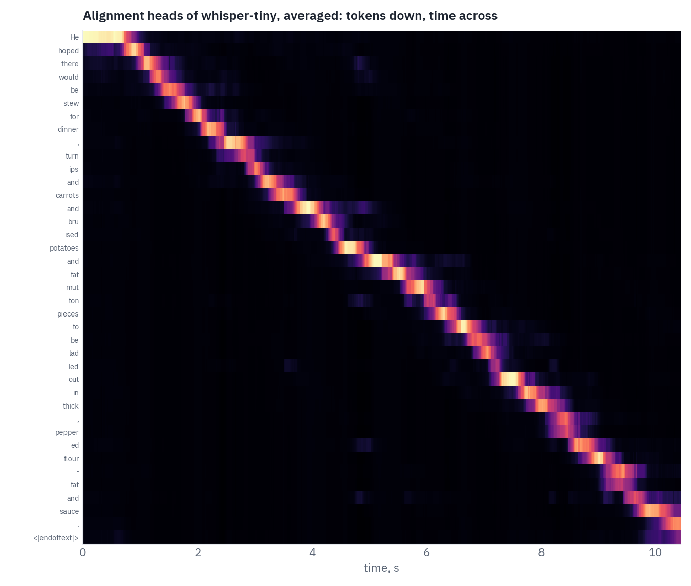<div class="tfs-playhead" style="position:absolute;top:5.2%;height:87.6%;width:2px;margin-left:-1px;background:#e8433a;opacity:0;pointer-events:none;"></div></div><audio controls preload="none" style="width:100%" src="/assets/posts/arch/14/output-13.mp3"></audio></figure>

The times are approximate: the attention is a by-product of transcription, not something trained to mark boundaries. *He* starts at 0.00 although the voice starts about half a second in, because the path has to start in the corner, and *dinner,* runs to 2.82 because the comma's row takes the pause after the word.

When the exact edges matter, as in subtitles cut to the frame, WhisperX aligns the transcript again with a separate phoneme recogniser; for search inside a recording or for following along, the attention is enough and costs one extra decoder pass.

## 10. Where speech recognition is in 2026

**Whisper's own line.** In December 2022 large-v2 was the same model trained 2.5 times longer with regularisation <sup class="cite">[<a href="#ref-6" id="cite-11" data-ref="6" aria-label="Reference 6: OpenAI (2022–2024). Release notes of large-v2, large-v3 and large-v3-turbo: #661, #1762, #2363. Hallucination reports: #928, #1873, #2372.">6</a>]</sup>. In November 2023 large-v3 took 128 mel bands instead of 80, added a token for Cantonese and was trained on a million hours of weakly labelled audio and four million hours labelled by large-v2<sup class="cite">[<a href="#ref-6" id="cite-12" data-ref="6" aria-label="Reference 6: OpenAI (2022–2024). Release notes of large-v2, large-v3 and large-v3-turbo: #661, #1762, #2363. Hallucination reports: #928, #1873, #2372.">6</a>]</sup>.

In October 2024 large-v3-turbo cut its decoder from 32 blocks to 4 and was fine-tuned on transcription only, so it does not translate<sup class="cite">[<a href="#ref-6" id="cite-13" data-ref="6" aria-label="Reference 6: OpenAI (2022–2024). Release notes of large-v2, large-v3 and large-v3-turbo: #661, #1762, #2363. Hallucination reports: #928, #1873, #2372.">6</a>]</sup>.

Turbo followed Distil-Whisper, which keeps the large encoder frozen and distils the decoder into two blocks, about six times faster within a percent of the error rate<sup class="cite">[<a href="#ref-11" id="cite-14" data-ref="11" aria-label="Reference 11: Gandhi, S., von Platen, P., &amp; Rush, A. M. (2023). Distil-Whisper: robust knowledge distillation via large-scale pseudo labelling. arXiv.">11</a>]</sup>.

Most deployments run Whisper outside PyTorch: faster-whisper on CTranslate2 with 8-bit weights, whisper.cpp in plain C++ on laptops and phones, WhisperX for batched transcription with a voice detector and word alignment.

**What replaced it at the top.** On the Hugging Face Open ASR Leaderboard, which by November 2026 ranks 69 models on
English with a default average of nine test sets, two of them private, whisper-large-v3 is 48th, with an average
error rate of 8.24% ([Open ASR Leaderboard](https://huggingface.co/spaces/hf-audio/open_asr_leaderboard),
v1.16.0).

The leaders are of three kinds. Encoder–decoders with a Conformer encoder, convolution and attention in every block, and a light decoder, such as NVIDIA's Canary and Cohere's Transcribe ([Srivastav et al., 2025](https://arxiv.org/abs/2510.06961) found this pairing gives the best average accuracy).

Transducers and CTC models with no autoregressive decoder at all, such as NVIDIA's Parakeet, which transcribes up to 24 minutes in one pass and on a data-centre GPU runs thousands of times faster than real time.

And speech-augmented language models, which feed an audio encoder's output to a large language model the way lesson 13 fed images: Mistral's Voxtral uses Whisper large-v3's encoder for this<sup class="cite">[<a href="#ref-12" id="cite-15" data-ref="12" aria-label="Reference 12: Liu, A. H., Ehrenberg, A., Lo, A., et al. (2025). Voxtral. arXiv.">12</a>]</sup>, and NVIDIA's Canary-Qwen, IBM's Granite Speech and Qwen3-ASR are built the same way.

About a third of the open models on the leaderboard still derive from Whisper's encoder or architecture.

**Streaming.** Whisper needs the whole 30-second window before it starts, which suits files and not live captions. Moonshine replaced the fixed window with rotary positions and no padding, and its second version attends within a sliding window so that it can stream<sup class="cite">[<a href="#ref-13" id="cite-16" data-ref="13" aria-label="Reference 13: Jeffries, N., King, E., Kudlur, M., Nicholson, G., Wang, J., &amp; Warden, P. (2024). Moonshine: speech recognition for live transcription and voice commands. arXiv.">13</a>, <a href="#ref-14" id="cite-17" data-ref="14" aria-label="Reference 14: Kudlur, M., King, E., Wang, J., &amp; Warden, P. (2026). Moonshine v2: ergodic streaming encoder ASR for latency-critical speech applications. arXiv.">14</a>]</sup>.

Kyutai's models and Voxtral Realtime treat recognition as a text stream that runs a fixed delay behind the audio<sup class="cite">[<a href="#ref-15" id="cite-18" data-ref="15" aria-label="Reference 15: Zeghidour, N., Kharitonov, E., Orsini, M., et al. (2025). Streaming sequence-to-sequence learning with delayed streams modeling. arXiv.">15</a>]</sup>.

OpenAI itself announced in August 2026 that the `whisper-1` model of its API will shut down on 26 February 2027, in favour of newer transcription models whose architecture it has not published ([OpenAI changelog](https://developers.openai.com/api/docs/changelog)).

**Licences and data.** Whisper's code and weights are under the MIT licence on GitHub; the model cards on Hugging Face say Apache 2.0 for every model except turbo, which says MIT. Both allow commercial use.

LibriSpeech and FLEURS are CC BY 4.0. Common Voice, the largest crowd-sourced multilingual set, left Hugging Face in October 2025 and is distributed only through the Mozilla Data Collective, so that speakers who withdraw consent can be removed. Russian sets need care: Golos from SberDevices has its own licence, and Open STT is non-commercial.

Whisper-tiny's passport, and the family tree with this lesson's branch:


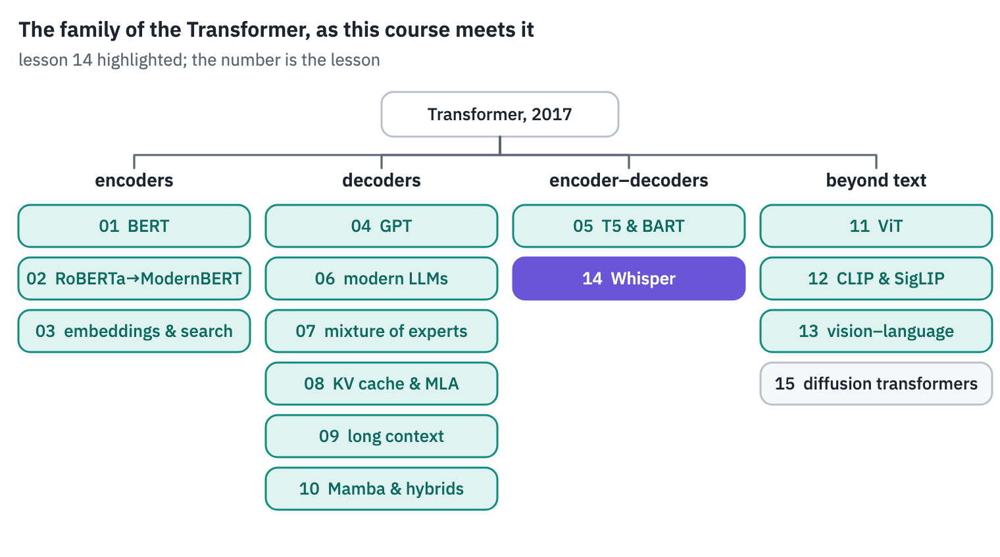
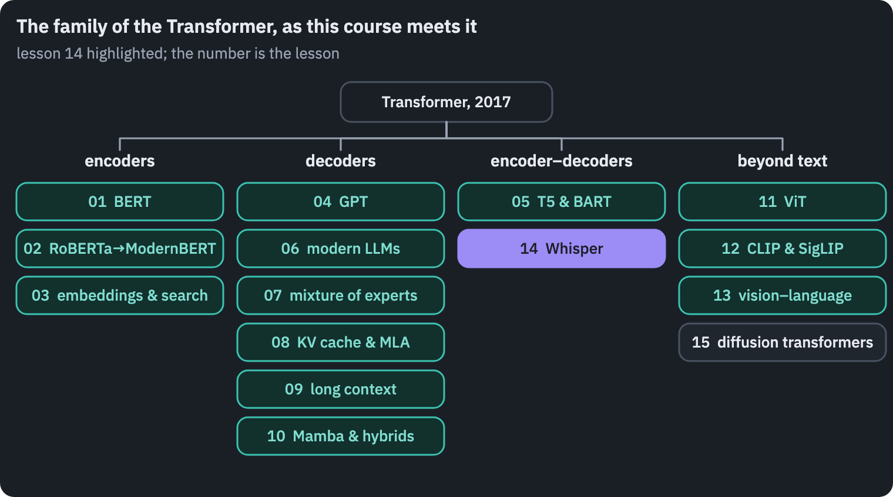

## References

1. {:#ref-1} Baevski, A., Zhou, H., Mohamed, A., & Auli, M. (2020). [wav2vec 2.0: a framework for self-supervised learning of speech representations](https://arxiv.org/abs/2006.11477). *NeurIPS 2020*. <a class="ref-back" href="#cite-1" aria-label="Back to the text">&#8617;</a>
2. {:#ref-2} Radford, A., Kim, J. W., Xu, T., Brockman, G., McLeavey, C., & Sutskever, I. (2022). [Robust speech recognition via large-scale weak supervision](https://arxiv.org/abs/2212.04356). *ICML 2023*. Code and weights: [openai/whisper](https://github.com/openai/whisper), MIT. <a class="ref-back" href="#cite-2" aria-label="Back to the text">&#8617;</a>
3. {:#ref-3} Panayotov, V., Chen, G., Povey, D., & Khudanpur, S. (2015). [LibriSpeech: an ASR corpus based on public domain audio books](https://www.danielpovey.com/files/2015_icassp_librispeech.pdf). *ICASSP 2015*. Data: [openslr/librispeech_asr](https://huggingface.co/datasets/openslr/librispeech_asr), CC BY 4.0. <a class="ref-back" href="#cite-3" aria-label="Back to the text">&#8617;</a>
4. {:#ref-4} Conneau, A., Ma, M., Khanuja, S., et al. (2022). [FLEURS: few-shot learning evaluation of universal representations of speech](https://arxiv.org/abs/2205.12446). *IEEE SLT 2022*. Data: [google/fleurs](https://huggingface.co/datasets/google/fleurs), CC BY 4.0. <a class="ref-back" href="#cite-4" aria-label="Back to the text">&#8617;</a>
5. {:#ref-5} Stevens, S. S., Volkmann, J., & Newman, E. B. (1937). [A scale for the measurement of the psychological magnitude pitch](https://doi.org/10.1121/1.1915893). *Journal of the Acoustical Society of America*, 8(3), 185–190. <a class="ref-back" href="#cite-5" aria-label="Back to the text">&#8617;</a>
6. {:#ref-6} OpenAI (2022–2024). Release notes of large-v2, large-v3 and large-v3-turbo: [#661](https://github.com/openai/whisper/discussions/661), [#1762](https://github.com/openai/whisper/discussions/1762), [#2363](https://github.com/openai/whisper/discussions/2363). Hallucination reports: [#928](https://github.com/openai/whisper/discussions/928), [#1873](https://github.com/openai/whisper/discussions/1873), [#2372](https://github.com/openai/whisper/discussions/2372). <a class="ref-back" href="#cite-6" aria-label="Back to the text">&#8617;</a>
7. {:#ref-7} Barański, M., Jasiński, J., Bartolewska, J., Kacprzak, S., Witkowski, M., & Kowalczyk, K. (2025). [Investigation of Whisper ASR hallucinations induced by non-speech audio](https://arxiv.org/abs/2501.11378). *ICASSP 2025*. <a class="ref-back" href="#cite-7" aria-label="Back to the text">&#8617;</a>
8. {:#ref-8} Wang, Y., Alhmoud, A., Alsahly, S., Alqurishi, M., & Ravanelli, M. (2025). [Calm-Whisper: reduce Whisper hallucination on non-speech by calming crazy heads down](https://arxiv.org/abs/2505.12969). *Interspeech 2025*. <a class="ref-back" href="#cite-8" aria-label="Back to the text">&#8617;</a>
9. {:#ref-9} Koenecke, A., Choi, A. S. G., Mei, K. X., Schellmann, H., & Sloane, M. (2024). [Careless Whisper: speech-to-text hallucination harms](https://arxiv.org/abs/2402.08021). *FAccT 2024*. <a class="ref-back" href="#cite-9" aria-label="Back to the text">&#8617;</a>
10. {:#ref-10} Bain, M., Huh, J., Han, T., & Zisserman, A. (2023). [WhisperX: time-accurate speech transcription of long-form audio](https://arxiv.org/abs/2303.00747). *Interspeech 2023*. <a class="ref-back" href="#cite-10" aria-label="Back to the text">&#8617;</a>
11. {:#ref-11} Gandhi, S., von Platen, P., & Rush, A. M. (2023). [Distil-Whisper: robust knowledge distillation via large-scale pseudo labelling](https://arxiv.org/abs/2311.00430). *arXiv*. <a class="ref-back" href="#cite-14" aria-label="Back to the text">&#8617;</a>
12. {:#ref-12} Liu, A. H., Ehrenberg, A., Lo, A., et al. (2025). [Voxtral](https://arxiv.org/abs/2507.13264). *arXiv*. <a class="ref-back" href="#cite-15" aria-label="Back to the text">&#8617;</a>
13. {:#ref-13} Jeffries, N., King, E., Kudlur, M., Nicholson, G., Wang, J., & Warden, P. (2024). [Moonshine: speech recognition for live transcription and voice commands](https://arxiv.org/abs/2410.15608). *arXiv*. <a class="ref-back" href="#cite-16" aria-label="Back to the text">&#8617;</a>
14. {:#ref-14} Kudlur, M., King, E., Wang, J., & Warden, P. (2026). [Moonshine v2: ergodic streaming encoder ASR for latency-critical speech applications](https://arxiv.org/abs/2602.12241). *arXiv*. <a class="ref-back" href="#cite-17" aria-label="Back to the text">&#8617;</a>
15. {:#ref-15} Zeghidour, N., Kharitonov, E., Orsini, M., et al. (2025). [Streaming sequence-to-sequence learning with delayed streams modeling](https://arxiv.org/abs/2509.08753). *arXiv*. <a class="ref-back" href="#cite-18" aria-label="Back to the text">&#8617;</a>
16. {:#ref-16} Srivastav, V., Zheng, S., Bezzam, E., et al. (2025). [Open ASR Leaderboard: towards reproducible and transparent multilingual and long-form speech recognition evaluation](https://arxiv.org/abs/2510.06961). *arXiv*. Leaderboard: [hf-audio/open_asr_leaderboard](https://huggingface.co/spaces/hf-audio/open_asr_leaderboard).
{: .tfs-refs}



